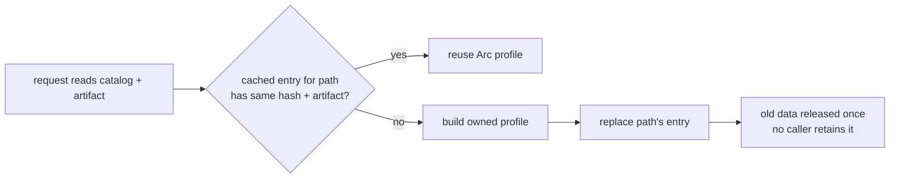

# Pipeline review: fix now

The `2026-10-25-pipeline-improvements` review left 39 open findings. Most are
unmeasured performance ideas and wait for measurement. This fix takes the
seven that are real resource defects, or that cost almost nothing to fix, and
closes them now. This review covers these seven findings; the separately scoped
findings listed under “Out of scope” are unchanged. No author decision is
needed to plan this fix.

| # | Finding | Package | Class |
| - | ------- | ------- | ----- |
| 1 | Dynamically loaded lifecycle profiles and host catalogs are leaked | `darkmatter`, `dmls` | memory leak |
| 2 | Lifecycle-host discovery reads every candidate on every request | `darkmatter`, `dmls` | repeated I/O |
| 3 | ElevenLabs cache publication blocks async executor workers | `biscuit-speaks` | blocking I/O in async |
| 4 | Refined call-type validators are cached without eviction | `darkmatter` | unbounded cache |
| 5 | Named-type loading parses each YAML document twice | `darkmatter` | redundant work |
| 6 | `map_bodies` clones the body it replaces | `darkmatter` | redundant work |
| 7 | Runtime blacklist checks also read and parse the whitelist | `claudine` | redundant I/O |

Two rules come out of this fix and apply to every later change in these
areas:

- **No `Box::leak` on a path that loads data at runtime.** Leaking is
  acceptable only for compiled, process-lifetime catalogs built once behind a
  `LazyLock`. Data read from disk, whose content can change while a process
  runs, is owned and reclaimable.
- **A process-wide cache keyed by file revision keeps the latest revision per
  path, or is bounded.** A cache that keeps every revision it has ever seen is
  a leak with extra steps.

## 1. Reclaimable host lifecycle profiles and host catalogs

### Today

Three places leak memory every time DMLS reads a host catalog from disk:

| Site | What leaks | How often |
| ---- | ---------- | --------- |
| `schemas/catalog.rs::host_lifecycle_profiles` | the whole `GlobalCatalog` (`Box::leak(Box::new(catalog))`) | once per new cache key, including when the artifact is then absent, stale, or invalid |
| `lifecycle/host_profile.rs` (`read`) | each `host_globals` name and the `ignore_unprovided` verb list | once per profile rebuild |
| `schemas/catalog.rs::GlobalCatalog::from_host_file` | each declared `$schema` requirement name | **on every call** |

The third site is worse than the review recorded. `host_catalogs` calls
`from_host_file` with no cache, and DMLS calls `host_catalogs` from
completion, hover, and diagnostics (`dmls/src/providers/dsl.rs`,
`dmls/src/providers/frontmatter.rs`). Every one of those requests leaks every
host global name in every host catalog under the document's schema roots. The
comment above the leak ("a discovered catalog is loaded once per editor
preparation") is wrong.

On top of the leaks, the `host_lifecycle_profiles` cache is keyed by `(path,
catalog hash, artifact)` and never evicts anything. Each saved edit to a
catalog or its `<stem>.lifecycle.json` adds one more retained revision.

The leaks exist only to meet these `'static` interfaces:

- `GlobalRequirement { name: &'static str, same_as: Option<&'static str> }`
- `EventRegistry::declare_host_global(&mut self, name: &'static str)`
- `EventRegistry::register_global_catalog(&mut self, catalog: &'static GlobalCatalog)`
- `UnknownVerbPolicy::IgnoreUnprovided(&'static [&'static str])`
- `HostLifecycleProfile::from_artifact(catalog: &'static GlobalCatalog, …)`

### Required behavior

- Data loaded from disk is owned by the value that uses it. A
  `HostLifecycleProfile` owns, through shared ownership, its registry and that
  registry's `GlobalCatalog`, host-global names, and unknown-verb list.
  Once neither the cache nor a caller retains the profile or its registry,
  its dynamically loaded data is released. A caller may retain a registry
  separately from the profile; that legitimately keeps its catalog alive. An independently
  cloned unknown-verb policy similarly retains its owned list until dropped.
- `from_host_file` leaks nothing. Requirement names it derives from the file
  are owned by the requirement list.
- Compiled hosts keep writing registrations as they do today. A
  `const`-constructed `GlobalRequirement::shape("…")`, a `&'static` verb slice
  such as `md_host`'s `UNPROVIDED_VERBS`, and a process-lifetime catalog all
  remain one-line registrations. Use `Cow<'static, str>` for requirement
  names, equality targets, and declared host-global names. Keep the static
  `const` shape constructor and add an owned-name constructor for disk loads.
  Catalog registration accepts a borrowed static catalog or an
  `Arc<GlobalCatalog>` through one wrapper with `From` conversions. The
  unprovided-verb list similarly accepts a static string slice or a shared
  owned string list; it never promotes disk strings to `'static`.
- These owned values are `Clone`, not `Copy`. Update all callers that copy
  requirements or policies, including artifact serialization and compiled
  registrations. Catalog accessors return references tied to the registry
  borrow, not fabricated `'static` references. Wire fields, registration
  checks, verb matching, and deterministic artifact bytes do not change.
- The profile cache keeps **only the latest revision per catalog path**. A
  lookup whose catalog hash or artifact differs from the cached entry replaces
  it. A failed load is cached the same way, so a broken artifact is not
  re-validated on every request. Once its revision is replaced, the failure is
  gone too. The key retains the existing catalog-content hash and artifact
  states (absent, unreadable with reason, or exact text); do not substitute
  modification times or file lengths for content identity. Use `biscuit-hash`
  for content hashing.
- Resolve each candidate using the existing schema-root context and path
  identity. Parse the same catalog text whose hash is checked against the
  artifact, through a shared text-loading helper used by the file loader.
  This avoids accepting a registry from a second read under a first read's
  hash if the file changes between reads. Catalog import resolution keeps
  its existing behavior.
- A failed artifact retains its revision and reason, not a partially built
  catalog or registry. An unreadable, removed, invalid, or no-longer-host
  catalog encountered at a previously cached path drops that path's old
  cached profile when that state is observed. Do not scan beyond the discovery
  winner just to prune entries. The candidate remains skipped, as today;
  ordinary catalog diagnostics still report catalog errors.
- Cache lookup and replacement are synchronized. Concurrent readers receive
  results for the bytes they observed, and there is at most one retained
  revision per path. “Latest” means the most recently installed observation,
  not a transaction spanning separate files or concurrent editor requests.
- An analysis that already holds an `Arc<HostLifecycleProfile>` finishes with
  that profile, even if the cache replaces it in the meantime.
- Validation is unchanged. Exact catalog and artifact checks, shadowing by
  earlier schema roots, and the reasons reported for an untrusted artifact
  stay as they are.

### Why latest-per-path rather than a bounded LRU

An editor alternates between revisions of one file only by undo. Reparsing
that case is cheap. A latest-per-path map has no capacity to tune, and it
cannot evict a live file's profile because some other file was edited. The
map retains at most one entry for each visited catalog path, not each
revision. Paths in roots that are never visited again can remain until process
exit; this change does not promise a fixed bound on the number of distinct
paths. Reclamation applies when an entry is replaced or removed and no caller
retains its owned data.

### Comment drift to correct in the same change

- `host_lifecycle_profiles` doc: "the catalog is leaked once per distinct key."
- `from_host_file`: "a discovered catalog is loaded once per editor
  preparation, so its few names are leaked."

## 2. Stop lifecycle-host discovery at the first usable profile

### Today

`LifecycleHost::for_document` (`dmls/src/overlay/event_views.rs`) uses the
first profile that loads, and keeps the failure reasons only when none does.
But `host_lifecycle_profiles` first builds a complete `Vec`. It reads and
classifies every remaining candidate file and companion artifact after the
winner, and the editor then discards them. Frontmatter diagnostics
(`diagnostics/frontmatter.rs`) and the DSL incomplete-profile diagnostic
(`providers/dsl.rs`) each call `for_document` separately within one
diagnostics pass.

### Required behavior

- Discovery is lazy. Candidates are visited in the existing order, with the
  existing shadowing, and visiting stops at the first usable profile. Return
  a lazy iterator from Darkmatter's discovery function; DMLS consumes it only
  until the first success. Preserve root order, sorted filenames within each
  root, and filename shadowing even when an earlier candidate is unusable.
  Directory enumeration and sorting within the current root may be eager;
  catalog and artifact contents after the winner must not be read.
- When no profile is usable, the reasons from every candidate are still
  reported, exactly as `incomplete()` reports them today.
- Within one diagnostics pass, the `LifecycleHost` is discovered once and
  passed by reference from the provider diagnostics dispatcher to the
  frontmatter and DSL checks. Preserve provider ordering, diagnostic codes
  and ranges, and each provider's existing panic isolation.
  Today each provider runs inside its own `catch_unwind` boundary
  (`ProviderRegistry::collect`), and host discovery happens inside the
  providers. Moving discovery into the dispatcher must not move it outside
  that isolation. Run the shared discovery inside its own panic boundary. If
  it panics, log it the way a provider panic is logged, and drop the
  frontmatter and DSL providers' diagnostics for that pass, which is what a
  discovery panic inside them produces today. Every other provider's
  diagnostics are unaffected. Helpers that are
  invoked independently may discover their own host, but the combined pass
  must use the supplied host throughout. Separate editor requests still
  discover fresh, so repairing an artifact removes its warning on the next
  request.
- No request-scoped or session-scoped cache is added to `DocumentContext`.
  That larger design is deferred until measurements justify it.

## 3. ElevenLabs cache publication off the async executor

### Today

`ElevenLabsProvider` (`biscuit-speaks/lib/src/providers/cloud/elevenlabs.rs`)
calls the synchronous `audio_cache::write_atomic` from inside `async fn`s:

- `generate_to_cache` publishes the complete synthesized audio after a cache
  miss.
- `select_and_record` publishes the default-voice record through
  `snapshot::write`, even when the audio is already cached.

`write_atomic` creates directories, writes a temporary file, calls
`sync_all`, and renames. It now owns its temporary file through `tempfile`, so
every error path already cleans up. All of that runs on the executor worker
that polls the future. Claudine's pre-warm and the `biscuit-speaks` CLI both
drive these futures.

### Required behavior

- Both publications run on Tokio's blocking pool through
  `tokio::task::spawn_blocking`. The audio closure owns its destination path
  and moves the response buffer without copying it. The record closure owns
  the `Snapshot`; path selection, serialization, and its atomic write all
  run inside that closure. Existing skip conditions for records remain.
  Retain the audio length separately for logging after moving the buffer.
- The awaiting future reports success only after the closure finishes.
- Error policy is unchanged:
  - an audio publication failure (including a panic, surfaced as a
    `JoinError`) fails preparation as `TtsError::TempFileError`;
  - a voice-record failure, including a closure panic or cancellation
    reported as a `JoinError`, is logged at `warn` and never returned.
- Durability is unchanged: `sync_all` and atomic publication stay. Cache
  names, record format, expiry, last-writer behavior, and the existing
  cross-platform `tempfile` publication implementation are unchanged.
  No network request or playback moves into the blocking closure.
- Cancellation: dropping the awaiting future does not cancel a running
  closure. That is safe, because the closure owns the temporary file, so it
  either publishes a complete file or removes its staging file on ordinary
  failure or unwinding. This does not promise cleanup after process death.
  A queued closure may also finish after the caller is dropped. Dropping a
  caller does not imply that the resulting cache entry will be absent.
- `biscuit-speaks` adds the `rt` feature to its `tokio` dependency.
  The crate already requires a Tokio runtime, because it uses `tokio::fs` and
  `tokio::process`.

The small synchronous `exists()` probe in `cache_exists` stays as it is.

### Why `spawn_blocking` rather than `tokio::fs`

`tokio::fs` runs each operation on the blocking pool anyway. Splitting the
publication across several awaits would add cancellation points in the middle
of an atomic publish, and the guard ownership would have to be re-proven.
Moving the whole existing, tested operation is smaller and keeps one
implementation of atomic publication.

## 4. Bounded validator cache for refined call types

### Today

`compose/expression/call_binding/translate.rs::format_assertion` keeps a
process-wide `Mutex<HashMap<String, Arc<jsonschema::Validator>>>` keyed by the
serialized fragment, and never evicts anything. Each distinct refined
signature (for example an editor extension rebuilding constrained URL
signatures) adds a validator for the life of the process. `schemas/validate.rs`
already provides `ValidatorCache::structural_validator_for`: it is bounded and
content-hashed, and it builds through the same `build_structural_validator`.
Other modules already keep a module-local `LazyLock<ValidatorCache>` (for
example `completion.rs`, `coerce.rs`, `example.rs`).

### Required behavior

- `format_assertion` obtains validators from a module-local
  `LazyLock<ValidatorCache>` through `structural_validator_for`, using the
  existing default capacity and configuration. The private
  `HashMap` memo is removed.
- An `Assertion` keeps its own `Arc<Validator>`, so evicting the cache entry
  never changes how an existing signature judges a value.
- Validators are built exactly as today: file values are judged by syntax
  alone, and custom format registration applies. Validator-build errors
  retain their existing `TranslateError` category and description context.
- The `format_assertion` doc comment ("built once per distinct fragment for
  the process") is updated to describe the bounded cache.

## 5. One YAML parse per named-type load

### Today

`schemas/resolve.rs::named_types_from_text` parses the whole document with
`serde_yaml_ng::from_str::<YamlValue>` only to produce a syntax error. It then
calls `parse_standalone_schema_document`, which parses it again through
`numeric::load_admitted_yaml`. The classifier already maps a syntax failure to
`SchemaError::SchemaDocument { message: "not valid YAML: …" }`. The comment
justifying the first parse ("The classifier declines unparseable YAML") is
stale.

### Required behavior

- The preliminary parse and its comment are removed. The classifier is the
  only authority on whether an import target is valid YAML.
- An unparseable import target still fails with `SchemaError::SchemaDocument`
  whose message starts with `not valid YAML` and whose path identifies the
  imported file. For example, importing a file containing `kind: schema` and
  `types: [` still produces that error.
- A document that fails *numeric admission* now reports the classifier's
  admission message. Previously it reported serde's raw message. This is an
  intentional improvement, because the strict loader reports the same file
  the same way.
- Ordinary YAML that is not a schema still yields
  `SchemaError::AmbiguousReferenced`. Existing errors for an unsupported
  schema envelope, a root union, or a whole-file reference remain unchanged.
  “One parse” means removing this redundant preliminary deserialization; it
  does not replace the strict loader's numeric checks or internal passes.

## 6. `map_bodies` does not clone the body it replaces

`schemas/simplified/definitions.rs::DefinitionTable::map_bodies` builds
`Definition { body: project(&definition.body), ..definition.clone() }`. The
`..definition.clone()` clones the whole `Definition`, including the body that
`body:` immediately replaces.

### Required behavior

- Construct the definition field by field: the projected body, plus clones of
  `origin` and `json_key`. If `Definition` gains a field later, the compiler
  flags this site.
- `DefKey` identity, allocation order, origins, and `by_json_key` are
  unchanged.

## 7. Runtime blacklist checks read only the blacklist

### Today

`claudine/lib/src/harness/shell.rs::user_blacklist` builds a full
`ShellApprovalOptions`, calls `SessionPolicy::load`, and keeps only
`policy.blacklist`. `SessionPolicy::load` reads and parses the whitelist too,
through `store::load_ruleset`, which emits a `tracing::warn!` for every
skipped line. Structured lifecycle dispatch and sequence template preparation
call `user_blacklist` before every filled command. So a large or malformed
whitelist adds file reads, parsing, and repeated warnings to each runtime
check.

### Required behavior

- `user_blacklist` derives the policy paths with the same `policy_paths_at`
  that `SessionPolicy::load` uses, and loads only the blacklist file. Path
  derivation and the per-file load rule are shared helpers, not a second
  interpretation of policy roots. Keep the existing captured policy root;
  do not rediscover the home directory, current directory, or repository.
  Extract the existing per-file load closure into a shared private helper.
  Keep path derivation in the existing `policy_paths_at` function.
- The results are unchanged:
  - no policy root gives an empty set;
  - a root whose paths cannot be derived gives an empty set;
  - a missing or unreadable blacklist gives an empty set;
  - callers still apply the built-in blacklist in every case;
  - malformed blacklist lines still produce the existing warnings and valid
    blacklist lines still apply. Only whitelist reads and warnings disappear
    from runtime-only checks.
- The empty set returned by `user_blacklist` contains only user rules. It
  does not disable the caller's built-in rules. Do not make an underivable
  root silently succeed during approval: `SessionPolicy::load` retains its
  current denial in that case.
- The blacklist is still read fresh before every dispatch. Nothing is cached.
- `SessionPolicy::load` still reads both files for approval decisions.

## Design Decisions

### Owned runtime data with convenient compiled registrations

- **Decision:** In the `darkmatter` package, use `Cow<'static, str>` in
  [GlobalRequirement](../../../darkmatter/lib/src/markdown/schemas/catalog.rs)
  and for declared global names in
  [EventRegistry](../../../darkmatter/lib/src/lifecycle/registry.rs).
  Use a borrowed-static-or-shared-owned catalog wrapper and a
  static-slice-or-shared-owned verb-list wrapper, with `From` conversions, so
  compiled hosts retain short registrations while disk profiles own their data.
- **Alternatives considered:** Require every compiled catalog to become an
  `Arc`, cloning its contents when only a static reference is available.
  Keep static-only interfaces and leak runtime values.
- **Why:** The catalog and verb-list wrappers accept existing static values
  without deep copies. Owned names keep the existing constant shape
  constructor possible and remove the only reason to leak discovered names.
- **Downsides:** Requirement and policy values lose `Copy`, and registrations
  using public struct literals or enum operands need small source updates.
  Accessors can no longer promise a static lifetime. Update all repository
  consumers in this fix; the serialized artifact stays compatible.

### Retain one observed revision per path

- **Decision:** In `darkmatter`, replace the revision-keyed map used by
  [host_lifecycle_profiles](../../../darkmatter/lib/src/markdown/schemas/catalog.rs)
  with one entry per existing discovery path identity. Each entry contains its
  catalog hash, exact artifact state, and either a shared profile or a failure
  reason; failures retain no partially built catalog.
- **Alternatives considered:** Keep all revisions. Add a fixed-capacity cache
  that evicts the least recently used path.
- **Why:** Repeated edits must release obsolete catalogs, while analyses that
  already hold a profile must finish safely. Content identity preserves the
  existing freshness checks without a new capacity setting.
- **Downsides:** Undo may rebuild a profile. Paths in unvisited roots can
  remain until exit; this fixes revision growth, not growth from an unlimited
  number of distinct paths. Concurrent observations have no global ordering.

### Validate the catalog bytes that were observed

- **Decision:** In `darkmatter`, share a text-loading implementation between
  [GlobalCatalog::from_host_file](../../../darkmatter/lib/src/markdown/schemas/catalog.rs)
  and lifecycle discovery, so the profile is built from the catalog bytes
  used for its content hash. Retain existing import resolution and artifact
  validation rules.
- **Alternatives considered:** Read the catalog again after hashing it.
  Introduce filesystem snapshots or a new imported-file revision protocol.
- **Why:** A second read can build a different catalog from the one an artifact
  authenticates. Reusing the observed text closes that race without changing
  the on-disk format or broadening this fix into dependency tracking.
- **Downsides:** Separate catalog and artifact reads are still not an atomic
  filesystem snapshot. A concurrent edit may temporarily produce the existing
  stale-artifact warning; the next request reads both again.

### Lazy discovery and one host per diagnostics pass

- **Decision:** Return a lazy iterator from Darkmatter's discovery function.
  In the `dmls` package,
  [LifecycleHost::for_document](../../../darkmatter/dmls/src/overlay/event_views.rs)
  stops at its first success, and the
  [provider diagnostics dispatcher](../../../darkmatter/dmls/src/providers/mod.rs)
  passes one host to both frontmatter and DSL checks during a combined pass.
- **Alternatives considered:** Return a dedicated first-success result from
  Darkmatter. Store a host cache on the document context. Keep eager discovery.
- **Why:** An iterator retains access to all discovery results for consumers
  that need them, while DMLS avoids reading candidates it discards. Passing a
  host explicitly also makes the two checks agree within the same pass.
- **Downsides:** The discovery return type and diagnostic provider plumbing
  change. Sorting filenames in a visited directory still costs work, and
  separate editor requests intentionally read again.

### Await whole atomic publications on the blocking pool

- **Decision:** In `biscuit-speaks`, move both writes from
  [ElevenLabsProvider](../../../biscuit-speaks/lib/src/providers/cloud/elevenlabs.rs)
  into awaited `spawn_blocking` closures. Audio publication errors, including
  join errors, fail preparation; errors writing the
  [default-voice snapshot](../../../biscuit-speaks/lib/src/providers/cloud/elevenlabs/snapshot.rs)
  only warn.
- **Alternatives considered:** Split publication into asynchronous filesystem
  operations. Start writes without awaiting completion. Leave them inline.
- **Why:** The tested atomic writer already handles staging and cleanup.
  Moving the whole operation prevents file flushes from blocking runtime
  workers and preserves the promise that successful preparation has published
  its file.
- **Downsides:** Each publication schedules a blocking job and requires Tokio's
  production `rt` feature. A started job can outlive its caller, and runtime
  shutdown can wait for it; cancellation is not a rollback.

### Reuse the existing bounded validator cache

- **Decision:** In `darkmatter`, make
  [format_assertion](../../../darkmatter/lib/src/markdown/compose/expression/call_binding/translate.rs)
  use the existing
  [ValidatorCache](../../../darkmatter/lib/src/markdown/schemas/validate.rs)
  with its default capacity and structural-validator behavior. Assertions
  retain their validator through shared ownership independently of eviction.
- **Alternatives considered:** Build a second eviction implementation. Keep
  every validator. Stop caching and compile on every call.
- **Why:** Existing consumers already use this bounded cache and the same
  validator builder. Reuse avoids a second policy and preserves format checks.
- **Downsides:** Eviction can cause recompilation; the cache's capacity bounds
  cache entries, not validators retained by live assertions.

### Remove redundant work without changing schema or approval rules

- **Decision:** In `darkmatter`, remove the preliminary parse in
  [named_types_from_text](../../../darkmatter/lib/src/markdown/schemas/resolve.rs)
  and explicitly construct each definition in
  [DefinitionTable::map_bodies](../../../darkmatter/lib/src/markdown/schemas/simplified/definitions.rs).
  In `claudine`, extract the existing per-file load helper so
  [user_blacklist](../../lib/src/harness/shell.rs) reads only user blacklist
  rules while full approval continues to load both files.
- **Alternatives considered:** Add another YAML parser or a parse cache. Keep
  cloning replaced definition bodies. Cache policy rules across dispatches.
- **Why:** Existing strict parsing, definition identity, and captured policy
  roots already provide the needed behavior. Only the duplicate work is
  removed; numeric-admission errors intentionally adopt the strict loader's
  wording, and runtime-only whitelist warnings intentionally disappear.
- **Downsides:** Error text changes for numeric rejection, and blacklist I/O
  remains per dispatch so edits continue to take effect immediately.

### Prove resource behavior directly and keep verification proportional

- **Decision:** Use weak references for successful profile reclamation,
  failure-cache state and build counts for invalid artifacts, read counters
  for discovery and blacklist-only loading, and an independently bounded
  scheduling test for each publication path. Use existing behavioral tests
  plus code inspection for redundant parses and clones.
- **Alternatives considered:** Infer skipped reads from missing warnings or
  permissions. Require every regression to fail before the change. Add a
  timing benchmark or a cross-host performance study.
- **Why:** An invalid profile has no successful object to observe, and a
  behavior-preserving optimization can pass all existing behavioral tests.
  Direct ownership and work checks prove these changes without timing noise.
- **Downsides:** Small private test seams are needed. Those seams must observe
  the production path and must not replace the behavior being tested.

## Out of scope

- **Leaked host *function* catalogs.** `HostFunctionCatalog::load` goes through
  `expression/catalog::load_catalog`, which leaks descriptors to satisfy
  `FunctionCatalog`'s public `&'static` fields, and `host_function_catalogs`
  caches every revision. This is the same class of defect, but fixing it
  changes the descriptor API that `md schema about`, DMLS, and lifecycle verb
  parsing read. It is handled by `2026-10-25-host-function-catalog-leak`,
  which follows rule 1 above.
- The other 32 open findings in `2026-10-25-pipeline-improvements`, including
  support for running group targets through `prep`. This fix does not
  change that separate feature’s scope or planning state.
- A request- or session-scoped discovery cache in DMLS (§2).
- Async versions of `cache_exists` or any other `biscuit-speaks` provider
  path (§3).

## Implementation surfaces

| Item | Files |
| ---- | ----- |
| 1 | `darkmatter/lib/src/markdown/schemas/catalog.rs`, `darkmatter/lib/src/lifecycle/host_profile.rs`, `darkmatter/lib/src/lifecycle/registry.rs`, `darkmatter/lib/src/lifecycle/parse.rs` (`UnknownVerbPolicy`), compiled-host registrations in `darkmatter` and `claudine` |
| 2 | `darkmatter/dmls/src/providers/mod.rs` (shared diagnostics dispatch and provider input), `darkmatter/lib/src/markdown/schemas/catalog.rs`, `darkmatter/dmls/src/overlay/event_views.rs`, `darkmatter/dmls/src/diagnostics/frontmatter.rs`, `darkmatter/dmls/src/providers/dsl.rs` |
| 3 | `biscuit-speaks/lib/src/providers/cloud/elevenlabs.rs`, `…/elevenlabs/snapshot.rs`, `biscuit-speaks/lib/Cargo.toml` |
| 4 | `darkmatter/lib/src/markdown/compose/expression/call_binding/translate.rs` |
| 5 | `darkmatter/lib/src/markdown/schemas/resolve.rs` |
| 6 | `darkmatter/lib/src/markdown/schemas/simplified/definitions.rs` |
| 7 | `claudine/lib/src/harness/shell.rs` |

Implement profile ownership and lazy discovery together because they change
the same API. The other five changes are independent. Update all consumers
of changed public types, including tests and
`darkmatter/lib/benches/pipeline_work_support/mod.rs`; compile declared
example and benchmark consumers as appropriate.

## Documentation

- `darkmatter/docs/topics/lifecycle/host-artifact.md` and
  `darkmatter/dmls/docs/diagnostics.md`: describe the profile cache's lifetime
  (one retained revision per visited catalog path, reclaimed after replacement
  and the last caller releases it) and the
  first-usable-profile discovery. Remove any statement that a loaded profile
  or catalog lives for the rest of the process.
- `biscuit-speaks/docs/tts-caching.md`: state that ElevenLabs publication runs
  on the blocking pool, and describe what dropping the awaiting future does.
- `claudine/docs/topics/pre-flight-checks.md`: state that only the blacklist is read
  and that it is read fresh per dispatch.
- `biscuit-speaks/docs/dependencies.md`: update the existing Tokio entry for
  its production `rt` feature. No crate dependency is added or removed.
- The `darkmatter` and `claudine` skills, if either describes the leaked
  lifetimes.

## Acceptance and verification

Success means all seven defects are corrected, existing public behavior is
preserved except for the two stated diagnostic changes, and owned profiles
remain usable by in-progress analyses. New tests are L1: temporary files,
fake ElevenLabs responses, and in-process synchronization only, with no
network, speech playback, terminal windows, or browser windows. Use the
repository Test Toolkit and existing area fixtures.

1. **Successful profiles release their owned data.** Load a valid catalog and
   artifact, retain weak references to the profile, its registry, and its
   shared catalog, then replace the artifact and separately the catalog with
   another valid revision. After dropping all strong references outside the
   cache, weak references to the old objects cannot upgrade. Holding the old
   profile or its registry across replacement keeps its old analysis valid;
   dropping the last holder then releases it. Also exercise owned host-global
   names and an owned `ignore_unprovided` list through parsing and artifact
   serialization.
2. **Failures are cached without retaining catalog allocations.** An invalid,
   absent, or stale artifact produces the existing reason, retains no catalog
   or registry, and does not rebuild while its revision is unchanged. A private
   build counter and observation of cache entries prove this; do not attempt
   to create a weak reference to a nonexistent successful profile. Repairing
   the artifact is observed on the next discovery. Encountering an unreadable,
   removed, invalid, or no-longer-host catalog drops any previously cached
   success at that path when observed and never returns that old profile.
   This check must not require reads beyond a discovery winner.
3. **The ownership and wire contracts hold.** Inspect the changed runtime
   paths for `Box::leak`; runtime-loaded names, lists, and catalogs have none.
   The separately scoped host-function catalog leaks remain explicitly outside
   this fix. Existing compiled-host registration tests and committed artifact
   comparisons pass without changing artifact bytes or format versions.
   A test of the shared text loader confirms it builds from its supplied
   bytes rather than rereading different catalog bytes from disk.
4. **Discovery stops and diagnostics share one host.** With a usable first
   profile and another candidate after it, a private read observer on the
   lifecycle discovery path records zero reads of the later catalog contents
   and artifact. Missing warnings or
   an unreadable file alone are insufficient evidence. With no usable
   profile, all reasons appear in existing order. Include an earlier-root
   filename shadowing a later-root valid catalog. Through the normal combined
   DMLS diagnostics path, count one lifecycle discovery and verify both
   frontmatter and DSL results. A test-injected panic in the shared discovery
   drops only the frontmatter and DSL diagnostics for that pass and is logged;
   other providers' diagnostics still arrive. A second request after artifact repair clears
   the warning. Keep ordinary catalog diagnostics independent.
5. **Both publications leave the async worker free.** On a current-thread
   runtime, the real publication path enters a test-controlled synchronous
   writer that reports entry and waits for a signal sent by another async
   task on that same runtime. Cover audio publication and voice-record
   publication, including a default-voice record on an audio-cache hit.
   The synchronous wait has its own short `recv_timeout` or equivalent
   independent watchdog: a Tokio timeout alone cannot fire while its only
   worker is blocked. Running the write inline must fail within five seconds
   and release all test threads and tasks instead of hanging on runtime drop.
   The correct path observes the signal and completes. Exercise ordinary
   write errors and closure panics to confirm fatal audio errors and warned,
   nonfatal record errors; keep staging-cleanup coverage. A caller dropped
   after publication starts does not prevent the owned write from completing.
6. **Validator eviction preserves live assertions.** Inject a capacity-one
   instance into the same private assertion-building path used by production.
   Build assertion A and then B; prove A was evicted from the cache while its
   retained assertion still accepts and rejects the same values. Preserve
   syntax-only file checks, custom formats, and build-error context. A test
   of the generic cache alone does not prove assertion wiring.
7. **Import parsing retains useful errors with less work.** Import an actual
   malformed schema file containing `kind: schema` and `types: [` through the
   named-type resolver. Assert `SchemaDocument`, the imported path, and the
   `not valid YAML` prefix. Cover numeric-admission rejection and valid YAML
   that is not a schema; retain existing unsupported-envelope, root-union,
   and whole-file-reference checks. Existing DMLS `named_type_references.rs`
   and CLI `schema_triggers.rs` checks still pass. Code inspection confirms
   the duplicate preliminary parse is gone; preserved error output alone
   does not prove a parse count.
8. **Definition projection preserves identity.** Existing recursive-definition
   and schema-lowering checks preserve keys, order, origins, and JSON names.
   Inspect the explicit field construction to confirm no clone of the
   replaced body remains; no new behavioral test is needed for this change.
9. **Runtime policy loads only the blacklist.** Exercise blacklist enforcement
   through a real runtime dispatch check. A private file-load observer proves
   the whitelist is never opened while the blacklist is read, including when
   the whitelist contains malformed lines. A second dispatch after editing
   the blacklist sees the new rule. Retain no-root, underivable-root,
   missing-file, and unreadable-file behavior, valid rules among malformed
   blacklist lines, their existing warnings, and built-in blacklist
   enforcement. Inject read failures instead of relying on platform-specific
   permissions. Full approval still reads both files and denies an
   underivable root.
10. **Run the scoped gates.** During implementation, run `just test` and
    `just lint` in `darkmatter/`, `claudine/`, and `biscuit-speaks/`; the
    Darkmatter area recipes include DMLS. Compile affected declared benchmark
    and example consumers of the public type changes. Each new L1 test stays
    under five seconds and uses existing fixture isolation, including all
    three temp-directory variables where required by ElevenLabs fixtures.
    Tests must work on macOS, Linux, native Windows, and WSL2; report which
    environments were actually verified. Retain the existing portable atomic
    writer rather than introduce platform-specific publication code. No
    performance spike is required: the acceptance checks measure ownership,
    avoided work, and runtime progress directly.
