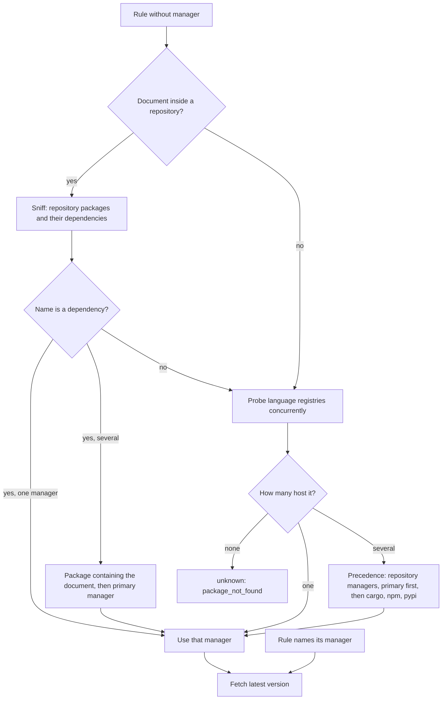

# Content Policy: Package Version Rules

## Purpose

A document that describes a library goes stale when the library ships a new
release, not when a calendar interval passes. This feature adds four rules that
compare a package's latest published release with the version the document was
written against:

| Rule | Triggers when the latest release differs from the recorded version in | Needs semver |
| --- | --- | --- |
| `MajorVersion` | `major` (at or above `1.0.0`); `major` or `minor` (below `1.0.0`) | yes |
| `MinorVersion` | `major` or `minor`, whatever the version | yes |
| `PatchVersion` | `major`, `minor`, `patch`, or pre-release | yes |
| `VersionChange` | the version string at all | no |

They replace the `SemVerMajorChange` / `SemVerMinorChange` candidates listed in
the README and in `2026-09-28-content-policy`'s "Later Policy Decisions".

It also adds the machinery the rules need, built for speed:

- finding a package's **package manager** (and so its registry), preferring the
  managers the surrounding repository uses;
- fetching the **latest version** from each supported registry over the network,
  concurrently, once per run;
- **filling in** the manager and version the author left out, the first time the
  rule is checked;
- a **`sniff lib` command group** (`find`, `latest`, `versions`, `about`) that
  exposes the same lookups on the command line.

### Who owns what

**Every piece of package-manager knowledge lives in Sniff.** content-policy
never names a registry, parses a package identity, reads a version scheme, or
decides which manager a name belongs to. It asks Sniff.

| Sniff owns | content-policy owns |
| --- | --- |
| Package identities (`manager:name`, qualifiers) and each registry's name rules | The four rules' grammar, which embeds a Sniff identity |
| The manager → registry catalog | Mapping a rule to the change classes that trigger it |
| Version schemes, ordering, and classifying a change (major, minor, patch, …) | Capture and renewal edits to the document |
| Discovery: repository evidence, probing, precedence | The report, statuses, and actions |
| Registry lookups (latest, release history, description), batching, timeouts | The `PackageProvider` seam that keeps evaluation testable without a network |
| Host facts used at capture (the Debian-family release) | |
| The `sniff lib` CLI | The `policy` CLI flags (`--no-capture`, `--offline`) |

One consequence is that `sniff lib latest serde` and a `MajorVersion(serde)`
rule in the same directory always pick the same manager and version, because
they run the same code.

## Rulings Needed

These choices change the grammar or the contract. Each lists a recommendation
first. The rest of the spec is written as if every recommendation is accepted.

### R1. How a rule names the package, its manager, and its version

Today rule arguments are positional and unquoted (`FileChanged(src/a.rs, @fp)`),
and `@` at the start of an argument means a frontmatter property reference.
Package names break both assumptions: npm scopes start with `@`
(`@types/node`), and some managers' names collide across registries (`uuid`
exists on crates.io, npm, and PyPI).

- **(Recommended) A `manager:name` identity, then an optional version.**
  `MajorVersion(serde)`, `MajorVersion(cargo:serde)`,
  `MajorVersion(cargo:serde, 1.0.219)`, `MajorVersion(npm:@types/node, 20.11.0)`.
  The first argument is always a literal package identity and never a property
  reference, so `@types/node` needs no escaping. A version without a manager is
  written `MajorVersion(serde, 1.0.219)`. One argument carries identity, so the
  second is always the version: no guessing whether `v2` is a manager or a version.
  Cost: a new `:` separator in the grammar; names containing `:` (none on the
  supported registries) cannot be written.
- **Positional manager.** `MajorVersion(serde, cargo, 1.0.219)`. Familiar from
  `ValidFor`, but `MajorVersion(serde, 1.0.219)` and `MajorVersion(serde, cargo)`
  are told apart only by checking the closed list of manager names, and an
  arbitrary `VersionChange` version could match one.
- **Quoted names**, as in the request (`MajorVersion('package-name')`). No rule
  quotes an argument today, YAML already uses quotes around the whole rule
  string, and `'` inside a single-quoted YAML scalar must be doubled. Under the
  recommendation quotes are not needed; they are **not** accepted, so there is
  one spelling.

The request wrote the key as `content-policy:`. The key is `content_policy`
(snake_case, configurable with `--key`), and this spec does not change it.

### R2. What "filled in the first time the policy is evaluated" means

Evaluation never writes today (the library evaluates bytes or a parsed map, and
Darkmatter and caches call it read-only). `FileChanged` captures a missing
fingerprint only in `policy renew`.

- **(Recommended) The library stays read-only and proposes a capture; `policy
  check` writes it.** A rule missing its manager or version evaluates to
  `unknown` with reason `uncaptured_version`, and the report carries the
  observed manager and version as a capture proposal. `policy check` applies
  every capture proposal to the file (it only ever adds what is absent, never
  changes a written value), then reports the rule as `fresh` with
  `captured: true`. `policy check --no-capture` leaves the file alone. A library
  caller applies captures with `plan_capture` / `apply_renewal`, the same
  byte-exact edit path renewal uses.
  Cost: `policy check` becomes a writer by default. A read-only consumer that
  never applies captures keeps seeing `unknown`, which is the safe direction.
- **Evaluation reports `fresh` without writing.** The rule would look fresh on
  every run and never record what it compared against, so it would never go
  stale. Rejected: it breaks "missing evidence is never fresh".
- **Only `policy renew` fills it in**, as for `FileChanged`. Consistent, but the
  author has to run a second command for every new rule, which is what the
  request asks to avoid.

### R3. "Changes" means "differs", not "is newer"

- **(Recommended) Differs.** Compare the latest release with the recorded
  version at the rule's granularity; any difference triggers. A release that is
  yanked so the registry's latest falls back to an older major also triggers,
  since the document no longer matches what users get. One comparison serves
  all four rules.
- **Newer only.** Ignores a falling latest; needs an ordering for
  `VersionChange`, which has none without semver.

### R4. Which package managers ship first

A *package manager* is what the author names (`uv`, `cargo-binstall`, `winget`).
A *registry* is where its versions come from. Several managers can share one
registry, and only registries need a lookup.

Sniff fetches latest versions over the network for **crates.io** and the **npm
registry** only. Its pip, apt, and Homebrew entries are stubs that always answer
"no version". It has enum variants, but no lookup, for uv, winget, Chocolatey,
and Scoop, and no variant at all for cargo-binstall.

- **(Recommended) These managers, over these six registries:**

    | Managers | Registry | Lookup (works from every OS) | Version scheme |
    | --- | --- | --- | --- |
    | `cargo`, `cargo-binstall` | crates.io | `crates.io/api/v1/crates/{name}` (exists) | SemVer |
    | `npm`, `pnpm`, `yarn`, `bun` | npm | `registry.npmjs.org/{name}` (exists) | SemVer |
    | `pip`, `uv`, `poetry`, `pdm` | PyPI | `pypi.org/pypi/{name}/json` | PEP 440 |
    | `apt` | Debian / Ubuntu archive, per release ([R7](#r7-apt-versions-depend-on-the-distribution-release)) | Debian: `qa.debian.org/madison.php`; Ubuntu: Launchpad `getPublishedSources` | Debian |
    | `choco` | Chocolatey community feed | NuGet v2 OData, `community.chocolatey.org/api/v2/` | NuGet (up to 4 parts) |
    | `scoop` | a Scoop bucket ([R8](#r8-scoop-and-winget-identities)) | the bucket's manifest JSON on GitHub | free-form |
    | `winget` | winget community source | to be settled by spike S1 ([R8](#r8-scoop-and-winget-identities)) | free-form |

    - **cargo-binstall** resolves versions from crates.io and then looks for a
      prebuilt binary, compiling from source when none exists. Its latest
      version is the crate's latest, so it is an alias of crates.io and needs
      no lookup of its own.
    - **uv** is not pip underneath. It is its own resolver and installer, but
      it reads the same registry (PyPI by default), so for version purposes it
      is a PyPI alias, like Poetry and PDM.
    - Every lookup is an HTTP API, never a local `apt-cache`, `winget`, or
      `choco` command, so a document declaring `winget:Git.Git` evaluates the
      same on macOS as on Windows, and `apt:curl` the same on Windows as on
      Ubuntu.
    - Other registries (Go proxy, RubyGems, Packagist, NuGet, Hex, pub.dev,
      Homebrew) are added later by implementing one Sniff lookup each. No
      content-policy change is needed for them.
- **Language registries only (crates.io, npm, PyPI).** Much less Sniff work, but
  leaves out apt and Windows, which you asked for.
- **Windows: winget only.** winget is built into Windows, but it is also the
  managers' hardest source to read ([R8](#r8-scoop-and-winget-identities)).
  Chocolatey and Scoop each cost one small JSON lookup.

### R5. Which registry wins when several host the name

Discovery outside a repository (and inside one, for a name the repository does
not depend on) can find the same name on several registries.

- **(Recommended) A fixed precedence, recorded at capture.** Inside a
  repository, registries of the managers the repository uses come first, its
  primary manager first of all. After that, the fixed order is `cargo`, `npm`,
  `pypi`. The report lists every registry that has the name; the chosen one is
  written into the rule at capture, so the choice is made once and is visible
  in the document from then on. The choice never depends on which registry
  answered first.
- **Treat several hosts as `unknown` until the author picks.** Safe, but every
  common name (`uuid`, `semver`, `chalk`) would need manual work.

**Discovery never probes an OS registry** (apt, Chocolatey, Scoop, winget). An
OS package must name its manager: `MajorVersion(apt:curl)`,
`VersionChange(winget:Git.Git)`. Reasons:

- names collide across ecosystems (`curl`, `git`, and `jq` all exist on npm or
  PyPI too), so a probe would usually pick the wrong one;
- a repository's manifests do not declare OS packages, so the repository rule
  cannot break the tie;
- winget IDs (`Publisher.Name`) and Scoop names (`bucket/name`) are their own
  namespaces, which the author knows when writing the rule;
- it keeps the probe to three cheap language-registry requests.

A bare name that no language registry hosts is `unknown` (`package_not_found`),
and the message suggests naming the manager.

### R6. How semver rules read versions that are not SemVer

PyPI, apt, Chocolatey, Scoop, and winget do not use SemVer: `2.31.0.post1` (PEP
440), `1:8.5.0-2ubuntu10.6` (Debian), `2.47.1.2` (Chocolatey's four parts),
`131.0.6778.86` (a typical winget version).

- **(Recommended) Read each scheme's release part as `major.minor.patch`.**
  - The *release part* is the leading run of dot-separated numbers once the
    scheme's own decorations are removed: the Debian epoch (`1:`) and revision
    (`-2ubuntu10.6`), and PEP 440's epoch (`1!`), post-release, and dev-release
    suffixes.
  - One or two numbers are padded with zeros (`2.0` reads as `2.0.0`).
  - A fourth number and beyond is ignored by semver rules, the way build
    metadata is, so Chrome's `131.0.6778.86` → `131.0.6778.90` does not trigger
    `PatchVersion`.
  - A PEP 440 pre-release (`a1`, `b2`, `rc1`) is a SemVer pre-release.
  - Anything left over is ignored by the semver rules: a Debian revision bump
    (a distribution security patch) or a PEP 440 post-release. `VersionChange`
    still catches it.
  - A version with no numeric release part (`latest`, `nightly-2026-11-20`) is
    `not_semver` for the three semver rules.
  - The author's own version argument is read the same way, so
    `MajorVersion(apt:curl, 8.5.0-2ubuntu10.6)` is valid, and so is a version
    copied verbatim from the registry.

  Cost: these rules are "SemVer-shaped", not strict SemVer, outside crates.io
  and npm. The per-scheme readers are about a page of code each and are
  property-tested.
- **Strict SemVer only.** Semver rules on any non-SemVer registry are always
  `not_semver`, so apt and Windows packages can only use `VersionChange`.
  Simple, but `MajorVersion(winget:Google.Chrome)` would never work.

### R7. apt versions depend on the distribution release

`curl` is `7.88.1-10+deb12u8` on Debian 12 and `8.5.0-2ubuntu10.6` on Ubuntu
24.04. There is no single "latest" for an apt package.

- **(Recommended) Qualify the manager with the release:
  `apt@debian-12:curl`, `apt@ubuntu-24.04:curl`.**
  - Capture fills in a bare `apt:curl` with the release of the host doing the
    capture, read through Sniff's OS detection (`/etc/os-release`).
  - On a host that is not Debian-family, a bare `apt:curl` stays `unknown`
    (`missing_distribution`) until the author adds the release.
  - Lookups go to the archive's own API for that release, including its
    `-updates` and `-security` pockets, so evaluation is the same from any
    host.
  - Supported releases at launch are Debian and Ubuntu. Derivatives (Mint, Pop!_OS)
    are captured as the Ubuntu or Debian release they track, as `/etc/os-release`'s
    `ID_LIKE` and `UBUNTU_CODENAME` report.

  Cost: a `@` qualifier in the manager segment, and two archive lookups (Debian
  and Ubuntu publish versions differently).
- **Host-local `apt-cache policy` candidate.** No qualifier, but the result
  depends on which host evaluates it, works only on Debian-family Linux, and
  violates "every package must work on macOS, Linux, and Windows".

### R8. Scoop and winget identities

- **Scoop:** a package lives in a bucket. **(Recommended)** `scoop:main/git`,
  `scoop:extras/vscode`. A bare `scoop:git` means the `main` bucket, and capture
  writes `scoop:main/git`. Only the official buckets (`main`, `extras`,
  `versions`, `java`, `nerd-fonts`, `nonportable`, `php`, `games`) are known by
  name at launch. A third-party bucket is out of scope.
- **winget:** the identity is the package ID, `winget:Git.Git`, compared without
  regard to case as winget does.
  - The community source has no per-package REST API. Its index is a signed
    `source.msix` archive containing a SQLite index, several megabytes in size.
    The other route is the `microsoft/winget-pkgs` GitHub repository, whose API
    is rate-limited to 60 unauthenticated requests per hour.
  - **(Recommended)** Spike S1 measures both before planning: download size and
    time, and how to read the index's format version. Then download the index
    at most once per run, only when a run contains a winget rule.
  - If neither route is acceptable, winget ships in a follow-up and Chocolatey
    and Scoop ship without it.

### R9. Where Sniff's pure package logic lives

content-policy must check `MajorVersion(cargoo:serde)` and reject it at parse
time, with no network, to keep "invalid declarations are validation errors with
no verdict". So its core needs Sniff's identity parser, manager catalog, and
version schemes. But the `sniff` library crate always compiles gix, hyperpolyglot
(with the C library pcre2), sysinfo, and the rest of host discovery. Its
`network` feature only adds HTTP.

- **(Recommended) A pure leaf crate, `sniff-package`, in the Sniff area**
  (`sniff/package/`).
  - It holds identities, the manager and registry catalog, name rules, version
    schemes, ordering, and change classification.
  - It does no I/O. Its only dependencies are `serde` and `semver`.
  - The existing `LanguagePackageManager`, `OsPackageManager`, and `versioning`
    code moves into it, and `sniff::package` re-exports it, so Sniff's API does
    not change.
  - content-policy core depends on `sniff-package` only. Its
    `package-adapter` feature adds `sniff` with `network` for discovery and
    lookups.

  Cost: one more crate, and moving roughly 900 lines.
- **content-policy core depends on `sniff` directly.** No new crate. Darkmatter
  already depends on Sniff (with `remote`), so it pays nothing extra. But every
  other caller of the evaluation library compiles host discovery and pcre2,
  reversing the earlier decision to keep core near Serde-level.
- **Core treats identities as opaque strings.** No dependency at all, but a
  misspelled manager becomes an `unknown` at evaluation instead of a
  validation error. Rejected: it breaks the fail-closed rule.

## Declaration Format

```yaml
---
content_policy:
  - MajorVersion(serde)                          # author wrote the name only
  - "MinorVersion(npm:@types/node, 20.11.0)"     # manager and version given; quoted for the comma in a flow list only
  - rule: PatchVersion(cargo:tokio, @tokio_version)
    action: archive
  - VersionChange(pypi:certifi)
  - MajorVersion(apt:curl)                       # release filled in at capture
  - MajorVersion(winget:Google.Chrome)
  - PatchVersion(scoop:extras/vscode)
  - MinorVersion(choco:git)
tokio_version: 1.41.1
---
```

After the first `policy check` (on a host that can reach the registries, in a
repository whose Cargo workspace depends on `serde`), the first and last entries
read:

```yaml
  - MajorVersion(cargo:serde, 1.0.219)
  - VersionChange(pypi:certifi, 2026.10.5)
  - MajorVersion(apt@ubuntu-24.04:curl, 8.5.0-2ubuntu10.6)   # captured on an Ubuntu 24.04 host
```

### Arguments

| Position | Form | Required | Meaning |
| --- | --- | --- | --- |
| 1 | `name` or `manager:name` | yes | Package identity. Always literal; never a property reference |
| 2 | version, or `@property` | no | The version the document was written against |

- The identity is parsed by Sniff (`sniff_package::PackageIdentity::parse`). The
  `sniff lib` commands accept exactly the same spelling, so a rule's first
  argument can be pasted into `sniff lib latest` and back.
- **Manager names** are lowercase and come from the [R4](#r4-which-package-managers-ship-first)
  table, plus the registry aliases `crates` and `pypi`. Managers that share a
  registry are equivalent for lookup (`pnpm:left-pad` and `uv:httpx` query npm
  and PyPI). Capture writes the manager the repository uses, or the
  registry's own name outside one.
- **Manager qualifiers:** apt takes a release, `apt@debian-12:curl` or
  `apt@ubuntu-24.04:curl` ([R7](#r7-apt-versions-depend-on-the-distribution-release)).
  No other manager takes one.
- **Names** follow each registry's naming rules, which Sniff checks lexically
  at parse time:

    | Registry | Name rules |
    | --- | --- |
    | crates.io | ASCII alphanumerics, `-`, `_` |
    | npm | optional `@scope/`, lowercase, URL-safe |
    | PyPI | PEP 508 names, compared after PEP 503 normalization |
    | apt | Debian package names: lowercase alphanumerics and `+ - .` |
    | Chocolatey | NuGet IDs, compared without regard to case |
    | Scoop | `bucket/name` or `name` ([R8](#r8-scoop-and-winget-identities)) |
    | winget | `Publisher.Name` IDs, compared without regard to case |

  No name may contain `,`, `)`, whitespace, or `:` after the manager prefix.
- **Versions** for the three semver rules must have a release part in the
  registry's scheme ([R6](#r6-how-semver-rules-read-versions-that-are-not-semver)):
  strict SemVer 2.0 for crates.io and npm (no leading `v`), and for the other
  registries a version in that registry's own scheme.
  A `VersionChange` version is any non-empty string without `,`, `)`, or
  surrounding whitespace.
- **`@property`** names one top-level property holding the version, exactly as
  `ValidFor`'s baseline does. Capture never invents the property; when the rule
  names one, capture writes the version there.
- A missing version is not an error. A missing manager is not an error.

### Comparison

Sniff reads both versions in the registry's scheme and classifies the
difference between them (`sniff_package::classify_change`) as one of `none`,
`major`, `minor`, `patch`, `prerelease`, or `other`. Below `1.0.0` a change of
minor classifies as `major`, the convention Cargo and npm use. `other` covers
changes the scheme carries beyond its release part, such as a Debian revision or
a fourth number.

content-policy only maps each rule to the classes that trigger it:

| Rule | Triggers on |
| --- | --- |
| `MajorVersion` | `major` |
| `MinorVersion` | `major`, `minor` |
| `PatchVersion` | `major`, `minor`, `patch`, `prerelease` |
| `VersionChange` | any class but `none`, including `other`, and any string difference in a scheme Sniff cannot read |

`MinorVersion` ignores whether the version is below `1.0.0` (as you asked)
because `major` is in its set: `0.4.2 → 0.5.0` classifies as `major`, and
`MinorVersion` still triggers on it.

This classification replaces Sniff's `is_major_update`. That function means
"is newer", while these rules need "differs" (R3). Sniff's
`DependencyEntry.has_major_update` keeps its meaning, now computed from the
classification plus Sniff's version ordering.

Build metadata (`+…`) is ignored by every semver rule, per SemVer precedence.
For registries that do not use SemVer, the table applies to the release part
that [R6](#r6-how-semver-rules-read-versions-that-are-not-semver) reads, so a
Debian `8.5.0-2ubuntu10.6` behaves like `8.5.0` in every row except
`VersionChange`.

| Rule | Recorded `1.4.2` vs latest | Recorded `0.4.2` vs latest |
| --- | --- | --- |
| `MajorVersion` | `2.0.0` triggers; `1.5.0` does not | `0.5.0` and `1.0.0` trigger; `0.4.3` does not |
| `MinorVersion` | `1.5.0` and `2.0.0` trigger; `1.4.3` does not | `0.5.0` triggers; `0.4.3` does not |
| `PatchVersion` | `1.4.3`, `1.4.2-rc.1` trigger; `1.4.2+b7` does not | `0.4.3` triggers |
| `VersionChange` | any different string triggers; `1.4.2` does not | same |

"Latest" is the registry's latest **stable** release:

| Registry | Latest is |
| --- | --- |
| npm | `dist-tags.latest` |
| crates.io | `max_stable_version` (Sniff reads `max_version` today, which can be a pre-release; see [Sniff changes](#sniff-changes)) |
| PyPI | `info.version` |
| apt | the highest version published for the release across its release, `-updates`, and `-security` pockets, compared by Debian version ordering |
| Chocolatey | the `IsLatestVersion` package (stable, approved) |
| Scoop | the manifest's `version` |
| winget | the highest version in the index for the ID |

A document that tracks pre-releases is out of scope (see
[Out of scope](#out-of-scope)).

### Validation errors and unknown results

Each new failure has its own registered code, so a lifecycle `failure` handler
can match it with `when: "err.code == '…'"`.

| Code | Kind | Example |
| --- | --- | --- |
| `invalid_package_name` | diagnostic | `MajorVersion(Serde Json)` |
| `unknown_package_manager` | diagnostic | `MajorVersion(brew:jq)` (not a language manager), `MajorVersion(cargoo:serde)` |
| `unsupported_package_manager` | diagnostic | `MajorVersion(go:golang.org/x/net)` before a Go lookup exists; the message lists the supported managers |
| `invalid_version` | diagnostic | `MajorVersion(serde, v1.0)`, `MinorVersion(serde, 1.0)` |
| `unknown_distribution` | diagnostic | `MajorVersion(apt@debian-99:curl)`, `MajorVersion(apt@fedora-41:curl)` |
| `unexpected_qualifier` | diagnostic | `MajorVersion(npm@lts:react)` (only apt takes a qualifier) |
| `unknown_bucket` | diagnostic | `MajorVersion(scoop:my-bucket/tool)` |
| `missing_distribution` | unknown reason | bare `apt:curl` checked on a host that is not Debian-family, so capture cannot fill in the release |
| `uncaptured_version` | unknown reason | manager or version absent, and no capture was applied |
| `package_not_found` | unknown reason | no supported registry hosts the name, or the named one returns 404 |
| `registry_unavailable` | unknown reason | timeout, DNS failure, HTTP 5xx, malformed response, or `--offline` |
| `not_semver` | unknown reason | a semver rule where the registry's latest (or a referenced property's value) is not semver |
| `missing_provider` | unknown reason (existing) | no package provider configured |

An unknown package rule never nominates an action, exactly like an unknown file
rule.

## Finding the Package Manager

Discovery is Sniff's `resolve` operation. The `PackageProvider` adapter in
content-policy and `sniff lib latest` both call it. Resolution runs only for a
rule with no manager. Once a manager is written into
the rule, it is used as written and discovery never runs for that rule again.
That is the main performance property: discovery is a one-time cost per rule.



1. **Inside a repository**, Sniff reads the repository's
   packages and their declared dependencies (Sniff's `Package.dependencies`,
   each with a `package_manager`). It never asks for Sniff's "deep" mode, which
   fetches every dependency's latest version.
2. If the name is a dependency under exactly one manager, that manager is used.
   No registry probe happens.
3. If it is a dependency under several managers, the manager of the package
   that contains the document wins (Sniff's `RepoInfo::package_for_dir`), then
   the repository's primary manager.
4. Otherwise (no repository, or the name is not a dependency) every language
   registry (crates.io, npm, PyPI) is asked at once whether it hosts the name.
   OS registries are never probed ([R5](#r5-which-registry-wins-when-several-host-the-name)).
   The probe goes to registries, not managers: `cargo-binstall`, `uv`, and the
   other aliases add no requests. The lookup that answers
   "hosts it" also returns the latest version, so a probe costs one request per
   registry and no second fetch.
5. Several hosts are ordered by the [R5](#r5-which-registry-wins-when-several-host-the-name)
   precedence. The report lists all of them under `candidates`.

## Performance

Sniff's batch lookup (`sniff::package::lookup_all`) implements these rules, and
so they hold equally for `policy check` and for `sniff lib`.

| Concern | Rule |
| --- | --- |
| Discovery | Once per rule's lifetime; captured into the rule (above) |
| Repository scan | At most once per repository root per run, at Sniff's cheapest request tier that returns declared dependencies; no lockfile resolution, no deep mode |
| Registry requests | Deduplicated per run by `(registry, normalized name)` across every rule in every document; one shared HTTP client per registry |
| Concurrency | All requests of a run go out at once, bounded (default 16 in flight); total wall time is about one round trip, not one per rule |
| Timeouts | 5 s per request by default; a timeout is `registry_unavailable`, never a hang |
| Evaluation with no package rules | Makes no network call and builds no runtime |
| `--offline` | Makes no network call; package rules are `unknown` (`registry_unavailable`) |
| winget | The community index is downloaded at most once per run, only when the run has a winget rule, and is read for every winget rule in the run (sizes and timing come from spike S1) |
| apt | One archive request per `(release, name)`; the Debian and Ubuntu archive APIs each answer every pocket of a release in one response |

Rules that already carry manager and version still need a network fetch per
check, because "latest" is the observation. A cache of latest versions across
runs is **not** part of this feature (see [Out of scope](#out-of-scope)).

### Provider contract

`FileProvider` is called once per path. A package provider must see every
request of a run together so it can send them concurrently, so the contract is
batched:

```rust
pub trait PackageProvider: Send + Sync {
    /// Called once per evaluation or renewal run with every distinct request.
    fn observe_all(&self, requests: &[PackageRequest]) -> Vec<PackageObservation>;
}

pub struct PackageRequest {
    /// Parsed by Sniff; its manager is `None` when discovery should choose.
    pub identity: sniff_package::PackageIdentity,
    /// Directory the document lives in, for repository discovery.
    pub base_dir: PathBuf,
}

/// Sniff's own result type, passed through unchanged.
pub type PackageObservation = sniff_package::Resolution;
```

`Resolution` is `Found { source, latest, candidates, manager_source }`,
`NotFound { searched }`, or `Unavailable { source, reason }`. The trait exists so
that evaluation tests can script observations without a network or a
repository. It defines no package vocabulary of its own.

- Core collects the requests, calls `observe_all` once, then decides. Providers
  report facts. Core turns Sniff's change class into a rule result, so every
  provider is judged the same way, the rule `FileProvider` already follows.
- Core stays synchronous and network-free. The bundled `SniffPackageAdapter`
  lives behind a new off-by-default `package-adapter` feature
  (`dep:sniff`, `sniff/network`), as `FileAdapter` lives behind `file-adapter`.
  It is a thin call to `sniff::package::lookup_all`. Sniff provides a blocking
  entry point that works even when the caller is already inside a Tokio
  runtime, by running the batch on a dedicated thread rather than calling
  `block_on` on the caller's runtime, so the adapter holds no runtime logic of
  its own.
- Set on either context with `ctx.with_packages(Arc<dyn PackageProvider>)`.
  Without it, package rules are `unknown` (`missing_provider`).
- Sniff does not depend on Darkmatter, so the dependency rule (`just
  deps-check`) still holds; the check is extended to cover the new feature.

## Capture and Renewal

| Operation | Manager absent | Version absent | Version present |
| --- | --- | --- | --- |
| `policy check` (default) | written | written | unchanged |
| `policy check --no-capture` | unchanged | unchanged | unchanged |
| `policy renew` | written | written | replaced with latest |

- Capture inserts text into the rule string (`MajorVersion(serde)` becomes
  `MajorVersion(cargo:serde, 1.0.219)`), or writes the `@property` value. It uses
  renewal's byte-exact editor and refuses the same YAML shapes renewal refuses
  (block scalars, escaped double-quoted strings, anchors), reporting the refusal
  instead of failing the check.
- A capture in a flow list that would introduce the first comma inside an
  unquoted rule (`[MajorVersion(serde)]`) is refused with the existing flow-list
  comma diagnostic, since writing it would split the entry.
- Renewal never changes a written manager. Changing it is a policy edit.
- The rules are **renewable**: the version is the baseline. Renewal without a
  provider, or with the registry unreachable, fails planning with
  `MissingEvidence`, as `FileChanged` does.
- Darkmatter's `last_updated` stamping does not touch package versions: a
  content edit does not prove the content matches a new release.

## Report Shape

Additive only; existing field names stay frozen
(`evaluation::report_json_field_names_are_frozen` is extended, not changed).
Each package entry adds a `package` object:

```json
{
  "rule": "MajorVersion(cargo:serde, 1.0.219)",
  "result": "triggered",
  "package": {
    "name": "serde",
    "manager": "cargo",
    "manager_source": "declared",
    "recorded": "1.0.219",
    "latest": "2.0.0",
    "candidates": [],
    "captured": false
  }
}
```

`manager_source` is `declared`, `repository`, or `probe`. `candidates` lists
every registry that hosts the name when discovery found more than one.

## Changes Outside content-policy

### Sniff changes

#### Library

- **`sniff-package` leaf crate** (R9): identities and name rules, the manager
  and registry catalog (R4), version schemes and ordering, `classify_change`
  (replacing `is_major_update`), and the apt release, Scoop bucket, and winget
  ID rules (R7, R8).
- **`resolve` and `lookup_all`** in `sniff::package`: discovery (R5,
  [Finding the Package Manager](#finding-the-package-manager)), deduplicated
  concurrent lookups, timeouts, and a blocking entry point.
- **Release history and descriptions:** a per-registry `versions` lookup
  (version, publish date, yanked, pre-release) and an `about` lookup
  (description, license, homepage, repository), used by the CLI below. Each
  registry's lookup returns the fields its API publishes; see
  [Registry coverage](#registry-coverage).
- **A primary language package manager.** Sniff records each package's
  `package_managers` and a repository's `primary_layer()` (its main workspace
  standard), and its OS detection has a primary *system* manager. It has no
  primary *language* manager for a repository. Add one, derived from the
  primary layer, so content-policy reads it rather than recalculating it.
- **Stable latest on crates.io.** `CargoNetwork::latest_version` returns
  `max_version`, which can be a pre-release; return `max_stable_version`.
- **PyPI lookup** (per R4): a `PypiNetwork` for `https://pypi.org/pypi/{name}/json`,
  registered for pip, uv, Poetry, and PDM, replacing the `PipStub` network
  answer.
- **A found-or-not answer with the version** in one request, so a probe is one
  call per registry (the current `find_package` and `latest_version` each make
  a request).
- **Per-call timeout and shared client** suitable for 16 concurrent requests.
- **A query richer than a name.** `PackageManagerShape::latest_version(name)`
  cannot carry an apt release or a Scoop bucket. Replace it with a
  `PackageQuery { name, qualifier }`, so a qualified lookup still goes through
  Sniff's registry rather than a content-policy special case.
- **New managers and lookups** (per R4):
    - a `CargoBinstall` language manager variant, mapped to the crates.io lookup;
    - `Uv`, `Poetry`, and `Pdm` mapped to the PyPI lookup;
    - an apt lookup over the Debian (madison) and Ubuntu (Launchpad) archive
      APIs, replacing `AptStub`'s network answer, with Debian version ordering;
    - Chocolatey (NuGet v2 OData), Scoop (official bucket manifests), and
      winget (the route spike S1 chooses) lookups.
- **The host's Debian-family release** (ID and version, following `ID_LIKE`)
  from Sniff's OS detection, for apt capture.

#### CLI: `sniff lib`

A new command group that looks packages up in registries. `<pkg>` is the same
identity a rule takes: `serde`, `cargo:serde`, `npm:@types/node`,
`apt@ubuntu-24.04:curl`, `scoop:extras/vscode`. Every command honors Sniff's
global `--json` and `--plain` flags.

| Flag | Applies to | Default |
| --- | --- | --- |
| `--dir <path>` | all | the launch directory; sets the repository context for discovery |
| `--timeout <secs>` | all | `5` |
| `--release <distro-version>` | `find` | the host's Debian-family release, if any (for apt) |
| `--limit <n>` / `--all` | `versions` | `20` |
| `--stable` | `versions` | off; hides pre-releases and yanked releases |

**`sniff lib find <pkg>`** lists which package managers host the name.

- It asks every supported registry concurrently, including OS registries (apt
  for `--release`, Chocolatey, the official Scoop buckets, and winget). Here
  the user is explicitly asking, unlike automatic discovery.
- It groups managers by registry.
- It marks the one discovery would choose (`canonical`), and why
  (`repository dependency`, `primary manager`, `precedence`). OS registries are
  marked "never chosen automatically".
- Given `cargo:serde`, it checks only that registry, which makes it an
  existence test.

Version numbers and dates in these examples are illustrative.

```text
$ sniff lib find uuid
uuid  found on 3 registries
  ● crates.io   cargo, cargo-binstall   1.11.0   canonical (repository dependency)
  ○ npm         npm, pnpm, yarn, bun    11.0.3
  ○ PyPI        pip, uv, poetry, pdm    1.30
```

**`sniff lib latest <pkg>`** prints the latest stable version.

- It runs the same `resolve` that `MajorVersion(<pkg>)` uses.
- The plain output is only the version, so it can be used in scripts:
  `v=$(sniff lib latest serde)`.
- The styled output adds the manager and any other candidates.
- `--json` returns the `Resolution`: `name`, `manager`, `registry`, `latest`,
  `manager_source`, `candidates`.

**`sniff lib versions <pkg>`** lists releases, newest first, by the registry's
version ordering. Each row shows the version, the publish date (UTC
`YYYY-MM-DD`, or `—` where the registry publishes none), and the markers
`pre-release`, `yanked`, and `latest`.

```text
$ sniff lib versions cargo:serde --limit 3
serde (crates.io)
  1.0.219   2025-03-09   latest
  1.0.218   2025-02-20
  1.0.217   2024-12-27
```

**`sniff lib about <pkg>`** gives a brief description of the package: name,
manager and registry, description, latest version, license, homepage,
repository, and its page on the registry. A field the registry does not
publish is omitted, never printed empty.

Exit codes follow Sniff's convention: `0` when the command produced its
answer, `1` for every failure (with a message on stderr), and `2` for a
usage error. With `--json`, a failure prints `{"error": {"code": …, "message":
…}}`. The codes are the registered ones shared with content-policy:
`package_not_found`, `registry_unavailable`, `invalid_package_name`,
`unknown_package_manager`, `unsupported_package_manager`, and
`missing_distribution`. A script can tell them apart without matching message
text.

The pages are `sniff/docs/cli/lib.md` and one page per subcommand
(`lib_find.md`, `lib_latest.md`, `lib_versions.md`, `lib_about.md`), following
the existing `repo_*.md` layout.

#### Registry coverage

| Registry | `latest` | `versions` with dates | `about` |
| --- | --- | --- | --- |
| crates.io | yes | yes (`created_at`, `yanked`) | description, homepage, repository, license |
| npm | yes | yes (`time`; deprecated shown as yanked) | description, homepage, repository, license |
| PyPI | yes | yes (upload time of each release's first file; `yanked`) | summary, project URLs, license |
| apt | yes | versions per release; dates only where the archive API gives them (S2) | description where the archive API gives it (S2) |
| Chocolatey | yes | yes (`Published`) | summary, project URL, license URL |
| Scoop | yes | latest only: bucket manifests keep no history | description, homepage, license |
| winget | per S1 | versions without dates | name and publisher (description per S1) |

### Editor schema and Darkmatter

- `content-policy/schemas/content-policy.yaml`: the four rules join
  `short_form` and the single `suggest(...)` list (eleven rules).
- Darkmatter's `content_policy_fixtures` (`DECLARATIONS`) gain accept/reject
  cases for each new form, including `npm:@scope/name`.

### Docs

- `content-policy/docs/topics/policy-lifecycle.md`: a "Watch a Package's
  Releases" section (rules, comparison table, discovery diagram, capture),
  failure codes with a `when: "err.code == '…'"` example, and the
  `--no-capture` and `--offline` flags.
- README: move the version rules from candidates to built; drop
  `SemVerMajorChange` / `SemVerMinorChange`.
- Sniff: a `docs/topics/` page on package lookups (identities, the registry
  catalog, discovery and precedence, version schemes and change classes, with
  the discovery diagram), the `sniff lib` CLI pages above, and its README's
  command overview.
- The `content-policy` and `sniff` skills, and `docs/dependencies.md` in both
  areas (`sniff-package`, `semver`).
- The content-policy topic page links to Sniff's package-lookup page for
  identities, schemes, and discovery, rather than restating them.

## Library Architecture

| Layer | Addition |
| --- | --- |
| Model | `Rule::{MajorVersion, MinorVersion, PatchVersion, VersionChange} { package: sniff_package::PackageIdentity, version: Option<VersionBaseline> }`; `VersionBaseline::{Inline, Reference}` |
| Grammar | Splits the rule's arguments; hands the identity and version to `sniff-package` and maps its errors to content-policy diagnostics |
| Evaluation | Two-phase: collect package requests, one `observe_all`, map Sniff's change class to a result |
| Renewal | `plan_capture`; renewal replaces versions |
| Provider | `PackageProvider`, `PackageRequest`, `PackageObservation` |
| `package-adapter` feature | `SniffPackageAdapter` |
| CLI | enables `package-adapter`; `--no-capture`, `--offline`, `--registry-timeout` |

`sniff-package` is the only new core dependency. content-policy has no
version-parsing code and no registry knowledge of its own.

## Out of scope

- Tracking pre-releases or a non-`latest` dist-tag (`next`, `beta`).
- Version ranges (`^1.2`) as the recorded value.
- Homebrew, and Linux managers other than apt (dnf, pacman, zypper, apk).
  Each is one Sniff lookup later.
- Debian-family releases other than Debian and Ubuntu, and third-party apt
  repositories (PPAs, vendor repositories such as Docker's).
- Third-party Scoop buckets, and winget sources other than the community
  source (`msstore`).
- Private registries, registry credentials, and mirrors.
- A cross-run cache of latest versions. Each check of a captured rule costs one
  deduplicated, concurrent request; if editor or bulk use proves that too slow,
  a TTL cache is a separate feature.
- Comparing against the version the repository has *locked* rather than the
  registry's latest.

## Acceptance Criteria

1. The four rules parse in compact and long form, with and without manager and
   version, and round-trip through `Display` and `Policy::to_json`.
2. Each diagnostic in the table above is produced by a test declaration and is
   rejected with no verdict.
3. Sniff's `classify_change` has property tests over every scheme, and the
   comparison table holds as a property test for each rule, including the
   `0.x` cases and build-metadata ignoring. Each scheme's release-part reader
   (PEP 440, Debian, NuGet four-part, free-form) has a property test plus
   fixture cases taken from real registry responses.
4. `cargo-binstall:` and `uv:` rules query crates.io and PyPI and are
   deduplicated with `cargo:` and `pip:` rules for the same name.
5. `apt@debian-12:curl` and `apt@ubuntu-24.04:curl` evaluate identically on
   macOS, Linux, and Windows; a bare `apt:curl` is captured with the host's
   release on Debian-family hosts and is `missing_distribution` elsewhere.
6. A bare name is never resolved to an OS registry.
7. Discovery inside a fixture repository picks the dependency's manager with no
   registry call (asserted through a scripted provider and a recording HTTP
   mock); outside a repository it probes every language registry concurrently and
   applies the R5 precedence regardless of response order.
8. A run over 50 documents naming 10 distinct packages makes exactly 10
   registry requests, and its wall time is within one request timeout.
9. `policy check` captures absent manager and version, leaves present values
   alone, and is byte-exact elsewhere; `--no-capture` writes nothing.
10. `policy renew` replaces versions and refuses without a reachable registry.
11. Evaluation without the `package-adapter` feature compiles and reports
    `missing_provider`; `just deps-check` passes with every feature.
12. Registry tests use a local mock server; tests that hit real registries are
    gated like Sniff's existing `real_*` network tests.
13. The schema accepts the new forms in DMLS and `md schema validate`.
14. Docs, README, skills, and `docs/dependencies.md` are updated; it all works
    on macOS, Linux, Windows, and WSL2.
15. content-policy contains no registry URL, manager list, name rule, or
    version parser. A test asserts its source names no registry host, and
    `just deps-check` asserts the core depends on `sniff-package` and not on
    `sniff`.
16. `sniff lib latest <pkg>` and a `MajorVersion(<pkg>)` rule in the same
    directory resolve the same manager and version (one shared test over a
    fixture repository and a mock registry).
17. `sniff lib find`, `latest`, `versions`, and `about` each have L1 tests for
    styled, `--plain`, and `--json` output against mock registries, including
    every error code and the exit codes.
18. `sniff lib find` probes OS registries; automatic discovery never does.

## Spikes

| Spike | Question | Decides |
| --- | --- | --- |
| S1 winget source | Size and download time of the community `source.msix` index; whether its SQLite schema is versioned and stable enough to read; GitHub `winget-pkgs` API cost as the fallback | Whether winget ships in this feature, and by which route |
| S2 apt archives | Whether madison and Launchpad each return every pocket of a release in one request, their rate limits, and their response stability | The apt lookup's request count and failure handling |

## Open Questions

None beyond [Rulings Needed](#rulings-needed) and [Spikes](#spikes).
