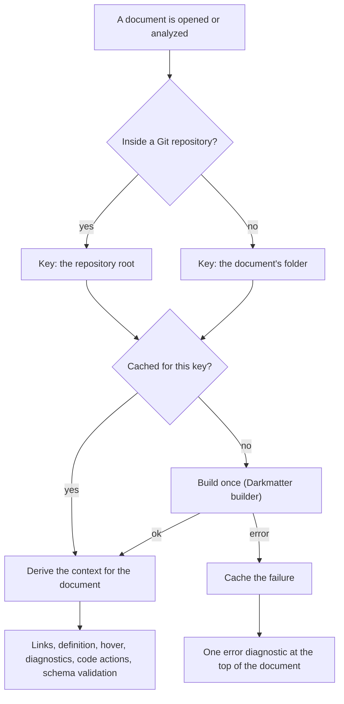

# How DMLS Resolves File References

Every editor feature that follows a path resolves it the way `md compose`
does when you run it from the repository root. That covers links, `::file`,
`::code`, and `::toc-linking` targets, `$schema` values, and `file(...)`-typed
frontmatter values. A `&`, `^`, or `@` reference that composes also resolves in the
editor, and one that fails to compose is flagged.

```markdown
<!-- repo/area/pkg/docs/guide.md -->
::file &README.md          <!-- the repository root's README.md -->
::file ^CHANGELOG.md       <!-- the package's, else the area's, else the root's -->
::file @prompts/review.md  <!-- the `@` search chain -->
[setup](./setup.md)        <!-- beside this document, then the repository root -->
```

The sigils themselves are defined in
[File references](../../../biscuit-file/docs/topics/file-references.md). This
page covers how the editor gets the context they resolve in, the
schema-specific lookup a `$schema` value uses, and which failures become
diagnostics.

## One context per repository

A **context** holds what references resolve against: the repository root,
its package catalog (for `^`), the `@` roots, `HOME` (for `~`), and the
environment (for `{{VAR}}`). DMLS builds it with Darkmatter's
`build_resolution_context`, the same builder `md` uses.

- **One build per repository.** The first time DMLS sees a document in a
  repository, it builds that repository's context and caches it. Every other
  document in the repository reuses the cached context, derived for its own
  folder.
- **The request directory is the repository root.** This holds even when your
  editor's workspace folder is above the repository, or is one of several
  folders inside it. Editor results therefore equal `md compose` run from the
  repository root.
- **No repository, its own folder.** A document outside any repository gets a
  context for its own folder. Relative paths work there, and `&` and `^` fail
  with `MissingContext` because there is no repository to anchor them.
- **`HOME` and the environment are fixed at startup.** DMLS reads them once,
  when the server starts. Restart the server to pick up a change.



## What drops a cached context

A cached context, or a cached failure, is dropped and rebuilt on the next
request when any of these happen:

| Event | What is dropped |
|---|---|
| `workspace/didChangeWatchedFiles` names a path | Every entry keyed at an ancestor of the path, plus, for a file inside `.git/`, every entry keyed inside that repository |
| A save triggers the server-side rescan (clients without a file watcher) and the rescan finds a Markdown file that joined or left the file list, a parsed document whose bytes changed, or a changed package manifest | The same entries as for a watched change at that path |
| `workspace/didChangeConfiguration` | Every entry |

DMLS asks watching clients to report Markdown files (the configured
`include` globs), every YAML file, the files that change the workspace file
list (`.gitignore`, `.ignore`, and `.dmls.toml`), the package manifests sniff
detects packages by (`Cargo.toml`, `package.json`, `pyproject.toml`,
`go.mod`), and `.git/config`. Adding a package changes what
`^` finds, so the new manifest alone is enough:

```text
repo/pkg/doc.md contains   ::file ^pkg-only.md
repo/pkg/pkg-only.md       exists, but pkg/ is not a package yet → broken
add repo/pkg/Cargo.toml    the client reports it → the context rebuilds → resolves
```

Each drop also re-resolves the workspace graph and re-publishes diagnostics
for every open document.

## When a context cannot be built

The builder fails when repository discovery fails, for example on a corrupt
`.git/config`, or when the context it builds is invalid. DMLS then:

- publishes exactly one **error** diagnostic at line 0, column 0, with code
  `dm.context.build_failure`, a message naming the failure class and the
  directory, and `data: {"resolution_failure": "<Class>"}`;
- logs the failure once, at `error` level;
- resolves **nothing** in that document: document links, go-to-definition,
  and transclusion and link diagnostics return no result. Schema validation,
  schema hover, and schema completion are off too, because the document's
  `$schema` reference and trigger schemas resolve through the same context.
  Nothing falls back to a guess. Features that need no path, such as folding,
  symbols, and expression diagnostics, keep working.

```text
error dm.context.build_failure (darkmatter.context)
file references are not resolved in this document (MissingContext):
repository discovery failed at `/work/repo/docs`: …
```

Repair the cause and the next watched or rescanned change drops the cached
failure. The diagnostic clears and the features return.

## Untitled buffers

An `untitled:` buffer has no folder. It borrows a repository's context when
your workspace folders lie in exactly one repository: each folder counts the
repository that contains it, and repositories nested below a folder do not
count. The buffer is then analyzed as if it sat at that repository's root.

With folders in two or more repositories, or in none, the buffer gets the
`dm.context.build_failure` diagnostic and resolves nothing. Any other choice
would make the same buffer resolve differently depending on which other
folders happen to be open.

## `$schema` references

A `$schema` string is looked up with schema-specific rules, not the ordinary
`./`-then-repository-root rule above. DMLS uses the same selection code as
`md schema validate`, with the document's own context and schema roots, so
the document link, go-to-definition, the value hover, and the validator
always name the same file.

| You write | DMLS searches |
|---|---|
| A bare name: `$schema: review.yaml` | The schema roots, in order, and nothing else: the folder `SCHEMAS_DIR` names, then `{package}/schemas/`, `{package-area}/schemas/`, `{file-tree-root}/schemas/`, and `~/schemas/`. The first root holding the file wins |
| An explicit relative path: `$schema: ./review.yaml`, `../shared/review.yaml` | The document's folder only, never a schema root and never the process's working directory |
| Any other form (`&`, `^`, `@`, `~`, `{{VAR}}`, absolute) | The ordinary file-reference rules for that form |

A root folder that does not exist is skipped. When **no** schema root folder
exists at all, a bare name is looked up like any other implicit path: the
document's folder, then the repository root. The roots, `SCHEMAS_DIR`, and
duplicate-root rules are described in
[Schema roots](../../docs/topics/schemas/definition.md#schema-roots).

```text
repo/
├── schemas/review.yaml         ← 4. file tree root: selected
└── area/pkg/                   (a package: has Cargo.toml)
    ├── schemas/                ← 2. package root: exists, no review.yaml
    └── docs/
        ├── review.yaml         ← beside the document: never used for a bare name
        └── review-3.md         $schema: review.yaml
```

Here `review.yaml` resolves to `repo/schemas/review.yaml`. The file beside
the document does not count, because a bare name never searches the
document's folder while a schema root exists. Had no root held
`review.yaml`, validation would report an error naming the file beside the
document and suggesting `./review.yaml`; it never selects that file for you.

### Where a link to a missing schema goes

A `$schema` file that does not exist is still a validation error. But the
document link and go-to-definition do not disappear: they point at the path
where the file would be created, so following the link starts the file in
the right place.

| Reference | Creation path |
|---|---|
| A bare name, with at least one existing schema root | `{first existing schema root}/{name}` |
| A bare name, with no schema root folder | The first ordinary candidate, `{document folder}/{name}`, only when no candidate matched (an existing file at the repository root is linked instead) |
| A bare name that exists only beside the document | `{first existing schema root}/{name}`, never the sibling |
| An explicit relative path | The path it names, relative to the document's folder |

```text
repo/schemas/ exists and is empty; repo/docs/plan.md has $schema: plan.yaml
  link and definition → repo/schemas/plan.yaml   (does not exist yet)
  diagnostic          → the missing-$schema error, unchanged
```

DMLS only returns the file URI. It creates no file or folder; what happens
when you follow a link to a nonexistent file is up to the client (Zed opens
an empty buffer, for example).

Some references get **no** link and no creation path, because guessing one
would be wrong:

- a malformed reference
- a reference whose anchor is missing, such as `&review.yaml` outside a
  repository (`MissingContext`)
- a location that could not be checked (`Io`), including a schema root that
  could not be read: a lower-priority root never stands in for it
- a remote URL; remote schemas are never fetched
- any reference in a document without a file-resolution context

Each of these is a typed failure, not a miss. The
[`$schema` value hover](./hover.md#formatting-rule-schema-value-hover) says
which one applies, lists the searched locations in order for a miss, and
labels the creation path as missing.

### When a `$schema` selection is redone

The selection is kept with the document's schema and redone on the next
request when the selected file changes or disappears, or when any location
searched before it changes, for example a higher-priority root folder or a
nearer copy of the file appearing. Deleting the selected file moves the link
to the next candidate, or to the creation path when none is left; creating
the missing file makes it the target. Repairing a malformed schema file
refreshes its earlier failure the same way.

## Failure classes on diagnostics

Every diagnostic about a reference that did not resolve carries the class in
its `data`, so a client never has to parse the message:

| Diagnostic | `data.resolution_failure` |
|---|---|
| `dm.links.broken_path` | `NoMatch`, or why the reference could not be planned (for example `MissingContext` for `&` outside a repository) |
| `dm.transclusion.broken_path` | The class from resolving the target |
| `dm.schema.invalid_file_reference` | The class from validating the value (`InvalidReference` for bad syntax, `MissingContext` or `Io` when it could not be checked). A well-formed reference to a missing file is not reported in the editor, eager or not; `md` still fails on a missing `file(eager)` target |
| `dm.context.build_failure` | The build failure's class |

The classes are biscuit-file's `ResolutionFailure` variants: `InvalidReference`,
`MissingContext`, `NoMatch`, `Io`, and `UnsupportedRemote`.

### Missing `file` values are explained, not flagged

While you write a document, a file it names may not exist yet, so a
well-formed `file(...)` value whose file is missing (`NoMatch`) gets no
diagnostic, `eager` or not. Hover over the value instead: it says the file
is missing and whether `md` will require it at run time (see the
[`file` value hover](./hover.md#formatting-rule-file-value-hover)). Existence
of an `eager` file stays a run-time check: `md compose` and
`md schema validate` still fail on it.

```yaml
$schema:
  source: file(eager)
  notes: file
  cover: file
source: ./draft.md        # missing: no diagnostic in the editor; md fails at run time
notes: ./later.md         # missing: no diagnostic anywhere
cover: "@"                # InvalidReference: still a diagnostic
```

The rule matches on the typed `NoMatch` class, never on message text, and
covers only the existence of a `file` value. Everything else keeps its
diagnostic, code, range, and `resolution_failure` data: a malformed reference
(`InvalidReference`), a reference that needs a missing anchor
(`MissingContext`), a location that could not be checked (`Io`), a missing
`$schema` file, named-type import, or `example(...)` file, a missing required
value, and YAML syntax errors.

## Workspace documents and the disk

The workspace graph resolves links, transclusions, and file uses with the
same answer composition gives. When the first planned candidate is a
workspace document (a Markdown file in the workspace file list, or an open
buffer), it resolves there without touching the disk. Otherwise the graph
asks the file resolver, so an existing file outside the list is still a
target. For example, with only `repo/docs/` open, `[t](&target.md)` links to
`repo/target.md`, go-to-definition opens it, and no `dm.links.broken_path` is
reported. When no file exists, a later candidate that is an open, unsaved
buffer still counts.

A `#fragment` is checked against the target's headings, which are parsed the
first time an open document's link or heading completion needs them. That
includes an existing Markdown file outside the list (above the workspace
folder, or excluded from discovery): it is parsed the same way, as a
dependency that never joins the list. A `#fragment` on a file in another
format is never checked. Features that report
a single target, such as directive links and transclusion
diagnostics, probe the filesystem the way composition does. The
create-missing-file code action creates the file at the first planned
candidate, where `md compose` would look first.
