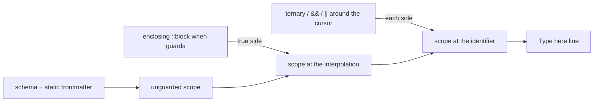
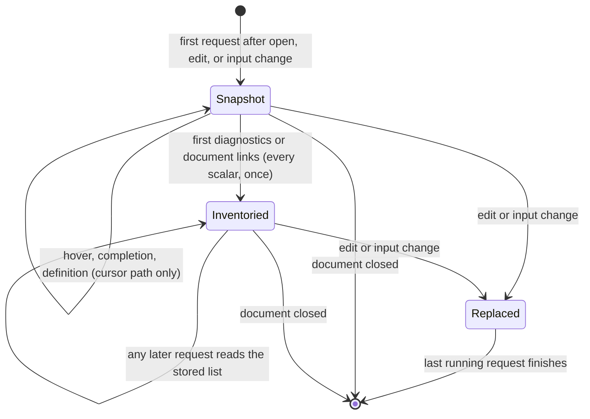

# DMLS Hover Effects

Hover (`textDocument/hover`) is how DMLS explains the symbol under the cursor without navigating away from it — a schema property's type and description, a `ctx.*` variable, a directive's semantics, a wiki link's target, and so on. This page describes how hover content is produced, the hard limits on how it can look, and the formatting rules DMLS applies within those limits.

## The rendering contract

Every DMLS hover is an LSP `MarkupContent` with `kind = Markdown`. We hand the editor a **Markdown string**; the **editor** renders it using **its own theme**.

That split is the whole story of "how much control we have":

- We choose the **Markdown constructs**.
- The editor decides how each construct *looks* — font, weight, and especially   **color**.

We cannot set colors, backgrounds, opacity, or CSS, and editors strip inline HTML (`<span style="color:…">` and friends) from hover content. So there is **no way to make hover text a specific color, or to "dim" it** — those are theme decisions, identical across VS Code, Zed, Neovim, and Helix. This is an LSP/editor limitation, not a DMLS one.

What a construct becomes when the editor renders it:

| We emit                                         | Rendered as                                                |
|-------------------------------------------------|------------------------------------------------------------|
| `` `name` `` (inline code)                          | a boxed / inverted background (theme-colored)          |
| `**name**` (bold)                               | bold weight, no box                                        |
| `_name_` (italic)                               | italic                                                     |
| `# name` / `## name` (heading)                  | larger / heavier heading                                   |
| lists, block quotes, links, tables, fenced code | supported (fenced code is syntax-highlighted by the theme) |
| raw HTML, hex colors, ANSI codes                | **ignored / sanitized**                                    |

The only places color ever appears are constructs the *theme* colors — inline code, links (the accent color, but underlined and clickable), and syntax-highlighted fenced blocks. None of these is a reliable lever for "make this token blue," so DMLS does not try; it expresses hierarchy with weight and style instead.

## Formatting rule: frontmatter schema hover

Hovering a schema-declared frontmatter property renders its type, whether it is required, its enum values, its default, and its `->` description. The style rule is chosen to convey hierarchy using only the constructs above:

| Element                      | Markup                                  | Rationale                                       |
|------------------------------|-----------------------------------------|-------------------------------------------------|
| the property being described | `` `area` `` (inline-code box)              | the box marks *the subject* of the hover        |
| its type                     | `Type: **string**` (bold)               | emphasized, but distinct from the boxed subject |
| enum values                  | `Values: _draft_, _published_` (italic) | softer metadata                                 |
| default value                | `Default: _draft_` (italic)             | softer metadata                                 |
| required flag                | `Required` (plain)                      | a plain word needs no emphasis                  |
| description                  | plain paragraph                         | the prose the author wrote                      |
| `alphanumeric` character rules | `Options: …`, `Characters: …`, `First character: …`, `` `..`: … `` | the canonical options and the character sets they allow |

The mental model: **box = the thing being described; bold = its type; italic = its example/enum/default values.** (An earlier idea — blue type, dim default — was dropped because color and dim are not expressible in hover Markdown.)

The body is assembled by the pure `schema_hover_body` function in `src/providers/frontmatter.rs`, kept free of any LSP session state so the rule is unit-testable in isolation.

### Schema definitions

Hovering a definition in a schema (its key or its type text) shows what it
declares, then the catalog description of each built-in type it uses. A type
with an alias names it, so `whatever: any` hovers as `unknown`:

```markdown
**`whatever`**

Type: **type-definition**

Declares: **unknown**

**`unknown`** (alias `any`): Every value, including null, or omission; ...
```

An `alphanumeric` type adds its canonical options (redundant ones dropped)
and the effective character sets, as the library computes and renders them.
`alphanumeric(allow-dashes, block-leading-dash, block-double-periods)`
shows:

```markdown
Options: `allow-dashes`, `block-leading-dash`

Characters: `A-Z a-z 0-9 -`

First character: `A-Z a-z 0-9`

`..`: forbidden
```

A local type named like a built-in, referenced as `shell@this`, hovers and
goes to its local definition; the bare `shell` is the built-in.

### Union-typed properties and list items

A property typed by a reference to a union-typed named type with a postfix
(`policy[](min(1))@./content-policy.yaml`, `choice(required)`) has no single
type, so its hover lists every alternative, one line each, with the
alternative's own description:

```markdown
Type: **array**, each item one of:
- **string** — Never triggers
- **object** with `rule`, `action`
```

Hovering one item of such an array names an alternative only when the item
is valid against exactly that one. A missing (`null`) item, an item no
alternative accepts, and an item several alternatives accept all show the
whole list, with the reason first:

| Item                            | Hover shows                                           |
|---------------------------------|-------------------------------------------------------|
| `- ValidFor(3mo)`               | `Matches alternative 3 of 9`, then that alternative   |
| `- Duration(3mo)`               | `matches none of the 9 alternatives:` and the list    |
| `- null`                        | `no value; one of 9 alternatives:` and the list       |

On a field inside an object item, the field's own hover is followed by a
line naming the item's alternative (``Item `content_policy[1]` matches
alternative 9 of 9:``) or, when no single alternative accepts the item, the
list. Whether an alternative accepts an item is decided by the Darkmatter
library: the alternative is lowered to JSON Schema and checked with its
structural validator, which judges a file value by syntax alone.

A field that only some object forms of a value declare still hovers. In a
Claudine lifecycle item, `ensure_file`'s long form is one of three overloads,
and only the later two declare `content`; hovering `content` in
`- ensure_file: { file: notes.md, content: "# Notes" }` describes it with the
same item line as `file`.

### Recursive types

A property typed by a recursive named type is described by name, followed
by the definition once; inside it, each recursive use is again written by
name, so the hover is finite however deep the type goes:

```markdown
Type: **item[](required)**

`item` is defined as: `{children: item[](required),value: string(required) -> The node text}`
```

A property below the recursion (`value` four levels down) hovers exactly as
it does at the top level.

The same named form describes a property typed by a
[shared named type](../../docs/topics/schemas/definition.md#shared-named-types),
an acyclic object, dictionary, tuple, or list that the schema stores once
because two or more places use it: `` `entry` is defined as: … ``. A stored
**union**, recursive or shared, is the exception. It hovers exactly as the
inlined union would, listing its alternatives as described under
[Union-typed properties and list items](#union-typed-properties-and-list-items),
so the item line ("matches alternative N of M") numbers the same list
whether the union was stored or copied.

## Formatting rule: interpolation `ctx.*` hover

Inside a `{{ … }}` body interpolation, a cursor on an explicitly `ctx.`-qualified variable renders the shared catalog-backed block followed by an interpolation-only note. The variable counts as the root through member access and index access too (for example `ctx.packages[0].first`), because the lexer keeps a dotted `ctx.packages` as a single token.

The catalog-backed block is single-sourced through one adapter, `overlay::expressions::format_ctx_hover_block`, which the frontmatter `ctx.*` hover also renders — so the two surfaces produce the same bytes. The block carries the qualified name, the rendered type, the read-only / Darkmatter-owned ownership note, and the description:

| Element      | Markup                                         | Rationale                                        |
|--------------|------------------------------------------------|--------------------------------------------------|
| the variable | `` `ctx.<name>` ``(inline-code box) + `(type)` | the box marks the subject; the type rides inline |
| ownership    | `read-only, Darkmatter-owned` (plain)          | a passive reminder, not a captured value         |
| description  | plain paragraph                                | the prose the catalog author wrote               |

After the block, the interpolation surface appends one interpolation-only line:

> The `ctx` variable is evaluated at _compose_ time (rather than now).

The frontmatter surface does not emit that note — it is DMLS-owned because it describes passive editor behavior (DMLS never captures host context or evaluates the expression to build hover content).

Classification requires an explicit `ctx.` prefix (the D2 rule): a bare `{{ today }}` is a **frontmatter** variable even when `today` is also a known context-variable tail, and an unknown `ctx.<name>` keeps the generic expression hover without borrowing a similarly named bare key's value. The hover range remains the complete `{{ … }}` expression.

## Formatting rule: reserved-root and `fm.<key>` hover

A cursor on a bare reserved root (`fm`, `ctx`, `env`, `current`, and any other
name in Darkmatter's reserved-root catalog) appends one line, `` **`<root>`** — <description> ``,
with the catalog description. A reserved root shadows a frontmatter key of the
same name, so this line wins over any static value.

A cursor on `fm.<key>` hovers the frontmatter key `<key>` exactly as a bare
`{{ <key> }}` would: its static value, or the schema block for a declared but
unset property. `doc` and `hook` are ordinary properties: `{{ doc.title }}`
shows the static value of the nested key `doc.title`, never a root
description.

## Formatting rule: function-call hover

A cursor on a known function-name identifier — the name token of a `FunctionCall` such as `as_csv(...)` — renders the catalog typed signature and description through `overlay::expressions::format_function_block`.

| Element      | Markup                                     | Rationale                          |
|--------------|--------------------------------------------|------------------------------------|
| the function | `` `<typed signature>` ``(inline-code box) | the box marks the subject          |
| description  | plain paragraph                            | the prose the catalog author wrote |

Cursor precedence: the function name wins on its own name identifier; an offset on an argument, parenthesis, or comma falls through to that inner expression's `ctx.*` or frontmatter hover (`function_call_at` declines on a non-name offset, so `expression_at` serves the argument). Unknown functions keep the generic `**Expression**` hover. The hover range remains the complete `{{ … }}` expression.

## Formatting rule: bare-identifier (frontmatter variable) hover

A bare identifier inside `{{ … }}` is a **frontmatter variable** (the D2 rule above). When the document sets the key, hover shows its static value. When the key is *declared by the effective schema but unset in the document* — a caller-supplied parameter injected at compose time — hover falls back to the schema block: type, constraints, and `->` description, rendered by `frontmatter::schema_hover_details` (the schema body without the leading `` `key` `` heading, so the name is not duplicated under the `**Expression**` header). A set frontmatter value always wins over the schema block.

## Formatting rule: narrowed local type

When a guard narrows an identifier's type where the cursor is, the expression
hover ends with one more line giving the type there and the guards that
narrowed it. With `target: [string, number, "null"]` in the schema:

```md
::block when="is_string(target)"
Checking out {{ target }}.
::end-block
```

hovering `target` inside the block adds:

> Type here: `string` (narrowed by `::block when="is_string(target)" (line 5)`)

The type comes from Darkmatter's type scope, the same one composition uses for
shell template holes and transclusion targets, so the editor and `md compose`
always agree on it. DMLS does not decide any guard fact itself. A hover that no
guard narrows shows no extra line.



Guards that apply:

- **Body `::block when="…"`**, every block that encloses the interpolation,
  outermost first. This covers prose interpolations, `::shell` holes, and
  `::shell-block` holes. On a `::shell` line or a `::shell-block` command the
  shell hover keeps precedence and appends the same line when the cursor is on
  a `{{ … }}` hole.
- **Inside the expression**: the branch of a ternary gets its side of the
  condition (`is_string(target) ? target : 'none'` shows `string` on the first
  `target`, `number | null` on the last), and a later `&&` / `and` operand gets
  the earlier operands' true side, a later `||` / `or` operand their false side.
  This also applies to an `expression`-typed frontmatter value.

Both branches are analyzed, each with its own side's type, because the editor
cannot know which one runs; this says nothing about which branch compose
reads. Guards are never evaluated: `file_exists(x)` makes `x` a present string
inside its block without checking any file or URL.

Not applied yet (**planned**):

- A lifecycle `when` (with its `then` / `else` actions) and a sequence task
  `when` in frontmatter do not narrow the hover of the actions they select: a
  value under `then:` hovers with its declared type. Call diagnostics in
  lifecycle stacks are narrowed (see
  [Diagnostics](./diagnostics.md)); sequence task bodies are not.
- Host globals (`err`, `timing`, `group`) and nested union members are not
  projected: a guard on `x.kind` narrows only `x.kind`, never `x`.

## Formatting rule: globals inside a lifecycle stack

Inside the value of one of the document's host's lifecycle events (md's
`initialize`, `composed`, `failed`, `cancelled`, `finalize`, or a host's from
its [lifecycle artifact](../../docs/topics/lifecycle/host-artifact.md), such as
Claudine's `start` and `success`), an expression is hovered with that
event's binding view, at any depth of the stack: a `{{ … }}` span, a `when`
condition, or an expression-typed value. A cursor on a global the event
declares, such as `err`, shows its declaration and whether the event can read
it, with the reason when it cannot. The event's global wins over a
frontmatter key of the same name, so the key's static value is not shown:

```yaml
err: shadow                       # a frontmatter key
composed:
    - info: "{{ err.msg }}"       # hover: err is unavailable in composed, and why
failed:
    - info: "{{ err.msg }}"       # hover: err is available in failed
```

Outside every stack, such as `{{ err }}` in the document body, `err` is the
frontmatter key again and hovers with its static value.

Hover on an event key itself is the ordinary schema hover, so it shows the
description of whichever schema types the key. Under Claudine's schema, for
example, `composed` and `failed` hover with the guidance to use Claudine's
`start` and `blocked`. A schema problem's diagnostic does not repeat that
description; hover is where it appears.

## Formatting rule: interpolation literal hover

A cursor anywhere inside an interpolation literal (`{{{ … }}}`) renders an `**Interpolation literal**` block showing the composed output — the inner content wrapped in `{{ … }}` as inline code (a fenced block when multiline, with backtick fences sized to survive content containing backticks) — followed by the note that the content is rendered as literal `{{ … }}` text and is not interpolated. The body is assembled by the pure `literal_hover_markdown` function in `src/providers/dsl.rs`. The hover range is the literal's complete outer `{{{ … }}}` span.

## What answers a hover

Hover is a provider-chain capability: each provider may contribute, and the registry keeps the **first non-empty** result. Providers run in registration order, so a more specific overlay wins over the substrate for the same offset.

| Provider (in order)  | Hovers on                                            | Content                                                                                                   |
|----------------------|------------------------------------------------------|-----------------------------------------------------------------------------------------------------------|
| substrate (Markdown) | a link                                               | graph-sourced target preview (an unopened target is read once, then cached)                               |
| wiki                 | `[[target]]` / `[[target#heading]]`                  | resolved target + heading preview                                                                         |
| frontmatter          | a frontmatter key or its value                       | schema type/required/enum/default/description; or a `ctx.*` generated-key annotation                      |
| DSL                  | a directive, `{{ }}` interpolation, `{{{ }}}` literal, or a `$()` value | directive semantics + resolved target; interpolation's static value, schema-property fallback, or `ctx.*` note, plus a guard-narrowed local type; literal composed-output + inert note; on a `$()` suffix (`::ok`, `::exit-code`, `::result`, `::timeout:<seconds>`, `::no-cache`), what the suffix does; elsewhere on a `$()` value, the shell policy verdict |

Because the chain stops at the first non-empty hover, a schema-defined frontmatter key whose value contains `{{ }}` is explained by the **frontmatter** provider (the schema description), while an *undefined* key's `{{ … }}` value falls through to the **DSL** provider's interpolation hover.

## Frontmatter typing and its reuse

Many frontmatter answers need to know what the schema says about a value:
whether it is an `expression`, a `file`, which union arm a list item
selected. DMLS works that out lazily and keeps it for as long as the buffer
and its schema inputs stay the same, so an editor's stream of hovers costs
the same on a large document as on a small one.

**A cursor request types only its own path.** Hover, completion, and
go-to-definition resolve the schema along the path of the entry under the
cursor (`initialize[3].then[0].warn`) and nothing else. On a hover inside a
lifecycle stack, only that scalar's `{{ … }}` spans and `when` guard are
read. A request never types the other entries to find its own, so a hover
on a 200-item lifecycle stack does the same work as on a one-item stack.

**Diagnostics types the whole frontmatter once.** Diagnostics and document
links need every scalar. The first of them classifies each scalar entry
(expression, file, or neither, with its decoded text) and keeps the list.
Every later request on the same buffer and schema reads that list instead
of walking again, including the next diagnostics pass. A cursor request
reads an entry from the list when it is already there, but never starts the
walk.

**Items share schema storage, not results.** Each list item still selects
its own union arm from its own authored values, exactly as before. What is
shared is the stored schema for an arm: every item that selects it reads the
same stored shape instead of a copy.

```yaml
$schema:
  step:
    - "{ kind: literal(say; required), text: string(required) }"
    - "{ kind: literal(shell; required), run: string(required) }"
  steps: step[]
steps:
  - kind: say      # selects the `say` arm
    text: hello
  - kind: shell    # selects the `shell` arm
    run: ls
  - kind: say      # selects `say` again: the same stored shape as item 0
    text: again
```

A hover on `text` in the third item describes the `say` arm; a hover on
`run` describes the `shell` arm. Items 0 and 2 share one stored `say` shape,
and item 1 has the `shell` one. An item whose `kind` is missing, unknown, or
not one of the literals sees the merged view of every arm, built once and
shared the same way. A recursive type (`item: "{ children: item[] }"`)
returns to the same stored shapes at every depth.

**When the stored analysis is replaced.** It belongs to one snapshot of the
document, and any change to what it was built from starts a new one:

| Change | Replaces the analysis |
| ------ | --------------------- |
| An edit, or a new buffer version with the same text | yes |
| A schema file the document's schema was built from changes on disk, even with no edit | yes, on the next request |
| A schema that failed to assemble because an imported file was malformed, when that file is fixed | yes, on the next request |
| A schema that failed because an imported file is missing, when the file is created | on the next watched-file event, rescan, or edit |
| The `.dmls.toml` or editor configuration, the trigger files, or the document's repository context | yes |
| Malformed YAML (the last good tree is kept) | yes: answers use the last good tree, never another buffer's text or ranges |
| Closing the document | dropped |

A request that is still running when the analysis is replaced finishes on
the one it started with; the replaced analysis is then dropped, and it never
becomes current again.



**Work kept across edits.** Two kinds of schema work are expensive enough
on large recursive types that DMLS keeps them across edits, keyed by the
schema content they came from rather than by a snapshot: the array-item
definition of a list (the union `- ` items are checked against), and, for
each union alternative, the prepared check that says whether an item matches
it (the `matches alternative … of …` line above). An edit that leaves the
schema as it was reuses both; a changed alternative is prepared again, and
an unchanged one beside it is not. The server keeps at most 256 of each and
starts over when that fills. The first hover over alternatives the server
has not seen pays for preparing them once.

## Passivity

Hover is read-only like every DMLS request: it resolves local files and reads the in-memory graph (parsing a link's unopened target the first time a hover needs it), but never executes a shell command (`$(...)`, `::shell`), fetches a remote URL, or mutates anything. A `$()` or `::shell` hover *explains* what compose would do and whether policy allows it — it never does it.

## Testing

The formatting rule is covered at two levels:

- **Unit** (`src/providers/frontmatter.rs`): `schema_hover_body` is called with   hand-built `PropertyDef`s and the emitted Markdown is asserted directly (type   is bold and not inline code; enum members and default are italic). No LSP   session is needed because the function is pure.
- **Integration** (`tests/l1/lsp_session.rs`): a full   `initialize → didOpen → textDocument/hover` session over the in-memory   connection asserts the rendered `contents.value` the editor would receive. The   `hover_markup(fixture, uri, line, character)` helper collapses the   request-and-extract boilerplate so hover assertions stay one line.
