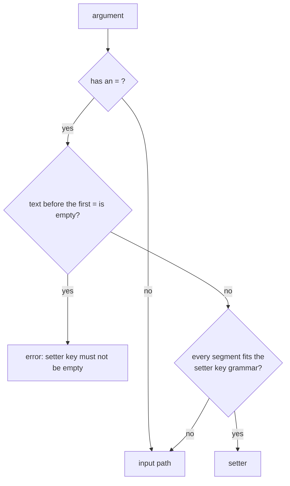

# `md compose`

The `compose` command assembles a Markdown document by evaluating its expressions,
applying transforms, and including referenced content. It writes the composed
result and, when the root declares lifecycle events, runs those events around
composition.

It is used for document assembly workflows like:

- interpolation (`{{ ... }}`)
- replacement transforms
- transclusion (`::file`, `::code`, `::toc-linking`, `::file-links`, and related directives)
- **link resolve** (converts relative links to absolute paths before transclusion)
- **link normalization** (converts absolute paths back to portable forms in the final document)

Unlike `read`, `compose` focuses on transformed content, not display rendering defaults.

Markdown output exports `::file-links` as readable linked lists without internal
render-tree metadata comments. Local `file:` URLs use the same portable-link
normalization as absolute paths: verified bare tree-root links first, then nearby
relative links and repository references such as `&docs/standards/mode-1004.md`.

`md compose` always writes Markdown, or the same result as data. To see a composed
document in a terminal, as plain text, or as HTML, pipe it to
[`md render`](./render.md):

```sh
md compose doc.md | md
md compose doc.md | md render --output html > doc.html
```

## Reporting

### Usage

```bash
# Compose a file
md compose doc.md

# Compose stdin
cat doc.md | md compose
md compose -

# Provide default values as JSON or JSON5
md compose doc.md --state '{"name":"Alice","env":"prod"}'
md compose doc.md --state '{name: "Alice", env: "prod"}'

# Override values using --set
md compose doc.md --set '{"name":"Bob"}'

# Override values using setters
md compose doc.md name=Bob iteration=1
md compose - name=Alice draft=false

# Override one nested value, keeping its siblings
md compose doc.md author.name=Bob
md compose doc.md items.1.name=z

# Include frontmatter in output
md compose doc.md --frontmatter
md compose doc.md --fm

# One value: the outcome, every diagnostic, and the document
md compose doc.md --output json
md compose doc.md --output yaml

# Reflow the document's prose at 80 columns
md compose doc.md --width 80

# Print the output and open it in the default app
md compose doc.md --show

# Report shell commands that compose could execute, without running them
md compose doc.md --shell
```

### Setters

A positional argument of the form `path=value` overrides one frontmatter value for this run. The file is not changed.

```bash
md compose doc.md iteration=1 draft=false name=Alice
md compose iteration=1 doc.md            # setters can come before the path too
md compose doc.md author.name=Alice      # one nested value; author's other keys stay
md compose doc.md 'a\.b=1'               # a key with a dot in its name
```

The left side is a [property path](./index.md#property-paths), and the right side follows the shared [value rules](./index.md#command-line-values). The argument splits at its first `=`, so the rest belongs to the value (`note=a=b`).

**Telling a setter from a file.** `md compose` has to decide whether an argument is a setter or the input path, before it reads anything:



The first segment must match `[A-Za-z_][A-Za-z0-9_-]*`. Each later segment matches that too or is all digits, and `\.` stands for a literal dot within a segment.

| Argument | Reads as |
|---|---|
| `name=Bob`, `author.name=Bob`, `items.0=x`, `'a\.b=1'` | setter |
| `a.b=c.md` | setter: it sets `b` inside `a` to `c.md` |
| `./a.b=c.md`, `./foo=bar.md`, `/tmp/a=b.md`, `@x=1.md` | input path |
| `9key=value`, `a..b=1`, `a.=1` | input path, because the key does not fit |

Name a file that looks like a setter with `./` in front. On native Windows, where `\` also separates folders, `dir\.config=1.md` reads as a setter, so write `.\dir\.config=1.md`. A key that does not fit the grammar, such as one with a space, can still be set by name through `--set`.

**What a setter does to a document.** Each document reads a setter through its own schema, and a setter reaches transcluded children just as `--set` does. So `md compose parent.md v=7` changes `v` in the parent and in each child, and a nested setter whose path cannot be followed in a child fails the run, naming that child.

- Changing one descendant keeps its siblings. Naming a whole object replaces it, as in `'author={name:"Ann"}'`.
- A missing parent is created. A number under a missing parent, an index out of range, and a path through text or `null` fail: see [When a path cannot be followed](./index.md#when-a-path-cannot-be-followed).
- A setter can change which schema applies. Setters are first applied to a temporary copy to select the schema, and then each value is read once through that schema, so `lang=rust edition=1.10` reads `edition` through a trigger that matches `lang: rust`, whichever comes first on the line. There is no second attempt: a trigger that would match only after a later conversion fails with a schema problem that names the setter.
- A setter's `{{ ... }}` stays authored text, evaluated by composition as `--set` values are.
- A file value resolves from the directory you ran `md` in, at any depth. Run from `work/` with `work/assets/me.png` present, `md compose sub/doc.md author.avatar=assets/me.png` stores the absolute path of that file, and `sub/`'s own `assets/me.png` is not a fallback. The same holds for each file inside a whole object, whether written `'author={avatar:"assets/me.png"}'` or through `--set`. A value the document itself wrote beside it, such as `author.cover: ./cover.png`, still resolves from the document's folder. A `--state` default counts as the document's own value, so it resolves from the document's folder too.

The schema composition selected decides how a setter's value is read and whether it is allowed: the baseline from `--baseline-schema` or `--disable baseline-schema`, matching triggers, and the document's `$schema`. With `--baseline-schema base.yaml` declaring `version: string`, `version=1.10` stays the text `1.10`, and a key declared `unknown` keeps its text too: `x=1.10` is `"1.10"` under `x: unknown`. The frontmatter root is open by default, so an undeclared top-level key is fine. A declared nested object is closed by default, so `author.mistake=1` fails with `dm.schema.unknown_key`, unless the schema opens it with a pattern key such as `"<string>": unknown`.

**Overlapping setters** resolve by how specific they are, not by their order on the line. The same path given twice takes the last value.

```bash
md compose doc.md 'author={name:"Ann",email:"a@x"}' author.name=Bob
md compose doc.md author.name=Bob 'author={name:"Ann",email:"a@x"}'
# both give { name: "Bob", email: "a@x" }

md compose doc.md author=7 author.name=Bob
# fails in either order: a scalar or null cannot also hold a child
```

**A failing setter** reports `dm.setter.invalid` when it cannot be applied, and a `dm.schema.*` code when its value breaks the schema. Either way the message names your argument and has no line or column, because the value is on the command line, not in the file. See [Composition Problems](../errors/composition-problems.md#how-a-problem-is-located).

#### Migrating older calls

| Call | Before | Now |
|---|---|---|
| `md compose doc.md a.b=c.md` | composed the file `a.b=c.md` | a setter; write `./a.b=c.md` for the file |
| `md compose doc.md nested.deep=7` | failed: read as a second input | sets `deep` inside `nested` |
| `md compose doc.md version=1.10` under `version: string` | the number `1.1` | the text `"1.10"` |
| `md compose doc.md x=1.10` under `x: unknown` | the number `1.1` | the text `"1.10"` |
| `md compose doc.md 'meta={a:1,a:2}'` | kept the last value | fails: a parsed object must be valid |
| `md compose doc.md 'meta={a:NaN}'` | the text `{a:NaN}` | fails, for the same reason |
| `md compose doc.md 'style={ max-width: 50 }'` | the text | the object `{max-width: 50}` |
| `md compose doc.md 'note={foo}'` | the text `{foo}` | the object `{foo: null}`; quote it to keep the text: `'note="{foo}"'` |
| `md compose doc.md n=9007199254740993` | a number no double can hold | the text `"9007199254740993"` when no type is declared |

### Arguments

- `[ARGS]`: Positional arguments — an optional input file path and zero or more [`path=value` setters](#setters), in any order. Use `-` for stdin. If no path is provided, reads stdin when piped; otherwise errors.

### Options

- `--state <JSON>`: default values as JSON or JSON5; fills in null/missing frontmatter keys without overriding existing values.
- `--set <JSON>`: override values as JSON or JSON5; overwrites existing frontmatter keys.
- `--timeout <SECONDS>`: global shell command timeout (default: 10). Pair it with `--allow shell-timeout` to turn a timed-out command into an empty string and a warning.
- `--frontmatter` / `--fm`: include frontmatter in the output (default: body only).
- `--output <markdown|json|json5|yaml|toml>`: what to print (default: `markdown`). See [Output Behavior](#output-behavior) and [Output and Width](./output-and-width.md). A data output cannot be combined with `--shell`.
- `--width <N|N%|auto|source|unlimited>`: how the document's prose is reflowed. See [Width](#width).
- `--show`: print the output and open it in the default app, through a temp file. See [Opening the output in an app](./output-and-width.md#opening-the-output-in-an-app). It cannot be combined with `--shell`, which composes nothing to open (a usage error).
- `--allow <ID|all>`: permit a recovery, or reads from an explicitly named host. Repeatable. `all` permits every recovery but never grants a host or authorizes a shell command. See [Policy Flags](./policy.md) for precedence and conflicts.
    - `missing-hyperlinks`, `missing-image-refs`: keep the content when a hyperlink or image target is missing; issues are still reported (on stderr, or in `diagnostics` in a data output) and the exit status is 0.
    - `missing-transclusions`: remove a transclusion directive whose target is missing; issues are still reported and the exit status is 0.
    - `ctx-override`: replace a non-object `ctx` frontmatter value with the runtime context. By default, a document that defines `ctx` as a non-object (e.g., a string or array) causes a hard error; this allowance downgrades the error to a warning.
    - `invalid-frontmatter-assignment`, `reassigned-frontmatter-property`: recover from an invalid or duplicated `set` assignment on a `::file` directive (see [Block Transclusion](../transclusion/block-transclusion.md)).
    - `shell-timeout`: replace a timed-out shell command's output with an empty string and a warning.
    - `untyped-map-variables`, `untyped-filter-variables`: accept a `::map` or `::filter` source that has no iterable declaration, reporting a warning instead of failing. Only the static typing requirement is waived; a source known to be unsuitable still fails, and shell approval still applies.
    - `host=HOST`: grant network access to a host or address (see below).
- `--deny <ID|all>`: make the selected diagnostics blocking, so compose fails and writes no document. Repeatable. Takes any recovery identifier above, `style` (unknown or deprecated `style:` keys and inline horizontal-rule deprecations), a diagnostic code such as `dm.reference.missing_hyperlink` (`md compose --help` lists them), or `all`. Informational notices never block, and `--deny all` never revokes an `--allow host=HOST`.
- `--disable <ID>`: stop a feature from running. Repeatable; there is no `all`.
    - `baseline-schema`: validate without the default Darkmatter baseline frontmatter schema.
    - `schema-triggers`: skip repository schema-trigger discovery and bare-name schema-root lookup.
    - `collection-blocks`: skip the `::map` and `::filter` directive stage, so those directives are not expanded.
- `--max-iteration-visits <N>`: how many source items one compose request may visit across every `::map` and `::filter`, nested directives and child compositions included. Rejected items count. `N` is a positive integer (zero, a sign, or a value beyond 64 bits is a usage error with exit status 2). When omitted, the library default (100,000) applies; there is no unlimited setting and no recovery for exhaustion.
- `--max-expansion-bytes <N>`: how many bytes of `::map` and `::filter` expansion one request may materialize, nested copies included. Same value rules as `--max-iteration-visits`; the library default is 16,777,216 (16 MiB).
- `--shell`: report the effects discovered in the compose tree and exit without performing them. The report includes body `::shell` directives, top-level frontmatter `$(...)` shell expressions, and the root document's [lifecycle](#lifecycle-events) `shell` actions, including commands discovered through markdown transclusions, followed by the `ping`/`ping_under` probes the tree could send and whether an `--allow host=HOST` entry already grants each one. No command runs and no packet is sent. A [schema trigger skipped as invalid](../topics/schemas/schema-triggers.md#invalid-discovered-triggers) is reported on stderr after the report.
- `--perf`: report how long compose took, as command-level timings (input loading, context capture, validation, option construction) and per-stage compose pipeline timings. A Markdown run prints the report to stderr, after any compose warnings and deferred validation issues. A data output puts the timings in the value's [`perf`](./data-contracts.md#timings) field and writes nothing to stderr.
- `--allow host=HOST`: grant network access to a host or address. Repeat for multiple entries. The default policy is deny-all, and the entry's shape decides which capability it grants:
    - a hostname or `*.wildcard` pattern allows remote URL reads from that host, and grants no ICMP;
    - an exact IP literal allows remote URL reads from that exact host **and** grants `ping`/`ping_under` to that address (an IPv6 zone constrains the ICMP grant to that interface, spelled the way the host spells it — the interface name on macOS and Linux (`fe80::1%en0`), the numeric interface index on Windows (`fe80::1%12`));
    - a strict CIDR such as `10.1.0.0/16` grants `ping`/`ping_under` to every address in the range of that family, and authorizes no HTTP at all.

  An ICMP probe to an address no entry grants returns `null` with a compose warning and sends nothing. An exact hostname entry also allows a [schema slot](../topics/schemas/schema-slots.md)'s reads of `http` and `https` URLs on that host, for this run (a `*.wildcard` pattern or a CIDR range allows no slot read); see [Schema slot reads](./policy.md#schema-slot-reads).
- `--remote-concurrency <N>`: maximum concurrent remote fetches. Defaults to `16`, or the value of the `DARKMATTER_REMOTE_CONCURRENCY` environment variable when the flag is omitted. An explicit flag overrides the env var, which overrides the default.
- `--remote-ttl <SECONDS>`: set the freshness lifetime of transport-cached remote bodies. Without this, the server's `max-age` is used when present. It never makes a `no-store` response storable or a `no-cache` response fresh.
- `--remote-refresh`: revalidate every transport-cached remote body with a conditional GET, even when fresh.
- `--remote-freshness <strict|fallback|optimistic>`: choose stale-cache behavior for remote artifacts. Defaults to `fallback`, which serves the stale cached body when revalidation fails on the network. `strict` fails instead; `optimistic` serves any cached body without revalidation. A `no-cache` response is always revalidated and never served stale.
- `--cache-root <DIR>`: the transport-artifact cache root. It persists raw remote URL response bodies only, under `<DIR>/.darkmatter/cache/v1/`, so `--remote-ttl`, `--remote-refresh`, and `--remote-freshness` apply across CLI runs. Semantic results (composed documents, `::file` children, `::code` and `::toc-linking` results, and document snapshots) are never persisted; every run recomposes local content. Nothing is created on disk until a storable remote response is written, and a cache root never authorizes a host. See [Caching](../topics/caching.md).

### Output Behavior

`md compose` accepts Markdown and the data family, and nothing else. Composition
is Markdown to Markdown, so the formatted alternatives belong to `md render`.

| `--output` | stdout | stderr |
|---|---|---|
| `markdown` (default) | the composed Markdown; nothing on failure | warnings, the problem report, lifecycle output, `--perf`, `-v` summaries |
| `json`, `json5`, `yaml`, `toml` | one [envelope](./data-contracts.md#md-compose-and-md-render) holding the document and every problem | nothing |

The default is the same on a terminal and on a pipe, so `md compose doc.md > out.md`
always writes Markdown.

```sh
$ md compose doc.md --output yaml
file: doc.md
outcome: success
document: |-
  # Notes
  ...
diagnostics: []
summary:
  references: 3
  documents: 1
  ok: 3
  broken: 0
lifecycle_output: []
```

Frontmatter is consumed as pipeline input and stripped from the output unless
`--frontmatter` (`--fm`) is given. With it, the output includes the frontmatter,
reflecting any values filled in by `--state`; key order is preserved from the
source document, and new keys appear at the end. A data output's `document` honors
the flag the same way.

`--show` prints the output and also opens it. A failed Markdown run opens nothing;
a failed data run still opens its failure value.

### Width

`md compose` ignores `OUTPUT_COLUMNS` and the terminal size unless you ask for them,
so the bytes it writes do not depend on where it ran.

| `--width` | The composed prose |
|---|---|
| (none) | never wraps; a paragraph's single line breaks are joined into one line |
| `source` | keeps authored line breaks |
| `N` | joined, then wrapped at `N` columns |
| `auto`, `N%` | as `N`, resolved from `OUTPUT_COLUMNS` or the terminal; no wrapping when neither is known |
| `unlimited` | joined, never wrapped |

Code blocks and tables are never reflowed. A data output's `document` gets the same
treatment. `--width` does not affect stderr. See
[Choosing a width](./output-and-width.md#choosing-a-width).

### Precedence

Override values are applied in this order (highest priority last):

1. **Document frontmatter** — base values from the document itself
2. **`--state`** — fills null/missing keys without overriding existing values
3. **`--set`** — unconditional overwrite of matching keys
4. **[`path=value` setters](#setters)** — unconditional overwrite of the one value each names, highest CLI priority

`--state` deep-merges into the frontmatter, and `--set` replaces each top-level key it names whole. Setters run after both, one path at a time, and outrank them whatever their spelling: `author={...}` beats a more specific `author.name` inside a `--set` object. `--state` and `--set` keep taking objects with literal keys, so `--set '{"a.b":1}'` sets the one key `a.b`.

```bash
# --state provides defaults, --set overrides, a setter overrides both
md compose doc.md --state '{"name":"Alice"}' --set '{"name":"Bob"}' name=Charlie
# Result: name is "Charlie"
```

### Transform Context

- If `[INPUT]` is a file path, compose sets source-file context for relative transclusion resolution.
- If input is stdin (`-` or piped with no input arg), source-file-relative path resolution is not available.
- All file path arguments accept the full [file reference grammar](./index.md#file-references) — `@` magic paths search package, package area, repository root, then home; `&` pins the repository root and `^` searches package → package area → repository root.

### Validation and Errors

- **Reference validation** runs automatically before composition when input is a file path. If any references (hyperlinks, images, transclusions, CSS imports, etc.) point to missing targets, compose prints the [reference report](./validate.md#the-reference-report) on stderr, grouped by the document that holds each problem, and exits with status 1. It is passive: body `::shell` directives are not run for it, so a reference only a command's output would contain is checked when the document composes.

  ```text
  Broken references in broken.md

  broken.md
    file not found in hyperlink  `./missing.md`  broken.md:3:5

  child.md (transcluded at broken.md:5)
    file not found in image  `./nope.png`  child.md:2:1

  Checked 4 references across 2 documents: 2 ok, 2 broken
  ```

  A data output reports the same problems in `diagnostics`, with the document as `null`.

- **`--allow` allowances** relax validation for specific categories. When all errors belong to allowed categories, compose proceeds normally: content goes to stdout, issues are reported on stderr, and the exit status is 0. If any errors remain in non-allowed categories, compose still blocks with exit status 1.

  ```bash
  # Compose despite broken links — content to stdout, warnings to stderr
  md compose doc.md --allow missing-hyperlinks

  # Compose despite any broken reference
  md compose doc.md --allow missing-hyperlinks --allow missing-image-refs --allow missing-transclusions

  # Pipe composed output while still seeing warnings
  md compose doc.md --allow missing-hyperlinks > output.md
  ```

- **`--deny` selections** make diagnostics blocking. One found by passive analysis (the call check, reference validation, the lifecycle call check) stops compose before anything runs; one found by shell preparation, which walks every transcluded document whatever its `when=` (such as an invalid schema trigger only a skipped child holds), stops compose before any shell command is approved or runs; one found while composing stops compose before the document is written, without undoing effects that already ran. See [Policy Flags](./policy.md).

- **Schema templates.** A document whose `$schema` (or matching trigger payload) holds `{{ … }}` [slots](../topics/schemas/schema-slots.md) is validated against the resolved schema. A data file committed, unchanged, in the schema's repository is read without asking; on a terminal, any other read whose target is written in the slot is asked about before anything runs, in the same batch as shell commands and before them (and on its own when no shell operation is enabled), with a numbered prompt offering this file or its folder, for this run or always, or a denial (see [Prompts](../topics/schemas/schema-slots.md#prompts)). A read whose target is computed (from `env`, say) is asked about when its slot evaluates. `--allow host=HOST` also allows a slot's reads of `http` and `https` URLs on that host for the run, unless a deny grant covers them. A data output never asks: an unapproved read fails the run (exit 1) with `dm.schema.slot_approval_required`, whose `grants_needed` names the grants that would allow it. The data files a slot read are in the envelope's `read_set`.
- Invalid JSON/JSON5 in `--state` returns an error.
- Non-object JSON (array/string/number/etc.) in `--state` returns an error.
- Transform failures return non-zero exit with error details.
- Remote URL transclusion fails unless the target host is allowed with
  `--allow host=HOST`. Denied hosts are rejected before any network request is
  attempted.

### Lifecycle Events

A root document that authors `initialize`, `composed`, `failed`,
`cancelled`, or `finalize` in its frontmatter composes as a lifecycle run.
`md compose` fires those five events around composition; transcluded
documents never fire theirs. See [Lifecycle Events](../topics/lifecycle/index.md)
for the grammar and [Lifecycle Error Handling](../topics/lifecycle/error-handling.md)
for failure routing.

```yaml
---
composed:
    - stdout: "Generated by md compose; do not edit."
    - shell: "git rev-parse --short HEAD"
finalize:
    - info: "composed {{ title }}"
---
```

- **Order.** `initialize`, then composition, then `composed`, then the
  document is written, then `finalize`. When composition or preflight fails,
  `failed` runs instead of `composed`, then `finalize`.
- **Output.** In a Markdown run, stdout holds only the document: every
  communication action (`stdout`, `stderr`, `info`, `warn`, `success`, `message`)
  and all lifecycle command output go to stderr, in run order. A `stdout` action's
  text is rendered there as prose. In a data output, the same output is captured
  as written into the value's
  [`lifecycle_output`](./data-contracts.md#lifecycle-output), and stderr stays empty.
- **`skip`** in `initialize` writes no document, runs no `finalize`, and
  exits 0.
- **Other hosts' actions.** A verb `md` does not run (Claudine's `say`,
  `retry`, `break`, or an unknown verb) is skipped with one warning on stderr
  per occurrence reached, naming the verb and the event; the rest of the stack
  runs and the exit status is unaffected. A malformed or misplaced action
  that `md` does run is an error before anything runs.
- **Shell approval.** Lifecycle `shell` actions are audited with the body's
  commands, under the same blacklist, whitelist, approval, and timeout rules,
  before composition. They run only from `composed` on. `--shell` lists them
  without running any stack.
- **Errors.** An error in `initialize` or a preflight failure runs `failed`
  then `finalize`. An error in `composed` or a failed document write runs
  `finalize` only. Either way the exit status is 1.
- **Ctrl-C** stops the run, runs `cancelled` (when authored) and `finalize`,
  and exits 130; a second Ctrl-C exits at once. An interrupted data output prints
  no value.

A lifecycle run in Markdown mode does not print the `--perf` report or the verbose
compose summary; a data output still carries `perf`. There is no dry-run mode;
`--shell` is the only report-only mode.

### Remote URL Examples

```bash
# Fetch and transclude an allowed remote Markdown document
md compose doc.md --allow host=example.com

# Cache remote artifacts and serve stale content on revalidation failure
md compose doc.md \
  --allow host=example.com \
  --cache-root . \
  --remote-freshness fallback

# Force revalidation of cached remote artifacts
md compose doc.md \
  --allow host=example.com \
  --cache-root . \
  --remote-refresh
```

### Removed spellings

These are usage errors (exit status 2).

| Removed | Use instead |
|---|---|
| `--output markdown-plus`, `--output html`, `--output browser` | `md compose doc.md \| md render --output ...` |
| `--output text`, `--output auto` | `--output markdown`, or no `--output` |
| `--output json` as the document AST, `--output ast` | no replacement: the document AST is not an output |
| `--output report-json` | `--output json` |

## Lessons Learned

- `compose` defaults to markdown because composed document output is the primary workflow.
- Frontmatter acts as transform configuration and is intentionally stripped unless `--fm` is used.
- Explicit `--state` is best for script-driven parameterization; it fills gaps without overwriting intent.
- JSON5 support for `--state` makes shell usage more ergonomic (no quoting keys).

## Issues

_(none known)_
