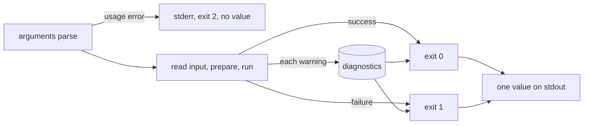
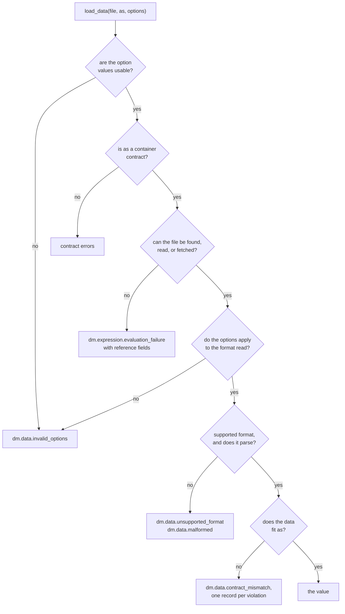

# Data Contracts

Every `md` command can print its result as data, so a script, a CI job, or an
editor can read the outcome and every problem as one value instead of parsing
text. This page says what that value holds for each command.

```sh
md compose notes.md --output json
```

```json
{
  "file": "notes.md",
  "outcome": "failure",
  "document": null,
  "diagnostics": [
    {
      "code": "dm.reference.missing_hyperlink",
      "severity": "error",
      "message": "Missing local target: ./missing.md",
      "source": { "file": "/work/notes.md", "line": 3, "column": 5, "section": "notes", "inserted": false },
      "expected_type": null,
      "actual_type": null,
      "span": { "start": 14, "end": 39 },
      "iteration_path": [],
      "reason": "file not found",
      "construct": "hyperlink",
      "reference": "./missing.md",
      "failure": "no-match",
      "included_via": []
    }
  ],
  "summary": { "references": 2, "documents": 1, "ok": 1, "broken": 1 },
  "lifecycle_output": [],
  "read_set": []
}
```

`json`, `json5`, `yaml`, and `toml` all carry the same value; the examples here
use JSON. How to choose an output, and how the families differ, is on
[Output and Width](./output-and-width.md).

## Streams and exit status

A data output writes exactly one value to stdout and nothing to stderr. Anything a
run has to say is in that value or is not said. That includes warnings, `--perf`
timings, and the output of lifecycle actions and shell steps.

| Status | Meaning | stdout | stderr |
|---|---|---|---|
| 0 | the command ran and succeeded | one value | nothing |
| 1 | the command ran and failed | one value that says so | nothing |
| 2 | a usage error: no command ran | empty | the parser's message |
| 130 | interrupted with Ctrl-C | empty | nothing |

Once the arguments parse, the command writes one value, including when the input
cannot be read. `--show` combines with a data output: the value is printed and
also opened (see [Opening the output in an app](./output-and-width.md#opening-the-output-in-an-app)). `--shell` prints its
own report and cannot be combined with one.



## `md compose` and `md render`

`md compose` and `md render` (and `md FILE`) print the same envelope, defined by
[`compose.yaml`](../../cli/schemas/output/compose.yaml) and
[`render.yaml`](../../cli/schemas/output/render.yaml).

| Field | Value |
|---|---|
| `file` | the file as given on the command line; `null` for stdin |
| `outcome` | `"success"` or `"failure"` |
| `document` | the document as a Markdown string; `null` on failure |
| `diagnostics` | every diagnostic the run reported, in [this order](#which-diagnostics-in-which-order); `[]` when there were none |
| `summary` | the reference check's totals; `null` when no check ran |
| `perf` | `md compose --perf` [timings](#timings); absent without that flag |
| `lifecycle_output` | what [lifecycle and shell steps](#lifecycle-output) printed, in run order; `[]` when there was nothing |
| `read_set` | the files and URLs the run's expressions [read](#read-set), sorted; `[]` when there were none |

`document` is always Markdown, even though `md render` defaults to terminal text.
It is the Markdown the same command's `--output markdown` would print, with
`--frontmatter` and `--width` honored, and without the final newline that printing
to stdout adds.

`summary` counts what the reference check saw. `md compose` runs the check on a
file argument; stdin has no base directory to resolve against, and `md render`
does not run it, so both report `null`.

| `summary` field | Value |
|---|---|
| `references` | references checked |
| `documents` | documents checked, the named one included |
| `ok` | references that resolved |
| `broken` | references that did not |

### Timings

`--perf` places timings in the value instead of on stderr. There is one entry per
command-level and pipeline stage, in run order.

```json
"perf": {
  "stages": [
    { "name": "resolve input", "milliseconds": 6.19 },
    { "name": "load input", "milliseconds": 0.2 },
    { "name": "capture context", "milliseconds": 2.36 }
  ]
}
```

### Lifecycle output

A formatted run writes lifecycle output to stderr. A data run captures it here, one
entry per step, so nothing is dropped and stdout stays one value. `stage` is the
lifecycle event, `step` is the action or the shell command, and `text` is what it
printed, exactly.

```yaml
---
composed:
    - stdout: "hello **bold**"
    - shell: "echo from-shell"
finalize:
    - info: "done"
---
```

```json
"lifecycle_output": [
  { "stage": "composed", "step": "stdout", "text": "hello **bold**" },
  { "stage": "composed", "step": "echo from-shell", "text": "from-shell\n" },
  { "stage": "finalize", "step": "info", "text": "done" }
]
```

### Read set

`read_set` lists every file and URL an expression read during the run, so a
script can tell which inputs a composed document depends on (for example, to
rebuild it when one of them changes). It is always present, success or failure.

```markdown
---
title: Release
---
Owner: {{ frontmatter("team.md").owner }}
{{ file_exists("CHANGELOG.md") }}
{{ load_data("servers.yaml", "string[]") }}
```

```json
"read_set": [
  "/work/CHANGELOG.md",
  "/work/servers.yaml",
  "/work/team.md"
]
```

- **What counts.** Each read-side function records the file it reads:
  `load_data`, `frontmatter`, `try_frontmatter`, `file_exists`,
  `markdown_title`, `markdown_body_empty`, and `validate_schema`. Schema files a
  `load_data` contract or `validate_schema` imports count too, at any depth,
  including every one read before an import failed. The path functions
  (`absolute`, `basename`, `join`, `link`, …) and `has_skill` record the
  candidates they probed, and `find_first_index`/`find_last_index` the folder
  they listed. Links, transclusions, `find_files` glob listings, and other
  files the run touches without an expression do not.
- **Every pass counts.** A read during the reference check, the lifecycle,
  pre-flight, or composition is reported, including a read in a transcluded
  document. A run that fails reports the reads made before it stopped, the file
  that failed to read or parse included, even when the failure came in the
  reference check before composition started.
- **Misses count.** A missing file records every path it was looked for:
  `file_exists`, `load_data`, and `frontmatter` on a missing file, and a
  contract import that does not exist. So `CHANGELOG.md` above appears whether
  or not it exists. A reference that names no concrete file, such as an empty
  string, records nothing.
- **Form.** Local files are absolute paths with `/` separators; URLs are
  written as the remote cache normalizes them, query included. A URL a host
  policy refused is still listed. Each entry appears once, in lexical order.
- **`md render`** runs no expressions, so its `read_set` is always `[]`.

## Diagnostics

A diagnostic is one reported problem. The same problem has the same fields
everywhere: a call the editor (DMLS) marks with `dm.expression.incompatible_call`
at `notes.md:4:18` is the record `md compose` rejects the document with and the
record this output prints.

| Field | Value |
|---|---|
| `code` | a stable `dm.<family>.<kind>` code, shared with DMLS; see [Codes](#codes) |
| `severity` | `"error"`, `"warning"`, or `"info"` |
| `message` | the problem in words |
| `source` | where the problem is, as below, or `null` when no file is known |
| `expected_type` | for a call argument, the parameter's declared type; for a [contract mismatch](#data-errors), the type the offending value should have had; otherwise `null` |
| `actual_type` | for a call argument, the argument's type; for a contract mismatch, the kind of value found; otherwise `null` |
| `span` | `{ "start", "end" }`, the byte range of the failing construct in `source.file`; otherwise `null` |
| `iteration_path` | for a failure while a `::map` or `::filter` body was being processed, the position of each item, outermost first, as `{ "collection", "position" }` (a number for an index, a string for a key); otherwise `[]` |
| `data_location` | for `dm.data.malformed` and `dm.data.contract_mismatch`, where in the loaded data file the problem is; see [Data location](#data-location). Absent, not `null`, on every other diagnostic |
| `grants_needed` | for `dm.schema.slot_approval_required`, the grants any one of which would allow the schema slot's read, in prompt order, as `{ "kind", "target", "scope" }` (`kind` is `file`, `dir`, `url`, `url-any-query`, or `site`; `scope` is `once` or `persisted`); see [Schema Slots](../topics/schemas/schema-slots.md#failures). Absent, not `null`, on every other diagnostic |

Severity describes the problem, and `outcome` describes the run. A problem an
`--allow` recovered keeps its severity while the run succeeds, so `severity: "error"`
can appear with `outcome: "success"`. A warning a `--deny` made blocking stays
`"warning"` while the run fails, with one exception: a `style` key that
`--deny` made blocking on `md render` (`dm.style.unknown_key`,
`dm.style.deprecated`) is reported as `"error"`.

`source` locates the problem in the document that was written, not in the composed
result, so transclusion cannot shift it:

| `source` field | Value |
|---|---|
| `file` | the resolved path of the file that holds the problem; `null` for stdin |
| `line` | the authored line, one-based; `null` when no authored position is proven, as for a document built in memory or a line counted in rewritten text |
| `column` | the authored column, one-based and counting characters; `null` as for `line`, and for a problem whose producer knows only the line |
| `section` | the composed anchor slug of the innermost heading at or before the problem; absent above the first heading, and on diagnostics that do not compute it |
| `inserted` | `true` when an expression, a shell step, or a `replace:` value created the reference, so `line` and `column` point at the construct that created it |

A problem inside transcluded content points at the transcluded file, not at the
`::file` directive that included it. A problem whose producer knows no file falls back
to the document the command named, with a `null` line and column. See
[what each family reports](../errors/composition-problems.md#how-a-problem-is-located).

### Reference details

A reference problem also carries what the [reference report](./validate.md#the-reference-report)
shows in its rows, as separate fields. So does an expression that failed because
the file a read-side function names could not be read, such as
`frontmatter("missing.md")`: its `construct` is the function, as in
`"frontmatter()"`, and its `reference` is the argument as written. A remote
fetch that fails after its host was allowed (the request fails, or the response
is not UTF-8 text) carries them too, with reason `"unreachable"` and failure
`"io"`; its `message` keeps the remote runtime's wording. Other diagnostics
omit these fields. The cases `load_data` meets are
listed under [Data errors](#data-errors).

| Field | Value |
|---|---|
| `reason` | the reason phrase, such as `"file not found"` or `"no matching heading"` |
| `construct` | the construct phrase, such as `"hyperlink"`, `"image"`, or `"::code"` |
| `reference` | the reference as written |
| `failure` | the [file-reference failure class](../errors/file-reference-failures.md), such as `"no-match"`, when the reference failed to resolve |
| `included_via` | the transclusion trail, outermost first, as `{ "file", "line" }` steps; each `line` is the authored line of the `::file` or `::toc-linking` directive |

## Which diagnostics, in which order

- **Warnings** come in the order the run found them: passive checks first,
  then what composition reports while it runs. The passive checks report a
  lifecycle stack's calls (event by event, each surface in authored order),
  then the document's calls by authored position: frontmatter first, then
  the body top to bottom, with `{{ … }}` expressions and `::block`/`::file`
  conditions interleaved where they are written. Transcluded documents report
  in the order their directives appear.
- **A failure** comes after the warnings reported before it. Earlier warnings
  are kept: a category 3 call reported before a failing `{{ 1 / 0 }}` is in
  the failure value too. A rejected call keeps the passive warnings found
  before it in that order, including an earlier call in its own expression;
  a finding after the rejected call is not reported, since the check stops
  there. A static `::map`/`::filter` defect (an invalid source, a pattern, a
  sort key, a protected parameter name) is rejected the same way: a recovered
  untyped source written before it keeps its `untyped_map_source` or
  `untyped_filter_source` warning in the value. A failure in a transcluded
  document comes after every warning of the documents that transclude it,
  outermost first, then its own: a parent's passive check covers the whole
  parent before any child composes, so a parent warning written after the
  `::file` line is reported too.

  ```text
  parent.md                         child.md
  1 {{ file_exists("") }}           1 {{ file_exists("https://") }}
  3 ::file ./child.md               3 {{ min(true, 5) }}
  5 {{ file_exists("http://") }}
  ```

  reports `always_false_call` at `parent.md` lines 1 and 5, then at
  `child.md` line 1, then `incompatible_call` at `child.md` line 3.

- **A policy stop** (`--deny`) lists each warning once, with its own severity:
  a denied `warning` is still `"warning"`. The policy decides the outcome, not
  the diagnostic.
- A check that stops a run before composition starts reports what that
  check found. A rejected call the pre-flight walk finds (the walk checks
  each document before it runs a shell) reports the same warnings ahead of
  it as the compose pass would: those of the document that holds it, after
  those of every document that transcludes it.
- **A rejected call** reports the call's own record wherever it is authored:
  in the body, in frontmatter, in a `::block` or `::file` condition, or on a
  lifecycle surface (an action's text, a `when:` condition, a `shell:`
  command, a side-effect argument such as `ensure_file:`, a `set:` value, or
  a control reason such as `error:`). The record is the one DMLS shows for
  the same bytes, located in the file as written. A lifecycle rejection stops
  the run before `initialize`, so no lifecycle effect runs; the lifecycle
  warnings found before it come first.

  ```yaml
  ---
  composed:
    - stdout: "{{ min(true, 5) }}"
  ---
  ```

  ```json
  { "code": "dm.expression.incompatible_call", "severity": "error",
    "message": "min: argument 1 (`a`) is literal true, expected number (…)",
    "source": { "file": "/work/doc.md", "line": 3, "column": 21, "inserted": false },
    "expected_type": "number", "actual_type": "literal true",
    "span": null, "iteration_path": [] }
  ```

## Codes

Call findings use the editor's codes (`dm.expression.incompatible_call`,
`uncertain_call`, `always_false_call`, `incomplete_analysis`), schema problems
the editor's schema codes (`dm.schema.type_mismatch`, `constraint`,
`missing_required`, `unknown_key`, `invalid_file_reference`, `prepare`), and a
recovered problem the code [`--deny`](./policy.md) takes for it. A failure is
classified by what failed:

| Code | Failure |
|---|---|
| `dm.frontmatter.yaml_parse` | the frontmatter YAML, or its `---` fence, does not parse; located |
| `dm.input.read_failure` | the input, or a file it needs, cannot be read |
| `dm.expression.parse_failure` | an expression does not parse |
| `dm.expression.evaluation_failure` | an expression fails to evaluate; located when the expression is authored in the file |
| `dm.expression.unknown_function` | an expression calls a function that does not exist |
| `dm.data.*` | a `load_data` call fails on its data or its contract (`malformed`, `contract_mismatch`, `not_a_container`, `row_shape_conflict`, `unsupported_format`, `this_import_rejected`, `invalid_options`); a missing or unreadable data file is `dm.expression.evaluation_failure`, as for any read-side function; see [Data errors](#data-errors) |
| `dm.directive.parse_failure` | a `::` directive does not parse |
| `dm.collection.*` | a `::map` or `::filter` fails (`malformed`, `untyped_map_source`, `untyped_filter_source`, `invalid_source`, `pattern_mismatch`, `invalid_sort_key`, `callback_failed`), located at the directive opener or the failing callback; a static defect is reported once, with `iteration_path: []` |
| `dm.iteration.visit_limit`, `dm.iteration.expansion_limit` | a request ran past `--max-iteration-visits` or `--max-expansion-bytes`; located at the authored text whose work was being paid for: the collection opener for a visit, the copied body text, or the `{{ }}`, `::shell`, `::shell-block`, or `::file` whose output was being inserted (a cached child that is included again is located at the including `::file`) |
| `dm.shell.failure` | a shell command fails, times out, or is refused |
| `dm.transclusion.failure` | a transclusion fails for another reason |
| `dm.reference.failure` | a file reference does not resolve |
| `dm.compose.parameter_binding` | a supplied value does not bind to its parameter |
| `dm.setter.invalid` | a `key.path=value` setter cannot be applied: its value is an invalid container, its path meets a scalar parent or an index out of range in a document, or a scalar setter overlaps a setter below it. The message names the argument and its path; `source` is null, because a command-line value is in no file |
| `dm.lifecycle.failure` | a lifecycle event fails (an `error:` action, a failed action) |
| `dm.hash.no_stored_hash` | `md hash --diff` found no stored hash to compare against |
| `dm.hash.changed` | `md hash --diff` found the document differs from its stored hash |
| `dm.schema.baseline` | `md schema validate --schema` could not load the baseline schema |
| `dm.output.serialization_failed` | the value cannot be written in the requested format; see [TOML](#toml) |
| `dm.output.open_failed` | `--show` could not open the file |
| `dm.style.*`, and `dm.schema.*` for a style | `md render` could not use a style setter, a `--style` file, or the merged style; see [Style input errors](#style-input-errors) |
| `dm.compose.failure` | anything else, on any command |

A warning whose producer declares no code reports `dm.compose.warning`. These
warnings belong to the run's output rather than to composition:

| Code | Warning |
|---|---|
| `dm.output.fractional_width` | `--width` was fractional and was rounded down |
| `dm.link.malformed_structured_title` | a link title starts with `{` but is not a JSON5 object, so it is read as plain text |
| `dm.link.legacy_structured_title` | a link title uses the removed `key=value` syntax; [`md clean`](./clean.md#migrating-link-titles) migrates it |
| `dm.style.unknown_key` | `md render` found an unknown `style:` key |
| `dm.style.deprecated` | `md render` found a deprecated `style:` key or inline rule style |

### Style input errors

`md render` (and `md FILE`) checks every [style it is given on the command
line](./render.md#styling-from-the-command-line), setters and `--style`
files, before it prints or opens anything, for every `--output`. A rejected
style fails the run with exit status 1, and a data output carries the
records in its one value with stderr empty. For a misspelled setter:

```text
$ md render doc.md style.magin=4 --output json
```

```json
{
  "file": "doc.md",
  "outcome": "failure",
  "document": null,
  "diagnostics": [
    {
      "code": "dm.schema.unknown_key",
      "severity": "error",
      "message": "`style.magin`: `magin` is not a valid property under `style`; did you mean `style.margin`? (from the setter `style.magin=4`)",
      "source": null,
      "expected_type": null,
      "actual_type": null,
      "span": null,
      "iteration_path": []
    }
  ],
  "summary": null,
  "lifecycle_output": [],
  "read_set": []
}
```

A schema problem's message starts with the property it is about,
`` `style.<path>`: ``, and other messages about one property name it too. A
problem with a value ends by naming where the value came from:
`(from the setter …)`, `(in the style file … at line L, column C)`, or the
document. A setter is in
no file, so its `source` is `null`; a style-file record's `source` is that
file, with the key's line and column when the format proves them, never the
Markdown document.

| Code | Severity | When |
|---|---|---|
| `dm.schema.unknown_key` | error | a setter names a key the document's schema does not declare (`style.magin=4`, `style.table.border.glow=1`, or a whole-object setter holding one); the message suggests a renamed key's new name, or else the nearest sibling key within two edits, as in ``did you mean `style.margin`?``; an unrelated word gets no suggestion, and a suggestion only ever names a key the same schema accepts, so under `$schema: { style: { accent: string } }` `style.acent=blue` suggests `style.accent` and `style.magin=4` suggests nothing |
| `dm.schema.type_mismatch`, `dm.schema.constraint` | error | a setter or style file gives a declared key a value its schema refuses (`style.margin=abc`, `max-width: abc` in a file), or a whole-style setter is not a mapping (`style='{ margin: '`, `style=4`, `style=null`, `style=[]`), with a message naming `style` |
| `dm.style.unknown_key` | warning | a style file holds a key the schema does not declare; the key is left out and the rest applies. The document's own `style:` reports its unknown keys the same way |
| `dm.style.deprecated` | warning | the document's `style:` uses a deprecated key or inline rule style |
| `dm.style.invalid_value` | error | a value the schema admits but rendering cannot use, such as a color (`style.page.bg-color=currentColor`) or a length with an unsupported unit |
| `dm.style.conflict` | error | one layer sets one field twice under different spellings (`style.ml=2 style.page.margin-left=3`), or sets both `width` and `max-width` on one component |
| `dm.style.invalid_root` | error | a style file is not a mapping (a file holding an array or a number), or a `KEY@FILE` offset is missing or not a mapping |
| `dm.style.empty_file` | error | a style file sets no value once unknown keys and nulls are removed (`{}`, or only unknown keys); an inline `style='{}'` is a valid no-op |
| `dm.style.invalid_setter` | error | a setter's key is not a property path (`style..x=1`) |
| `dm.data.malformed` | error | a style file is not valid in its format, located at the parser's line and column |
| `dm.input.read_failure` | error | a `--style` argument that names no usable file: missing (with its `failure:` class, such as `no-match`), a URL, `-`, an inline object, or an extension other than `.json`, `.json5`, `.yaml`, `.yml`, and `.toml` |

Two cases are easy to confuse:

- **An unknown member of a compound value** is an unknown key, whichever
  arm of the value it sits in: `table.border: { weight: thick, glow: 1 }`
  drops `glow` with a `dm.style.unknown_key` warning in a style file or the
  document, and is a `dm.schema.unknown_key` error in a setter. The rest of
  the value still applies.
- **Unknown-key warnings become errors under `--deny style`** (or
  `--deny dm.style.unknown_key`, or `--deny all`), in a style file and in the
  document alike; see [Policy Flags](./policy.md#diagnostics---deny). A setter
  is already an error.

A failure is reported with the warnings found before it, so a run whose
style file is empty after its unknown keys are dropped reports the
`dm.style.empty_file` error followed by each `dm.style.unknown_key`
warning.

### Failures inside `::map` and `::filter` bodies

A failure of any kind while a repeated body was being processed (a callback,
a `when=` gate, a `{{ }}` expression, a `::shell` or `::shell-block`
argument, a `::file` target or condition, a child document, or an allowance)
keeps its own `code` and `message`, and adds where it happened: `source` and
`span` locate the authored site in the file (not in the expanded text), and
`iteration_path` names the item whose copy ran it. The `message` ends with
`at <path>`. For a shell-block command failure, the site is the command's
authored line, including when an earlier command succeeded; for the block's
combined-output allowance, it is the block opener.

Given this `doc.md`, where only `ok.md` exists:

```md
---
$schema:
  data: string[](required)
data: [./ok.md, ./missing.md]
---
::map data
{{ frontmatter(i, 'title') }}
::end-map
```

the second item fails on line 7:

```json
{ "code": "dm.expression.evaluation_failure", "severity": "error",
  "message": "interpolation of `frontmatter(i, 'title')` failed: invalid file path: ./missing.md at data[1]",
  "source": { "file": "/work/doc.md", "line": 7, "column": 1, "inserted": false },
  "expected_type": null, "actual_type": null,
  "span": { "start": 85, "end": 114 },
  "iteration_path": [{ "collection": "data", "position": 1 }] }
```

Positions are the items' places in the original source, before any filter or
sort. A failure inside a child document that a repeated `::file` included
joins both paths, outer first (`data[1] → d[0]`), and keeps the child's own
`source`.

### Schema triggers skipped as invalid

A [schema trigger skipped because it failed to load](../topics/schemas/schema-triggers.md#invalid-discovered-triggers)
is a `dm.schema.invalid_trigger` warning. It belongs to the trigger, not to
the composed document. Its `message` names the trigger file (or
`embedded:{bundle}/{file name}`) and the reason, and, when the failure is
inside a payload or import file, that file too. The value lists each
trigger once, even when transcluded documents discover it again.

Its `source` points into the trigger file only where the failure has a
known position there, which is a trigger file that is not valid YAML:

```json
{ "code": "dm.schema.invalid_trigger", "severity": "warning",
  "message": "ignoring invalid schema trigger /repo/schemas/broken.yaml: not valid YAML at line 3, column 1: …",
  "source": { "file": "/repo/schemas/broken.yaml", "line": 3, "column": 1, "inserted": false },
  "expected_type": null, "actual_type": null }
```

Every other cause names the trigger file with a `null` line and column, since
no position is invented: an envelope with unsupported keys, or a payload or
import that fails to load (a position inside that file is never placed on the
trigger; the message names the file instead). An embedded trigger names no local
file, so its `source` is `null`:

```json
{ "code": "dm.schema.invalid_trigger", "severity": "warning",
  "message": "ignoring invalid schema trigger /repo/schemas/memory.yaml: invalid schema-trigger: …",
  "source": { "file": "/repo/schemas/memory.yaml", "line": null, "column": null, "inserted": false },
  "expected_type": null, "actual_type": null }
```

`md schema validate --output json`, which reports several files, puts a
trigger warning that files share in the `warnings` of the first file that
discovers it, once per invocation, and not in the later files' records.

## Data errors

[`load_data(file, as, options)`](../functions/load-data.md) reads a data file
and checks it against the contract `as`; the optional
[options](../topics/loading-data.md#options) choose the format, the CSV
delimiter, and whether a CSV file has a header row. When the call fails, its
diagnostic tells a script which part failed: the options, the contract, the
data, or the file itself. This section lists
every case, what each record carries, and how many records one failure produces.
Every case is an error. None is a warning, so `--allow` and `--deny` do not
apply to them.



| Code | What triggers it | `data_location` |
|---|---|---|
| `dm.data.not_a_container` | `as` does not describe a [container](../topics/schemas/definition.md#container-types): a scalar such as `"string"`, `"unknown"` or `"null"` alone, a union with a scalar arm, or a named import that resolves to a scalar | no |
| `dm.data.this_import_rejected` | `as` names a type of the calling document (`Os@this`, or a bare name such as `Os`). An inline contract has no types of its own, so import the type from a file (`Os@./types.yaml`). A misspelled type keyword reads as a bare name: `"strng[]"` fails here | no |
| `dm.data.row_shape_conflict` | the file is CSV or TSV and `as` cannot choose one row shape: one arm reads rows as objects and another as lists, or an element is not a row; or `header: false` is given and `as` describes object rows | no |
| `dm.data.unsupported_format` | no `format` option is given and the file's extension names none of the [supported formats](../topics/loading-data.md#formats) (`.txt`, `.md`, no extension), whether or not the file exists | no |
| `dm.data.invalid_options` | an [option](../topics/loading-data.md#options) value cannot be used (a `delimiter` that is not one ASCII character other than a double quote, CR, or LF), a TSV read is given a delimiter other than a tab, or `delimiter` or `header` is given for a format other than CSV and TSV. The message names the key | no |
| `dm.data.malformed` | the content does not parse under its format's rules: invalid syntax, trailing text, an empty JSON or JSON5 file, a number the format cannot hold exactly, several YAML documents, a YAML duplicate key, non-string key, or tag, a TOML duplicate key, a CSV or TSV quote error or ragged row, or a local file that is not valid UTF-8 | yes |
| `dm.data.contract_mismatch` | the data parsed but does not fit `as` | yes, on each record but the overflow record |

### Contract errors

A contract problem is reported in one of two places, depending on whether `as` is
written in the call or computed:

- **A literal `as`** is judged by the call check before anything runs, so no file
  is read and no `::shell` command runs. The record is located at the `as`
  argument, and `expected_type` and `actual_type` name the parameter and the
  argument, as for any [rejected call](#which-diagnostics-in-which-order).
- **A computed `as`**, such as a frontmatter value, is judged when the call runs.
  The record is located at the expression, with `null` types.

`dm.data.row_shape_conflict` needs the format as well, so it is found before
anything runs only when the format is provable: a literal `format` option, or
a literal `file` and no computed value that could set `format`.
`dm.data.unsupported_format` is always found when the call runs.

```json
{ "code": "dm.data.not_a_container",
  "message": "load_data(): the contract `string` does not describe a container (an array, tuple, object, or dictionary)",
  "source": { "file": "/work/doc.md", "line": 1, "column": 27, "inserted": false },
  "expected_type": "type-definition(container)", "actual_type": "literal \"string\"" }
```

Two contract problems keep a general code:

- `as` text that is not type syntax at all, such as `"[string,"` or
  `"string[("`, is `dm.expression.incompatible_call` at the `as` argument when it
  is a literal, and `dm.expression.evaluation_failure` when it is computed.
- A contract whose named type cannot be resolved (the import file exists but
  does not export the name, or is not a schema document) is
  `dm.expression.evaluation_failure`, located at the expression, with no
  `data_location` and no reference fields. A missing import file is a
  [file error](#file-errors) that names the import.

```json
{ "code": "dm.expression.evaluation_failure",
  "message": "interpolation of `load_data(\"os.yaml\", \"Nope@./types.yaml\")` failed: load_data(): the contract `Nope@./types.yaml` is invalid: as: unknown named type `Nope` in `/work/types.yaml`",
  "source": { "file": "/work/doc.md", "line": 1, "column": 3, "inserted": false } }
```

### Option errors

An options problem is found before the data file is read, so its record never
has a `data_location`. Like a contract problem, where it is reported depends
on whether the options are written in the call:

- **Literal options** are judged by the call check before anything runs. The
  record is located at the options argument, and `expected_type` and
  `actual_type` name the parameter and the argument.
- **Computed options**, such as `load_data(f, t, opts)` with `opts` from
  frontmatter, are judged when the call runs. The record is located at the
  call expression, with `null` types.

Literal options are judged even when `as` is computed, because whether an
option applies to a format never depends on the contract:
`load_data("rows.json", t, {header: true})` is refused before anything runs,
whatever `t` holds. Only the CSV and TSV row rules wait for a contract the
call check can read. When the call check refuses a literal `as` itself, that
contract error is the one reported, ahead of any option error.

A key that is not an option, a value of the wrong type, or a format name that
is not in the list is not `dm.data.invalid_options`: the argument does not fit
the parameter at all, so it is `dm.expression.incompatible_call` at the
options argument.

Given `rows.csv` and this document, `doc.md`:

```md
{{ load_data("rows.csv", "tuple([string, number])[]", {delimiter: ",,"}) }}
```

`md compose doc.md --output json` exits with status 1, writes nothing to
stderr, and prints:

```json
{
  "file": "doc.md",
  "outcome": "failure",
  "document": null,
  "diagnostics": [
    {
      "code": "dm.data.invalid_options",
      "severity": "error",
      "message": "load_data(): option `delimiter` is invalid: must be one ASCII character other than a double quote, CR, or LF (write a tab as \"\\t\")",
      "source": { "file": "/work/doc.md", "line": 1, "column": 55, "inserted": false },
      "expected_type": "{format: enum(yaml,yml,json,jsonl,ndjson,csv,tsv,toml,json5),delimiter: string,header: boolean} | null",
      "actual_type": "literal {\"delimiter\":\",,\"}",
      "span": null,
      "iteration_path": []
    }
  ],
  "summary": null,
  "lifecycle_output": [],
  "read_set": []
}
```

Field by field:

- `code` and `severity`: an error, which `--allow` cannot recover.
- `message`: names the key (`delimiter`) and what a valid value is.
- `source`: line 1, column 55, the `{` that opens the options argument.
- `expected_type` and `actual_type`: the declared options parameter and the
  literal that was passed.
- no `data_location`: no data file was read.
- `read_set` is empty: the call check rejected the document before any
  expression ran, so `rows.csv` was never resolved.

Given the same `rows.csv` (`web,8080` and `db,5432`, no header row), a
headerless read succeeds:

```md
Ports: {{ load_data("rows.csv", "tuple([string, number])[]", {header: false}) }}
```

```text
Ports: [["web",8080],["db",5432]]
```

### Malformed data and contract mismatches

A malformed file is one record. Its `data_location` points into the file where
the parser proves a position; see [Data location](#data-location).

```json
{ "code": "dm.data.malformed",
  "message": "interpolation of `load_data(\"bad.json\", \"unknown[]\")` failed: load_data(): `/work/bad.json` is not valid JSON: EOF while parsing a list",
  "source": { "file": "/work/doc.md", "line": 1, "column": 3, "inserted": false },
  "expected_type": null, "actual_type": null,
  "data_location": { "file": "/work/bad.json", "line": 1, "column": 7 } }
```

A contract mismatch is one failure, but it is reported as one record per
violating value, so a script can show every bad row at once. Each record has:

- `message`: ``load_data(): `<file>` does not match `<as>`:`` followed by what
  is wrong with that value, including the value found (`"macOS"`). The value
  appears only in the message, never in a field.
- `expected_type`: the type the value should have had (`number`), the whole `as`
  as written for a record at the data's root (pointer `""`), or `absent` for a
  key or tuple element the contract does not allow.
- `actual_type`: the kind of value found (`string`, `number`, `boolean`, `null`,
  `array`, `object`), or `missing` for a required value that is not there.
- `source`, `span`, and `iteration_path`: the call, the same on every record.

Given `os.yaml` holding `- macOS` and `- Linux`, the call
`{{ load_data("os.yaml", "number[]") }}` reports:

```json
[
  { "code": "dm.data.contract_mismatch",
    "message": "load_data(): `/work/os.yaml` does not match `number[]`: [0]: expected number; received text \"macOS\"; conversion failed: not a number",
    "source": { "file": "/work/doc.md", "line": 1, "column": 12, "inserted": false },
    "expected_type": "number", "actual_type": "string",
    "data_location": { "file": "/work/os.yaml", "pointer": "/0", "line": 1, "column": 3 } },
  { "code": "dm.data.contract_mismatch",
    "message": "load_data(): `/work/os.yaml` does not match `number[]`: [1]: expected number; received text \"Linux\"; conversion failed: not a number",
    "source": { "file": "/work/doc.md", "line": 1, "column": 12, "inserted": false },
    "expected_type": "number", "actual_type": "string",
    "data_location": { "file": "/work/os.yaml", "pointer": "/1", "line": 2, "column": 3 } }
]
```

Records are in **file order**: array items by index, object keys in the order
the file writes them, and a missing member after the members that are present.
At most **20** violations are listed. When there are more, one further record
with the same code counts the rest. It is located at the call, has no
`data_location`, and has `null` types. A CSV file with 25 bad rows reports rows
0 to 19, then:

```json
{ "code": "dm.data.contract_mismatch",
  "message": "load_data(): `/work/rows.csv` does not match `{port: number}[]`: 5 more violations are not listed",
  "source": { "file": "/work/doc.md", "line": 1, "column": 8, "inserted": false },
  "expected_type": null, "actual_type": null }
```

When two arms of a union are containers of the same kind
(`{a: string}[] | {b: number}[]`), nothing in the data says which arm was meant,
so data that fits neither is one record at pointer `""` rather than one per row.
Its message carries each arm's failure, cut to a few lines.

### File errors

A data file that cannot be found or read is not a `dm.data.*` problem. It keeps
the code every read-side function uses, `dm.expression.evaluation_failure`, and
its `message` and terminal output are those of any expression failure.
Most such records also carry the [reference details](#reference-details), so a
script can tell what went wrong without parsing the message:

| Failure | `reason` | `construct` | `reference` | `failure` |
|---|---|---|---|---|
| the local file does not exist | `file not found` | `load_data()` | the `file` argument as written | `no-match` |
| an import named in `as` does not exist | `file not found` | `load_data()` | the import, such as `./missing-types.yaml` | `no-match` |
| the local file exists but cannot be read | omitted | `load_data()` | the `file` argument as written | [`io`](../errors/file-reference-failures.md) |
| the URL's host is not allowed | `remote check disabled` | `load_data()` | the URL as written | `unsupported-remote` |
| the host is allowed, but the request fails (no connection, an HTTP error status) or the response is not UTF-8 text | `unreachable` | `load_data()` | the URL as written | `io` |

```json
{ "code": "dm.expression.evaluation_failure",
  "message": "interpolation of `load_data(\"gone.json\", \"unknown[]\")` failed: invalid file path: gone.json",
  "source": { "file": "/work/doc.md", "line": 1, "column": 3, "inserted": false },
  "reason": "file not found", "construct": "load_data()",
  "reference": "gone.json", "failure": "no-match" }
```

A fetch from an allowed host that fails keeps the remote runtime's wording in
`message`, such as `HTTP error status 500 from <url>` or `invalid UTF-8 in
response body: …`. Its `failure` is `io`, never `unsupported-remote`, because
the host was allowed and contacted:

```json
{ "code": "dm.expression.evaluation_failure",
  "message": "interpolation of `load_data(\"https://data.example.com/hosts.json\", \"object\")` failed: load_data(): HTTP error status 500 from https://data.example.com/hosts.json",
  "source": { "file": "/work/doc.md", "line": 1, "column": 3, "inserted": false },
  "reason": "unreachable", "construct": "load_data()",
  "reference": "https://data.example.com/hosts.json", "failure": "io" }
```

No file error has a `data_location`. The other read-side functions (`frontmatter`, `markdown_title`,
`markdown_body_empty`, `validate_schema`, `file_exists`) report their file
failures the same way, each naming itself in `construct`.

`validate_schema` reads more than its argument: the `$schema` file its
subject document names, and every file that schema imports a named type
from. When one of those is missing or unreadable, the record carries the
same fields with `construct` `validate_schema()` and `reference` the schema
reference as written (`./missing-types.yaml` for
`name: Name@./missing-types.yaml`): `file not found`/`no-match` for a file
that does not exist, `io` with no `reason` for one that cannot be read. A
schema file that reads but is not a valid schema (a grammar error, an
unknown named type) is not a file failure and has no reference fields. A
remote `$schema` is never fetched, so it has none either. The `message` is
the same in every case, for example:

```json
{ "code": "dm.expression.evaluation_failure",
  "message": "interpolation of `validate_schema(\"subject.md\")` failed: validate_schema(): validate_schema() error for \"subject.md\": could not resolve $schema reference `./missing-types.yaml`",
  "source": { "file": "/work/doc.md", "line": 1, "column": 3, "inserted": false },
  "reason": "file not found", "construct": "validate_schema()",
  "reference": "./missing-types.yaml", "failure": "no-match" }
```

A data failure stops the command; it can stop it in the reference check, before
composition starts. See [Data failures](../errors/composition-problems.md#data-failures).
`md graph` and `md validate refs` report the same records when the documents they
prepare call `load_data`.

## Data location

`data_location` says where in a loaded data file a problem is, so an editor or a
script can open the data at the right line. `source` still points at the
`load_data` call in the Markdown document. It is present only on
`dm.data.malformed` and `dm.data.contract_mismatch` records (other than the
overflow record), and absent on every other diagnostic.

| `data_location` field | Value |
|---|---|
| `file` | the data file as a portable absolute path, always with `/` separators, or the URL it was fetched from; the same spelling as its [`read_set`](#read-set) entry |
| `pointer` | the [JSON Pointer](https://www.rfc-editor.org/rfc/rfc6901) (RFC 6901) of the offending value, such as `/servers/1/port`; `""` is the whole document, and `/` and `~` in a key are written `~1` and `~0` |
| `line` | the one-based line of that value |
| `column` | the one-based column of that value, counting characters, not bytes |
| `byte_offset` | for a local file that is not valid UTF-8, the zero-based offset of the first invalid byte, counted in the file's original bytes |

A field that is not known is **omitted**, never `null` and never a guess. The
object has `file` and whichever of the others were proven:

```json
"data_location": { "file": "/work/ports.json", "pointer": "/1", "line": 1, "column": 5 }
"data_location": { "file": "/work/bad.json", "line": 2, "column": 1 }
"data_location": { "file": "/work/data.json", "byte_offset": 1 }
"data_location": { "file": "/work/p.yaml", "pointer": "/items/0" }
```

`source.file` and `data_location.file` can be spelled differently. `source.file`
is a native path (`C:\work\doc.md` on Windows), while `data_location.file` is
portable (`C:/work/ports.json`), so a script that compares a data file with its
`read_set` entry can compare the strings directly.

### Which value a record points at

- **A contract mismatch always has a pointer.** It names the offending value.
- **A missing value keeps its own pointer.** A required member `port` that is
  absent from the first row is `/0/port`, but its `line` and `column` are those
  of the nearest value that exists, the row `/0`.
- **An unexpected key or tuple element** is located at its value, not at its key.
  In `[{"a": "x", "z": 1}]` against `{a: string}[]`, `/0/z` is at the `1`.
- **A CSV or TSV cell** is located at its raw start, including an opening quote;
  a problem with a whole row is located at the start of its record.
- **A malformed document has no pointer** unless the parser proves which value
  failed, because there is no value tree to point into. Its `line` and `column`
  are the parser's.
- **A local file that is not valid UTF-8** reports `file` and `byte_offset`
  only. A line means nothing in text that cannot be decoded.

### How lines and columns are counted

Positions use the same convention as `source`, so both open the same way in an
editor:

- Lines and columns are one-based, and a column counts characters: an `é` before
  the value moves the column by one, not two.
- LF and CRLF end a line. A lone CR, not followed by LF, does not, so a CRLF file
  reports the same positions as its LF copy.
- One leading UTF-8 byte-order mark is removed before counting, so it never
  shifts a column. `byte_offset` is the exception: it counts the file's
  original bytes, the mark included.
- Data fetched from a URL gets lines and columns too, counted in the fetched
  text.

### YAML anchors, aliases, and merge keys

YAML lets you name a value with an **anchor** (`&name`) and reuse it later with
an **alias** (`*name`). The alias is not a copy written in the file: the parser
expands it into the anchored value. A value reached through an alias therefore
has no text of its own, so its record is located at the alias token that
brought it in. Its pointer still names the expanded value.

With a contract that requires numeric `port` values:

```yaml
base: &b {port: x}
one: *b
two: *b
```

| Pointer | Line | Column | Located at |
| ------- | ---- | ------ | ---------- |
| `/base/port` | 1 | 17 | the `x` inside the anchored mapping |
| `/one/port` | 2 | 6 | the alias `*b` on line 2 |
| `/two/port` | 3 | 6 | the alias `*b` on line 3 |

Each use is its own record, in file order. Several failing values under one
alias share its position but keep their own pointers, and a missing member
under an alias is located at the alias too. An alias does not affect any
other value in the file. Below, `/servers/1/port` is still line 4, column 12,
the `x`:

```yaml
base: &b {port: 1}
servers:
  - *b
  - {port: x}
```

A flow collection written across several lines is located like any other
value, inside it and after it:

```yaml
items: [
  {port: 1},
  {port: x}
]
```

`/items/1/port` is line 3, column 10.

**Merge keys are not applied.** Some YAML tools read `<<: *b` as "inherit the
members of `b`". `load_data` does not: `<<` is an ordinary key whose value is
the expanded alias, so `server: {<<: *b, port: 2}` has the members `<<` and
`port`, and nothing is inherited. A failure inside it, such as
`/server/<</port`, is located at the `*b` after `<<`. A contract that does not
allow a `<<` member reports it as an unexpected property and adds one
sentence (the message is one line, wrapped here):

```text
load_data(): `/work/h.yaml` does not match
`{ base: { port: number }, server: { port: number } }`: server["<<"]: expected { port?: null | number, no other keys }; received
object {"port":1}; unexpected property. YAML merge keys are not applied, so
`<<` is read as an ordinary key.
```

The sentence is added only for a YAML file and only for a key that is exactly
`<<`, written plain or quoted.

### YAML positions that cannot be proven

Most YAML problems have a line and column. A few have less, because the parser
or the position map cannot prove one:

- **Pointer only.** When a file's layout is one the position map cannot match
  to the parsed value, contract-mismatch records in that file have `file` and
  `pointer` but no `line` or `column`. An anchor on a key (`&k a: 1`) is an
  example: `b: x` on the next line is reported as `/b` with no position. A
  guessed position is never reported in its place. A parser error in such a
  file keeps the parser's line and column.
- **A duplicate key** is located at the start of the mapping that holds it, not
  at the second key: `a: 1` then `a: 2` at the top of a file is line 1,
  column 1, with no pointer.

These are always located, because they are problems in the YAML itself, not
contract mismatches:

- **A second YAML document** is located at the `---` that starts it
  (`a: ok`, `---`, `a: next` is line 2, column 1), or at its first value when
  no `---` introduces it (after a `...` end marker).
- **A non-string key** is located at the key: `42: text` at the top of a file
  is line 1, column 1, with no pointer.
- **A tag** (`b: !tag text`) is located at the tag (line 1, column 4), with
  the pointer of the tagged value (`/b`).

## Other commands

Each command has its own shape. Three rules cover how a command reports its
outcome, depending on whether its shape was published before `outcome` existed:

- **A command whose result always has an outcome** includes `outcome` and
  `diagnostics` on every run. That is `md set`, `md hash`, `md edit`,
  `md code-block`, `md schema triggers`, and `md schema about`. On failure its
  result fields are `null` or empty.
- **A command with an existing object** adds `outcome` and `diagnostics` only when
  the run failed or has a run-level warning, so a clean success reads as it always
  has. That is `md toc`, `md delta`, `md rm`, `md graph`, `md validate refs`, and
  `md schema validate`. When a failure leaves no result at all, such as a missing
  input, the value is `{ "outcome": "failure", "diagnostics": [...], "value": null }`.
- **A command whose value is the user's own data** never adds fields to it, because
  a frontmatter property called `outcome` would be overwritten. That is `md get` and
  a single or merged `md schema detect`. A clean success is the bare value, and a
  run with something to say wraps it:
  `{ "outcome": "...", "diagnostics": [...], "value": ... }`.

| Command | Schema | Value |
|---|---|---|
| [`md clean`](./clean.md#version-1-json-envelope) | [`clean.yaml`](../../cli/schemas/output/clean.yaml) | the version-1 object: `version`, `source`, `frontmatter`, `diagnostics`, `applied`, `changed`, `warnings`; see below for its run-level records |
| [`md list-themes`](./list-themes.md) | [`list-themes.yaml`](../../cli/schemas/output/list-themes.yaml) | a bare array of `{ name, description }`, one per theme in canonical order; a run with a diagnostic is `{ "outcome", "diagnostics", "value" }`, as for `md get` |
| [`md toc`](./toc.md) | [`toc.yaml`](../../cli/schemas/output/toc.yaml) | `title`, the hashes, `preamble`, `structure` (the heading tree), `code_blocks`, `internal_links`, `slug_index` |
| [`md delta`](./delta.md) | [`delta.yaml`](../../cli/schemas/output/delta.yaml) | `classification`, `statistics`, the frontmatter and preamble flags, `added`, `removed`, `modified`, `moved`, `code_block_changes`, `broken_links` |
| [`md get`](./get.md) | [`get.yaml`](../../cli/schemas/output/get.yaml) | one path's value, or a flat object keyed by the [paths](./index.md#property-paths) as written; a missing path is `""` |
| [`md set`](./set.md) | [`set.yaml`](../../cli/schemas/output/set.yaml) | `file`, `property` (the path as written), `value`, `document`, `saved`, plus outcome |
| [`md rm`](./rm.md) | [`rm.yaml`](../../cli/schemas/output/rm.yaml) | `removed` (the paths as written), `remaining` (surviving top-level keys), `filename` |
| [`md edit`](./edit.md) | [`edit.yaml`](../../cli/schemas/output/edit.yaml) | `file`, `editor`, `created`, plus outcome |
| [`md hash`](./hash.md) | [`hash.yaml`](../../cli/schemas/output/hash.yaml) | `mode`, `file`, `kind`, `computed`, `stored`, `comparison`, `saved`, plus outcome |
| [`md graph`](./graph.md) | [`graph.yaml`](../../cli/schemas/output/graph.yaml) | `file`, `source`, `references`, `transclusions`, and with `--validate`, `validation` |
| [`md code-block`](./code-block.md) | [`code-block.yaml`](../../cli/schemas/output/code-block.yaml) | `file`, `code`, `language`, `title`, `line_numbering`, `highlight`, plus outcome |
| [`md validate refs`](./validate.md) | [`validate-refs.yaml`](../../cli/schemas/output/validate-refs.yaml) | `valid`, `references_scanned`, `references_valid`, `issues`, `warnings`, and with `--show-all`, `references`; with `--graph`, `{ "graph": { "format", "source" } }` alone |
| [`md schema validate`](./schema.md#md-schema-validate) | [`schema-validate.yaml`](../../cli/schemas/output/schema-validate.yaml) | `{ "files": [...] }`, one record per file argument |
| [`md schema detect`](./schema.md#md-schema-detect) | [`schema-detect.yaml`](../../cli/schemas/output/schema-detect.yaml) | the inferred schema; for several files without `--merge`, `{ "files": [{ "file", "schema" }] }` |
| [`md schema triggers`](./schema.md#md-schema-triggers) | [`schema-triggers.yaml`](../../cli/schemas/output/schema-triggers.yaml) | `file`, `roots`, `shadowed`, `skipped`, `triggers`, plus outcome |
| [`md schema about`](./schema.md#md-schema-about) | [`schema-about.yaml`](../../cli/schemas/output/schema-about.yaml) | `sections`, the whole catalog at any verbosity, plus outcome |

A malformed [property path](./index.md#property-paths) given to `md get`, `md set`, or `md rm` is a usage error: exit status 2, nothing read, and no value printed. A path that is well formed but cannot be edited, or a value the schema refuses, is a failure with exit status 1 and a diagnostic.

Three of these have details a script should know:

**`md clean`** already had a `diagnostics` array, whose rows are positions in the
document. It keeps that array, and its run-level records (a fractional `--width`)
are in `run_diagnostics` instead. On a failure the object gains `outcome` and
`run_diagnostics`; on a missing input it is the `value: null` form above.

```json
{ "version": 1, "source": { "kind": "file", "path": "/work/doc.md" }, "frontmatter": { "present": false },
  "diagnostics": [], "applied": [], "changed": false, "warnings": [],
  "outcome": "success",
  "run_diagnostics": [{ "code": "dm.output.fractional_width", "severity": "warning", "…": "…" }] }
```

**`md schema validate`** is one object, so that it has a YAML and a TOML form. A
failing run has `outcome: "failure"` and an empty run-level `diagnostics`: each
problem stays in its file's record. Only a problem with the invocation itself (a
baseline that cannot be loaded, `dm.schema.baseline`) is a run diagnostic, and then
`files` is `[]`.

```json
{ "files": [
    { "file": "doc.md", "valid": false, "schema": null, "layers": { "…": "…" },
      "problems": [{ "kind": "missing", "property": "count", "path": "",
                     "line": 2, "column": 1, "message": "\"count\" is a required property" }] }
  ],
  "outcome": "failure",
  "diagnostics": [] }
```

A record that could not be validated names why in `error`: `file_reference`,
`frontmatter_parse`, `yaml_parse`, or `schema`. See
[JSON Output](../topics/schemas/definition.md#json-output) for the record's fields
and its YAML-document values.

**`md get`** and a single or merged **`md schema detect`** read as the bare value
until a run has something to say:

```text
$ md get doc.md title
"Notes"

$ md get doc.md title --width 72.9
{
  "outcome": "success",
  "diagnostics": [{ "code": "dm.output.fractional_width", "…": "…" }],
  "value": "Notes"
}
```

## TOML

TOML has no `null` and needs a table at the root, so a TOML output differs from the
other three formats in three ways:

- A field whose value is `null` is omitted.
- A `null` inside an array cannot be omitted without changing the array, so the run
  fails with status 1 and a `dm.output.serialization_failed` diagnostic naming the
  path to the value.
- A value that is not an object is wrapped as `value = ...`.

```text
$ md get doc.md title --output toml
value = "Notes"

$ md get doc.md tags --output toml        # tags: [1, null]
outcome = "failure"

[[diagnostics]]
code = "dm.output.serialization_failed"
iteration_path = []
message = "could not write toml output at `/value/1`: TOML cannot represent a null inside an array"
severity = "error"
```

A property whose whole value is `null` therefore prints nothing in TOML. TOML
integers are signed 64-bit, so a larger number is written as its decimal text;
[`md toc`](./toc.md#output)'s unsigned hashes are the case you will meet.

## How the shapes are enforced

Each command's shape is a [SimplifiedSchema](../../../simplified-schema/README.md)
file under `darkmatter/cli/schemas/output/`, and the tests keep the code and the
files together:

- Conformance tests run the real `md` with `--output json` and validate stdout
  strictly against the command's file, covering success, failure, and warnings.
  They live in `cli/tests/l1/output_commands.rs` and, for the envelope,
  `cli/tests/l1/output_envelope.rs`.
- `COMMAND_LEAVES` in `cli/src/args/output.rs` records every runnable command with
  its default and schema file. A guard test in `output_commands.rs` holds that table
  to the command-line definitions and the schema directory, and fails when a command
  has no row, no schema file, or no conformance test.
- A format-parity test checks that `json5`, `yaml`, and `toml` carry the same data
  as `json`.

When you add a command or change a shape, change the file and the code together; the
tests fail otherwise.

## Privacy

A diagnostic never contains an evaluated argument value, an environment
value, or a file's contents, and producing the value evaluates, renders, and
reads nothing again. Messages can still quote authored source text, as the
terminal output does.

## Effects are not rolled back

The value waits for the outcome, so no partial document is printed and
nothing is published before blocking checks pass. It is not a transaction:
a lifecycle effect or cache write that already happened stays done when the
run later fails.

## Removed spellings

| Removed | Use instead |
|---|---|
| `md compose --output report-json` | `md compose --output json` |
| `md schema validate --format json` | `md schema validate --output json` |
| `--json` on any command | `--output json` |
