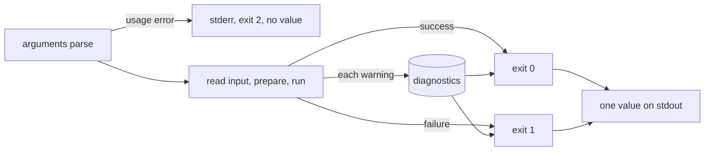

# Data Contracts

Every `md` command can print its result as data, so a script, a CI job, or an
editor can read the outcome and every problem as one value instead of parsing
text. This page says what that value holds for each command.

```sh
md compose notes.md --output json
```

```json
{
  "file": "notes.md",
  "outcome": "failure",
  "document": null,
  "diagnostics": [
    {
      "code": "dm.reference.missing_hyperlink",
      "severity": "error",
      "message": "Missing local target: ./missing.md",
      "source": { "file": "/work/notes.md", "line": 3, "column": 5, "section": "notes", "inserted": false },
      "expected_type": null,
      "actual_type": null,
      "span": { "start": 14, "end": 39 },
      "iteration_path": [],
      "reason": "file not found",
      "construct": "hyperlink",
      "reference": "./missing.md",
      "failure": "no-match",
      "included_via": []
    }
  ],
  "summary": { "references": 2, "documents": 1, "ok": 1, "broken": 1 },
  "lifecycle_output": [],
  "read_set": []
}
```

`json`, `json5`, `yaml`, and `toml` all carry the same value; the examples here
use JSON. How to choose an output, and how the families differ, is on
[Output and Width](./output-and-width.md).

## Streams and exit status

A data output writes exactly one value to stdout and nothing to stderr. Anything a
run has to say is in that value or is not said. That includes warnings, `--perf`
timings, and the output of lifecycle actions and shell steps.

| Status | Meaning | stdout | stderr |
|---|---|---|---|
| 0 | the command ran and succeeded | one value | nothing |
| 1 | the command ran and failed | one value that says so | nothing |
| 2 | a usage error: no command ran | empty | the parser's message |
| 130 | interrupted with Ctrl-C | empty | nothing |

Once the arguments parse, the command writes one value, including when the input
cannot be read. `--show` combines with a data output: the value is printed and
also opened (see [Opening the output in an app](./output-and-width.md#opening-the-output-in-an-app)). `--shell` prints its
own report and cannot be combined with one.



## `md compose` and `md render`

`md compose` and `md render` (and `md FILE`) print the same envelope, defined by
[`compose.yaml`](../../cli/schemas/output/compose.yaml) and
[`render.yaml`](../../cli/schemas/output/render.yaml).

| Field | Value |
|---|---|
| `file` | the file as given on the command line; `null` for stdin |
| `outcome` | `"success"` or `"failure"` |
| `document` | the document as a Markdown string; `null` on failure |
| `diagnostics` | every diagnostic the run reported, in [this order](#which-diagnostics-in-which-order); `[]` when there were none |
| `summary` | the reference check's totals; `null` when no check ran |
| `perf` | `md compose --perf` [timings](#timings); absent without that flag |
| `lifecycle_output` | what [lifecycle and shell steps](#lifecycle-output) printed, in run order; `[]` when there was nothing |
| `read_set` | the files and URLs the run's expressions [read](#read-set), sorted; `[]` when there were none |

`document` is always Markdown, even though `md render` defaults to terminal text.
It is the Markdown the same command's `--output markdown` would print, with
`--frontmatter` and `--width` honored, and without the final newline that printing
to stdout adds.

`summary` counts what the reference check saw. `md compose` runs the check on a
file argument; stdin has no base directory to resolve against, and `md render`
does not run it, so both report `null`.

| `summary` field | Value |
|---|---|
| `references` | references checked |
| `documents` | documents checked, the named one included |
| `ok` | references that resolved |
| `broken` | references that did not |

### Timings

`--perf` places timings in the value instead of on stderr. There is one entry per
command-level and pipeline stage, in run order.

```json
"perf": {
  "stages": [
    { "name": "resolve input", "milliseconds": 6.19 },
    { "name": "load input", "milliseconds": 0.2 },
    { "name": "capture context", "milliseconds": 2.36 }
  ]
}
```

### Lifecycle output

A formatted run writes lifecycle output to stderr. A data run captures it here, one
entry per step, so nothing is dropped and stdout stays one value. `stage` is the
lifecycle event, `step` is the action or the shell command, and `text` is what it
printed, exactly.

```yaml
---
composed:
    - stdout: "hello **bold**"
    - shell: "echo from-shell"
finalize:
    - info: "done"
---
```

```json
"lifecycle_output": [
  { "stage": "composed", "step": "stdout", "text": "hello **bold**" },
  { "stage": "composed", "step": "echo from-shell", "text": "from-shell\n" },
  { "stage": "finalize", "step": "info", "text": "done" }
]
```

### Read set

`read_set` lists every file and URL an expression read during the run, so a
script can tell which inputs a composed document depends on (for example, to
rebuild it when one of them changes). It is always present, success or failure.

```markdown
---
title: Release
---
Owner: {{ frontmatter("team.md").owner }}
{{ file_exists("CHANGELOG.md") }}
{{ load_data("servers.yaml", "string[]") }}
```

```json
"read_set": [
  "/work/CHANGELOG.md",
  "/work/servers.yaml",
  "/work/team.md"
]
```

- **What counts.** Each read-side function records the file it reads:
  `load_data`, `frontmatter`, `try_frontmatter`, `file_exists`,
  `markdown_title`, `markdown_body_empty`, and `validate_schema`. Schema files a
  `load_data` contract or `validate_schema` imports count too. Links,
  transclusions, and other files the run touches without an expression do not.
- **Every pass counts.** A read during the reference check, the lifecycle,
  pre-flight, or composition is reported, including a read in a transcluded
  document. A run that fails reports the reads made before it stopped, the file
  that failed to read or parse included, even when the failure came in the
  reference check before composition started.
- **Misses count.** `file_exists` on a missing file records the path it looked
  for, so `CHANGELOG.md` above appears whether or not it exists. A reference
  that names no concrete file, such as an empty string, records nothing.
- **Form.** Local files are absolute paths with `/` separators; URLs are
  written as the remote cache normalizes them, query included. A URL a host
  policy refused is still listed. Each entry appears once, in lexical order.
- **`md render`** runs no expressions, so its `read_set` is always `[]`.

## Diagnostics

A diagnostic is one reported problem. The same problem has the same fields
everywhere: a call the editor (DMLS) marks with `dm.expression.incompatible_call`
at `notes.md:4:18` is the record `md compose` rejects the document with and the
record this output prints.

| Field | Value |
|---|---|
| `code` | a stable `dm.<family>.<kind>` code, shared with DMLS; see [Codes](#codes) |
| `severity` | `"error"`, `"warning"`, or `"info"` |
| `message` | the problem in words |
| `source` | where the problem is, as below, or `null` when no file is known |
| `expected_type` | for a call argument, the parameter's declared type; otherwise `null` |
| `actual_type` | for a call argument, the argument's type; otherwise `null` |
| `span` | `{ "start", "end" }`, the byte range of the failing construct in `source.file`; otherwise `null` |
| `iteration_path` | for a failure while a `::map` or `::filter` body was being processed, the position of each item, outermost first, as `{ "collection", "position" }` (a number for an index, a string for a key); otherwise `[]` |

Severity describes the problem, and `outcome` describes the run. A problem an
`--allow` recovered keeps its severity while the run succeeds, so `severity: "error"`
can appear with `outcome: "success"`. A warning a `--deny` made blocking stays
`"warning"` while the run fails.

`source` locates the problem in the document that was written, not in the composed
result, so transclusion cannot shift it:

| `source` field | Value |
|---|---|
| `file` | the resolved path of the file that holds the problem; `null` for stdin |
| `line` | the authored line, one-based; `null` when no authored position is proven, as for a document built in memory or a line counted in rewritten text |
| `column` | the authored column, one-based and counting characters; `null` as for `line`, and for a problem whose producer knows only the line |
| `section` | the composed anchor slug of the innermost heading at or before the problem; absent above the first heading, and on diagnostics that do not compute it |
| `inserted` | `true` when an expression, a shell step, or a `replace:` value created the reference, so `line` and `column` point at the construct that created it |

A problem inside transcluded content points at the transcluded file, not at the
`::file` directive that included it. A problem whose producer knows no file falls back
to the document the command named, with a `null` line and column. See
[what each family reports](../errors/composition-problems.md#how-a-problem-is-located).

### Reference details

A reference problem also carries what the [reference report](./validate.md#the-reference-report)
shows in its rows, as separate fields. So does an expression that failed because
the file a read-side function names could not be read, such as
`frontmatter("missing.md")`: its `construct` is the function, as in
`"frontmatter()"`, and its `reference` is the argument as written. Other
diagnostics omit these fields.

| Field | Value |
|---|---|
| `reason` | the reason phrase, such as `"file not found"` or `"no matching heading"` |
| `construct` | the construct phrase, such as `"hyperlink"`, `"image"`, or `"::code"` |
| `reference` | the reference as written |
| `failure` | the [file-reference failure class](../errors/file-reference-failures.md), such as `"no-match"`, when the reference failed to resolve |
| `included_via` | the transclusion trail, outermost first, as `{ "file", "line" }` steps; each `line` is the authored line of the `::file` or `::toc-linking` directive |

### Data location

A problem inside a file `load_data` read also says where in that file it is.
`source` still points at the `load_data` call in the document; `data_location`
points into the data. It is present only on `dm.data.malformed` and
`dm.data.contract_mismatch` records, and absent (not `null`) on every other
diagnostic.

```json
{ "code": "dm.data.contract_mismatch", "severity": "error",
  "message": "…",
  "source": { "file": "/work/notes.md", "line": 4, "column": 3, "inserted": false },
  "expected_type": "number", "actual_type": "string",
  "span": { "start": 31, "end": 70 }, "iteration_path": [],
  "data_location": { "file": "/work/ports.json", "pointer": "/1", "line": 1, "column": 5 } }
```

| `data_location` field | Value |
|---|---|
| `file` | the data file's resolved path, or the URL it was fetched from |
| `pointer` | the [JSON Pointer](https://www.rfc-editor.org/rfc/rfc6901) of the offending value, such as `/1`; always present on a contract mismatch, and absent on a syntax error unless the parser can name the value |
| `line`, `column` | one-based; the column counts characters. Absent when the position cannot be proven, as for a YAML file that uses an alias or a flow collection spread over several lines |
| `byte_offset` | for a local file that is not valid UTF-8, the zero-based offset of the first invalid byte, with no `line` or `column` |

A contract mismatch lists up to 20 violating values, one record each, in the
order they appear in the file; one more record of the same code, with no
`data_location`, says how many were left out.

## Which diagnostics, in which order

- **Warnings** come in the order the run found them: passive checks first,
  then what composition reports while it runs. The passive checks report a
  lifecycle stack's calls (event by event, each surface in authored order),
  then the document's calls by authored position: frontmatter first, then
  the body top to bottom, with `{{ … }}` expressions and `::block`/`::file`
  conditions interleaved where they are written. Transcluded documents report
  in the order their directives appear.
- **A failure** comes after the warnings reported before it. Earlier warnings
  are kept: a category 3 call reported before a failing `{{ 1 / 0 }}` is in
  the failure value too. A rejected call keeps the passive warnings found
  before it in that order, including an earlier call in its own expression;
  a finding after the rejected call is not reported, since the check stops
  there. A static `::map`/`::filter` defect (an invalid source, a pattern, a
  sort key, a protected parameter name) is rejected the same way: a recovered
  untyped source written before it keeps its `untyped_map_source` or
  `untyped_filter_source` warning in the value. A failure in a transcluded
  document comes after every warning of the documents that transclude it,
  outermost first, then its own: a parent's passive check covers the whole
  parent before any child composes, so a parent warning written after the
  `::file` line is reported too.

  ```text
  parent.md                         child.md
  1 {{ file_exists("") }}           1 {{ file_exists("https://") }}
  3 ::file ./child.md               3 {{ min(true, 5) }}
  5 {{ file_exists("http://") }}
  ```

  reports `always_false_call` at `parent.md` lines 1 and 5, then at
  `child.md` line 1, then `incompatible_call` at `child.md` line 3.

- **A policy stop** (`--deny`) lists each warning once, with its own severity:
  a denied `warning` is still `"warning"`. The policy decides the outcome, not
  the diagnostic.
- A check that stops a run before composition starts reports what that
  check found. A rejected call the pre-flight walk finds (the walk checks
  each document before it runs a shell) reports the same warnings ahead of
  it as the compose pass would: those of the document that holds it, after
  those of every document that transcludes it.
- **A rejected call** reports the call's own record wherever it is authored:
  in the body, in frontmatter, in a `::block` or `::file` condition, or on a
  lifecycle surface (an action's text, a `when:` condition, a `shell:`
  command, a side-effect argument such as `ensure_file:`, a `set:` value, or
  a control reason such as `error:`). The record is the one DMLS shows for
  the same bytes, located in the file as written. A lifecycle rejection stops
  the run before `initialize`, so no lifecycle effect runs; the lifecycle
  warnings found before it come first.

  ```yaml
  ---
  composed:
    - stdout: "{{ min(true, 5) }}"
  ---
  ```

  ```json
  { "code": "dm.expression.incompatible_call", "severity": "error",
    "message": "min: argument 1 (`a`) is literal true, expected number (…)",
    "source": { "file": "/work/doc.md", "line": 3, "column": 21, "inserted": false },
    "expected_type": "number", "actual_type": "literal true",
    "span": null, "iteration_path": [] }
  ```

## Codes

Call findings use the editor's codes (`dm.expression.incompatible_call`,
`uncertain_call`, `always_false_call`, `incomplete_analysis`), schema problems
the editor's schema codes (`dm.schema.type_mismatch`, `constraint`,
`missing_required`, `unknown_key`, `invalid_file_reference`, `prepare`), and a
recovered problem the code [`--deny`](./policy.md) takes for it. A failure is
classified by what failed:

| Code | Failure |
|---|---|
| `dm.frontmatter.yaml_parse` | the frontmatter YAML, or its `---` fence, does not parse; located |
| `dm.input.read_failure` | the input, or a file it needs, cannot be read |
| `dm.expression.parse_failure` | an expression does not parse |
| `dm.expression.evaluation_failure` | an expression fails to evaluate; located when the expression is authored in the file |
| `dm.expression.unknown_function` | an expression calls a function that does not exist |
| `dm.data.*` | a `load_data` call fails on its data or its contract (`malformed`, `contract_mismatch`, `not_a_container`, `row_shape_conflict`, `unsupported_format`, `this_import_rejected`); a missing or unreadable data file is `dm.expression.evaluation_failure`, as for any read-side function |
| `dm.directive.parse_failure` | a `::` directive does not parse |
| `dm.collection.*` | a `::map` or `::filter` fails (`malformed`, `untyped_map_source`, `untyped_filter_source`, `invalid_source`, `pattern_mismatch`, `invalid_sort_key`, `callback_failed`), located at the directive opener or the failing callback; a static defect is reported once, with `iteration_path: []` |
| `dm.iteration.visit_limit`, `dm.iteration.expansion_limit` | a request ran past `--max-iteration-visits` or `--max-expansion-bytes`; located at the authored text whose work was being paid for: the collection opener for a visit, the copied body text, or the `{{ }}`, `::shell`, `::shell-block`, or `::file` whose output was being inserted (a cached child that is included again is located at the including `::file`) |
| `dm.shell.failure` | a shell command fails, times out, or is refused |
| `dm.transclusion.failure` | a transclusion fails for another reason |
| `dm.reference.failure` | a file reference does not resolve |
| `dm.compose.parameter_binding` | a supplied value does not bind to its parameter |
| `dm.setter.invalid` | a `key.path=value` setter cannot be applied: its value is an invalid container, its path meets a scalar parent or an index out of range in a document, or a scalar setter overlaps a setter below it. The message names the argument and its path; `source` is null, because a command-line value is in no file |
| `dm.lifecycle.failure` | a lifecycle event fails (an `error:` action, a failed action) |
| `dm.hash.no_stored_hash` | `md hash --diff` found no stored hash to compare against |
| `dm.hash.changed` | `md hash --diff` found the document differs from its stored hash |
| `dm.schema.baseline` | `md schema validate --schema` could not load the baseline schema |
| `dm.output.serialization_failed` | the value cannot be written in the requested format; see [TOML](#toml) |
| `dm.output.open_failed` | `--show` could not open the file |
| `dm.compose.failure` | anything else, on any command |

A warning whose producer declares no code reports `dm.compose.warning`. These
warnings belong to the run's output rather than to composition:

| Code | Warning |
|---|---|
| `dm.output.fractional_width` | `--width` was fractional and was rounded down |
| `dm.link.malformed_structured_title` | a link title starts with `{` but is not a JSON5 object, so it is read as plain text |
| `dm.link.legacy_structured_title` | a link title uses the removed `key=value` syntax; [`md clean`](./clean.md#migrating-link-titles) migrates it |
| `dm.style.unknown_key` | `md render` found an unknown `style:` key |
| `dm.style.deprecated` | `md render` found a deprecated `style:` key or inline rule style |

### Failures inside `::map` and `::filter` bodies

A failure of any kind while a repeated body was being processed (a callback,
a `when=` gate, a `{{ }}` expression, a `::shell` or `::shell-block`
argument, a `::file` target or condition, a child document, or an allowance)
keeps its own `code` and `message`, and adds where it happened: `source` and
`span` locate the authored site in the file (not in the expanded text), and
`iteration_path` names the item whose copy ran it. The `message` ends with
`at <path>`. For a shell-block command failure, the site is the command's
authored line, including when an earlier command succeeded; for the block's
combined-output allowance, it is the block opener.

Given this `doc.md`, where only `ok.md` exists:

```md
---
$schema:
  data: string[](required)
data: [./ok.md, ./missing.md]
---
::map data
{{ frontmatter(i, 'title') }}
::end-map
```

the second item fails on line 7:

```json
{ "code": "dm.expression.evaluation_failure", "severity": "error",
  "message": "interpolation of `frontmatter(i, 'title')` failed: invalid file path: ./missing.md at data[1]",
  "source": { "file": "/work/doc.md", "line": 7, "column": 1, "inserted": false },
  "expected_type": null, "actual_type": null,
  "span": { "start": 85, "end": 114 },
  "iteration_path": [{ "collection": "data", "position": 1 }] }
```

Positions are the items' places in the original source, before any filter or
sort. A failure inside a child document that a repeated `::file` included
joins both paths, outer first (`data[1] → d[0]`), and keeps the child's own
`source`.

### Schema triggers skipped as invalid

A [schema trigger skipped because it failed to load](../topics/schemas/schema-triggers.md#invalid-discovered-triggers)
is a `dm.schema.invalid_trigger` warning. It belongs to the trigger, not to
the composed document. Its `message` names the trigger file (or
`embedded:{bundle}/{file name}`) and the reason, and, when the failure is
inside a payload or import file, that file too. The value lists each
trigger once, even when transcluded documents discover it again.

Its `source` points into the trigger file only where the failure has a
known position there, which is a trigger file that is not valid YAML:

```json
{ "code": "dm.schema.invalid_trigger", "severity": "warning",
  "message": "ignoring invalid schema trigger /repo/schemas/broken.yaml: not valid YAML at line 3, column 1: …",
  "source": { "file": "/repo/schemas/broken.yaml", "line": 3, "column": 1, "inserted": false },
  "expected_type": null, "actual_type": null }
```

Every other cause names the trigger file with a `null` line and column, since
no position is invented: an envelope with unsupported keys, or a payload or
import that fails to load (a position inside that file is never placed on the
trigger; the message names the file instead). An embedded trigger names no local
file, so its `source` is `null`:

```json
{ "code": "dm.schema.invalid_trigger", "severity": "warning",
  "message": "ignoring invalid schema trigger /repo/schemas/memory.yaml: invalid schema-trigger: …",
  "source": { "file": "/repo/schemas/memory.yaml", "line": null, "column": null, "inserted": false },
  "expected_type": null, "actual_type": null }
```

`md schema validate --output json`, which reports several files, puts a
trigger warning that files share in the `warnings` of the first file that
discovers it, once per invocation, and not in the later files' records.

## Other commands

Each command has its own shape. Three rules cover how a command reports its
outcome, depending on whether its shape was published before `outcome` existed:

- **A command whose result always has an outcome** includes `outcome` and
  `diagnostics` on every run. That is `md set`, `md hash`, `md edit`,
  `md code-block`, `md schema triggers`, and `md schema about`. On failure its
  result fields are `null` or empty.
- **A command with an existing object** adds `outcome` and `diagnostics` only when
  the run failed or has a run-level warning, so a clean success reads as it always
  has. That is `md toc`, `md delta`, `md rm`, `md graph`, `md validate refs`, and
  `md schema validate`. When a failure leaves no result at all, such as a missing
  input, the value is `{ "outcome": "failure", "diagnostics": [...], "value": null }`.
- **A command whose value is the user's own data** never adds fields to it, because
  a frontmatter property called `outcome` would be overwritten. That is `md get` and
  a single or merged `md schema detect`. A clean success is the bare value, and a
  run with something to say wraps it:
  `{ "outcome": "...", "diagnostics": [...], "value": ... }`.

| Command | Schema | Value |
|---|---|---|
| [`md clean`](./clean.md#version-1-json-envelope) | [`clean.yaml`](../../cli/schemas/output/clean.yaml) | the version-1 object: `version`, `source`, `frontmatter`, `diagnostics`, `applied`, `changed`, `warnings`; see below for its run-level records |
| [`md toc`](./toc.md) | [`toc.yaml`](../../cli/schemas/output/toc.yaml) | `title`, the hashes, `preamble`, `structure` (the heading tree), `code_blocks`, `internal_links`, `slug_index` |
| [`md delta`](./delta.md) | [`delta.yaml`](../../cli/schemas/output/delta.yaml) | `classification`, `statistics`, the frontmatter and preamble flags, `added`, `removed`, `modified`, `moved`, `code_block_changes`, `broken_links` |
| [`md get`](./get.md) | [`get.yaml`](../../cli/schemas/output/get.yaml) | one path's value, or a flat object keyed by the [paths](./index.md#property-paths) as written; a missing path is `""` |
| [`md set`](./set.md) | [`set.yaml`](../../cli/schemas/output/set.yaml) | `file`, `property` (the path as written), `value`, `document`, `saved`, plus outcome |
| [`md rm`](./rm.md) | [`rm.yaml`](../../cli/schemas/output/rm.yaml) | `removed` (the paths as written), `remaining` (surviving top-level keys), `filename` |
| [`md edit`](./edit.md) | [`edit.yaml`](../../cli/schemas/output/edit.yaml) | `file`, `editor`, `created`, plus outcome |
| [`md hash`](./hash.md) | [`hash.yaml`](../../cli/schemas/output/hash.yaml) | `mode`, `file`, `kind`, `computed`, `stored`, `comparison`, `saved`, plus outcome |
| [`md graph`](./graph.md) | [`graph.yaml`](../../cli/schemas/output/graph.yaml) | `file`, `source`, `references`, `transclusions`, and with `--validate`, `validation` |
| [`md code-block`](./code-block.md) | [`code-block.yaml`](../../cli/schemas/output/code-block.yaml) | `file`, `code`, `language`, `title`, `line_numbering`, `highlight`, plus outcome |
| [`md validate refs`](./validate.md) | [`validate-refs.yaml`](../../cli/schemas/output/validate-refs.yaml) | `valid`, `references_scanned`, `references_valid`, `issues`, `warnings`, and with `--show-all`, `references`; with `--graph`, `{ "graph": { "format", "source" } }` alone |
| [`md schema validate`](./schema.md#md-schema-validate) | [`schema-validate.yaml`](../../cli/schemas/output/schema-validate.yaml) | `{ "files": [...] }`, one record per file argument |
| [`md schema detect`](./schema.md#md-schema-detect) | [`schema-detect.yaml`](../../cli/schemas/output/schema-detect.yaml) | the inferred schema; for several files without `--merge`, `{ "files": [{ "file", "schema" }] }` |
| [`md schema triggers`](./schema.md#md-schema-triggers) | [`schema-triggers.yaml`](../../cli/schemas/output/schema-triggers.yaml) | `file`, `roots`, `shadowed`, `skipped`, `triggers`, plus outcome |
| [`md schema about`](./schema.md#md-schema-about) | [`schema-about.yaml`](../../cli/schemas/output/schema-about.yaml) | `sections`, the whole catalog at any verbosity, plus outcome |

A malformed [property path](./index.md#property-paths) given to `md get`, `md set`, or `md rm` is a usage error: exit status 2, nothing read, and no value printed. A path that is well formed but cannot be edited, or a value the schema refuses, is a failure with exit status 1 and a diagnostic.

Three of these have details a script should know:

**`md clean`** already had a `diagnostics` array, whose rows are positions in the
document. It keeps that array, and its run-level records (a fractional `--width`)
are in `run_diagnostics` instead. On a failure the object gains `outcome` and
`run_diagnostics`; on a missing input it is the `value: null` form above.

```json
{ "version": 1, "source": { "kind": "file", "path": "/work/doc.md" }, "frontmatter": { "present": false },
  "diagnostics": [], "applied": [], "changed": false, "warnings": [],
  "outcome": "success",
  "run_diagnostics": [{ "code": "dm.output.fractional_width", "severity": "warning", "…": "…" }] }
```

**`md schema validate`** is one object, so that it has a YAML and a TOML form. A
failing run has `outcome: "failure"` and an empty run-level `diagnostics`: each
problem stays in its file's record. Only a problem with the invocation itself (a
baseline that cannot be loaded, `dm.schema.baseline`) is a run diagnostic, and then
`files` is `[]`.

```json
{ "files": [
    { "file": "doc.md", "valid": false, "schema": null, "layers": { "…": "…" },
      "problems": [{ "kind": "missing", "property": "count", "path": "",
                     "line": 2, "column": 1, "message": "\"count\" is a required property" }] }
  ],
  "outcome": "failure",
  "diagnostics": [] }
```

A record that could not be validated names why in `error`: `file_reference`,
`frontmatter_parse`, `yaml_parse`, or `schema`. See
[JSON Output](../topics/schemas/definition.md#json-output) for the record's fields
and its YAML-document values.

**`md get`** and a single or merged **`md schema detect`** read as the bare value
until a run has something to say:

```text
$ md get doc.md title
"Notes"

$ md get doc.md title --width 72.9
{
  "outcome": "success",
  "diagnostics": [{ "code": "dm.output.fractional_width", "…": "…" }],
  "value": "Notes"
}
```

## TOML

TOML has no `null` and needs a table at the root, so a TOML output differs from the
other three formats in three ways:

- A field whose value is `null` is omitted.
- A `null` inside an array cannot be omitted without changing the array, so the run
  fails with status 1 and a `dm.output.serialization_failed` diagnostic naming the
  path to the value.
- A value that is not an object is wrapped as `value = ...`.

```text
$ md get doc.md title --output toml
value = "Notes"

$ md get doc.md tags --output toml        # tags: [1, null]
outcome = "failure"

[[diagnostics]]
code = "dm.output.serialization_failed"
iteration_path = []
message = "could not write toml output at `/value/1`: TOML cannot represent a null inside an array"
severity = "error"
```

A property whose whole value is `null` therefore prints nothing in TOML. TOML
integers are signed 64-bit, so a larger number is written as its decimal text;
[`md toc`](./toc.md#output)'s unsigned hashes are the case you will meet.

## How the shapes are enforced

Each command's shape is a [SimplifiedSchema](../../../simplified-schema/README.md)
file under `darkmatter/cli/schemas/output/`, and the tests keep the code and the
files together:

- Conformance tests run the real `md` with `--output json` and validate stdout
  strictly against the command's file, covering success, failure, and warnings.
  They live in `cli/tests/l1/output_commands.rs` and, for the envelope,
  `cli/tests/l1/output_envelope.rs`.
- `COMMAND_LEAVES` in `cli/src/args/output.rs` records every runnable command with
  its default and schema file. A guard test in `output_commands.rs` holds that table
  to the command-line definitions and the schema directory, and fails when a command
  has no row, no schema file, or no conformance test.
- A format-parity test checks that `json5`, `yaml`, and `toml` carry the same data
  as `json`.

When you add a command or change a shape, change the file and the code together; the
tests fail otherwise.

## Privacy

A diagnostic never contains an evaluated argument value, an environment
value, or a file's contents, and producing the value evaluates, renders, and
reads nothing again. Messages can still quote authored source text, as the
terminal output does.

## Effects are not rolled back

The value waits for the outcome, so no partial document is printed and
nothing is published before blocking checks pass. It is not a transaction:
a lifecycle effect or cache write that already happened stays done when the
run later fails.

## Removed spellings

| Removed | Use instead |
|---|---|
| `md compose --output report-json` | `md compose --output json` |
| `md schema validate --format json` | `md schema validate --output json` |
| `--json` on any command | `--output json` |
