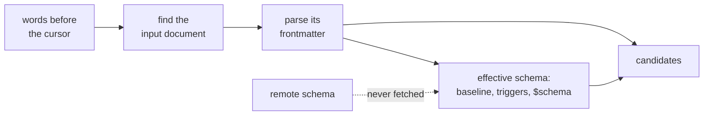

# Darkmatter CLI

The Darkmatter CLI works off of a "subcommand" structure, and **`md FILE …` is `md render FILE …`**: with no subcommand, `md` renders, taking exactly the arguments, output, diagnostics, and exit status of [`md render`](./render.md). A file named like a command needs `./` or `--` (`md ./toc`, `md -- toc`). With no file and a terminal on stdin, `md` prints the help below to stderr and exits with status 1; a redirected stdin is read as the document.

Render options, such as `--style`, `--output`, and the `style…=VALUE` setters, go after `md render` or anywhere on `md` alone, never before another subcommand; `--width`, `-v`, and `--debug` may go anywhere; `--magic-root` and `--completions` go before any subcommand. See [Where options go](./render.md#where-options-go).

Here's the layout of the help system you'll get when you run `md --help`. Root help lists the commands, the shared controls, and `--style`; `md render --help` lists every render option.

```txt
Command-line interface for the darkmatter markdown renderer.

Use `md --help` to see all available options.

Usage: md [OPTIONS] [COMMAND]

`md [ARGS] [OPTIONS]` is `md render [ARGS] [OPTIONS]`; see `md render --help`.

Commands:
  render       Render a markdown document (same as default behavior without a subcommand)
  clean        Clean up markdown formatting
  compose      Compose a document through the compose pipeline
  list-themes  List the themes `style.page.theme` and `style.page.code.theme` accept
  toc          Show markdown table of contents
  delta        Compare two markdown documents
  get          Get frontmatter values from a markdown document, by property path
  set          Set the value at a frontmatter property path in a markdown document
  rm           Remove the values at one or more frontmatter property paths from a markdown document
  edit         Open a markdown file in your preferred editor
  validate     Validate references in a markdown document
  hash         Hash a markdown document's frontmatter and body
  schema       Schema authoring and validation commands
  graph        Visualize a markdown file's dependency graph
  code-block   Render a single code block from a file or literal content

Options:
  -h, --help
          Print help (see a summary with '-h')

  -V, --version
          Print version

Shared controls:
      --width <WIDTH>
          Width the output is wrapped to: N columns, N%, `auto` (`OUTPUT_COLUMNS`, else the
          terminal, else unlimited), `source` (keep authored line breaks), or `unlimited`. `md
          render`'s `style.max-width` caps content inside it

  -v, --verbose...
          Increase verbosity for styled user-facing output (-v summary, -vv detailed)

      --magic-root <DIR>
          Search DIR for `@` references, before the default roots (repeatable; searched in the order
          given; give it before the subcommand). A relative DIR is relative to the launch directory;
          DIR must exist

      --completions <SHELL>
          Generate shell completions for the specified shell

          [possible values: bash, elvish, fish, powershell, zsh]

Render:
      --style <FILE>
          A JSON, JSON5, YAML, or TOML style file (repeatable; later files merge over earlier ones)
```

Three things work the same way on every command:

- **[Output and Width](./output-and-width.md)**: one `--output` selector with two families (formatted and data), one `--width`, one rule for where things are written, and one meaning for exit statuses 0, 1, and 2.
- **[Data Contracts](./data-contracts.md)**: the value each command prints with `--output json`, `json5`, `yaml`, or `toml`, including every diagnostic.
- **[Policy Flags](./policy.md)**: commands that have a policy choice share three verbs, `--allow`, `--deny`, and `--disable`.

## Subcommands

> Use the links to move into a more detailed description of each of the commands

- [`render <file-reference>`](./render.md) - renders a Markdown file into one of the supported outputs; if no `--output <target>` is specified then it uses `terminal` (escape codes to make the Markdown look nice), which falls back to `plain` on a pipe
- [`clean <file-reference>`](./clean.md) - cleans up the Markdown file by ensuring good headings structure, consistent indent levels, use of proper vertical spacing. Sends fixed file to STDOUT unless the `--save` switch is used
- [`compose <file-reference>`](./compose.md) - runs the referenced Markdown file through the [composition pipeline](../darkmatter-compose-pipeline.md) and returns the composed Markdown to STDOUT, or the document and every problem as data; pipe it to `md render` for any other output
- [`toc <file-ref>`](./toc.md) - shows the table of contents for the file referenced
- [`list-themes`](./list-themes.md) - lists the theme names `style.page.theme` and `style.page.code.theme` accept
- [`delta <file-ref> <file-ref>`](./delta.md) - describes the changes found between the two Markdown files. Uses a structured analysis to describe semantically what's changed. Adds visual diffing if you use the `--verbose` flag.
- [`get <file-ref> <path>`](./get.md) - extracts a frontmatter value, named by [property path](#property-paths), from the Markdown file referenced
- [`set <file-ref> <path> <value>`](./set.md) - sets a frontmatter value, named by [property path](#property-paths), on the referenced Markdown file
- [`rm <file-ref> <path>`](./rm.md) - removes a frontmatter value, named by [property path](#property-paths), from the referenced Markdown file
- [`edit <file-ref>`](./edit.md) - opens the referenced Markdown file and blocks until the user closes that file in their editor.
- [`validate refs <file-ref>`](./validate.md) - validates references (links, images, transclusions) in the document and prints the reference report.
- [`hash <file-ref>`](./hash.md) - computes Markdown-aware hashes, stores them, and reports drift from a stored hash.
- [`graph <file-ref>`](./graph.md) - visualizes the dependency graph of the document.
- [`schema <subcommand>`](./schema.md) - validates frontmatter and YAML documents against a schema, detects a schema from documents, explains schema triggers, and prints the schema language reference.
- [`code-block <input>`](./code-block.md) - renders one code block from a file or from literal content.

## File References

All file references in the CLI use the `FileReference` struct from the `biscuit-file` library (in this monorepo). The introducer you write selects a **closed, ordered list of base directories**; resolution joins the path onto each base in turn and takes the first candidate that is an existing regular file. There is no cross-kind fallback — a `./foo.md` that misses is never retried as `@foo.md`.

| Written as            | Kind                     | Candidate order                                                                       |
|-----------------------|--------------------------|---------------------------------------------------------------------------------------|
| `./x.md`, `../x.md`   | explicit relative        | the base directory only                                                               |
| `x.md`, `docs/x.md`   | implicit relative        | the base directory **first**, then the repository root                                |
| `/x.md`, `C:\x.md`    | absolute                 | used verbatim                                                                         |
| `~/x.md`              | home                     | the user's home directory only (`~user` is rejected)                                  |
| `@x.md`               | magic (multi-homed)      | the local tree (package, package area, repository root or launch directory, plus registered roots inside it) before home and registered roots outside it; see [Magic Paths](../topics/magic-paths.md) |
| `&x.md`               | repository root, exactly | the repository root only                                                              |
| `^x.md`               | repository scoped        | package, package area, then repository root; never consults home                      |
| `vault:x.md`          | vault                    | registered vault roots, then the paths in `$VAULT`                                    |
| `http://`, `https://` | remote                   | a typed remote reference; never a local candidate                                     |

**"Base directory"** means the directory a reference was authored from: for an argument you type at the shell that is the directory you ran `md` in; for a reference written inside a document it is the directory of the document being composed.

A relative reference may not climb out of the repository that holds its base directory, whether you type it as an argument or a document contains it: inside `/work/repo`, `md compose ../../elsewhere.md` fails with `failure: invalid-reference` when it would leave `/work/repo`. An absolute path may name any file. See [Relative references stay in their tree](../topics/file-referencing.md#relative-references-stay-in-their-tree).

Two modifiers compose with every kind above:

- a leading `%` (`%@README.md`) switches from exact-path probing to a recursive search of the same roots
- any path segment may contain `{{VAR}}` environment interpolation (`@configs/{{APP}}/settings.toml`)

A few things worth knowing before typing one of these at a shell prompt:

- `&` is a shell control operator, so repository-root references have to be quoted: `md render '&docs/plan.md'`
- `&` and `^` are repository-contained — using either outside a repository, or writing a payload that escapes it (`&../outside.md`), is a typed error rather than a silent miss
- `@` is the one multi-homed introducer that can leave the repository, because `$HOME` is in its search list; reach for `^` when repository containment is the point
- the `!` sigil has been removed from the grammar; a reference beginning with `!` is now a parse error (`failure: invalid-reference`) that suggests `^`

### Every file argument uses this grammar

Every command that reads a file you name opens it through the table above, from the directory you ran `md` in: the document argument of `md <file>`, `render`, `compose`, `clean`, `toc`, `get`, `set`, `rm`, `edit`, `hash`, both inputs of `delta`, `graph`, `validate refs`, `schema validate`, `schema detect`, `schema triggers`, and `code-block` (see below). So `md schema validate '@notes.md'`, `md validate refs '&docs/plan.md'`, and `md get '^README.md' title` work like `md compose` does. Output destinations, cache directories, and `--magic-root` directories are settings, not files to read, and are plain paths.

An argument is parsed before anything is read, so text that is not valid reference syntax fails with `failure: invalid-reference` even when a file with that literal name exists:

```text
$ ls
@   doc.md
$ md get @ title --output plain   # a bare `@` is an introducer with no path
⤫ FileReferenceError: file argument not resolved
┃ failure: invalid-reference
$ md get ./@ title --output plain # `./` names the literal file
Literal
```

The same holds for a bare `&` or `^`, and for the removed `!` sigil (`md get '!old.md' title`). Spell a file whose name starts with one of these characters with `./` in front.

A few commands add a rule of their own:

- **`md code-block <input>`** renders `--content` input as typed and requires `--file` input to resolve to a file. With neither flag, the input is read as a file only when it is one line of reference syntax naming an existing file (`md code-block '&src/main.rs'`); anything else, including a reference that matches nothing, a malformed one such as `@`, and a relative path leaving the repository, is rendered as literal code and no file is read.
- **`md hash <directory>`** names its directory with the same grammar (`md hash '&docs'`); a relative directory may not leave the repository. The first place the reference looks that holds a file or a directory decides between hashing one document and a tree, so `md hash notes.md` hashes a nearer `notes.md` file before a repository-root `notes.md/` directory, and a place that cannot be checked fails with `failure: io`.
- **`md edit <file>`** creates the file when the reference matches nothing, at the first place the reference would look: beside you for `./new.md` or `new.md`, at the repository root for `&new.md`. A malformed reference or a path leaving the repository is refused before any file is created or editor opened.
- **`md schema triggers <file>`** inspects a document inside a repository and prints the file it opened on its `Document:` line, listing any trigger it [skipped as invalid](../topics/schemas/schema-triggers.md#invalid-discovered-triggers) under "Skipped invalid triggers" (the warning itself goes to stderr); a document outside every repository fails with `failure: missing-context`, and a schema root it cannot inspect (such as one below a folder without search permission) fails with an I/O error naming that root instead of listing the roots.
- **`md schema validate`** reports an argument that does not open on that file's line (`could not be opened`, with its `failure:` row) and exits `1`, as for a file whose frontmatter cannot be parsed. Whether an argument is a whole YAML document is judged on the file it opened, so `md schema validate '@service.yaml'` validates YAML (see [YAML documents on the command line](../topics/schemas/definition.md#yaml-documents-on-the-command-line)).

To search more directories for `@` references, pass `--magic-root <DIR>` before the subcommand (`md --magic-root shared compose '@notes.md'`); it is repeatable and applies to every route. See [Magic Paths](../topics/magic-paths.md#from-the-md-command-line).

The canonical reference for the full grammar — including the error vocabulary and the `resolve_detailed()` diagnostics — is [File References in `biscuit-file`](../../../biscuit-file/docs/topics/file-references.md). For how darkmatter injects its own `@` search roots, see [Magic Paths](../topics/magic-paths.md).

`render`, `compose`, `clean`, `toc`, `get`, `set`, and `hash` can consume STDIN as their (first) file reference; the other commands work on named files:

```sh
# composes the file and then passes STDIN to `md` which to renders the Markdown for the terminal
md compose foobar.md | md
```

## Property Paths

`md get`, `md set`, `md rm`, the `key=value` setters of `md compose`, and the [`style…=VALUE` setters](./render.md#style-setters) of `md render` all name a value inside frontmatter the same way: with a **property path**, a list of keys joined by `.`.

```yaml
---
title: Notes
author:
  name: Alice
style:
  page:
    max-width: 96
items:
  - name: a
  - name: b
ports:
  "0": http
"a.b": a key with a dot in its name
---
```

```sh
md get doc.md style.page.max-width   # 96
md get doc.md items.1.name           # "b"
md get doc.md ports.0                # "http": on a mapping, 0 is a key
md get doc.md 'a\.b'                 # the key whose name is a.b
md set doc.md author.name Ann --save # changes one value, keeps the rest of author
md rm doc.md items.0                 # removes it; the next element becomes items.0
md compose doc.md author.name=Ann    # overrides it for this run only
md doc.md style.page.max-width=72     # renders with it for this run only
```

### Spelling a path

A path has one reading, whatever the document holds: `a.b` is always `b` inside `a`, even when the document has a top-level key literally named `a.b`.

| You write | It means |
|---|---|
| `.` | the next key begins |
| `\.` | a dot inside this key: `'a\.b'` is the one key `a.b` |
| `\\` | a backslash inside this key: `'C:\\.name'` is `name` under the key `C:\` |
| `\` before anything else | that backslash, unchanged: `C:\dir` is the one key `C:\dir` |

- Escape pairs match from left to right.
- Quote a path that has a backslash, so that your shell passes it on untouched. The path rules apply after the shell has removed its quoting.
- Nothing is trimmed or normalized, so spaces and Unicode are part of a key. `'$schema'` and `'my key'` are ordinary one-segment paths.
- The whole argument `''` names an empty top-level key. An empty segment in a longer path (`a.`, `.a`, `a..b`) is a mistake: it fails as a usage error with exit status 2, before the document is read.

These escapes belong to property paths only. File references keep their own [grammar](#file-references).

### Numbers: index or key

The value a path walks through decides what a number means. On an array `1` is an index, and on a mapping it is the key `"1"`, so `0` and `00` are two different keys. An array index is written in one way only, with plain digits and no leading zero: `items.01`, `items.-1`, and `items.+1` never find an element. A number too large to be an index is simply out of range. Paths address elements that exist, so no path appends to an array; replace the whole array to add to it (`md set doc.md items '[1, 2, 3]'`).

### When a path cannot be followed

`md get` reads, so a path that leads nowhere is simply missing. The commands that change something refuse, and write nothing.

| The path | `md get` | `md set`, `md compose` setter | `md rm` |
|---|---|---|---|
| ends at a key that is absent | `""` | creates the key | exit 1 |
| goes through parents that are absent (`author.name`, no `author`) | `""` | creates the parents | exit 1 |
| has a number under an absent parent (`items.0.name`, no `items`) | `""` | exit 1: it could be an index or a key | exit 1 |
| names an array index that does not exist | `""` | exit 1, naming the array's length | exit 1, naming the array's length |
| goes through text, a number, or `null` (`nick.first`, where `nick: Ken`) | `""` | exit 1, naming the parent's type | exit 1, naming the parent's type |

A path command never destroys what you did not name. To replace `nick: Ken` with a mapping, name `nick` itself: `md set doc.md nick '{first: "Ken"}'`.

### Where these paths do not apply

- `--state` and `--set` on `md compose` take objects, whose keys are literal: `--set '{"a.b": 1}'` sets the one key `a.b`, and `--set '{"a": {"b": 1}}'` supplies a nested object.
- Expressions such as `{{ author.name }}` have [their own grammar](../topics/darkmatter-expressions.md).
- `md schema validate`'s `key=value` assignments have [their own value rules](../topics/schemas/definition.md).

## Command-Line Values

`md set`, `md compose` setters, and `md render` style setters read a value in the same way, in two steps. The text decides the value's form, then the type the document's schema declares for that place decides how plain text and a quoted string are read.

**Step 1, the form.** The whole text is read as JSON5:

| You write | Form |
|---|---|
| `{a: 1}`, `["x", "y"]` | an object or array |
| `{ max-width: 50 }` | an object: a value starting with `{` that JSON5 rejects is tried as one YAML flow mapping, so a hyphenated key needs no quotes |
| `"Alice"` | a string, with its quotes removed once |
| `null` | null |
| (empty) | the empty string |
| anything else: `5`, `1.10`, `true`, `Alice`, `[x, y]`, `{{ title }}` | plain text, spelled as written |

JSON5 goes first because YAML would read `{a:1}` as a key named `a:1`. Only a value starting with `{` is tried as YAML, and only as one flow mapping with no tags, anchors, or aliases; anything else stays plain text. So `[x, y]` is the text `[x, y]`; write `'["x", "y"]'` for an array.

An object or array that parsed must also be valid, and never falls back to text: a repeated key (`{a:1,a:2}`), a non-finite number (`{a:NaN}`), and a whole number no double can hold exactly (`{a:9007199254740993}`) all fail, and nothing is written or composed.

**Step 2, the type.** Plain text and a quoted string then go through the same [conversion](../../../simplified-schema/docs/topics/conversion.md) authored frontmatter gets:

| You write | Declared `string` | Declared `number` | Declared `numberlike` | Declared `boolish` | Declared `unknown` | Not declared |
|---|---|---|---|---|---|---|
| `5` | `"5"` | `5` | `"5"` | refused | `"5"` | `5` |
| `1.10` | `"1.10"` | `1.1` | `"1.10"` | refused | `"1.10"` | `1.1` |
| `02134` | `"02134"` | `2134` | `"02134"` | refused | `"02134"` | `"02134"` |
| `true` | `"true"` | refused | refused | `true` | `"true"` | `true` |
| `On` | `"On"` | refused | refused | `"On"` | `"On"` | `"On"` |
| `'"5"'` | `"5"` | `5` | `"5"` | refused | `"5"` | `"5"` |
| `'"true"'` | `"true"` | refused | refused | `"true"` | `"true"` | `"true"` |

A refused value stays as you wrote it at this step, so schema validation is what reports it. A bare `NaN` or `9007199254740993` with no declared type stays text.

- **Not declared** is the only column that guesses a type from the text. Quoting is how to keep a string there: `'"5"'` is the text `5`.
- **`unknown` is a declared type that converts nothing**, so `1.10` stays the text `1.10`. It says nothing about structure, so container syntax is still read as a container: `{a:1}` is the object `{a: 1}` under `unknown`, as it is everywhere else. Quote it to keep the text: `'"{a:1}"'`.
- **A pattern key declares every key it matches.** Under `scores: {"<string>": number}`, `scores.a` is declared `number`, and under `"<string>": unknown`, `author.mistake=1` is the text `1`.
- **Quoting never builds a container.** Under an object or array type, `'"{a:1}"'` stays text and validation refuses it.
- **A raw JSON Schema** declares what it can name. A property typed through a construct it cannot name, such as `$ref` or `allOf`, is read as text only if the schema accepts that exact text there, so `1.10` keeps its spelling behind a `$ref` to a string with a `pattern`, a `format`, or an `enum` that accepts it. Otherwise it is read as not declared, and validation then converts it as it converts authored frontmatter: `'"5"'` behind a `$ref` to a number is the number `5`.
- **`allOf` drives no conversion.** `5` behind an `allOf` requiring a number is the number `5`, because unquoted text with no type it can be read through is guessed. `'"5"'` there is refused, because a quoted value says it is the string `5`, and nothing converts it. An authored `"5"` in the document is refused the same way.

An object or array has already lost its numbers' spelling when its fields are converted, so `author={version:1.10}` gives `"1.1"` under a `version: string`. Write `author.version=1.10`, or quote it: `'author={version:"1.10"}'`.

## Shell Completions

`md` completes subcommands, flags, Markdown files (`.md`, `.dm`), and directories, and it completes property paths and their values from the document on the command line. Add the line for your shell to its startup file:

```bash
# Bash (~/.bashrc)
source <(COMPLETE=bash md)

# Zsh (~/.zshrc)
source <(COMPLETE=zsh md)

# Fish (~/.config/fish/config.fish)
COMPLETE=fish md | source

# Elvish (~/.config/elvish/rc.elv)
with E:COMPLETE = elvish { eval (md | slurp) }

# PowerShell ($PROFILE)
Remove-Item Alias:md -Force -ErrorAction SilentlyContinue; $env:COMPLETE = "powershell"; md | Out-String | Invoke-Expression; Remove-Item Env:\COMPLETE
```

`md --completions <SHELL>` prints the setup command for your shell, for `bash`, `elvish`, `fish`, `powershell`, or `zsh`.

On Windows, PowerShell ships `md` as an alias of `mkdir`, and an alias outranks a program, so without the first part of that line `md` never reaches this tool. Afterward `md` is this tool in that session, and `mkdir` still makes directories.

### Completing a path

Tab walks the schema one level at a time, so you can find out what a document accepts without opening it:

```text
md compose doc.md style.<Tab>                 style.page. style.page= style.table. style.table= ...
md compose doc.md style.page.<Tab>            ... style.page.max-width= style.page.alignment= ...
md compose doc.md style.page.alignment=<Tab>  left center right   (some shells show style.page.alignment=left, ...)
md get doc.md au<Tab>                         author. author
md set doc.md style.page.alignment <Tab>      left center right
```

Tab fills in only what every candidate shares. `style.pa<Tab>` stops at `style.page` because `style.page.` (go deeper) and `style.page=` (replace the whole object) are both valid, so you type the `.` or `=` yourself. The finished word is `style.page.alignment=center`, with no space before the value.

A key's form tells you what accepting it does:

| Candidate | Means | After it |
|---|---|---|
| `style.page.` | go into an object or array | no space |
| `style.page=`, `title=` | assign, in `md compose`; the value comes next | no space |
| `title`, `items` | the whole value, in `md get`, `md set`, or `md rm` | a space |
| `items.0.`, `items.0=`, `items.0` | an existing array element; arrays offer only the indexes they hold | as above |

The keys on offer depend on the command, because each one can do something different with an absent key:

| Command | Offers, in this order | Why |
|---|---|---|
| `md compose`, `md set` | schema keys (required first, then as declared), then keys only the document has | you may set a key the document omits |
| `md get` | keys the document has, then absent schema keys | reading an absent key only prints empty |
| `md rm` | keys the document has | removing an absent key is an error |

A setter already on the line is not offered again, and it counts: `md compose doc.md lang=rust <Tab>` offers what the schema selected by `lang: rust` declares. Only the words before the cursor count. A key declared with a pattern (`"<string>": unknown`) offers the keys already present, never the pattern itself, and no key names are invented for an open object. A path that could only fail when run, such as one into a text value, is not offered.

Where the shell can show it, a schema description (`-> ...` in a type) appears as the candidate's help.

### Completing a value

| The key's type | Tab offers |
|---|---|
| `enum(...)`, `literal(...)` | the members |
| `suggest(...)` | the suggestions, which stay advisory |
| `boolean` | `true`, `false` |
| `file` and its forms | file paths, including files that are not Markdown |
| a union | the candidates of each arm, without repeats; a literal tag in the document or an earlier setter (`kind: rust`) narrows the arms |
| `string`, `number`, `unknown`, an object | nothing |

A value that the [value rules](#command-line-values) would read as something else is offered in JSON quotes, so an enum member `null` appears as `"null"`. Your shell's own quoting is added after that, so a member with a space or `$` still arrives as one value.

### What completion reads

Tab can never change or run anything, however the document is written.



- **It reads** the input document, the local files its schema needs, the configured schema roots to discover triggers, and a directory's listing when completing a file.
- **It reads each file once per Tab.** A file that several places name is opened only the first time: a type file that both `ctx` and `current` of a custom global catalog import, or that the baseline, a trigger, and the document's `$schema` all import, is read once. So is a file in a schema root: trigger discovery reads every file there, and a `$schema` target, import, baseline, or `example(...)` file among them is not read again.
- **It never** evaluates an expression, runs a command, makes a network request (even with `--allow host=HOST` on the line), reads stdin, opens a candidate file, or writes anything.
- **It also honors** `--state`, `--set`, and `--magic-root` when they come before the cursor.
- **It reads the schema the command would use.** `md compose` follows `--baseline-schema`, `--disable baseline-schema`, `--disable schema-triggers`, and `DARKMATTER_NO_BASELINE_SCHEMA` when they come before the cursor. `md get`, `md set`, and `md rm` follow `BASELINE_SCHEMA` and `DARKMATTER_NO_BASELINE_SCHEMA`. [Selecting the baseline](../topics/schemas/definition.md#selecting-the-baseline) has the full rules. For example, with `base.yaml` declaring `status: enum(custom)`:

    ```sh
    md compose --baseline-schema base.yaml doc.md status=<Tab>      # status=custom
    md compose --baseline-schema base.yaml doc.md style.<Tab>       # nothing: this baseline has no style
    md compose --disable baseline-schema doc.md style.<Tab>         # nothing, unless doc.md has its own style
    BASELINE_SCHEMA=./base.yaml md set doc.md status <Tab>          # custom
    ```

- **It prints no errors.** Whatever it cannot work out, it leaves out, and validation stays the judge of what is allowed:

| Situation | Tab still offers |
|---|---|
| no input document, or input from stdin | the selected baseline's keys, such as the built-in `style.*`, plus files and flags |
| the document does not parse | the selected baseline's keys |
| the document's schema is missing, invalid, or remote | the document's own keys and the selected baseline's |
| the selected baseline file cannot be loaded | the built-in baseline's keys |
| the baseline is disabled and nothing else declares a key | only keys already in the document |
| an earlier setter is incomplete or invalid | everything else; that setter is ignored |

### Per-shell limits

The "Real Tab" column is an automated run in a real terminal that presses Tab through `style.page.alignment=center` and then runs the command. Each cell names the system it was last observed on. A "Real Tab" test for a shell the host does not have is skipped, so that shell is unproven on that host.

The bash, zsh, and PowerShell script-load tests are part of `just test` wherever the platform ships the shell, and they fail when it cannot start. Neither fish nor Elvish ships with any platform, and the CI runners have neither. Their script-load tests are compiled only when a developer selects them, on a host that has both shells:

```bash
cd darkmatter && just test-optional-shells
```

A selected test fails when its shell cannot start. Elsewhere, including every CI run, the fish and Elvish script-load columns are unproven.

| Shell | Words `md` receives | Registration script loads | Real Tab |
|---|---|---|---|
| bash 5 | tested | macOS | macOS |
| bash 3.2 (ships with macOS) | tested | macOS | macOS |
| zsh | tested | macOS | macOS |
| fish | tested | macOS | macOS |
| Elvish 0.21 | tested | macOS, with a stand-in for its editor module, which exists only at a prompt | macOS, with the extra Enter below |
| Windows PowerShell 5.1 | tested | native Windows | native Windows |
| PowerShell 7.6 | tested | native Windows, through the Real Tab run | native Windows |

PowerShell on macOS and Linux has not been observed.

- **Elvish:** Tab opens a list, even for one candidate, and writes the highlighted candidate into the line. While the list is open, typing only narrows the list and never reaches the line. Press Enter to keep the candidate and go on typing; the word stays open, with no space added. Press Escape to close the list and get back what you typed. A candidate holding `=` appears in quotes, and what you type after the closing quote is still the same word:

  ```text
  md compose doc.md style.pa<Tab><Enter>          md compose doc.md style.page.
  al<Tab><Enter>                                  md compose doc.md 'style.page.alignment='
  ce<Tab><Enter>                                  md compose doc.md 'style.page.alignment=center'
  ```

- **PowerShell:** Tab writes the first candidate whole, so `style.pa<Tab>` gives `style.page.` straight away, and pressing Tab again moves to the next candidate (`style.page=`). No space follows any candidate, including a finished value, so type the space yourself before the next argument.
- **fish:** offers nothing for a value after an opening quote (`mode="pl<Tab>`). Complete first, or type the value.
- **bash:** a setter deliberately left empty just before the cursor (`x= y<Tab>`) reads as `x=y` while completing. That changes only what Tab offers, not what the command does when run.

## Working on the CLI

If you are changing `md` itself, see [Developing the CLI](./developing.md) for where the code lives and how its tests launch the binary.
