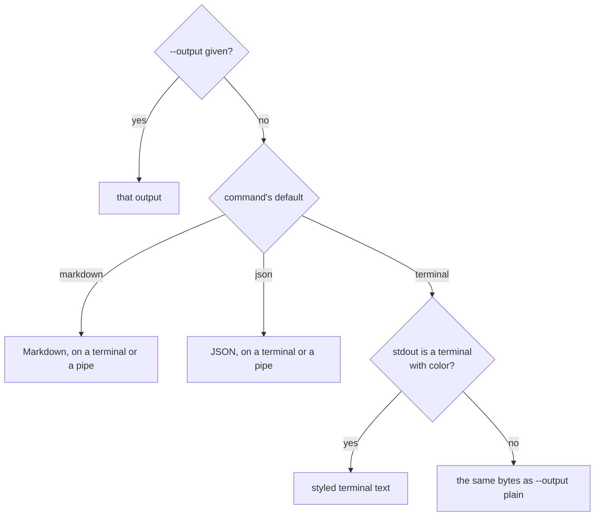
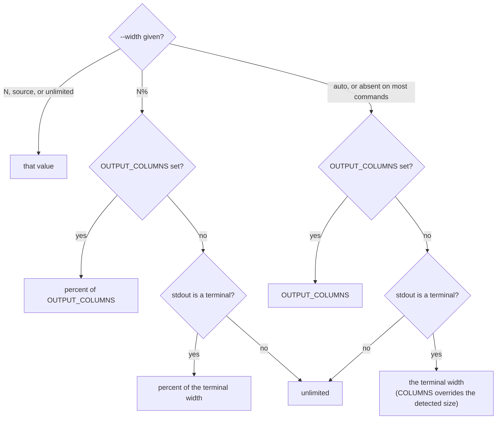
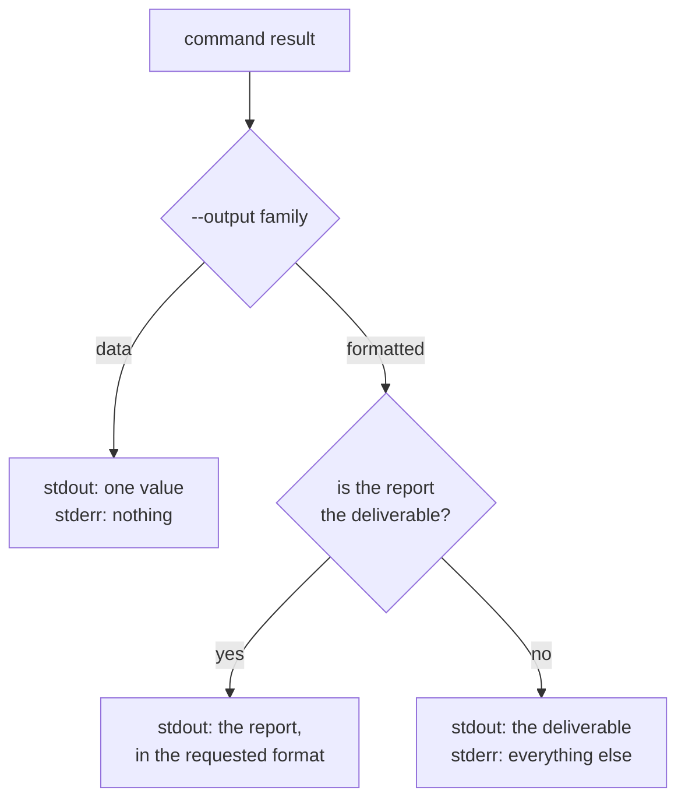

# Output and Width

Every `md` command prints through the same two options: `--output` chooses what
to print, and `--width` chooses how wide prose may run. Once you know them for
one command, you know them for all of them.

```sh
md render notes.md                      # for reading in a terminal
md render notes.md --output plain       # the same text with no styling
md render notes.md --output html > notes.html
md toc notes.md --output yaml           # the command's data, for a script
md render notes.md --width 72           # wrap prose at 72 columns
```

This page covers what each output contains, which output a command uses when you
do not choose one, how width is decided, which stream each thing is written to,
and what the exit status means. For the fields of each data output, see
[Data Contracts](./data-contracts.md).

## Choosing an output

`--output <target>` is the only way to choose an output type. The targets form
two families, and the family decides how a run behaves, not only how it looks.

| Value | Family | What you get |
|---|---|---|
| `terminal` | formatted | text styled for a terminal (color, bold, clickable links), reduced to what the terminal supports |
| `plain` | formatted | plain text with all styling removed and no escape bytes |
| `markdown` | formatted | Markdown that is pleasant to author and readable in any Markdown viewer |
| `markdown-plus` | formatted | Markdown that uses inline HTML for higher-fidelity presentation |
| `html` (alias `browser`) | formatted | HTML |
| `json`, `json5`, `yaml`, `toml` | data | the command's result as one value, for scripts |

A **formatted** output is for a person or a document. A **data** output is for a
program: it is always exactly one value on stdout, whether the run worked or not
(see [Streams](#streams)).

A value a command does not accept is a usage error, listed in that command's
`--help`.

### Which command accepts what

Every command accepts both families and declares one default. Two commands differ
from that pattern: `md compose` accepts only Markdown and the data family, and
`md schema detect` adds one value of its own.

| Command | Default | Accepts |
|---|---|---|
| [`md compose`](./compose.md) | `markdown` | `markdown` and the data family |
| [`md clean`](./clean.md), [`md set`](./set.md) | `markdown` | both families |
| [`md get`](./get.md) | `json` | both families |
| [`md schema detect`](./schema.md#md-schema-detect) | `terminal` | both families and `json-schema` |
| [`md render`](./render.md) (and `md FILE`), [`md toc`](./toc.md), [`md delta`](./delta.md), [`md rm`](./rm.md), [`md edit`](./edit.md), [`md hash`](./hash.md), [`md graph`](./graph.md), [`md code-block`](./code-block.md), [`md validate refs`](./validate.md), [`md schema validate`](./schema.md#md-schema-validate), [`md schema triggers`](./schema.md#md-schema-triggers), [`md schema about`](./schema.md#md-schema-about) | `terminal` | both families |

`md --completions` and `md --list-themes` take no `--output`: combining them is a
usage error. `md --help` and `md --version` print their text and ignore it.

### The default rule

A command's default follows one rule, and an explicit `--output` always wins:

- A command that defaults to `markdown` **always** writes Markdown, whatever
  stdout is and whatever the terminal supports. These are the document commands,
  whose deliverable is a Markdown document: `md compose`, `md clean`, and
  `md set`.
- A command that defaults to `terminal` falls back to `plain` when stdout is not
  a terminal or the terminal has no color support.



So a redirect never captures escape codes, and it never captures a different
document type than you asked for:

```sh
md compose notes.md > out.md       # Markdown
md render notes.md > out.txt       # plain text, because stdout is a file
md render notes.md --output markdown > out.md   # ask for Markdown by name
```

## `markdown` and `markdown-plus`

Both are Markdown. They differ in purpose:

- **`markdown`** is valid Markdown, with Darkmatter's directives and conventions
  on top. Its goal is to stay ergonomic to edit and readable in every viewer.
- **`markdown-plus`** carries more presentation by using inline HTML, which
  Markdown permits. It renders with higher fidelity and is less pleasant to edit.
  Where a construct has no richer form, the two read the same.

Disclosure sections show the difference. Given a document with a disclosure
section:

```md
<!-- md render doc.md --output markdown -->
::disclosure Setup
::details
Run `just install`.
::end-disclosure

<!-- md render doc.md --output markdown-plus -->
<details><summary>Setup</summary>

Run `just install`.
</details>
```

## What `plain` keeps

`plain` removes styling but not meaning: structure a reader relies on stays, and
no escape byte is ever written. A `terminal` output that falls back to `plain`
produces the same bytes.

Code stays recognizable as code. Inline code keeps its backticks, and a code
block keeps its fences and language tag, so a reader or script can tell it from
prose. A code line is never wrapped in `plain`: a line longer than the width is
printed whole.

````text
$ md render setup.md --output plain
Setup

Run `just install` first.

```sh
just install
```
````

The other elements follow the same principle:

| Element | In `plain` |
|---|---|
| bold, italic | the markers go, the text stays: `**bold**` prints `bold` |
| heading | its text alone, without `#` markers |
| table | keeps its box-drawing borders, which are structure rather than styling |
| block quote | each line is prefixed `> ` |
| horizontal rule | `---` |
| disclosure section | its summary line, then its contents as normal text |
| link, image | [the non-clickable rule](#links-and-images-that-cannot-be-clickable) |

```text
Setup

> Quoted text keeps a visible marker.

---

┌──────┬──────┐
│ Name │ Type │
├──────┼──────┤
│ id   │ ulid │
└──────┴──────┘
```

Because tables keep their borders, `plain` is not ASCII-only. It is escape-free.

## Links and images that cannot be clickable

A link can only be clicked in a terminal that supports OSC 8 hyperlinks (an
escape sequence that attaches a URL to text). Everywhere else, in `plain` and in
a terminal without that support, one rule decides what is printed. The global
`-v` flag asks for the URLs.

| Element | Default | With `-v` |
|---|---|---|
| link | `text` | `text <url>` |
| link whose text equals its URL | `url`, once | `url`, once |
| image | `IMAGE[alt]` | `image: alt <path>` |

```text
$ md render links.md --output plain
See the docs and https://example.com/x.

IMAGE[Logo]

$ md render links.md --output plain -v
See the docs <https://example.com/docs> and https://example.com/x.

image: Logo <./logo.png>
```

A URL this rule prints is never broken by word wrap. It counts as one unbreakable
word: when it does not fit on the current line it moves to a line of its own, and
if it is longer than the width it overflows that line rather than being split or
hyphenated.

```text
$ md render long.md --output plain -v --width 30
See the docs
<https://example.com/a/very/long/path/to/the/documentation/page.html>
for details and more words
here.
```

The [reference report](./validate.md#the-reference-report) never puts information
only in a URL: a problem's `file:line:column` is always visible text.

## Choosing a width

`--width` sets the column count prose wraps at. Every `md` command accepts it,
before or after the subcommand. A command that prints no prose (`md hash`,
`md rm`, `md get`, `md edit`, `md schema detect`) accepts it and it has no effect
there. Reports made of fixed rows (`md toc`, `md delta`, `md schema validate`) do not
wrap either.

| Value | Meaning |
|---|---|
| `N` | `N` columns, overriding `OUTPUT_COLUMNS` and the terminal |
| `N%` | `N` percent of `OUTPUT_COLUMNS` if set, else of the terminal width, rounded down; unlimited when neither is known |
| `auto` | `OUTPUT_COLUMNS` if set, else the terminal width, else unlimited |
| `source` | keep authored line breaks: no reflow at all |
| `unlimited` | never wrap and never pad, even on a terminal of known width |

```sh
md render notes.md --width 72          # wrap at 72 columns
md render notes.md --width 80%         # 80% of the terminal or OUTPUT_COLUMNS
OUTPUT_COLUMNS=100 md toc notes.md     # 100 columns, even on a pipe
md clean notes.md --width source       # keep every authored line break
md render notes.md --width unlimited   # one line per paragraph, nothing padded
```

A value below one column, or one that is not a width at all, is a usage error
(exit 2).

**A fractional width** is rounded down with a warning, because a column count is
a whole number. In a formatted output the warning goes to stderr. In a data output
it is a `dm.output.fractional_width` entry in the value (`run_diagnostics` for
`md clean`, `diagnostics` for everything else), and the run still succeeds.

```text
$ md render notes.md --width 72.9 --output plain
󰀨 --width takes a whole number of columns; using 72 for 72.9
```

### How the width is decided

Most commands treat a missing `--width` as `auto`. The terminal counts only when
stdout is a terminal, so on a pipe with neither option nothing wraps, and piped
output never depends on the size of the window it was launched from.



`OUTPUT_COLUMNS` holds a positive whole number. Any other value is a usage error
(exit 2), so a typo in a script's environment fails instead of silently changing
the layout. `COLUMNS`, by contrast, only overrides the detected size of a real
terminal, and has no effect on a pipe.

### Width on the document commands

The document commands treat their source text as the deliverable, so they ignore
`OUTPUT_COLUMNS` and the terminal unless you ask with `--width`, `--width auto`
included:

| Command | With no `--width` | With `--width N` |
|---|---|---|
| `md compose` | never wraps; joins a paragraph's single line breaks into one line | joins, then wraps at `N` |
| `md clean` | keeps authored line breaks, unless the document's `style.markdown` asks for `unwrap` or `fixed-width` | joins, then wraps at `N`, overriding the document |
| `md set` | keeps the rest of the document byte for byte | wraps each authored line at `N` and keeps the breaks between them |

`--width source` keeps authored line breaks on all three, and on `md clean` it
overrides the document's `fixed-width:` and `unwrap:`.

`md render --output markdown` follows the general rule with one exception: when no
width is known it prints the document's source lines rather than joining them, so
`md render notes.md --output markdown > copy.md` keeps them. Given a width, it
wraps each authored line and keeps the breaks between them, as `md set` does.

### What width does to each element

Width affects prose first. Other elements either keep their natural size or fill
the width, depending on the value.

| Element | Under `N` columns | Under `unlimited` |
|---|---|---|
| prose paragraph | wrapped at word boundaries | one line, never wrapped |
| code block | lines unchanged, and cut off at `N` in a styled terminal | lines unchanged |
| code panel background | padded to `N` | padded to the block's longest line |
| table | fitted to `N`, cells wrap | natural column widths |
| horizontal rule | `N` glyphs in a styled terminal; `---` in `plain` | a short rule in a styled terminal; `---` in `plain` |
| `md graph` line | cut off with `…` | never cut |

In `html`, `--width N` adds a `max-width: Nch` rule to prose elements and leaves
code blocks and tables alone. Markdown tables and code blocks are never reflowed.

`--width` is the room available. On `md render` and `md FILE`, `--max-width <N>`
caps the content inside it, whichever is smaller wins, and it exists only there:

```sh
md render notes.md --output plain --width 100 --max-width 60   # wraps at 60
```

### Width in data outputs and on stderr

A data output often carries the text a formatted output would have printed, and
that text gets the same treatment under the same rules. The `document` of
`md compose --output json` is exactly the Markdown `md compose` would print, and
`--width 40` reflows it at 40 columns. Structural values such as numbers, paths,
and codes are never wrapped.

`--width` applies only to the deliverable. Whatever a formatted run writes to
stderr wraps at stderr's own terminal width, and does not wrap when stderr is not a
terminal:

```sh
md compose broken.md --width 20 2> report.txt   # the report is not wrapped at 20
```

## Streams

What goes where depends on the family. The rule is that a script can trust stdout
and never has to parse stderr.

**Data outputs** write exactly one value to stdout, success or failure, and
nothing to stderr. Anything a run has to say is part of the value: warnings and
errors are diagnostics, `--perf` timings are `perf`, and lifecycle and shell step
output is `lifecycle_output`. `-v` adds nothing to a data output. A shell command
that would need interactive approval fails the run instead of prompting.

**Formatted outputs** write the deliverable to stdout, in the requested format.
Everything else (warnings, a composition's problem report, `-v` summaries, `--perf`
timings, lifecycle output) goes to stderr, styled according to what stderr itself
supports.

**A report that is the deliverable** goes to stdout in the requested format. This
is the case for commands run to produce a report: `md validate refs`,
`md graph --validate`, `md schema validate`, and `md hash --diff`.



| Command | stdout | stderr |
|---|---|---|
| `md compose broken.md` | nothing (it failed) | the problem report |
| `md compose broken.md --output json` | the value, with `outcome: "failure"` | nothing |
| `md render doc.md --output html` | the HTML | style warnings |
| `md validate refs doc.md --output markdown` | the report, as Markdown | nothing |

## Exit status

Every command uses the same statuses in every output mode, so a script decides
what happened from the status and never from stderr.

| Status | Meaning | stdout, data output | stderr, data output |
|---|---|---|---|
| 0 | the command ran and succeeded | one value | nothing |
| 1 | the command ran and failed | one value, with `outcome: "failure"` | nothing |
| 2 | a usage error: nothing ran | empty | the parser's message |
| 130 | interrupted with Ctrl-C | empty | nothing |

Status 1 covers every failure a run reaches, including one found by a check:
a broken reference, a `--deny` that made a warning blocking, `md hash --diff`
finding a difference, `md schema validate` finding an invalid document, and
`--save` given stdin.

Status 2 means the arguments could not be accepted: an unknown or removed flag, a
misspelled subcommand, a conflicting pair, a value out of range, or an argument
combination a command rejects, such as `md hash docs/ --save` or
`md code-block x --highlight abc`. No value is written, because no command ran.

In a formatted output the statuses mean the same; only the streams differ.

```sh
if out=$(md compose doc.md --output json); then
  jq -r .document <<<"$out"            # success
elif [ $? -eq 2 ]; then
  echo "fix the command line" >&2      # usage error: no value
else
  jq -r '.diagnostics[].message' <<<"$out"   # failure: the value says why
fi
```

## Opening the output in an app

`--show` writes the output to a temporary file and opens it in the host's default
app for that file type. It exists only on `md render` (and `md FILE`) and
`md compose`.

| Run | Printed to stdout | Opened |
|---|---|---|
| `md render --output markdown\|markdown-plus\|html --show` | nothing | that output |
| `md render --show` (`terminal` or `plain`) | the text | the document's Markdown |
| `md compose --show` | the Markdown | the Markdown |
| any data output with `--show` | the value | the value, as a `.json`, `.json5`, `.yaml`, or `.toml` file |

A data output combines with `--show` like any other, because a data output is
always one value on stdout:

```sh
md compose doc.md --output yaml --show   # prints the value and opens a temp .yaml file
```

A failed formatted run opens nothing. A failed data run still opens its failure
value. When the host cannot open the file, the run fails with status 1: a data
output reports `dm.output.open_failed`, and a formatted output writes the error to
stderr. `MD_DRY_RUN=1` writes the file without launching anything.

## Removed spellings

These are usage errors (exit 2).

| Removed | Use instead |
|---|---|
| `--output auto` | the command's default, or an explicit value |
| `--output ast`, and `--output json` as the document AST | no replacement: the document AST is not an output |
| `--output text` | `--output markdown` |
| `--output report-json` | `--output json` |
| `md compose --output markdown-plus\|html\|browser` | `md compose doc.md \| md render --output ...` |
| `--format` | `--output` |
| `--json` | `--output json` |
| `--json5`, `--yaml`, `--toml` | `--output json5`, `--output yaml`, `--output toml` |
| `--plain` | `--output plain` |
| `md get --raw` | `md get --output plain` |
| `md clean --fixed-width N` | `md clean --width N` |
| `md clean --ignore-incidental-newlines` | `md clean --width source` |
