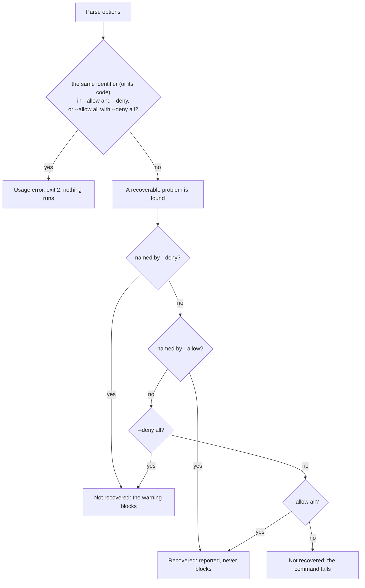
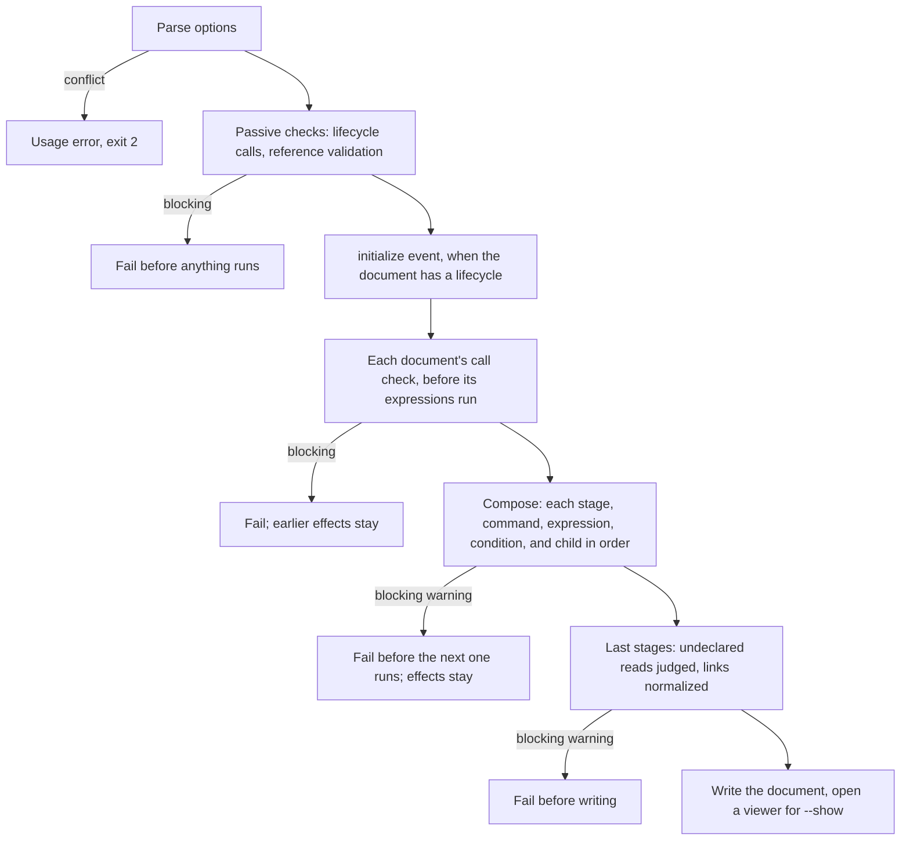

# Diagnostic Policy

Three verbs control how strict an `md` command is. Every command that has a
policy choice uses the same three, with the same identifiers:

| Option | What it does |
|---|---|
| `--allow <id\|all>` | permit a **recovery** (keep going past a known problem in a defined way), or reads from an explicitly named host |
| `--deny <id\|all>` | make the selected **diagnostics blocking**: the command fails when one is reported, and writes no document |
| `--disable <id>` | stop a **feature** from running |

```sh
# Keep the content when a hyperlink target is missing.
md compose doc.md --allow missing-hyperlinks

# Fail on any warning at all (CI), except the recovery named here.
md compose doc.md --deny all --allow shell-timeout

# Validate without the built-in baseline schema.
md schema validate doc.md --disable baseline-schema

# Fail when the `style:` frontmatter has an unknown or deprecated key.
md doc.md --deny style
```

Each verb is repeatable (`--allow missing-hyperlinks --allow shell-timeout`),
and repeating the same selection is harmless.

## Which command takes what

| Command | `--allow` | `--deny` | `--disable` |
|---|---|---|---|
| `md compose` | every recovery, `host=HOST`, `all` | every recovery, `style`, a diagnostic code, `all` | `baseline-schema`, `schema-triggers` |
| `md render`, `md FILE` | — | `style`, `all` | — |
| `md clean` | — | — | `baseline-schema`, `schema-triggers` |
| `md schema validate` | — | — | `baseline-schema`, `schema-triggers` |

A command that does not list a verb does not accept it, and an identifier a
command does not list is a usage error there. `md compose --help` lists every
identifier and code with a one-line description, and shell completion offers
them.

### Recoveries (`--allow`, `md compose`)

| Identifier | Recovery | Diagnostic code |
|---|---|---|
| `missing-hyperlinks` | keep the content when a hyperlink target is missing | `dm.reference.missing_hyperlink` |
| `missing-image-refs` | keep the content when an image target is missing | `dm.reference.missing_image` |
| `missing-transclusions` | remove a transclusion directive whose target is missing | `dm.reference.missing_transclusion` |
| `ctx-override` | replace a non-object `ctx` frontmatter value with the runtime context | `dm.context.ctx_override` |
| `invalid-frontmatter-assignment` | skip an invalid `set=` assignment on a `::file` directive; valid siblings still apply | `dm.transclusion.invalid_frontmatter_assignment` |
| `reassigned-frontmatter-property` | when a `::file` directive assigns one property twice, the rightmost wins | `dm.transclusion.reassigned_frontmatter_property` |
| `shell-timeout` | a shell command that times out becomes an empty string | `dm.shell.timeout_recovered` |

A recovered problem is still reported on stderr as a warning carrying its
code. Without the allowance the problem fails the command.

`--allow all` turns on every recovery above. It never grants a host and never
authorizes a shell command: shell approval and host consent are separate.

### Access (`--allow host=HOST`, `md compose`)

`--allow host=example.com` lets composition read remote content from exactly
that host (a hostname, an IP address, or a CIDR range for ICMP probes).
`host=HOST` is an allowance only: `--deny host=…` and `--disable host=…` are
usage errors, and `--deny all` does not take a named host away.

### Features (`--disable`)

| Identifier | What stops |
|---|---|
| `baseline-schema` | the built-in Darkmatter baseline frontmatter schema (and `BASELINE_SCHEMA`) |
| `schema-triggers` | schema-trigger discovery and bare-name schema-root lookup |

A disabled feature produces no diagnostics, and `--deny` does not turn it back
on. `md schema validate --disable baseline-schema` reports a document with no
remaining schema as "valid by default", never as passing the baseline.
`--disable baseline-schema` together with an explicit baseline
(`--baseline-schema PATH` on `md compose` and `md clean`, `--schema PATH` on
`md schema validate`) is a usage error.

### Diagnostics (`--deny`)

- **`style`**: unknown or deprecated `style:` keys, and deprecated inline
  horizontal-rule styles in the body, fail rendering (`md FILE`, `md render`,
  and `md compose --output html|markdown-plus`). Informational notices never
  block.
- **A recovery identifier**: that recovery does not apply, and its warning
  blocks.
- **A diagnostic code** (`md compose` only), such as
  `dm.expression.uncertain_call` or `dm.expression.undeclared_property`: a
  warning with that code blocks. `md compose --help` lists every code.
- **`all`**: every reported warning and error blocks, except a recovery named
  by `--allow`.

`dm.schema.invalid_trigger`, the warning for a
[schema trigger skipped because it failed to load](../topics/schemas/schema-triggers.md#invalid-discovered-triggers),
is one of those codes. Denied by name or through `--deny all`, it stops
composition once the document's schemas are prepared, before any of its
expressions, shell commands, or transcluded children run. The warning keeps
its `warning` severity and names the trigger, never the document.
`md schema validate` and `md clean` report the same warning but take no
`--deny`, so there it never blocks.

`--allow` never takes a diagnostic code, and some problems cannot be allowed
at all: a call proven wrong, a parse error, or an unavailable global always
fails.

## Precedence and conflicts

A specific identifier beats `all`, whichever comes first on the command line:

```sh
# Every recovery except missing hyperlinks.
md compose doc.md --allow all --deny missing-hyperlinks
md compose doc.md --deny missing-hyperlinks --allow all   # same

# Every warning blocks except a recovered context override.
md compose doc.md --deny all --allow ctx-override
```

The conflict check runs first, over the whole command line; then each
recoverable problem is decided like this:



Opposite selections of the same specificity are usage errors (exit status 2),
reported before the command reads its input or runs anything:

```sh
md compose doc.md --allow all --deny all                      # error
md compose doc.md --allow ctx-override --deny ctx-override    # error
# A recovery's code names the same recovery, so this is an error too.
md compose doc.md --allow missing-hyperlinks --deny dm.reference.missing_hyperlink
```

An allowance controls **recovery** only; a denial controls **blocking**. They
combine: `--allow all --deny dm.expression.uncertain_call` recovers every
recoverable problem and still fails on an uncertain call.

## When a blocking diagnostic stops the command

Denial changes a command's outcome, never a diagnostic: a blocked warning
keeps its code, severity, and message. The command stops as soon as the
diagnostic is known, without reordering its steps or undoing work already
done.



- **Passive checks** read the document without running it. A blocking
  finding there fails the command before `initialize`, any shell, or any
  expression runs. A blocking reference issue exits with status 2, like an
  unrecovered missing reference.
- **The call check** runs for each document (each transcluded child too) just
  before its expressions are evaluated, so a blocking call warning stops that
  document before it runs anything.
- **Runtime warnings** (an undeclared property, an unknown `ctx` group, the
  notice that a repeated volatile command reused its result) are found while
  composing. A blocking one stops the document before its next stage,
  command, expression, or condition: a `::shell` after the read never runs, a
  `::file` whose `when=` warned composes no child, a transcluded child stops
  before its own shells, and an expression or condition evaluated after the
  read never runs, so an `as_markdown(…)` there composes nothing. A nested
  `as_markdown` child that stops stops the calling document too, even inside
  an `||` fallback. In a lifecycle run the failure goes to `failed`;
  `composed` and the write never happen.
- **"Next" follows evaluation order, which is not always reading order.**
  Body `{{ … }}` spans, and the spans inside one frontmatter value, are
  evaluated from the end of the text backward; frontmatter keys (a key that
  reads another waits for it), `::block` conditions, and `::file` `when=`
  conditions in document order. An expression evaluated before the warning
  is known still runs.
- **A frontmatter read is judged when the frontmatter is final**, after its
  `$( … )` commands and the schema that may declare the property. A blocking
  undeclared read in frontmatter therefore stops the body, not the frontmatter
  commands or expressions that run beside it.
- **Nothing is undone or interrupted.** Commands that already ran stay done,
  and a transcluded child already composing beside the one that stopped
  finishes. A warning from the last stages (an undeclared read only
  reconciled at the end, link normalization) stops the command before the
  document is written.

```sh
# .darkmatter-shell-whitelist holds: prefix touch
printf '{{ missing }}\n\n::shell touch marker\n' > doc.md
md compose doc.md --deny all   # fails on dm.expression.undeclared_property; no marker
md compose doc.md              # succeeds with the warning; creates marker

# The later span is evaluated first, so the nested shell never runs either.
printf '{{ as_markdown("::shell touch marker") }}\n\n{{ missing }}\n' > doc.md
md compose doc.md --deny all   # fails on dm.expression.undeclared_property; no marker
```

A failed command never writes the composed document to stdout, in any
`--output` mode, and never opens a viewer for `--show`.

## Removed flags

The verbs replace these flags. Each old spelling is a usage error that names
its replacement; there are no aliases.

| Removed | Replacement |
|---|---|
| `--allow-missing-hyperlinks` | `--allow missing-hyperlinks` |
| `--allow-missing-image-refs` | `--allow missing-image-refs` |
| `--allow-missing-transclusions` | `--allow missing-transclusions` |
| `--allow-any-missing-reference` | `--allow missing-hyperlinks --allow missing-image-refs --allow missing-transclusions` |
| `--allow-ctx-override` | `--allow ctx-override` |
| `--allow-invalid-frontmatter-assignment` | `--allow invalid-frontmatter-assignment` |
| `--allow-reassigned-frontmatter-property` | `--allow reassigned-frontmatter-property` |
| `--allow-shell-timeout` | `--allow shell-timeout` |
| `--allow-host HOST` | `--allow host=HOST` |
| `--no-baseline-schema` | `--disable baseline-schema` |
| `--no-schema-triggers` | `--disable schema-triggers` |
| `--strict-style` | `--deny style` |

## For library callers

The registry of identifiers lives in `darkmatter-cli`
(`darkmatter/cli/src/args/policy.rs`). The library owns what the
identifiers mean: `darkmatter::markdown::compose::policy` holds the
diagnostic codes (`COMPOSE_DIAGNOSTIC_CODES`) and the `BlockingPolicy` a
caller installs with `ComposeOptions::with_blocking_policy`. A composition
under a policy that blocks a call warning, or a runtime warning before its
next stage, command, or child, fails there with
`MarkdownError::BlockedDiagnostics`, which carries the blocking warnings and
the earlier non-blocking ones. A warning reported by the last stages is left
in the report for the caller to check, as `md` does before writing.
