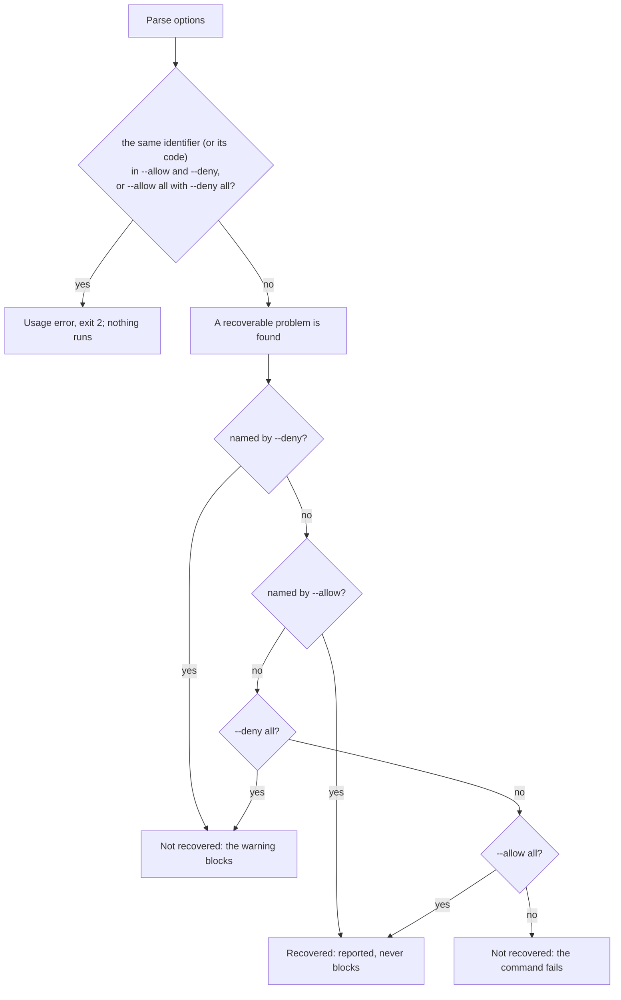
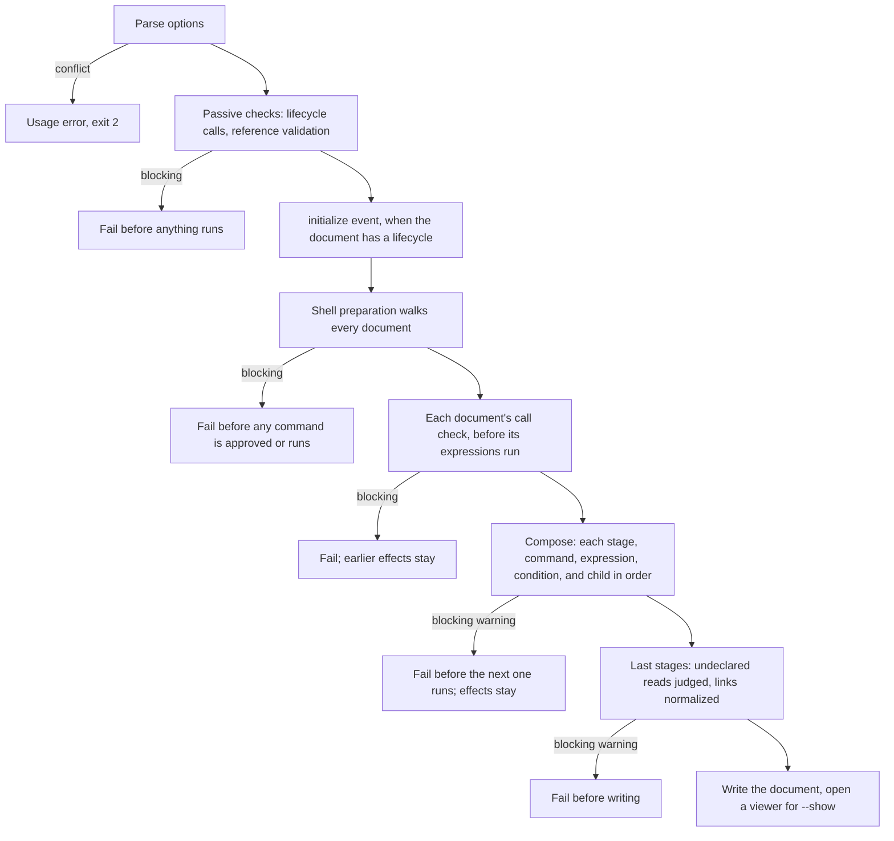

# Diagnostic Policy

Three verbs control how strict an `md` command is. Every command that has a
policy choice uses the same three, with the same identifiers:

| Option | What it does |
|---|---|
| `--allow <id\|all>` | permit a **recovery** (keep going past a known problem in a defined way), or reads from an explicitly named host |
| `--deny <id\|all>` | make the selected **diagnostics blocking**: the command fails when one is reported, and writes no document |
| `--disable <id>` | stop a **feature** from running |

```sh
# Keep the content when a hyperlink target is missing.
md compose doc.md --allow missing-hyperlinks

# Fail on any warning at all (CI), except the recovery named here.
md compose doc.md --deny all --allow shell-timeout

# Validate without the built-in baseline schema.
md schema validate doc.md --disable baseline-schema

# Fail when the `style:` frontmatter or a style file has an unknown or deprecated key.
md doc.md --deny style
md doc.md --style ./site.yaml --deny style
```

Each verb is repeatable (`--allow missing-hyperlinks --allow shell-timeout`),
and repeating the same selection is harmless.

## Which command takes what

| Command | `--allow` | `--deny` | `--disable` |
|---|---|---|---|
| `md compose` | every recovery, `host=HOST`, `all` | every recovery, `style`, a diagnostic code, `all` | `baseline-schema`, `schema-triggers`, `collection-blocks` |
| `md render`, `md FILE` | — | `style`, `dm.style.unknown_key`, `dm.style.deprecated`, the `dm.link.*` codes, `all` | — |
| `md clean` | — | — | `baseline-schema`, `schema-triggers` |
| `md schema validate` | — | — | `baseline-schema`, `schema-triggers` |

A command that does not list a verb does not accept it, and an identifier a
command does not list is a usage error there. `md compose --help` lists every
identifier and code with a one-line description, and shell completion offers
them.

### Recoveries (`--allow`, `md compose`)

| Identifier | Recovery | Diagnostic code |
|---|---|---|
| `missing-hyperlinks` | keep the content when a hyperlink target is missing | `dm.reference.missing_hyperlink` |
| `missing-image-refs` | keep the content when an image target is missing | `dm.reference.missing_image` |
| `missing-transclusions` | remove a transclusion directive whose target is missing | `dm.reference.missing_transclusion` |
| `ctx-override` | replace a non-object `ctx` frontmatter value with the runtime context | `dm.context.ctx_override` |
| `invalid-frontmatter-assignment` | skip an invalid `set=` assignment on a `::file` directive; valid siblings still apply | `dm.transclusion.invalid_frontmatter_assignment` |
| `reassigned-frontmatter-property` | when a `::file` directive assigns one property twice, the rightmost wins | `dm.transclusion.reassigned_frontmatter_property` |
| `shell-timeout` | a shell command that times out becomes an empty string | `dm.shell.timeout_recovered` |
| `untyped-map-variables` | a `::map` source with no iterable declaration is accepted with a warning | `dm.collection.untyped_map_source` |
| `untyped-filter-variables` | a `::filter` source with no iterable declaration is accepted with a warning | `dm.collection.untyped_filter_source` |

A missing target of any other kind (a CSS, script, or font import, a `<video>`,
`<audio>`, `<source>`, or `<iframe>`) has no recovery: `md compose` stops on it even
with `--allow all`.

A recovered problem is still reported, carrying its code: on stderr in a Markdown
run, and in `diagnostics` in a [data output](./data-contracts.md). Without the
allowance the problem fails the command.

`--allow all` turns on every recovery above. It never grants a host and never
authorizes a shell command: shell approval and host consent are separate.

### Access (`--allow host=HOST`, `md compose`)

`--allow host=example.com` lets composition read remote content from exactly
that host (a hostname, an IP address, or a CIDR range for ICMP probes).
`host=HOST` is an allowance only: `--deny host=…` and `--disable host=…` are
usage errors, and `--deny all` does not take a named host away. A named host
also allows schema slot reads of URLs on it; see
[Schema slot reads](#schema-slot-reads).

### Features (`--disable`)

| Identifier | What stops |
|---|---|
| `baseline-schema` | the built-in Darkmatter baseline frontmatter schema (and `BASELINE_SCHEMA`) |
| `schema-triggers` | schema-trigger discovery and bare-name schema-root lookup |
| `collection-blocks` | the `::map` and `::filter` directive stage (`md compose` only) |

A disabled feature produces no diagnostics, and `--deny` does not turn it back
on. `md schema validate --disable baseline-schema` reports a document with no
remaining schema as "valid by default", never as passing the baseline.
`--disable baseline-schema` together with an explicit baseline
(`--baseline-schema PATH` on `md compose` and `md clean`, `--schema PATH` on
`md schema validate`) is a usage error.

A YAML file given to `md schema validate` never uses a baseline or trigger
schemas, so both identifiers are accepted there and change nothing for it;
its kind definitions come from the schema roots whatever `schema-triggers`
says. See
[YAML documents on the command line](../topics/schemas/definition.md#yaml-documents-on-the-command-line).

### Diagnostics (`--deny`)

- **`style`**: fail rendering (`md FILE` and `md render`) on a style key that
  would otherwise only warn:
    - an unknown or deprecated key in the document's `style:` frontmatter, and
      a deprecated inline horizontal-rule style in the body;
    - an unknown key in a `--style` file, which is otherwise left out with a
      warning.

  A [style setter](./render.md#style-setters) needs no denial: an unknown key
  or a wrong value there is already an error. Informational notices never
  block. See [When a style is rejected](./render.md#when-a-style-is-rejected).
- **A recovery identifier**: that recovery does not apply, and its warning
  blocks.
- **A diagnostic code**, such as `dm.expression.uncertain_call`,
  `dm.expression.undeclared_property` (an unhandled read of a name nothing
  declares), or `dm.expression.undeclared_member` (an unhandled read of a
  member its value's known object type does not declare, such as
  `server.nmae`; see
  [Misspelled members](../topics/darkmatter-expressions.md#misspelled-members)):
  a warning with that code blocks.
  `md compose --help` lists every code; `md render` takes
  `dm.link.malformed_structured_title`, `dm.link.legacy_structured_title`,
  `dm.style.unknown_key`, and `dm.style.deprecated`.
- **`all`**: every reported warning and error blocks, except a recovery named
  by `--allow`.

`dm.schema.invalid_trigger`, the warning for a
[schema trigger skipped because it failed to load](../topics/schemas/schema-triggers.md#invalid-discovered-triggers),
is one of those codes. Denied by name or through `--deny all`, it stops
composition once the document's schemas are prepared, before any of its
expressions, shell commands, or transcluded children run. The warning keeps
its `warning` severity and names the trigger, never the document.
`md schema validate` and `md clean` report the same warning but take no
`--deny`, so there it never blocks.

`--allow` never takes a diagnostic code, and some problems cannot be allowed
at all: a call proven wrong, a parse error, or an unavailable global always
fails.

## Precedence and conflicts

A specific identifier beats `all`, whichever comes first on the command line:

```sh
# Every recovery except missing hyperlinks.
md compose doc.md --allow all --deny missing-hyperlinks
md compose doc.md --deny missing-hyperlinks --allow all   # same

# Every warning blocks except a recovered context override.
md compose doc.md --deny all --allow ctx-override
```

The conflict check runs first, over the whole command line; then each
recoverable problem is decided like this:



Opposite selections of the same specificity are usage errors (exit status 2),
reported before the command reads its input or runs anything:

```sh
md compose doc.md --allow all --deny all                      # error
md compose doc.md --allow ctx-override --deny ctx-override    # error
# A recovery's code names the same recovery, so this is an error too.
md compose doc.md --allow missing-hyperlinks --deny dm.reference.missing_hyperlink
```

An allowance controls **recovery** only; a denial controls **blocking**. They
combine: `--allow all --deny dm.expression.uncertain_call` recovers every
recoverable problem and still fails on an uncertain call.

## When a blocking diagnostic stops the command

Denial changes a command's outcome, never a diagnostic: a blocked warning
keeps its code, severity, and message. The one exception is a `style` key
denied on `md render`, which is reported with severity `error` (see
[Diagnostics](./data-contracts.md#diagnostics)). The command stops as soon as the
diagnostic is known, without reordering its steps or undoing work already
done.



- **Passive checks** read the document without running it. A blocking
  finding there fails the command before `initialize`, any shell, or any
  expression runs. A blocking reference issue exits with status 1, like an
  unrecovered missing reference.
- **Shell preparation** walks every document the composition could reach,
  a `::file` whose `when=` is false included, before any shell command is
  approved or prompted for. A blocking warning only that walk finds (an
  invalid schema trigger in a skipped child) fails the command there, before
  any command runs; in a lifecycle run, effects of `initialize` stay.
- **The call check** runs for each document (each transcluded child too) just
  before its expressions are evaluated, so a blocking call warning stops that
  document before it runs anything.
- **Runtime warnings** (an undeclared property, an unknown `ctx` group, the
  notice that a repeated volatile command reused its result) are found while
  composing. A blocking one stops the document before its next stage,
  command, expression, or condition: a `::shell` after the read never runs, a
  `::file` whose `when=` warned composes no child, a transcluded child stops
  before its own shells, and an expression or condition evaluated after the
  read never runs, so an `as_markdown(…)` there composes nothing. A nested
  `as_markdown` child that stops stops the calling document too, even inside
  an `||` fallback. In a lifecycle run the failure goes to `failed`;
  `composed` and the write never happen.
- **"Next" follows evaluation order, which is not always reading order.**
  Body `{{ … }}` spans, and the spans inside one frontmatter value, are
  evaluated from the end of the text backward; frontmatter keys (a key that
  reads another waits for it), `::block` conditions, and `::file` `when=`
  conditions in document order. An expression evaluated before the warning
  is known still runs.
- **A misspelled member is judged where it is read.** A
  `dm.expression.undeclared_member` warning is known as soon as the read is
  evaluated, so it stops the next expression, condition, or stage. A `when=`
  condition that warns composes no child, and a frontmatter `$( … )` ternary
  that warns runs no command. A read inside a callback (`map(…)`, a `::map`
  or `::filter` callback) is judged at the collection's next gate or when the
  collection finishes, not between items. A read that is never evaluated,
  such as an unchosen ternary branch, never warns and never blocks.
- **A frontmatter read is judged when the frontmatter is final**, after its
  `$( … )` commands and the schema that may declare the property. A blocking
  undeclared read in frontmatter therefore stops the body, not the frontmatter
  commands or expressions that run beside it.
- **Nothing is undone or interrupted.** Commands that already ran stay done,
  and a transcluded child already composing beside the one that stopped
  finishes. A warning from the last stages (an undeclared read only
  reconciled at the end, link normalization) stops the command before the
  document is written.

```sh
# .darkmatter-shell-whitelist holds: prefix touch
printf '{{ missing }}\n\n::shell touch marker\n' > doc.md
md compose doc.md --deny all   # fails on dm.expression.undeclared_property; no marker
md compose doc.md              # succeeds with the warning; creates marker

# The later span is evaluated first, so the nested shell never runs either.
printf '{{ as_markdown("::shell touch marker") }}\n\n{{ missing }}\n' > doc.md
md compose doc.md --deny all   # fails on dm.expression.undeclared_property; no marker
```

A misspelled member blocks only when you deny it; the same document
composes, with the warning, under the default policy:

```sh
cat > doc.md <<'MD'
---
$schema:
  server: "{ name: string, port: number }"
server: { name: web, port: 80 }
---
{{ server.nmae }}

::shell touch marker
MD
md compose doc.md                                          # succeeds; warns, creates marker
md compose doc.md --deny dm.expression.undeclared_member   # exit 1; no marker
```

```text
Member 'nmae' is not declared by the known object type of 'server' at doc.md:6.
```

The warning keeps its `warning` severity in either run; `--deny` changes only
the outcome. With `--output json` it is one record in `diagnostics`, with
`code`, `severity`, and `source.line`/`source.column` at the member name, and
stderr stays empty.

A failed command never writes the composed document to stdout, in any
`--output` mode, and exits with status 1. With `--show`, a failed Markdown run opens
no viewer; a failed data output still opens its failure value, which holds no
document. See [Exit status](./output-and-width.md#exit-status).

## Schema slot reads

A schema can load values from data with a `{{ … }}`
[slot](../topics/schemas/schema-slots.md), such as
`enum({{ load_data("../os.yaml", "string[]") }})`. Whether a slot may read a
file or URL is decided by **grants**, not by the verbs on this page, and not
by the shell command whitelist or blacklist either:

- **`--allow host=HOST` is the only flag that affects a slot read.** On
  `md compose` it also allows a slot's `http` and `https` reads on that host
  for the run, unless a deny grant covers them. No other `--allow`,
  `--deny`, or `--disable` identifier governs a slot, and no
  `dm.schema.slot_*` code is a recovery or one of the codes `--deny` takes, so
  `--deny dm.schema.slot_denied` is a usage error and `--allow all` recovers
  no slot failure.
- **Persisted grants** live in the user's grant store,
  `<home>/.config/darkmatter/schema-read-policy` on every OS, never in a
  repository. Each line allows or denies one target, and a deny always wins:

  ```text
  allow file /home/me/data/os.yaml
  deny dir /home/me/schemas/private
  allow site https://schemas.example.com
  ```

  See [Grants](../topics/schemas/schema-slots.md#grants) for every target
  kind and what makes the file invalid.
- **On a terminal**, a read no grant decides is asked about with a numbered
  prompt (see [Prompts](../topics/schemas/schema-slots.md#prompts)).
- **A data output never asks.** An unapproved read fails with
  `dm.schema.slot_approval_required`, whose `grants_needed` lists the grants
  any one of which would allow it, so a script can add one to the store and
  run again:

  ```json
  { "code": "dm.schema.slot_approval_required",
    "grants_needed": [{ "kind": "file", "target": "/repo/data/os.yaml", "scope": "persisted" }, "..."] }
  ```

  A `persisted` entry is the store line `allow <kind> <target>`; a `once`
  entry can only be given at a prompt.

## Removed flags

The verbs replace these flags. Each old spelling is a usage error that names
its replacement; there are no aliases.

| Removed | Replacement |
|---|---|
| `--allow-missing-hyperlinks` | `--allow missing-hyperlinks` |
| `--allow-missing-image-refs` | `--allow missing-image-refs` |
| `--allow-missing-transclusions` | `--allow missing-transclusions` |
| `--allow-any-missing-reference` | `--allow missing-hyperlinks --allow missing-image-refs --allow missing-transclusions` |
| `--allow-ctx-override` | `--allow ctx-override` |
| `--allow-invalid-frontmatter-assignment` | `--allow invalid-frontmatter-assignment` |
| `--allow-reassigned-frontmatter-property` | `--allow reassigned-frontmatter-property` |
| `--allow-shell-timeout` | `--allow shell-timeout` |
| `--allow-host HOST` | `--allow host=HOST` |
| `--no-baseline-schema` | `--disable baseline-schema` |
| `--no-schema-triggers` | `--disable schema-triggers` |
| `--strict-style` | `--deny style` |

## For library callers

The registry of identifiers lives in `darkmatter-cli`
(`darkmatter/cli/src/args/policy.rs`). The library owns what the
identifiers mean: `darkmatter::markdown::compose::policy` holds the
diagnostic codes (`COMPOSE_DIAGNOSTIC_CODES`) and the `BlockingPolicy` a
caller installs with `ComposeOptions::with_blocking_policy`. A composition
under a policy that blocks a call warning, or a runtime warning before its
next stage, command, or child, fails there with
`MarkdownError::BlockedDiagnostics`, which carries the blocking warnings and
the earlier non-blocking ones. A warning reported by the last stages is left
in the report for the caller to check, as `md` does before writing.
