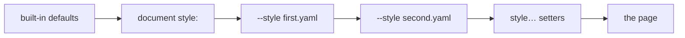

## Overview

The `render` command renders markdown documents for terminal viewing or export
formats, and is where any Markdown, including the output of
[`md compose`](./compose.md), turns into something else:

```sh
md compose doc.md | md
md compose doc.md | md render --output html > doc.html
```

**`md FILE …` is `md render FILE …`.** With no subcommand, `md` runs `render`
with exactly the arguments you gave it: the same options, the same output,
the same diagnostics, and the same exit status.

```sh
md README.md --output plain --indent 2
md render README.md --output plain --indent 2   # the same run
```

Use `render` when you want explicit command intent in scripts and docs. A
file named like a command, or like a `style…=VALUE` setter, follows `--`
(or starts with `./`): `md -- render` renders the file `render`, and
`md render -- toc` renders the file `toc`.

### Where options go

`md` has two kinds of option, and the kind decides where you may write it:

| Kind | Options | Where |
|---|---|---|
| render options | `--style`, `--output`, `--show`, `--indent`, `--deny`, `--feature`, `--mermaid`, the input, and `style…=VALUE` setters | after `md render`, or anywhere on `md` with no subcommand; never before a subcommand |
| shared controls | `--width`, `-v`/`--verbose`, `--debug` | anywhere, before or after a subcommand |
| root-only | `--magic-root`, `--completions`, `--help`, `--version` | before any subcommand (`--help` also works on each command) |

A render option before a subcommand is a usage error (exit code 2), because
nothing combines the two levels:

```sh
md --feature embed-mermaid-font render README.md   # exit 2
md render README.md --feature embed-mermaid-font   # the render form
md --mermaid toc README.md                         # exit 2
md style.margin=4 toc README.md                    # exit 2: a setter is a render argument
md --width 72 render README.md                     # fine: a shared control
md --magic-root ./shared render '@notes.md'        # fine: before the subcommand
```

## Reporting

### Usage

```sh
# Explicit render command
md render README.md

# Equivalent implicit form
md README.md

# Render from stdin
md render -
cat README.md | md render

# Select an output
md render README.md --output plain
md render README.md --output markdown
md render README.md --output html
md render README.md --output json

# Wrap prose at 72 columns, or at 80% of the terminal
md render README.md --width 72
md render README.md --width 80%

# Style it without editing the file
md render README.md style.max-width=72 style.page.theme=github
md render README.md --style ./print.yaml

# Open the selected output in the default app
md render README.md --output html --show

# Override list indentation
md render README.md --indent 2
```

### Arguments

- `[ARGS]...`: the Markdown file path (supports `@` file references; `-` for stdin) and any `style…=VALUE` setters, in any order. A word is a setter when the text before its first `=` is `style` or starts with `style.`; every other word is the file. More than one file is a usage error (exit code 2). If no file is given, reads stdin when it is piped or redirected (even when empty); see [No input](#no-input) for a terminal. See [Style setters](#style-setters).
- `-- [INPUT]...`: everything after `--` is the file, never a setter or a command.

### Options

These are the render options; `md` with no subcommand takes the same ones.

- `--style <FILE>`: a JSON, JSON5, YAML, or TOML style file (repeatable; later files merge over earlier ones). See [Style files](#style-files).
- `--output <terminal|plain|markdown|markdown-plus|html|browser|json|json5|yaml|toml>`: What to print (default: `terminal`). See [Output Behavior](#output-behavior).
- `--show`: Write output to a temp file and open it with the system default app. See [Opening the Output](#opening-the-output).
- `--indent <#>`: Enforce a nested-list indentation step of 2, 4, or 8 spaces per level. Default: 4. For an eight-space step, cleanup uses CommonMark-valid marker padding on parent items when needed to preserve the same list tree.
- `--deny <ID>`: make the selected diagnostics blocking (repeatable): `style`, `dm.style.unknown_key`, `dm.style.deprecated`, a `dm.link.*` code, or `all`. See [Policy Flags](./policy.md#diagnostics---deny).
- `--mermaid`: in terminal output, render Mermaid diagrams in automatic mode: an
  image where the terminal shows images, otherwise a text drawing when the
  diagram has one and it fits, otherwise the highlighted code block (see
  [Mermaid in the terminal](#mermaid-in-the-terminal) below). HTML, Markdown,
  and JSON output ignore it.
- `--feature <NAME>`: turn on a named feature (see [Features](#features) below)

The shared controls apply too:

- `--width <N|N%|auto|source|unlimited>`: Width the output is wrapped to (default: `auto`). See [Width](#width) and [Output and Width](./output-and-width.md#choosing-a-width).
- `-v`/`--verbose`: more detail in styled output, such as link URLs in `plain` (`-vv` for more).

### Themes and line numbers

Themes and code line numbers are style keys, set in the document's `style:`
or from the command line like any other (see
[Styling from the command line](#styling-from-the-command-line)):

- `style.page.theme=NAME`: prose theme
- `style.page.code.theme=NAME`: code theme override (selects *which* theme pair, e.g. `dracula`)
- `style.page.code.mode=MODE`: the code panel's light/dark variant (`inverse`, the default, `dark`, `light`, or `same`)
- `style.code-block.line-numbers=true`: include code line numbers in terminal rendering

```sh
md README.md style.page.theme=github style.code-block.line-numbers=true
```

[`md list-themes`](./list-themes.md) lists the theme names these take.

### Styling from the command line

A document's look (margins, widths, alignment, colors, themes) comes from its
`style:` frontmatter, described in
[Layouts and Style](../topics/layouts-and-style.md). Two kinds of argument add
style on top of it for one run, without editing the file:

- a **setter**, `style.KEY=VALUE` or `style=OBJECT`, sets one style value;
- a **style file**, `--style FILE`, supplies a whole style object from a
  JSON, JSON5, YAML (`.yaml`, `.yml`), or TOML file.

```sh
md README.md style.page.margin-left=4
md README.md --style ./wide.yaml
md README.md --style ./wide.yaml style.page.theme=github
md render README.md style='{ page: { margin: 2 } }'
```

Both use the same keys as `style:` frontmatter, so a value can be copied
between a document and the command line unchanged.

#### Style setters

A setter is one word: a property path that starts with `style`, an `=`, and a
value. It is not a flag, so it has no leading `--`, and it may sit before or
after the file.

```sh
md README.md style.table.alignment=center        # one key
md style.margin=2 README.md style.ml=6           # order does not matter
md README.md style='{ max-width: 50, margin-left: 4 }'   # several keys at once
md render ./style.draft=old.md                   # a file: `./` makes it a path
md render -- style.draft=old.md                  # a file: nothing after `--` is a setter
```

- **The path** is spelled with `.` between keys, like every
  [property path](./index.md#property-paths). Page keys and their short forms
  may also be written at the top level: `style.max-width=80` is
  `style.page.max-width=80`, and `style.ml=4` is `style.page.margin-left=4`.
  Only the canonical kebab-case names are setters.
- **The value** is the text after the first `=`, read as the key's declared
  type, as [command-line values](./index.md#command-line-values) are for
  `md set`: `4` is a number for `max-width` and `slate-900` is a color. A
  value that starts with `{` is an object (JSON5, or a YAML flow mapping, so
  `max-width` needs no quotes inside it). Booleans always take a value:
  `style.code-block.line-numbers=false`.
- **Compound values** take either form: `style.table.border=thin` and
  `style.table.border='{ left: true, right: false }'` both set the border,
  and `style.table.border.left=false` sets one field of it.
- **Repeating a path** keeps its last value, whole-object setters included:
  `style='{ margin: 2 }' style='{ max-width: 50 }'` keeps only the second.
  The replaced value is never read, so
  `style='{ margin: 1, margin: 2 }' style='{ margin: 3 }'` succeeds; only the
  surviving value must be valid.
- **Two spellings of one field** fail rather than depend on order:
  `style.ml=2 style.page.margin-left=3` is a `dm.style.conflict` error. A
  short form beside a more specific key is fine; the specific key wins, so
  `style.margin=2 style.ml=6` gives a left margin of 6 and 2 elsewhere.

#### Style files

`--style FILE` reads a style object from a file. The file holds what you
would write under `style:` in frontmatter, at its root:

```yaml
# print.yaml
max-width: 72
margin-left: 4
table:
  alignment: center
```

```sh
md README.md --style ./print.yaml
md README.md --style ./print.yaml --style ./dark.toml   # the later file wins key by key
```

The argument is a [file reference](./index.md#file-references), resolved from
the directory you ran `md` in, with one addition: `KEY@FILE` selects a mapping
inside the file.

| You write | Reads |
|---|---|
| `--style print.yaml` | the whole file |
| `--style style@site.yaml` | the `style` key of `site.yaml` |
| `--style themes.dark@site.yaml` | a nested key (a [property path](./index.md#property-paths)) |
| `--style @shared.yaml` | a [magic path](../topics/magic-paths.md), no offset |
| `--style style@@shared.yaml` | an offset into a magic path |
| `--style ./user@host.yaml` | a file with `@` in its name: `./`, or any `/` before the `@`, makes it a path |

- The extension decides the format: `.json`, `.json5`, `.yaml`, `.yml`, or
  `.toml`. Anything else, a Markdown file included, is refused.
- Style files are local. A URL is refused without a request, and
  `--style -` is refused because stdin is reserved for the Markdown input.
- A file holds data, not Darkmatter syntax: nothing in it is evaluated, and it
  cannot load another style file.
- To give a style inline, use a setter: `--style '{ margin: 4 }'` fails with a
  hint to write `style='{ margin: 4 }'`.
- A relative path inside the file, such as `page.stylesheet`, resolves from
  the file's own directory.

#### Which value wins

Each source is a **layer**, and a layer changes only the keys it names. Later
layers win, key by key: built-in defaults, then the document's own `style:`
(the lowest you can set), then each `--style` file in command-line order, then
the setters, which form one final layer wherever they sit on the line.



```yaml
# guide.md frontmatter
style:
  page:
    max-width: 96
    margin-top: 1
```

```sh
md guide.md style.ml=6   # left margin 6; max-width 96 and margin-top 1 are kept
```

Short forms are expanded inside each layer before layers merge, so a later
layer's broad key still beats an earlier layer's specific one: a document's
`ml: 6` loses to a setter `style.margin=2`. Setting `width` on a component in
a later layer drops an inherited `max-width`, and the reverse. A `null` in a
command-line layer means "not set", not "reset". The details are in
[Layouts and Style](../topics/layouts-and-style.md).

#### When a style is rejected

Every command-line layer is checked before anything is printed or opened, on
every `--output`, so a bad value never looks as if it worked. A failure exits
with code 1; a data output reports it in its one value and leaves stderr
empty (see [Style input errors](./data-contracts.md#style-input-errors) for
every code).

| Problem | In a setter | In a `--style` file | In the document's `style:` |
|---|---|---|---|
| an unknown key (`magin`, `table.border.glow`) | error, `dm.schema.unknown_key`, suggesting the nearest valid key (``did you mean `style.margin`?``) | left out with a `dm.style.unknown_key` warning | `dm.style.unknown_key` warning |
| a wrong value (`max-width: abc`) | error, `dm.schema.*` | error, `dm.schema.*` | error in an output that builds a page; `markdown` and data outputs do not read it |
| a `style=` value that is not a mapping (`style='{ margin: '`, `style=4`, `style=null`) | error, `dm.schema.type_mismatch`, naming `style` | — | — |
| nothing left once unknown keys and nulls are removed | — | error, `dm.style.empty_file` | — |
| a file that is missing, unreadable, malformed, or not a mapping | — | error, naming the file | — |

A rejected style still reports every warning found before it: the schema
triggers skipped as invalid, the document's own `style:` warnings at their
authored lines, and the warnings of each `--style` file read before the one
that failed. A formatted output writes them to stderr above the error and
prints no page; a data output lists them in `diagnostics` beside the error.
When `--deny <code>` blocks one warning, that warning becomes the error and
the others stay warnings.

```text
$ md render notes.md --style missing.yaml --output yaml   # line 3 of notes.md is `  magin: 4`, under `style:`
outcome: failure
diagnostics:
- code: dm.style.unknown_key
  severity: warning
  message: unknown style key `style.magin`
  source: { file: notes.md, line: 3, column: 3 }   # abridged
- code: dm.input.read_failure
  severity: error
  message: 'Failed to load file: "missing.yaml"'
```

`--deny style` turns the warnings in that table into errors: see
[Policy Flags](./policy.md#diagnostics---deny). A setter is judged by the
document's effective schema, so a document whose schema opens `style` with a
pattern key (`"<string>": unknown`) accepts setters it declares; an admitted
key that Darkmatter does not render is accepted and has no effect.

A Markdown or data output prints the document's source, so a setter or style
file never enters it; the values are still checked. A misspelled setter that
names no file (`stlye.page.margin-left=4`) fails as an input that does not
resolve, with a hint naming the `style.…` spelling.

#### Completion

Shell completion offers the keys the document's schema declares under
`style`, one level at a time, and their values after `=`; `--style` completes
JSON, JSON5, YAML, and TOML files. Completion never opens a style file.

```text
md render doc.md style.<Tab>                  style.page. style.page= style.margin-left= ... style.table. style.ul. ...
md render doc.md style.ul.<Tab>               style.ul.width= style.ul.max-width= style.ul.alignment= ...
md render doc.md style.ul.alignment=<Tab>     left center right
```

#### Rendering composed output

`md compose` writes Markdown and takes no style. To style a composed document,
pipe it into `md render -`:

```sh
md compose docs/guide.md | md render - --output html --style ./print.yaml > guide.html
```

The pipe carries text, not the original file's path. The rendered document is
stdin, so it resolves relative references from the directory you ran `md` in,
not from `docs/`: an image written `./diagram.png` in `docs/guide.md` is
looked for as `./diagram.png` beside you, and may be missing or a different
file. Style files and setters always resolve from that directory too. Run the
pipe from the document's directory, or use references that do not depend on
it (absolute, `&`, `^`, or `@` paths), when the source has relative assets.

### No input

With no file and a terminal on stdin there is nothing to read. Both spellings
write the root help to stderr and exit with code 1; a data output instead
prints its one failure value (`dm.input.read_failure`) and leaves stderr
empty. A redirected stdin, even an empty one, is read as the document.

### Environment

- `OUTPUT_COLUMNS`: the width used when `--width` is absent; see [How the width is decided](./output-and-width.md#how-the-width-is-decided).
- `TERMINAL_IMAGES`: terminal image output. A truthy value (`true`, `1`, `yes`, `on`) forces protocol image output attempts, a falsy one (`false`, `0`, `no`, `off`) disables it, and anything else uses capability detection.

### Features

`--feature <NAME>` turns on an opt-in by name. It is a render option, so it is
written `md doc.md --feature NAME` or `md render doc.md --feature NAME`; before
any subcommand (`md --feature NAME render doc.md`) it is a usage error.

- Repeatable and comma-separated: `--feature a --feature b` is the same as
  `--feature a,b`.
- Names are case-insensitive, and repeating a name is harmless.
- An unknown name, including an empty one (`--feature a,,b` or
  `--feature ""`), is a usage error (exit code 2) that lists the valid names.
  Shell completion offers them.

| Name | Effect |
| --- | --- |
| `embed-mermaid-font` | In HTML output, embed the font static-SVG Mermaid diagrams were measured in, once per page (see [Mermaid rendering](../rendering/mermaid.md#embedded-font)). |
| `no-mermaid-fallbacks` | With `--mermaid`, never draw a diagram as text: a terminal without images shows its code block. |
| `no-mermaid-partial-fallbacks` | With `--mermaid`, never draw a diagram as text when the drawing may miss details the image would show. Every diagram family's drawing is partial today, so this currently acts like `no-mermaid-fallbacks`. |
| `no-mermaid-partial-warning` | With `--mermaid`, hide the note that follows a partial text drawing. |
| `no-mermaid-rendering` | Every Mermaid fence stays a highlighted code block, in every output. |

When two fallback features overlap, the more restrictive wins:
`no-mermaid-fallbacks,no-mermaid-partial-fallbacks` never draws text. The
three fallback features act only with `--mermaid`; without it they are
accepted and change nothing.

`embed-mermaid-font` acts only on Mermaid diagrams emitted as static SVG.
`md`'s HTML output does not produce static SVG today: its Mermaid diagrams
are interactive `<pre class="mermaid">` blocks, so the page is byte for byte
the same with and without the feature. Terminal, Markdown, and JSON output
ignore it. No frontmatter key turns it on.

```sh
md --output html --feature embed-mermaid-font notes.md
md render notes.md --output html --feature EMBED-MERMAID-FONT   # same
```

`no-mermaid-rendering` wins over every other Mermaid option on the command:
`--mermaid`, static SVG, and `embed-mermaid-font` (which then has nothing to
embed). Terminal and HTML output show each fence as a code block with
[Mermaid syntax highlighting](../rendering/mermaid.md#syntax-highlighting),
and HTML output loads no Mermaid.js. Markdown and JSON output keep the
` ```mermaid ` fence, as they always do.

```sh
md --mermaid --feature no-mermaid-rendering notes.md   # code blocks, not diagrams
md render notes.md --output html --feature no-mermaid-rendering   # no Mermaid.js
```

### Mermaid in the terminal

`md --mermaid` renders each Mermaid fence in automatic mode:

- **The terminal shows images:** the diagram is drawn as an image.
- **It does not:** a diagram that can be drawn as text (a flowchart or a
  sequence diagram, for example) and fits the width is drawn as a `txt` block,
  followed by a note when the drawing may miss details. Any other diagram
  (a pie chart, for example) stays its highlighted `mermaid` code block.
- **`TERMINAL_IMAGES=0`:** every fence stays a code block.

````text
$ NO_COLOR=1 md --mermaid flow.md          # in a terminal without image support
```txt
┌───────┐     ┌──────┐
│       │     │      │
│ Alpha ├────►│ Beta │
│       │     │      │
└───────┘     └──────┘
```

▐   Note: this textual representation is provided because the current terminal
▐   settings do not allow for a graphical image to be used. …
````

With color, the drawing sits in a highlighted code panel instead of between
fences.

The fallback features above choose whether text may replace the code block
and whether the note is shown. Without a fallback feature, the
`MERMAID_FALLBACK` environment variable applies: `code-block` (any case) means
never draw text. A feature always wins over the variable.

```sh
MERMAID_FALLBACK=code-block md --mermaid flow.md          # source, not a drawing
md render --mermaid flow.md --feature no-mermaid-partial-warning   # drawing, no note
```

### Output Behavior

`md render` accepts both output families. Its default, `terminal`, is styled text
on a color terminal and the same bytes as `plain` everywhere else, including on a
pipe. A script that wants Markdown asks for it by name.

| `--output` | stdout | stderr |
|---|---|---|
| `terminal` (default), `plain`, `markdown`, `markdown-plus`, `html` | the rendered document | style and link-title warnings |
| `json`, `json5`, `yaml`, `toml` | one [envelope](./data-contracts.md#md-compose-and-md-render) | nothing |

Warnings about unknown or deprecated `style:` keys (`dm.style.unknown_key`,
`dm.style.deprecated`) and link titles are written to stderr in a formatted output
and appear in `diagnostics` in a data output. `--deny style` makes both block, and
`--deny <code>` makes just that one block, for every output. `--output markdown`
builds no page, so it does not otherwise report the `style:` warnings. `md render` runs no reference check,
so the envelope's `summary` is `null`. To check references, use
[`md validate refs`](./validate.md).

````text
$ md render notes.md --output plain
Notes

This is bold text with `inline code` and a link.

```yaml
name: string(required)
```
````

See [What `plain` keeps](./output-and-width.md#what-plain-keeps) for how each element
prints, and [Links and images that cannot be clickable](./output-and-width.md#links-and-images-that-cannot-be-clickable)
for what `-v` adds.

### Width

`--width` wraps prose in every formatted output. With no `--width`, the width comes
from `OUTPUT_COLUMNS`, then a real terminal; on a pipe with neither, nothing wraps.

```sh
md render notes.md --width 72 --output plain     # paragraphs wrap at 72 columns
md render notes.md --width unlimited             # one line per paragraph, nothing padded
md render notes.md --width source --output plain # keep the authored line breaks
```

`--width` and the style key `max-width` answer different questions:

- **`--width` is the room available**: how wide the output may be, the same
  for every command. It is not a style key.
- **`style.max-width` (`page.max-width`) caps the page's content** inside that
  room. It never widens short content, and the page's margins and padding sit
  outside it. A document can pin it in its `style:`; `--width` cannot be.

Whichever is narrower wins:

```sh
md render notes.md --output plain --width 100 style.max-width=40   # wraps at 40
md render notes.md --output plain --width 30 style.max-width=40    # wraps at 30
md render notes.md --output plain --width 60 style.margin=2        # 2 cells each side, prose wraps at 56
```

`--output markdown` and a data output's `document` are the document's source text.
With no known width they keep the source lines. Given a width, each authored line
wraps at that width and the breaks between them stay; `--width unlimited` joins a
paragraph's lines.

### Opening the Output

| Run | stdout | Opened |
|---|---|---|
| `--output markdown`, `markdown-plus`, or `html` | nothing | that output |
| `terminal`, `plain` | the text | the document's Markdown |
| a data output | the value | the value, as a file of that type |

`MD_DRY_RUN=1` writes the temp file but skips launching the viewer. A failure to
open the file fails the run with status 1. See
[Opening the output in an app](./output-and-width.md#opening-the-output-in-an-app).

### Removed spellings

These are usage errors (exit status 2).

| Removed | Use instead |
|---|---|
| `--output auto` | no `--output`: `terminal` falls back to `plain` by itself |
| `--output text` | `--output markdown` |
| `--output json` as the document AST, `--output ast` | no replacement: the document AST is not an output, and `--output json` prints the envelope |
| `md render --save`, `md FILE --save` | `md clean FILE --save` to clean in place; a shell redirect (`md render FILE --output html > FILE.html`) to keep rendered output |
| `--html`, `--show-html` | `--output html`, `--output html --show` |
| `--ast`, top-level `--json` | `--output json` for the envelope; the document AST is not an output |
| `--no-images` | `TERMINAL_IMAGES=0` |
| top-level `--toc`, `--delta` | [`md toc`](./toc.md), [`md delta`](./delta.md) |
| `--list-themes` | [`md list-themes`](./list-themes.md) |

#### Presentation flags

The old page, layout, and theme flags are gone from `md` and `md render`.
Each is now an unknown argument (clap's ordinary error, exit status 2), and
its value is a style key, written as a setter or in a `--style` file. Every
replacement below works the same in a document's `style:` frontmatter, and
accepts that grammar: a CLI margin was a bare cell count, while
`style.ml=10%` and `style.max-width=60ch` are valid too.

```sh
md README.md --mx 6 --theme github            # before: now a usage error
md README.md style.mx=6 style.page.theme=github
```

| Removed (aliases) | Use instead |
|---|---|
| `-m N`, `--margin N` | `style.margin=N` |
| `--mx N` / `--my N` | `style.mx=N` / `style.my=N` |
| `--mt N` (`--margin-top`) | `style.page.margin-top=N` (or `style.mt=N`) |
| `--mb N` (`--margin-bottom`) | `style.page.margin-bottom=N` (or `style.mb=N`) |
| `--ml N` (`--margin-left`) | `style.page.margin-left=N` (or `style.ml=N`) |
| `--mr N` (`--margin-right`) | `style.page.margin-right=N` (or `style.mr=N`) |
| `--padding N` | `style.padding=N` |
| `--px N` / `--py N` | `style.px=N` / `style.py=N` |
| `--pt N` (`--padding-top`) | `style.page.padding-top=N` (or `style.pt=N`) |
| `--pb N` (`--padding-bottom`) | `style.page.padding-bottom=N` (or `style.pb=N`) |
| `--pl N` (`--padding-left`) | `style.page.padding-left=N` (or `style.pl=N`) |
| `--pr N` (`--padding-right`) | `style.page.padding-right=N` (or `style.pr=N`) |
| `--page-bg STYLE` (`--page-background`) | `style.page.background=STYLE` (`transparent`, `subtle`, or `pronounced`) |
| `--page-bg-color COLOR` | `style.page.bg-color=COLOR`; an `R,G,B` triple such as `30,30,35` and `currentColor` are no longer accepted: write `#1e1e23` and `current` |
| `--max-width N` (also `md render --max-width`) | `style.max-width=N`, or `style='{ max-width: N }'`; see [Width](#width) |
| `--theme NAME` | `style.page.theme=NAME` |
| `--code-theme NAME` | `style.page.code.theme=NAME` |
| `--code-block MODE` | `style.page.code.mode=MODE` (`inverse`, `dark`, `light`, or `same`) |
| `--line-numbers`, `--line-numbers BOOL` | `style.code-block.line-numbers=true` (or `false`); the value is no longer optional |
| `--alignment ALIGN` | `style.alignment=ALIGN`: the page and every component (`images`, `ul`, `ol`, `li`, `block-quote`, `table`, `code-block`, `hyperlinks`, `hr`, and `disclosure`) |
| `--align-images ALIGN` | `style.images.alignment=ALIGN` |
| `--align-lists ALIGN` | `style='{ ul: { alignment: ALIGN }, ol: { alignment: ALIGN }, li: { alignment: ALIGN } }'` |
| `--align-ul` / `--align-ol` / `--align-li ALIGN` | `style.ul.alignment=ALIGN` / `style.ol.alignment=ALIGN` / `style.li.alignment=ALIGN` |
| `--align-block-quotes ALIGN` | `style.block-quote.alignment=ALIGN` |
| `--align-tables ALIGN` | `style.table.alignment=ALIGN` |
| `--align-code-blocks ALIGN` | `style.code-block.alignment=ALIGN` |
| `--fill FILL`, `--fill-*` | component width and padding keys; see [Fill flags](#fill-flags) |

`style.alignment` and a component's own alignment combine as the flags did:
a more specific key in the same layer wins, so
`style.alignment=center style.table.alignment=right` centers everything but
the table. `md schema about --code-block`, `md code-block --theme`, and
`md clean --save` are options of those commands and are unchanged.

##### Fill flags

A fill flag took a mode (`full`, `pad=N`, `indent=N`, `max=N`, `explicit=N`)
and lowered it onto a component's width or horizontal padding. Each mode is now
those properties, set on every component the flag reached:

| Flag | Components |
|---|---|
| `--fill-images` | `images` |
| `--fill-lists` | `ul`, `ol`, and `li` (set each one) |
| `--fill-ul` / `--fill-ol` / `--fill-li` | `ul` / `ol` / `li` |
| `--fill-block-quotes` | `block-quote` |
| `--fill-tables` | `table` |
| `--fill-code-blocks` | `code-block` |
| `--fill` | every component: `images`, `ul`, `ol`, `li`, `block-quote`, `table`, `code-block`, `disclosure`, `hr`, and `hyperlinks` (set each one; see the table below for `hr` and `hyperlinks`) |

For a component `C` (any of the components above other than `hr` and
`hyperlinks`), each mode becomes:

| Mode | Use instead | With `C` = `table` |
|---|---|---|
| `max=N` | `C.max-width` | `style.table.max-width=40` |
| `explicit=N` | `C.width` | `style.table.width=50` |
| `full` | `C.width` `auto`, `C.padding` 0 | `style='{ table: { width: "auto", padding: 0 } }'` |
| `pad=N` | `C.padding` 0, then `padding-left` and `padding-right` N | `style='{ table: { padding: 0, "padding-left": 4, "padding-right": 4 } }'` |
| `indent=N` | `C.padding` 0, then the side you choose N | `style='{ table: { padding: 0, "padding-left": 4 } }'` |

The two components the global `--fill` also reached take less:

| Mode | `hr` (horizontal rules) | `hyperlinks` |
|---|---|---|
| `max=N`, `explicit=N` | `hr.max-width`, `hr.width` | nothing |
| `full` | nothing: it never changed a rule | nothing |
| `pad=N`, `indent=N` | `hr`'s `padding`, `padding-left`, and `padding-right`, as above: `style.hr.padding-left=4` moves a rule 4 cells in | nothing |

No fill mode had a visible effect on hyperlinks, so there is nothing to carry
over.

- **`pad` and `indent` reset padding.** They replaced the whole padding, so
  the replacements set `padding` to 0 before the sides; setting only the sides
  would keep any vertical padding the component inherits.
- **`indent` no longer picks a side.** It padded the side the component was
  aligned to, at the moment the flag applied. Name the side yourself:
  `padding-left` for a left-aligned component, `padding-right` for a
  right-aligned one, and both for a centered one.
- **`full` needs no reset.** Setting `width` removes an inherited `max-width`
  (and the reverse).
- **A broadcast has no one-word replacement.** `--fill max=60` becomes a key
  per component; keep the list in a style file and pass it with `--style`:

```yaml
# fill-max-60.yaml: what `--fill max=60` did
images: { max-width: 60 }
ul: { max-width: 60 }
ol: { max-width: 60 }
li: { max-width: 60 }
block-quote: { max-width: 60 }
table: { max-width: 60 }
code-block: { max-width: 60 }
disclosure: { max-width: 60 }
hr: { max-width: 60 }
```

```sh
md README.md --style ./fill-max-60.yaml
```

## Lessons Learned

- A single `terminal` default that falls back to `plain` gives good results for both interactive terminals and pipelines.
- `render` and implicit `md [INPUT]` share the same core path, so behavior remains aligned.
- Theme and layout choices are style keys, so the same value works as a setter, in a `--style` file, and in a document's `style:`.
