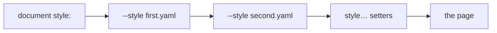

## Overview

The `render` command renders markdown documents for terminal viewing or export
formats, and is where any Markdown, including the output of
[`md compose`](./compose.md), turns into something else:

```bash
md compose doc.md | md
md compose doc.md | md render --output html > doc.html
```

`render` is functionally equivalent to running `md` with no subcommand:

- `md render README.md`
- `md README.md`

Use `render` when you want explicit command intent in scripts and docs.
Both forms use the same argument definitions and command dispatch, including
`--indent`, output selection, features, and diagnostic policy. For example,
`md README.md --indent 2` is an alias for `md render README.md --indent 2`.

A render option belongs to one spelling or the other, never both: given
before a subcommand it is a usage error (exit code 2), because nothing
combines the two levels.

```bash
md --feature embed-mermaid-font render README.md   # exit 2
md render README.md --feature embed-mermaid-font   # the render form
md --mermaid toc README.md                         # exit 2
```

Shared controls (`--width`, `-v`/`--verbose`, `--debug`, `--magic-root`) are
not render options and may precede any subcommand.

A file named like a command, or like a `style…=VALUE` setter, follows `--`
(or starts with `./`): `md -- render` renders the file `render`, and
`md render -- toc` renders the file `toc`.

## Reporting

### Usage

```bash
# Explicit render command
md render README.md

# Equivalent implicit form
md README.md

# Render from stdin
md render -
cat README.md | md render

# Select an output
md render README.md --output plain
md render README.md --output markdown
md render README.md --output html
md render README.md --output json

# Wrap prose at 72 columns, or at 80% of the terminal
md render README.md --width 72
md render README.md --width 80%

# Open the selected output in the default app
md render README.md --output html --show

# Override list indentation
md render README.md --indent 2
```

### Arguments

- `[ARGS]...`: the Markdown file path (supports `@` file references; `-` for stdin) and any `style…=VALUE` setters, in any order. A word is a setter when the text before its first `=` is `style` or starts with `style.`; every other word is the file. More than one file is a usage error (exit code 2). If no file is given, reads stdin when it is piped or redirected (even when empty); see [No input](#no-input) for a terminal. See [Styling from the command line](#styling-from-the-command-line) for setters.
- `-- [INPUT]...`: everything after `--` is the file, never a setter or a command.

### Options

- `--output <terminal|plain|markdown|markdown-plus|html|browser|json|json5|yaml|toml>`: What to print (default: `terminal`). See [Output Behavior](#output-behavior).
- `--width <N|N%|auto|source|unlimited>`: Width the output is wrapped to (default: `auto`). See [Output and Width](./output-and-width.md#choosing-a-width).
- `--show`: Write output to a temp file and open it with the system default app. See [Opening the Output](#opening-the-output).
- `--indent <#>`: Enforce a nested-list indentation step of 2, 4, or 8 spaces per level. Default: 4. For an eight-space step, cleanup uses CommonMark-valid marker padding on parent items when needed to preserve the same list tree.
- `--style <FILE>`: a JSON, JSON5, YAML, or TOML style file (repeatable; later files merge over earlier ones). See [Styling from the command line](#styling-from-the-command-line).
- `--mermaid`: in terminal output, render Mermaid diagrams in automatic mode: an
  image where the terminal shows images, otherwise a text drawing when the
  diagram has one and it fits, otherwise the highlighted code block (see
  [Mermaid in the terminal](#mermaid-in-the-terminal) below). HTML, Markdown,
  and JSON output ignore it.
- `--feature <NAME>`: turn on a named feature (see [Features](#features) below)

### Themes and line numbers

Themes and code line numbers are style keys, set in the document's `style:`
or from the command line like any other (see
[Styling from the command line](#styling-from-the-command-line)):

- `style.page.theme=NAME`: prose theme
- `style.page.code.theme=NAME`: code theme override (selects *which* theme pair, e.g. `dracula`)
- `style.page.code.mode=MODE`: the code panel's light/dark variant (`inverse`, the default, `dark`, `light`, or `same`)
- `style.code-block.line-numbers=true`: include code line numbers in terminal rendering

```bash
md README.md style.page.theme=github style.code-block.line-numbers=true
```

[`md list-themes`](./list-themes.md) lists the theme names these take.

### Styling from the command line

Two kinds of argument add style on top of the document's own `style:`
frontmatter, without editing the file:

- a **setter**, `style.KEY=VALUE` or `style=OBJECT`, sets one style value;
- a **style file**, `--style FILE`, supplies a whole style object from a
  JSON, JSON5, YAML (`.yaml`, `.yml`), or TOML file.

```bash
md README.md style.page.margin-left=4
md README.md --style ./wide.yaml
md README.md --style ./wide.yaml style.page.theme=github
md render README.md style='{ page: { margin: 2 } }'
```

Later layers win, field by field: the document's own style, then each
`--style` file in the order given, then the setters (wherever they sit on the
line). A layer changes only the fields it names.



Every layer is checked before anything is printed or opened, on every
`--output`, so a bad value never looks as if it worked:

- a setter is judged by the document's schema: an unknown key is
  `dm.schema.unknown_key`, a wrong value `dm.schema.type_mismatch`, and the
  run fails with exit code 1;
- a style file that cannot be found or read, or holds invalid content, fails
  the same way and names the file, never the document;
- an unknown key in a style file is left out with a `dm.style.unknown_key`
  warning, on stderr or in a data output's `diagnostics`.

A Markdown or data output prints the document's source, so a setter or style
file never enters it; the values are still checked. A misspelled setter that
names no file (`stlye.page.margin-left=4`) fails with a hint naming the
`style.…` spelling.

Shell completion offers the keys the document's schema declares under
`style`, one level at a time (`style.` → `style.page.`), and their values
after `=`; `--style` completes JSON, JSON5, YAML, and TOML files. Completion
never opens a style file.

### No input

With no file and a terminal on stdin there is nothing to read. Both spellings
write the root help to stderr and exit with code 1; a data output instead
prints its one failure value (`dm.input.read_failure`) and leaves stderr
empty. A redirected stdin, even an empty one, is read as the document.

### Environment

- `OUTPUT_COLUMNS`: the width used when `--width` is absent; see [How the width is decided](./output-and-width.md#how-the-width-is-decided).
- `TERMINAL_IMAGES`: terminal image output. A truthy value (`true`, `1`, `yes`, `on`) forces protocol image output attempts, a falsy one (`false`, `0`, `no`, `off`) disables it, and anything else uses capability detection.

### Features

`--feature <NAME>` turns on an opt-in by name. It is a render option, so it is
written `md doc.md --feature NAME` or `md render doc.md --feature NAME`; before
any subcommand (`md --feature NAME render doc.md`) it is a usage error.

- Repeatable and comma-separated: `--feature a --feature b` is the same as
  `--feature a,b`.
- Names are case-insensitive, and repeating a name is harmless.
- An unknown name, including an empty one (`--feature a,,b` or
  `--feature ""`), is a usage error (exit code 2) that lists the valid names.
  Shell completion offers them.

| Name | Effect |
| --- | --- |
| `embed-mermaid-font` | In HTML output, embed the font static-SVG Mermaid diagrams were measured in, once per page (see [Mermaid rendering](../rendering/mermaid.md#embedded-font)). |
| `no-mermaid-fallbacks` | With `--mermaid`, never draw a diagram as text: a terminal without images shows its code block. |
| `no-mermaid-partial-fallbacks` | With `--mermaid`, never draw a diagram as text when the drawing may miss details the image would show. Every diagram family's drawing is partial today, so this currently acts like `no-mermaid-fallbacks`. |
| `no-mermaid-partial-warning` | With `--mermaid`, hide the note that follows a partial text drawing. |
| `no-mermaid-rendering` | Every Mermaid fence stays a highlighted code block, in every output. |

When two fallback features overlap, the more restrictive wins:
`no-mermaid-fallbacks,no-mermaid-partial-fallbacks` never draws text. The
three fallback features act only with `--mermaid`; without it they are
accepted and change nothing.

`embed-mermaid-font` acts only on Mermaid diagrams emitted as static SVG.
`md`'s HTML output does not produce static SVG today: its Mermaid diagrams
are interactive `<pre class="mermaid">` blocks, so the page is byte for byte
the same with and without the feature. Terminal, Markdown, and JSON output
ignore it. No frontmatter key turns it on.

```bash
md --output html --feature embed-mermaid-font notes.md
md render notes.md --output html --feature EMBED-MERMAID-FONT   # same
```

`no-mermaid-rendering` wins over every other Mermaid option on the command:
`--mermaid`, static SVG, and `embed-mermaid-font` (which then has nothing to
embed). Terminal and HTML output show each fence as a code block with
[Mermaid syntax highlighting](../rendering/mermaid.md#syntax-highlighting),
and HTML output loads no Mermaid.js. Markdown and JSON output keep the
` ```mermaid ` fence, as they always do.

```bash
md --mermaid --feature no-mermaid-rendering notes.md   # code blocks, not diagrams
md render notes.md --output html --feature no-mermaid-rendering   # no Mermaid.js
```

### Mermaid in the terminal

`md --mermaid` renders each Mermaid fence in automatic mode:

- **The terminal shows images:** the diagram is drawn as an image.
- **It does not:** a diagram that can be drawn as text (a flowchart or a
  sequence diagram, for example) and fits the width is drawn as a `txt` block,
  followed by a note when the drawing may miss details. Any other diagram
  (a pie chart, for example) stays its highlighted `mermaid` code block.
- **`TERMINAL_IMAGES=0`:** every fence stays a code block.

````text
$ NO_COLOR=1 md --mermaid flow.md          # in a terminal without image support
```txt
┌───────┐     ┌──────┐
│       │     │      │
│ Alpha ├────►│ Beta │
│       │     │      │
└───────┘     └──────┘
```

▐   Note: this textual representation is provided because the current terminal
▐   settings do not allow for a graphical image to be used. …
````

With color, the drawing sits in a highlighted code panel instead of between
fences.

The fallback features above choose whether text may replace the code block
and whether the note is shown. Without a fallback feature, the
`MERMAID_FALLBACK` environment variable applies: `code-block` (any case) means
never draw text. A feature always wins over the variable.

```bash
MERMAID_FALLBACK=code-block md --mermaid flow.md          # source, not a drawing
md render --mermaid flow.md --feature no-mermaid-partial-warning   # drawing, no note
```

### Output Behavior

`md render` accepts both output families. Its default, `terminal`, is styled text
on a color terminal and the same bytes as `plain` everywhere else, including on a
pipe. A script that wants Markdown asks for it by name.

| `--output` | stdout | stderr |
|---|---|---|
| `terminal` (default), `plain`, `markdown`, `markdown-plus`, `html` | the rendered document | style and link-title warnings |
| `json`, `json5`, `yaml`, `toml` | one [envelope](./data-contracts.md#md-compose-and-md-render) | nothing |

Warnings about unknown or deprecated `style:` keys (`dm.style.unknown_key`,
`dm.style.deprecated`) and link titles are written to stderr in a formatted output
and appear in `diagnostics` in a data output. `--deny style` makes both block, and
`--deny <code>` makes just that one block, for every output. `--output markdown`
builds no page, so it does not otherwise report the `style:` warnings. `md render` runs no reference check,
so the envelope's `summary` is `null`. To check references, use
[`md validate refs`](./validate.md).

````text
$ md render notes.md --output plain
Notes

This is bold text with `inline code` and a link.

```yaml
name: string(required)
```
````

See [What `plain` keeps](./output-and-width.md#what-plain-keeps) for how each element
prints, and [Links and images that cannot be clickable](./output-and-width.md#links-and-images-that-cannot-be-clickable)
for what `-v` adds.

### Width

`--width` wraps prose in every formatted output. With no `--width`, the width comes
from `OUTPUT_COLUMNS`, then a real terminal; on a pipe with neither, nothing wraps.

```bash
md render notes.md --width 72 --output plain     # paragraphs wrap at 72 columns
md render notes.md --width unlimited             # one line per paragraph, nothing padded
md render notes.md --width source --output plain # keep the authored line breaks
```

`--output markdown` and a data output's `document` are the document's source text.
With no known width they keep the source lines. Given a width, each authored line
wraps at that width and the breaks between them stay; `--width unlimited` joins a
paragraph's lines.

### Opening the Output

| Run | stdout | Opened |
|---|---|---|
| `--output markdown`, `markdown-plus`, or `html` | nothing | that output |
| `terminal`, `plain` | the text | the document's Markdown |
| a data output | the value | the value, as a file of that type |

`MD_DRY_RUN=1` writes the temp file but skips launching the viewer. A failure to
open the file fails the run with status 1. See
[Opening the output in an app](./output-and-width.md#opening-the-output-in-an-app).

### Removed spellings

These are usage errors (exit status 2).

| Removed | Use instead |
|---|---|
| `--output auto` | no `--output`: `terminal` falls back to `plain` by itself |
| `--output text` | `--output markdown` |
| `--output json` as the document AST, `--output ast` | no replacement: the document AST is not an output, and `--output json` prints the envelope |
| `md render --save`, `md FILE --save` | `md clean FILE --save` |
| `--html`, `--show-html` | `--output html`, `--output html --show` |
| `--ast`, top-level `--json` | `--output json` for the envelope; the document AST is not an output |
| `--no-images` | `TERMINAL_IMAGES=0` |
| top-level `--toc`, `--delta` | [`md toc`](./toc.md), [`md delta`](./delta.md) |
| `--list-themes` | [`md list-themes`](./list-themes.md) |

#### Presentation flags

The old page, layout, and theme flags are gone from `md` and `md render`.
Each is now an unknown argument (clap's ordinary error, exit status 2), and
its value is a style key, written as a setter or in a `--style` file. Every
replacement below works the same in a document's `style:` frontmatter.

```bash
md README.md --mx 6 --theme github            # before: now a usage error
md README.md style.mx=6 style.page.theme=github
```

| Removed (aliases) | Use instead |
|---|---|
| `-m N`, `--margin N` | `style.margin=N` |
| `--mx N` / `--my N` | `style.mx=N` / `style.my=N` |
| `--mt N` (`--margin-top`) | `style.page.margin-top=N` (or `style.mt=N`) |
| `--mb N` (`--margin-bottom`) | `style.page.margin-bottom=N` (or `style.mb=N`) |
| `--ml N` (`--margin-left`) | `style.page.margin-left=N` (or `style.ml=N`) |
| `--mr N` (`--margin-right`) | `style.page.margin-right=N` (or `style.mr=N`) |
| `--padding N` | `style.padding=N` |
| `--px N` / `--py N` | `style.px=N` / `style.py=N` |
| `--pt N` (`--padding-top`) | `style.page.padding-top=N` (or `style.pt=N`) |
| `--pb N` (`--padding-bottom`) | `style.page.padding-bottom=N` (or `style.pb=N`) |
| `--pl N` (`--padding-left`) | `style.page.padding-left=N` (or `style.pl=N`) |
| `--pr N` (`--padding-right`) | `style.page.padding-right=N` (or `style.pr=N`) |
| `--page-bg STYLE` (`--page-background`) | `style.page.background=STYLE` |
| `--page-bg-color COLOR` | `style.page.bg-color=COLOR` |
| `--max-width N` (also `md render --max-width`) | `style.max-width=N`, or `style='{ max-width: N }'` |
| `--theme NAME` | `style.page.theme=NAME` |
| `--code-theme NAME` | `style.page.code.theme=NAME` |
| `--line-numbers [BOOL]` | `style.code-block.line-numbers=true` (or `false`) |
| `--alignment ALIGN` | `style.alignment=ALIGN`: the page and every component |
| `--align-images ALIGN` | `style.images.alignment=ALIGN` |
| `--align-lists ALIGN` | `style='{ ul: { alignment: ALIGN }, ol: { alignment: ALIGN }, li: { alignment: ALIGN } }'` |
| `--align-ul` / `--align-ol` / `--align-li ALIGN` | `style.ul.alignment=ALIGN` / `style.ol.alignment=ALIGN` / `style.li.alignment=ALIGN` |
| `--align-block-quotes ALIGN` | `style.block-quote.alignment=ALIGN` |
| `--align-tables ALIGN` | `style.table.alignment=ALIGN` |
| `--align-code-blocks ALIGN` | `style.code-block.alignment=ALIGN` |

`--code-block` is an unknown argument here too: the code panel's variant is
`style.page.code.mode`. `md schema about --code-block` keeps its own flag.

##### Fill flags

A fill flag took a mode (`full`, `pad=N`, `indent=N`, `max=N`, `explicit=N`)
and lowered it onto a component's width or horizontal padding. Each mode is now
those properties, set on the component bucket the flag named:

| Flag | Bucket |
|---|---|
| `--fill-images` | `images` |
| `--fill-lists` | `ul`, `ol`, and `li` (set each one) |
| `--fill-ul` / `--fill-ol` / `--fill-li` | `ul` / `ol` / `li` |
| `--fill-block-quotes` | `block-quote` |
| `--fill-tables` | `table` |
| `--fill-code-blocks` | `code-block` |
| `--fill` | every component: `images`, `ul`, `ol`, `li`, `block-quote`, `table`, `code-block`, `hr`, `hyperlinks`, and `disclosure` (set each one, or keep the list in a `--style` file) |

With `table` as the bucket:

| Mode | Use instead |
|---|---|
| `max=40` | `style.table.max-width=40` |
| `explicit=50` | `style.table.width=50` |
| `full` | `style='{ table: { width: "auto", padding: 0 } }'` |
| `pad=4` | `style='{ table: { padding: 0, "padding-left": 4, "padding-right": 4 } }'` |
| `indent=4` | `style='{ table: { padding: 0, "padding-left": 4 } }'` |

- `pad` and `indent` replaced the whole padding, so the replacements reset
  `padding` to 0 before setting the sides; setting only the sides would keep
  any vertical padding the component inherits.
- `indent` picked its side from the component's alignment. That choice is now
  yours: `padding-left` for a left-aligned component, `padding-right` for a
  right-aligned one, and both for a centered one.
- Setting `width` removes an inherited `max-width` (and the reverse), so
  `full` needs no extra reset.
- For a horizontal rule, `max` and `explicit` are `hr.max-width` and
  `hr.width`, and `pad`/`indent` are `hr`'s `padding`, `padding-left`, and
  `padding-right`; `full` never changed a rule. On `hyperlinks` no fill mode
  had a visible effect, so there is nothing to carry over.

## Lessons Learned

- A single `terminal` default that falls back to `plain` gives good results for both interactive terminals and pipelines.
- `render` and implicit `md [INPUT]` share the same core path, so behavior remains aligned.
- Theme and layout choices are style keys, so the same value works as a setter, in a `--style` file, and in a document's `style:`.
