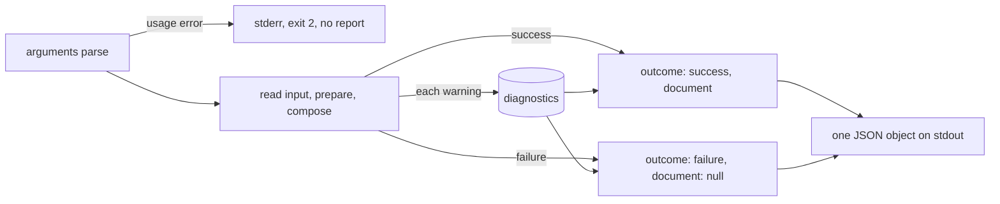

# Composition Reports

`md compose --output report-json` composes a document and prints one JSON
object that says whether it worked, lists every diagnostic the run reported,
and carries the composed document. Use it from scripts, CI jobs, and editors
that need the result and its problems in one machine-readable value instead
of a document on stdout and styled warnings on stderr.

```sh
md compose notes.md --output report-json
```

```json
{
  "outcome": "failure",
  "diagnostics": [
    {
      "code": "dm.expression.incompatible_call",
      "severity": "error",
      "message": "min: argument 1 (`a`) is boolean, expected number (category 5: no value of that type can bind)",
      "source": { "file": "notes.md", "line": 4, "column": 18 },
      "expected_type": "number",
      "actual_type": "boolean"
    }
  ],
  "document": null
}
```

Only `md compose` has this format. `md render`, `md FILE`, `md clean`, and
`md schema validate` refuse `report-json` as an unsupported output format
(exit 2) before they read anything; their own JSON formats (`--output json`
for the Markdown AST, `md schema validate --format json` for a multi-file
report) are unchanged.

## The object

Every field is always present.

| Field | Value |
|---|---|
| `outcome` | `"success"` or `"failure"` |
| `diagnostics` | every diagnostic the run reported, in the order below; `[]` when there were none |
| `document` | the composed Markdown on success (as `--output markdown` would print it, honoring `--frontmatter`); `null` on failure |

Each diagnostic has eight fields:

| Field | Value |
|---|---|
| `code` | a stable `dm.<family>.<kind>` code, shared with the editor (DMLS) |
| `severity` | `"error"`, `"warning"`, or `"info"` |
| `message` | the problem in words |
| `source` | `{ "file", "line", "column" }` where the authored text starts, or `null` when the problem has no known position |
| `expected_type` | for a call argument, the parameter's declared type; otherwise `null` |
| `actual_type` | for a call argument, the argument's type; otherwise `null` |
| `span` | `{ "start", "end" }`, the byte range of the failing authored construct in `source.file`, for a composition failure located at one; otherwise `null` |
| `iteration_path` | for a failure while a `::map` or `::filter` body was being processed, the original position of each item, outermost first, as `{ "collection", "position" }` (a number for an index, a string for a key); otherwise `[]` |

`line` and `column` are one-based, and the column counts characters. `file`
names the root document as you gave it on the command line, and a transcluded
document by its resolved path; it is `null` for stdin. A problem inside
transcluded content points at the transcluded file, not at the `::file`
directive that included it.

The same problem has the same fields everywhere: a call the editor marks with
`dm.expression.incompatible_call` at `notes.md:4:18` is the record
`md compose` rejects the document with and the record this report prints.

## Exit status and streams

| Run | `outcome` | `document` | Exit status |
|---|---|---|---|
| composed | `"success"` | the Markdown | 0 |
| failed while composing (a rejected call, a schema problem, a failing expression or shell, a policy stop) | `"failure"` | `null` | 1 |
| a lifecycle run that failed | `"failure"` | `null` | the run's status (1, or 130 when interrupted) |
| a reference no recovery covers (a missing link target) | `"failure"` | `null` | 2, as without the report |
| a usage error (an unknown flag, `--allow x --deny x`) | no report | | 2, with clap's message on stderr |

Once the arguments parse, the command writes exactly one object, including
when the input file cannot be read. Stdout carries nothing else: a lifecycle
`stdout:` action's line and a lifecycle command's output go to stderr, and so
do `-v` progress and `--perf` timings. No warning row or error block repeats
the report on stderr.

`--show` (there is no document file to open) and `--shell` (it prints its own
report) cannot be combined with `report-json`.



## Which diagnostics, in which order

- **Warnings** come in the order the run found them: passive checks first,
  then what composition reports while it runs. The passive checks report a
  lifecycle stack's calls (event by event, each surface in authored order),
  then the document's calls by authored position: frontmatter first, then
  the body top to bottom, with `{{ … }}` expressions and `::block`/`::file`
  conditions interleaved where they are written. Transcluded documents report
  in the order their directives appear.
- **A failure** comes after the warnings reported before it. Earlier warnings
  are kept: a category 3 call reported before a failing `{{ 1 / 0 }}` is in
  the failure report too. A rejected call keeps the passive warnings found
  before it in that order, including an earlier call in its own expression;
  a finding after the rejected call is not reported, since the check stops
  there. A static `::map`/`::filter` defect (an invalid source, a pattern, a
  sort key, a protected parameter name) is rejected the same way: a recovered
  untyped source written before it keeps its `untyped_map_source` or
  `untyped_filter_source` warning in the report. A failure in a transcluded document comes after every warning of
  the documents that transclude it, outermost first, then its own: a
  parent's passive check covers the whole parent before any child composes,
  so a parent warning written after the `::file` line is reported too.

  ```text
  parent.md                         child.md
  1 {{ file_exists("") }}           1 {{ file_exists("https://") }}
  3 ::file ./child.md               3 {{ min(true, 5) }}
  5 {{ file_exists("http://") }}
  ```

  reports `always_false_call` at `parent.md` lines 1 and 5, then at
  `child.md` line 1, then `incompatible_call` at `child.md` line 3.

  ```json
  { "outcome": "failure",
    "diagnostics": [
      { "code": "dm.expression.uncertain_call", "severity": "warning", "…": "…" },
      { "code": "dm.expression.evaluation_failure", "severity": "error", "…": "…" } ],
    "document": null }
  ```

- **A policy stop** (`--deny`) lists each warning once, with its own severity:
  a denied `warning` is still `"warning"`. The policy decides the outcome, not
  the diagnostic.
- A check that stops a run before composition starts reports what that
  check found. A rejected call the pre-flight walk finds (the walk checks
  each document before it runs a shell) reports the same warnings ahead of
  it as the compose pass would: those of the document that holds it, after
  those of every document that transcludes it.
- **A rejected call** reports the call's own record wherever it is authored:
  in the body, in frontmatter, in a `::block` or `::file` condition, or on a
  lifecycle surface (an action's text, a `when:` condition, a `shell:`
  command, a side-effect argument such as `ensure_file:`, a `set:` value, or
  a control reason such as `error:`). The record is the one DMLS shows for
  the same bytes, located in the file as written. A lifecycle rejection stops
  the run before `initialize`, so no lifecycle effect runs; the lifecycle
  warnings found before it come first.

  ```yaml
  ---
  composed:
    - stdout: "{{ min(true, 5) }}"
  ---
  ```

  ```json
  { "code": "dm.expression.incompatible_call", "severity": "error",
    "message": "min: argument 1 (`a`) is literal true, expected number (…)",
    "source": { "file": "doc.md", "line": 3, "column": 21 },
    "expected_type": "number", "actual_type": "literal true" }
  ```

## Codes

Call findings use the editor's codes (`dm.expression.incompatible_call`,
`uncertain_call`, `always_false_call`, `incomplete_analysis`), schema problems
the editor's schema codes (`dm.schema.type_mismatch`, `constraint`,
`missing_required`, `unknown_key`, `invalid_file_reference`, `prepare`), and a
recovered problem the code [`--deny`](./policy.md) takes for it. A failure is
classified by what failed:

| Code | Failure |
|---|---|
| `dm.frontmatter.yaml_parse` | the frontmatter YAML, or its `---` fence, does not parse; located |
| `dm.input.read_failure` | the input, or a file it needs, cannot be read |
| `dm.expression.parse_failure` | an expression does not parse |
| `dm.expression.evaluation_failure` | an expression fails to evaluate; located when the expression is authored in the file |
| `dm.expression.unknown_function` | an expression calls a function that does not exist |
| `dm.directive.parse_failure` | a `::` directive does not parse |
| `dm.collection.*` | a `::map` or `::filter` fails (`malformed`, `untyped_map_source`, `untyped_filter_source`, `invalid_source`, `pattern_mismatch`, `invalid_sort_key`, `callback_failed`), located at the directive opener or the failing callback; a static defect is reported once, with `iteration_path: []` |
| `dm.iteration.visit_limit`, `dm.iteration.expansion_limit` | a request ran past `--max-iteration-visits` or `--max-expansion-bytes`; located at the authored text whose work was being paid for: the collection opener for a visit, the copied body text, or the `{{ }}`, `::shell`, `::shell-block`, or `::file` whose output was being inserted (a cached child that is included again is located at the including `::file`) |
| `dm.shell.failure` | a shell command fails, times out, or is refused |
| `dm.transclusion.failure` | a transclusion fails for another reason |
| `dm.reference.failure` | a file reference does not resolve |
| `dm.compose.parameter_binding` | a supplied value does not bind to its parameter |
| `dm.lifecycle.failure` | a lifecycle event fails (an `error:` action, a failed action) |
| `dm.compose.failure` | anything else |

A warning whose producer declares no code reports `dm.compose.warning`.

### Failures inside `::map` and `::filter` bodies

A failure of any kind while a repeated body was being processed (a callback,
a `when=` gate, a `{{ }}` expression, a `::shell` or `::shell-block`
argument, a `::file` target or condition, a child document, or an allowance)
keeps its own `code` and `message`, and adds where it happened: `source` and
`span` locate the authored site in the file (not in the expanded text), and
`iteration_path` names the item whose copy ran it. The `message` ends with
`at <path>`. For a shell-block command failure, the site is the command's
authored line, including when an earlier command succeeded; for the block's
combined-output allowance, it is the block opener.

Given this `doc.md`, where only `ok.md` exists:

```md
---
$schema:
  data: string[](required)
data: [./ok.md, ./missing.md]
---
::map data
{{ frontmatter(i, 'title') }}
::end-map
```

the second item fails on line 7:

```json
{ "code": "dm.expression.evaluation_failure", "severity": "error",
  "message": "interpolation of `frontmatter(i, 'title')` failed: invalid file path: ./missing.md at data[1]",
  "source": { "file": "doc.md", "line": 7, "column": 1 },
  "expected_type": null, "actual_type": null,
  "span": { "start": 85, "end": 114 },
  "iteration_path": [{ "collection": "data", "position": 1 }] }
```

Positions are the items' places in the original source, before any filter or
sort. A failure inside a child document that a repeated `::file` included
joins both paths, outer first (`data[1] → d[0]`), and keeps the child's own
`source`.

A [schema trigger skipped because it failed to load](../topics/schemas/schema-triggers.md#invalid-discovered-triggers)
is a `dm.schema.invalid_trigger` warning. It belongs to the trigger, not to
the composed document. Its `message` names the trigger file (or
`embedded:{bundle}/{file name}`) and the reason, and, when the failure is
inside a payload or import file, that file too. The report lists each
trigger once, even when transcluded documents discover it again.

Its `source` points into the trigger file only where the failure has a
known position there, which is a trigger file that is not valid YAML:

```json
{ "code": "dm.schema.invalid_trigger", "severity": "warning",
  "message": "ignoring invalid schema trigger /repo/schemas/broken.yaml: not valid YAML at line 3, column 1: …",
  "source": { "file": "/repo/schemas/broken.yaml", "line": 3, "column": 1 },
  "expected_type": null, "actual_type": null }
```

Every other cause has `source: null`, since no position is invented: an
envelope with unsupported keys, a payload or import that fails to load (a
position inside that file is never placed on the trigger; the message names
the file instead), and any embedded trigger, which names no local file:

```json
{ "code": "dm.schema.invalid_trigger", "severity": "warning",
  "message": "ignoring invalid schema trigger /repo/schemas/memory.yaml: invalid schema-trigger: …",
  "source": null, "expected_type": null, "actual_type": null }
```

`md schema validate --format json`, which reports several files, puts a
trigger warning that files share in the `warnings` of the first file that
discovers it, once per invocation, and not in the later files' records.

## Privacy

A diagnostic never contains an evaluated argument value, an environment
value, or a file's contents, and producing the report evaluates, renders, and
reads nothing again. Messages can still quote authored source text, as the
terminal output does.

## Effects are not rolled back

The report waits for the outcome, so no partial document is printed and
nothing is published before blocking checks pass. It is not a transaction:
a lifecycle effect or cache write that already happened stays done when the
run later fails.
