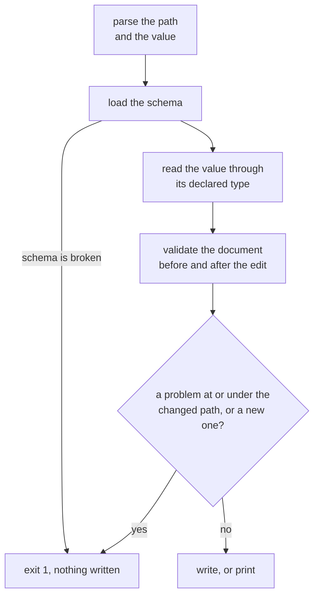

## Overview

The `set` command changes one frontmatter value on a markdown document, named by a [property path](./index.md#property-paths), and checks the new value against the document's schema.

By default the modified document is written to stdout without changing the source file, making it suitable for piped workflows. The `--save` flag writes the change back to the file in place.

## Usage

```bash
# Set a property and output to stdout (file is not modified)
md set doc.md title "New Title"

# Set a property and save in place (no output)
md set doc.md title "New Title" --save

# Set from stdin (pipe-friendly)
cat doc.md | md set - title "New Title"

# Chain multiple set operations via pipes
md set doc.md title "New Title" | md set - version 2 | md set - draft true

# Set one nested value; a missing parent is created
md set doc.md style.page.max-width 50 --save
md set doc.md author.name Ken --save

# Set one array element, or a key with a dot in its name
md set doc.md items.1.name z --save
md set doc.md 'a\.b' 1 --save

# JSON5 and YAML flow values are read as structure
md set doc.md tags '["rust","markdown"]'
md set doc.md meta '{a: 1}'
md set doc.md style.page '{ max-width: 50 }'
md set doc.md count 42
md set doc.md draft false

# Report the result as data, for a script
md set doc.md title "New Title" --output json
```

## Arguments

- `<INPUT>`: Markdown file path (supports `@` file references) or `-` for stdin.
- `<PROP>`: The [property path](./index.md#property-paths) to set. A malformed path such as `a..b` is a usage error with exit status 2, before the document is read.
- `<VALUE>`: The value, read by the shared [value rules](./index.md#command-line-values): JSON5 or a YAML flow mapping, otherwise text read through the type the schema declares.

## Options

- `--save`: Write the change back to the source file. A formatted output prints nothing on success. With stdin input it fails with exit status 1.
- `--output <terminal|plain|markdown|markdown-plus|html|browser|json|json5|yaml|toml>`: What to print (default: `markdown`). See [Output Behavior](#output-behavior).
- `--width <N|N%|auto|source|unlimited>`: Wrap the printed document. With no `--width`, the document keeps its authored line breaks whatever the terminal size or `OUTPUT_COLUMNS`. Given a width, each authored line wraps at it and the breaks between them stay. See [Output and Width](./output-and-width.md).

## Output Behavior

`md set` accepts both output families. Its default is `markdown`, on a terminal and
on a pipe alike, because its deliverable is the Markdown document.

**Default (no `--save`)**

- Prints the full document (frontmatter + body) with the property updated to stdout.
- The source file is not modified.
- Frontmatter key order is preserved from the original document.

**Other formatted outputs (`terminal`, `plain`, `markdown-plus`, `html`)**

- Print the edited document rendered in that form, to stdout.

**Data outputs (`json`, `json5`, `yaml`, `toml`)**

- Print one value to stdout and nothing to stderr, with or without `--save`.
  `document` is the resulting Markdown, and `saved` says whether the file was
  written. See [Data Contracts](./data-contracts.md#other-commands).

```json
{
  "file": "doc.md",
  "property": "title",
  "value": "New Title",
  "document": "---\ntitle: New Title\n---\n# Doc\n",
  "saved": false,
  "outcome": "success",
  "diagnostics": []
}
```

## Validation

`md set` validates what it changed and nothing else, so it stays useful for repairing a document that has other problems. It reads the same schema `md schema validate` does: the baseline, triggers, and the document's `$schema`. Take a document with `count: number` that is missing a required `title`:

| Command | Result |
|---|---|
| `md set a.md count 5` | writes `count: 5`; the missing `title` does not block it |
| `md set a.md count abc` | fails with exit status 1; nothing is written |
| `md set a.md title Notes` | writes, repairing the document |



- A problem counts only when it sits at or under the path you set, or when the edit introduced it. So `md set a.md author.mistake 1` fails under an `author` object that does not declare `mistake`, but a problem that was already there at a parent of the path does not block the edit.
- A missing or malformed schema fails with an explanation and no write. It never silently changes how the value is read.
- Validation is passive. It reads local schema files only, evaluates nothing, and leaves `file(eager)` values as they are. A pending value such as `'{{ fm.n }}'` is written unevaluated, and composition judges it later.
- Setting `$schema` itself checks only that the value can be a schema reference, not the rest of the document against it, and does not open the file. Text is always a reference; `null`, numbers, and booleans are refused, so use `md rm doc.md '$schema'` to remove it.

## Formatting Is Preserved

Only the value being set is rewritten. Every other byte of the document
stays exactly as authored: indentation, comments, quoting, block scalars,
line endings, and the body. A new key is appended as the last entry of its
parent, at the parent's indentation; an existing one is replaced where it stands.
So a nested edit keeps the comments on its siblings:

```yaml
# before                         # after: md set doc.md start_phase 6 --save
phase: 1  # first phase          phase: 1  # first phase
files:                           files:
    - a.rs                           - a.rs
                                 start_phase: 6
```

```yaml
# before                         # after: md set doc.md author.email b@x.io --save
author:                          author:
  # who wrote it                   # who wrote it
  name: Alice  # primary           name: Alice  # primary
  email: a@x.io                    email: b@x.io
```

The new value itself is written in Darkmatter's standard YAML style. When the
frontmatter cannot be edited in place (its root mapping is indented, or the path
goes inside a non-empty flow collection such as `tags: [a, b]`), `set` falls back
to rewriting the whole frontmatter block in the standard style, which loses its
comments. `md clean --save` fixes the indentation so later edits stay in place.
See [Editing nested values](../topics/frontmatter.md#editing-nested-values) for
what is kept, and for the one case that is refused: an edit that would change a
value you did not name, through a YAML alias.

**With `--save`**

- Updates the source file in place.
- A formatted output prints nothing on success (exit status 0).
- A data output prints the value, with `saved: true`.
- Returns exit status 1 on failure, with the error on stderr, or in the value for a
  data output.

**Stdin (`-`)**

- The modified document is written to stdout.
- `--save` with stdin fails with exit status 1. A data output reports it in
  `diagnostics`.

## Migrating older calls

An ordinary call such as `md set doc.md title "New Title"` is unchanged. These differ:

| Call | Before | Now |
|---|---|---|
| `md set doc.md a.b 1` | wrote a top-level key named `a.b` | writes `b` inside `a`. For the old key write `'a\.b'`, and clean up an old one with `md rm doc.md 'a\.b'` |
| `md set doc.md meta '{a:1}'` | the text `{a:1}` | the object `{a: 1}`; quote it to keep the text: `'"{a:1}"'` |
| `md set doc.md style.page '{ max-width: 50 }'` | the text | the object `{max-width: 50}` |
| `md set doc.md note '{foo}'` | the text `{foo}` | the object `{foo: null}`, read as a YAML flow mapping; quote it to keep the text |
| `md set doc.md version 1.10` under `version: string` | the number `1.1` | the text `"1.10"` |
| `md set doc.md count abc` under `count: number` | wrote it | refused, with no write |
| `md set doc.md meta '{a:1,a:2}'` | the text | refused: a parsed object must be valid |
| a key name holding `\\` or `\.` | taken literally | write each backslash as `\\`, as in [Spelling a path](./index.md#spelling-a-path) |

## Lessons Learned

- Default-to-stdout makes `set` composable in shell pipelines without side effects.
- `--save` is explicit opt-in for mutation, avoiding accidental file changes.
- Key ordering is preserved using an insertion-order map, so frontmatter reads back in the same order it was written.
- Re-serializing the whole frontmatter on every `set` turned a one-property change into a diff of every list in the file; editing only the changed property keeps scripted edits reviewable.
