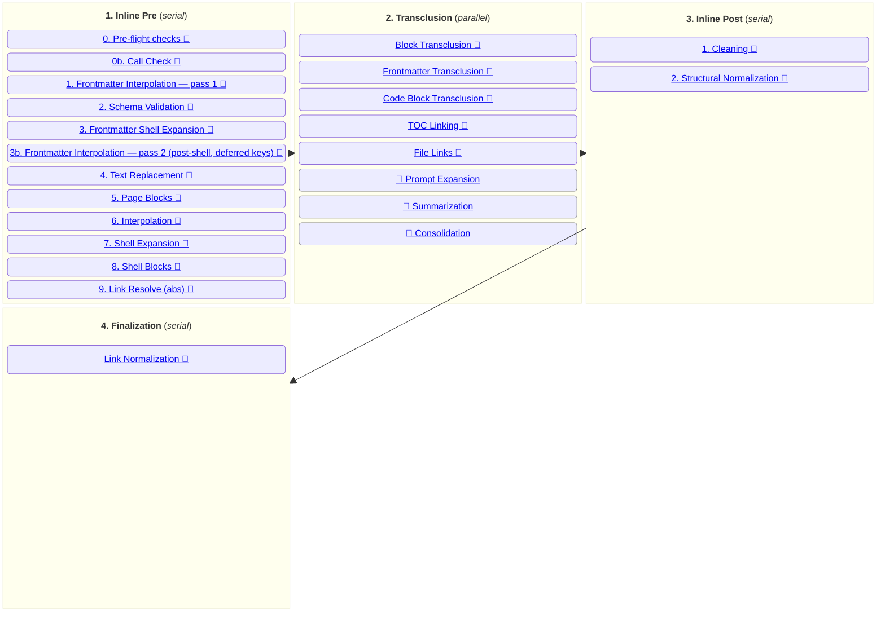
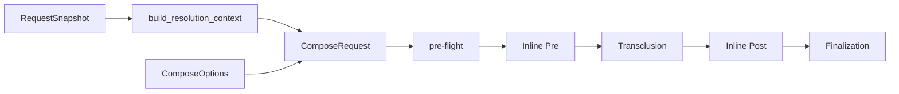
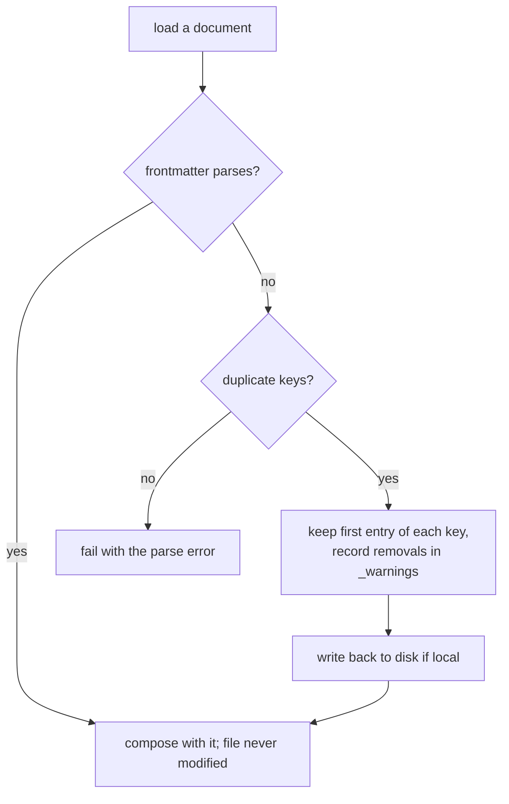
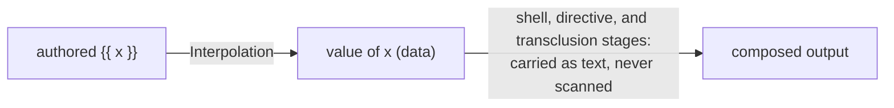
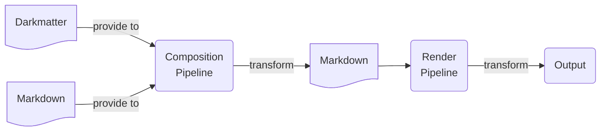

# Darkmatter Compose Pipeline

## High Level Flow



> **Note:** items marked with `🏁` are implemented

## The Request

Before any stage runs, the caller prepares a
[compose request](./topics/compose-requests.md): a `RequestSnapshot` (the
request directory, home directory, environment, and extra `@` roots) goes
through the context builder, which discovers the repository and validates the
result, and becomes a `ComposeRequest` holding one required file-resolution
context. Pre-flight and every stage below take that request, so they resolve
`./`, `&`, `^`, `@`, `~`, and `{{VAR}}` references identically, and `ctx.*` and
`env.*` read the same snapshot. A request that cannot be built fails before
anything runs, rather than surfacing later as a missing file.



## Loading Documents

> **Planned.** Nothing described in this section is built yet. Today a
> document whose frontmatter does not parse fails composition with an error
> such as `duplicate entry with key "human_review"`.

The pipeline reads other documents as well as the one being composed: an
expression such as `frontmatter(spec, 'status')` or `markdown_title(doc)`
loads the file it names, and so does a transclusion. When such a document's
frontmatter is not valid YAML **because a key appears more than once**, the
loader repairs it rather than failing:

1. It keeps the **first** entry for each duplicated key and removes every
   later one, together with that entry's value lines.
2. It records what it removed in the reserved `_warnings` frontmatter
   property, replacing any `_warnings` already there.
3. For a local file, it writes the repaired document back to disk, then
   continues composing with it. A remote (HTTP) document is repaired in
   memory only.

Writing back is deliberate: the `_warnings` record lands in the file, where the
author (or the next agent to edit it) can see what was lost, rather than the
same silent fix being made again on every read.



For example, an agent that re-adds keys instead of updating them leaves:

```yaml
agent: claude
model: opus
agent: claude
model: sonnet
```

After loading, the file reads:

```yaml
agent: claude
model: opus
_warnings:
    - { id: "duplicate-fm-key", property: "agent", message: "A duplicate entry for the 'agent' property made the frontmatter invalid YAML. Both entries had the same value, so no information was lost; the second entry was removed." }
    - { id: "duplicate-fm-key", property: "model", message: "A duplicate entry for the 'model' property made the frontmatter invalid YAML. The second entry had a different value from the first; it was removed so the frontmatter parses, and both values are kept in `data` (the first is the one in effect).", data: ["opus", "sonnet"] }
```

Each `_warnings` entry has:

- `id`: the kind of lossy repair; `duplicate-fm-key` is the only kind so far.
- `property`: the dotted path of the affected key, such as `hash.kind`.
- `message`: a plain-language account of what happened.
- `data`: present only when information was lost; every value, in source
  order, the first being the one kept.

The rules that bound this behavior:

- **Only lossy repairs, only when needed.** A document whose frontmatter
  parses is never rewritten by a read. Formatting-only fixes (whitespace, line
  endings, quoting) are not made on load; [`md clean`](./cli/clean.md) makes
  them and records the same duplicate-key repairs in `_warnings`.
- **Nothing fails because of `_warnings`.** It is a record for people and
  tools; no `md` command changes its result because the property is present.
- **Anything else stays an error.** Frontmatter that still does not parse
  after the duplicate keys are removed fails exactly as it does today.

## Pipeline Stages

### 1. Inline Pre

The **Pre Transclusion** group are a set of operations run in a serial process, one operation after another. These operations take place _before_ any transclusions take place and allow the document to become stable before the transclusion process is executed.

Being run serial is important so that one operation can _set up_ or _affect_ the next operation. Rather than be a side effect, this is intentional and often adds useful power to the pipeline. It does mean, however, that the ordering of these operations must be considered and organized in a way to provide maximum value.

> **Example:** if a conditional page block is evaluated to _false_ (aka, do not render this page), then identifying this first means any
shell expansion commands (or any other inline mutation) contained within the block will not be **executed** because this part of the page has
been removed.
>
> **Note:** approval and execution are deliberately separate. Pre-flight builds the **approval set** _condition-blind_ — it walks every branch (false page blocks, false-condition transclusions, both sides of a `$(...)` ternary) and approves every command that **could** run under any state, exactly once, up front. **Execution** is _condition-aware_: a command runs only when its branch is actually reached. So in the example above the dead-branch command is still approved (vetted once), but never executes while the condition is false. The governing invariant is `execution_set ⊆ approval_set`, which makes the execution-time gate a pure membership check that never prompts — see [pre-flight checks](./inline/preflight-checks.md).

Before any stage evaluates anything, the [call check](./inline/call-check.md) rejects a document that makes a call its schema's declared types prove can never bind, in any branch, so a sibling expression or command never runs first.

Each stage acts only on **authored** text, and each piece of authored text is scanned once. What a stage produces (an expression's value, shell output, a `{{{ … }}}` literal's braces, a file read) is data to every later stage, and to transcluded children: it is never evaluated, run, or parsed as a directive. The pipeline tracks this as origin beside the value (frontmatter paths and body byte ranges) rather than by escaping the text, and it fails closed if that tracking is ever lost. A frontmatter value that is a whole-value `$( … )` runs only when the author wrote it that way. See [Inserted Text Is Data](./inline/interpolation.md#inserted-text-is-data).



### 2. Transclusion

The **transclusion** stage is typified by recursive operations which have the potential to be time consuming (and more dependent on 
[caching](./topics/caching.md)) than those found in the inline steps. 

> **Note:** Not all operations are expensive -- for instance the most common transclusion directive is the `::file <ref>` directive which points to another local Markdown document. Assuming the document it references
doesn't have its own transclusions this operation will be lightning fast and no slower than any of the inline mutation operations.
However, even in this example, we don't know how expensive the operation is until the graph dependency has been traversed

### 3. Inline Post

- [Cleaning](./inline/cleaning.md) - tidies the composed body with the same guarded engine as `md clean`: it never changes meaning or touches a directive line, and it leaves the body unchanged when it cannot format it safely. Its settings come from `ComposeOptions`, not the document's `style.markdown`: by default it joins single newlines inside prose (`with_incidental_newline_mode(IncidentalNewlineMode::Preserve)` keeps them), re-indents nested lists to four spaces (`with_indentation`), and leaves sibling list spacing as written (`with_list_spacing`). `with_fixed_width(...)` re-wraps prose to a width and always unwraps first. Cleaning works on the composed Markdown body only: it never repairs frontmatter, and it never sees the documents an expression or transclusion loads (see [Loading Documents](#loading-documents)).
- [Normalization](./inline/structural-normalization.md) - ensures that the heading structure is valid and fixes where it is not

### 4. Finalization

The **finalization** stage is _only_ performed in the root document of the compose operation and does any adjustments on the fully transposed document before passing it back to the caller.

- [Link Normalization](./inline/link-normalization.md) - converts absolute paths back to portable references (relative, `&`, a declared `{{VAR}}`, or `~/`)


## Rendering

The Compose pipeline does not do any "rendering" per se but it's not uncommon programmatically to chain 
[rendering](./darkmatter-rendering-pipeline.md) immediately _after_ a page being _composed_. In addition the 
Darkmatter CLI reinforces this pattern by providing CLI switches to provide this same chaining. 
This back-to-back pipelining transform is visualized below:



The key things to remember are:

- the **Compose Pipeline** expects either Markdown or Darkmatter content as input
    - in the case of receiving a Markdown document _without_ any Darkmatter directives, only very mild formatting changes are made, from operations like [Cleaning](./inline/cleaning.md) and [Structural Normalization](./inline/structural-normalization.md)
- the [Rendering Pipeline](./darkmatter-rendering-pipeline.md) expects to receive Markdown content not Darkmatter and it returns one of the supported [output formats](./topics/output-formats.md).

> For more details on the **rendering pipeline** always refer to: [Rendering Pipeline](./darkmatter-rendering-pipeline.md)
