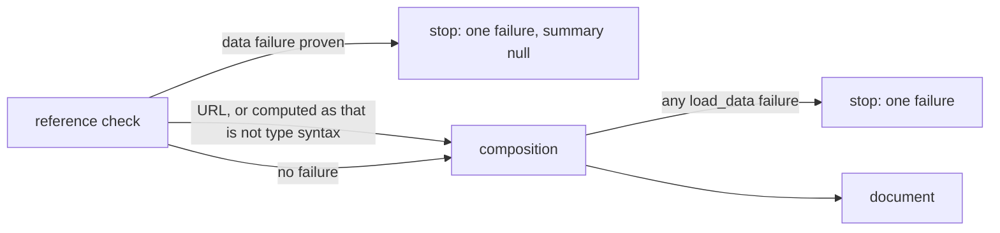

# Composition Problems

Use this page to decide how to read a failed `md compose`: whether fixing the
problem you see is likely to reveal another, and where each reported position
points. It applies to `md compose` and to library callers. The exact fields of a
data output are in [Data contracts](../cli/data-contracts.md#diagnostics), and the
exit statuses in [Output and width](../cli/output-and-width.md#exit-status).

## What stops a run

A run finds problems in **families**. Each family has a *stopping rule*, which
says whether the run keeps looking for more problems of that family after it
finds the first one. It tells you what to expect after a fix: a references report
is the whole list, while an expression error may have another behind it.

| Family | Stopping rule | What you see |
| --- | --- | --- |
| Setters | The run stops at the first setter that cannot be applied | One `dm.setter.invalid` error, before that document's stages run |
| References | Every problem is collected, then reported together | One grouped report, before anything is composed |
| Schema | Every problem in one document is collected, then the run stops | Every problem in that document, none from later documents |
| Transclusion | A fatal failure, such as a cycle, stops the run; a tolerated failure is reported and composition continues | A fatal error, or a notice in the document and a warning |
| Expression | The run stops at the first error it meets, which is not always the earliest in the document | One error |
| Data (`load_data`) | The run stops at the first failure that no explicit `try` recovers, which can come in the reference check before composition; see [Data failures](#data-failures) | One failure: one record, or one per violating value (up to 20) for a contract mismatch |
| Shell | The run stops at the first error | One error |
| Lifecycle | The run stops at the first error, then runs the [cleanup events](../topics/lifecycle/error-handling.md) | One error, plus what cleanup reports |

A warning never stops a run on its own. To make one stop it, name its code with
[`--deny`](../cli/policy.md).

For example, this document has two broken links and an expression that fails.
The first run reports only the links, together, because references are checked
before anything is composed. The expression's error appears once they are fixed:

```md
[one](./missing-one.md)
[two](./missing-two.md)

{{ 1 / 0 }}
```

```text
$ md compose doc.md
Broken references in doc.md

doc.md
  file not found in hyperlink  `./missing-one.md`  doc.md:1:1
  file not found in hyperlink  `./missing-two.md`  doc.md:2:1

Checked 2 references across 1 document: 0 ok, 2 broken
```

Only the reference report groups its problems. Every other family keeps its own
error block in a terminal.

`md validate refs --fail-fast` and the library's `fail_fast` option stop reference
checking at the first error. `md compose` always collects them.

## Data failures

A [`load_data`](../functions/load-data.md) call that fails stops the command,
unless an explicit [`try`](../functions/try.md) recovers it.
This section covers when that happens, which surrounding constructs pass the
failure on, what an explicit recovery reports, and why a failure can stop the
run before composition starts. The codes and fields of the failure are in
[Data errors](../cli/data-contracts.md#data-errors).

### An unguarded data failure is never recovered

Outside a `try`, no partial value stands in for data that did not load, and
nothing turns the failure into a warning:

- **Nothing later in the document runs.** No later expression, directive, or
  `::shell` command runs, and no document is written. The lifecycle's
  [cleanup events](../topics/lifecycle/error-handling.md) run as for any other
  failure.
- **`||` and the ternary do not absorb it.** `load_data("servers.yaml", "string[]") || []`
  fails when the file is missing; it does not yield `[]`. A ternary skips the call
  only when its condition sends it to the other branch, which is how an optional
  file is written:

  ```md
  {{ file_exists("servers.yaml") ? load_data("servers.yaml", "string[]") : [] }}
  ```

  The guard skips a missing file. It does not hide a malformed one: when the file
  exists, the call runs and its failure stops the command.
- **Every surface passes it on.** A failure inside a callback (`map(items, i => load_data(…))`),
  a `::map` or `::filter` body, frontmatter interpolation, a `::block` condition,
  or nested composition (`as_markdown(…)`) stops the command with its own
  `dm.data.*` code, located at the start of the `{{ … }}` interpolation that
  holds the call (a condition's failure at its directive). A failure inside a repeated body also carries its
  [`iteration_path`](../cli/data-contracts.md#failures-inside-map-and-filter-bodies).

### What an explicit `try` reports

`try(expr, fallback)` returns its fallback when `expr` fails with a
*recoverable* read failure: a missing or unreadable file, a malformed file or
one that breaks its contract, or an allowed remote read that fails in transport.
Every other failure, such as an unsupported format, a denied host, or a failure
inside nested composition, still stops the run as above. Which causes are
recoverable is listed in
[Recovering from read failures](../topics/darkmatter-expressions.md#recovering-from-read-failures).

```md
{{ as_json(try(load_data("optional.yaml", "string[]"), [])) }}
```

With no `optional.yaml`, this composes `[]` and the run succeeds. What the run
reports follows from that:

- **A recovered cause is not reported.** It produces no error and no warning,
  neither in a terminal nor in the `--output json` envelope, whose
  `diagnostics` stays empty.
- **Other warnings are unaffected.** A warning raised elsewhere, including one
  inside the same `try` such as an undeclared property, is still reported, and
  naming its code with [`--deny`](../cli/policy.md) still stops the run.
- **A failing fallback is reported normally.** `try` does not catch its own
  fallback's failure. That failure keeps its own code, is located at the start
  of the `{{ … }}` interpolation that holds it, and keeps its `iteration_path`
  when it happens inside a callback. The recovered cause leaves no trace in the
  record.

### It can stop the run in the reference check

`md compose` checks a file's references before composing it, and to do that it
prepares each document, which evaluates its expressions, transcluded documents
included. A data failure the check can prove on its own stops the command
there: composition never starts, the data output's `summary` is `null`, and its
`read_set` still lists the data file.
A recoverable failure inside a `try` does not stop it: the check takes the
fallback and continues, as composition will.



For example, `doc.md` holds the line `::file ./child.md`, and `child.md` loads a
JSON file that ends early (`bad.json` is `{"a": 1,`):

```md
{{ load_data("bad.json", "unknown[]") }}
```

The reference check fails on the child's data, and the record names the child
as its `source`:

```json
{ "code": "dm.data.malformed",
  "source": { "file": "/work/child.md", "line": 1, "column": 1, "inserted": false },
  "data_location": { "file": "/work/bad.json", "line": 2, "column": 1 } }
```

The check proves every `dm.data.*` failure, a missing or unreadable data file,
and a contract that names a missing import or an unknown type. It leaves two
cases to composition, which reports them in the same way:

- **A URL.** The reference check does not fetch remote data, so a
  `load_data("https://…", …)` call is first tried, and fails if it is going to,
  during composition.
- **A computed `as` that is not type syntax**, such as a frontmatter value
  `"string[("`. A computed `as` that parses but is not a container
  (`"string"`) is proven in the check.

## How a problem is located

In a data output, a problem's `source` says where to look. Its positions are always
**authored**: they point at the file as you wrote it, not at the text composition
was working on, so you can jump straight to them. Here `shared/intro.md` has a
broken `::code` target on line 9, and `types.md` pulled it in on line 8:

```json
{
  "code": "dm.reference.missing_transclusion",
  "source": {
    "file": "/work/repo/shared/intro.md",
    "line": 9,
    "column": 1,
    "section": "getting-started",
    "inserted": false
  },
  "reason": "file not found",
  "construct": "::code",
  "reference": "./examples/basic.rs",
  "failure": "no-match",
  "included_via": [
    { "file": "/work/repo/types.md", "line": 8 }
  ]
}
```

| Field | Meaning |
| --- | --- |
| `source.line`, `source.column` | The authored position. Both are 1-based and count the complete file, frontmatter included. For a reference, the column counts characters rather than bytes, and CRLF line endings do not change either number. A `prologue:` or `epilogue:` reference reports its own value, so each entry of a list has its own position: in `prologue: [./a.md, ./b.md]`, `./b.md` is at column 20, and an entry on a later line of a multi-line list is on that line. `null` when no position is proven: the document has no authored positions (built in memory or fetched from a URL), or the producer knows only the file. Never a placeholder. |
| `source.inserted` | `true` when an expression, a shell step, or a `replace:` value wrote the reference. It has no authored text of its own, so `line` and `column` name the construct that wrote it: the `{{ … }}`, the `$( … )`, or the replaced key. |
| `source.section` | The composed anchor slug of the innermost heading at or before the problem. `# Intro {{ title }}` with `title: Root` gives `intro-root`, the anchor that exists in the composed document. |
| `reason`, `construct`, `reference`, `failure` | Reference problems, and an expression whose read-side function could not read its file (`frontmatter("missing.md")`, or a URL whose host is not allowed): the report's phrase (such as `file not found` or `remote check disabled`), the construct (for a function, its name and `()`, such as `frontmatter()`), the reference as written, and the [failure class](./file-reference-failures.md). The expression keeps the code `dm.expression.evaluation_failure`. |
| `included_via` | Reference problems only: the directives that pulled the document in, outermost first, each with its `file` and authored `line`. Empty for the named document. |

When a problem's position cannot be proven, `source` still names the file, with a
`null` line and column. A line counted in text a stage rewrote is never published as
authored, so a `::shell` directive or a `::shell-block` command reports its file alone,
and its message may name a different line than the file has:

```json
{
  "code": "dm.shell.failure",
  "message": "Approval required for 'echo hi' at line 8",
  "source": { "file": "/work/repo/notes.md", "line": null, "column": null, "inserted": false }
}
```

What each family reports:

| Problem | `source` |
| --- | --- |
| A schema problem | the file, at its [location](../topics/schemas/definition.md#problem-locations) when it has one; a schema that could not be prepared has the file alone |
| A `load_data` failure | the start of the `{{ … }}` interpolation that holds the call; its `as` argument for a contract the call check rejects; its options argument for options the call check rejects; a position inside the data file is in [`data_location`](../cli/data-contracts.md#data-location) |
| A `when=` condition on `::block` or `::file` that fails or warns | the directive's opener, unless a stage rewrote it (then the file alone) |
| A `$( … )` frontmatter command | the file and the line of its key; the column is `null` |
| A `::file` directive that does not parse, or a malformed `::block` | the file |
| A transclusion cycle | the document holding the directive that closes the cycle, which may be a child rather than the named document |
| An undeclared property | the file and the line of its first read (for a read in frontmatter, its key's line); the column is `null` |
| Another warning | the document that reported it |
| Any other failure that holds no file, such as a caller's `--set` value that could not bind | the document named on the command line |
| A schema problem on a value a `key.path=value` setter supplied | the file, with a `null` line and column; the message names the setter, because the value was never at the on-disk scalar |
| A `dm.setter.invalid` setter that cannot be applied | `null`, whatever the document; the message names the argument, its path, and the document a path could not reach |

A value on the command line was never in a file, so neither form points into one.
Both name your argument, so you can tell which setter to fix:

```text
$ md compose doc.md items.9.name=z
Setter: items.9.name=z
Path: items.9.name
`items.9` is out of range: the array has 2 element(s) in `doc.md`

$ md compose doc.md count=abc --output json
"code": "dm.schema.type_mismatch",
"message": "\"abc\" is not of type \"number\" (from the setter `count=abc` at `count`)",
"source": { "file": "doc.md", "line": null, "column": null, "inserted": false }
```

Apart from `dm.setter.invalid`, `source` is `null` only when no file is known: input read from stdin or built in
memory, or a lifecycle `error:` step, whose message is the author's own text.

Reference graphs keep a second set of numbers. `ReferenceOrigin::line` and `span`
count lines in the prepared body, after frontmatter removal and expansion, because
code that walks the graph works on that text. No report or data output shows them.
