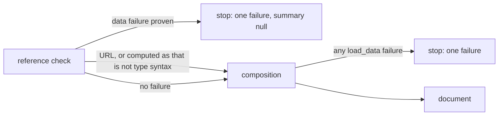

# Composition Problems

Use this page to decide how to read a failed `md compose`: whether fixing the
problem you see is likely to reveal another, and where each reported position
points. It applies to `md compose` and to library callers. The exact fields of a
data output are in [Data contracts](../cli/data-contracts.md#diagnostics), and the
exit statuses in [Output and width](../cli/output-and-width.md#exit-status).

## What stops a run

A run finds problems in **families**. Each family has a *stopping rule*, which
says whether the run keeps looking for more problems of that family after it
finds the first one. It tells you what to expect after a fix: a references report
is the whole list, while an expression error may have another behind it.

| Family | Stopping rule | What you see |
| --- | --- | --- |
| Setters | The run stops at the first setter that cannot be applied | One `dm.setter.invalid` error, before that document's stages run |
| References | Every problem is collected, then reported together | One grouped report, before anything is composed |
| Schema | Every problem in one document is collected, then the run stops | Every problem in that document, none from later documents |
| Transclusion | A fatal failure, such as a cycle, stops the run; a tolerated failure is reported and composition continues | A fatal error, or a notice in the document and a warning |
| Expression | The run stops at the first error it meets, which is not always the earliest in the document | One error |
| Data (`load_data`) | The run stops at the first failure that no explicit `try` recovers, which can come in the reference check before composition; see [Data failures](#data-failures) | One failure: one record, or one per violating value (up to 20) for a contract mismatch |
| Shell | The run stops at the first error | One error |
| Lifecycle | The run stops at the first error, then runs the [cleanup events](../topics/lifecycle/error-handling.md) | One error, plus what cleanup reports |

A warning never stops a run on its own. To make one stop it, name its code with
[`--deny`](../cli/policy.md).

For example, this document has two broken links and an expression that fails.
The first run reports only the links, together, because references are checked
before anything is composed. The expression's error appears once they are fixed:

```md
[one](./missing-one.md)
[two](./missing-two.md)

{{ 1 / 0 }}
```

```text
$ md compose doc.md
Broken references in doc.md

doc.md
  file not found in hyperlink  `./missing-one.md`  doc.md:1:1
  file not found in hyperlink  `./missing-two.md`  doc.md:2:1

Checked 2 references across 1 document: 0 ok, 2 broken
```

Only the reference report groups its problems. Every other family keeps its own
error block in a terminal.

`md validate refs --fail-fast` and the library's `fail_fast` option stop reference
checking at the first error. `md compose` always collects them.

## Data failures

A [`load_data`](../functions/load-data.md) call that fails stops the command,
unless an explicit [`try`](../functions/try.md) recovers it.
This section covers when that happens, which surrounding constructs pass the
failure on, what an explicit recovery reports, why a failure can stop the
run before composition starts, and how a loaded value that fails its
property's schema differs. The codes and fields of the failure are in
[Data errors](../cli/data-contracts.md#data-errors).

### An unguarded data failure is never recovered

Outside a `try`, no partial value stands in for data that did not load, and
nothing turns the failure into a warning:

- **Nothing later in the document runs.** No later expression, directive, or
  `::shell` command runs, and no document is written. The lifecycle's
  [cleanup events](../topics/lifecycle/error-handling.md) run as for any other
  failure.
- **`||` and the ternary do not absorb it.** `load_data("servers.yaml", "string[]") || []`
  fails when the file is missing; it does not yield `[]`. A ternary skips the call
  only when its condition sends it to the other branch, which is how an optional
  file is written:

  ```md
  {{ file_exists("servers.yaml") ? load_data("servers.yaml", "string[]") : [] }}
  ```

  The guard skips a missing file. It does not hide a malformed one: when the file
  exists, the call runs and its failure stops the command.
- **Every surface passes it on.** A failure inside a callback (`map(items, i => load_data(…))`),
  a `::map` or `::filter` body, frontmatter interpolation, a `::block` condition,
  or nested composition (`as_markdown(…)`) stops the command with its own
  `dm.data.*` code, located at the start of the `{{ … }}` interpolation that
  holds the call (a condition's failure at its directive). A failure inside a repeated body also carries its
  [`iteration_path`](../cli/data-contracts.md#failures-inside-map-and-filter-bodies).

### What an explicit `try` reports

`try(expr, fallback)` returns its fallback when `expr` fails with a
*recoverable* read failure: a missing or unreadable file, a malformed file or
one that breaks its contract, or an allowed remote read that fails in transport.
Every other failure, such as an unsupported format, a denied host, or a failure
inside nested composition, still stops the run as above. Which causes are
recoverable is listed in
[Recovering from read failures](../topics/darkmatter-expressions.md#recovering-from-read-failures).

```md
{{ as_json(try(load_data("optional.yaml", "string[]"), [])) }}
```

With no `optional.yaml`, this composes `[]` and the run succeeds. What the run
reports follows from that:

- **A recovered cause is not reported.** It produces no error and no warning,
  neither in a terminal nor in the `--output json` envelope, whose
  `diagnostics` stays empty.
- **Other warnings are unaffected.** A warning raised elsewhere, including one
  inside the same `try` such as an undeclared property, is still reported, and
  naming its code with [`--deny`](../cli/policy.md) still stops the run.
- **A failing fallback is reported normally.** `try` does not catch its own
  fallback's failure. That failure keeps its own code, is located at the start
  of the `{{ … }}` interpolation that holds it, and keeps its `iteration_path`
  when it happens inside a callback. The recovered cause leaves no trace in the
  record.

### It can stop the run in the reference check

`md compose` checks a file's references before composing it, and to do that it
prepares each document, which evaluates its expressions, transcluded documents
included. A data failure the check can prove on its own stops the command
there: composition never starts, the data output's `summary` is `null`, and its
`read_set` still lists the data file.
A recoverable failure inside a `try` does not stop it: the check takes the
fallback and continues, as composition will.



For example, `doc.md` holds the line `::file ./child.md`, and `child.md` loads a
JSON file that ends early (`bad.json` is `{"a": 1,`):

```md
{{ load_data("bad.json", "unknown[]") }}
```

The reference check fails on the child's data, and the record names the child
as its `source`:

```json
{ "code": "dm.data.malformed",
  "source": { "file": "/work/child.md", "line": 1, "column": 1, "inserted": false },
  "data_location": { "file": "/work/bad.json", "line": 2, "column": 1 } }
```

The check proves every `dm.data.*` failure, a missing or unreadable data file,
and a contract that names a missing import or an unknown type. It leaves two
cases to composition, which reports them in the same way:

- **A URL.** The reference check does not fetch remote data, so a
  `load_data("https://…", …)` call is first tried, and fails if it is going to,
  during composition.
- **A computed `as` that is not type syntax**, such as a frontmatter value
  `"string[("`. A computed `as` that parses but is not a container
  (`"string"`) is proven in the check.

### A loaded value that fails its property's schema

A `load_data` call without `as` succeeds on any well-formed file, and the
schema of the frontmatter property that stores the result judges the value
afterward. A mismatch there is a **schema** problem, not a data failure: it
follows the schema family's stopping rule (every problem in the document is
collected), keeps a `dm.schema.*` code, and `try` around the call does not
recover it, because the call itself succeeded.

Such a problem has two locations when the value came straight from the file:

```md
---
$schema:
    direct: "{ name: string(required), age: number }[]"
direct: "{{ load_data('data.yaml') }}"
---
```

| Location | Where it points |
| --- | --- |
| `source` | the `{{` of the property's expression in the document (here line 4, column 10), not the property's key |
| `data_location` | the failing value in the data file, such as `data.yaml` line 4, column 8, pointer `/1/age` |

`data_location` appears for the call itself, the call in parentheses, and a
conditional whose selected arm is the call. A value built from the data, by
a callback, a spread, `try`, or `||`, has `source` alone. The record fields
are in [Destination schema failures](../cli/data-contracts.md#destination-schema-failures).

## How a problem is located

In a data output, a problem's `source` says where to look. Its positions are always
**authored**: they point at the file as you wrote it, not at the text composition
was working on, so you can jump straight to them. Here `shared/intro.md` has a
broken `::code` target on line 9, and `types.md` pulled it in on line 8:

```json
{
  "code": "dm.reference.missing_transclusion",
  "source": {
    "file": "/work/repo/shared/intro.md",
    "line": 9,
    "column": 1,
    "section": "getting-started",
    "inserted": false
  },
  "reason": "file not found",
  "construct": "::code",
  "reference": "./examples/basic.rs",
  "failure": "no-match",
  "included_via": [
    { "file": "/work/repo/types.md", "line": 8 }
  ]
}
```

| Field | Meaning |
| --- | --- |
| `source.line`, `source.column` | The authored position. Both are 1-based and count the complete file, frontmatter included. For a reference, the column counts characters rather than bytes, and CRLF line endings do not change either number. A `prologue:` or `epilogue:` reference reports its own value, so each entry of a list has its own position: in `prologue: [./a.md, ./b.md]`, `./b.md` is at column 20, and an entry on a later line of a multi-line list is on that line. `null` when no position is proven: the document has no authored positions (built in memory or fetched from a URL), or the producer knows only the file. Never a placeholder. |
| `source.inserted` | `true` when an expression, a shell step, or a `replace:` value wrote the reference. It has no authored text of its own, so `line` and `column` name the construct that wrote it: the `{{ … }}`, the `$( … )`, or the replaced key. |
| `source.section` | The composed anchor slug of the innermost heading at or before the problem. `# Intro {{ title }}` with `title: Root` gives `intro-root`, the anchor that exists in the composed document. |
| `reason`, `construct`, `reference`, `failure` | Reference problems, and an expression whose read-side function could not read its file (`frontmatter("missing.md")`, or a URL whose host is not allowed): the report's phrase (such as `file not found` or `remote check disabled`), the construct (for a function, its name and `()`, such as `frontmatter()`), the reference as written, and the [failure class](./file-reference-failures.md). The expression keeps the code `dm.expression.evaluation_failure`. |
| `included_via` | Reference problems only: the directives that pulled the document in, outermost first, each with its `file` and authored `line`. Empty for the named document. |

When a problem's position cannot be proven, `source` still names the file, with a
`null` line and column. A line counted in text a stage rewrote is never published as
authored. A command `md compose` refuses before anything runs (its pre-flight approval
check) is one such case: its message names the line the command was written on, but
`source` names the file alone, because that check reports every document it walks
against the one it was asked about:

```json
{
  "code": "dm.shell.failure",
  "message": "Approval required for 'echo hi' at line 8",
  "source": { "file": "/work/repo/notes.md", "line": null, "column": null, "inserted": false }
}
```

A `::shell-block` that same check cannot read is different: its record names the
file that holds the block, so it keeps the line. Here `echo "open` on line 10 has
no closing quote:

```json
{
  "code": "dm.shell.failure",
  "message": "Shell block error: Shell block parse error at line 10: Command tokenization failed: Unterminated double quote",
  "source": { "file": "/work/repo/notes.md", "line": 10, "column": 1, "inserted": false }
}
```

A `::shell` command that fails while the document composes (a program that is not
installed, a refused approval, a non-zero exit) is placed at its directive, even
after a false `::block` above it removed lines from the body:

```json
{
  "code": "dm.shell.failure",
  "message": "Command not found: 'nonexistentcmd' at line 11",
  "source": { "file": "/work/repo/notes.md", "line": 11, "column": 1, "inserted": false }
}
```

What each family reports:

| Problem | `source` |
| --- | --- |
| A schema problem | the file, at its [location](../topics/schemas/definition.md#problem-locations) when it has one; a schema that could not be prepared has the file alone; for a property whose whole value is one `{{ … }}` expression, the expression, with a [`data_location`](#a-loaded-value-that-fails-its-propertys-schema) when the value came straight from a `load_data` call |
| A `load_data` failure | the start of the `{{ … }}` interpolation that holds the call; its `as` argument for a contract the call check rejects; its options argument for options the call check rejects; a position inside the data file is in [`data_location`](../cli/data-contracts.md#data-location) |
| A `when=` condition on `::block` or `::file` that fails or warns | the directive's opener, unless a stage rewrote it (then the file alone) |
| A `$( … )` frontmatter command | the file and the line of its key; the column is `null` |
| A `::file`, `::code`, `::url`, or `::shell` directive that does not parse | the directive's opener in the file as written; the file alone when a stage wrote the opener or the body no longer matches the file |
| A `::shell` command, or a `::shell-block` command, that fails while composing | the `::shell` directive's opener, or the block command's own line; the file alone when its position cannot be proven, and for a command the pre-flight approval check refuses |
| A malformed `::block`, an `::end-block` with no opener, or a `::block` or `::shell-block` with no `::end-block` | the marker's line in the file as written; the file alone when its position cannot be proven |
| A `prologue:` or `epilogue:` that is not a string or a list of strings | the file and the line of its key; the column is `null` |
| A `::file`, `::code`, `::url`, `prologue:`, or `epilogue:` whose target is invalid (a bare `@`), refused by its directive (a `::file`, `prologue:`, or `epilogue:` file that is not Markdown, a `::url` that is not an absolute URL), missing, unreadable, or refused by the network policy | the directive's opener, or the value (each list entry its own), in the file that wrote it, which may be a child rather than the named document; the same from composition, its pre-flight check, `md graph`, and `md validate refs`, on the warning when a `::file` tolerates a child's failure, and on the warning, under the same code, when composition leaves the inclusion out instead (an absent target with `--allow missing-transclusions`, or any of these in a document that sets `ignore_invalid: true`); the file alone when its position cannot be proven |
| A `::shell-block` with an invalid option, or a block command that does not parse | the opener's line (an option) or the command's line in the file that holds the block, which may be a child rather than the named document, also when the pre-flight approval check finds it; the file alone when its position cannot be proven |
| A transclusion cycle | the document holding the directive that closes the cycle, which may be a child rather than the named document |
| A `::toc-linking` or `::file-links` directive that fails, or whose failure a `::file` tolerated as a warning | the directive's opener in the file that holds it, which may be a child rather than the named document; the file alone when its position cannot be proven. A `::toc-linking` target it selected that cannot be read (`dm.input.read_failure`, a warning when composing) is placed there too, and its message names the selected file |
| An undeclared property | the file and the line of its first read (for a read in frontmatter, its key's line); the column is `null` |
| Another warning | the document that reported it |
| Any other failure that holds no file, such as a caller's `--set` value that could not bind | the document named on the command line |
| A schema problem on a value a `key.path=value` setter supplied | the file, with a `null` line and column; the message names the setter, because the value was never at the on-disk scalar |
| A `dm.setter.invalid` setter that cannot be applied | `null`, whatever the document; the message names the argument, its path, and the document a path could not reach |

A value on the command line was never in a file, so neither form points into one.
Both name your argument, so you can tell which setter to fix:

```text
$ md compose doc.md items.9.name=z
Setter: items.9.name=z
Path: items.9.name
`items.9` is out of range: the array has 2 element(s) in `doc.md`

$ md compose doc.md count=abc --output json
"code": "dm.schema.type_mismatch",
"message": "\"abc\" is not of type \"number\" (from the setter `count=abc` at `count`)",
"source": { "file": "doc.md", "line": null, "column": null, "inserted": false }
```

Apart from `dm.setter.invalid`, `source` is `null` only when no file is known: input read from stdin or built in
memory, or a lifecycle `error:` step, whose message is the author's own text.

### Telling directive failures apart

Every failure has its own code, so a script branches on `code` and never on
the message. A `::toc-linking` or `::file-links` directive reports what was
wrong with it: for example, a level outside `h1`–`h6` is
`dm.toc_linking.invalid_level`, and a `--depth` that is not a number is
`dm.file_links.invalid_depth`. The full list is in
[Data contracts](../cli/data-contracts.md#codes).

```md
::toc-linking ./guide.md level=h9
```

```json
{
  "code": "dm.toc_linking.invalid_level",
  "severity": "error",
  "message": "TOC linking error: Invalid heading level 'h9' at line 3",
  "source": { "file": "/work/repo/doc.md", "line": 3, "column": 1, "inserted": false }
}
```

A CI step that fixes a level automatically but stops on anything else can
read the code from the data output:

```sh
md compose doc.md --output json > result.json || {
    case "$(jq -r '.diagnostics[0].code' result.json)" in
        dm.toc_linking.invalid_level) echo "use a level from h1 to h6 in ::toc-linking" ;;
        dm.file_links.invalid_depth) echo "give ::file-links --depth a whole number" ;;
        *) jq -r '.diagnostics[0].message' result.json ;;
    esac
    exit 1
}
```

`md validate refs` and `md graph` report the same codes for the same
directives.

Some of these failures do not stop `md compose`. A `::toc-linking` whose
`filter=` does not compile, or a `::file-links` whose glob is invalid, whose
`--dir` is missing, is a file, or cannot be read, or that sits in text read
from stdin, is left out of the document, and composition continues. The
failure is still reported, as a `warning`, under the same code it has when it
stops a run, so the script above works for both:

```md
::file-links ./notes/[.md
```

```json
{
  "code": "dm.file_links.invalid_glob",
  "severity": "warning",
  "message": "File-links error: glob reference `./notes/[.md` is not a valid glob: unclosed character class; missing ']' (line 3)",
  "source": { "file": "/work/repo/doc.md", "line": 3, "column": 1, "inserted": false }
}
```

To make such a failure stop the run instead, deny its code:
`md compose doc.md --deny dm.file_links.invalid_glob`. See
[Policy](../cli/policy.md#diagnostics---deny).

A directive's line is always its line in the file as you wrote it. The
frontmatter header and a `::block` that composition removes do not shift it:
here the bad `::file` is reported at line 7 by `md compose`, `md graph`, and
`md validate refs` alike, although it is the third line of the body and the
block before it is dropped.

```md
---
title: Notes
---
::block when="false"
draft
::end-block
::file
```

```json
{
  "code": "dm.directive.parse_failure",
  "message": "Transclusion error: Failed to parse directive at line 7: Expected value, found end of directive",
  "source": { "file": "/work/repo/doc.md", "line": 7, "column": 1, "inserted": false }
}
```

When Darkmatter cannot prove where the directive was written (a stage wrote
it, or a caller changed the text after loading the file), the message names
no line and `source.line` is `null`.

A directive that parses but names a target that cannot be used is reported at
the same place, and the message starts with that place as `file:line:column`.
Here `nested.md`, which `doc.md` includes, writes `::file @` on line 7, and a
bare `@` names no file:

```json
{
  "code": "dm.reference.failure",
  "message": "Transclusion error: /work/repo/nested.md:7:1: File reference error: file reference syntax is invalid: the `@` sigil requires a relative payload: `@`",
  "source": { "file": "/work/repo/nested.md", "line": 7, "column": 1, "inserted": false }
}
```

A `prologue: "@"` on line 3 is reported at its value, `line: 3` and
`column: 11`. A target that does not exist keeps
`dm.reference.missing_transclusion`, at the same place.

When composition leaves such an inclusion out instead of failing (a missing
`::code ./gone.rs` on line 6 under `--allow missing-transclusions`, or a
`::file ./notes.txt` in a document that sets `ignore_invalid: true`), its
warning has the code and the place the failure would have had:

```json
{
  "code": "dm.reference.missing_transclusion",
  "severity": "warning",
  "message": "Transclusion error: /work/repo/doc.md:6:1: I/O error: File not found: ./gone.rs",
  "source": { "file": "/work/repo/doc.md", "line": 6, "column": 1, "inserted": false }
}
```

`md compose` also reports the same miss from its reference check, at the same
place; that record has a `construct` field, and the composition warning has
none.

In a terminal, the error block for such a failure starts with the place,
one row each for the file and, when it is known, the line:

```text
⤫ TransclusionError: file reference failure
┃
┃ File: /work/repo/nested.md
┃ Line: 7
┃
┃ file reference syntax is invalid: the `@` sigil requires a relative payload: `@`
```

A link or image is not an inclusion: an invalid target such as `[setup](@)`
does not stop the reference check part-way. The check reports it as a broken
reference at the link's line and column, with the reason
`invalid file reference`, beside every other broken reference it finds, and
`md compose` then fails with status 1, as it does for a missing link target.

Reference graphs keep a second set of numbers. `ReferenceOrigin::line` and `span`
count lines in the prepared body, after frontmatter removal and expansion, because
code that walks the graph works on that text. No report or data output shows them.

### Headings pushed past H6

Markdown has six heading levels. When a heading would have to move deeper
than H6, Darkmatter reports it under a code of its own, so a script can tell
it apart from every other problem.

A `::file` child's headings are shifted to sit under the heading before the
directive. A child heading that would land past H6 is written as bold text
instead, and composition continues with a `warning`:

```md
###### Setup

::file ./steps.md
```

Here `steps.md` starts with `## Steps` and has a `### Details` heading.
`## Steps` becomes `###### Steps`, and `### Details`, which would become
H7, becomes `**Details**`:

```json
{
  "code": "dm.transclusion.heading_overflow",
  "severity": "warning",
  "message": "Heading overflow at line 3: converted to bold text (would become H7)",
  "source": { "file": "/work/repo/doc.md", "line": null, "column": null, "inserted": false }
}
```

The line in the message is the heading's line in `steps.md`; `source` names
the composed document, with no line, because the bold text is not where the
author wrote the heading. To stop the run instead, deny the code:
`md compose doc.md --deny dm.transclusion.heading_overflow`.

The library's `Markdown::normalize` and `Markdown::relevel` return a
`NormalizationError` when a target level would push a heading past H6.
`error_diagnostics` reports it as `dm.normalization.level_overflow`
(`dm.normalization.validation_failed` for a heading structure rule), so a
caller branches on the code, never on the message:

```rust
use darkmatter::markdown::compose::report_diagnostics::error_diagnostics;
use darkmatter::markdown::{HeadingLevel, Markdown};

let doc = Markdown::from("#### Four\n\n###### Six\n".to_string());
let error = doc.relevel(HeadingLevel::H5).unwrap_err();
assert_eq!(error_diagnostics(&error)[0].code, "dm.normalization.level_overflow");
```
