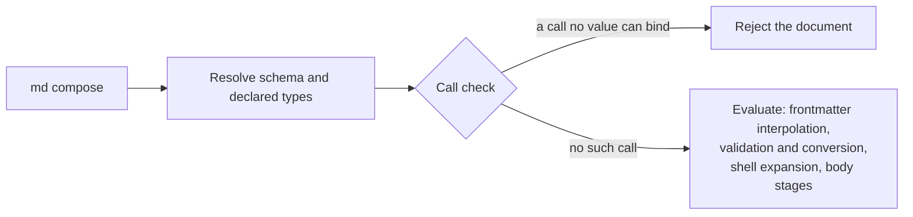

# Call Check

Before Darkmatter evaluates anything in a document, it checks every function
call the document authors against the types its schema declares. A call that
can never bind — whatever the document's values turn out to be — rejects the
whole document. Nothing of it runs first: no frontmatter expression, no
`$( … )` command, no body expression.

```markdown
---
$schema:
  flag: boolean(required)
flag: true
stamp: "$(date)"
---
{{ true ? 'ok' : min(flag, 5) }}
```

`min` takes numbers and `flag` is declared a boolean, so this document is
rejected even though the `min` branch would never be taken, and `date` never
runs:

```text
A document expression failed to evaluate `true ? 'ok' : min(flag, 5)`:

min: argument 1 (`a`) is boolean, expected number (category 5: no value of
that type can bind)

Expression at line: 7, column: 1
```

To see it yourself, save the document as `check.md` and run
`md compose check.md`: it prints the error above and exits with status 1.
Change `min(flag, 5)` to `min(5, 6)` and the check passes; only then does
composition reach `$(date)` and ask you to approve it, as it does for any
shell command.

## When it runs

The check is the first step of every document's pipeline, after the schema is
resolved and before frontmatter interpolation pass 1. The established order
after it is unchanged.



The check is passive: it reads the authored text and the schema's declared
types, never a frontmatter value, and it evaluates nothing.

## The five argument categories

For every argument of every call, the check compares the argument's declared
type with the parameter's type and puts the pair in exactly one of five
categories. The examples use this schema and the function
`min(a: number, b: number)`:

```yaml
$schema:
  count: string               # optional: string | null
  maybe: number               # optional: number | null
  size: number(required)      # number
  flag: boolean(required)     # boolean
  # untyped has no schema entry: unknown
```

| # | Category | Example | `md compose` | Editor (DMLS), by default |
|---|---|---|---|---|
| 1 | Always binds: the same type, or a conversion that is always safe | `min(size, 5)`, `upper(size)`, `min("4", 5)` | composes | silent |
| 2 | Binds unless the value is missing (`null`) | `min(maybe, 5)` | composes; fails when it runs if `maybe` is unset | silent |
| 3 | Might bind, might not | `min(count, 5)`: text converts only if it holds a number | composes; the value decides when it runs | warning |
| 4 | Type not known | `min(untyped, 5)` | composes; the value decides when it runs | silent |
| 5 | Can never bind | `min(flag, 5)`, `min("pear", 5)`, `min(1)` | **rejected** | error |

Only category 5 changes what `md compose` does. The others describe how sure
the check can be, and the editor uses them to decide what to flag; its strict
setting also warns for categories 2 and 4 (see
[DMLS Diagnostics](../../dmls/docs/diagnostics.md#severity)). The idea is that a
document with no types gets no warnings, and adding types buys more checking.

A few rules decide the category:

- **Constraints never count.** A `number` passed to `number(integer; min(1))`
  is category 1; the constraint is checked on the value when the call runs.
- **Literals are judged by their value.** `min("4", 5)` is category 1 and
  `min("pear", 5)` is category 5, as is `pr_list(0)` when `pr_list` requires
  `min(1)`.
- **A fallback can rescue a call.** `number("pear", 7)` is category 1 because
  `number` returns the fallback when its first argument cannot bind;
  `number("4", "x")` is category 5 because the fallback itself cannot bind.
- **Wrong argument counts** (`min(1)`) and calls no overload can take are
  category 5.

A call in category 3 can still fail at runtime. Save this as `count.md` and
run `md compose count.md`:

```markdown
---
$schema:
  count: string
count: "pear"
---
{{ min(count, 5) }}
```

The check lets it through, then the call fails when it runs, with the
binder's type error:

```text
min: invalid arguments for min(a: number, b: number): number a (argument
1): expected number; received text "pear"; conversion failed: not a
number
```

With `count: "4"` the same document composes to `4`.

## What is rejected

Only a call that is **proven** wrong (category 5) rejects the document:

| Call (with `flag: boolean(required)`, `size: number(required)`) | Verdict |
|---|---|
| `min(flag, 5)` | rejected: a boolean never binds a number |
| `min(fm.flag, 5)`, `min(fm["flag"], 5)` | rejected: the same property |
| `min(1)`, `number()` | rejected: wrong argument count |
| `number("4", "x")`, `number("pear")` | rejected: the literal cannot bind |
| `min(size, 5)`, `number("pear", 7)`, `number(flag, 7)` | not rejected (`number`'s `7` is a valid fallback) |
| `min(untyped, 5)` (no schema entry) | not rejected; its value is checked when it runs |
| `min(maybe \|\| 0, 5)`, `min(length(count), 5)` | not rejected; the argument's type is not known before it runs |

Silence is not a promise: a call the check accepts can still fail at runtime
with its own type error, for example a constraint the value does not meet.

Every branch is checked, including the ones a run never takes: both sides of a
ternary, both operands of `||`, `&&`, `and(…)`, and `or(…)`, and the body of a
`::block` whose condition is false. Laziness at runtime is unchanged:
`and(false, effect())` still never calls `effect`.

A call in a dead branch is still an authoring mistake, and the editor marks
it as one, so composition agrees. This document is rejected although its
block never renders:

```markdown
---
$schema:
  flag: boolean(required)
flag: true
---
::block when="false"
{{ min(flag, 5) }}
::end-block
done
```

A block body is checked with its condition assumed true, so a guard narrows
what is inside it. This document composes to `3`: inside the block `foo` is
known to be a number, so `min(foo, 5)` is category 1.

```markdown
---
$schema:
  foo: "string | number"
foo: 3
---
::block when="is_number(foo)"
{{ min(foo, 5) }}
::end-block
```

## What is checked

Only syntax the composition would evaluate:

| Surface | Checked when | Not checked |
|---|---|---|
| frontmatter `{{ … }}` in any string value | frontmatter interpolation is enabled | keys the caller excludes, values inherited from a parent or supplied as data, literal tokens, `{{{ … }}}` |
| body `{{ … }}` (directive targets included) | body interpolation is enabled | fenced and indented code (unless `interpolate_code_blocks`), `{{{ … }}}` |
| `::block when="…"` conditions | page blocks are enabled | |
| `::file` / `::code` `when=…` conditions | a transclusion stage is enabled | |

A frontmatter-only composition (`ComposeOptions::only_frontmatter_surface`)
checks the frontmatter and leaves the body, invalid calls included, untouched.

A transcluded document is checked against its own schema when its own
composition starts, before any of it is evaluated. Its rejection fails the
parent's composition (it is never replaced by a "could not transclude"
notice). Text a child or an expression inserts is data, never the parent's
syntax, so it is not checked again.

## What the check cannot see

The check knows only what the schema declares. Where that runs out, an
argument is category 4 (type not known), and the call is judged when it runs:

- **Declared types, never values.** The check reads the schema, not the
  frontmatter. `maybe: number` is optional, so `maybe` is `number | null` even
  when the frontmatter sets `maybe: 3`: a caller, a setter, or interpolation
  can still replace that value before the call runs.
- **Top-level properties only.** `size` and `fm.size` are typed; a path below
  a property (`meta.count`), bare `fm`, a computed key (`fm[key]`), `ctx`,
  `env`, host globals, call results, and operators (`maybe || 0`) are
  unknown.
- **SimplifiedSchema only.** When `$schema` is a raw JSON Schema, every
  variable is unknown. In a root union, a property is typed only when every
  arm that declares it declares it the same way; when any arm is a raw JSON
  Schema, every variable is unknown. This document composes to `ok`, because
  `raw.json` hides the type of `flag`:

  ```markdown
  ---
  $schema: ./raw.json
  flag: true
  ---
  {{ true ? 'ok' : min(flag, 5) }}
  ```

  ```json
  { "type": "object", "properties": { "flag": { "type": "boolean" } } }
  ```

Some syntax is not checked before evaluation at all, because it does not
exist yet or is not evaluated on that surface. A bad call there still fails
when it runs:

- text a frontmatter `replace` map inserts into the body;
- `{{ … }}` inside `::shell` lines when body interpolation is off;
- an expression that does not parse: the check skips it, and the stage that
  evaluates it reports the parse error.

## The error

A rejection is reported as the same error a failing expression raises at that
place, with the call check as its cause
(`ExpressionError::CallCheck`, reachable through
`MarkdownError::rejected_call()`):

- a frontmatter value: an interpolation error naming the key and the
  expression's span;
- a body expression: an interpolation error at its line and column;
- a `::block` or `::file` condition: a condition error at the directive's
  line.

For a call whose arguments are all literals, the message is the runtime
binder's own type error.
