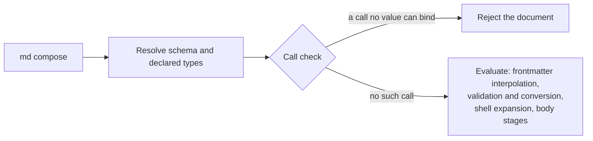

# Call Check

Before Darkmatter evaluates anything in a document, it checks every function
call the document authors against the types its schema declares. A call that
can never bind — whatever the document's values turn out to be — rejects the
whole document. Nothing of it runs first: no frontmatter expression, no
`$( … )` command, no body expression.

```markdown
---
$schema:
  flag: boolean(required)
flag: true
stamp: "$(date)"
---
{{ true ? 'ok' : min(flag, 5) }}
```

`min` takes numbers and `flag` is declared a boolean, so this document is
rejected even though the `min` branch would never be taken, and `date` never
runs:

```text
A document expression failed to evaluate `true ? 'ok' : min(flag, 5)`:

min: argument 1 (`a`) is boolean, expected number (category 5: no value of
that type can bind)

Expression at line: 7, column: 1
```

To see it yourself, save the document as `check.md` and run
`md compose check.md`: it prints the error above and exits with status 1.
Change `min(flag, 5)` to `min(5, 6)` and the check passes; only then does
composition reach `$(date)` and ask you to approve it, as it does for any
shell command.

## When it runs

The check is the first step of every document's pipeline, after the schema is
resolved and before frontmatter interpolation pass 1. The established order
after it is unchanged.



The check is passive: it reads the authored text and the schema's declared
types, never a frontmatter value, and it evaluates nothing.

## The five argument categories

For every argument of every call, the check compares the argument's declared
type with the parameter's type and puts the pair in exactly one of five
categories. The examples use this schema and the function
`min(a: number, b: number)`:

```yaml
$schema:
  count: string               # optional: string | null
  maybe: number               # optional: number | null
  size: number(required)      # number
  flag: boolean(required)     # boolean
  # untyped has no schema entry: unknown
```

| # | Category | Example | `md compose` | Editor (DMLS), by default |
|---|---|---|---|---|
| 1 | Always binds: the same type, or a conversion that is always safe | `min(size, 5)`, `upper(size)`, `min("4", 5)` | composes | silent |
| 2 | Binds unless the value is missing (`null`) | `min(maybe, 5)` | composes; fails when it runs if `maybe` is unset | silent |
| 3 | Might bind, might not | `min(count, 5)`: text converts only if it holds a number | composes **with a warning**; the value decides when it runs | warning |
| 4 | Type not known | `min(untyped, 5)` | composes; the value decides when it runs | silent |
| 5 | Can never bind | `min(flag, 5)`, `min("pear", 5)`, `min(1)` | **rejected** | error |

Only category 5 stops `md compose`. Category 3 composes too, but each such
argument is reported as a `dm.expression.uncertain_call` warning on stderr,
exactly as the editor shows it. Categories 1, 2, and 4 are silent; the editor's
strict setting also warns for 2 and 4 (see
[DMLS Diagnostics](../../dmls/docs/diagnostics.md#severity)). The idea is that a
document with no types gets no warnings, and adding types buys more checking.

For `{{ min(count, 5) }}` on line 6 of `doc.md`, with `count: string` and
`count: "4"`, the document composes to `4` and stderr shows:

```text
$ md compose doc.md
⚠ `min(…)` at doc.md:6: argument 1 (`a`) is string | null, expected number (category 3: some values of that type convert and others do not)
```

The same check covers lifecycle stacks: a category 3 call in a `when:` or an
action operand is a warning naming the stack path
(``lifecycle `composed[0].when` ``), and a category 5 call rejects the document
before any event runs.

### One diagnostic, everywhere

Composition, `md compose`, and the editor report each call finding with the
same fields, decided once by the Darkmatter library:

| Field | Example |
|---|---|
| code | `dm.expression.uncertain_call` |
| severity | `warning` (`error` for category 5) |
| message | ``min: argument 1 (`a`) is string \| null, expected number (category 3: …)`` |
| source | the file, and the one-based line and column where the argument starts |
| expected type | `number` (the parameter's declared type) |
| actual type | `string \| null` (the argument's design-time type) |

A blocking policy changes whether a command fails, never a diagnostic's code
or severity. The position is always the authored one: an argument inside a
frontmatter string, a `::block when=` condition, a lifecycle scalar, or a
transcluded file is reported where you wrote it, not in the composed output. A
diagnostic never contains an evaluated value, an environment value, or file
contents, and producing one runs nothing: a call in a branch that never runs is
still checked, and no function is called to check it.

A few rules decide the category:

- **Constraints never count.** A `number` passed to `number(integer; min(1))`
  is category 1; the constraint is checked on the value when the call runs.
- **Literals are judged by their value.** `min("4", 5)` is category 1 and
  `min("pear", 5)` is category 5, as is `pr_list(0)` when `pr_list` requires
  `min(1)`.
- **A fallback can rescue a call.** `number("pear", 7)` is category 1 because
  `number` returns the fallback when its first argument cannot bind;
  `number("4", "x")` is category 5 because the fallback itself cannot bind.
- **Wrong argument counts** (`min(1)`) and calls no overload can take are
  category 5.
- **A recursive type is judged by its definition, and named in messages.** A
  property typed by a
  [recursive named type](../topics/schemas/definition.md#cross-file-named-type-imports-namefile)
  is checked against what one level of the type holds, never by expanding it,
  so the check always finishes. With `node: "{ label: string, children:
  node[] }"` and `tree: node(required)`, `keys(tree)` is category 1 and
  `min(tree, 5)` is category 5, reported as "argument 1 (`a`) is node,
  expected number". A recursive union such as `[string, number, "{ items:
  data[] }"]` passed to `min` is category 3: its text might convert, its
  object never does.
- **`numberlike` and `boolish` may hold text.** Both keep a value exactly as
  sent, so a declared `boolish` is either a native boolean or a boolean word
  such as `"yes"` or `"1"`, and a `numberlike` is a number or numeric text
  such as `"+4"`. The check counts both forms:

  | Declared `src` | Call | Category | Why |
  |---|---|---|---|
  | `boolish(required)` | `min(src, 5)` | 3 | `"1"` converts to a number; `true` does not |
  | `boolish(required)` | `length(src)` | 3 | `length` refuses a boolean, not the text `"yes"` |
  | `numberlike(required)` | `min(src, 5)` | 1 | every numberlike value converts to a number |
  | `numberlike(required)` | a `boolean` parameter | 3 | `"1"` is a boolean word; `4` and `"+4"` are not |
  | `numberlike` or `boolish` | a `json` or `yaml` parameter | 3 | `"+4"` and `"yes"` are not JSON; a tab-led `"\t4"` is not YAML |
  | `boolean(required)` | `min(src, 5)` | 5 | a native boolean never binds a number |

  This document composes to `1`:

  ```markdown
  ---
  $schema:
    src: boolish(required)
  src: "1"
  ---
  {{ min(src, 5) }}
  ```

A call in category 3 can still fail at runtime. Save this as `count.md` and
run `md compose count.md`:

```markdown
---
$schema:
  count: string
count: "pear"
---
{{ min(count, 5) }}
```

The check lets it through, then the call fails when it runs, with the
binder's type error:

```text
min: invalid arguments for min(a: number, b: number): number a (argument
1): expected number; received text "pear"; conversion failed: not a
number
```

With `count: "4"` the same document composes to `4`.

## What is rejected

Only a call that is **proven** wrong (category 5) rejects the document:

| Call (with `flag: boolean(required)`, `size: number(required)`) | Verdict |
|---|---|
| `min(flag, 5)` | rejected: a boolean never binds a number |
| `min(fm.flag, 5)`, `min(fm["flag"], 5)` | rejected: the same property |
| `min(1)`, `number()` | rejected: wrong argument count |
| `number("4", "x")`, `number("pear")` | rejected: the literal cannot bind |
| `min(size, 5)`, `number("pear", 7)`, `number(flag, 7)` | not rejected (`number`'s `7` is a valid fallback) |
| `min(word, 5)`, `length(word)` with `word: boolish(required)` | not rejected; `word` may hold text such as `"1"` |
| `min(untyped, 5)` (no schema entry) | not rejected; its value is checked when it runs |
| `min(maybe \|\| 0, 5)`, `min(length(count), 5)` | not rejected; the argument's type is not known before it runs |

Silence is not a promise: a call the check accepts can still fail at runtime
with its own type error, for example a constraint the value does not meet.

Every branch is checked, including the ones a run never takes: both sides of a
ternary, both operands of `||`, `&&`, `and(…)`, and `or(…)`, and the body of a
`::block` whose condition is false. Laziness at runtime is unchanged:
`and(false, effect())` still never calls `effect`.

A call in a dead branch is still an authoring mistake, and the editor marks
it as one, so composition agrees. This document is rejected although its
block never renders:

```markdown
---
$schema:
  flag: boolean(required)
flag: true
---
::block when="false"
{{ min(flag, 5) }}
::end-block
done
```

A block body is checked with its condition assumed true, so a guard narrows
what is inside it. This document composes to `3`: inside the block `foo` is
known to be a number, so `min(foo, 5)` is category 1.

```markdown
---
$schema:
  foo: "string | number"
foo: 3
---
::block when="is_number(foo)"
{{ min(foo, 5) }}
::end-block
```

## What is checked

Only syntax the composition would evaluate:

| Surface | Checked when | Not checked |
|---|---|---|
| frontmatter `{{ … }}` in any string value | frontmatter interpolation is enabled | keys the caller excludes, values inherited from a parent or supplied as data, literal tokens, `{{{ … }}}` |
| body `{{ … }}` (directive targets included) | body interpolation is enabled | fenced and indented code (unless `interpolate_code_blocks`), `{{{ … }}}` |
| `::block when="…"` conditions | page blocks are enabled | |
| `::file` / `::code` `when=…` conditions | a transclusion stage is enabled | |
| lifecycle `when:` predicates and action operands, in every branch | the host runs a lifecycle (`md compose`, Claudine) | an ignored verb's operand |

A lifecycle stack is checked before its first event runs, each expression
typed with the globals its event declares (`err` only where a failure is
handled) and narrowed by the `when:` items around it, exactly as a body
expression is narrowed by its `::block` guards. A `set` ends what a guard
proved about the property it writes, and no guard reaches another event (see
[What a Guard Proves](../topics/darkmatter-expressions.md#how-long-a-fact-lasts)):

```yaml
composed:
  - when: is_number(foo)          # foo: string | number
    then:
      - stdout: "{{ min(foo, 5) }}"   # foo is a number here
      - set: { foo: pear }
      - stdout: "{{ min(foo, 6) }}"   # the fact ended at the set
```

The rejection names the lifecycle path and gives the same verdict the call
would get in the body:

```text
lifecycle `composed[0].when` calls a function with an argument that can never
bind (doc.md): min: argument 1 (`a`) is boolean, expected number (category 5:
no value of that type can bind)
```

A frontmatter-only composition (`ComposeOptions::only_frontmatter_surface`)
checks the frontmatter and leaves the body, invalid calls included, untouched.

A transcluded document is checked against its own schema when its own
composition starts, before any of it is evaluated. Its rejection fails the
parent's composition (it is never replaced by a "could not transclude"
notice). Text a child or an expression inserts is data, never the parent's
syntax, so it is not checked again.

## Where argument types come from

The check types an argument from the schema's declarations, never from the
document's values:

| Argument | Its type |
|---|---|
| a literal (`5`, `'a'`, `[1, 2]`) | that value, bound as the call would bind it |
| a declared property (`size`, `fm.size`) | its declared type, plus `null` when it is optional |
| a path into a typed object (`meta.count`) | the member's declared type, plus `null` when it, or any object on the path, is optional |
| a constant index (`list[0]`, `pair[1]`) | the item's type, plus `null` unless a tuple position guarantees it |
| `ctx.*`, `env`, `err`, `timing` | the shape `darkmatter.yaml` declares |
| a host global (Claudine's `loop.count`, `seq.index`) | the shape the host's catalog declares; nothing when the event declares the global unavailable |
| a call (`length(count)`) | the function's declared `returns` type; for overloads, the union over every overload the argument count can select |
| `x \|\| y` | `x`'s type without `null`, joined with `y`'s |
| `c ? a : b` | the two branch types joined, each under the guard |

```markdown
---
$schema:
  count: string
  maybe: number
---
{{ min(length(count), 5) }}  <- category 1: `length` returns a number
{{ min(maybe || 0, 5) }}     <- category 1: `|| 0` removes null
```

Every layer of the effective schema contributes, after resolution and
merging: the document's `$schema`, matching trigger schemas, and the
baseline. A raw JSON Schema layer is read conservatively: its literal
`properties` (through `anyOf`, `oneOf`, and `allOf`) are typed by `type`,
`const`, `enum`, and `items`; anything else, a `$ref` included, is unknown.

In a root union, each arm contributes the property's type with that arm's
optionality; an arm that does not declare the property contributes
`unknown`, which makes the whole type unknown:

```yaml
$schema:
  - { spec: file(required), plan: file(required), area: string }
  - { review: file(required), plan: file(required), area: string }
# plan -> file, area -> string | null, spec and review -> unknown
```

Joined types are normalized one way everywhere: `unknown` absorbs every
other type, duplicates collapse, and the order of arms and keys never
changes the result (`string | number` and `number | string` are one type).

## What the check cannot see

Where the declarations run out, an argument is category 4 (type not known),
and the call is judged when it runs:

- **Declared types, never values.** `maybe: number` is optional, so `maybe`
  is `number | null` even when the frontmatter sets `maybe: 3`: a caller, a
  setter, or interpolation can still replace that value before the call runs.
- **No declaration.** An undeclared property, a computed key (`fm[key]`,
  `list[i]`), bare `fm`, an open `object`, a pattern key, or a raw `$ref`.
- **Other operators.** `size + 1`, comparisons, and negation are unknown.

Some syntax is not checked before evaluation at all, because it does not
exist yet or is not evaluated on that surface. A bad call there still fails
when it runs:

- text a frontmatter `replace` map inserts into the body;
- `{{ … }}` inside `::shell` lines when body interpolation is off;
- an expression that does not parse: the check skips it, and the stage that
  evaluates it reports the parse error.

## The error

A rejection is reported as the same error a failing expression raises at that
place, with the call check as its cause
(`ExpressionError::CallCheck`, reachable through
`MarkdownError::rejected_call()`):

- a frontmatter value: an interpolation error naming the key and the
  expression's span;
- a body expression: an interpolation error at its line and column;
- a `::block` or `::file` condition: a condition error at the directive's
  line.

For a call whose arguments are all literals, the message is the runtime
binder's own type error.
