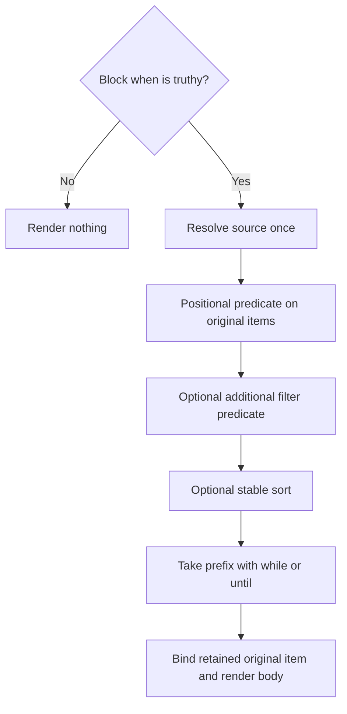

# Filter Directive

**Planned:** `::filter` and `::end-filter` are not implemented yet. This page
records their intended behavior.

Use `::filter` to render selected items from a typed collection. Its positional
function decides which items to keep; the body receives each retained original
item. In contrast, [map](./map.md) transforms each retained item before binding
it for the body. Both directives share collection types, options, local scope,
composition rules, and shell approval behavior.

## Syntax and a First Example

```md
::filter <source> "<pattern> => <predicate>" <optional options>
content using the retained item's local bindings
::end-filter
```

The quoted predicate is optional and positional; there is no `fn=` option.
Both `->` and `=>` are accepted with identical semantics in all anonymous
functions. Sources are written directly, such as `tasks`, `ctx.packages`,
`fm.tasks`, or `local.team.members`, without interpolation delimiters.

Sources initially support identifiers and dotted properties, including dashed
identifiers; bracket access, calls, and operators are not source syntax. Put the
optional positional function before named options. Callback and condition
values are quoted on one opener line. Unknown or duplicate options, bare flags,
extra positional arguments, and empty callback/condition values are errors,
even in a skipped region. Option names and ordering values are case-sensitive.

```md
---
$schema:
    tasks: "{ title: string(required), completed: boolean(required) }[](required)"
tasks:
    - { title: Write docs, completed: false }
    - { title: Publish release, completed: true }
---
::filter tasks "task => !task.completed"
- {{task.title}}
::end-filter
```

Output:

```md
- Write docs
```

The body receives the task object, not the predicate's boolean result.

Omitting the predicate is equivalent to `"i => true"`: retain every item and
bind it as `i`. This includes falsey items such as `0`, `false`, or null. An
explicit `"i => i"` instead retains only truthy items. Predicates use the
existing Darkmatter truthiness rules, rather than requiring boolean results.

## Iterable Sources and Types

Arrays and tuples yield their elements. Objects yield entries with the general
shape `{key: string, value: any}`; both fields are present, including when the
value is null. Declared value types are preserved: a dictionary of `Person`
values exposes `value: Person`. Differently typed object properties contribute
a union of value types.

The source needs a statically known iterable type from the effective schema,
a namespace declaration, or an enclosing local binding. Literal frontmatter
values alone do not establish that declaration.

| Source type or value | Behavior |
| --- | --- |
| Declared array, tuple, or object | Iterate its elements or entries |
| `any[]` | Iterable, with unknown element types |
| `any` alone | Does not establish static iterability |
| Union of iterable alternatives | Accepted, with combined item types |
| Optional or nullable iterable | Accepted; missing or null renders nothing |
| Empty iterable | Render nothing |
| Union containing a non-null scalar alternative | Needs a guard that establishes iterability |
| Non-null scalar at runtime | Error |
| Undeclared source | Static typing error by default |

A declared optional source's absence differs from an undeclared source. Normal
schema validation still rejects a missing required frontmatter property.
Null inside an array is an actual item and is tested normally, unlike a null
source, which has no items.

The planned `--allow untyped-filter-variables` recovery permits an untyped
source, with corresponding library policy support. It bypasses only the static
source-typing requirement; it does not make scalars iterable, waive expression
errors, or authorize shell commands.

## Predicate Binding and Destructuring

The positional parameter pattern binds the original item while the predicate
evaluates. If the predicate is truthy, that same original item supplies the
body's bindings. There is no mapping-result binding or transformation stage.

Shallow object destructuring is supported:

```md
---
$schema:
    scores: "{ Ada: number(required), Grace: number(required) }(required)"
scores: { Ada: 90, Grace: 70 }
---
::filter scores "{key,value} -> value >= 80"
- {{key}}: {{value}}
::end-filter
```

Output:

```md
- Ada: 90
```

The pattern binds the input entry, not the predicate's truthy result. Patterns
are nonempty with distinct identifier fields; extra input fields are allowed.
Aliases, quoted/computed keys, array patterns, nested patterns, defaults, rest
bindings, and trailing commas are outside the initial grammar. Missing
pattern fields are errors: reject provably incompatible input shapes
statically and check uncertain shapes at runtime.

Use `::map` when the body should receive a transformed value. A filter predicate
may compute a value to test its truthiness, but that value never replaces the
item in the body.

## The Local Namespace and Nesting

Bindings belong to the reserved `local` namespace:

| Reference | Resolution |
| --- | --- |
| `foo` | Nearest local `foo`, otherwise normal lookup |
| `local.foo` | Nearest local `foo` only |
| `fm.foo` | Frontmatter `foo`, even when shadowed by a local |

A local holding null still shadows frontmatter. Inner map or filter bindings
may shadow outer locals; leaving the inner scope restores the outer meaning.
Reserved namespaces and registered host globals cannot be shadowed. Bindings
never modify frontmatter or leak to siblings.

Given declared teams with `active`, `name`, and a typed `members` collection:

```md
::filter teams "team => team.active"
## {{team.name}}
::filter team.members "member => member.active"
- {{member.name}} belongs to {{team.name}}
::end-filter
::end-filter
```

The source and block-level `when` use the enclosing scope before the new item
binding exists. Each anonymous function has its own parameter scope; an
option's parameter does not introduce a body binding.

A transclusion inside the body can use locals in its target, condition, and
explicit child parameters. The included document does not inherit these local
bindings automatically. Pass iteration values through the existing `set`
options in [block transclusion](../transclusion/block-transclusion.md).
Ordinary frontmatter inheritance retains its existing behavior.

## Options and Evaluation Order

| Option | Meaning |
| --- | --- |
| `when="expression"` | Gate the entire block once using the enclosing scope |
| `filter="item => predicate"` | Additional per-item selection after the positional predicate |
| `sort="item => key"` | Sort selected original items by a computed key |
| `sort-order="asc"` or `sort-order="desc"` | Ascending by default; requires `sort=` |
| `while="item => predicate"` | Stop before the first falsey result |
| `until="item => predicate"` | Stop before the first truthy result |

All anonymous functions accept either arrow. `when` is an ordinary condition,
not an anonymous function. `while` and `until` are mutually exclusive. Options
other than the ordering of these operations do not depend on their textual
order in the directive.



A falsey `when` prevents all runtime source and item evaluation. If omitted,
the block is enabled. The positional predicate is evaluated once per visited
item; `filter=` is evaluated only when that first predicate is truthy. Both
conditions must pass. For example, assuming declared task fields:

```md
::filter tasks "task => !task.completed" when="show_tasks" filter="task -> task.priority > 0"
- {{task.title}}
::end-filter
```

Rejected items never reach sorting, stopping, or body rendering. All selectors
and stopping predicates receive original items, not predicate results. For
`[1, 2, 3, 4]`, either `while="i => i < 3"` or `until="i -> i == 3"` retains
`1, 2` when selection otherwise keeps all items. The stopping item is excluded.

Without sorting, processing is lazy: a stopping boundary prevents later item
predicates from running. Sorting examines all selected items first. Resolve
the source once per invocation and parse the expressions once. An inner filter
is a separate invocation for each reached enclosing iteration.

## Ordering and Sorting

Without sorting, arrays and tuples preserve element order and objects preserve
insertion order, including authored YAML key order. Selection preserves the
relative order of retained items.

For declared people with `active`, `name`, and numeric `age` properties:

```md
::filter people "person => person.active" sort="person -> person.age" sort-order="desc"
- {{person.name}}
::end-filter
```

Sort keys are computed once per selected item, before stopping. Numeric keys
compare numerically; string keys use case-sensitive, locale-independent
ordering. Equal keys preserve their previous order even in a descending sort.
Missing or null keys, boolean keys, mixed numeric/string keys, and object or array keys are
errors. Use an explicit fallback or normalization in the selector when needed,
such as `sort="person => lower(person.name)"`.

The comparator never executes expressions. Preserve source indices and object
keys through sorting so diagnostics identify the original data.

## Composition and Inserted Data

Maps, filters, and conditional regions share one Markdown-aware structural
traversal. Document frontmatter preparation finishes before body evaluation.
An outer false condition skips an inner filter; an inner condition can read an
outer iteration's local bindings. Iterations do not rerun frontmatter or
restart the whole document pipeline. Finish structural callbacks and body
preparation before ordinary body interpolation, then run the existing body
shell, link-resolution, transclusion, cleanup, and normalization stages. A later
predicate failure can prevent earlier bodies' shell commands from running.
Children retain existing concurrency and output placement. Explicit expression
effects, including `as_markdown()`, run when their expression evaluates.

Carry immutable lexical scopes and source provenance through interpolation,
shell handling, and transclusion. Repeated bodies remain authored templates.
Values interpolated into them retain data provenance and cannot become new
executable directives. Do not rescan concatenated output. This follows
[Inserted Text Is Data](./interpolation.md#inserted-text-is-data), including
its existing treatment of authored replacements and explicit `as_markdown()`.

## Validation and Shell Approval

Validation checks source types, predicate parameter patterns, expressions, and
body bindings without executing predicates or performing their effects.
Composition and DMLS use the same types and diagnostics. A predicate does not
replace the body's item type with the predicate result type. Existing static
call checks still apply inside skipped regions.

Every authored shell command requires explicit whitelist permission regardless
of selection conditions. For a string-typed `pkg`:

```md
::filter packages "pkg => starts_with(pkg, 'biscuit-')"
::shell just test {{pkg}}
::end-filter
```

The existing [shell approval system](./preflight-checks.md) requests permission
for the typed template `just test {{ string }}`, without enumerating packages or
executing the predicate. At each reached execution, the actual value passes
through existing template argument checks. A placeholder cannot add shell
operators, redirection, or additional commands. A type declaration establishes
an argument's type, not authorization. No filter-specific permission system
is introduced.

Local-dependent shell placeholders are execution-time values and require typed
template approval; their absence during discovery is not a missing-value error.
Unrelated approval-time placeholders retain their existing validation. Each
reached execution validates actual arguments, and a null argument is missing.
Unknown types retain the existing broad scalar fallback, not permission for null
or container arguments. Numeric constraints remain runtime validators behind
the existing string approval hole.

Repeated commands retain the request-wide shell result cache. Use
`::shell --no-cache` or `::shell-block no_cache=true` when each reached occurrence
must launch a fresh process. Authorization and argument checks precede reuse.

## Discovering Child Documents

This behavior is planned. Composition preflight can enumerate a typed
collection and evaluate supported read-side expressions to discover child
files. For example, declare `chapters` as `file[](required)` and populate it
with `chapters: "{{ find_files('./chapters/*.md') }}"`:

```md
::filter chapters
::file {{i}}
::end-filter
```

Preflight inspects candidate children before collection conditions, filtering,
or stopping can exclude them. It can therefore read files and evaluate
expressions needed to compute targets for items that rendering later skips.
The same rule applies when explicit parameters passed from locals determine a
child's own transclusions. Schema validation and DMLS remain passive; preflight
does not execute shell commands or render repeated bodies.

Targets that depend on pending shell output or other execution results that
discovery cannot faithfully produce fail during preflight. A declared type or
predicate refinement establishes file suitability, but does not replace target
discovery or authorize a command. At execution, each target must match the
discovered graph for its iteration scope; a newly encountered target fails
without late approval. Retaining the target graph does not promise to cache
arbitrary callback results.

## Failures, Limits, and Diagnostics

Source, predicate, pattern, sort, and stopping-expression failures fail
composition; there is no automatic skip-on-error behavior. Body directives
retain their existing failure policies and explicit recoveries. Missing/null
sources and empty selections render nothing. Already performed effects are
not rolled back if a later iteration fails.

Maps and filters share two budgets across expression calls, nested directives,
and transcluded documents:

- **100,000 item visits** by default. Rejected items count; later pipeline
  stages do not count the same visit again. Nested calls share the allowance.
- **16 MiB (16,777,216 bytes) of cumulative UTF-8 expansion work** by default.
  Count bytes materialized into collection expansions, including inserted
  expression, shell, and child output. Nested output counts again when copied
  into an enclosing expansion; cached fragments count whenever inserted.

For example, a 1 MiB inner expansion copied into an outer expansion consumes
2 MiB even if the final document contains only 1 MiB. Ordinary pipeline passes,
buffer reallocations, unrelated source text, and preflight copies add no charge.
Expression result arrays consume visits but are values, not rendered bytes.
These limits do not bound arbitrary allocations inside expression handlers or
subprocesses before their output reaches the document.

Library options and the planned CLI controls accept positive limits:

```sh
md compose report.md --max-iteration-visits 200000 --max-expansion-bytes 33554432
```

The byte flag takes an integer byte count. Zero, negative, and overflowing
values are rejected; there is no unlimited setting. Budget exhaustion fails
composition, including through nested expression fallbacks. An exactly full
budget succeeds; an append that would exceed it fails before the append.
Preflight does not spend the execution allowance. Existing transclusion depth
limits remain separate. Standalone expression sessions share the same default
visit limit across nested calls.

Diagnostics name the authored file, line, expression, original index or key,
and nested iteration path. Report static defects once; attach iteration
context to runtime failures. Sorting must not replace source positions with
output positions.

## Markdown Boundaries

The body repeats with its authored whitespace; no implicit separator is added.
Its newlines and blank lines repeat too. An empty filter removes its directive
region without adding a placeholder or blank line. Normal cleanup runs later.

Opening and closing directives occupy their own lines. `::end-filter` accepts
only trailing whitespace. Directive-looking text in fenced or indented code
blocks stays literal. Maps, filters, and conditional blocks must nest without
crossing boundaries. A mismatched closer reports its location and the still-open
inner block. Preserve list/block-quote container context and body indentation
through the shared structural scanner.

The shared scanner also pairs shell blocks. A repeated `::shell-block` keeps its
own `::end-block`; collection openers inside its command body are invalid.
Quoted map/filter pairs are active within matching blockquote containers,
including their full quote depth. Existing quoted `::block` examples remain
literal; use the collection's `when=` option for a quoted collection condition.
Match indentation relative to the Markdown container, and preserve loaded LF or
CRLF boundaries, including a closer at end of file without a final newline.
