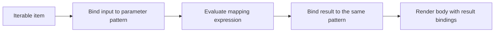
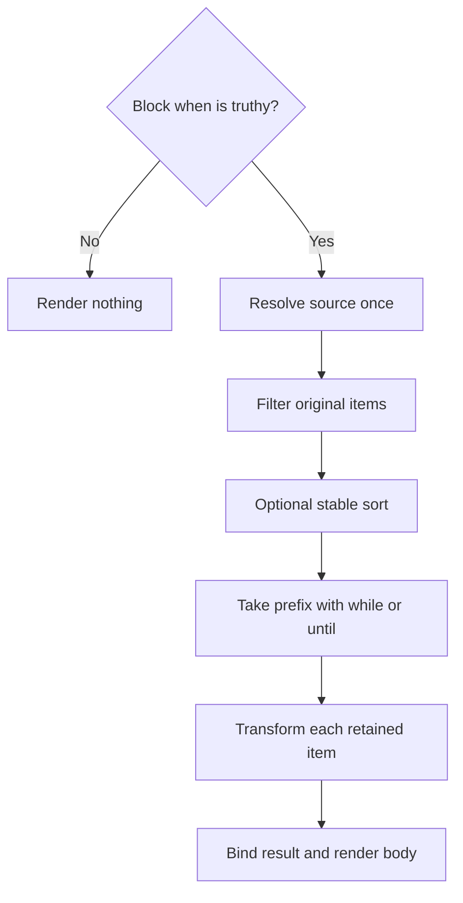

# Map Directive

Use `::map` when the body should receive a transformed item. The companion
[filter directive](./filter.md) selects items and exposes their original
values instead. Both share options, iterable types, local scopes, ordering,
composition, and authorization rules.

The map directive has this structure:

```md
<!-- start map block -->
::map <source> "<pattern> => <expression>" <optional filters> <optional sort>
<!-- mapped content block with local variable -->
- and don't forget: "{{i}}"
::end-map
```

- Like most other directives we have clear start (`::map`) and stop (`::end-map`) tokens which bound the mapping behavior.
- The central idea of this directive is to allow a Markdown author to iterate over [_iterables_](../iterables.md) and render them into the composed document with high precision.
- Just like all other block directives, the interior section can include any combination of other directives (e.g., conditional blocks, transclusion, etc.)

The quoted mapping function is optional and positional; there is no `fn=` option.
Both `->` and `=>` are accepted and have identical semantics in mapping,
filtering, sorting, and stopping functions. Sources are written directly, such as `data`,
`ctx.packages`, or `team.members`, without `{{ }}` interpolation delimiters.

Sources initially support identifiers and dotted properties, including dashed
identifiers; bracket access, calls, and operators are not source syntax. Put the
optional positional function before named options. Callback and condition
values are quoted on one opener line. Unknown or duplicate options, bare flags,
extra positional arguments, and empty callback/condition values are errors,
even in a skipped region. Option names and ordering values are case-sensitive.

## Expressions

The simplest expression is _no expression at all_ and the map directive allows for that. So this example is perfectly valid:

```md
---
$schema:
    data: string[](required)
data: ["foo","bar","baz"]
---
::map data
- {{i}}
::end-map
```

This example renders an unordered list of:

```md
- foo
- bar
- baz
```

And it does that with the help of the variable `i`. What is the variable `i`? Well it's the default name for the _local variable_ that will represent the value of each item in the iterable.

While simple is great, we often want to work with the iterable value before dropping into the render block:

```md
---
$schema:
    data: "{ name: string(required) }[](required)"
data:
    - { name: "foo" }
    - { name: "bar" }
    - { name: "baz" }
---
::map data "p => p.name"
- {{p}}
::end-map
```

In this example the underlying data we wanted to render was all nested inside the `name` property so we used an expression that offset the name property and gave us the value directly.

- you'll also notice that the expression named the variable `p` in this case which is entirely fine (so long as the variable is a valid variable name).
- this expression could just as easily used `i` as a variable and it would have made no difference.
- furthermore the example below would produce identical results:

    ```md
    ::map data "p => p"
    - {{p.name}}
    ::end-map
    ```

    In this example we don't offset in the block expression but instead do it in the render block's interpolation.

## Iterables

Any tuple, array, or key/value object is considered iterable. Arrays and tuples
yield their elements. Objects yield entries with the general shape
`{key: string, value: any}`:

```yaml
{ key: string(required), value: any }
```

Both fields are present on every entry, including when `value` is null. This is
the general shape, not a rule that erases the declared value type: a dictionary
of `Person` values yields entries whose `value` has type `Person`. For objects
with differently typed properties, the value type is the union of those
property types.

Without destructuring, use `i.key` and `i.value`:

```md
::map data
- {{i.key}} likes {{i.value}}
::end-map
```

So that means in the following Markdown:

```md
---
$schema:
    data: "{ foo: string(required), bar: string(required) }(required)"
data: { foo: "bar", bar: "baz"}
---
::map data "{key,value} => {key,value}"
- {{key}} likes {{value}}
::end-map
```

will produce the following results:

```md
- foo likes bar
- bar likes baz
```

## Iterable Variables

A map source must have a statically known iterable type at the iteration site.
That type can come from the effective schema, a namespace's type declaration,
or an enclosing local binding. Sources are not restricted to frontmatter.

For example, a namespace property declared as an array can be used directly:

```md
::map ctx.packages
- {{i}}
::end-map
```

The namespace's declaration determines the element type; the map does not
infer it from the property's name or rendered contents.

Frontmatter values alone do not establish a declared type for this requirement.
A literal list still needs a collection declaration in the effective schema.
The requirement applies to the source's type, not to whether every variable
referenced inside the body has a separate frontmatter schema entry.

That means in the following example Darkmatter would produce a `UntypedMapVariable` error:

```md
---
data:
    - foo
    - bar
    - baz
---
::map data "i => i"
- {{i}}!
::end-map
```

If you want to manually override this requirement you can use the `--allow untyped-map-variables` when calling compose from the CLI (or call `ComposeOptions::with_allow_untyped_map_variables(true)` in a library request).

This recovery bypasses the static typing requirement only. A missing
or null source renders nothing, as does an empty iterable. A non-null scalar
is an error. Map behavior does not waive ordinary schema validation: a missing
required frontmatter property still fails that validation.

The recovery's warning (`dm.collection.untyped_map_source`) is reported once,
at the source. When a later `::map` or `::filter` has a static defect, such as
a scalar source, composition fails before anything runs and the failure report
keeps the earlier warning ahead of the defect. A recovered source written after
the defect is not reported: the check stops at the first defect.

Below is an example of how you could make the first example pass without needing to overriding this requirement:

```md
---
$schema:
    data: string[](required)
data:
    - foo
    - bar
    - baz
---
::map data "i -> i"
- {{i}}!
::end-map
```

### Collection types and guards

- `any[]` is a known iterable type even though its elements are unknown.
- `any` alone does not establish iterability.
- A union whose alternatives are all iterable is accepted; its item type
  combines the possible element or object-entry types.
- Optional and nullable iterables are accepted without a guard. Missing and
  null sources render nothing.
- A union containing a non-null, non-iterable alternative, such as
  `string[] | string`, needs a guard that establishes iterability at the map site.
- An undeclared source remains a static typing problem; a declared source's
  permitted absence is not an undeclared binding.

For example, this nullable array renders nothing without needing a guard:

```md
---
$schema:
    names: string[] | null
names: null
---
::map names
- {{i}}
::end-map
```

### Nested sources

Local bindings retain their types, so a nested map can iterate over a property
of the enclosing item:

```md
---
$schema:
    teams: "{ name: string(required), members: { name: string(required) }[](required) }[](required)"
teams:
    - name: Platform
      members:
          - name: Ada
          - name: Grace
---
::map teams "team => team"
## {{team.name}}
::map team.members "member => member"
- {{member.name}}
::end-map
::end-map
```

Here, `team.members` inherits its iterable type from the element declaration of
`teams`; it needs no separate frontmatter declaration. Bindings are local to
their iteration's body and nested regions and do not modify frontmatter or
leak into subsequent siblings.

### The local namespace

Map bindings belong to the reserved `local` namespace. Bare names prefer the
nearest local binding over a frontmatter property of the same name:

| Reference | Resolution inside a map body |
| --- | --- |
| `foo` | Nearest local `foo`, otherwise normal lookup |
| `local.foo` | Nearest local `foo` only |
| `fm.foo` | Frontmatter `foo` only |

For example, a body can render `{{foo}}` or `{{local.foo}}` for its mapped value
and `{{fm.foo}}` for the document's value. A local binding holding null still
shadows frontmatter; lookup tests binding presence, not truthiness.

Inner maps or filters may shadow outer locals. Leaving the inner scope restores the outer
meaning, and unshadowed outer locals remain accessible. Reserved namespaces
and registered host globals cannot be shadowed.

The source and block-level `when` resolve in the enclosing scope before the
new iteration binding exists. Each anonymous function introduces its own
parameter binding locally; a parameter in `filter=` does not create a binding
in the body. The mapping result supplies the body's bindings.

Implementation uses immutable lexical scope frames shared by expression
evaluation and static type checking, rather than writing locals into
frontmatter.

### Transclusion boundary

A transclusion directive inside the map can read locals in its target,
condition, and explicit child parameters. The included document receives
iteration values through those explicit parameters; it does not automatically
inherit the map's `local` bindings. Existing frontmatter inheritance retains
its established behavior. Use the existing `set` options described in
[block transclusion](../transclusion/block-transclusion.md) to pass values.

## Map Function

An optional mapping function has two responsibilities:

- identifies the local binding pattern for each iteration
- transforms each input into the value used to render the body

Omitting the function is equivalent to `"i => i"` (or `"i -> i"`): the identity
mapping preserves the input's shape and type and exposes it as `i` in the body.

The parameter pattern binds the input while evaluating the expression, then
binds the expression's result for rendering the body. Thus, in `p => p.name`,
`p` is the input object inside the expression and the resulting name inside
the body. The body's binding has the result's type, not the input's type.



A nested map over a transformed value or one of its properties is valid only
when the resulting type is known to be iterable, subject to the same guard and
recovery rules as any other source.

### Destructuring

The initial design supports shallow object destructuring, such as
`{key,value}`. Patterns are nonempty and contain distinct identifier fields.
Aliases, quoted/computed keys, array patterns, nested patterns, defaults, rest
bindings, and trailing commas are outside the initial grammar. Extra input
fields are allowed. Object expressions support the shorthand `{key,value}` for
`{key: key, value: value}`.

For the string-valued `data` object above, this mapping exposes the transformed
fields to the body:

```md
::map data "{key,value} => {key, value: upper(value)}"
- {{key}} likes {{value}}
::end-map
```

The body's `value` is uppercase; it is not the original input field. In
contrast, `"{key,value} => value"` is invalid for that object because the
result is a string and cannot satisfy the `{key,value}` pattern. Both input
and result must supply the fields the pattern binds. Provably incompatible
shapes are rejected statically; uncertain shapes must be checked at runtime.

## Sorting

Without explicit sorting, arrays and tuples preserve element order, and
objects preserve insertion order. For authored YAML, object insertion order
is the order of keys in the document. Loading and composition must preserve
this order across platforms; underlying map storage must not silently replace
it with a different ordering. Filtering preserves relative order.

The optional `sort` function selects a key from each original item after
filtering:

```md
::map people "person => person.name" sort="person => person.age"
- {{person}}
::end-map
```

This example assumes `people` has a declared iterable type whose elements have
string `name` and numeric `age` properties.

| Situation | Behavior |
| --- | --- |
| Default direction | Ascending |
| Direction | `sort-order="asc"` (default) or `sort-order="desc"`; requires `sort=` |
| Equal keys | Stable: preserve their previous relative order |
| Numeric keys | Numeric comparison |
| String keys | Case-sensitive, locale-independent comparison |
| Missing or null key | Error; provide an explicit fallback if needed |
| Mixed numeric and string keys | Error; no implicit comparison-type conversion |
| Boolean, object, or array key | Error |

For case-insensitive sorting, select a normalized key explicitly:

```md
::map people "person => person.name" sort="person -> lower(person.name)"
- {{person}}
::end-map
```

Compute each retained item's key once, validate the keys, and perform a stable
sort. The comparator never evaluates expressions. Sorting examines all
filtered items even if a stopping predicate later renders only a short prefix.

## Conditions, Filtering, and Stopping

### Block condition: `when`

`when` is a block-level condition, consistent with other directives. It is an
ordinary condition expression, not an anonymous function. Evaluate it once in
the enclosing scope, before resolving the source. If falsey, render nothing
and perform no runtime source evaluation, item selection, sorting,
transformation, or body processing. Omitting `when` enables the block.

```md
::map tasks "task => task.title" when="show_tasks" filter="task => !task.completed"
- {{task}}
::end-map
```

Here, `show_tasks` gates the whole block. The example assumes declared task
elements with `title` and `completed` properties. Passive validation and shell
authorization still apply to authored content in a skipped block.

### Item selection: `filter`

`filter` evaluates an anonymous function against each original item and retains
truthy results. It accepts both `filter="task => !task.completed"` and
`filter="task -> !task.completed"`. Omission retains all items.

Filtered-out items never reach sorting, stopping predicates, mapping, or body
rendering. All predicates use Darkmatter's existing truthiness rules.

### Prefix selection: `while` and `until`

Stopping predicates inspect original items after filtering and sorting, before
mapping or rendering the current item:

- `while`: continue while the predicate is truthy; exclude the first falsey
  item and stop.
- `until`: continue while the predicate is falsey; exclude the first truthy
  item and stop.

Both take anonymous functions with either arrow. They are mutually exclusive;
either may be combined with `filter`. For the source `[1, 2, 3, 4]`:

| Option | Items rendered |
| --- | --- |
| `while="i => i < 3"` | `1, 2` |
| `until="i -> i == 3"` | `1, 2` |

Evaluate the stopping predicate once per reached item. The stopping item's
mapping expression and body are not evaluated, and no later stopping
predicates are evaluated. An item removed by `filter` cannot stop the map.

## Pipeline Sequencing

The logical order is:



Filters, sort selectors, and stopping predicates receive original items. Only
the body's bindings receive mapped results. A type those predicates prove about
an original item, through an object parameter or a destructured field, holds
for the mapping expression; the mapped result is a new binding that keeps a
proven type only where the mapping expression carries it. Preserve original source indices
or object keys alongside items through filtering and sorting.

Without sorting, process items lazily so the stopping boundary prevents
evaluation of later items, including later filters. Sorting requires examining
the filtered collection first. Transform and render retained items in order.
Parse expressions once and resolve the source once per map invocation; a
nested map is invoked separately for each reached enclosing iteration.

### Structural traversal

Conditional, map, and filter regions share one structural traversal. An outer false
condition suppresses a nested map, while an inner condition sees its enclosing
iteration's bindings:

```md
::block when="show_teams"
::map teams "team => team"
## {{team.name}}
::block when="team.active"
::map team.members "member => member"
- {{member.name}}
::end-map
::end-block
::end-map
::end-block
```

Parse authored regions into a nested tree, finish the document's frontmatter
preparation, then traverse body regions in source order with their lexical
scopes. Evaluate a region's gate before entering it. For each retained map
item, traverse the authored body with that iteration's result bindings.

Preserve the scope and source provenance for later interpolation, shell, and
transclusion stages. Reuse the existing expression evaluator, condition
semantics, and composition request. An iteration does not restart the full
document pipeline or rerun frontmatter preparation. Finish structural callback
evaluation and body preparation before ordinary body interpolation, then run
the existing body shell stages, link resolution, transclusion, cleanup, and
normalization. A later callback failure can prevent earlier bodies' shell
commands from running. Child transclusions retain existing concurrency and
output placement. Explicit effects invoked by an expression, including
`as_markdown()`, still run when that expression evaluates.

### Authored syntax and inserted data

Repeated bodies remain authored templates. Values supplied by iteration
bindings retain their data provenance and do not become new executable syntax
merely because the body interpolates them. This extends the existing
[Inserted Text Is Data](./interpolation.md#inserted-text-is-data) contract.

For example, a data value containing `::shell echo unexpected` is inserted as
text by `{{i}}`; it does not become a command. A directive authored in the body
can still receive a local value:

```md
::map documents "doc => doc"
::file {{doc.path}}
::end-map
```

The authored `::file` directive executes through normal transclusion rules;
interpolation supplies only its target. Reuse the parsed authored template for
each iteration, retain source spans and data-origin markers, and never feed
concatenated expanded output back through directive discovery.

Authored frontmatter expressions still execute during frontmatter preparation,
and authored text replacements retain their existing behavior. Explicit
`as_markdown()` remains the way to deliberately compose supplied text under
the request's existing permissions and recursion budget. Ordinary Markdown
rendering of inserted content follows the existing rendering rules.

## Validation and Shell Approval

Map validation is passive. It checks the source's iterable type, derives
parameter types for each anonymous function, checks mapping-result
destructuring, and validates the body with the resulting local types. It does
not execute map computations. Composition and DMLS share this type scope and
diagnostic logic. Existing static call checks still reject provably invalid
calls in skipped regions.

Shell authorization remains owned by the existing
[preflight approval system](./preflight-checks.md). All authored shell commands
require explicit whitelist permission regardless of `when`, `filter`, `while`,
or `until`. Conditions govern execution, never authorization. No map-specific
permission system is introduced.

For a local `pkg` declared as a string:

```md
::map packages "pkg => pkg"
::shell just test {{pkg}}
::end-map
```

The approval request describes the typed template `just test {{ string }}`. It
does not require enumerating package names or separately approving every
iteration. The type comes from the local binding's declaration; that type is
not itself permission to execute the command.

Integrate local type scopes with existing template approval and argument
validation. Each reached execution supplies its actual value through those
checks. A placeholder fills an argument and cannot introduce shell operators,
redirection, or additional commands. Approval covers the template across
iterations; runtime conditions determine which approved executions occur.

Local-dependent shell placeholders are execution-time values and require typed
template approval; their absence during discovery is not a missing-value error.
Unrelated approval-time placeholders retain their existing validation. Each
reached execution validates actual arguments, and a null argument is missing.
Unknown types retain the existing broad scalar fallback, not permission for null
or container arguments. Numeric constraints remain runtime validators behind
the existing string approval hole.

Repeated commands retain the request-wide shell result cache. Use
`::shell --no-cache` or `::shell-block no_cache=true` when each reached occurrence
must launch a fresh process. Authorization and argument checks precede reuse.

## Discovering Child Documents

Composition preflight can enumerate a typed
collection and evaluate supported read-side expressions to discover child
files. For example, declare `chapters` as `file[](required)` and populate it
with `chapters: "{{ find_files('./chapters/*.md') }}"`:

```md
::map chapters
::file {{i}}
::end-map
```

Preflight inspects candidate children before collection conditions, filtering,
or stopping can exclude them. It can therefore read files and evaluate
expressions needed to compute targets for items that rendering later skips.
The same rule applies when explicit parameters passed from locals determine a
child's own transclusions. Schema validation and DMLS remain passive; preflight
does not execute shell commands or render repeated bodies.

Targets that depend on pending shell output or other execution results that
discovery cannot faithfully produce fail during preflight. A declared type or
predicate refinement establishes file suitability, but does not replace target
discovery or authorize a command. At execution, each target must match the
discovered graph for its iteration scope; a newly encountered target fails
without late approval. Retaining the target graph does not promise to cache
arbitrary callback results.

## Failures, Limits, and Diagnostics

| Situation | Behavior |
| --- | --- |
| Missing or null source, empty iterable, or no selected items | Render nothing |
| Non-null, non-iterable source | Error unless an enclosing gate prevents runtime evaluation; static checks still apply |
| Invalid mapping result or failed destructuring | Fail composition |
| Filter, sort, or stopping expression fails | Fail composition |
| Body processing fails | Follow the existing directive's failure policy |

There is no automatic skip-on-error behavior. Existing explicit recovery
options retain their meaning. A failed map does not report earlier rendered
iterations as a successful composition. Effects already performed, such as
commands in earlier iterations, are not rolled back.

Maps and filters share two budgets across expression calls, nested directives,
and transcluded documents:

- **100,000 item visits** by default. Rejected items count; later pipeline
  stages do not count the same visit again. Nested calls share the allowance.
- **16 MiB (16,777,216 bytes) of cumulative UTF-8 expansion work** by default.
  Count bytes materialized into collection expansions, including inserted
  expression, shell, and child output. Nested output counts again when copied
  into an enclosing expansion; cached fragments count whenever inserted.

For example, a 1 MiB inner expansion copied into an outer expansion consumes
2 MiB even if the final document contains only 1 MiB. Ordinary pipeline passes,
buffer reallocations, unrelated source text, and preflight copies add no charge.
Expression result arrays consume visits but are values, not rendered bytes.
These limits do not bound arbitrary allocations inside expression handlers or
subprocesses before their output reaches the document.

Library options (`ComposeOptions::with_max_iteration_visits` and `with_max_expansion_bytes`, both taking `NonZeroU64`) and the CLI controls accept positive limits:

```sh
md compose report.md --max-iteration-visits 200000 --max-expansion-bytes 33554432
```

The byte flag takes an integer byte count. Zero, negative, and overflowing
values are rejected; there is no unlimited setting. Budget exhaustion fails
composition, including through nested expression fallbacks. An exactly full
budget succeeds; an append that would exceed it fails before the append.
Preflight does not spend the execution allowance. Existing transclusion depth
limits remain separate. Standalone expression sessions share the same default
visit limit across nested calls.

Diagnostics identify the authored file, line, and expression span, plus the
original source index or object key and any enclosing iteration path. For
example, `teams[2] → members[4]` identifies the input locations even after
sorting. Static authoring errors are reported once; runtime failures identify
the iteration that exposed them, whichever stage failed: a callback, a `when=`
gate, a `{{ }}` expression, a shell argument or its output, a `::file` target,
condition, or child, or an allowance. The library's typed error and
`md compose --output report-json` carry the same fields; see
[the report](../cli/report-json.md#failures-inside-map-and-filter-bodies).

## Markdown Boundaries

Preserve the authored body's whitespace without inserting implicit separators:

```md
::map names
- {{i}}
::end-map
```

Each repeated body includes its authored newline, so this produces consecutive
list items. A blank line inside the body repeats too. An empty map removes its
directive region without adding a placeholder or blank line. Existing cleanup
rules apply afterward.

- Opening and closing directives occupy their own lines.
- `::end-map` accepts only trailing whitespace.
- Directive-looking text in fenced or indented code blocks remains literal.
- Maps, filters, and conditional blocks must nest correctly; their boundaries cannot cross.
- Body indentation is preserved so repeated content can participate in lists
  and blockquotes.

For example, the following has a mismatched closing directive:

```md
::map items
::block when="enabled"
::end-map
::end-block
```

Report the unexpected closer and identify the still-open inner block. Use the
same Markdown-aware structural scanner for maps and conditional regions,
retaining source spans and container context rather than discovering map
boundaries with a separate regular-expression pass.

The shared scanner also pairs shell blocks. A repeated `::shell-block` keeps its
own `::end-block`; collection openers inside its command body are invalid.
Quoted map/filter pairs are active within matching blockquote containers,
including their full quote depth. Existing quoted `::block` examples remain
literal; use the collection's `when=` option for a quoted collection condition.
Match indentation relative to the Markdown container, and preserve loaded LF or
CRLF boundaries, including a closer at end of file without a final newline.
