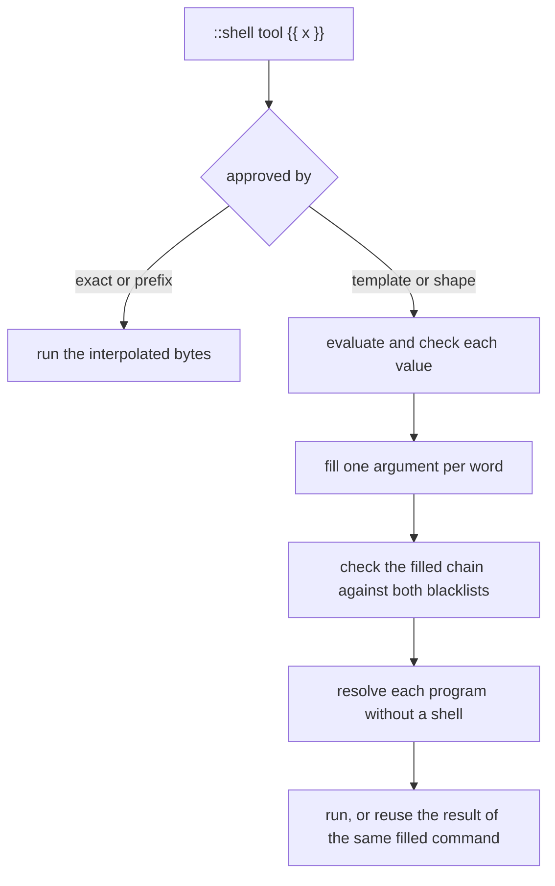
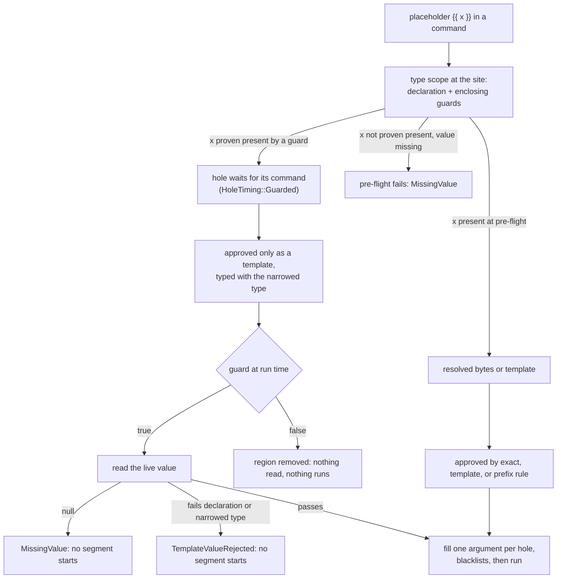

# Pre-Flight Shell Approval

A shell template lets you approve a command whose arguments may change between runs. For example, `template just clean --out {{ string }}/build` permits the same command structure with a different output directory. Each value is checked before it fills one argument; it cannot add shell syntax.

Every command still passes through pre-flight approval. This page explains exact, program-wide, and typed-template rules, what the approval prompt offers, and the checks that remain when an approved command runs.

## Why This Exists

Shell commands can appear in these places during Darkmatter composition:

1. **`::shell` directives** — inline shell expansion in the document body
2. **`::shell-block` / `::end-block` directives** — multi-command sequential execution
3. **Frontmatter `$(cmd)` expressions** — shell expansion in top-level frontmatter string values
4. **Lifecycle actions** — `shell` and whole-value `$( … )` commands in lifecycle `set` actions; see [Lifecycle](../topics/lifecycle/index.md). Initialization remains shell-free.

Without pre-flight approval, an unguarded shell directive could execute destructive or unintended commands during what should be a safe document composition.

## Approval vs Execution

Pre-flight separates two concerns that used to be conflated:

- **The approval set is condition-blind.** Collection walks frontmatter, body
  `::shell`/`::shell-block`, and the transclusion graph **without** evaluating
  any `when=` or page-block condition. Both sides of every `$(...)` ternary,
  every `::block` (even `when=`-false ones), and every conditionally-transcluded
  document contribute their commands. The set is deduped by normalized command
  string and approved **once, up front**, in a single batched prompt.
- **The execution set is condition-aware.** Each shell stage runs only the
  commands whose branch is actually reached given the document's final state
  (after page blocks have pruned dead regions and frontmatter is resolved).

The governing invariant is:

```
execution_set ⊆ approval_set      (always)
```

At execution, membership must match the approved bytes or typed shape. A shape
member still needs value validation, blacklist checks, and direct-target
validation before execution or result reuse. Re-preparing a document with
changed state requires another audit; an exact decision cannot cover new bytes.
A dead-branch command is **approved but never executed**.

### Missing values

A shell command never runs with a missing value. A placeholder is missing
when its expression evaluates to `null`, which is also what an absent
property reads as. Pre-flight evaluates every placeholder of every
`::shell`, `::shell-block`, and frontmatter `$( … )` command, in every
branch, and fails with `MissingValue` before any command runs:

```md
---
target: null
---
::shell ls {{ target }}
```

```text
shell command 'ls {{ target }}' reads 'target', which is missing (line 4)
```

An empty string, `0`, and `false` are present, and so is a fallback that
yields a value (`{{ target || 'src' }}`). The error names the command and
the expression, never the value. Like `NotPreApproved`, it always fails the
composition: no `--when-error`, timeout fallback, transclusion notice, or
`as_markdown(…) || fallback` absorbs it. Everywhere outside a shell command
(body text, other frontmatter), `null` still renders as an empty string.

Collection resolves every transclusion target the way composition does, from
the same repository-aware context, so a `::file &README.md` or
`::file ^docs/guide.md` reaches the same file in both, whatever directory `md`
was launched from.

Collection walks each transcluded child with the inputs composition gives it:
the parent's composed values as inherited defaults, the directive's `set.*`
overlay on top, and the same replace settings. So a partial's
`::shell git show {{ base }}` is approved with the `base` its parent resolved,
whether that value was a parent default, derived from another key, or supplied
by the caller. A remote (`::url`, `https://`) child composes with its parent's
options only, and is collected the same way.

A miss surfaces as `NotPreApproved`, which after collection is purely a bug
sentinel. It always fails the composition: the transclusion stage does not
replace the failing child with a "could not transclude" notice, a
`when_error` fallback does not apply (it covers a command that ran and
failed), and an `as_markdown(…) || fallback` does not fall back. A
user-authored command whose shape depends on a frontmatter value still pending
frontmatter-shell expansion (the chicken-and-egg case) is rejected up front as
`DynamicCommandShape` rather than surfacing as a late `NotPreApproved`; the
same holds in a child that inherits the pending value.

Content passed to `as_markdown(...)` is part of the graph. Preflight never
composes it: statically known content (string-literal arguments, in every
branch, and arguments discovery can evaluate) is walked like a transcluded
child, relative to the root document. Discovery answers shell probes
(`has_alias`, `has_builtin_function`, `has_user_function`, `can_execute`) with
`false`, returns `""` for `as_markdown`, and answers `ping`/`ping_under` with
`null`, and observes no lazy `current.*` value, so a command,
transclusion target, or nested content whose shape depends on one of those is
rejected up front as `UnevaluatedDependencyShape`. That includes reading one
indirectly: through a frontmatter value that reads it, in the same document or
inherited by a transcluded child. A caller override of that frontmatter value
makes the command approvable again.

```md
---
flag: "{{ has_alias('ll') }}"
---
::shell echo alias-{{ flag }}   <!-- UnevaluatedDependencyShape: frontmatter.flag -->
```

## ICMP Effects

Shell commands are not the only approvable effect. `ping` and `ping_under` are
network effects under their own grant, and the same condition-blind walk
reports them on `ComposePreflightReport::icmp_probes` — typed
`PlannedIcmpProbe` records (function, target, per-attempt timeout, attempt
count, and whether a grant already permits the target), not command strings.
Collecting them sends no packet: discovery records the plan and answers `null`.
A probe inside `as_markdown` content is discovered the same way, because that
content is walked as a child of the document that named it.

The grant itself comes from `--allow host=HOST` (`ComposeOptions::with_allowed_host`),
which is one entry point for two disjoint policies:

- An **exact IP literal** grants ICMP to that address and, as before, HTTP to
  that exact host. A grant that spells an IPv6 zone (`fe80::1%en0`) permits
  only that zone; an unscoped one permits any.
- A **strict CIDR** grants ICMP to every address whose bits fall inside it, of
  that family only. It authorizes no HTTP at all — no URL host can spell a
  range — so it is withheld from the fetch allowlist rather than left to fail
  an exact-string comparison.
- A **hostname or wildcard** grants HTTP only. It never authorizes an address
  indirectly.

At runtime the actual target is revalidated against the grant before anything
is sent. An ungranted target answers `null` and records one compose warning,
having sent nothing — even for a multi-attempt call. Evaluating an expression
never acquires consent as a side effect, and a nested `as_markdown` child runs
under the root's grants rather than its own.

`md compose --shell` prints the discovered ICMP probes alongside the shell
approval candidates.

## Security Policy

Darkmatter uses a two-stage security design:

1. **Global blacklist** — a built-in set of commands that are never allowed, regardless of user configuration
2. **User-controlled whitelist/blacklist files** — per-repo or per-user allow/deny lists

Every shell command discovered during composition is checked against these layers in order. The first matching layer determines the outcome:

- **Blacklisted** → immediate compose error
- **Not on host** → immediate compose error (command executable not found)
- **Whitelisted** → approved, execute normally
- **Unknown** → interactive approval prompt (or deny in non-interactive contexts)

### Blacklisted Commands and Syntax

The following commands will never be allowed:

- `rm`, `rimraf`, `find*-delete`, `unlink`, `shred`, `wipe`
- `echo* >>*`, `echo* >*`, `* >*`
- `install`
- `brew`, `apt`, `nala`, `pacman`, `dnf`, `yum`
- `npm uninstall`, `pnpm uninstall`, `bun uninstall`, `yarn uninstall`
- `npm install`, `pnpm install`, `bun install`, `yarn install`
- `npm add`, `pnpm add`, `bun add`, `yarn add`
- `mv`, `dd`
- `zfs`, `zpool`, `wipefs`, `mkfs*`, `parted`, `mparted`, `sgdisk`
- `pvcreate`, `lvremove`, `vgremove`, `mdadm`, `cryptsetup`
- `chmod`, `chgrp`, `chown`, `setfacl`
- `tar`, `unzip`, `rsync`, `cp`
- `kill`, `pkill`, `killall`
- `systemctl`
- `shutdown`, `reboot`, `poweroff`, `halt`, `init`
- `git reset`, `git clean`, `git checkout`, `git restore`, `git rebase`, `git branch`, `git push`, `git reflog`, `git gc`
- `psql -c`, `mysql -e`, `redis-cli FLUSH*`, `mongosh --eval`
- `ssh`, `scp`, `rsync`, `ansible`
- `curl`, `wget`, `http`
- `source`, `eval`, `sudo`, `doas`, `su`
- `docker rm*`, `docker system prune*`, `docker volume rm*`, `docker volume prune*`
- `kubectl delete*`, `helm uninstall*`, `terraform destroy*`

### Whitelist and Blacklist Files

Approved commands are stored in a namespaced whitelist file, and a companion
blacklist file tracks user-denied commands. `md compose` keeps both beside the
document, or in the directory `md` was launched from when the document comes
from stdin:

```text
docs/guide.md          → docs/.darkmatter-shell-whitelist, docs/.darkmatter-shell-blacklist
md compose - (in ~/w)  → ~/w/.darkmatter-shell-whitelist,  ~/w/.darkmatter-shell-blacklist
```

A library caller that sets no policy root (`ComposeOptions::with_shell_policy_root`)
gets the request context's repository root, else its home directory, else the
request directory. Pre-flight and execution read the same files.

#### File format

Each file is UTF-8 text with one rule per line. Blank lines and lines starting
with `#` are ignored.

```text
# whitelist
exact just ci-local --plan
prefix ls
template just clean --out {{ string }}/build
```

| Rule | Matches |
|------|---------|
| `exact <command>` | that command, argument for argument |
| `prefix <executable>` | the executable with any arguments |
| `template <shape>` | a command with the same argument list, where each `{{ type }}` hole stands for one argument value of that type |

Matching compares parsed arguments: quoting and whitespace variants have the
same shape, but changing a literal, argument count, hole position, chain
operator, or ordered redirection changes it. For example, `tool "{{ x }}"`
and `tool {{ x }}` share a shape; `tool prefix-{{ x }}` needs a rule retaining
that literal prefix. Adjacent holes such as `{{ x }}{{ y }}` stay in one word.

Before considering guard refinements, only a bare top-level property (`out`
or `fm.out`) gets its declaration from the effective schema of the document that owns the command. Named declarations
resolve there, including in a transcluded child with its own schema. Other
expressions (`env.OUT`, `last(seq.outputs)`, `out || 'dist'`), undeclared properties,
and schemas without a SimplifiedSchema projection use a broad `string` hole.

| Rule hole | Candidate declaration | Covered? |
| --- | --- | --- |
| `string` | any declaration | yes; its original validator still applies |
| `alphanumeric(allow-slashes)` | `alphanumeric` | yes, the declaration is narrower |
| `alphanumeric` | `alphanumeric(allow-slashes)` | no |
| `alphanumeric` | `string`, a number, or a union | no |

Constraints such as `min(3)` remain runtime validators and are omitted from the
saved shape. Numeric and union declarations save a `string` hole; the prompt
discloses their retained validator. A rule never narrows a broad declaration
by inspecting today's value.

A `template` hole holds one type with its options and nothing else:
`{{ string }}` or a narrower string-like type such as
`{{ alphanumeric(allow-slashes) }}`. A literal containing spaces, quotes,
braces, or shell characters is double-quoted, with `\\`, `\"`, `\{`, `\}`,
`\n`, `\r`, and `\t` as escapes. To store literal braces rather than a
placeholder, escape them: `"\{\{ x \}\}"` represents the literal argument
`{{ x }}`. Unescaped braces inside a quoted rule literal are rejected.
A line the loader cannot read is skipped with a warning naming the file and line, and the other rules still load. These
template lines are skipped:

| Line | Why |
|------|-----|
| `template build {{ alphanumeric(allow-slashes; min(3)) }}` | a constraint |
| `template build {{ alphanumeric(min(3)) }}` | a constraint, written without `;` |
| `template build {{ number }}` | not a string-like type |
| `template build {{ slug }}` | a named type |
| `template {{ string }} run` | a hole in the program word |

In the blacklist, a `template` line blocks any command whose arguments it
matches, whatever the hole types: `template deploy {{ string }}` blocks
`deploy prod`, including a command written without any placeholder. A
single-command rule blocks that command anywhere in an `&&`/`||` chain.

A whitelist `template` rule approves a command at pre-flight when no `exact`
rule covers its bytes: an `exact` rule wins, then a `template` rule, then a
`prefix` rule. The approval records the command's shape, not its bytes, and
the command then runs as a template.

### Running a command as a template

A command with a placeholder runs one of two ways, decided by what approved
it:

| Approved by | Runs as |
|-------------|---------|
| an `exact` rule, an earlier exact decision, or a `prefix` rule | its **resolved bytes**: the text after interpolation, split into words, exactly as before templates existed |
| a `template` rule, an earlier shape decision, or the "this command shape" choice | a **template**: each placeholder fills exactly one argument |

A command can also run only as a template: when a value it reads is produced
later in the run (see [Late values](#claudinedarkmatter-boundary)), or when a
value holds quotes, operators, or other command syntax so the interpolated
text no longer reads as a command. Such a command is approved by its shape,
or by `prefix` rules for its programs, never by bytes.

```md
---
dir: "a b"
---
::shell ls {{ dir }}/build
```

With `exact ls a b/build` this runs `ls` with the two arguments `a` and
`b/build`. With `template ls {{ string }}/build` it runs `ls` with the one
argument `a b/build`.

A single argument can still select a program option. For example, a value
beginning with `-` may be treated as a flag by its program. Use `--` before
value arguments where the program supports it, and choose a restrictive type
when approving a reusable operation.

When the bytes are split into words, a quoted empty word (`""` or `''`) is
one empty argument, and the exact key spells it `""`. An unquoted placeholder
that resolves to an empty string adds no word, as in a shell:

```md
---
msg: ""
---
::shell git commit -m "{{ msg }}"
::shell git commit -m {{ msg }}
```

The first line's exact key is `git commit -m ""`, and `git` receives an empty
third argument. The second line's key is `git commit -m`, and `git` receives
two arguments. Neither key approves the other command, and an older
`exact git commit -m` rule never approves the quoted form. The same spelling
is used for every key a resolved command or a filled template is matched
against, blacklist `exact` rules included.

In template mode, before anything runs:

1. **Every placeholder expression is evaluated once** against the document's
   current state and checked; when the same expression fills several
   arguments, that one checked value fills each of them. `null` is a missing
   value (`MissingValue`). An array or
   object, or a string holding a NUL byte, is refused, even under a `string`
   rule. The original value must pass the placeholder's declared type,
   constraints included (`min`, `pattern`, …); nothing is converted first, so
   a number never passes `alphanumeric`. A placeholder typed by a recursive
   named type (`data: [string, number, "{ items: data[] }"]`) is checked
   against that type's definition: with `value: data(required)`, `3` and
   `"a b"` pass `{{ value }}`. A placeholder typed under a guard
   (see [Guarded values](#guarded-values)) must also pass the type
   the guard narrowed it to. A refused value fails with
   `TemplateValueRejected`, which names the placeholder and its declared type
   and never shows the value.
2. **The value becomes text** (a string as is, a number or boolean as written)
   and joins the literal text of its word: `{{ dir }}/build` is one argument,
   `{{ a }}{{ b }}` is one argument, and an empty value is one empty argument.
   The value is never read again for spaces, quotes, operators, or
   placeholders.
3. **The whole filled command is checked** against the built-in blacklist and
   then the user blacklist, every segment of an `&&`/`||` chain before the
   first starts. `template git {{ string }}` therefore cannot run
   `git reset`.
4. **Each program is found without a shell.** It must be on `PATH` and run
   natively: on Windows an `.exe` or `.com`, never a `.cmd` or `.bat`; on Unix
   a native executable or a `#!` script, never a file the system would hand to
   `/bin/sh`. A shell builtin or alias is not found. A refusal is
   `TemplateTarget`.

These four failures, and `MissingValue`, are not command failures: no
`--when-error` handler, allowed timeout, or transclusion notice absorbs them.
A command's result is cached for the composition by its filled program and
argument list, so the same approval with different values runs again, while
the same filled command runs once.

Authorization and results are separate caches. Authorization includes the
execution mode, policy root, and typed shape or exact bytes. A result hit grants
no permission: the current template is filled and validated, and the runtime
blacklist and target checks run before a result can be reused. A saved shape
contains no runtime values.

Template grammar permits fixed program words, literal argument fragments,
placeholders, `&&`/`||`, and only `> /dev/null`, `2> /dev/null`, `2>&1`, and
`>&2` redirections. Pipes, semicolons, background execution, append/input
redirection, and variable program words or redirect targets are refused in
template mode, including under prefix or once approval. Values containing
those characters are still argument data. Redirection order matters:
`2>&1 > /dev/null` keeps stderr on the original stdout destination;
`> /dev/null 2>&1` discards both.

The shell runtime rejection chain omits a refused value. Earlier document
schema validation has its own diagnostics and may display that value; this
is not a secrecy guarantee for every composition error.



## Interactive Approval

When a command does not match the blacklist and is not in the whitelist, and
both stdin and stderr are terminals, `md` asks about it on stderr. The prompt
lists only the choices the command is eligible for, numbered in this order:

| Choice | Listed when | Saves |
|--------|-------------|-------|
| Allow this exact command | resolved-byte approval is eligible and every value is known now | `exact <resolved command>` to `.darkmatter-shell-whitelist` |
| Allow this command shape | the command has a placeholder and valid template grammar | `template <shape>` to `.darkmatter-shell-whitelist`; the command runs as a template |
| Allow this program with any arguments | every program word is fixed | `prefix <program>` for each distinct program of the chain |
| Allow once | always | nothing; this run only (for a command with no exact choice, its shape for this run) |
| Deny | always | nothing; the run stops |
| Blacklist and stop | always | `exact <resolved command>` to `.darkmatter-shell-blacklist`, or `template <shape>` when no exact choice is listed; the run stops |

The program-word restriction comes from the authored command, even when a host
allows it to run as resolved bytes after template grammar fails. For example,
`{{ tool }} probe` and `git --version && {{ tool }} probe` cannot offer or save
program approval; their eligible byte approvals remain exact, once, deny, and
exact blacklist. This does not enable interpolated executables in document
shell directives, blocks, or frontmatter shell values.

A command with a placeholder shows each one as `{{ name: type }}`, and its
resolved bytes beside it when they are known:

```text
  ⚠  Shell Approval Required
  Source:   /work/doc.md:line 4
  Command:  just clean --out {{ out: string }}/build
  Resolved: just clean --out dist/build

  1 │ Allow this exact command               (saves "exact just clean --out dist/build" to the whitelist)
  2 │ Allow this command shape               (saves "template just clean --out {{ string }}/build" to the whitelist; runs as a template)
  3 │ Allow this program with any arguments  (saves "prefix just" to the whitelist)
  4 │ Allow once                             (this session only)
  5 │ Deny                                   (stops the run)
  6 │ Blacklist and stop                     (saves "exact just clean --out dist/build" to the blacklist; stops the run)
```

A placeholder whose declared type is not string-like is approved with the
broad `string` type, and the prompt says which validator still checks the
value: `seq {{ count: string (validated as number) }}`. A value that is not
known yet is never shown, and never shown as an empty string: such a command
has no `Resolved:` line and no exact choice.

A number that names no listed choice is refused and the prompt is shown
again. Input that ends without an answer denies. Without a terminal there is
no prompt: the command fails with the approval-required error, which names
the whitelist and the rules that would allow it.

`md compose` decides each command site once, before anything runs, and
writes the row the chosen option names. A choice that cannot be written (for
example, the whitelist path is not writable) fails with a policy I/O error and
approves nothing; it never falls back to "allow once". A saved rule answers
the next run without a prompt, and a rule already in the file is not written
again.

The approval request a handler receives says which choices it may offer
(`ShellApprovalRequest::offered`) and, for a command with a placeholder,
carries its template (`ShellApprovalRequest::template`): the shape a
"this command shape" choice persists, and the display form
`git --version {{ word: string }}`. A command whose value is produced later
in the run (see below) has no bytes yet, so it is never offered the exact
choice, and its request leaves `normalized_exact` empty. A decision for a
choice the request did not offer is treated as a denial.

A handler installed on composition itself (`with_shell_approval_handler`) is
offered the shape the same way. Choosing it (`AllowTemplatePersist`) writes the
`template` rule and runs the command as a template; "allow once" on a request
that offers no exact choice approves the shape for the rest of the
composition. `darkmatter_cli::approval::approve_with_io` runs one prompt
session over any reader and writer, which is how the prompt is tested.

## Timeouts

- Default timeout: 10 seconds
- Override globally: `--timeout <seconds>` (CLI) or `ComposeOptions::with_shell_timeout()` (library)
- Override per-command: `$(cmd)::timeout:<seconds>` (frontmatter only)
- Default timeout behavior: compose error
- With `--allow shell-timeout`: timed-out commands are replaced with an empty string and compose emits a warning instead of failing

## Integration with External Tools

When Darkmatter is used through an external orchestrator (such as Claudine), the pre-flight flow can be bypassed in favor of the orchestrator's own approval system. In this mode, Darkmatter receives a set of pre-approved commands and skips its own whitelist and interactive approval checks; each command it runs still meets the built-in and user blacklists. See the [Claudine/Darkmatter boundary](#claudinedarkmatter-boundary) below for details.

### Claudine/Darkmatter Boundary

**Darkmatter's role is discovery.** It walks the document graph condition-blind — following transclusions, resolving interpolation, parsing `::shell`/`::shell-block` directives, and scanning frontmatter for `$(...)` expressions. `Markdown::compose_preflight(&request)` takes the same [`ComposeRequest`](../topics/compose-requests.md) the compose pass will use and returns a `ComposePreflightReport` whose `approval_set()` is every command that could run under any state, without checking policy files or making approval decisions. (`collect_shell_commands` remains as the lower-level entry point that returns the raw entries.)

**Every file target is checked.** Discovery resolves the target of every `::file`, `::code`, and `::toc-linking` directive, including those in false branches. A `::file` child is walked for commands. A `::code` or `::toc-linking` target is only resolved: pre-flight never reads it, fetches it, or looks inside it for commands. A `::toc-linking` fallback chain follows composition's rule: the first existing alternative wins, a trailing `false` suppresses the directive, and otherwise the first alternative's failure is reported. A target that does not resolve fails pre-flight with the same [`failure` class](../errors/file-reference-failures.md) composition would report:

```md
::code &src/main.rs                     resolved; recorded in the report's graph
::toc-linking "&missing.md | false"     suppressed; no error
::toc-linking &missing.md               fails pre-flight with `failure: no-match`
```

Each resolved `::code` and `::toc-linking` target appears in `ComposePreflightReport::preflight_graph` as a `PreflightTargetEdge` on its document's node (`targets`), separate from the `::file` edges that composition reuses.

**Before the body exists.** An orchestrator that must run a step before the body's includes exist (Claudine's `initialize`) reads the frontmatter first with `ComposeOptions::only_frontmatter_surface()`. That projection never walks the body graph; its approval set is `collect_frontmatter_shell_commands`, the document's frontmatter `$(...)` commands alone. The full condition-blind discovery above runs after the step, on the settled document.

**Claudine's role is authorization.** It takes the approval set from Darkmatter, merges in commands from its harness, checks everything against the whitelist, and prompts the user once for anything missing. The merged, authorized set is handed back to the pipeline as the execution membership source.

**Each command site is reported.** Besides the deduped resolved-byte entries, the report's `candidates` holds one `ShellCandidate` per command site, never merged by bytes: its authored template, typed against the schema of the document that owns it (a transcluded child uses its own), whether it may run as resolved bytes, and the bytes discovery resolved for it.

**Late values.** A host whose commands read values the run produces later (Claudine's sequence outputs, for example) declares those roots with `ComposeOptions::with_deferred_shell_roots`. Discovery does not evaluate a placeholder that reads one, directly or through a frontmatter value derived from one, and marks it `HoleTiming::Deferred`. Its command has no resolved bytes, so it can be approved only as a template (`ModeRequirement::TemplateRequired`); one whose authored text is not a valid template fails pre-flight with `TemplateGrammar`. Declaring a root late does not make it readable: availability stays with the host's globals. The command's other placeholders are still checked for missing values. A late root names a host global: `fm.<root>` reads the document's own property of that name and is an approval-time value.

#### Parsed-once syntax for a host

A host that analyzes the same authored text several ways (Claudine's sequence preflight) builds one `expression::PreparedInterpolation` per text and reads it through `view(range)` instead of re-parsing. The collection retains each placeholder occurrence with its range, trimmed text, and the spanned syntax or the located `PreparationError`; `PreparedPlaceholder::expr()` gives the plain `Expr` (erased once, cached). A view translates coordinates for a sub-range, such as the command inside a `$( … )` wrapper found by `authored_shell_command`. The parsed counterparts — `validate_interpolation`, `parse_authored_prepared`, `CommandTemplate::project_types_prepared`, `project_hole_expr`, `DeferredShellRoots::late_roots_of_expr`, and `placeholder_guard_expr` — share their analysis bodies with the text functions, which remain. The collection holds syntax only: no values, schema, guards, or approval decisions, and evaluation is unaffected.

#### Guarded values

A guard that encloses a command proves things about the values it reads. In
a document body, a command inside `::block when="…"` runs only when the
condition held, because composition removes a false block before any command
runs:

```md
::block when="release_tag"
::shell git tag {{ release_tag }}
::end-block
```

`release_tag` is present whenever `git tag` runs, even when it is missing
while commands are approved. Such a placeholder waits for its command
(`HoleTiming::Guarded`): the command can be approved only as a template, and
the value is read and checked when the block is actually selected, before any
segment of the chain starts. If the guard is false, the block is removed and
nothing is read or run. The same applies to every command of a
`::shell-block` inside the block. Nested blocks combine: a command inside
`::block when="a"` and then `::block when="b"` has both guards.

Only a guard excuses a missing value, and only for what it proves on its true
side:

| Around `::shell tool {{ x }}` | Missing `x` at approval |
| --- | --- |
| no block | `MissingValue` |
| `::block when="x"`, `when="x != null"`, `when="file_exists(x)"`, `when="is_string(x)"`, `when="a && x"` | waits for the command |
| `::block when="!x"`, `when="is_null(x)"`, `when="x != ''"`, `when="x \|\| y"`, `when="x.a"` | `MissingValue` |

A schema declaring the property required does not excuse a missing value, and
`when="x"` does not excuse a missing `y` in `tool {{ x }} {{ y }}` or a read
of `x` outside the block. A frontmatter `$( … )` value is never guarded, even
when a block that reads its key is the only use of it. A command that must
wait this way and is not a valid template fails with `TemplateGrammar`.

A host that runs commands under its own conditions types each command under
those guards through the same type scope, so the rules above apply there too:
a placeholder its guard proves present waits for its command, and a `null`
read once the guard has selected the action fails that action with
`MissingValue`. Claudine does this for a lifecycle item's `when:` (its `then:`
and the actions written beside the `when:` get the true side, its `else:` the
false side, nested items combining) and for a sequence task's `when:`, which
covers that task's `shell:` command and `with:` values but not the document a
`prompt:` task composes. A lifecycle `set` ends what a guard proved about each
key it writes for the actions after it, including after the item that
contains it.

A guard also narrows the type a placeholder approves as. Under
`::block when="mode != 'release'"` with `mode: enum(release, debug, test)`, the
placeholder in `deploy {{ mode }}` approves as `{{ enum(debug,test) }}`, and a
saved rule for the whole enum still covers it. A narrowing to a non-string
type keeps the broad `{{ string }}` approval and is shown as
`string (validated as number)`. Discovery and the compose pass type a body
command under the same enclosing blocks, so the narrowed shape approved before
composition is the shape that runs. When the command runs, the value must pass
both its declaration and the narrowed type; a value that changed type after
the guard (for example through a `set`) fails with `TemplateValueRejected`.
A host's late-value barrier never reads a guarded placeholder, and checks a
late value only against its declaration, leaving the narrowed type to the
command that is reached.

The whole path, from the guard to the command that runs:



Which guard forms prove what, how equality treats missing values, and when a
write ends a fact are in
[What a Guard Proves](../topics/darkmatter-expressions.md#what-a-guard-proves).

A host that places commands where their values may change before they run (a sequence task after the first) also calls `DeferredShellRoots::with_placeholders_template_required()`. Every command with a placeholder is then `TemplateRequired`, even when all its values are known: it contributes no resolved bytes, is never offered "this exact command", and an `exact` rule for its current bytes does not cover it. Its approval-time placeholders are still evaluated and checked for missing values, and a command with a placeholder that is not a valid template fails with `TemplateGrammar`. A command with no placeholder is unaffected.

```md
---
latest: "{{ last(seq.outputs) }}"
---
::shell just test {{ last(seq.outputs) }} --package {{ pkg }}   <!-- template only; `pkg` must be present -->
::shell just clean {{ latest }}                              <!-- template only, through `latest` -->
```

**During composition**, Darkmatter receives the pre-approved set via `pre_approved_commands` on `ComposeOptions` (a `ShellPreApprovals` holding resolved bytes and template shapes) and bypasses its own approval flow. Each command must prove membership: its resolved bytes are in the exact set, or its authored shape, re-typed against its owner's schema, is in the template set. A template-only site is never admitted by bytes, and execution never adds the bytes it resolved to either set. A command admitted by its shape runs as a template, with the checks of [Running a command as a template](#running-a-command-as-a-template); a pre-approval never skips them.

Membership is judged after the warnings of the collection walk are judged against the request's blocking policy (`ComposeOptions::with_blocking_policy`). A denied warning only that walk finds, such as an invalid schema trigger in a child that composition skips (`::file child.md when=false`), stops composition with `MarkdownError::BlockedDiagnostics` before any command runs, whatever the pre-approved set holds. `Markdown::compose_preflight_approvals` applies the same check before it reads a policy file or asks the approval handler, and returns the stop as `ShellExpansionError::Preflight`.

**Running templates elsewhere.** A host that runs commands itself (Claudine's sequence and lifecycle runners) uses the same checks from `shell_expansion::template`: `fill_template` to fill a template through a `HoleEvaluator`, `resolve_late_values` to check values the run produced before a step's first command, `check_filled_chain` for the blacklists, and `resolve_direct_target` for each program. A host-owned whole-value `$( … )` (Claudine's lifecycle `set`) is a `ResolvedShellValue`; `with_template` makes it run as its typed template, `with_late_values` hands it values already checked at a barrier, and `execute_shell_values_with` reads its other placeholders through the host's own `HoleEvaluator`. Its pre-approval is then its shape, not its bytes. `ResolvedShellValue::template_only` keeps such a value whose interpolated text no longer reads as a command, so it can run only as its template.

**Values that do not exist yet.** A host global declared `Availability::ExecutionDependent` (Claudine's `loop` before a loop's first iteration) has no value at discovery. A placeholder reading one is unknown, not missing, and a body `::shell` or `::shell-block` command reading one contributes neither bytes nor a site: the preparation that binds the value discovers and audits it.

This separation ensures:

- The orchestrator never needs to understand transclusion, interpolation, or the document graph
- Darkmatter never needs to understand the orchestrator's harness, interactive prompting, or session lifecycle
- There is exactly one place where shell approval decisions are made

## See Also

- [Shell Expansion](../inline/shell-expansion.md) — `::shell` directive syntax, output handling, and error exit codes
- [Frontmatter Shell Expansion](../inline/fm-shell-expansion.md) — `$(cmd)` expressions in frontmatter
- [Shell Blocks](../inline/shell-blocks.md) — `::shell-block` / `::end-block` multi-command directives
- [Darkmatter Compose Pipeline](../darkmatter-compose-pipeline.md)
