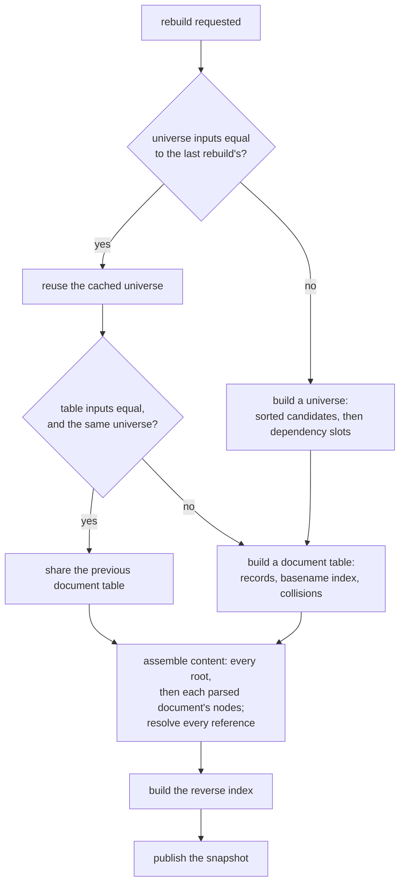
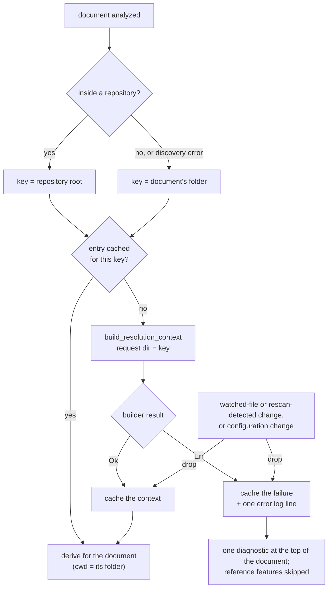

# LSP Architecture

DMLS (`darkmatter/dmls`) is a stdio language server. `run_server` in
[`router.rs`](../../dmls/src/router.rs) performs the `initialize` handshake,
then dispatches every request and notification against one `ServerState`:

- the open documents (the editor's buffers are authoritative over disk)
- the layered configuration (editor `didChangeConfiguration` settings over
  `.dmls.toml`; see [DMLS Configuration](./configuration.md))
- the workspace index and the graph snapshot that readers load: the
  workspace file list and the documents parsed so far (open buffers and the
  targets they reference)
- the index store, the per-file facts that references, rename, file
  rename, and workspace symbols are answered from, filled only when a
  feature first needs every document (see [DMLS Indexing](./indexing.md))
- the provider registry, the ordered chain of providers per capability
- the diagnostics scheduler and the frontmatter overlay caches
- the watch mode, which decides how on-disk changes are learned
- the file-resolution contexts, one per repository

For each request on an open document, the router assembles a
`DocumentContext` (path, text, source map, graph snapshot, configuration,
overlay, and file-resolution context) and runs the provider chain against
it. The [DMLS README](../../dmls/README.md#architecture) covers the graph,
source map, provider registry, and concurrency model in more detail.

## Graphs and the wiki universe

DMLS never holds a graph over every workspace file. It builds a
`WorkspaceGraph` in two places:

| Graph | Documents | Lifetime |
| --- | --- | --- |
| the live snapshot | open buffers, the targets they reference, and their dependencies | replaced on each change |
| a request graph | the index store's candidate referrers of one request's target, the target, and the open buffers (see [Answering a request from the store](./indexing.md#answering-a-request-from-the-store)) | one references, rename, or file-rename request |

Neither graph holds every file, but a wiki link must still be matched, and
judged ambiguous, against every file. So
`WorkspaceGraph::build_with_roots(indices, generation, universe, contexts)`
takes the **wiki universe** from its caller: a `WikiUniverse`
([`wiki/universe.rs`](../../dmls/src/wiki/universe.rs)) with one entry per
listed Markdown file and open buffer, each named by its path relative to
the wiki roots, built from the file list without reading any file. Wiki resolution, ambiguity
diagnostics, wiki completion, and the wiki spelling a file rename writes
all index the universe, never the graph's own documents.

For example, with `alpha/topic.md` and `beta/topic.md` listed, a request
graph over `notes/b.md` alone still reports `[[topic]]` in `notes/b.md` as
ambiguous, and a file rename of `alpha/topic.md` still writes the
shortest spelling unique across both files. A request graph shares the
live snapshot's universe (`WorkspaceGraph::shared_wiki_universe`), so both
graphs judge wiki links identically. The universe is a required parameter:
no caller can silently judge ambiguity against a partial set.

### Rebuilding the live snapshot

Every change the live snapshot must reflect (a keystroke that alters an open
buffer, a target parsed for the first time, a file joining the list)
publishes a new `WorkspaceGraph` with the next generation.
`WorkspaceIndex::rebuild` in
[`graph/invalidate.rs`](../../dmls/src/graph/invalidate.rs) builds it. A
change that leaves a document's bytes as they were publishes nothing, unless
it changes the document's role: opening a
[dependency](./indexing.md#targets-outside-the-file-list) with its disk
bytes publishes it as an ordinary open document. A batch of disk changes
(one watched-files notification) publishes once, at the end.

Snapshots are immutable. A reader still holding the previous snapshot keeps
getting exactly the answers it got before; nothing in a new snapshot
reaches back into an old one.

A snapshot has two parts:

- **Path-derived**, read from paths and never from file contents: the wiki
  universe, and the **document table**. The table holds each document's
  path, canonical wiki path, workspace, dependency flag, and wiki slot; the
  wiki **basename** index (`[[topic]]` → every document whose file is named
  `topic`); and the portability collisions (paths that differ only by case
  or Unicode normalization).
- **Content-derived**: every node and edge, heading and frontmatter-key
  nodes, the resolution of every link, transclusion, wiki link, `$schema`
  and file use, and variable use, the paths a broken reference is waiting
  for, and the reverse index over the edges.

Nearly every rebuild is typing in an open buffer, which changes content and
no path. So the live index reuses the path-derived part whenever its inputs
are unchanged, and rebuilds the content-derived part every time:



The **universe** is reused when all three of its inputs equal the previous
rebuild's, compared by value:

- the **candidates**: every listed Markdown file plus every parsed document
  that is not a dependency (an open buffer outside the list), sorted and
  without duplicates;
- the **dependencies**, sorted;
- the **wiki roots**, in configured order. Order matters because the first
  root containing a path names it, so reordering the same roots is a change.

The **document table** is reused when:

- the sorted union of parsed and listed paths is the table's documents, in
  the same order;
- every document has the same dependency flag;
- the `Listing` state is equal. `Pending`, `Ready { complete: false }`, and
  `Ready { complete: true }` are three different inputs, because diagnostics
  that depend on which files exist read it;
- the universe is the very same one (pointer identity, not value equality).
  A rebuilt universe therefore always means a rebuilt table.

Parse state and content hashes are not table inputs; they belong to each
snapshot. A listed file parsed for the first time, or a listed buffer closed
back to unparsed, reuses both the universe and the table.

For example, with `a.md` and `guide.md` listed and `a.md` open:

| Change | Universe | Document table | Content |
| --- | --- | --- | --- |
| typing in `a.md` | reused | reused | rebuilt |
| hovering a link parses `guide.md` | reused | reused | rebuilt |
| a watched creation adds `notes/new.md` to the list | rebuilt | rebuilt | rebuilt |
| a re-walk lists the same files but one folder fails (`Ready { complete: false }`) | reused | rebuilt | rebuilt |
| `../README.md`, a dependency of `a.md`, is opened and edited | rebuilt | rebuilt | rebuilt |

Even when both are reused, every parsed document's nodes, edges, headings,
frontmatter keys, references and wiki resolutions, awaited paths, and the
reverse index are built anew, and every reference is resolved again. The
table records paths, never whether a reference's target exists, so a
shared table cannot hide a target that appeared or a probe that now fails.

**Basename keys are cached; frontmatter keys are not.** The basename index
in the table is derived from file names, so it survives an edit. A
document's frontmatter keys (the `FrontmatterKey` nodes that `{{ title }}`
interpolations resolve to through `uses_variable` edges) come from its
contents and are rebuilt on every edit: after renaming `title:` to
`heading:`, the next snapshot resolves `{{ heading }}` and no longer
resolves `{{ title }}`.

**Numbering.** `DocumentId`s are dense and follow path order over every
document, parsed or not. Roots come first: `DocumentId(d)`'s root is
`NodeId(d)`. Each parsed document's content nodes follow, documents in path
order, each in its usual node order. Node and edge IDs are local to one
snapshot. An edit that adds a heading shifts every later node, so never
compare node or edge IDs across snapshots; compare a document's path and a
node's span instead.

**Dependency slots.** The live universe holds every candidate in sorted
order, then one **unmatchable** slot per dependency, sorted, which no wiki
link can match. Because every document already has a slot, building a
table never has to append to a universe an older snapshot still shares
(which would copy it). A slot number is not a `DocumentId`: always map
between them with `WorkspaceGraph::wiki_slot` and `slot_document`. A
dependency's record still carries the real canonical path of its file.

Only the live index reuses. The public builders
(`WorkspaceGraph::build`, `build_with_roots`, and `build_listed`) always
build a fresh table, and request graphs are built that way. Tests compare
the live index against them as the uncached reference.

## File resolution contexts

Every feature that follows a file reference (document links,
go-to-definition, hover, the link graph, link and transclusion diagnostics,
anchor completion, the create-missing-file code action, and schema `file`
validation) resolves it through a `FileResolutionContext`. DMLS never joins
paths textually. The user-facing behavior is described in
[DMLS: File References in the Editor](../topics/dmls.md); this section
covers how the server produces and maintains the contexts. The code is in
[`context.rs`](../../dmls/src/context.rs).

### One snapshot, fixed at startup

`main.rs` calls `RequestSnapshot::from_process()` once and passes it to the
server in `RunOptions`. The snapshot carries `HOME` and the environment.
DMLS has no setting for an extra `@` root, so the production snapshot has
none; the snapshot is still where one would enter, and an embedder (or a
test) that starts the server with its own snapshot supplies it there.
Nothing else in DMLS reads the process for resolution,
so every context the server builds sees the same `HOME` and environment
until the server restarts. The snapshot's own request directory is never
used: each build re-anchors it with `snapshot.at_request_dir(key)`. See
[Compose Requests](../topics/compose-requests.md) for the snapshot and the
builder.

### The cache and its keys

`RepositoryContexts` caches one `build_resolution_context` result per key.
It is shared (`Arc`) between the router and the workspace graph.

| Document folder | Key, and the build's request directory |
|---|---|
| Inside a Git repository (`biscuit_file::find_git_root` finds a root) | The repository root |
| In no repository | The folder itself |
| Repository discovery errors | The folder itself; the builder then reports the same error for it |

The request directory is where `@` searches start, so an editor answers
`&`, `^`, and `@` the way `md compose` run from the repository root does,
whatever the editor's workspace folders are. A document's own context is
derived from the cached one with `for_source(path)`: the request directory
stays the key, and `cwd` becomes the document's folder.

```text
key repo/                     request_cwd   cwd
  repo/README.md              repo/         repo/
  repo/docs/guide.md          repo/         repo/docs/
```

A failed build is cached exactly like a success, so a broken repository is
built, and logged at `error` level, once rather than on every request. Each
cached entry has a generation number; a rebuilt context gets a new one, and
the overlay's schema cache keys on it, so `file` values are re-validated
against the fresh context.



### Two ways to resolve

| Consumer | How it resolves | Touches disk? |
|---|---|---|
| Workspace graph (link, transclusion, `uses_schema`, and `uses_file` edges; broken-link and missing-anchor diagnostics; link hover, document links, and definition) | The first planned candidate when it is a **graph document** (a Markdown file in the workspace file list, an open buffer, or a parsed dependency); otherwise `resolve_reference`, falling back to a later candidate that is an open, unsaved buffer when nothing matched (never past an I/O failure) | Only when the first candidate is not a graph document |
| Single-target features (directive links, definition and hover, transclusion diagnostics, frontmatter navigation, the create-missing-file action) | `resolve_reference`: the first planned candidate that exists, else the first candidate as the place a new file would go | Yes, as composition does |
| Anchor completion | The first planned candidate that is a graph document; otherwise `resolve_reference`, when it finds a Markdown file | Reads that one document if it has not been parsed |

The file list decides which workspace documents exist as graph nodes, never
whether a file exists. A graph edge lands on a graph document's node, on
an existing file outside the graph (`EdgeTarget::File`: above the workspace
folder, in `HOME`, under a magic root, excluded from discovery, or not
Markdown), or stays unresolved. For example, with only `repo/docs/` open,
`[t](../target.md)` links to `repo/target.md` and is not broken.

A Markdown document that is not open is parsed only when a feature needs
its contents: a `#fragment` link or `[[note#heading]]` from an open document
(to check the anchor), heading completion, hover, or definition on a link to
it, and the `::file`/`::code` chain followed outward from an open document
(for cycle detection). Until then its `#fragment`s are neither resolved to a
heading nor reported missing. This includes a Markdown file outside the
list that an edge lands on: once parsed it becomes a graph document, a
**dependency**, whose `#fragment`s are checked like any other, but which is
never a wiki candidate, a path completion, or part of the index store (see
[Targets outside the file list](./indexing.md#targets-outside-the-file-list)).
A file in another format is never parsed. A link to an open, unsaved buffer still resolves, unless a
place searched before it could not be checked (permission denied, a symlink
loop): that link stays broken with the `Io` failure class, as `md compose`
would fail.

### Invalidation

An entry is dropped, and rebuilt lazily on the next request, when:

| Event | Entries dropped |
|---|---|
| `workspace/didChangeWatchedFiles` names a path | Every entry keyed at an ancestor of the path, and every entry keyed inside the path's owning directory (the parent of `.git` for a path inside `.git/`, otherwise the path's own directory) |
| A save in server-rescan mode, where the rescan finds a Markdown file that joined or left the file list, a parsed document whose bytes changed, or a changed package manifest | The same entries, for each changed path |
| `workspace/didChangeConfiguration` | Every entry, even when the effective configuration is unchanged |

When anything is dropped, the graph is relinked so every reference
re-resolves, and diagnostics are re-published for every open document.

Clients that watch files are asked to report, besides the configured
document globs, every YAML file (`**/*.yaml`, `**/*.yml`, even when
`workspace.include` is empty), the discovery inputs `.gitignore`, `.ignore`,
and `.dmls.toml` (a change re-lists the workspace), every package manifest
sniff detects packages by (`PACKAGE_MANIFEST_FILE_NAMES`: `Cargo.toml`,
`package.json`, `pyproject.toml`, `go.mod`), and `**/.git/config`
([`watch.rs`](../../dmls/src/workspace/watch.rs)). These context inputs
only drop contexts; they are never indexed as documents. A client that
supports watchers rooted at a folder (`relativePatternSupport`) is also
asked to watch each folder the trigger registries read, wherever it lives,
including a schema root that does not exist yet. A client without that
support, or one that rejects the registration, gets the save fallback
instead: every save marks the trigger registries stale. A client that
rejects the workspace registration is switched to server-rescan mode. In server-rescan
mode (clients without a reliable watcher), each save lists the workspace
again, re-reads the closed documents already parsed, and re-hashes every
package manifest under the workspace roots and compares the result with the
previous scan. The rescan does not read `.git/config`, so a repaired
`.git/config` is noticed there only through another change below the
failing key, a configuration change, or a restart.

### Build failures

A document whose context failed gets one `dm.context.build_failure`
diagnostic (source `darkmatter.context`) at line 0, column 0, and nothing in
it is resolved: providers receive the failure through
`DocumentContext::file_context()` and skip every reference-dependent
answer (a directive hover, for example, keeps its description but shows no
target), and the overlay
assembles no schema, because `$schema` itself resolves through the context.
See [DMLS diagnostics](../../dmls/docs/diagnostics.md#file-resolution-context-source-darkmattercontext)
for the diagnostic's contents.

`ContextFailure` has three variants:

| Variant | When | Class |
|---|---|---|
| `Build` | `build_resolution_context` returned a `ContextBuildError` (`Discovery` or `Invalid`) | The error's own class |
| `UntitledWorkspace` | An untitled buffer's workspace folders do not lie in exactly one repository | `MissingContext` |
| `NotProvided` | A graph was built with `NoContexts` (tests and tools), never in a running server | `MissingContext` |

### Untitled buffers

An `untitled:` buffer has no folder to key on. `for_untitled` counts, for
each workspace folder, the repository containing it (discovered upward from
the folder; repositories nested below a folder do not count). With exactly
one, the buffer uses that repository's context unchanged, so `cwd` is the
repository root, and it is analyzed as if it were a file at that root. With
none, or two or more, it gets `ContextFailure::UntitledWorkspace` and the
same `dm.context.build_failure` diagnostic.
