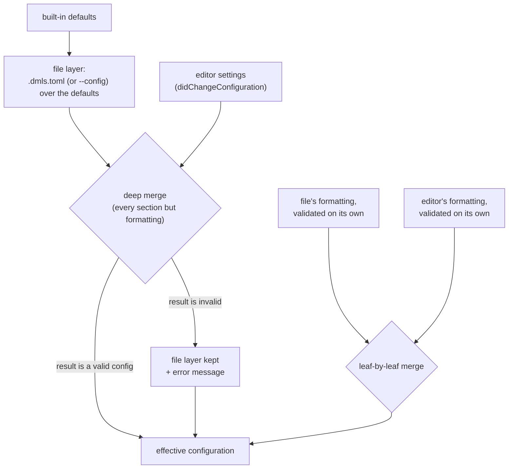

# DMLS Configuration

DMLS, the Darkmatter language server, reads its settings from a
`.dmls.toml` file in your workspace and from your editor's settings. With
these you can:

- choose which files DMLS lists as workspace documents (`[workspace]`)
- turn wiki-link features on or off and shape what wiki completion inserts
  (`[wiki]`)
- make frontmatter validation strict, and add schema baselines for parts of
  the tree (`[schema]`)
- set workspace defaults for `textDocument/formatting` (`[formatting]`)
- toggle code-action categories, frontmatter outline symbols, and semantic
  tokens

Every key is optional. An empty file, or no file at all, gives the built-in
defaults listed below. A minimal file:

```toml
# .dmls.toml
[workspace]
exclude = ["target/**", "node_modules/**"]

[schema]
strict = true

[formatting.markdown]
list-item-padding = "none"
```

Frontmatter never configures the server, and these settings configure only
the editor: `md` and other Darkmatter hosts never read `.dmls.toml`. How DMLS
lists and indexes the workspace, in what order startup runs, and what it logs
are covered in [DMLS Indexing](./indexing.md).

## Where the file is found

When the editor starts DMLS, it sends one or more workspace folders. DMLS
looks for `.dmls.toml` directly inside each folder, in the order the editor
sent them, and uses the **first one that loads**. It does not search parent
or child folders, and it does not merge files from several folders.

```text
~/work/                 <- workspace folder 1: no .dmls.toml, skipped
~/notes/.dmls.toml      <- workspace folder 2: used
~/notes/docs/.dmls.toml <- never read: not directly in a workspace folder
```

The `--config <path>` flag replaces discovery entirely: DMLS reads that one
file and looks nowhere else.

```sh
dmls --config ~/dotfiles/dmls.toml
```

`.dmls.toml` also works as an editor root marker, so an editor that finds the
workspace root by marker files can use it alongside `.git`; see [Editor
setup](../../dmls/docs/editors/README.md#root-marker-and-configuration).

### A malformed file degrades to defaults

A broken file never stops the server. What DMLS does depends on what is
wrong:

| Problem | Result |
|---|---|
| The file cannot be read, is not valid TOML, or a value outside `[formatting]` has the wrong type (`enable = "yes"`) | None of the file's settings apply. Discovery moves on to the next workspace folder's file, else the defaults. With `--config`, the defaults apply. |
| A value inside `[formatting]` is invalid | The file's other settings apply. That file contributes no formatting settings. |
| A key DMLS does not know, outside `[formatting]` | Ignored, silently. |
| A key DMLS does not know, inside `[formatting]` | Treated as an invalid `[formatting]` value (see above). |

Each finding is shown in the editor as a message (`window/showMessage`), an
error when settings were dropped and a warning when a legacy key was
translated, and is written to the server log. Findings are recomputed on
every load, so each one appears once per load or change, never once per
request.

### Changes apply without a restart

DMLS re-reads `.dmls.toml` and re-applies the editor settings when:

- the editor sends `workspace/didChangeConfiguration`; every such
  notification also re-reads the file, whether or not the editor watches it
- the editor reports a change to a `.dmls.toml` through
  `workspace/didChangeWatchedFiles`; DMLS asks clients that support dynamic
  file watching to watch `**/.dmls.toml`

A client without a reliable file watcher (DMLS rescans the workspace on save
for these, for example Neovim on Linux) does not report edits to
`.dmls.toml`. There, an edit takes effect on the next
`didChangeConfiguration` or a server restart.

After a reload, DMLS re-derives everything the settings shape: it lists the
workspace again when `[workspace]` changed, recomputes the wiki roots when
`wiki.wiki_root` changed, drops its cached file-resolution contexts and marks
every trigger registry stale, re-publishes diagnostics for every open
document, and asks the editor to refresh semantic tokens when
`semantic_tokens.enable` or `wiki.enable` changed.

## Precedence: editor settings, the file, defaults

Each setting is decided by the highest source that sets it:

1. **editor settings**, sent in the `settings` of
   `workspace/didChangeConfiguration`
2. **`.dmls.toml`** (or the `--config` file)
3. **built-in defaults**

DMLS never requests settings with `workspace/configuration`; it uses only
what `didChangeConfiguration` carries. The settings may be wrapped in a
`dmls` key or sent as the bare object, and use the same key names as the
file:

```json
{
  "dmls": {
    "wiki": { "enable": false },
    "diagnostics": { "debounce_ms": 300 },
    "formatting": { "markdown": { "fixed-width": 80 } }
  }
}
```

`null` (or `{ "dmls": null }`) clears the editor settings, so the file and
the defaults apply again. Any other non-object value is rejected with an
error, and the previous editor settings stay in effect.



### Every section but `formatting`: deep merge

The editor settings are merged into the file layer key by key. A table
(object) merges with the table below it; any other value, including an
array, replaces the value below it.

```toml
# .dmls.toml
[workspace]
include = ["**/*.md", "**/*.markdown"]
exclude = ["target/**"]

[code_actions.categories]
"create-missing-file" = false
```

```json
{ "workspace": { "exclude": ["dist/**"] },
  "code_actions": { "categories": { "add-missing-key": false } } }
```

The effective `exclude` is `["dist/**"]` (the array is replaced, not
appended), `include` keeps the file's value, and both code-action categories
are disabled (the tables merged).

If the merged result is not a valid configuration, for example
`"debounce_ms": "fast"`, DMLS ignores the editor settings for every section
but `formatting`, keeps the file layer, and shows an error. Bad editor
settings cannot wedge the server. A `null` value replaces the value below it
like any other: on an optional key (`workspace.root`, `wiki.wiki_root`,
`shell.policy_path`) it clears the setting, and on any other key it makes the
merged result invalid.

### `formatting`: leaf by leaf

`formatting` is read differently. The file's `formatting` and the editor's
`formatting` are each validated on their own (and legacy keys translated)
before they are combined, then merged one rule at a time: an editor rule with
a value wins; an absent or `null` editor rule falls through to the file's
rule. A source whose `formatting` is invalid contributes no formatting rules,
but its other sections still apply.

```toml
# .dmls.toml
[formatting.markdown]
indentation = 2
fixed-width = 100
```

```json
{ "formatting": { "markdown": { "fixed-width": null, "unwrap": true } } }
```

The effective rules are `indentation = 2` and `fixed-width = 100` from the
file (the editor's `null` falls through) and `unwrap = true` from the editor.
A document's own `style.markdown` and the `md` CLI flags rank above all of
these; see [Who wins](../topics/markdown-formatting.md#who-wins-precedence).

## Every key at a glance

| Key | Default | Applied |
|---|---|---|
| `workspace.root` | unset | yes |
| `workspace.include` | `["**/*.md", "**/*.markdown"]` | yes |
| `workspace.exclude` | `[]` | yes |
| `wiki.enable` | `true` | yes |
| `wiki.wiki_root` | unset | yes |
| `wiki.path_style` | `"shortest"` | yes |
| `wiki.heading_completion_style` | `"text"` | yes |
| `schema.strict` | `false` | yes |
| `schema.extensions.<name>.path` | (required per entry) | yes |
| `schema.extensions.<name>.globs` | `[]` | yes |
| `style.strict` | `false` | **parsed only** |
| `shell.policy_path` | unset | yes |
| `hints.inlay` | `true` | **parsed only** |
| `code_actions.categories.<category>` | every category enabled | yes |
| `formatting.markdown.<rule>` | no overrides | yes |
| `formatting.cleanup` (legacy) | unset | translated |
| `formatting.fixed_width` (legacy) | unset | translated |
| `symbols.frontmatter` | `false` | yes |
| `semantic_tokens.enable` | `true` | yes |
| `diagnostics.debounce_ms` | `200` | **parsed only** |

"Parsed only" means DMLS accepts and type-checks the key, so a file that sets
it stays valid, but nothing in the server reads it yet. Setting it changes
no behavior.

## `[workspace]`

`[workspace]` decides which files DMLS lists as the workspace. The file list
is what wiki links resolve against, what workspace symbols search, and what
the full index parses; see [DMLS Indexing](./indexing.md).

```toml
[workspace]
root = "docs"
include = ["**/*.md", "**/*.markdown"]
exclude = ["drafts/**", "**/CHANGELOG.md"]
```

### `root`

Narrows the listing to one directory. A relative `root` is joined onto each
workspace folder (`~/notes` plus `docs` lists `~/notes/docs`); an absolute
`root` is used instead of every folder. Unset, each workspace folder is
listed whole.

`root` changes only the file list. `.dmls.toml` is still found in the
workspace folder itself, wiki roots come from `wiki.wiki_root`, schema
extension paths and globs are relative to the workspace folder, and each
document's schema roots come from its own location.

### `include`

Globs, relative to the listed root, that select **Markdown documents**.
Default: `["**/*.md", "**/*.markdown"]`.

`include` controls two things:

- **Markdown discovery**: a file is listed as a Markdown document when it
  matches `include` and not `exclude`. Every file that matches is treated as
  Markdown, so name only Markdown files here.
- **The document file-watch globs**: DMLS asks the editor to watch exactly
  these patterns for document changes.

```toml
[workspace]
# Only the docs tree and top-level READMEs are documents.
include = ["docs/**/*.md", "*/README.md"]
```

`include` does not touch DMLS's other watches and listings, which are
always on:

- YAML files (`*.yaml`, `*.yml`) are listed and watched (`**/*.yaml`,
  `**/*.yml`) whatever `include` says, even when `include` is empty
  (`include = []` lists no Markdown at all, but still lists YAML)
- `.gitignore`, `.ignore`, and `.dmls.toml` are watched, because a change to
  one re-lists the workspace
- package manifests and `.git/config` are watched, because they change how
  references resolve
- the folders the trigger registries read are watched, for clients that
  support folder-rooted watches

### `exclude`

Globs, relative to the listed root, removed from the listing. Default: `[]`.
`exclude` wins over `include`, and it applies to **both Markdown and YAML**:

```toml
[workspace]
# Neither generated Markdown nor generated YAML is listed.
exclude = ["target/**", "build/**/*.yaml"]
```

An invalid glob in `include` or `exclude` is skipped with a warning in the
server log; the other patterns still apply.

### Ignore files

The listing also honors the same ignore rules Git uses, so you rarely need
to repeat them in `exclude`:

- `.gitignore` and `.ignore` files at any level
- `.git/info/exclude`
- your global Git excludes file

These rules apply even when the workspace is not a Git repository. Every
directory named `.git` is skipped. Other hidden directories are listed,
because folders such as `.claude/` hold real Markdown. Symbolic links are not
followed.

```text
notes/
├── .gitignore          # contains: scratch/
├── .claude/skills/x.md # listed: hidden folders are walked
├── scratch/todo.md     # not listed: ignored by .gitignore
└── guide.md            # listed
```

A change to `.dmls.toml`, `.gitignore`, or `.ignore` that the editor reports
re-lists the workspace. A change to `.git/info/exclude` lives inside `.git`,
which is never watched, so it takes effect on the next rescan or restart.

### Schema roots are not part of the listing

The folders DMLS searches for trigger schemas and bare-name `$schema` files
are **defined by each document's context**, not by `[workspace]`: the
document's package, its package area, the repository root's `schemas/`, the
folder `SCHEMAS_DIR` names, and `~/schemas` (see [Schema
roots](../topics/schemas/definition.md#schema-roots)). `include`, `exclude`,
`root`, and ignore files have no effect on them:

```toml
[workspace]
exclude = ["schemas/**"]   # hides schemas/*.yaml from the file list only
```

With this setting, the repository's `schemas/` triggers still apply to every
document. Schema features are described in [DMLS Schema
Support](../topics/schemas/dmls-schema-support.md).

There is currently no setting that narrows which files are in scope beyond
`root`, `include`, and `exclude`.

## `[wiki]`

Wiki-link (`[[note]]`) behavior.

```toml
[wiki]
enable = true
wiki_root = "notes"
path_style = "root-relative"
heading_completion_style = "slug"
```

| Key | Default | Effect |
|---|---|---|
| `enable` | `true` | Master switch. `false` turns off wiki-link definition, document links, references, highlights, hover, completion, diagnostics, and wiki semantic tokens. |
| `wiki_root` | unset | The folder wiki links resolve against. Relative: joined onto each workspace folder. Absolute: used instead of the workspace folders. Unset: each workspace folder. |
| `path_style` | `"shortest"` | What file completion (and a wiki-link rename) inserts: `"shortest"`, the shortest path suffix that resolves uniquely; `"relative"`, the path relative to the current document; `"root-relative"`, the path relative to the wiki root. |
| `heading_completion_style` | `"text"` | What heading completion inserts: `"text"`, the heading's visible text; `"slug"`, its GitHub-style slug. |

## `[schema]`

Frontmatter schema validation.

```toml
[schema]
strict = true

[schema.extensions.team]
path = "schemas/team-prompt.yaml"
globs = ["prompts/**", ".claude/**"]
```

| Key | Default | Effect |
|---|---|---|
| `strict` | `false` | Off: a missing required key is not reported (a value may arrive at compose time), and an unknown key is a warning. On: missing required keys are errors, and unknown keys are errors. |
| `extensions.<name>.path` | required | A SimplifiedSchema (or JSON Schema) file merged over the built-in baseline for matching documents. A relative path resolves against the first workspace folder. It names a document schema, never a trigger schema. |
| `extensions.<name>.globs` | `[]` | Which documents the extension applies to, matched against the document's path relative to its workspace folder. An extension with no globs never applies. |

Extensions are applied in name order, a later one winning over an earlier
one. Trigger schemas need no entry here; DMLS finds them in the schema roots.
How extensions, triggers, and a document's `$schema` combine is described in
[DMLS Schema
Support](../topics/schemas/dmls-schema-support.md#extensibility-through-configuration).

## `[style]`

```toml
[style]
strict = false
```

`strict` (default `false`) is **parsed only**. Unknown and deprecated
`style:` keys are reported (`dm.style.unknown_key`,
`dm.style.deprecated_key`) whatever its value.

## `[shell]`

```toml
[shell]
policy_path = "/Users/me/.config/darkmatter"
```

`policy_path` (default unset) names a **directory** holding a
`.darkmatter-shell-whitelist` file. When it is set and the file has entries,
hovering a `::shell`, `::shell-block`, or `$(…)` command reports a command
the whitelist covers as approved. DMLS never runs a command, and the
whitelist never changes diagnostics: a `dm.security.disallowed_command`
error comes only from Darkmatter's built-in blacklist, which always applies.
A relative path resolves against the server process's working directory,
not the workspace folder, so an absolute path is the reliable choice.

## `[hints]`

```toml
[hints]
inlay = true
```

`inlay` (default `true`) is **parsed only**. DMLS does not implement inlay
hints, so the key has no effect.

## `[code_actions.categories]`

Every code-action category is enabled unless set to `false` here:

```toml
[code_actions.categories]
"create-missing-file" = false
"add-missing-key" = false
```

| Category | The quick fix it controls |
|---|---|
| `create-missing-file` | Create the missing file behind a broken link or an unresolved wiki link. |
| `add-missing-key` | Add every missing required frontmatter key (offered in strict mode, where missing keys are reported). |
| `migrate-deprecated-style` | Rewrite a deprecated `style:` key to its replacement. |
| `close-directive-block` | Close an unclosed directive block with `::end-block`. |
| `wrap-in-interpolation-literal` | Wrap a malformed expression in an interpolation literal. |
| `reference-dash-separated-key` | Replace an expression that parses as a subtraction, such as `foo-bar`, with a reference to the dash-separated frontmatter key it spells. |
| `rewrite-with-concatenation` | Rewrite an expression nested inside an interpolation literal using `+` concatenation. |

A name not in this list matches nothing and is ignored.

## `[formatting]`

Workspace defaults for `textDocument/formatting`, under
`[formatting.markdown]`. The keys are the rule keys a document uses under
`style.markdown`; the full list, defaults, and examples are in [The
rules](../topics/markdown-formatting.md#the-rules).

```toml
[formatting.markdown]
indentation = 2
list-item-padding = "none"
fixed-width = 100
default-language = "text"
```

A document's own `style.markdown` overrides these rule by rule. Within DMLS,
editor settings and the file are merged leaf by leaf (see
[`formatting`: leaf by leaf](#formatting-leaf-by-leaf)). `markdown` is the
only current key under `[formatting]`; any other key is rejected, and that
source then contributes no formatting rules.

### Legacy keys

Two older keys are still accepted and translated, each with a warning that
names the replacement:

| Legacy key | Translated to |
|---|---|
| `cleanup = "compact"` | `list-item-padding = "none"` |
| `cleanup = "loose"` | `list-item-padding = "one"` |
| `cleanup = "default"` (or `null`) | no rule; the key can be removed |
| `fixed_width = 80` (a whole number from 1 to 1000) | `fixed-width = 80` |
| `fixed_width = null` | no rule; the key can be removed |

Any other legacy value is rejected. Mixing a legacy key with
`[formatting.markdown]` in the same source is rejected too: rewrite the
legacy key as a `markdown` rule.

```toml
# Rejected: legacy and current keys in one source.
[formatting]
fixed_width = 80

[formatting.markdown]
indentation = 2
```

## `[symbols]`

```toml
[symbols]
frontmatter = true
```

`frontmatter` (default `false`) adds the document's top-level frontmatter
keys to the document outline (`textDocument/documentSymbol`). It is off by
default so the outline stays prose-first.

## `[semantic_tokens]`

```toml
[semantic_tokens]
enable = false
```

`enable` (default `true`) is the master switch for semantic tokens. When
`false`, every semantic-token request returns an empty stream, which clears
the editor's existing tokens. Wiki-link tokens are also controlled by
`wiki.enable`.

## `[diagnostics]`

```toml
[diagnostics]
debounce_ms = 200
```

`debounce_ms` (default `200`) is **parsed only**. DMLS publishes diagnostics
as soon as each change is applied; no debounce delays them.
