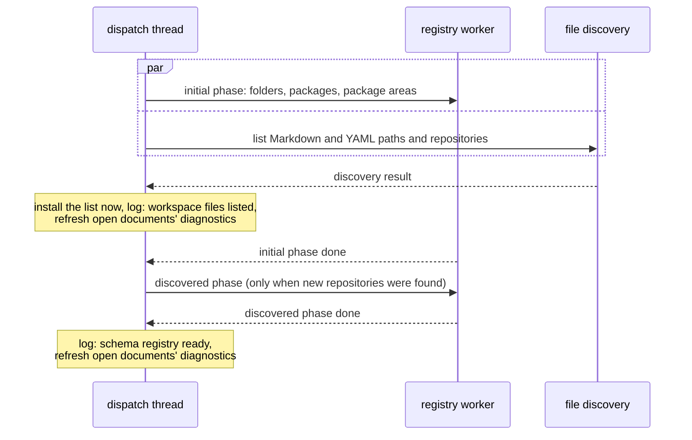
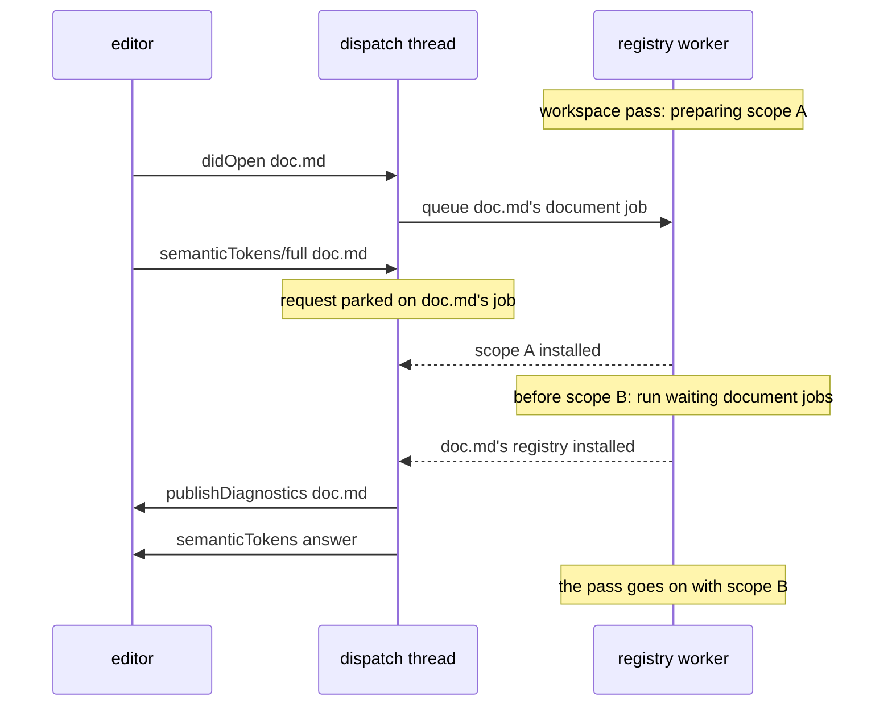
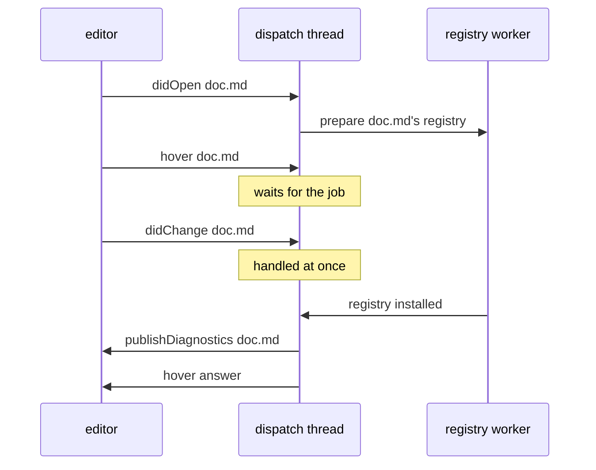
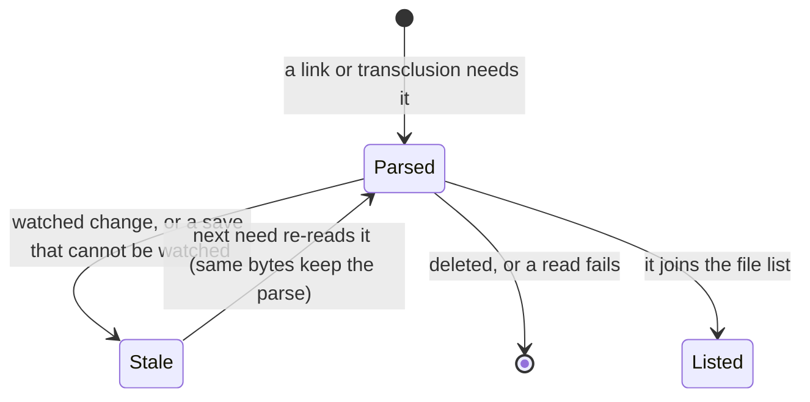
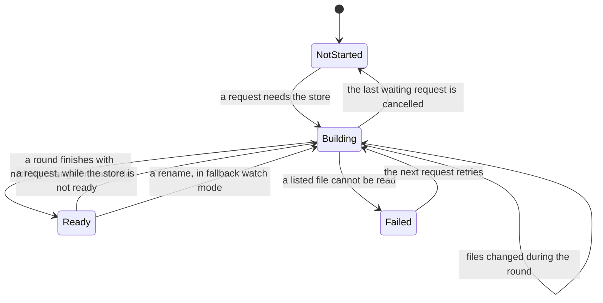
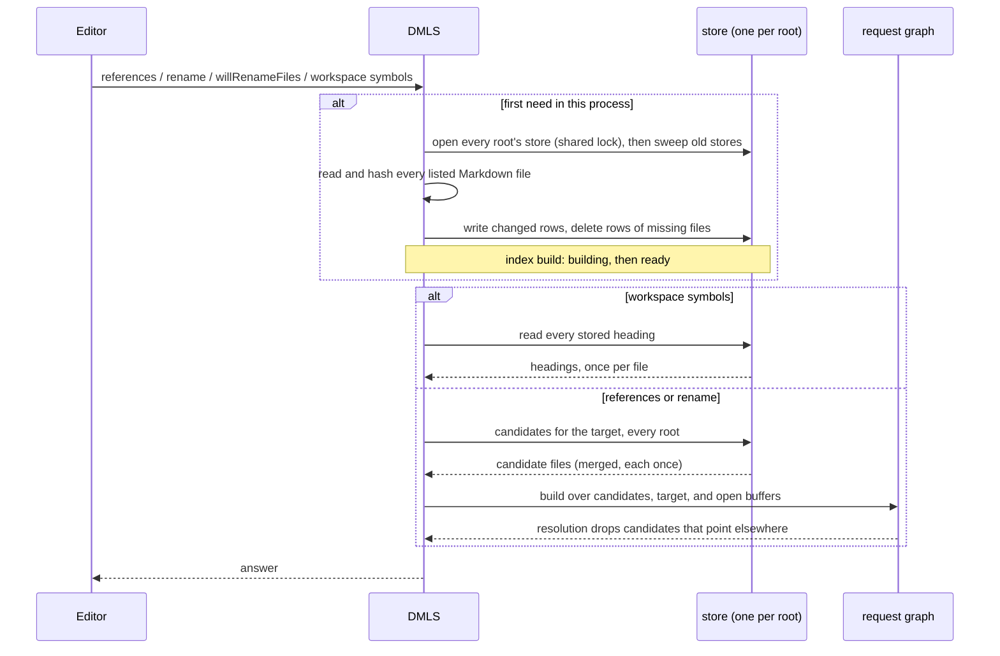
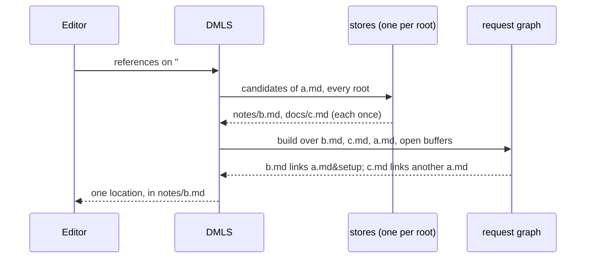

# DMLS Workspace Indexing

This page explains how DMLS (`darkmatter/dmls`) finds out what is in a
workspace: which schema files apply, which files exist, and which documents
it reads. It also describes the log lines each step writes. Use it to find
out why a diagnostic has not appeared yet, why the first "find references"
takes longer than the next one, or what a line in the DMLS log means.

The short version:

- **Startup reads very little.** DMLS loads the schema files that apply to
  each workspace folder, then lists file paths without reading them. Open
  documents are parsed when the editor opens them.
- **Other documents are read only when a feature needs them.** Hovering a
  link to `guide.md` parses `guide.md`, and nothing else.
- **Every document is read only for features that need all of them.** Find
  references, rename, file rename, and workspace symbols read every
  Markdown file into the [index store](#the-index-store) the first time
  one of them is used. The store persists across restarts, so a later
  start re-parses only the files that changed.

[LSP Architecture](./architecture.md) covers the server's state and how file
references resolve. [DMLS Configuration](./configuration.md) covers the
`[workspace]` keys that decide which files are listed.

## Startup

### What happens, in order

The `initialize` handshake completes before any indexing starts, so the
editor gets its capabilities at once. Then two things start at the same
time:

- **The registry worker prepares the schema registry of the known scopes**
  (the *initial phase*). It loads the trigger schemas of every workspace
  scope it can name without a listing (the scopes are described
  [below](#which-scopes-are-prepared)). Each scope is prepared as if for a
  document named `<scope>/.dmls-workspace`, through the same five roots
  that document would search. That name is only a key; DMLS never reads
  such a file, it does not need to exist, and no Markdown file is read.
  This is the same worker that prepares documents' registries (see
  [Preparing registries off the dispatch thread](#preparing-registries-off-the-dispatch-thread)),
  so a request's document job runs before the rest of startup's scopes.
- **File discovery lists the files** on its own thread (`spawn_startup` in
  [`router.rs`](../../dmls/src/router.rs)). It walks each workspace folder
  and records the paths of Markdown and YAML files, reading no file
  contents. The same walk records every directory that holds a `.git`
  entry (a directory, or the `.git` file of a linked worktree or
  submodule): the repositories inside the folders.

As soon as discovery returns, the dispatch thread installs the file list,
logs its line, and re-publishes the open documents' diagnostics, whatever
the registry worker is doing: the list is what releases
[withheld path diagnostics](#diagnostics-that-wait-for-the-list) and lets an
index build start. Once **both** discovery and the initial phase are done,
and only if discovery found repositories DMLS did not know, the dispatch
thread queues the *discovered phase*: each new repository, with the packages
and package areas inside it, is prepared the same way. Scopes already
prepared are fresh and are not prepared again.

After the last phase, the dispatch thread logs the one
[schema registry line](#schema-registry-lines), so its counts cover every
startup scope, and re-publishes diagnostics for the open documents.
Meanwhile it keeps answering requests, edits, cancellation, and shutdown.
No request waits for startup as a whole; a shutdown during either phase
answers waiting requests and stops the worker without waiting for startup
to finish.



| Step | Reads file contents? | When |
| --- | --- | --- |
| Schema registry | the YAML files directly inside the schema roots, plus the payload, import, and example files their triggers name | at once, on the registry worker, and again for the repositories the walk found once both are done |
| File list | no | at once, on the discovery thread, beside the initial phase; installed as soon as it returns |
| Open documents | the editor's buffers | as the editor opens them |
| Referenced targets | each target, once until it changes | the first time a feature needs its headings or transclusions |
| Index store | every listed Markdown file (parsed only where its row is missing or out of date) | the first references, rename, file-rename, or workspace-symbols request |

While the file list is being built, the editor shows progress under the
token `dmls/startup-index` ("Listing workspace files"), if it supports
`window.workDoneProgress`. The progress ends after the list is installed and
the open documents' diagnostics are refreshed.

### Which scopes are prepared

The prepared scopes together search every schema root that applies to a
document in the workspace. They are, for each workspace folder and each
repository the walk found inside one:

- the folder or repository itself;
- each package and package area its repository's package catalog lists
  inside it;
- in a monorepo, each first-level directory of the repository that the
  catalog makes a package area only by its first-directory fallback (no
  listed package or package area claims it), when that directory has a
  `schemas` folder. Finding these costs one listing of the repository root
  and one metadata read per directory; a directory without a `schemas`
  folder adds no scope.

For a repository at the workspace folder with a Cargo workspace member
`area/pkg`, startup prepares three scopes:

| Scope | Roots it searches (when present) |
| --- | --- |
| `{repo}` | `{repo}/schemas`, `SCHEMAS_DIR`, `~/schemas` |
| `{repo}/area` (package area) | `area/schemas`, then the tree roots |
| `{repo}/area/pkg` (package) | `area/pkg/schemas`, `area/schemas`, then the tree roots |

If the same monorepo also has `docs/schemas/` and no package under `docs/`,
a fourth scope `{repo}/docs` searches `docs/schemas`, then the tree roots,
because every document under `docs/` gets `docs` as its package area.

A workspace folder that is not a repository but holds repositories, for
example `~/code` holding `~/code/one` and `~/code/two`, gets a scope for
each repository, so `~/code/one/schemas` and `~/code/two/schemas` are both
prepared at startup. A repository inside an ignored directory is not walked,
so it is not found.

A package or repository that contains a workspace subfolder needs no scope of
its own: the folder's context already searches its roots, and a root above
the folder still applies. A package outside every workspace folder is not
prepared. With several folders, each contributes its scopes once.

A refresh that prepares the workspace scopes again (a watched or saved
schema file, a manifest change, a server rescan, a configuration change)
uses the same scopes, derived from the current package catalogs. The
repositories come from the latest listing: a re-listing that finds a new
repository queues the scopes' preparation, and so does a watched change to a
`.git/config` that appears or disappears below a workspace folder.

Each document still gets its own registry, prepared the first time a request
or a diagnostics refresh needs it (see
[Preparing registries off the dispatch thread](#preparing-registries-off-the-dispatch-thread)).
When its roots are among the prepared scopes' roots, that preparation reuses
their classified files and reads only what lies outside them. A document whose
context no prepared scope matches (an untitled buffer, a file outside the
workspace folders, or a file in a repository inside an ignored directory) has
its roots read then.

### Requests wait only for what they need

Nothing waits for startup as a whole. Each feature waits for its own
prerequisite, if any:

| Feature | Waits for |
| --- | --- |
| Any request on an open document (formatting, folding, symbols, completion, hover, …) | the document's trigger registry, when it is not prepared yet or a change made it stale; the registry worker prepares it while the request waits (see [Preparing registries off the dispatch thread](#preparing-registries-off-the-dispatch-thread)). Never the file list |
| Hover, definition, and completion on a link | also the target under the cursor, parsed on the spot (see [Referenced targets](#referenced-targets)) |
| Broken-link, transclusion, and wiki-link diagnostics | the file list (see [Diagnostics that wait for the list](#diagnostics-that-wait-for-the-list)) |
| Find references, rename, `workspace/willRenameFiles`, workspace symbols | the index store (see [The index build](#the-index-build) and [The index store](#the-index-store)) |
| `textDocument/prepareRename` | nothing; it checks only the local rename target |

### Preparing registries off the dispatch thread

The dispatch thread never prepares a trigger registry. Building a
document's overlay only looks its registry up, and a lookup reads nothing.
When a document needs a registry that is not ready (its first request, or
the first one after a change made it stale), the dispatch thread queues one
job on the **registry worker**, a background thread
(`spawn_registry_worker` in [`router.rs`](../../dmls/src/router.rs);
[`registry_jobs.rs`](../../dmls/src/registry_jobs.rs) holds the bookkeeping):

- A schema-dependent request for the document waits for that job. Every
  request for the same document shares it. Meanwhile the server keeps
  handling edits, other documents' requests, `$/cancelRequest` (a cancelled
  waiter is answered `RequestCanceled`; the job runs on), and `shutdown`
  (waiting requests are answered `ServerCancelled`).
- A diagnostics refresh for the document (after an open, an edit, or a
  schema change) keeps the diagnostics already published, and publishes new
  ones when the job's result is installed, before any waiting request is
  answered.
- A refresh that marks the workspace scopes stale schedules a **workspace
  pass** that prepares them again; the trigger-file diagnostics it changes
  are published when it finishes. Schedules merge: any number made while a
  pass is queued add nothing, and any number made while one runs add a
  single follow-up pass, which reads the scopes when it starts.
- Document jobs come first, then startup's phases, then a workspace pass.
  The worker starts a pass only when no document job is queued, and a
  running pass (a startup phase or a workspace pass), before each scope it
  prepares, first runs every document job queued meanwhile. A request
  therefore waits for at most the one scope in progress, never for a whole
  pass.
- The worker is the only thread that prepares registries and runs one job
  at a time, so no two preparations ever overlap.

A request on a document opened while a workspace pass runs waits only for
the scope in progress:





A preparation holds the overlay lock only twice, briefly: to copy the cached
root contents, and to install its result. It scans the roots and reads the
payloads with the lock released, so a lookup never waits for it. A result is
installed in one step, and only when no preparation of the same document
that began later has installed already. A change that arrives while a
preparation runs, and touches what it read, leaves the installed registry
stale, so the next need prepares it again.

## The schema registry

The schema registry is DMLS's in-memory copy of the schema files in every
schema root it has searched. It answers "which trigger schemas apply to this
document?" without touching disk. The code is in
[`overlay/registry.rs`](../../dmls/src/overlay/registry.rs) and
[`overlay/mod.rs`](../../dmls/src/overlay/mod.rs). For what trigger schemas
are and how they match, see
[Schema Definition](../topics/schemas/definition.md#repository-trigger-schemas)
and [DMLS Schema Support](../topics/schemas/dmls-schema-support.md).

### Where schema files are found

Each document has the five schema roots described in
[Schema roots](../topics/schemas/definition.md#schema-roots), most local
first:

1. `{package}/schemas/`
2. `{package area}/schemas/`
3. `{file tree root}/schemas/` (the repository root in a repository)
4. the folder `SCHEMAS_DIR` names
5. `~/schemas/`

Only the **immediate** `.yaml` and `.yml` children of a root are read;
subfolders are not searched. The workspace's `include`, `exclude`, and
ignore files do not apply here: a root above the workspace folder, or in your
home folder, still counts. DMLS discovers triggers only for documents inside
an open workspace folder.

### How each file is classified

Every file in a searched root is classified once. The class comes from the
file's text, except that a trigger whose payload fails to resolve is a failed
trigger:

| Class | What it is | Example |
| --- | --- | --- |
| named schema | a standalone SimplifiedSchema document, usable by `$schema: name.yaml` and by trigger payloads | `prompt.yaml` declaring `kind: object` fields |
| trigger schema | a file that declares `kind: trigger-schema` and loads | `prompt.trigger.yaml` with `match:` and `$schema:` |
| failed trigger | a file that declares `kind: trigger-schema` but does not load (bad YAML, bad `match`, or a payload that fails to resolve) | a trigger whose `match:` has a typo, or whose `$schema:` names a missing file |
| unclassified | anything else, including YAML that does not parse and claims no trigger envelope | a half-edited `notes.yaml` |

An unclassified file never fails trigger discovery, so a mid-edit,
unrelated YAML file in `schemas/` is silent. A failed trigger does fail its
scope (see [Failures](#failures)).

A document's registry is its five roots' triggers with the usual
**filename shadowing**: the first root that holds a filename wins, and the
same name in a later root is never evaluated. This includes a file that is
not a trigger; an unclassified `tree.trigger.yaml` in the package root still
hides a `tree.trigger.yaml` in `~/schemas/`. The result is the same, trigger
for trigger and in the same order, as what `md` discovers for that document.

Root contents are shared: two documents whose roots include the same folder
read it once. Each document's registry is kept separately, because payloads
and `$path` patterns resolve in that document's own context.

### Resolved payloads are shared

Resolving a trigger's payload (its `$schema`, imports, and examples) is the
expensive part of a preparation; a large payload can take hundreds of
milliseconds. So the process keeps the last 32 resolved payloads, and a
preparation that needs one with the same inputs reuses it instead of
resolving it again. The inputs are what resolution reads, not which document
asked:

- the trigger file's path and its payload value;
- the document's schema roots;
- the file-resolution context as seen from the trigger's folder and from each
  schema root;
- the document's file tree root (the repository root in a repository).

The folder of the document that asked is not an input. Two documents in
different packages of one repository, `area/a/doc.md` and `area/b/doc.md`,
whose roots both reach `{repo}/schemas/prompt.trigger.yaml`, resolve that
payload once. A document under a different home, environment, `@` scope, or
tree root resolves it again.

A kept payload is reused only when every file it read still has the same
xxHash and no file was added to or removed from a schema root or a folder
it read from, so a new file that a bare name would now find is noticed.
A failed resolution is never kept. Each reuse makes a payload the most
recently used one, and the least recently used is dropped to make room.
The [workspace pass line](#the-workspace-pass-line) counts reuses as
`payload_hits` and resolutions as `payload_misses`.

### Ready lookups do no I/O

Once a document's registry is ready, looking it up again lists no folder,
reads no file, hashes nothing, and resolves no payload. DMLS prepares it
again only when one of its inputs changes. Other parts of schema assembly,
such as the document's own `$schema` file and its imports, are still checked
for changes on each lookup.

### When the registry changes

| Input | Effect |
| --- | --- |
| `workspace/didChangeWatchedFiles` for a known file | re-read; its xxHash is compared with the recorded one, and only a changed file is reclassified and its scopes prepared again |
| a file created or deleted in a searched root, or in a folder holding a payload, import, or example | the affected registries are prepared again (no hash to compare) |
| `textDocument/didSave` of any `.yaml` or `.yml` file, open in the editor or not | the same as a watched change for that path |
| a server rescan (see below) | every registry is marked stale; each file is re-hashed on next use and keeps its class if unchanged |
| a configuration change, or a watched `.dmls.toml`, that changes the effective configuration | every registry is marked stale |
| a configuration notification that leaves the effective configuration as it was | no registry is marked stale and no workspace pass runs; an open document whose file-resolution context rebuilds differently (a package declared with no manifest event) is prepared again when it next needs its registry |
| a watched package manifest (`Cargo.toml`, `package.json`, `pyproject.toml`, `go.mod`) or `.git/config` | every registry is marked stale, since a root can move |

After each of these, the registry worker works the workspace scopes out
again from the current contexts and their package catalogs and prepares
every stale one, as at startup; any other document's registry is prepared
when a request or diagnostics refresh next needs it, and the open documents'
diagnostics are published once their registries are installed. So a package that a manifest change adds has its roots prepared
without a document opening there, and a trigger fixed in a scope with no open
document clears its diagnostic.

Each preparation records what it read: the searched and absent root folders,
every root file and dependency with its xxHash, and the folders that hold the
dependencies. A dependency can live anywhere, even outside every workspace
folder. A scope that failed is prepared again after any change it recorded,
so creating a missing payload file recovers it.

Unsaved edits to a schema file do not affect other documents. The registry
reads disk, so a change applies after you save.

### Watching schema folders

Schema roots and dependency folders can sit outside the workspace, where the
workspace's file watchers do not reach. A client that supports watchers
rooted at a folder (`relativePatternSupport`) is also asked to watch each of
those folders, including a root that does not exist yet, and the folder of
every Markdown file parsed as a referenced target outside the file list (see
[Targets outside the file list](#targets-outside-the-file-list)).

When the client lacks that support or rejects the registration, DMLS falls
back to the save: **every save marks every registry stale**, and each is
prepared again, re-checking its inputs, when it is next needed. In that mode an edit made outside the editor
(say, `git pull` changing `~/schemas/prompt.trigger.yaml`) is noticed on the
next save of any file, or on restart. DMLS never polls.

A client with no reliable file watcher at all runs in server-rescan mode:
each save re-lists the workspace and marks every registry stale. See
[Invalidation](./architecture.md#invalidation).

### Failures

A scope here is one document's registry, logged under the document's folder.

- **A trigger fails to load.** If the document had a working registry
  before, DMLS keeps using that last-good registry and publishes a
  diagnostic on the failing trigger file. A malformed trigger affects only
  the documents for which it is not shadowed. If there was no last-good
  registry, the document gets no triggers, and the failure is reported
  without claiming triggers are ready.
- **A root cannot be read.** An I/O error listing or reading a schema root
  fails closed: the document gets the failure, never a last-good registry and
  never a file from a less local root. Other, healthy scopes still load.
- **Recovery.** When the next preparation succeeds, the trigger-file
  diagnostic is cleared, open documents are refreshed, and one `info` line is
  logged.

Each failure is logged once when it is new; see
[Trigger registry lines](#trigger-registry-lines).

## The file list

The file list is the set of paths DMLS knows exist in the workspace. It is
built by [`workspace/discover.rs`](../../dmls/src/workspace/discover.rs) and
kept current through [`workspace/watch.rs`](../../dmls/src/workspace/watch.rs).
It decides which Markdown files are workspace documents (graph nodes, path
completion candidates, wiki-link targets); whether a path exists on disk is
still decided by resolving it.

### What is listed

One walk runs per effective workspace root (each workspace folder, with
`workspace.root` applied). Patterns are matched against the path relative to
that root.

- **Markdown**: files that match `workspace.include` (default `**/*.md` and
  `**/*.markdown`) and do not match `workspace.exclude`.
- **YAML**: every `*.yaml` and `*.yml` file that does not match
  `workspace.exclude`. `include` does not apply to YAML, so an empty
  `include` lists no Markdown but still lists YAML.

YAML entries never become documents in the link graph. See
[DMLS Configuration](./configuration.md) for the `[workspace]` keys.

### What is skipped

| Rule | Example |
| --- | --- |
| `.gitignore`, `.ignore`, `.git/info/exclude`, and the global Git excludes file are honored, also in a folder that is not a Git repository | `node_modules/` in `.gitignore` is never listed |
| every directory named `.git` is skipped | `.git/COMMIT_EDITMSG.md` is never listed |
| hidden directories are walked | `.claude/skills/x/SKILL.md` is listed |
| symlinks are not followed, and a symlinked file is skipped | `alias.md -> README.md` lists only `README.md` |
| a second path to the same physical file (by canonical path) is a duplicate, logged at `warn` and not listed | two overlapping workspace folders |

The walk reads directory entries only, never file contents.

### Incomplete lists

A walk error, such as an unreadable directory, does not stop the walk. It
marks the list **incomplete** and logs `workspace discovery incomplete`.
DMLS never treats absence from an incomplete list as proof that a file is
missing.

### Keeping the list current

| Event | Effect |
| --- | --- |
| a watched Markdown or YAML file is created, changed, or deleted | that path joins or leaves the list, judged by the same include, exclude, and ignore rules as the walk; a path the walk would not list still refreshes a [dependency](#targets-outside-the-file-list) parsed from it |
| a watched `.gitignore` or `.ignore` changes | the workspace is listed again |
| a watched `.dmls.toml` changes, or the `[workspace]` settings change | the configuration reloads, the workspace is listed again, and the watchers are registered again |
| a save in server-rescan mode | the workspace is listed again and `workspace rescan complete` is logged |

Listing again reads no file contents. `.git/info/exclude` sits inside `.git`
and is not watched, so a change to it takes effect on the next rescan,
configuration change, or restart.

### Diagnostics that wait for the list

Some diagnostics depend on which paths exist. Publishing them before the list
is ready could report a link broken that is not. While the list is pending,
these codes are withheld:

- `dm.links.broken_path` and `dm.links.missing_anchor`
- `dm.transclusion.broken_path` and `dm.transclusion.cycle` (`::file` and
  `::code`)
- `wiki.unresolved-target`, `wiki.ambiguous-target`, and
  `wiki.heading-missing-in-target`

Every other diagnostic (syntax, frontmatter, schema) publishes at once. When
the list is installed, the open documents' diagnostics are refreshed with
the withheld codes included. If the list is incomplete, the wiki-link codes
stay withheld, because wiki-link resolution is decided by the list alone;
the other codes are decided by disk and publish.

A missing `$schema` target does not wait. It is decided by resolving the
reference on disk, so the list's state cannot make it wrong.

See [DMLS Diagnostics](../../dmls/docs/diagnostics.md) for what each code
means.

## Referenced targets

A Markdown document that is not open is parsed only when a feature needs
its contents. That holds for a target in the file list and for one outside
it (see [Targets outside the file list](#targets-outside-the-file-list)):

| Feature | What it reads from the target |
| --- | --- |
| missing-anchor diagnostic (`guide.md#setup`, `[[guide#setup]]`) | headings |
| heading completion after `#` | headings |
| hover preview or definition on a link | headings |
| transclusion cycle detection | its `::file`/`::code` targets, followed outward from the open document |

For example, opening `a.md` that contains `[setup](guide.md#setup)` parses
`a.md` and `guide.md`, and no other file. If `a.md` contains
`::file ./part.md`, and `part.md` transcludes `./more.md`, both are parsed to
look for a cycle. Until a target is parsed, its anchors are neither resolved
nor reported missing.

The code is `WorkspaceIndex::prepare_targets` and `ensure_parsed` in
[`graph/invalidate.rs`](../../dmls/src/graph/invalidate.rs). The rules:

- **Cache.** A parsed target is kept in memory, keyed by path, with the
  xxHash of the bytes it was parsed from.
- **Stale marking.** A watched change to a parsed, closed document marks it
  stale but keeps the old parse. The next need re-reads it and reuses the
  parse when the xxHash is unchanged. A server rescan re-reads every parsed,
  closed document at once, with the same reuse. A deletion removes it.
- **Failed reads.** A target that cannot be read loses its parse, so old
  headings are never served. A listed target stays in the list, unparsed.
  A target outside the list is dropped.
- **Open buffers win.** An open buffer replaces the disk parse, including an
  unsaved file that is not on disk. Closing it restores the disk view: a
  listed file becomes unparsed again, and an unsaved or unlisted document
  leaves the index.
- **Markdown only.** A target is parsed only when it is a Markdown file
  (`.md` or `.markdown`). `::code ./mod.rs` resolves, but `mod.rs` is never
  read as Markdown.
- **Passive.** Parsing never composes, runs shell expressions, or fetches
  remote content.

All parsing runs on the dispatch thread under the index lock, so two
requests for the same target share one parse, and a newer buffer can never
be overwritten by an older read.

### Targets outside the file list

The file list decides what the index store and wiki links cover. It does not
decide which targets can be analyzed. A link or transclusion resolves the
way composition resolves it, and when it lands on an existing Markdown file
that is not listed, that file is parsed on first need just like a listed
one. Such a file is a **dependency**. Two common cases:

- `workspace.exclude = ["drafts/**"]`, and `a.md` links to
  `drafts/plan.md#goals`;
- the editor opened only `docs/`, and `docs/a.md` links to
  `../README.md#install` in the same repository.

In both, `#goals` and `#install` are checked, completion after `#` offers
the target's headings, hover shows its title and heading, definition lands on
the heading's line, and a transclusion back to `a.md` is reported as a cycle,
exactly as for a listed target.

A dependency is read for its headings and its `::file`/`::code` targets
only. It is not part of the file list, so:

- it never answers a wiki link (`[[plan]]` stays unresolved) or appears in
  path completion;
- it is not in workspace symbols, and its own links are not counted as
  references to other documents;
- it has no index store row and is not counted in `index store revalidated`.

A dependency is kept current like a listed target:



| How the client watches | What notices a change |
| --- | --- |
| folder watchers (`relativePatternSupport`) | DMLS also watches each dependency's folder (see [Watching schema folders](#watching-schema-folders)); a watched change marks it stale, and a deletion drops it |
| glob watchers only | a dependency inside a workspace folder is covered by the Markdown globs; every save also re-reads every dependency, which covers one outside the folders |
| no watcher (server-rescan mode) | every save re-reads every parsed document, dependencies included |

A watched creation of an unlisted Markdown file, or a save in the last two
modes, also re-resolves every reference, so a link to a dependency that was
deleted and created again is analyzed again.

## The index build

Some requests need every Markdown document's contents. They are answered
from the [index store](#the-index-store), which must first have read every
listed Markdown file in this process. Reading them is the **index build**.
The code is [`index_build.rs`](../../dmls/src/index_build.rs) and the router.

| Request | Why it needs every document |
| --- | --- |
| `textDocument/references` (headings, links, wiki links) | backlinks can be in any file |
| `textDocument/rename` (headings) | a file the store has not read would keep its broken link |
| `workspace/willRenameFiles` | the same, for links to the renamed file |
| `workspace/symbol` | every heading |

The first such request starts the build and waits for it. Later requests of
the same kinds answer at once. `textDocument/prepareRename` never waits.
Nothing is built at startup, and DMLS never keeps a graph over every file:
each request builds a small graph over the store's candidates (see
[Answering a request from the store](#answering-a-request-from-the-store)).

### Build states



- **Shared build.** A request that arrives while the store builds waits on
  the same build. Waiters are answered in arrival order.
- **Rounds, off the dispatch thread.** The first round reads and hashes
  every listed Markdown file on a background worker pool and re-parses only
  those whose row is missing or out of date (see
  [Filling and staying current](#filling-and-staying-current)). The
  dispatch thread keeps answering edits, cancellation, and shutdown. A file
  that changed while a round read is read again by another round, which
  reads only those files; the build is ready when a round finishes with
  nothing changed meanwhile.
- **Waiting for the list.** A build started before the file list is ready
  waits for it first.
- **Ready, or not.** The build answers only while the store is ready: every
  listed Markdown file has been read in this process and no store has
  switched to memory since. A listed file that becomes unreadable, or a new
  listed file, makes the store not ready, and the next request that needs it
  runs a build, which fails or succeeds exactly like a first build. A file
  that leaves the list (deleted, renamed, or excluded) is absent, not
  unreadable.

  For example, after the store is ready, `notes/b.md` (which links to a
  heading in `a.md`) is overwritten with bytes that are not UTF-8 and a
  watched change arrives. Renaming the heading in `a.md` now returns the
  `RequestFailed` error naming `notes/b.md` instead of an edit that misses
  its link. Restoring the file and sending another change makes the rename
  edit both files again.

### Failure, cancellation, and shutdown

| Event | What the waiting requests get |
| --- | --- |
| a listed Markdown file cannot be read (for example, it is not valid UTF-8) | LSP error `RequestFailed` (-32803), with a message naming the file; the state becomes `Failed` |
| one waiting request is cancelled | that request gets `RequestCanceled`; the build continues for the others |
| the last waiting request is cancelled | `RequestCanceled`, and the build is dropped; rows it already wrote are kept (they are correct for the bytes they were read from), but the next build reads every file again |
| `shutdown` arrives during a build | `ServerCancelled`, before the `shutdown` response |

A failed build blocks references, rename, file rename, and workspace symbols
until the file is fixed or excluded, because an answer that skipped it could
miss its links. Each request retries the build. A file deleted or renamed
during the round does not fail it. Features that parse targets on demand are
unaffected.

```text
dmls could not build the workspace index: /repo/notes/latin1.md could not be read (stream did not contain valid UTF-8)
```

### Progress

A client that sets `window.workDoneProgress` sees the build as progress
under the token `dmls/index`, titled "Indexing the workspace", from the
first round to the last. Other clients get no progress messages.

### Measuring the build

`dmls --bench-index <dir>` measures what the first of these requests costs,
in two halves, then prints a summary (or JSON with `--json`) and exits. It
uses a temporary store directory, never the editor's, and removes it.

| Half | Starts from | Measures |
| --- | --- | --- |
| cold | no store | the file-list walk, creating the store, and filling it (every file read, hashed, parsed, and written); the store's size; the process's peak resident memory |
| warm | the cold half's store, files unchanged | the walk, opening the store, revalidating (every file read and hashed, none parsed), then a references request, a heading rename, and a workspace-symbols request answered as the server answers them; the first references latency with and without the walk; the resident memory the warm half adds |

The warm half runs in a fresh `dmls` process, so its memory figure does not
include the cold fill's. The requests are about `--bench-target <file>`
(relative to `<dir>`), by default `<dir>/README.md` or else the first listed
file, at its first heading.

```console
$ dmls --bench-index ~/repo/darkmatter/docs --bench-target lsp/indexing.md
index store bench over 137 Markdown files in /Users/me/repo/darkmatter/docs
  cold: list 3.3 ms · open 1.1 ms · fill 152.4 ms (137 parsed) · store 0.5 MiB · peak RSS 94.3 MiB
  warm: list 3.1 ms · open 0.5 ms · revalidate 1.5 ms (137 unchanged, 0 parsed)
  first references 45.6 ms (48.7 ms with the list walk) · 0 locations over 6 candidates
  requests: references 43.6 ms · rename 2.0 ms · symbols 0.8 ms (2 symbols) · added RSS 20.4 MiB
```

Here the cursor is on the document's title, which nothing links to by its
anchor, so the six candidates (files whose links might name `indexing.md`)
resolve to no heading backlink.

## The index store

DMLS also keeps a persistent **index store**: one SQLite file per effective
workspace root, with one row per listed Markdown file. The code is
[`index_store/`](../../dmls/src/index_store/) and
[`router/facts.rs`](../../dmls/src/router/facts.rs).

A row holds the file's **facts**, the parts of a parse that references,
rename, file rename, and workspace symbols read:

| Stored | Not stored |
| --- | --- |
| path and content hash (xxHash of the raw bytes) | the file's text |
| headings (level, title, slug, span, line) | schema, `file`, and variable uses |
| links, wiki links, and transclusions (as written, with their spans) | frontmatter keys |
| candidate keys (see [Answering a request from the store](#answering-a-request-from-the-store)) | any resolved link target |

**It is only a cache.** Every row is a pure function of the file's path and
bytes, and DMLS uses a row only after it has read the file in this process
and found the same hash. Configuration (`.dmls.toml`, wiki roots,
`include`/`exclude`) is not stored: links are resolved at request time with
the current settings. A missing, stale, or corrupt store therefore costs
time, never a wrong answer, and the store directory is always safe to
delete by hand, even while editors run.

The store answers references, rename, file rename, and workspace symbols,
once [the index build](#the-index-build) has read every listed file into it.
The first such request in a process goes through these steps:



**Why DMLS keeps no graph over every file.** A store could instead be used
to rebuild a graph over every file at each start and keep it resident.
That build costs 0.5–1.9 s per process on a repository of about 5,700
Markdown files and keeps about 97 MiB resident (about 25 MiB of parsed
documents and 72 MiB of graph). A request graph over the candidates costs
about 5 MiB and 0.1 s, so DMLS builds one per request and drops it. Neither
choice changes a cold fill: parsing every file the first time peaks near
600 MiB either way, and that peak is parse working memory, not retained
data.

### Answering a request from the store

The store **narrows** and a graph **decides**. For a references, heading
rename, or file rename request, DMLS asks every root's store which files
hold a *candidate key* of the request's target: a key derived from one
link that names the file it probably points at. It then builds a small
graph over those candidates, the target, and every open buffer, and runs
the same providers over it that a graph over every file would run. A
candidate whose link turns out to point elsewhere simply resolves to
nothing.



For example, with both `a.md` and `docs/a.md` in the workspace, if
`notes/b.md` contains `[setup](../a.md#setup)` and `docs/c.md` contains
`[setup](a.md#setup)`, both are candidates for `a.md`,
because a bare `a.md` might also be read from the repository root. Only the
graph knows `docs/c.md` means `docs/a.md`, so only `notes/b.md` is answered.

- **Which document a request is about.** References: the open document
  and the target of the link, wiki link, or transclusion under the cursor.
  Heading rename: the heading's document. File rename: each renamed file.
- **Wiki links are judged against every listed file**, not only the graph's
  documents. `[[topic]]` with `alpha/topic.md` and `beta/topic.md` listed is
  still ambiguous when neither file is a candidate, and a file rename picks
  the same wiki spelling a graph over every file would.
- **Only rows that match this process's reads are used.** Each request
  reads its candidates, rows, or headings from one consistent state of each
  store, together with the hash of every row, and compares each listed
  file's row hash with the hash of the bytes this process last read for
  it. A listed file whose row differs, or has none, is read, hashed, and
  parsed again for the request, its row is rewritten, and that fresh parse
  takes the row's place, including in deciding whether the file is a
  candidate. See [Several DMLS processes](#several-dmls-processes) for how
  such a row appears.
- **Open buffers win.** An open buffer's text replaces its row in the graph,
  saved or not.
- **Files outside the file list are not candidates.** A row another DMLS
  process wrote for a file this one does not list is ignored. A target
  outside the list that DMLS already read (a referenced dependency) is
  still in the graph.
- **Multiple roots.** Every root's store is asked and the candidates are
  merged, so a file rename in one root edits links in another. A file under
  two nested roots has a row in each store but appears once in every
  answer.
- **Workspace symbols build no graph.** They read every listed file's stored
  headings (an open buffer's headings in place of its row) and emit each
  document's title (its first level-1 heading, else its first heading, else
  its file name) and every heading that matches the query.
- **Answered on the dispatch thread**, like every other request. The
  candidate query and the graph build run inside the request handler, so an
  edit or cancellation sent meanwhile waits for the answer. On a
  5,700-file repository a references request takes about 45 ms and a
  workspace-symbols request about 50 ms; workspace symbols grows with the
  number of listed files. The handler never waits on a build: while one is
  running or the store is not ready, these requests wait in the queue (see
  [The index build](#the-index-build)), so the build's lock on the store is
  never contended.

The graph is dropped after the request. When the stores are off or
unusable, the same requests answer from facts kept in memory.

### Where the stores live

| `DMLS_CACHE_DIR` in the server's environment | Store directory |
| --- | --- |
| unset or empty | `<user cache dir>/darkmatter/dmls/`: `~/Library/Caches` on macOS, `$XDG_CACHE_HOME` or `~/.cache` on Linux, `%LOCALAPPDATA%` on Windows |
| an absolute path | that directory, created when missing |
| `off` (any case) | no store and no file written; facts are kept in memory |
| a relative path, or a file | no store; facts are kept in memory |
| an absolute path that cannot be created | no store; facts are kept in memory |

Each case that ends in memory, `off` included, logs one `index store
unavailable, using memory` `warn` per process (see
[Index store lines](#index-store-lines)). `DMLS_CACHE_DIR`
is read from the environment DMLS starts with; it is set in the editor's
server settings or the shell that starts the editor, never in `.dmls.toml`
(see [DMLS Configuration](./configuration.md#dmls_cache_dir-the-index-store-directory)).

For example, to keep stores on a scratch disk, or to run with no store at
all:

```sh
DMLS_CACHE_DIR=/Volumes/scratch/dmls-cache code .
DMLS_CACHE_DIR=off nvim README.md
```

**One store per effective root.** The effective root is a workspace
folder with [`workspace.root`](./configuration.md#root) applied, so every
worktree of a repository gets its own store. The file name is the xxHash of
the canonical root path, as 16 hex digits, then the facts version:

```text
~/Library/Caches/darkmatter/dmls/
├── 9c1d0e6b2f4a7385-f1.sqlite        the store
├── 9c1d0e6b2f4a7385-f1.sqlite-wal    SQLite's write-ahead log
├── 9c1d0e6b2f4a7385-f1.sqlite-shm    SQLite's shared memory index
└── 9c1d0e6b2f4a7385-f1.sqlite.lock   the liveness lock (see below)
```

The facts version (`f1`) changes whenever a parser change changes what a
row holds, so two DMLS builds with different versions on one workspace keep
separate stores instead of rebuilding each other's. The old version's files
expire through the [sweep](#lock-file-and-sweep). Each store records its
root in a `meta` table; a store whose recorded root differs (a hash
collision) is emptied and refilled.

**Permissions.** On macOS and Linux, a directory DMLS creates is `0700` and
the store and lock files are `0600`, because headings and paths can come
from private repositories. On Windows, the default `%LOCALAPPDATA%`
permissions already limit the files to the user, and DMLS changes none.

**Size.** A store is roughly 2.6 KiB per Markdown file: about 15 MiB for a
repository of 5,700 files, plus up to a few MiB of `-wal` before SQLite
checkpoints it.

**Local disks only.** A `DMLS_CACHE_DIR` on a network filesystem (NFS,
SMB) or on a WSL Windows-drive mount (`/mnt/c/...`) is not supported:
SQLite's locking and write-ahead log are unreliable there. DMLS does not
detect it; keep the store directory on a local disk.

**Always safe to delete.** Removing the directory, or any store in it, is
always safe. A running DMLS keeps answering (from the store file it holds
open, or from memory) and the next start refills. There is no prune
command; the sweep removes old stores by itself.

### Lock file and sweep

Every DMLS process holds a **shared** OS lock on `<store>.lock` for as long
as it has that store open. Anything that deletes a store first takes an
**exclusive** lock without waiting, and leaves the store alone when it
cannot get one.

The lock file exists because "the delete failed" only means "in use" on
Windows. On macOS and Linux, deleting an open SQLite file succeeds: the
holder keeps writing to a file that no longer has a name, and a new store
created at the same path would split the two processes' writes.

**The sweep.** The first store open in a process (never at startup)
deletes the other stores in the directory whose newest file (`.sqlite`,
`-wal`, `-shm`, or `.lock`) is older than **30 days**:

| A store in the directory | Swept? |
| --- | --- |
| untouched for more than 30 days, no holder | yes, all four files |
| untouched for more than 30 days, another process holds its lock | no (`skipped_in_use`) |
| on Windows, a file of it is open without the lock (os error 32 on delete) | no (`skipped_in_use`) |
| touched in the last 30 days | no |
| its root no longer exists | only by age: an unmounted disk does not make its stores stale |

A store stays fresh while it is used: opening it, and any read or write at
most once an hour after that, updates its file time and its
`meta.last_opened`.

### Several DMLS processes

An editor can run several DMLS processes on one workspace (one per window,
or one per client). They share the store safely:

- SQLite runs in write-ahead-log mode, so readers never block a writer.
  A writer waits up to 5 s for another writer's lock.
- Every process may write. Rows are written in transactions of 200 files,
  keyed by path, and a row whose stored hash already matches is skipped, so
  two processes filling one store at once end with the same rows.
- A process uses another process's row only when the row's hash equals its
  own read of the file. A shared row saves a parse; it never decides an
  answer.
- That check is made on every request, not only when the store is filled.
  Another process can commit a row computed from older bytes after this
  process read the file: for example, one window starts a fill, the file is
  saved, a second window reads the new bytes, and then the first window
  commits the batch it parsed before the save. SQLite makes each write
  atomic but cannot tell which bytes are newer. Each request therefore reads
  every row hash and the rows it needs inside one read transaction, so no
  commit lands between them, and re-reads any listed file whose row does not
  match (see
  [Answering a request from the store](#answering-a-request-from-the-store)).
  If `notes/wiki.md` holds `[[b#Some Heading]]` on disk but a late batch
  stored an earlier version without it, a rename of that heading still edits
  `notes/wiki.md`. The check reads one hash per stored file.
- Rows are deleted only for files missing on disk, never because a file is
  absent from one process's file list (two builds can list different files).
- Switching a new store to write-ahead-log mode can report "busy" at once
  when two processes create it together. DMLS retries for about 2 s; a
  switch still busy after that uses memory.

### When a store cannot be used

A cache problem never fails a request. Each root climbs one ladder:

| Problem | What DMLS does |
| --- | --- |
| the store is corrupt, not a database, or has another format stamp | takes the exclusive lock, deletes the store, and creates it again, once (`index store recreated`) |
| the same, but another process holds the lock, or Windows refuses the delete | uses memory for that root |
| read-only directory, disk full, cannot open, busy beyond 5 s, write-ahead-log switch still busy | uses memory for that root |
| a write fails, or a row no longer decodes, after the store opened | switches to memory, keeping the store's rows when every one of them can still be read, plus the facts being written |
| `DMLS_CACHE_DIR=off`, or no cache directory | uses memory for every root |

A root in memory stays there until the process exits; restart DMLS after
fixing the cause. Memory holds facts, not parsed documents: about 16 MiB
for a repository of 5,700 files. A request during which a store fails
still answers in full: memory holds the rows that could be salvaged, and the
request reads afresh every listed file it checks whose row is missing or
does not match this process's read. The next request that needs the store
reads and hashes every listed file again first.

Because every process with a store open holds its shared lock, no process
ever deletes or recreates a store another one is using: the sweep skips it,
and a repair that cannot take the exclusive lock uses memory instead.

### Filling and staying current

The first references, rename, file-rename, or workspace-symbols request
reads and hashes every listed Markdown file and re-parses only the files
whose hash differs from their row, or that have none. A restart with
unchanged files therefore parses nothing for the store. Rows of files
missing on disk are deleted. There is no size-and-mtime shortcut: a stale
row would hide a new link from a rename.

After that, rows follow disk changes:

| Situation | What a changed Markdown file does |
| --- | --- |
| no build has run yet | only the file list changes; the first build reads everything |
| a build is running | the next round re-reads it |
| client watching (`didChangeWatchedFiles`) | its event re-reads it and updates or deletes its row |
| fallback watch mode (no watcher) | a save re-reads the saved file, the files that joined or left the list, and the referenced targets whose bytes the save's rescan found changed; every other change waits |

Open buffers never write rows; a row always holds the bytes on disk. Closing
an open document counts as a change to it (its disk bytes are authoritative
again), so a client-watching session re-reads it at once.

In fallback watch mode a file changed outside the editor, with no save that
re-reads it, keeps its old row until the next rename: references and
workspace symbols answer from that row. For example, if `notes/b.md` is
overwritten with bytes that are not UTF-8 and only `a.md` is saved, a
references request still lists `notes/b.md`'s old link, while a rename
re-reads every file first and fails naming `notes/b.md`.

**Renames re-read first.** In fallback watch mode, where no event reports a
file changed outside the editor, every heading rename and file rename runs a
build first that re-reads every listed file, so a file that gained a link to
the target since the last save is edited too. In every mode, a rename then
re-reads its target and every closed candidate referrer (see
[Answering a request from the store](#answering-a-request-from-the-store))
and re-parses any whose bytes changed, before it computes an edit, so each
edit lands on the file's current text.

For example, `notes/b.md` links to `a.md#setup`, and an external tool
inserts two lines at the top of `notes/b.md` without an event. Renaming the
`Setup` heading edits the link at its new line, not the old one.

## Log lines

### Where logs go

DMLS logs to stderr, or with `--log-file <path>`, appends to that file.
Logs never go to stdout, which carries the protocol. `--log-level` sets the
filter (`error`, `warn`, `info`, `debug`, `trace`, or any `RUST_LOG`-style
directive) and overrides `RUST_LOG`; the default is `info`.

Each line is the timestamp, the level, the module, the message, then
`key=value` fields. Text fields from the protocol (`method`, `uri`,
`outcome`) are quoted; other fields are not. The samples below show one line
each.

| Message | Level | When |
| --- | --- | --- |
| `schema registry ready` | `info` | startup registry preparation finishes with no failed scope |
| `schema registry initialized with failures` | `info` | the same, when `failed_scopes` is above zero |
| `workspace files listed` | `info` | the startup file list is installed |
| `workspace rescan complete` | `info` | a server rescan has listed the workspace again |
| `index store opened` | `info` | a root's store is opened or created (the first build in a process) |
| `index store revalidated` | `info` | an index build becomes ready |
| `index build failed` | `warn` | an index build could not read a listed file |
| `index store unavailable, using memory` | `warn`, once per process, then `debug` | a store is off, cannot be opened, or fails while in use |
| `index store recreated` | `warn` | a corrupt store was deleted and created again |
| `index store sweep` | `info` (`debug` when it removed nothing) | the first store open in a process swept stores untouched for 30 days |
| `retaining last-good trigger registry` | `warn`, then `debug` | a trigger fails to load and a last-good registry is kept |
| `trigger registry unavailable` | `warn`, then `debug` | a trigger or root fails with no last-good registry |
| `trigger registry recovered` | `info` | a scope loads after a recorded failure |
| `trigger registries prepared` | `debug` | a workspace pass on the registry worker finishes |
| `skipping duplicate physical file …` | `warn` | a second path to an already listed file |
| `workspace discovery incomplete` | `warn` | a listing walk hit an error |
| `slow request` / `request complete` | `warn` / `debug` | every request, by elapsed time |
| `slow notification` / `notification complete` | `warn` / `debug` | every notification, by elapsed time |

Earlier versions logged `startup index complete documents=…` after parsing
every file at startup. That line no longer exists; startup now logs the
registry and file-list lines, and the index store lines appear only when a
feature needs the store.

### The `workspace` field

Every startup, index build, and index store line carries `workspace`, so lines from several
servers sharing one log file can be told apart. It is:

1. the client's workspace-folder URIs, comma-joined, when it sent any;
2. otherwise the client's root URI;
3. otherwise the root paths, comma-joined.

There is one line per server, not one per folder. With two folders open:

```text
workspace=file:///Users/me/repo/docs,file:///Users/me/repo/claudine
```

The code is `workspace_identifier` in
[`workspace/mod.rs`](../../dmls/src/workspace/mod.rs).

### Schema registry lines

```text
2026-10-17T09:14:02.481233Z  INFO dmls::router: schema registry ready roots=2 tree_schemas=14 scoped_schemas=0 trigger_schemas=5 unclassified=1 failed_triggers=0 failed_scopes=0 elapsed_ms=41 workspace=file:///Users/me/repo
```

| Field | Meaning |
| --- | --- |
| `roots` | distinct schema folders searched across the prepared workspace scopes; a folder searched by several scopes, or in several roles, counts once. Absent folders are not counted |
| `tree_schemas` | named schemas in folders that serve as a file tree root, `SCHEMAS_DIR`, or home root |
| `scoped_schemas` | named schemas in folders that serve only as package or package-area roots |
| `trigger_schemas` | trigger schemas that load, in any searched folder |
| `failed_triggers` | files that declare `kind: trigger-schema` but fail to load: the envelope does not load, or a prepared scope failed to resolve the payload (a missing or unparseable payload file, or an import or example it names that does not resolve) |
| `unclassified` | other YAML files in searched folders |
| `failed_scopes` | prepared scopes whose last preparation failed |
| `elapsed_ms` | time spent preparing every startup scope's registry, including loading trigger payloads; the file-list walk, queue waits, and document jobs that ran between startup's scopes are not included |

The counting rules:

- File counts are **distinct files** across the searched folders, before
  per-document shadowing. A file that one document shadows still counts.
- Every file in a searched folder is counted in exactly one of
  `tree_schemas`, `scoped_schemas`, `trigger_schemas`, `failed_triggers`, or
  `unclassified`.
- A payload resolves in each document's own context, so one trigger can
  load for one scope and fail for another. It counts once, as a failed
  trigger, if any prepared scope failed it. A trigger that no preparation
  reached (shadowed in every prepared scope, or listed after an earlier
  failing trigger) counts by its envelope alone.
- A folder that is both a scoped root and a tree root counts once, as
  tree-wide. In a repository that is itself a package, `{repo}/schemas/` is
  both the package root and the file tree root, so its named schemas count
  in `tree_schemas`.
- The counts cover every startup scope (folders, the repositories the walk
  found, and the packages and package areas inside them, including
  first-directory fallback areas), so a broken trigger in an unopened
  package appears here as `failed_triggers` and `failed_scopes`. The line is
  logged once, after the walk-found repositories are prepared, and before
  the file-list line. Roots prepared later for a document outside those
  scopes, or for a repository a later re-listing finds, are not logged again.

### File list lines

```text
2026-10-17T09:14:02.655012Z  INFO dmls::router: workspace files listed markdown=5676 yaml=272 duplicates=0 elapsed_ms=173 workspace=file:///Users/me/repo
2026-10-17T09:31:47.090551Z  INFO dmls::router: workspace rescan complete markdown=5677 yaml=272 duplicates=0 elapsed_ms=168 workspace=file:///Users/me/repo
```

| Field | Meaning |
| --- | --- |
| `markdown`, `yaml` | accepted, deduplicated entries in the list, not every file on disk |
| `duplicates` | paths skipped as a second path to an already listed file; each is also logged on its own `warn` line |
| `elapsed_ms` | wall time of the walk |

Related warnings:

```text
2026-10-17T09:14:02.650110Z  WARN dmls::workspace::startup: skipping duplicate physical file /Users/me/repo/docs/guide.md
2026-10-17T09:14:02.651420Z  WARN dmls::workspace::startup: workspace discovery incomplete errors=1 first_error="IO error for operation on /Users/me/repo/locked: Permission denied (os error 13)"
```

### Index store lines

None of these lines contains file contents or heading text. The code is
`finish_index_round` in [`router.rs`](../../dmls/src/router.rs) and
[`index_store/source.rs`](../../dmls/src/index_store/source.rs) and
[`index_store/workspace.rs`](../../dmls/src/index_store/workspace.rs).

A first build after a restart opens each root's store, then revalidates:

```text
2026-10-17T09:20:11.511204Z  INFO dmls::index_store::source: index store opened path=/Users/me/Library/Caches/darkmatter/dmls/9c1d0e6b2f4a7385-f1.sqlite created=false facts_version=1 rows=5676 workspace=file:///Users/me/repo
2026-10-17T09:20:11.592310Z  INFO dmls::router: index store revalidated markdown=5676 unchanged=5675 reparsed=1 removed=0 trigger=references elapsed_ms=96 workspace=file:///Users/me/repo
```

| Line | Field | Meaning |
| --- | --- | --- |
| `index store opened` | `path` | the store file |
| | `created` | `true` when the file was new (or recreated); then `rows` is omitted |
| | `facts_version` | the version of what extraction stores, also part of the file name |
| | `rows` | files with a row, when the store already existed |
| `index store revalidated` | `markdown` | listed Markdown files |
| | `unchanged`, `reparsed` | files whose row matched their bytes, and files parsed and written, summed over the build's rounds |
| | `removed` | rows deleted for files missing on disk |
| | `trigger` | the request that started the build: `references`, `rename`, `file-rename`, or `workspace-symbols` |
| | `elapsed_ms` | wall time from the first waiting request to ready, including any wait for the file list and every round |

When a store cannot be used, a corrupt one is replaced, or old stores are
swept:

```text
2026-10-17T09:20:11.498002Z  WARN dmls::index_store::source: index store unavailable, using memory reason=disabled detail=DMLS_CACHE_DIR=off path= workspace=file:///Users/me/repo
2026-10-17T09:20:11.503517Z  WARN dmls::index_store::source: index store recreated path=/Users/me/Library/Caches/darkmatter/dmls/9c1d0e6b2f4a7385-f1.sqlite reason=corrupt workspace=file:///Users/me/repo
2026-10-17T09:20:11.509944Z  INFO dmls::index_store::workspace: index store sweep removed=2 skipped_in_use=0 elapsed_ms=3 workspace=file:///Users/me/repo
```

`reason` is `disabled`, `unavailable` (no cache directory, or a relative
`DMLS_CACHE_DIR`), `corrupt`, `root-mismatch`, `busy`, or `in-use`; `detail`
is the error text. The memory `warn` appears once per process; a later
root or failure logs the same message at `debug` as `index store
unavailable, already using memory`.

A failed build logs:

```text
2026-10-17T09:20:09.118300Z  WARN dmls::router: index build failed unreadable=1 first=/Users/me/repo/notes/latin1.md error=stream did not contain valid UTF-8 trigger=references workspace=file:///Users/me/repo
```

At `debug`, `index build started` (with `trigger` and `awaiting_list`),
`index build cancelled`, and `index store refreshed` (a live update's
counts) mark the rest.

### Trigger registry lines

These lines report changes in a scope's state, not every lookup. The code
is `record_failure`, `record_recovery`, and `log_failure` in
[`overlay/registry.rs`](../../dmls/src/overlay/registry.rs).

```text
2026-10-17T10:02:13.552018Z  WARN dmls::overlay::registry: retaining last-good trigger registry scope=/Users/me/repo/docs trigger_file=/Users/me/repo/schemas/prompt.trigger.yaml error=trigger-schema file `/Users/me/repo/schemas/prompt.trigger.yaml` is not valid YAML at line 17, column 93: mapping values are not allowed in this context has_last_good=true
2026-10-17T10:04:40.008163Z  INFO dmls::overlay::registry: trigger registry recovered scope=/Users/me/repo/docs trigger_file=/Users/me/repo/schemas/prompt.trigger.yaml
```

| Event | Level | Message | Fields |
| --- | --- | --- | --- |
| load fails, last-good registry kept; first failure, or a different file or error text | `warn` | `retaining last-good trigger registry` | `scope trigger_file error has_last_good` |
| the same failure again (same file and error text) | `debug` | `retaining last-good trigger registry` | the same |
| load fails with no last-good registry (a first load, or any root I/O failure) | `warn`, then `debug` on a repeat | `trigger registry unavailable` | `scope trigger_file error` |
| load succeeds after a recorded failure | `info` | `trigger registry recovered` | `scope trigger_file` |

`scope` is the folder of the document whose registry failed; `trigger_file`
is the file or folder the error names, empty when it names none. The rule
that decides "this failure is new" is the same one that decides whether the
trigger-file diagnostic is published again, so a repeated failure is neither
re-published nor re-logged at `warn`.

#### The workspace pass line

Each workspace pass (the refresh the registry worker runs after a
configuration or schema change) ends with one `debug` line. Run with
`--log-level debug` to see it; it tells you how much a refresh cost and
whether the trigger-payload memo saved work:

```text
2026-10-18T11:20:03.418220Z DEBUG dmls::router: trigger registries prepared probes=2 prepared=1 fresh=1 failed=0 payload_hits=0 payload_misses=1 elapsed_ms=38 workspace=file:///Users/me/repo/docs,file:///Users/me/repo/claudine
```

| Field | Meaning |
| --- | --- |
| `probes` | the workspace scopes the pass checked |
| `prepared` | scopes whose registry was prepared and loaded |
| `fresh` | scopes still fresh, or outside every trigger boundary; nothing was read for them |
| `failed` | scopes whose preparation failed (a trigger or schema root did not load), or whose folder context could not be built |
| `payload_hits` | trigger payloads reused from the memo after their dependency fingerprint matched |
| `payload_misses` | trigger payloads resolved because the memo had no valid entry, whether or not the resolution succeeded |
| `elapsed_ms` | time spent building the probe list and preparing probes |

`prepared + fresh + failed` equals `probes`. The counts and the time belong
to the pass alone: a document job that runs between two of its probes (so a
waiting request is answered sooner) is not counted, and a fresh scope records
neither a hit nor a miss. Startup's phases do not log this line; startup
reports the one `schema registry ready` line instead. Like every log line
here, it carries counts and identifiers only, never payload, schema, or
environment text. The code is `RegistryWorker::run_pass` and
`log_workspace_pass` in [`router.rs`](../../dmls/src/router.rs).

### Request timing lines

Every request and notification ends in exactly one timing event, on every
path: a result, an error response, a cancellation, or a caught panic. The
code is [`request_timing.rs`](../../dmls/src/request_timing.rs) and
`handle_request` in [`router.rs`](../../dmls/src/router.rs).

- A **request** is measured from the moment the dispatch thread dequeues it
  until its response is sent, including any wait for the index build, the
  file list, or its document's trigger registry.
- A **notification** has no response; it is measured until its handler
  returns. Work it hands off (debounced diagnostics publishing, the startup
  walk) is not included.
- At or above **500 ms** (a constant, `SLOW_THRESHOLD`), the event is a
  `warn`: `slow request` or `slow notification`. Below it, the event is a
  `debug`: `request complete` or `notification complete`. To see every
  request, run with `--log-level debug`.

```text
2026-10-17T09:15:40.112903Z  WARN dmls::request_timing: slow request method="textDocument/hover" uri="file:///Users/me/repo/docs/guide.md" id=14 outcome="ok" elapsed_ms=612 overlay_build_ms=27 schema_assembly_ms=19 trigger_registry_ms=0 provider_chain_ms=9 waited_for_file_list=false waited_for_index=false waited_for_trigger_registry=true trigger_registry_wait_ms=571
2026-10-17T09:20:11.905130Z  WARN dmls::request_timing: slow request method="textDocument/references" uri="file:///Users/me/repo/docs/guide.md" id=21 outcome="ok" elapsed_ms=4858 overlay_build_ms=1 schema_assembly_ms=0 trigger_registry_ms=0 provider_chain_ms=3 waited_for_file_list=false waited_for_index=true waited_for_trigger_registry=false
2026-10-17T09:15:41.020447Z DEBUG dmls::request_timing: request complete method="workspace/symbol" id=15 outcome="cancelled" cancelled=true elapsed_ms=12 waited_for_file_list=false waited_for_index=true waited_for_trigger_registry=false
```

| Field | Meaning |
| --- | --- |
| `method` | the LSP method |
| `uri` | the message's `textDocument.uri`; omitted when it names no document (workspace symbols, `workspace/willRenameFiles`, `$/cancelRequest`) |
| `id` | the request id, to tell overlapping requests apart; omitted for notifications |
| `outcome` | `ok`, `error` (an error response, including `RequestFailed`), `panic`, or `cancelled` (`RequestCanceled` or `ServerCancelled`) |
| `cancelled` | `true`, present only when `outcome` is `cancelled` |
| `elapsed_ms` | the measured total described above |
| `overlay_build_ms`, `schema_assembly_ms`, `trigger_registry_ms`, `provider_chain_ms` | time in each stage; omitted for a stage that did not run |
| `waited_for_file_list` | the request waited for the startup file list (today, only an index build started before the list was ready) |
| `waited_for_index` | the request waited for an index build (the index store revalidating) |
| `waited_for_trigger_registry` | the request waited for the registry worker to prepare its document's trigger registry |
| `trigger_registry_wait_ms` | how long the request was parked on trigger-registry jobs, summed over every time it parked (a request whose job finished in an outdated context parks again); present only when `waited_for_trigger_registry` is `true` |

Stage times **nest**; they are not parts of `elapsed_ms` to be added up:

```text
elapsed_ms                       dequeue to response sent, including waits
├── overlay_build_ms             building the document's frontmatter overlay
│   └── schema_assembly_ms       assembling its effective schema
│       └── trigger_registry_ms  looking up its trigger registry (never preparing it)
└── provider_chain_ms            running the feature's providers
```

When the document is itself a trigger-schema file being authored,
`trigger_registry_ms` is timed directly under the overlay build. A stage that
runs more than once in one message, such as a notification that refreshes
every open document, reports the sum of its runs. In the hover sample above,
almost all the time is outside every stage, and `trigger_registry_wait_ms=571`
says it was spent waiting for the document's registry to be prepared; in the
references sample, almost all of it is the wait for the index build.

`trigger_registry_wait_ms` covers both the time the document's job sat in
the worker's queue and the time it took to prepare; it does not separate the
two. Each parked interval ends when the request resumes, is cancelled, or is
answered at shutdown, so a cancelled request reports it too, and handler work
or an index wait between two intervals is not included.

Timing events never contain source text, frontmatter values, or protocol
payloads. At `debug`, the `lsp_server` crate's own transport trace does
print whole protocol messages; filter it with a directive such as
`--log-level debug,lsp_server=info`.
