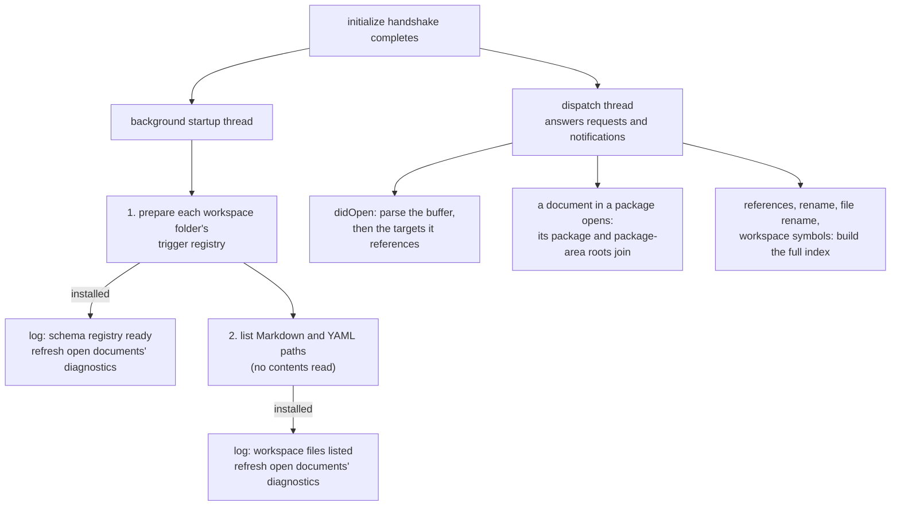
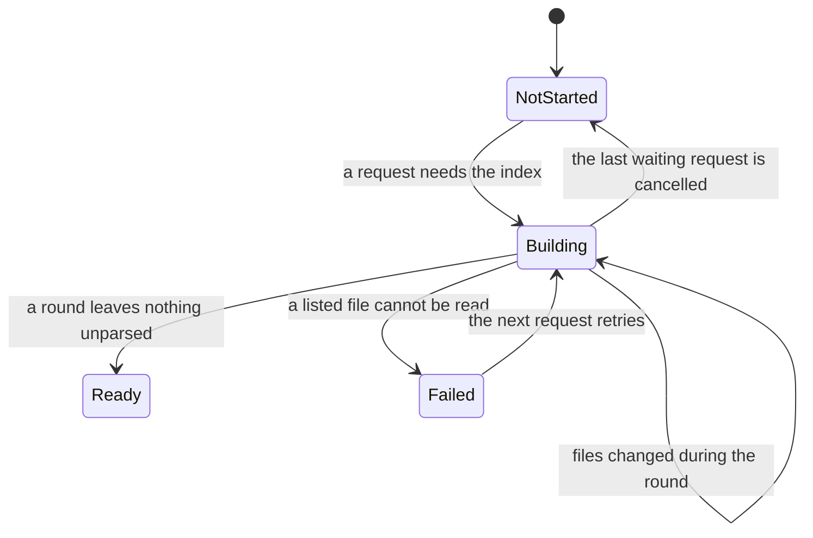

# DMLS Workspace Indexing

This page explains how DMLS (`darkmatter/dmls`) finds out what is in a
workspace: which schema files apply, which files exist, and which documents
it reads. It also describes the log lines each step writes. Use it to find
out why a diagnostic has not appeared yet, why the first "find references"
takes longer than the next one, or what a line in the DMLS log means.

The short version:

- **Startup reads very little.** DMLS loads the schema files that apply to
  each workspace folder, then lists file paths without reading them. Open
  documents are parsed when the editor opens them.
- **Other documents are read only when a feature needs them.** Hovering a
  link to `guide.md` parses `guide.md`, and nothing else.
- **Every document is read only for features that need all of them.** Find
  references, rename, file rename, and workspace symbols build the full
  index the first time one of them is used.

[LSP Architecture](./architecture.md) covers the server's state and how file
references resolve. [DMLS Configuration](./configuration.md) covers the
`[workspace]` keys that decide which files are listed.

## Startup

### What happens, in order

The `initialize` handshake completes before any indexing starts, so the
editor gets its capabilities at once. Then one background thread
(`spawn_startup` in [`router.rs`](../../dmls/src/router.rs)) does two things
in order:

1. **Prepare the schema registry.** For each workspace folder, it loads the
   trigger schemas a document directly in that folder would use
   (`OverlayState::prepare_workspace_registries`). The folder is prepared as
   if for a document named `<folder>/.dmls-workspace`. That name is only a
   key; DMLS never reads such a file, and it does not need to exist.
2. **List the files.** It walks each workspace folder and records the paths
   of Markdown and YAML files. It reads no file contents.

Each result is handed back to the dispatch thread, which installs it between
client messages, writes a log line, and re-publishes diagnostics for the open
documents. Meanwhile the dispatch thread keeps answering requests, edits,
cancellation, and shutdown.



| Step | Reads file contents? | When |
| --- | --- | --- |
| Schema registry | the YAML files directly inside the schema roots, plus the payload, import, and example files their triggers name | first, on the startup thread |
| File list | no | after the registry, on the startup thread |
| Open documents | the editor's buffers | as the editor opens them |
| Referenced targets | each target, once until it changes | the first time a feature needs its headings or transclusions |
| Full index | every listed Markdown file | the first references, rename, file-rename, or workspace-symbols request |

Startup prepares only each workspace folder's own context. A document inside
a package, below the folder, also searches that package's and package area's
`schemas/` folders. Those roots are loaded when such a document is first
analyzed, before its schema-dependent answers.

While the file list is being built, the editor shows progress under the
token `dmls/startup-index` ("Listing workspace files"), if it supports
`window.workDoneProgress`. The progress ends after the list is installed and
the open documents' diagnostics are refreshed.

### Requests wait only for what they need

Nothing waits for startup as a whole. Each feature waits for its own
prerequisite, if any:

| Feature | Waits for |
| --- | --- |
| Any request on an open document (formatting, folding, symbols, completion, hover, …) | the document's trigger registry, which every overlay build looks up; a registry that is not prepared yet is prepared on the spot. Never the file list |
| Hover, definition, and completion on a link | also the target under the cursor, parsed on the spot (see [Referenced targets](#referenced-targets)) |
| Broken-link, transclusion, and wiki-link diagnostics | the file list (see [Diagnostics that wait for the list](#diagnostics-that-wait-for-the-list)) |
| Find references, rename, `workspace/willRenameFiles`, workspace symbols | the full index (see [The full index](#the-full-index)) |
| `textDocument/prepareRename` | nothing; it checks only the local rename target |

The startup thread holds the overlay lock for one workspace folder at a time,
so a document request that arrives during startup waits at most for
the folder being prepared.

## The schema registry

The schema registry is DMLS's in-memory copy of the schema files in every
schema root it has searched. It answers "which trigger schemas apply to this
document?" without touching disk. The code is in
[`overlay/registry.rs`](../../dmls/src/overlay/registry.rs) and
[`overlay/mod.rs`](../../dmls/src/overlay/mod.rs). For what trigger schemas
are and how they match, see
[Schema Definition](../topics/schemas/definition.md#repository-trigger-schemas)
and [DMLS Schema Support](../topics/schemas/dmls-schema-support.md).

### Where schema files are found

Each document has the five schema roots described in
[Schema roots](../topics/schemas/definition.md#schema-roots), most local
first:

1. `{package}/schemas/`
2. `{package area}/schemas/`
3. `{file tree root}/schemas/` (the repository root in a repository)
4. the folder `SCHEMAS_DIR` names
5. `~/schemas/`

Only the **immediate** `.yaml` and `.yml` children of a root are read;
subfolders are not searched. The workspace's `include`, `exclude`, and
ignore files do not apply here: a root above the workspace folder, or in your
home folder, still counts. DMLS discovers triggers only for documents inside
an open workspace folder.

### How each file is classified

Every file in a searched root is classified once, from its text alone:

| Class | What it is | Example |
| --- | --- | --- |
| named schema | a standalone SimplifiedSchema document, usable by `$schema: name.yaml` and by trigger payloads | `prompt.yaml` declaring `kind: object` fields |
| trigger schema | a file that declares `kind: trigger-schema` and loads | `prompt.trigger.yaml` with `match:` and `$schema:` |
| failed trigger | a file that declares `kind: trigger-schema` but does not load (bad YAML, bad `match`) | a trigger whose `match:` has a typo |
| unclassified | anything else, including YAML that does not parse and claims no trigger envelope | a half-edited `notes.yaml` |

An unclassified file never fails trigger discovery, so a mid-edit,
unrelated YAML file in `schemas/` is silent. A failed trigger does fail its
scope (see [Failures](#failures)).

A document's registry is its five roots' triggers with the usual
**filename shadowing**: the first root that holds a filename wins, and the
same name in a later root is never evaluated. This includes a file that is
not a trigger; an unclassified `tree.trigger.yaml` in the package root still
hides a `tree.trigger.yaml` in `~/schemas/`. The result is the same, trigger
for trigger and in the same order, as what `md` discovers for that document.

Root contents are shared: two documents whose roots include the same folder
read it once. Each document's registry is kept separately, because payloads
and `$path` patterns resolve in that document's own context.

### Ready lookups do no I/O

Once a document's registry is ready, looking it up again lists no folder,
reads no file, hashes nothing, and resolves no payload. DMLS prepares it
again only when one of its inputs changes. Other parts of schema assembly,
such as the document's own `$schema` file and its imports, are still checked
for changes on each lookup.

### When the registry changes

| Input | Effect |
| --- | --- |
| `workspace/didChangeWatchedFiles` for a known file | re-read; its xxHash is compared with the recorded one, and only a changed file is reclassified and its scopes prepared again |
| a file created or deleted in a searched root, or in a folder holding a payload, import, or example | the affected registries are prepared again (no hash to compare) |
| `textDocument/didSave` of any `.yaml` or `.yml` file, open in the editor or not | the same as a watched change for that path |
| a server rescan (see below) | every registry is marked stale; each file is re-hashed on next use and keeps its class if unchanged |
| a configuration change, or a watched `.dmls.toml` | every registry is marked stale |
| a watched package manifest (`Cargo.toml`, `package.json`, `pyproject.toml`, `go.mod`) or `.git/config` | every registry is marked stale, since a root can move |

Each preparation records what it read: the searched and absent root folders,
every root file and dependency with its xxHash, and the folders that hold the
dependencies. A dependency can live anywhere, even outside every workspace
folder. A scope that failed is prepared again after any change it recorded,
so creating a missing payload file recovers it.

Unsaved edits to a schema file do not affect other documents. The registry
reads disk, so a change applies after you save.

### Watching schema folders

Schema roots and dependency folders can sit outside the workspace, where the
workspace's file watchers do not reach. A client that supports watchers
rooted at a folder (`relativePatternSupport`) is also asked to watch each of
those folders, including a root that does not exist yet.

When the client lacks that support or rejects the registration, DMLS falls
back to the save: **every save marks every registry stale**, and the next
lookup re-checks its inputs. In that mode an edit made outside the editor
(say, `git pull` changing `~/schemas/prompt.trigger.yaml`) is noticed on the
next save of any file, or on restart. DMLS never polls.

A client with no reliable file watcher at all runs in server-rescan mode:
each save re-lists the workspace and marks every registry stale. See
[Invalidation](./architecture.md#invalidation).

### Failures

A scope here is one document's registry, logged under the document's folder.

- **A trigger fails to load.** If the document had a working registry
  before, DMLS keeps using that last-good registry and publishes a
  diagnostic on the failing trigger file. A malformed trigger affects only
  the documents for which it is not shadowed. If there was no last-good
  registry, the document gets no triggers, and the failure is reported
  without claiming triggers are ready.
- **A root cannot be read.** An I/O error listing or reading a schema root
  fails closed: the document gets the failure, never a last-good registry and
  never a file from a less local root. Other, healthy scopes still load.
- **Recovery.** When the next preparation succeeds, the trigger-file
  diagnostic is cleared, open documents are refreshed, and one `info` line is
  logged.

Each failure is logged once when it is new; see
[Trigger registry lines](#trigger-registry-lines).

## The file list

The file list is the set of paths DMLS knows exist in the workspace. It is
built by [`workspace/discover.rs`](../../dmls/src/workspace/discover.rs) and
kept current through [`workspace/watch.rs`](../../dmls/src/workspace/watch.rs).
It decides which Markdown files are workspace documents (graph nodes, path
completion candidates, wiki-link targets); whether a path exists on disk is
still decided by resolving it.

### What is listed

One walk runs per effective workspace root (each workspace folder, with
`workspace.root` applied). Patterns are matched against the path relative to
that root.

- **Markdown**: files that match `workspace.include` (default `**/*.md` and
  `**/*.markdown`) and do not match `workspace.exclude`.
- **YAML**: every `*.yaml` and `*.yml` file that does not match
  `workspace.exclude`. `include` does not apply to YAML, so an empty
  `include` lists no Markdown but still lists YAML.

YAML entries never become documents in the link graph. See
[DMLS Configuration](./configuration.md) for the `[workspace]` keys.

### What is skipped

| Rule | Example |
| --- | --- |
| `.gitignore`, `.ignore`, `.git/info/exclude`, and the global Git excludes file are honored, also in a folder that is not a Git repository | `node_modules/` in `.gitignore` is never listed |
| every directory named `.git` is skipped | `.git/COMMIT_EDITMSG.md` is never listed |
| hidden directories are walked | `.claude/skills/x/SKILL.md` is listed |
| symlinks are not followed, and a symlinked file is skipped | `alias.md -> README.md` lists only `README.md` |
| a second path to the same physical file (by canonical path) is a duplicate, logged at `warn` and not listed | two overlapping workspace folders |

The walk reads directory entries only, never file contents.

### Incomplete lists

A walk error, such as an unreadable directory, does not stop the walk. It
marks the list **incomplete** and logs `workspace discovery incomplete`.
DMLS never treats absence from an incomplete list as proof that a file is
missing.

### Keeping the list current

| Event | Effect |
| --- | --- |
| a watched Markdown or YAML file is created, changed, or deleted | that path joins or leaves the list, judged by the same include, exclude, and ignore rules as the walk |
| a watched `.gitignore` or `.ignore` changes | the workspace is listed again |
| a watched `.dmls.toml` changes, or the `[workspace]` settings change | the configuration reloads, the workspace is listed again, and the watchers are registered again |
| a save in server-rescan mode | the workspace is listed again and `workspace rescan complete` is logged |

Listing again reads no file contents. `.git/info/exclude` sits inside `.git`
and is not watched, so a change to it takes effect on the next rescan,
configuration change, or restart.

### Diagnostics that wait for the list

Some diagnostics depend on which paths exist. Publishing them before the list
is ready could report a link broken that is not. While the list is pending,
these codes are withheld:

- `dm.links.broken_path` and `dm.links.missing_anchor`
- `dm.transclusion.broken_path` and `dm.transclusion.cycle` (`::file` and
  `::code`)
- `wiki.unresolved-target`, `wiki.ambiguous-target`, and
  `wiki.heading-missing-in-target`

Every other diagnostic (syntax, frontmatter, schema) publishes at once. When
the list is installed, the open documents' diagnostics are refreshed with
the withheld codes included. If the list is incomplete, the wiki-link codes
stay withheld, because wiki-link resolution is decided by the list alone;
the other codes are decided by disk and publish.

A missing `$schema` target does not wait. It is decided by resolving the
reference on disk, so the list's state cannot make it wrong.

See [DMLS Diagnostics](../../dmls/docs/diagnostics.md) for what each code
means.

## Referenced targets

A workspace document that is not open is parsed only when a feature needs
its contents:

| Feature | What it reads from the target |
| --- | --- |
| missing-anchor diagnostic (`guide.md#setup`, `[[guide#setup]]`) | headings |
| heading completion after `#` | headings |
| hover preview or definition on a link | headings |
| transclusion cycle detection | its `::file`/`::code` targets, followed outward from the open document |

For example, opening `a.md` that contains `[setup](guide.md#setup)` parses
`a.md` and `guide.md`, and no other file. If `a.md` contains
`::file ./part.md`, and `part.md` transcludes `./more.md`, both are parsed to
look for a cycle. Until a target is parsed, its anchors are neither resolved
nor reported missing.

The code is `WorkspaceIndex::prepare_targets` and `ensure_parsed` in
[`graph/invalidate.rs`](../../dmls/src/graph/invalidate.rs). The rules:

- **Cache.** A parsed target is kept in memory, keyed by path, with the
  xxHash of the bytes it was parsed from.
- **Stale marking.** A watched change to a parsed, closed document marks it
  stale but keeps the old parse. The next need re-reads it and reuses the
  parse when the xxHash is unchanged. A server rescan re-reads every parsed,
  closed document at once, with the same reuse. A deletion removes it.
- **Failed reads.** A target that cannot be read loses its parse, so old
  headings are never served. It stays in the list, unparsed.
- **Open buffers win.** An open buffer replaces the disk parse, including an
  unsaved file that is not on disk. Closing it restores the disk view: a
  listed file becomes unparsed again, and an unsaved or unlisted document
  leaves the index.
- **Only workspace documents.** A target outside the file list (above the
  workspace folder, in your home folder) still resolves, but it is not
  parsed and its anchors are not checked.
- **Passive.** Parsing never composes, runs shell expressions, or fetches
  remote content. `::code` targets are not parsed as Markdown.

All parsing runs on the dispatch thread under the index lock, so two
requests for the same target share one parse, and a newer buffer can never
be overwritten by an older read.

## The full index

Some features need every Markdown document's contents. They build the
**full index**, in which every listed Markdown file is parsed. The code is
[`full_index.rs`](../../dmls/src/full_index.rs) and the router.

| Request | Why it needs every document |
| --- | --- |
| `textDocument/references` (headings, links, wiki links) | backlinks can be in any file |
| `textDocument/rename` (headings) | an unparsed file's links would be left broken |
| `workspace/willRenameFiles` | the same, for links to the renamed file |
| `workspace/symbol` | every heading |

The first such request starts the build and waits for it. Later requests of
the same kinds answer at once. `textDocument/prepareRename` never waits.

### Build states



- **Shared build.** A request that arrives while the index builds waits on
  the same build. Waiters are answered in arrival order.
- **Rounds, off the lock.** Each round takes the list of unparsed or stale
  files, then a background worker pool reads and parses them without holding
  the index lock. The dispatch thread keeps answering edits, cancellation,
  and shutdown. When the round returns, any file whose disk, buffer, or list
  state changed during the round has its parse discarded, and another round
  reads it again. The index becomes ready only when a round leaves nothing
  unparsed.
- **Waiting for the list.** A build started before the file list is ready
  waits for it first.
- **Diagnostics first.** When the index becomes ready, DMLS refreshes the
  open documents' diagnostics before it answers the waiters, so a response
  can be treated as a barrier.
- **Kept current.** Once ready, the index stays current file by file: a
  watched change or a newly listed file is parsed at once.

### Failure, cancellation, and shutdown

| Event | What the waiting requests get |
| --- | --- |
| a listed Markdown file cannot be read (for example, it is not valid UTF-8) | LSP error `RequestFailed` (-32803), with a message naming the file; the state becomes `Failed` |
| one waiting request is cancelled | that request gets `RequestCanceled`; the build continues for the others |
| the last waiting request is cancelled | `RequestCanceled`, and the build is dropped; its partial parses are discarded |
| `shutdown` arrives during a build | `ServerCancelled`, before the `shutdown` response |

A failed build blocks references, rename, file rename, and workspace symbols
until the file is fixed or excluded, because a partial index would produce
incomplete results or rename edits that miss links. Each request retries the
build. A file deleted or renamed during the round does not fail it. Features
that parse targets on demand are unaffected.

```text
dmls could not build the workspace index: /repo/notes/latin1.md could not be read (stream did not contain valid UTF-8)
```

### Progress

A client that sets `window.workDoneProgress` sees the build as progress
under the token `dmls/full-index`, from the first round to the last. Other
clients get no progress messages.

### Measuring the full index

`dmls --bench-index <dir>` lists `<dir>` and parses every Markdown file in
it, then prints stage timings and exits. It measures the full index, not
startup. Pass an absolute path; a relative one fails to build a resolution
context.

## Log lines

### Where logs go

DMLS logs to stderr, or with `--log-file <path>`, appends to that file.
Logs never go to stdout, which carries the protocol. `--log-level` sets the
filter (`error`, `warn`, `info`, `debug`, `trace`, or any `RUST_LOG`-style
directive) and overrides `RUST_LOG`; the default is `info`.

Each line is the timestamp, the level, the module, the message, then
`key=value` fields. Text fields from the protocol (`method`, `uri`,
`outcome`) are quoted; other fields are not. The samples below show one line
each.

| Message | Level | When |
| --- | --- | --- |
| `schema registry ready` | `info` | startup registry preparation finishes with no failed scope |
| `schema registry initialized with failures` | `info` | the same, when `failed_scopes` is above zero |
| `workspace files listed` | `info` | the startup file list is installed |
| `workspace rescan complete` | `info` | a server rescan has listed the workspace again |
| `full index built` | `info` | a full-index build becomes ready |
| `full index build failed` | `warn` | a full-index build could not read a listed file |
| `retaining last-good trigger registry` | `warn`, then `debug` | a trigger fails to load and a last-good registry is kept |
| `trigger registry unavailable` | `warn`, then `debug` | a trigger or root fails with no last-good registry |
| `trigger registry recovered` | `info` | a scope loads after a recorded failure |
| `skipping duplicate physical file …` | `warn` | a second path to an already listed file |
| `workspace discovery incomplete` | `warn` | a listing walk hit an error |
| `slow request` / `request complete` | `warn` / `debug` | every request, by elapsed time |
| `slow notification` / `notification complete` | `warn` / `debug` | every notification, by elapsed time |

Earlier versions logged `startup index complete documents=…` after parsing
every file at startup. That line no longer exists; startup now logs the
registry and file-list lines, and `full index built` appears only when a
feature builds the full index.

### The `workspace` field

Every startup and index line carries `workspace`, so lines from several
servers sharing one log file can be told apart. It is:

1. the client's workspace-folder URIs, comma-joined, when it sent any;
2. otherwise the client's root URI;
3. otherwise the root paths, comma-joined.

There is one line per server, not one per folder. With two folders open:

```text
workspace=file:///Users/me/repo/docs,file:///Users/me/repo/claudine
```

The code is `workspace_identifier` in
[`workspace/mod.rs`](../../dmls/src/workspace/mod.rs).

### Schema registry lines

```text
2026-10-17T09:14:02.481233Z  INFO dmls::router: schema registry ready roots=2 tree_schemas=14 scoped_schemas=0 trigger_schemas=5 unclassified=1 failed_triggers=0 failed_scopes=0 elapsed_ms=41 workspace=file:///Users/me/repo
```

| Field | Meaning |
| --- | --- |
| `roots` | distinct schema folders searched across the scopes prepared so far; a folder searched by several scopes, or in several roles, counts once. Absent folders are not counted |
| `tree_schemas` | named schemas in folders that serve as a file tree root, `SCHEMAS_DIR`, or home root |
| `scoped_schemas` | named schemas in folders that serve only as package or package-area roots |
| `trigger_schemas` | trigger schemas that load, in any searched folder |
| `failed_triggers` | files that declare `kind: trigger-schema` but fail to load |
| `unclassified` | other YAML files in searched folders |
| `failed_scopes` | prepared scopes whose last preparation failed |
| `elapsed_ms` | wall time to prepare every workspace folder's registry, including loading trigger payloads |

The counting rules:

- File counts are **distinct files** across the searched folders, before
  per-document shadowing. A file that one document shadows still counts.
- Every file in a searched folder is counted in exactly one of
  `tree_schemas`, `scoped_schemas`, `trigger_schemas`, `failed_triggers`, or
  `unclassified`.
- A folder that is both a scoped root and a tree root counts once, as
  tree-wide. In a repository that is itself a package, `{repo}/schemas/` is
  both the package root and the file tree root, so its named schemas count
  in `tree_schemas`.
- Startup prepares only the workspace folders' own contexts. Package and
  package-area roots below a folder are not counted here; they join later,
  when a document in them is analyzed, and are not logged again.

### File list lines

```text
2026-10-17T09:14:02.655012Z  INFO dmls::router: workspace files listed markdown=5676 yaml=272 duplicates=0 elapsed_ms=173 workspace=file:///Users/me/repo
2026-10-17T09:31:47.090551Z  INFO dmls::router: workspace rescan complete markdown=5677 yaml=272 duplicates=0 elapsed_ms=168 workspace=file:///Users/me/repo
```

| Field | Meaning |
| --- | --- |
| `markdown`, `yaml` | accepted, deduplicated entries in the list, not every file on disk |
| `duplicates` | paths skipped as a second path to an already listed file; each is also logged on its own `warn` line |
| `elapsed_ms` | wall time of the walk |

Related warnings:

```text
2026-10-17T09:14:02.650110Z  WARN dmls::workspace::startup: skipping duplicate physical file /Users/me/repo/docs/guide.md
2026-10-17T09:14:02.651420Z  WARN dmls::workspace::startup: workspace discovery incomplete errors=1 first_error="IO error for operation on /Users/me/repo/locked: Permission denied (os error 13)"
```

### Full index lines

```text
2026-10-17T09:20:11.904772Z  INFO dmls::router: full index built markdown=5676 headings=48211 links=30455 trigger=references elapsed_ms=4857 workspace=file:///Users/me/repo
```

| Field | Meaning |
| --- | --- |
| `markdown` | listed Markdown files |
| `headings` | headings across every indexed document |
| `links` | Markdown links plus wiki links; images and transclusions are not counted |
| `trigger` | the request that started the build: `references`, `rename`, `file-rename`, or `workspace-symbols` |
| `elapsed_ms` | wall time from the first waiting request to ready, including any wait for the file list and every round |

A failed build logs instead:

```text
2026-10-17T09:20:09.118300Z  WARN dmls::router: full index build failed unreadable=1 first=/Users/me/repo/notes/latin1.md error=stream did not contain valid UTF-8 trigger=references workspace=file:///Users/me/repo
```

At `debug`, `full index build started` (with `trigger` and `awaiting_list`)
and `full index build cancelled` mark the start and a dropped build.

### Trigger registry lines

These lines report changes in a scope's state, not every lookup. The code
is `record_failure`, `record_recovery`, and `log_failure` in
[`overlay/registry.rs`](../../dmls/src/overlay/registry.rs).

```text
2026-10-17T10:02:13.552018Z  WARN dmls::overlay::registry: retaining last-good trigger registry scope=/Users/me/repo/docs trigger_file=/Users/me/repo/schemas/prompt.trigger.yaml error=trigger-schema file `/Users/me/repo/schemas/prompt.trigger.yaml` is not valid YAML at line 17, column 93: mapping values are not allowed in this context has_last_good=true
2026-10-17T10:04:40.008163Z  INFO dmls::overlay::registry: trigger registry recovered scope=/Users/me/repo/docs trigger_file=/Users/me/repo/schemas/prompt.trigger.yaml
```

| Event | Level | Message | Fields |
| --- | --- | --- | --- |
| load fails, last-good registry kept; first failure, or a different file or error text | `warn` | `retaining last-good trigger registry` | `scope trigger_file error has_last_good` |
| the same failure again (same file and error text) | `debug` | `retaining last-good trigger registry` | the same |
| load fails with no last-good registry (a first load, or any root I/O failure) | `warn`, then `debug` on a repeat | `trigger registry unavailable` | `scope trigger_file error` |
| load succeeds after a recorded failure | `info` | `trigger registry recovered` | `scope trigger_file` |

`scope` is the folder of the document whose registry failed; `trigger_file`
is the file or folder the error names, empty when it names none. The rule
that decides "this failure is new" is the same one that decides whether the
trigger-file diagnostic is published again, so a repeated failure is neither
re-published nor re-logged at `warn`.

### Request timing lines

Every request and notification ends in exactly one timing event, on every
path: a result, an error response, a cancellation, or a caught panic. The
code is [`request_timing.rs`](../../dmls/src/request_timing.rs) and
`handle_request` in [`router.rs`](../../dmls/src/router.rs).

- A **request** is measured from the moment the dispatch thread dequeues it
  until its response is sent, including any wait for the full index or the
  file list.
- A **notification** has no response; it is measured until its handler
  returns. Work it hands off (debounced diagnostics publishing, the startup
  walk) is not included.
- At or above **500 ms** (a constant, `SLOW_THRESHOLD`), the event is a
  `warn`: `slow request` or `slow notification`. Below it, the event is a
  `debug`: `request complete` or `notification complete`. To see every
  request, run with `--log-level debug`.

```text
2026-10-17T09:15:40.112903Z  WARN dmls::request_timing: slow request method="textDocument/hover" uri="file:///Users/me/repo/docs/guide.md" id=14 outcome="ok" elapsed_ms=612 overlay_build_ms=598 schema_assembly_ms=590 trigger_registry_ms=571 provider_chain_ms=9 waited_for_file_list=false waited_for_full_index=false
2026-10-17T09:20:11.905130Z  WARN dmls::request_timing: slow request method="textDocument/references" uri="file:///Users/me/repo/docs/guide.md" id=21 outcome="ok" elapsed_ms=4858 overlay_build_ms=1 schema_assembly_ms=0 trigger_registry_ms=0 provider_chain_ms=3 waited_for_file_list=false waited_for_full_index=true
2026-10-17T09:15:41.020447Z DEBUG dmls::request_timing: request complete method="workspace/symbol" id=15 outcome="cancelled" cancelled=true elapsed_ms=12 waited_for_file_list=false waited_for_full_index=true
```

| Field | Meaning |
| --- | --- |
| `method` | the LSP method |
| `uri` | the message's `textDocument.uri`; omitted when it names no document (workspace symbols, `workspace/willRenameFiles`, `$/cancelRequest`) |
| `id` | the request id, to tell overlapping requests apart; omitted for notifications |
| `outcome` | `ok`, `error` (an error response, including `RequestFailed`), `panic`, or `cancelled` (`RequestCanceled` or `ServerCancelled`) |
| `cancelled` | `true`, present only when `outcome` is `cancelled` |
| `elapsed_ms` | the measured total described above |
| `overlay_build_ms`, `schema_assembly_ms`, `trigger_registry_ms`, `provider_chain_ms` | time in each stage; omitted for a stage that did not run |
| `waited_for_file_list` | the request waited for the startup file list (today, only a full-index build started before the list was ready) |
| `waited_for_full_index` | the request waited for a full-index build |

Stage times **nest**; they are not parts of `elapsed_ms` to be added up:

```text
elapsed_ms                       dequeue to response sent, including waits
├── overlay_build_ms             building the document's frontmatter overlay
│   └── schema_assembly_ms       assembling its effective schema
│       └── trigger_registry_ms  looking up its trigger registry
└── provider_chain_ms            running the feature's providers
```

When the document is itself a trigger-schema file being authored,
`trigger_registry_ms` is timed directly under the overlay build. A stage that
runs more than once in one message, such as a notification that refreshes
every open document, reports the sum of its runs. In the hover sample above,
almost all the time is in the trigger registry, which points at a registry
preparation; in the references sample, almost all of it is the wait for the
full index.

Timing events never contain source text, frontmatter values, or protocol
payloads. At `debug`, the `lsp_server` crate's own transport trace does
print whole protocol messages; filter it with a directive such as
`--log-level debug,lsp_server=info`.
