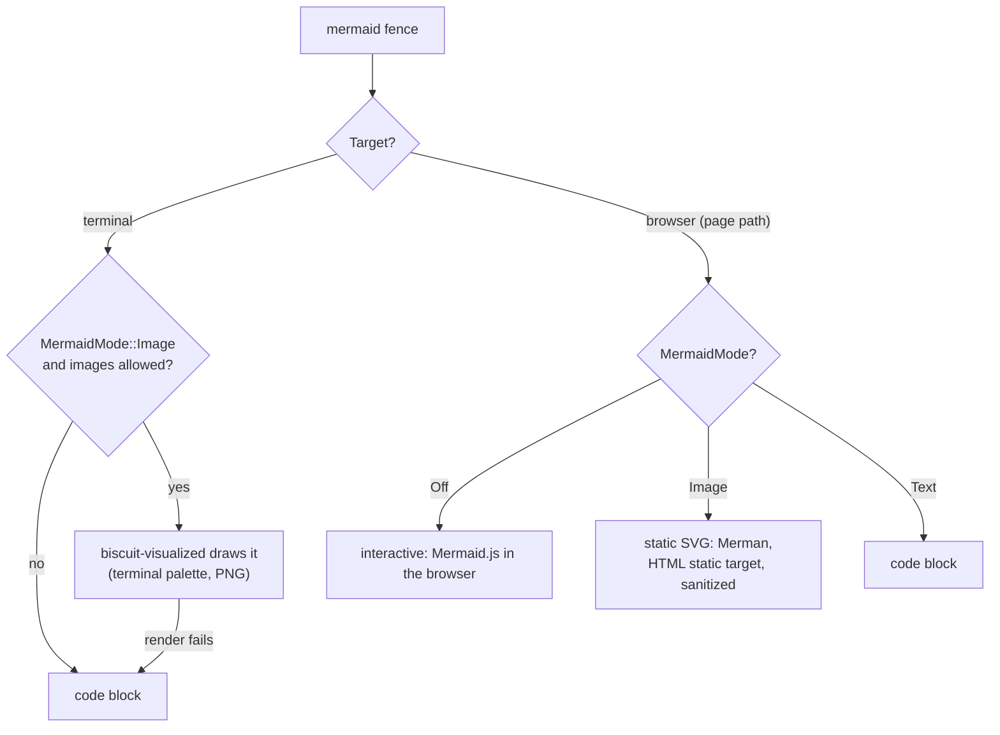
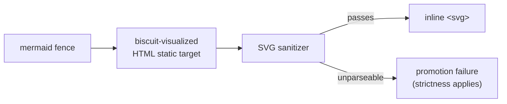

# Mermaid Rendering in Darkmatter

## Overview

Darkmatter recognizes fenced code blocks tagged with the `mermaid` language
(case-insensitive) and decides, per output target, whether to show the fence
as code or as a drawn diagram. Darkmatter draws no diagram itself:
[`biscuit-visualized`](../../../biscuit-visualized/README.md) renders it in
pure Rust with [Merman](../../../biscuit-visualized/docs/merman.md#what-merman-is),
a Rust reimplementation of Mermaid.js, and
[`biscuit-terminal`](../../../biscuit-terminal/README.md) puts the image on
the screen. The browser's interactive mode is the exception: there the
reader's browser runs Mermaid.js itself.

One setting, the [`MermaidMode`](../../lib/src/markdown/output/terminal.rs)
enum (re-exported as `darkmatter::markdown::output::MermaidMode`), decides
what a fence becomes:

| Variant         | Terminal                                                      | Browser (Darkmatter page path)                                    |
|-----------------|---------------------------------------------------------------|-------------------------------------------------------------------|
| `Off` (default) | Regular code fence with syntax highlighting.                  | **Interactive** `<pre class="mermaid">` + injected ESM bootstrap. |
| `Image`         | Inline diagram image, drawn in-process by Merman (opt-in).    | Rendered static `<svg>` (an explicit static opt-in).              |
| `Text`          | The same code fence as `Off`.                                 | `<pre><code class="language-mermaid">` code block.                |



`MermaidMode` is a field of both `TerminalOptions` and `HtmlOptions`, so the
same knob controls `Markdown::as_terminal` / `Markdown::as_html` and the
higher-level
[`DarkmatterPage::with_mermaid_mode`](../../lib/src/layout/page.rs) builder:

```rust
use darkmatter::markdown::output::MermaidMode;

let page = DarkmatterPage::new(&terminal).with_mermaid_mode(MermaidMode::Image);
let text = page.render(&markdown)?; // fences become inline images where the terminal allows
```

The **browser** column above is Darkmatter's page browser path, shared by both
`DarkmatterPage::render_to_browser` (a **body-only** HTML fragment, with no
`<!DOCTYPE>`/`<html>`/`<head>`/`<body>` scaffold, for embedding a render into a
host document) and `DarkmatterPage::render_to_browser_document` (a complete
**standalone `<!DOCTYPE html>` document** with a real `<head>`, which the `md`
CLI uses for HTML output; see [`artifact.rs`](../../cli/src/artifact.rs)). Both remap
`MermaidMode` onto `renderable`'s `BrowserMermaidMode` in
[`render_tree/entrypoints.rs`](../../lib/src/markdown/render_tree/entrypoints.rs):
`Off → Interactive`, `Image → StaticSvg`, `Text → Code`. The low-level
`renderable` browser renderer keeps `BrowserMermaidMode::Code` as its own
default, and `Markdown::as_html` maps `Off → Code` (it does not opt into the
interactive default), so only the Darkmatter page browser path is interactive
by default. See [Rendering to the Browser](#rendering-to-the-browser).

The [`Mermaid`](../../lib/src/mermaid/mod.rs) struct is a standalone
convenience API, not part of the page pipeline: it holds a diagram's source
and an optional title, `render_for_terminal()` draws it through
[`render_terminal.rs`](../../lib/src/mermaid/render_terminal.rs) (a thin
wrapper around `biscuit_visualized::components::mermaid::MermaidDiagram`,
re-exporting its `MermaidRenderError`), and `alt_text()` returns the title
or, without one, a description of the diagram type from
`detect_diagram_type` (for example `"Sequence diagram"`, or the generic
`"Mermaid diagram"`).

## Rendering to the Terminal

Terminal output goes through the render tree
([`render_tree/entrypoints.rs`](../../lib/src/markdown/render_tree/entrypoints.rs)).
It installs biscuit-visualized's `TerminalDiagramRenderer` as the render
options' **diagram hook**, the callback biscuit-terminal's tree renderer calls
for a `mermaid` fence; biscuit-terminal draws no diagrams itself, so without
that hook every fence would stay code. A fence becomes an image only when
both hold:

- the caller opted in with `MermaidMode::Image` (`Off` and `Text` keep the
  fence as a syntax-highlighted code block);
- images are allowed: `TerminalOptions::image_mode` is not `Never` (the `md`
  CLI sets it from `TERMINAL_IMAGES`; `TERMINAL_IMAGES=0` turns images off).

The hook sizes the diagram to the columns the fence occupies (a list item's
or a quote's inner width, not the whole terminal) and draws it with the
[terminal palette](../../../biscuit-visualized/docs/merman.md#terminal-palettes):
the terminal's own background, text, and ANSI colors where it reports them,
otherwise the fixed palette for its light or dark mode.

```sh
md --mermaid README.md                     # fences drawn as images
TERMINAL_IMAGES=0 md --mermaid README.md   # images off: fences stay code
```

When the diagram cannot be drawn (the terminal shows no images, the source
does not parse, or
[another render failure](../../../biscuit-visualized/docs/merman.md#when-a-diagram-falls-back-to-its-source)),
the fence is rendered as its code block instead and the render records a
"Mermaid rasterization failed, falling back to code block" diagnostic. Under
strict rendering the failure is an error instead.

## Rendering to the Browser

Browser Mermaid is a page **feature**, resolved by
[`DarkmatterFeatureResolver`](../../lib/src/mermaid/feature.rs), the single
owner of Mermaid browser assets. When a `mermaid` fence is rendered through
Darkmatter's page browser path (`DarkmatterPage::render_to_browser` for a
body-only fragment, or `render_to_browser_document` for a standalone
document), the render-tree browser writer emits the interactive body element
and requests `PageFeature::MermaidDiagram`; the resolver then supplies the
shared assets, which are injected once per page (deduplicated in first-seen
order):

- **Body**: a `<pre class="mermaid">` element whose contents are the
  HTML-escaped diagram source, so a screen reader (and any reader whose browser
  cannot load the module) sees readable source.
- **Palette**: delivered through Mermaid's own `themeVariables` (baked into the
  bootstrap's `mermaid.initialize` call with `theme: 'base'`), never through CSS:
  Mermaid does not read CSS custom properties, so **no CSS block is injected**.
  A single palette is resolved for the document's color mode and fixed at init:
  [`mermaid_theme_for_syntect`](../../lib/src/mermaid/theme.rs) returns
  `DEFAULT_LIGHT_THEME` for a light page and `DEFAULT_DARK_THEME` otherwise,
  whatever the prose or code theme. There is no live `prefers-color-scheme`
  switch, because Mermaid's SVG colors are chosen once at init and would
  require a JS re-render to change.
- **Injected script**: an inline `<script type="module">` bootstrap that
  dynamically imports the exact `MERMAID_VERSION` (currently Mermaid.js 11.6.0,
  never a floating major tag) from `cdn.jsdelivr.net` (primary), retries the
  identical version from `unpkg.com` (fallback), and calls
  `mermaid.run({ querySelector: '.mermaid' })` so only `.mermaid` elements
  initialize. A total load failure logs one `console.error` and leaves the
  readable source visible.

```html
<pre class="mermaid">flowchart LR
    A --&gt; B</pre>
<script type="module">/* imports mermaid@11.6.0, initializes, runs */</script>
```

The interactive experience is Darkmatter's page browser default. The
low-level `renderable` browser renderer keeps `BrowserMermaidMode::Code`, so a
caller constructing `BrowserRenderOptions::default()` (or using `Markdown::as_html`
without opting in) still renders Mermaid as a plain code block, and terminal
output stays code unless the caller opts into `MermaidMode::Image`.

Delivery requires network access at view time and a Content Security Policy that
permits both CDN origins and inline modules. No diagram source or document
metadata is sent anywhere except the browser's module fetch; Mermaid runs locally
in the browser.

The interactive page is drawn by Mermaid.js 11.6.0, while the static SVG
below is drawn by Merman, which models Mermaid.js 12.2.0, so the same diagram
can look slightly different in the two modes.

### Static SVG (`MermaidMode::Image`)

With `MermaidMode::Image` the page browser path embeds the finished diagram as
an inline `<svg>` instead of the interactive source, so the page needs no
script, network, or CSP allowance:

```rust
let html = DarkmatterPage::new(&terminal)
    .with_mermaid_mode(MermaidMode::Image)
    .render_to_browser(&markdown)?;
```



The SVG is rendered by `biscuit-visualized` (Merman) in
[`code_renderer.rs`](../../lib/src/markdown/render_tree/code_renderer.rs)
with its
[**HTML static** target](../../../biscuit-visualized/docs/merman.md#html-static-target),
with a transparent background and the same terminal palette as the terminal
path: the colors of the terminal `md` runs in, or the fixed palette for its
color mode when there is none. It differs from the SVG that is rasterized for
the terminal in two ways, because the reader's browser fonts are unknowable:

- **Measured face first.** Each label's `font-family` starts with the exact
  face its box was measured with, followed by Merman's original stack, for
  example `'Trebuchet MS',"trebuchet ms",verdana,arial,sans-serif`. A reader who
  has that face sees the text fit its box exactly; anyone else falls back to
  the original stack.
- **Labels may overflow.** Where Merman clips label text to its box (nested
  `<svg>` viewports with `overflow:hidden`, used by class, ER, mindmap, and
  state labels), the overflow is made `visible`, so a wider fallback face
  spills past its box rather than being cut off.

Before it is emitted, the SVG passes Darkmatter's allow-list
[SVG sanitizer](../../lib/src/markdown/render_tree/svg_sanitizer.rs), which
re-parses the SVG and re-emits only elements and attributes on its list. It
keeps everything Merman needs for labels and shapes, including its one
`<style>` element (scoped by the diagram's id) and its drop shadows, and
still drops scripts, event handlers, and every external `url(...)` or `href`:

- **Drop shadows.** Only `<filter>` and `<feDropShadow>` are kept. Every
  attribute except `id`, on both, must be a number, a percentage, or a hex
  (`#rgb`, `#rgba`, `#rrggbb`, `#rrggbbaa`) or `rgb()`/`rgba()`/`hsl()`/`hsla()`
  color; named colors are not admitted. `dx` and `dy` are limited to 20 by
  magnitude, `stdDeviation` to one or two numbers from 0 to 20, and
  `flood-opacity` to 0–1. A shadow that breaks a limit is dropped, and a
  `<filter>` whose own attributes break one, or that is left with no valid
  shadow, is dropped with it, so the shape it was attached to paints
  unshadowed rather than invisible.
- **Every other filter primitive** (`feImage`, `feTurbulence`,
  `feGaussianBlur`, …) is dropped.
- **References stay local.** `filter="url(#…)"` survives only when it points
  inside the same SVG.

```text
kept:     <filter id="s" width="130%"><feDropShadow dx="4" dy="4" stdDeviation="0" flood-opacity="0.06" flood-color="#000000"/></filter>
dropped:  <feDropShadow dx="4" dy="4" stdDeviation="21"/>      stdDeviation over 20
dropped:  <feDropShadow flood-color="black"/>                  a named color
```

A diagram Merman cannot render (a parse error, an unsupported family such as
ZenUML, or a render over its time budget), or an SVG the sanitizer cannot
parse, is a promotion failure: the render tree applies its strictness setting
instead of emitting unsafe or broken markup.

# CLI Switches

The following `md` CLI flags (defined under [`darkmatter/cli/src/args/`](../../cli/src/args/mod.rs) and wired up in [`render.rs`](../../cli/src/render.rs), [`artifact.rs`](../../cli/src/artifact.rs), and [`commands/validate.rs`](../../cli/src/commands/validate.rs)) affect mermaid rendering. Unless otherwise noted, they belong to the top-level `md [FILE]` render command.

| Flag                              | Applies to                | Behavior                                                                                                                                                                                                                                                                             |
|-----------------------------------|---------------------------|--------------------------------------------------------------------------------------------------------------------------------------------------------------------------------------------------------------------------------------------------------------------------------------|
| `--mermaid`                       | Terminal                  | Sets `MermaidMode::Image` for terminal rendering. Without this flag mermaid blocks render as syntax-highlighted code (`MermaidMode::Off`). Falls back to the code block if the terminal does not show images (or `TERMINAL_IMAGES=0`) or if rendering fails. It does not change HTML output. |
| `--output <FORMAT>`               | All targets               | Selects the output target (`auto`, `markdown` / `text`, `markdown-plus`, `html` / `browser`, `json` / `ast`). Only `auto` (a TTY) and `html` exercise the mermaid renderers; the others emit the source unchanged.                                                                   |
| `--show`                          | All targets               | Writes the selected output to a temp file and opens it in the default app. With `--output html` this is the practical way to view rendered diagrams in a browser.                                                                                                                    |
| `--theme <NAME>`                  | All targets               | Selects the prose `ThemePair`. It does not change diagram colors: the terminal and static-SVG palettes come from the terminal, and the interactive palette from the page's light or dark mode.                                                                                      |
| `--code-theme <NAME>`             | All targets               | Selects the code `ThemePair` used for the code-block rendering of mermaid fences (`Off`, `Text`, and the fallback).                                                                                                                                                                |
| `--list-themes`                   | n/a                       | Lists available themes and exits without rendering.                                                                                                                                                                                                                                  |
| `md validate refs <FILE> --graph mermaid` | Mermaid *source emission* | Not a renderer switch, but worth flagging: this path prints the document's transclusion graph as raw mermaid flowchart source via `ReferenceGraph::to_mermaid`. The output is unrendered text suitable for piping into another mermaid renderer. |

```sh
md --mermaid notes.md                  # terminal: diagrams as images
md --output html --show notes.md       # browser: interactive Mermaid.js
md validate refs notes.md --graph mermaid > refs.mmd
```

There is currently no dedicated CLI switch to opt into `MermaidMode::Text` directly or to force `MermaidMode::Image` for HTML output: HTML rendering pulls its mode from the library default (`MermaidMode::Off`, the interactive page) unless callers construct `HtmlOptions` or a `DarkmatterPage` themselves.
