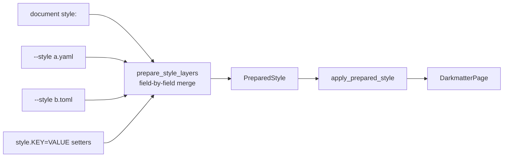

# Darkmatter Style Hints

## Style Frontmatter

Darkmatter reserves the Frontmatter property `style` for defining stylistic preferences. This is used by the following page elements:

1. `page` — **wired (sub-spec #2)**
1. `table`
1. `hyperlinks`
1. `images`
1. `hr` - Horizontal Rules
1. `ul` - Unordered Lists
1. `ol` - Ordered Lists
1. `li` - List Item
1. `block-quote` (canonical) / `block_quote` (snake-case alias, emits `Deprecated`)
1. `disclosure` - Disclosure blocks
1. `code-block` (canonical) / `code_block` (snake-case alias, emits `Deprecated`) — **wired (sub-spec #9)**

When performing a composition argument the caller can send in a style object to modify the default style of the full page graph (`style` property is passed down to child properties).

### Wiring Status

| Sub-Spec | Scope                             | Status          |
|----------|-----------------------------------|-----------------|
| #1       | Parser + schema + warnings        | Live            |
| #2       | `style.page.*` → `DarkmatterPage` | **Live**        |
| #3       | `style.table.*` / `style.images.*` / `style.block-quote.*` (`width`, `max-width`, `alignment`) | **Live** |
| #4       | `style.ul.*` / `style.ol.*` / `style.li.*` (`width`, `max-width`, `alignment`, `ul.left-margin`) | **Live** |
| #5       | `color` / `bg-color` application  | **Live**        |
| #6       | `style.hr.*` HR migration          | **Live**        |
| #7       | Bespoke knobs (stylesheet, meta, code-theme, hyperlinks, local-style) | **Live** |
| #8       | `style.disclosure.*` disclosure blocks | **Live**    |
| #9       | Style Everywhere: per-component `margin`, `padding`, `border`, `emphasis`, `word-wrap`, and `width` mode (`auto`/`fit-content`/length) | **Live** |

The library exposes `ACTIVE_STYLE_WIRING_SUB_SPEC` (currently `8`) so `KnownButInactive` warnings only fire for keys whose wiring sub-spec has not yet landed. Sub-spec #9 keys are schema-valid and lowered by the applicator; they follow the same `KnownButInactive` discipline if the active constant has not yet advanced to `9`. After sub-spec #9, every valid v1 schema key is either visually honored or rejected with a documented `StyleApplyError`. No valid v1 key emits `KnownButInactive` from a fully wired phase.

The later render-surface keys (`page.theme`, `page.code.mode`, `code-block.line-numbers`, every `padding-left`/`padding-right`, and `hr.padding`) are lowered and carry the active sub-spec `8` in the descriptor, so they emit no `KnownButInactive`; the rest of the sub-spec #9 surface still reports it.

## Schema & Parser Architecture (Sub-Spec #1)

The `style:` frontmatter is parsed by the `darkmatter::style` module into a typed, sparse tree of Rust structs anchored to `renderable` primitives. No darkmatter-local layout, style, or color runtime types are introduced — every length is `renderable::layout::Length`, every alignment is `renderable::layout::Alignment`, and every color is `renderable::color::Color` (wrapped only by `StyleColor` for opacity).

### Module Location

```text
darkmatter/lib/src/style/
├── mod.rs              # Re-exports
├── schema.rs           # StyleFrontmatter + per-bucket structs
├── length.rs           # Custom deserializers producing renderable::layout::Length
├── color.rs            # StyleColor wrapper + deserializers producing renderable::color::Color
├── parse.rs            # from_frontmatter / from_json_value / into_strict
├── warning.rs          # StyleWarning + StyleWarningKind
└── tests/              # Parser tests + roundtrip tests
```

### Entry Points

Three public functions form the parse API:

- **`from_frontmatter(fm: &Frontmatter)`** — reads `frontmatter.as_map().get("style")` and delegates to `from_json_value`. Returns `(StyleFrontmatter::default(), vec![])` when no `style:` key is present.
- **`from_json_value(value: &serde_json::Value)`** — the canonical entry point. `Frontmatter` stores its map as `IndexMap<String, serde_json::Value>`, so callers that already hold the raw value go here directly. Unknown keys are collected into warnings; structural or type errors short-circuit via `StyleParseError`.
- **`into_strict(parsed)`** — promotes schema-validation warnings (`UnknownKey`, `Deprecated`) into errors. `KnownButInactive` warnings are deliberately ignored so a schema-strict caller does not fail on a forward-compatible document.

### Warning Channel

Every parse produces zero or more `StyleWarning` values alongside the parsed `StyleFrontmatter`:

```rust
struct StyleWarning {
    path: String,           // Fully-qualified YAML path, e.g. "style.page.lft-margin"
    kind: StyleWarningKind, // Discriminated diagnostic category
    source_span: Option<StyleSpan>, // Always None in v1; reserved for future spans
}
```

The `StyleWarningKind` enum distinguishes three categories:

| Variant | Meaning | Behavior under `--deny style` |
|---|---|---|
| `UnknownKey` | Path does not appear anywhere in the schema (likely a typo). | Upgraded to error |
| `Deprecated { replacement }` | Path matched a snake-case alias for a canonicalized kebab-case key. | Upgraded to error |
| `KnownButInactive { sub_spec }` | Key is schema-valid but no rendering wiring exists for it yet. Carries the sub-spec number that will wire it. | **Never** blocks |

### Error Type

Structural and type errors short-circuit the parse via `StyleParseError`:

| Variant | Trigger |
|---|---|
| `Structure { path, expected, actual }` | Wrong YAML structure (e.g. a string where a map was expected). |
| `InvalidLength { path, raw, reason }` | Malformed length value (negative, unsupported unit, empty). |
| `InvalidPercent { path, value }` | Percent outside `0.0..=100.0` range. |
| `InvalidColor { path, raw, reason }` | Unrecognized color syntax. |
| `Strict { warnings }` | `into_strict` found one or more `UnknownKey`/`Deprecated` warnings. |
| `Serde(..)` | Underlying serde deserialization failure. |

### Schema Shape

The schema is a sparse tree of `Option` fields keyed by component. All buckets are `Option` so a sparse user input (e.g. only `page.left-margin`) does not materialize default values across the tree.

#### Root: `StyleFrontmatter`

```rust
#[derive(Debug, Clone, Default, Deserialize)]
#[serde(rename_all = "kebab-case", default)]
struct StyleFrontmatter {
    page:         Option<PageStyle>,
    table:        Option<TableStyle>,
    hyperlinks:   Option<HyperlinkStyle>,
    images:       Option<ImageStyle>,
    hr:           Option<HrStyle>,
    ul:           Option<UlStyle>,
    ol:           Option<OlStyle>,
    li:           Option<LiStyle>,
    block_quote:  Option<BlockQuoteStyle>,  // alias: "block_quote"
}
```

`#[serde(rename_all = "kebab-case")]` rewrites the field `block_quote` to the wire key `block-quote`; the `alias` accepts the legacy `block_quote` spelling and triggers a `Deprecated` warning.

#### Common Mutations: `CommonStyle`

Most component buckets embed a flattened `CommonStyle` providing the shared mutations:

| Field | Type | Wire key | Alias |
|---|---|---|---|
| `width` | `Option<WidthOrMode>` | `width` | — |
| `max_width` | `Option<renderable::layout::Length>` | `max-width` | `max_width` |
| `alignment` | `Option<renderable::layout::Alignment>` | `alignment` | — |
| `margin` | `Option<ComponentEdges>` | `margin` | — |
| `padding` | `Option<ComponentEdges>` | `padding` | — |
| `padding_left` | `Option<renderable::layout::Length>` | `padding-left` | — |
| `padding_right` | `Option<renderable::layout::Length>` | `padding-right` | — |
| `color` | `Option<StyleColor>` | `color` | — |
| `bg_color` | `Option<StyleColor>` | `bg-color` | `bg_color` |
| `border` | `Option<ComponentBorder>` | `border` | — |
| `emphasis` | `Option<ComponentEmphasis>` | `emphasis` | — |
| `word_wrap` | `Option<ComponentWordWrap>` | `word-wrap` | `word_wrap` |

`width` accepts either a length (`40`, `50%`) or a keyword (`auto`, `fit-content`) and lowers to `renderable::layout::Width` with the correct mode (Decision D3). `margin` and `padding` accept the same length forms as `width` and apply to all four sides; `padding-left` and `padding-right` then set one side each over `padding` (always in that order within a bucket, and a side alone keeps the other edges' inherited padding). `border`, `emphasis`, and `word-wrap` are compound values validated during typed deserialization; see [Sub-Spec #9](#sub-spec-9-style-everywhere) for details.

#### Per-Component Buckets

| Bucket | Struct | Common? | Extra fields |
|---|---|---|---|
| `page` | `PageStyle` | inline (not flattened) | 4 margins, 4 paddings, `background`, `stylesheet`, `meta`, `code` |
| `table` | `TableStyle` | `#[serde(flatten)]` | — |
| `block-quote` | `BlockQuoteStyle` | `#[serde(flatten)]` | — |
| `ul` | `UlStyle` | `#[serde(flatten)]` | `left_margin: Option<Length>` (indent for list content) |
| `ol` | `OlStyle` | `#[serde(flatten)]` | — |
| `li` | `LiStyle` | `#[serde(flatten)]` | — |
| `hyperlinks` | `HyperlinkStyle` | `#[serde(flatten)]` | `local_style: Option<Box<CommonStyle>>` (local-link overrides; wired sub-spec #7) |
| `images` | `ImageStyle` | `#[serde(flatten)]` | `local_style: Option<Box<CommonStyle>>` (local-image overrides; wired sub-spec #7) |
| `hr` | `HrStyle` | specialized (see Sub-Spec #6) | `kind` (HrKind), `weight` (HrWeight), `alignment` (HrAlignment) |
| `disclosure` | `DisclosureStyle` | `#[serde(flatten)]` | — |
| `code-block` | `CodeBlockStyle` | `#[serde(flatten)]` | — |

`PageStyle` is special: it does not flatten `CommonStyle` because its margins and paddings use a mix of horizontal `Length` and vertical `u16` fields, while `CommonStyle` is purely horizontal. It inlines `alignment`, `color`, `bg_color`, and `max_width` directly.

### Value Deserializers

#### Length

Horizontal fields (`left-margin`, `right-margin`, `left-padding`, `right-padding`, `width`, `max-width`) accept `renderable::layout::Length` via a custom string deserializer:

| Input form | Result |
|---|---|
| `"2ch"` / `"2 ch"` | `Length::Ch(2)` |
| `"40"` (bare number) | `Length::Ch(40)` |
| `"50%"` / `"50.5%"` | `Length::Percent(50.0)` / `Length::Percent(50.5)` |

Rejected forms: negative values (`"-2"`), unsupported units (`"2px"`, `"2em"`, `"2rem"`), empty string, malformed (`"50%%"`), percent out of range (`"101%"`).

Vertical fields (`top-margin`, `bottom-margin`, `top-padding`, `bottom-padding`) accept `u16` row counts only. A `row_count` helper explicitly rejects strings (e.g. `top-margin: "2ch"` fails with a `Structure` error rather than serde's default "invalid type" message).

#### Alignment

Delegates to `renderable::layout::Alignment` which accepts `"left"`, `"center"`, `"right"` via its existing `#[serde(rename_all = "snake_case")]` derive. The wrapper adds `"centered"` as an alias for `Center`.

#### Color: `StyleColor`

A thin wrapper around `renderable::color::Color` that preserves optional opacity for HTML targets:

```rust
struct StyleColor {
    color: renderable::color::Color,
    opacity: Option<u8>,  // Tailwind-style /0..=100; HTML-only, dropped by terminal
}
```

Accepted forms:

| Syntax | Result |
|---|---|
| `"red-500"` | Tailwind enum variant, no opacity |
| `"red-500/50"` | Tailwind enum variant + `opacity: Some(50)` |
| `"#fff"`, `"#ffffff"` | `Color::Rgb(..)` |
| `"#ffffffff"` | `Color::Rgb(..)` + alpha hex converted to `opacity: Some(alpha * 100 / 255)` |
| `"orange"`, `"rebeccapurple"` | Web named via `WEB_COLOR_LOOKUP` |

The Tailwind family and level enumeration is taken directly from `renderable::color::Tailwind` (21 families × 11 levels). The parser maps `"red-500"` to the matching enum variant; it does not redefine the taxonomy.

### Two-Pass Parser Design

Because `#[serde(deny_unknown_fields)]` aborts on the first typo and `serde_ignored` has unreliable behavior under `#[serde(flatten)]` and `Option<T>` newtypes, the parser uses a two-pass approach:

1. **Pass 1 — Canonicalization walk.** Walk the raw `serde_json::Value` map. For each leaf path: compute its canonical kebab-case path against a static schema descriptor; emit `Deprecated` if the raw key is a snake-case alias; emit `UnknownKey` if the path is not in the schema at all. The walk is driven by a static schema descriptor (one entry per leaf: canonical name, accepted aliases, parent path).

2. **Pass 2 — Typed deserialization.** Deserialize the value into `StyleFrontmatter` via standard serde. Structural errors short-circuit via `StyleParseError`.

3. **Pass 3 — `KnownButInactive` annotation.** Walk the parsed `StyleFrontmatter` and emit a `KnownButInactive` warning for every `Some` field whose wiring sub-spec exceeds `ACTIVE_STYLE_WIRING_SUB_SPEC`.

This gives full control over alias detection and unknown-key reporting without depending on `serde_ignored`'s behavior under `flatten`.

### Key Spelling: Kebab-Case Canonical

All multi-word frontmatter keys use hyphens: `max-width`, `bg-color`, `local-style`, `block-quote`, `left-margin`, etc. Snake-case spellings (`max_width`, `bg_color`, `local_style`, `block_quote`) are accepted via serde `alias` for backward compatibility and emit a `Deprecated { replacement }` warning. The pass-1 walker compares raw map keys against the canonical set to detect alias hits (since serde does not surface which alias matched).

## Page-Level Style (Sub-Spec #2)

The `style.page.*` subset is fully wired through `DarkmatterPage` for both terminal (`md`) and HTML (`md --output html`) rendering. Use canonical kebab-case keys; snake-case aliases are still accepted but produce a `Deprecated` warning.

### Supported Keys

| Key                  | Value Shape                                     | Notes                                                       |
|----------------------|-------------------------------------------------|-------------------------------------------------------------|
| `left-margin`        | `Nch`, `N%`, or `0`                             | Percent base = captured terminal width                      |
| `right-margin`       | `Nch`, `N%`, or `0`                             | Percent base = captured terminal width                      |
| `top-margin`         | non-negative integer (row count)                | Bare number; `2ch` is rejected for vertical fields          |
| `bottom-margin`      | non-negative integer                            |                                                             |
| `left-padding`       | `Nch`, `N%`, or `0`                             |                                                             |
| `right-padding`      | `Nch`, `N%`, or `0`                             |                                                             |
| `top-padding`        | non-negative integer                            |                                                             |
| `bottom-padding`     | non-negative integer                            |                                                             |
| `max-width`          | `Nch`, `N%`, or `0` (`0` rejected at apply-time) | Percent resolves against post-margin / post-padding content width |
| `alignment`          | `left` \| `center` \| `right`                    | Broadcasts to every `PageComponent` via `ComponentPolicy` (table/image/list/code/block-quote) |
| `background`         | `transparent` \| `subtle` \| `pronounced`        | Maps to `PageBackground` enum                               |
| `stylesheet`, `meta`, `code` | See [Bespoke Knobs (Sub-Spec #7)](#bespoke-knobs-sub-spec-7) | `stylesheet` and `meta` are HTML-only; `code.theme` applies to both targets |

`Length::Css(_)` (e.g. `10px`) is **not** valid for page-level terminal layout; it raises `StyleApplyError::InvalidCssLength`.

### Length Retention (per-target)

`apply_page_style` stores the authored `renderable::layout::Length` **directly**
on the slim page frame (`Edges` / `TargetValue<Length>`); it does **not**
pre-resolve percentages to cells. Each target then resolves the same `Length`:

| Length variant | Terminal | Browser wrapper |
|---|---|---|
| `Length::Zero` | `0` cells | `0ch` |
| `Length::Ch(n)` | `n` cells | `{n}ch` |
| `Length::Percent(p)` | `round(base * p / 100)` cells | `{p}%` (resolves against the viewport) |
| `Length::Css(_)` | rejected at apply time (`InvalidCssLength`) | — |

So `style.page.left-margin: 10%` becomes `8` cells on an 80-col terminal but
`margin-left: 10%` in the browser. The terminal percent base depends on the
field:

- **Horizontal margins and padding** resolve against the captured terminal width
  (`DarkmatterPage::new(&term)` captures it at construction time).
- **`max-width`** resolves against the **content width** after final page margin
  and padding values are known, from whichever style layer set them. A `max-width` that
  resolves to `0` cells is still rejected at apply time (`InvalidMaxWidth`), even
  though the `Length` itself is retained for the browser.

### Example

```yaml
---
style:
    page:
        left-margin: 2ch
        right-margin: 4ch
        top-margin: 1
        bottom-margin: 0
        max-width: 80%
        alignment: center
        background: subtle
---
```

### Precedence: Later Style Layers Win, Field by Field

`md` has no page-layout flags. A command line changes the style by adding
_layers_ on top of the document's `style:` frontmatter: each `--style FILE`
is one layer, and every `style.KEY=VALUE` setter on the command line forms
one more. `prepare_style_layers` merges them in this order, lowest first:

1. built-in defaults (no layer; what an unset field renders as)
2. the document's `style:` frontmatter
3. each `--style` file, in command-line order
4. the setters

The merge is field by field. A later layer replaces only the leaves it sets,
so a setter for `page.margin-left` changes the left margin and leaves the
document's `margin-right` in place:

```bash
# style-prop.md sets margin-left: 2ch and margin-right: 4ch
md render style-prop.md style.page.margin-left=7ch   # left 7, right 4
```



The `apply_*_style` functions run after the merge, so they apply every field
present in the effective style; none of them takes an override argument.

### Public API

```rust
/// Apply parsed page-level style onto a DarkmatterPage builder. Every
/// `style.page.*` field present in `style` is applied.
pub fn apply_page_style(
    page: DarkmatterPage,
    style: &StyleFrontmatter,
) -> Result<DarkmatterPage, StyleApplyError>;
```

Most callers do not call it directly: `apply_prepared_style` (see
[Prepared styles](#prepared-styles)) runs it with the
other `apply_*` functions in their required order. Terminal and HTML
rendering share the same call, so they read the same effective style.

### `--deny style`

`md --deny style` promotes schema-validation warnings to errors:

- `UnknownKey` → error
- `Deprecated` → error
- `KnownButInactive` → **still informational** (informational notices never block)

Use it in CI to catch typos, snake-case aliases, and deprecated HR syntax such as inline `style:` on `---` rules. `--deny style` is accepted by `md FILE`, `md render`, and `md compose`; see [Policy Flags](../cli/policy.md).

### Errors

`apply_page_style` returns `StyleApplyError`:

- `InvalidCssLength { field }` — `Length::Css(_)` was supplied to a page-level length field.
- `InvalidMaxWidth` — `style.page.max-width` resolved to `0` cells (e.g. `50%` of a `0`-cell content width after margins consumed everything).

## Component-Level Style (Sub-Spec #3)

`style.table.*`, `style.images.*`, and `style.block-quote.*` lower directly into per-component [`ComponentPolicy`](crate::layout::ComponentPolicy) via `apply_component_style`. `ComponentPolicy` is the **single source of truth** for a component's `style:` layout and colors: a `renderable::layout::Layout` plus optional `color` / `bg_color` carried as alpha-bearing [`PaintColor`](renderable::style::PaintColor) (so opacity survives to HTML — see [Color & Background-Color](#color--background-color-sub-spec-5)). The parsed `StyleColor` is lowered to `PaintColor` at the parser/apply boundary; no `StyleColor` survives on `ComponentPolicy`. There is no parallel per-component color map. Each bucket maps to a dedicated `PageComponent` variant:

| Bucket | `PageComponent` variant |
|---|---|
| `style.table.*` | `PageComponent::Tables` |
| `style.images.*` | `PageComponent::Images` |
| `style.block-quote.*` | `PageComponent::BlockQuotes` |

Three knobs are live on each of the three buckets:

- `width` — fixed width as `Nch`, `N%`, or `0`. Maps to `Layout.width = Width::Fixed`.
- `max-width` — upper bound as `Nch`, `N%`, or `0`. Maps to `Layout.max_width`.
- `alignment` — `left` \| `center` \| `right`. Maps to `Layout.alignment`.

`Length::Css(_)` (e.g. `10px`) is **not** valid in component fill fields; `apply_component_style` returns `StyleApplyError::ComponentInvalidCssLength { bucket, field }`.

### Length Lowering

`apply_component_style` lowers `renderable::layout::Length` directly into `Layout` fields, with no down-conversion:

| Length variant | Component layout lowering |
|---|---|
| `Length::Zero` | `Length::Zero` (cloned) |
| `Length::Ch(n)` | `Length::Ch(n)` (cloned) |
| `Length::Percent(p)` | `Length::Percent(p)` (cloned) |
| `Length::Css(_)` | Returns `StyleApplyError::ComponentInvalidCssLength { bucket, field }`. CSS units have no terminal equivalent. |

### Width vs. Max-Width Exclusivity

`width` and `max-width` are mutually exclusive **within the same bucket** in the v1 schema to keep CLI precedence predictable. Setting both raises:

```text
`style.{bucket}.width` and `style.{bucket}.max-width` are mutually exclusive
```

A style that sets both `width` and `max-width` in the same bucket always fails with `ComponentWidthConflict { bucket }` before rendering.

Bucket names in diagnostics use canonical kebab-case (`style.block-quote.*`, not `style.block_quote.*`). Snake-case aliases still parse but emit a `Deprecated` warning.

### Block-Quote Width Scope

`style.block-quote.width` and `style.block-quote.max-width` constrain the **whole rendered block quote** — including the quote prefix/border and body — not just the inner text. This differs from tables and images where the fill value constrains only the component itself. The block-quote terminal path applies the component width to the rendered wrapper, ensuring the prefix/border and body share the same width budget.

### Example

```yaml
---
style:
    table:
        max-width: 50%
        alignment: right
    images:
        width: 40ch
        alignment: center
    block-quote:
        max-width: 60ch
---
```

### Precedence: Page Broadcast, Then Component Style

Within one effective style, `apply_page_style` runs before
`apply_component_style`:

1. `style.page.alignment` broadcasts to every component.
2. `style.{table|images|block-quote|code-block}.alignment` then overrides the
   broadcast for that component only; components it does not name keep the
   broadcast.

Which layer supplied each value was decided earlier, when the layers were
merged (see [Precedence: Later Style Layers Win, Field by
Field](#precedence-later-style-layers-win-field-by-field)). For example, a
document with `page.alignment: center` and a setter
`style.table.alignment=right` centers every component except tables.

### Public API

```rust
/// Apply parsed table/image/block-quote/code-block style onto a
/// DarkmatterPage builder.
pub fn apply_component_style(
    page: DarkmatterPage,
    style: &StyleFrontmatter,
) -> Result<DarkmatterPage, StyleApplyError>;
```

### Errors

`apply_component_style` returns `StyleApplyError`:

- `ComponentWidthConflict { bucket }` — `width` and `max-width` set together inside the same bucket.
- `ComponentInvalidCssLength { bucket, field }` — `width` or `max-width` is a `Length::Css(_)` value.

### Inactive Keys

The `color` and `bg-color` knobs on `style.table`, `style.images`, and `style.block-quote` are now wired (sub-spec #5). The `images.local_style` knob is now wired (sub-spec #7). No keys in these buckets remain inactive.

## List-Level Style (Sub-Spec #4)

`style.ul.*`, `style.ol.*`, and `style.li.*` map onto three `PageComponent` variants — `Ul`, `Ol`, `Li`. Each bucket supports `width`, `max-width`, and `alignment` via the same direct lowering as sub-spec #3, plus a bespoke `ul.left-margin` indent channel.

### PageComponent Split

| Bucket | `PageComponent` variant |
|---|---|
| `style.ul.*` | `PageComponent::Ul` |
| `style.ol.*` | `PageComponent::Ol` |
| `style.li.*` | `PageComponent::Li` |

`PageComponent::ALL` includes all concrete variants (`Images`, `BlockQuotes`, `Tables`, `CodeBlocks`, `Ul`, `Ol`, `Li`, `Hyperlinks`, `Hr`, `Disclosure`).

### Tag-to-Component Mapping

The pulldown-cmark event stream distinguishes list kinds at render time:

| pulldown-cmark tag | `PageComponent` |
|---|---|
| `Tag::List(None)` | `PageComponent::Ul` |
| `Tag::List(Some(_))` | `PageComponent::Ol` |
| `Tag::Item` | `PageComponent::Li` |

### Live Knobs

Three knobs are live on each of the three list buckets, using the same direct lowering as sub-spec #3:

- `width` — fixed width as `Nch`, `N%`, or `0`. Maps to `Layout.width = Width::Fixed`.
- `max-width` — upper bound as `Nch`, `N%`, or `0`. Maps to `Layout.max_width`.
- `alignment` — `left` | `center` | `right`. Maps to `Layout.alignment`.

Plus the bespoke `ul.left-margin` indent channel (see below).

`Length::Css(_)` is rejected in list fill fields the same way as other component buckets, returning `StyleApplyError::ComponentInvalidCssLength`.

### Width vs. Max-Width Exclusivity

`width` and `max-width` remain mutually exclusive **per bucket** — the same exclusivity check from sub-spec #3 applies. Setting both `style.ul.width` and `style.ul.max-width` (or the equivalent for `ol`/`li`) returns `ComponentWidthConflict { bucket }` before rendering.

### ul.left-margin: Independent Indent Channel

`style.ul.left-margin` applies as a list-specific left indent that can coexist with `style.ul.width` or `style.ul.max-width`. It is stored as `ComponentPolicy.layout.margin.left` for `PageComponent::Ul` — an independent indent channel that does not conflict with width or max-width.

### Indent and Width Stacking Order

For unordered lists, the renderer applies layout in this fixed order:

1. **Resolve `ul.left-margin`.** The indent value is subtracted from the available body width.
2. **Apply `ul.width` or `ul.max-width`.** The width constraint operates on the remaining body width after indent.
3. **Apply alignment padding.** Any remaining alignment padding is added last.

This means `left-margin: 4ch` plus `max-width: 40` produces a 4-cell offset and a body wrapping at no more than 40 cells, capped by the remaining page width.

### Percent Resolution

| Field | Resolution base |
|---|---|
| `ul.left-margin: N%` | Page content width (after page margin/padding and page max-width are known) |
| `ul`/`ol`/`li` `width`, `max-width` | Same helper as sub-spec #3: `Length` values are cloned directly into `Layout.width` / `Layout.max_width`; the renderer fold resolves them at render time. |

`Length::Css(_)` fails with `StyleApplyError` for all list length fields.

### li.* Scope: Item Bodies Only

`style.li.alignment`, `style.li.width`, and `style.li.max-width` affect each list item's **content body** after the marker prefix is emitted. They do not affect marker placement — the containing `Ul`/`Ol` component governs markers. If both `li` and the containing list set alignment or width, the `li` value wins for the item body only.

### Browser Selectors and CSS Order

| `PageComponent` | CSS selector |
|---|---|
| `Ul` | `ul` |
| `Ol` | `ol` |
| `Li` | `li` |

Per-component browser CSS comes from the renderable browser fold lowering each node's `Layout`/`Style` attributes; no bespoke component CSS blocks are emitted.

### Setting Lists from the Command Line

There are no list flags. A setter or `--style` file names each list
component it changes; to set all three, name all three:

```bash
md render doc.md style.ul.alignment=center style.ol.alignment=center style.li.alignment=center
```

### Integration Order

Within one effective style, `apply_list_style` runs after
`apply_page_style` and `apply_component_style`, so a list bucket's own
`alignment` overrides the `style.page.alignment` broadcast for that list
component. Layer precedence (document, then `--style` files, then setters)
was already decided field by field when the layers were merged.

### Public API

```rust
/// Apply parsed ul/ol/li style onto a DarkmatterPage builder.
pub fn apply_list_style(
    page: DarkmatterPage,
    style: &StyleFrontmatter,
) -> Result<DarkmatterPage, StyleApplyError>;
```

### Example

```yaml
---
style:
    ul:
        left-margin: 4ch
        max-width: 40
    ol:
        alignment: right
    li:
        alignment: right
---
```

### Errors

`apply_list_style` returns `StyleApplyError`:

- `ComponentWidthConflict { bucket }` — `width` and `max-width` set together inside the same list bucket.
- `ComponentInvalidCssLength { bucket, field }` — `width` or `max-width` is a `Length::Css(_)` value.
- List-indent apply error — `with_list_left_margin` called with a non-`Ul` component returns a clear error.

### Inactive Keys

Color and background-color knobs on list buckets (`style.ul.color`, `style.ul.bg-color`, `style.ol.color`, `style.ol.bg-color`, `style.li.color`, `style.li.bg-color`) are now wired (sub-spec #5). No list-specific keys remain inactive.

## Color & Background-Color (Sub-Spec #5)

Sub-spec #5 activates the already-parsed `color` and `bg-color` fields for every `PageComponent` that exists after sub-spec #4, including `PageComponent::Hyperlinks`. The design stores `StyleColor` directly on `DarkmatterPage` and lowers to target-specific representations at render time.

### PageComponent::Hyperlinks

The schema already reserved `style.hyperlinks.color` and `style.hyperlinks.bg-color` as sub-spec #5 fields. `PageComponent::Hyperlinks` was added in this phase for color storage and rendering on both terminal and browser targets:

| Routing | Detail |
|---|---|
| Color storage | `ComponentPolicy.color` / `bg_color` on `DarkmatterPage` (wired sub-spec #5) |
| Browser selector | `a` (wired sub-spec #5) |
| Terminal rendering | Wraps link label text with foreground/background SGR while preserving existing OSC8 hyperlink sequences (wired sub-spec #5) |
| Full layout and `local-style` | Wired in sub-spec #7 (see [Bespoke Knobs](#bespoke-knobs-sub-spec-7)) |

### Color Storage and Inheritance

Page color lives in two `DarkmatterPage` fields; component color lives on each
component's `ComponentPolicy` — the single source of truth, with no parallel
color map:

```rust
page_color: Option<renderable::style::PaintColor>,
page_bg_color: Option<renderable::style::PaintColor>,
// per component, inside `component_policies: HashMap<PageComponent, ComponentPolicy>`:
struct ComponentPolicy {
    layout: Layout,
    color: Option<renderable::style::PaintColor>,
    bg_color: Option<renderable::style::PaintColor>,
}
```

The parsed `StyleColor` (which carries optional Tailwind/hex opacity) is lowered
to alpha-bearing `renderable::style::PaintColor` at the parser/apply boundary
(`style/apply.rs`), so opacity rides in the paint's alpha channel rather than a
side channel. The terminal reads `PaintColor::color` and ignores the alpha; the
browser fold lowers the pair straight to `rgb(...)` (opaque) / `rgba(...)`
(alpha) — there is no `darkmatter.style` hint and no post-render HTML rewrite.

Page **foreground** is **inheritance**: `style.page.color` is baked onto the document root node during the context-aware fold so it inherits to all descendants via `renderable`'s `InheritedStyle` (in the browser the styled root renders as a wrapping `<div>` whose `color` cascades). `style.page.bg-color` is **not** baked onto the root — background deliberately does not inherit — so it is painted by the page frame instead: the browser page wrapper and the terminal row decoration. A component-level value overrides the page-level value for that component (page color is never copied onto component nodes). If neither exists, no color rule or SGR is emitted.

There is no explicit inheritance clearing in v1 — the parser does not accept `"reset"`, so a component cannot opt out of page-level color. This keeps the implementation aligned with the accepted schema. A future parser extension may add a dedicated clear/reset value if documents need it.

### Terminal Lowering

Terminal output uses RGB-only colors:

- `PaintColor::color.to_rgb()` returns `Some((r, g, b))` for fixed RGB values, which lowers to truecolor SGR (`38;2;r;g;b` / `48;2;r;g;b`) when color depth allows it.
- `None` means no terminal SGR for this slot. This covers `Tailwind::{Transparent, Current, Inherit}` and other non-fixed color values.
- `ColorDepth::None` emits no color SGR.
- The `PaintColor` alpha is **ignored** by the terminal — it is an HTML-only concern.

Component color is scoped at render boundaries:

```text
<foreground SGR><background SGR>component output<reset>
```

The helper is a no-op when neither slot lowers to an SGR. The reset is emitted only when at least one SGR was opened, preventing color from leaking into later content or the user's shell.

### Browser Lowering

Browser output preserves CSS-special colors where possible:

| Color value | CSS output |
|---|---|
| RGB-capable | `rgb(r, g, b)` when opaque, or `rgba(r, g, b, alpha / 255.0)` when the `PaintColor` alpha is non-opaque |
| `Color::Tailwind(Tailwind::Transparent)` | `transparent` |
| `Color::Tailwind(Tailwind::Current)` | `currentColor` |
| `Color::Tailwind(Tailwind::Inherit)` | `inherit` |
| Unsupported non-RGB/default/reset | No CSS declaration emitted |

Component color CSS joins the existing component CSS rule — alignment, fill, color, background-color, and list-indent declarations for the same `PageComponent` are emitted in a single selector rule.

### page.background vs. page.bg-color

`style.page.background` (coarse fill level: `transparent` | `subtle` | `pronounced`) and `style.page.bg-color` (explicit color) are **separate** controls:

- `background` controls whether row decoration/fill is active.
- `bg-color` supplies the color used when painting component and page backgrounds.
- Both can be set simultaneously: `bg-color` supplies the color while `background` controls decoration.
- If `bg-color` is set without `background`, row decoration still activates so the color is visible.

### Code-Block Inherited Color Semantics

Code-block inherited color is deliberately asymmetric:

- **Background-color**: Page-inherited `bg-color` may apply to the code-block panel/container. It changes the containing panel/background fill rather than rewriting per-token background spans. Token-level backgrounds emitted by the syntax highlighter remain intact.
- **Foreground color**: Page-inherited foreground is a fallback/default only and must **not** override syntax token foreground colors selected by `code_theme`. If the renderer has no safe hook for non-highlighted fallback text, inherited foreground is skipped for highlighted code blocks.

Code blocks have no component-specific frontmatter color in this sub-spec (`style.code-blocks.*` is not a valid bucket).

### Public API

```rust
// darkmatter::layout::DarkmatterPage — extended

use renderable::style::PaintColor;

impl DarkmatterPage {
    /// Set the page-level inherited foreground color.
    pub fn with_page_color(self, color: PaintColor) -> Self;
    /// Set the page-level inherited background color.
    pub fn with_page_bg_color(self, color: PaintColor) -> Self;
    /// Set a component-level foreground color (overrides page-level inheritance).
    pub fn with_component_color(self, component: PageComponent, color: PaintColor) -> Self;
    /// Set a component-level background color (overrides page-level inheritance).
    pub fn with_component_bg_color(self, component: PageComponent, color: PaintColor) -> Self;

    /// Effective page-level foreground color.
    pub fn page_color(&self) -> Option<&PaintColor>;
    /// Effective page-level background color.
    pub fn page_bg_color(&self) -> Option<&PaintColor>;
    /// Effective foreground color for a component (component-level overrides page-level).
    pub fn color_for(&self, component: PageComponent) -> Option<&PaintColor>;
    /// Effective background color for a component (component-level overrides page-level).
    pub fn bg_color_for(&self, component: PageComponent) -> Option<&PaintColor>;
}

// darkmatter::style — extended

/// Apply parsed color and background-color style onto a DarkmatterPage builder.
///
/// No CLI color override exists in this sub-spec; frontmatter is the only color source.
pub fn apply_color_style(
    page: DarkmatterPage,
    style: &StyleFrontmatter,
) -> Result<DarkmatterPage, StyleApplyError>;
```

`color_for` and `bg_color_for` return the effective value after component-over-page inheritance.

### Precedence and Integration Order

`apply_color_style` runs after the page, component, list, rule, and
disclosure layout functions, so a component's `color` or `bg-color` overrides
the page-level value for that component. See [Prepared styles](#prepared-styles) for the full order `md` applies.

### Example

```yaml
---
style:
    page:
        color: blue-500
        bg-color: slate-900
    table:
        color: red-500
        bg-color: red-500/50
    hyperlinks:
        color: cyan-400
---
```

In this example, tables render with red foreground and semi-transparent red background (opacity preserved in browser, dropped in terminal). All other components (images, block-quotes, hyperlinks, lists) inherit blue-500 foreground and slate-900 background from the page level.

## HR Style (Sub-Spec #6)

Sub-spec #6 makes `style.hr.*` the canonical and only supported page-frontmatter surface for horizontal rule styling. `HrStyle` uses a **specialized schema** rather than flattening `CommonStyle` because HR `alignment` supports an extra `full` value that `renderable::layout::Alignment` cannot represent.

### Migration: Deprecated Aliases

Two legacy spellings are retained for one release cycle as deprecated aliases:

| Legacy path | Canonical replacement | Warning |
|---|---|---|
| Inline `--- { style: waves }` attribute | `--- { kind: waves }` | `Deprecated { replacement: "kind" }` |
| `style.hr.alignment: centered` | `style.hr.alignment: center` | `Deprecated { replacement: "center" }` |

Top-level `hr:` frontmatter is not merged into `style.hr` and does not provide horizontal-rule defaults. If both inline `kind` and `style` are present, `kind` wins and `style` still emits a deprecation warning because the document contains deprecated syntax.

### Precedence

From most specific to least:

1. **Inline attribute** (`--- { kind: waves }`) — per-rule override.
2. **`style.hr.*`** — canonical page-wide default.
3. **Component default** — `HorizontalRule::new()` defaults.

### Typed Enums

Three typed enums replace loose `String` values at the schema boundary:

```rust
#[derive(Debug, Clone, Copy, PartialEq, Eq, Deserialize)]
#[serde(rename_all = "kebab-case")]
pub enum HrKind {
    Dashes,
    Dots,
    Waves,
    LineStar,
    LineCircle,
    InsetLine,
    CurtainRod,
}

#[derive(Debug, Clone, Copy, PartialEq, Eq, Deserialize)]
#[serde(rename_all = "lowercase")]
pub enum HrWeight {
    Thin,
    Medium,
    Thick,
}

#[derive(Debug, Clone, Copy, PartialEq, Eq, Deserialize)]
#[serde(rename_all = "lowercase")]
pub enum HrAlignment {
    Full,
    Left,
    Center,
    Right,
}
```

`HrKind` variants map 1:1 to `biscuit_terminal::components::horizontal_rule::RuleStyle`. `HrWeight` maps to `RuleWeight`. `HrAlignment` maps to `RuleAlignment`.

### HrStyle Schema

`HrStyle` does **not** flatten `CommonStyle`. It inlines the common fields that apply (`width`, `max-width`, `color`, `bg-color`) and defines HR-specific typed fields:

| Field | Type | Wire key | Notes |
|---|---|---|---|
| `width` | `Option<Length>` | `width` | Fixed width; mutually exclusive with `max-width` |
| `max_width` | `Option<Length>` | `max-width` (alias: `max_width`) | Upper bound; mutually exclusive with `width` |
| `color` | `Option<StyleColor>` | `color` | Foreground (stroke/fill) color; uses sub-spec #5 color storage |
| `bg_color` | `Option<StyleColor>` | `bg-color` (alias: `bg_color`) | Background color; uses sub-spec #5 color storage |
| `alignment` | `Option<HrAlignment>` | `alignment` | `full` \| `left` \| `center` \| `right`; `centered` is deprecated alias for `center` |
| `kind` | `Option<HrKind>` | `kind` | Visual style of the rule |
| `weight` | `Option<HrWeight>` | `weight` | Stroke weight |
| `padding` | `Option<ComponentEdges>` | `padding` | All four sides of the `Hr` component policy's `Layout.padding` |
| `padding_left`, `padding_right` | `Option<Length>` | `padding-left`, `padding-right` | One side each, after `padding`; moves the rule inside the content width (`padding-left: 4` at width 50 draws 46 cells, 4 in). |

`width` and `max-width` conflict: setting both in the same `style.hr` bucket returns `StyleApplyError` before rendering, matching the exclusivity rule from sub-specs #3 and #4.

### PageComponent::Hr

Sub-spec #6 adds `PageComponent::Hr` to the `PageComponent` enum. This enables the sub-spec #5 color/bg-color mechanism to honor `style.hr.color` and `style.hr.bg-color` through the `Hr` component's `ComponentPolicy.color` / `bg_color`.

HR foreground color maps to the rule stroke/fill color. Background color applies to the HR component's bounding line/box through the same wrapper mechanism used for other `PageComponent` variants.

### Public API

```rust
// darkmatter::style - extended

/// Apply parsed HR style onto a DarkmatterPage builder.
pub fn apply_hr_style(
    page: DarkmatterPage,
    style: &StyleFrontmatter,
) -> Result<DarkmatterPage, StyleApplyError>;
```

There are no HR flags; a setter such as `style.hr.alignment=left` or a
`--style` file sets HR fields like any other style layer.

### Precedence and Integration Order

See [Prepared styles](#prepared-styles) for the full order `md` applies.

### `--deny style` and HR

`md --deny style` rejects deprecated HR syntax by promoting `Deprecated` warnings to errors:

- Inline `--- { style: waves }` → error
- `style.hr.alignment: centered` → error

### Inline Attributes

`HorizontalRuleAttrs` preserves deprecation provenance so `--deny style` can reject the legacy inline `style` key:

```rust
pub struct HorizontalRuleAttrs {
    pub kind: Option<String>,
    pub legacy_style: Option<String>,  // deprecated; retained for warning
    pub alignment: Option<String>,
    pub weight: Option<String>,
    pub width: Option<String>,
    pub color: Option<String>,
}
```

### Example

```yaml
---
style:
    hr:
        kind: waves
        weight: thick
        alignment: center
        color: slate-400
        max-width: 60ch
---
```

Every `---` horizontal rule in the document renders as a thick, centered, wave-pattern rule in slate-400 with a 60-character maximum width, unless an inline attribute overrides it:

```markdown
--- { kind: dots, alignment: full }
```

### Errors

`apply_hr_style` returns `StyleApplyError`:

- `ComponentWidthConflict { bucket: "hr" }` — `style.hr.width` and `style.hr.max-width` set simultaneously.
- `ComponentInvalidCssLength { bucket: "hr", field }` — `width` or `max-width` is a `Length::Css(_)` value.

## Bespoke Knobs (Sub-Spec #7)

Sub-spec #7 wires the remaining v1 schema keys that do not simply lower a `CommonStyle` bucket onto a component's `ComponentPolicy` (layout + colors). These are the "bespoke knobs": page stylesheet, page meta, code-block theme, hyperlink styling (including local-link overrides), and local image style overrides.

After this sub-spec ships, `ACTIVE_STYLE_WIRING_SUB_SPEC` advances to `7` and no valid v1 schema key emits `KnownButInactive`.

### `style.page.stylesheet`

Adds page-level CSS to HTML output. Every target checks the value without reading anything (it must be non-empty, not `file://`, and a valid `biscuit_file::FileReference`); only HTML and MarkdownPlus pages read a local file (`StyleAssetResolver::for_target`). Terminal, plain, Markdown, and data pages never read it.

**Local files:**

- The value is a `FileReference` (`./x.css`, `x.css`, `&x.css`, `~/x.css`, `{{VAR}}/x.css`, an absolute path), resolved with `resolve_detailed` against the context of the source that wrote it, never the process directory. For a prepared style that is the winning field's `StyleOrigin.context`: the document's context for a document value, the style file's own for a file value, and the launch context for a setter. A later layer that sets other fields does not move it. A caller of `apply_bespoke_style` supplies the context: `md` passes the opened document's context, or the launch context for standard input.
- The file is read once during HTML artifact construction and inlined into the page head as `<style data-darkmatter-source="...">`. This keeps the default artifact self-contained without requiring an externalization flag.

**Remote URLs:**

- HTTP(S) values are emitted as `<link rel="stylesheet" href="...">`. The renderer **never** fetches remote CSS — it only emits the tag.
- `file://` URLs are rejected in v1 (ambiguous across platforms; use normal local paths instead).

```yaml
---
style:
    page:
        stylesheet: ./custom.css
---
```

or:

```yaml
---
style:
    page:
        stylesheet: https://example.com/site.css
---
```

### `style.page.meta`

Emits page-level HTML `<meta>` tags. The parser stores this as an open `serde_json::Value`; at apply time it must be an object. Non-object values return `StyleApplyError::InvalidMetaShape`.

```yaml
---
style:
    page:
        meta:
            description: "Short summary"
            author: "Ken"
            keywords: ["rust", "markdown"]
            viewport: "width=device-width, initial-scale=1"
            "og:title": "Open Graph title"
            "twitter:card": "summary"
            charset: "utf-8"
---
```

**Conversion rules:**

- String, number, and boolean values lower to the `content` attribute.
- Array values are accepted only for `keywords` and are joined with `, ` after each element is stringified.
- `charset` lowers to `<meta charset="...">`.
- Keys beginning with `og:` lower to `<meta property="og:..." content="...">`.
- Every other key lowers to `<meta name="..." content="...">`.
- HTML escaping is performed by the HTML tag renderer, not by the style applicator.

### `style.page.code.theme`

Overrides the page-level default code-block theme. The string value parses via `ThemePair::try_from`, using the same accepted names as `style.page.theme`; `md list-themes` lists them. Unknown theme names return `StyleApplyError::InvalidCodeTheme { value }`.

A command-line setter (`style.page.code.theme=NAME`) or `--style` file wins over the document's value, like any later style layer.

### Presentation: themes, code-block mode, line numbers

`style.page.theme`, `style.page.code.theme`, `style.page.code.mode`, and `style.code-block.line-numbers` are resolved together, after the layers merge, by `darkmatter::style::PresentationDefaults::resolve`, and set on the page by `Presentation::apply_to` (prose and code themes, `with_code_block_mode`, `with_line_numbers`; the style's own code theme also as `with_page_code_theme`). The page carries them to both the terminal and the browser fold.

| Value | Source, highest first |
|---|---|
| prose theme | `page.theme` → captured `THEME` (`ThemePair::from_str_or_default`) → `one-half` |
| code theme | `page.code.theme` → captured `CODE_THEME` (`from_str_or_default`) → `get_code_theme_for_prose(prose theme)` |
| code-block mode | `page.code.mode` → `inverse` |
| line numbers | `code-block.line-numbers` (an explicit `false` is kept) → off |

`PresentationDefaults` holds the `THEME`/`CODE_THEME` values of a request snapshot (`from_snapshot`, `from_context`, `from_env`); it never reads the process environment. A fence's `theme=` and a directly constructed `CodeBlock` theme still outrank every row. Color mode is not part of it: it comes from the `Terminal` or output options the page was built from. `md` resolves over the merged style, so a setter or `--style` file value wins and one left out leaves the document's value.

The existing code-block contrast model is preserved: `ThemePair` resolves against the **inverted** color mode so the code panel contrasts against the page (light code on a dark page, and vice versa).

```yaml
---
style:
    page:
        code:
            theme: dracula
---
```

### `style.hyperlinks.*`

Sub-spec #5 added `PageComponent::Hyperlinks` for color storage on `DarkmatterPage`. Sub-spec #7 activates the full `CommonStyle` surface — including visual rendering of `color` and `bg-color` through the same `StyleColor` lowering helpers used by sub-spec #5, plus `width`, `max-width`, and `alignment` — and adds `local-style` for local-link overrides. The full `CommonStyle` surface is now live for hyperlinks:

- `color` and `bg-color` lower to terminal SGR around the link display text and to inline CSS on the HTML `<a>` element.
- Terminal: SGR wraps the display text while preserving OSC 8 hyperlink sequences. SGR reset closes before the OSC 8 end sequence so color does not leak.
- `width`, `max-width`, and `alignment` affect terminal fallback/display text before OSC 8 wrapping. For HTML they lower to inline CSS declarations on `<a>`.
- Existing per-link inline CSS from `Link::with_style` wins over global frontmatter style for the same CSS property. Frontmatter fills missing declarations.

### `style.hyperlinks.local-style.*`

Provides overrides for local hyperlinks only. A local hyperlink is any non-HTTP(S) link: relative paths, absolute paths, anchors (`#section`), and `file://` URLs. HTTP(S) links (including localhost) are remote.

`local-style` merges over `style.hyperlinks.*` **field-by-field** — only fields it sets override the outer hyperlink style. Unset fields fall back to `style.hyperlinks.*`.

The same terminal and HTML lowering rules apply as for `style.hyperlinks.*`.

### `style.images.local-style.*`

Provides overrides for local image references only. A local image has a primary `src` or `srcset` candidate that is not HTTP(S) and is not a `data:` URL. Data URLs are considered remote for local-style purposes because they are self-contained resources, not file references.

- **HTML:** local style merges into the image's inline `style` attribute through `ImageRef::with_style`. Existing per-image inline CSS wins over global frontmatter style for the same CSS property.
- **Terminal:** `color` and `bg-color` style the fallback alt text only. `width`, `max-width`, and `alignment` apply to the rendered fallback text, not to raster decoding or terminal image protocols.

### Width vs. Max-Width Exclusivity

The single-fill-slot rule from sub-specs #3, #4, and #6 also applies to `style.hyperlinks`, `style.hyperlinks.local-style`, and `style.images.local-style`. Setting both `width` and `max-width` in the same bucket returns `StyleApplyError` before rendering. HTML may be able to represent both, but accepting a document for one target and rejecting it for another would make `md` behavior unpredictable.

### CSS Length Support

CSS length support for hyperlinks and image `local-style` is **target-specific**:

- **HTML:** `Length::Css` values (e.g. `10px`) are valid because inline CSS can represent them.
- **Terminal:** `Length::Css` is rejected with `StyleApplyError`. CSS units have no terminal equivalent for link/image layout.

This is intentionally narrower than page/component fill, where CSS lengths are invalid for all targets.

### Public API

```rust
// darkmatter::layout::DarkmatterPage - extended

impl DarkmatterPage {
    /// Set the page-level stylesheet (inline or remote).
    pub fn with_stylesheet(self, stylesheet: PageStylesheet) -> Self;
    /// Set page-level HTML meta tags.
    pub fn with_page_meta(self, meta: PageMeta) -> Self;
    /// Set the page-level code-block theme override.
    pub fn with_page_code_theme(self, theme: ThemePair) -> Self;
    /// Set global hyperlink style (color, bg-color, width, max-width, alignment).
    pub fn with_hyperlink_style(self, style: CommonStyle) -> Self;
    /// Set local-link-only hyperlink style overrides.
    pub fn with_local_hyperlink_style(self, style: CommonStyle) -> Self;
    /// Set local-image-only style overrides.
    pub fn with_local_image_style(self, style: CommonStyle) -> Self;
}

/// A resolved page stylesheet.
pub enum PageStylesheet {
    /// Local file contents inlined as <style data-darkmatter-source="...">.
    Inline { source: PathBuf, css: String },
    /// Remote URL emitted as <link rel="stylesheet" href="...">.
    Remote { href: String },
}

/// Resolved page meta tags.
pub struct PageMeta {
    pub tags: Vec<MetaTag>,
}

/// A single HTML meta tag.
pub enum MetaTag {
    /// <meta charset="...">
    Charset(String),
    /// <meta name="..." content="...">
    Name { name: String, content: String },
    /// <meta property="..." content="...">
    Property { property: String, content: String },
}

// darkmatter::style - extended

/// Apply bespoke style knobs (stylesheet, meta, code-theme, local-style) onto
/// a DarkmatterPage builder. A local stylesheet resolves in `context` and is
/// read only when `assets` is a browser target's resolver.
pub fn apply_bespoke_style(
    page: DarkmatterPage,
    style: &StyleFrontmatter,
    assets: StyleAssetResolver,
    context: &FileResolutionContext,
) -> Result<DarkmatterPage, StyleApplyError>;

/// Which assets a page build reads: `for_target(OutputTarget::Html |
/// OutputTarget::MarkdownPlus)` reads local CSS; every other target, and
/// `passive()`, only validates.
pub struct StyleAssetResolver { /* .. */ }
```

### Prepared styles

`darkmatter::style::apply_prepared_style(page, &prepared, assets, &defaults)` is the page-construction entry for a `PreparedStyle` (from `prepare_style_layers`). Preparation is passive; this call executes assets. Layer order already decided precedence, field by field, so nothing in this call overrides a merged value.

### Precedence and Integration Order

The full integration order in `md` is:

1. `DarkmatterPage::new(&terminal)`
2. `prepare_style_layers(&layers, schema, policy)` — merges the document's `style:`, each `--style` file in order, then the setters, field by field
3. `apply_prepared_style(page, &prepared, StyleAssetResolver::for_target(target), &defaults)`, which runs, in order:
    1. the presentation `defaults` resolved over the merged style (themes, code-block mode, line numbers)
    2. `apply_page_style` — page frame and the `style.page.alignment` broadcast
    3. `apply_component_style` — table/image/block-quote/code-block
    4. `apply_list_style` — ul/ol/li
    5. `apply_hr_style` — HR
    6. `apply_disclosure_style` — disclosure
    7. `apply_color_style` — color and bg-color for all wired components
    8. the bespoke knobs (meta, code theme, hyperlink/image local-style), then `page.stylesheet` in the context of the layer that set it
4. `render / render_to_browser`

The individual `apply_*` functions are public for callers that hold a
`StyleFrontmatter` rather than a `PreparedStyle`; run them in the order above.
`apply_bespoke_style` resolves the stylesheet in the `context` its caller
supplies.

### Errors

`apply_bespoke_style` returns `StyleApplyError` with these additional variants:

| Variant | Trigger |
|---|---|
| `StylesheetNotFound { path }` | No file matches the local stylesheet reference; `path` is the first candidate probed. |
| `StylesheetReference { reference, error }` | The value is not a valid file reference, or resolving it failed (an unset `{{VAR}}`, a tree escape, an I/O probe failure). `StyleApplyError::file_reference_error()` returns the `FileReferenceError`. |
| `StylesheetContextMissing { reference }` | `apply_prepared_style` found a stylesheet with no recorded origin, so no context to resolve it in. |
| `StylesheetRead { path, source }` | Local stylesheet file exists but cannot be read (permissions, I/O). |
| `EmptyStylesheet` | The stylesheet value is empty after trimming. |
| `UnsupportedStylesheetScheme` | A `file://` URL was provided instead of a local path or HTTP(S) URL. |
| `InvalidMetaShape` | `style.page.meta` is not an object (e.g. a string or number). |
| `InvalidCodeTheme { value }` | The theme string does not match any known `ThemePair`. |

### Example

```yaml
---
style:
    page:
        stylesheet: ./custom.css
        meta:
            description: "Project documentation"
            keywords: ["rust", "markdown", "cli"]
            "og:title": "My Project"
            charset: "utf-8"
        code:
            theme: dracula
    hyperlinks:
        color: cyan-400
        bg-color: slate-900
        local-style:
            color: blue-300
    images:
        local-style:
            color: green-400
            width: 80%
---
```

In this example, all hyperlinks render with cyan-400 text on a slate-900 background, except local links (anchors, relative file paths) which use blue-300 text. Local images receive green-400 fallback alt text at 80% width. The page includes an inlined CSS file, meta tags, and the Dracula code theme.

## Disclosure Style (Sub-Spec #8)

`style.disclosure.*` controls the layout and color of render-time [`::disclosure` blocks](./disclosure.md). The bucket uses `CommonStyle`, so it supports the same five knobs as `style.table.*` and `style.block-quote.*`.

### Supported Keys

| Key | Value Shape | Notes |
|---|---|---|
| `width` | `Nch` or `N%` | Fixed width; mutually exclusive with `max-width` |
| `max-width` | `Nch` or `N%` | Upper bound; mutually exclusive with `width` |
| `alignment` | `left` \| `center` \| `right` | |
| `color` | Tailwind, hex, or web named | Foreground color for the disclosure summary |
| `bg-color` | Tailwind, hex, or web named | Background color for the disclosure summary |

Snake-case aliases (`max_width`, `bg_color`) parse but emit a `Deprecated` warning; `--deny style` rejects them.

### PageComponent

`PageComponent::Disclosure` stores the resolved `ComponentPolicy` on `DarkmatterPage`. The block-extension processor emits `NodeKind::Disclosure` during the render-tree fold; the build context applies the `PageComponent::Disclosure` policy to each disclosure node before the target fold runs.

### Inline Opener Overrides

Individual disclosure blocks can override the frontmatter bucket with `key=value` tokens on the opener line:

```md
::disclosure max-width=60ch color=red-500 License Agreement
::details
Keep your hands off.
::end-disclosure
```

Recognized keys are the same five style knobs. Tokens that are not recognized style pairs become part of the summary text. See [Disclosure Blocks](./disclosure.md) for the full syntax.

### Precedence

Disclosure style resolves from most specific to least specific:

1. Inline `key=value` tokens on the `::disclosure` opener.
2. `style.disclosure.*` frontmatter.
3. Page-level `style.page.alignment` broadcast.
4. Built-in default.

### Integration Order

`apply_disclosure_style` runs after `apply_hr_style` and before `apply_color_style`. See [Prepared styles](#prepared-styles) for the full order `md` applies.

### Errors

`apply_disclosure_style` returns the same errors as other component buckets:

- `ComponentWidthConflict { bucket: "disclosure" }` — `style.disclosure.width` and `style.disclosure.max-width` set simultaneously.
- `ComponentInvalidCssLength { bucket: "disclosure", field }` — `width` or `max-width` is a `Length::Css(_)` value.

## Style Mutation

### Common Mutations

Each of the component buckets embeds a `CommonStyle` providing the shared layout and appearance mutations:

| Mutation | Wire key | Value shape | Notes |
|---|---|---|---|
| `width` | `width` | `Nch`, `N%`, `auto`, or `fit-content` | Width mode; `auto`/`fit-content` are keywords (sub-spec #9); mutually exclusive with `max-width` within the same bucket |
| `max-width` | `max-width` | `Nch` or `N%` | Upper bound; mutually exclusive with `width` within the same bucket |
| `alignment` | `alignment` | `left` \| `center` \| `right` | Overrides page-level broadcast for this component |
| `margin` | `margin` | `Nch` or `N%` | Sub-spec #9; applies to all four sides |
| `padding` | `padding` | `Nch` or `N%` | Sub-spec #9; applies to all four sides |
| `padding-left`, `padding-right` | `padding-left`, `padding-right` | `Nch` or `N%` | One side each, applied after `padding` |
| `color` | `color` | Tailwind, hex, or web named | Sub-spec #5 wired; inheritance from page-level, component override |
| `bg-color` | `bg-color` | Tailwind, hex, or web named | Sub-spec #5 wired; inheritance from page-level, component override |
| `border` | `border` | bool, string, or object | Sub-spec #9; see [Sub-Spec #9](#sub-spec-9-style-everywhere) |
| `emphasis` | `emphasis` | object | Sub-spec #9; see [Sub-Spec #9](#sub-spec-9-style-everywhere) |
| `word-wrap` | `word-wrap` | `none` \| `wrap` \| `truncate` \| `wrap-prose` | Sub-spec #9; see [Sub-Spec #9](#sub-spec-9-style-everywhere) |

### Bespoke Style

While every component provides the common mutations, several components offer additional bespoke properties:

- **`page`** — `stylesheet` (CSS file path or URL for HTML output), `meta` (HTML `<meta>` tags), `code.theme` (code-block theme override), `background` (`transparent` \| `subtle` \| `pronounced`). Wired in sub-spec #7.
- **`hr`** — `kind` (HrKind), `weight` (HrWeight), `alignment` (HrAlignment, includes `full`). Wired in sub-spec #6. Inline `kind` replaces the legacy per-block `style:` attribute; page-wide defaults are only read from `style.hr`.
- **`hyperlinks`** — `local-style` provides a `CommonStyle` override for local hyperlinks. Wired in sub-spec #7.
- **`images`** — `local-style` provides a `CommonStyle` override for local image references. Wired in sub-spec #7.
- **`ul`** — `left-margin` controls list indent (e.g. `style.ul.left-margin: 4ch`). Wired in sub-spec #4.

## Sub-Spec #9 — Style Everywhere

Sub-spec #9 exposes the full applicable `Layout`/`Style` surface for every
`PageComponent` bucket. It adds `margin`, `padding`, `border`, `emphasis`, and
`word-wrap` to the existing `width`/`max-width`/`alignment`/`color`/`bg-color`
knobs, and it teaches `width` to accept the keywords `auto` and `fit-content`
so the correct `renderable::layout::Width` mode is set (Decision D3).

### Width Mode

`width` now accepts either a length or a keyword:

| Input | Lowered `Width` |
|---|---|
| `40` / `40ch` / `50%` | `Width::Fixed(TargetValue::universal(length))` |
| `auto` | `Width::Auto` |
| `fit-content` | `Width::FitContent` |

Omitting `width` preserves the component's existing default (Decision D3).

### Expanded Surface Per Bucket

The following keys are recognized in every component bucket that flattens
`CommonStyle` (`table`, `block-quote`, `ul`, `ol`, `li`, `hyperlinks`,
`images`, `hr`, `disclosure`, `code-block`) and in the `local-style` override
blocks for hyperlinks and images:

| Key | Value shape | Lowered to |
|---|---|---|
| `margin` | `Nch` or `N%` | `Layout.margin` (all four sides) |
| `padding` | `Nch` or `N%` | `Layout.padding` (all four sides) |
| `padding-left`, `padding-right` | `Nch` or `N%` | `Layout.padding.left` / `.right`, after `padding`; for `hyperlinks`/`images` `local-style`, `padding-*` CSS in `CommonStyle::to_css_overlay`. A `local-style` `padding` drops the base bucket's sides in `merge_common_style` |
| `border` | `true`/`false`, `"thin"`/`"medium"`/`"thick"`/"none", or object | `Style.border` |
| `emphasis` | object (`{ bold, dim, italic, strikethrough, blink, inverse, underline }`) | `Style.emphasis` |
| `word-wrap` | `none`/`wrap`/`truncate`/`wrap-prose` | `Layout.word_wrap` |

### Border Object

A `border` value can be:

- a boolean (`true` enables a thin solid border on all sides);
- a string weight (`"thin"`, `"medium"`, `"thick"`, `"none"`);
- an object specifying sides, weight, style, and color:

```yaml
style:
  table:
    border:
      left: true
      weight: thin
      color: slate-500
```

### Emphasis Object

An `emphasis` value is an object of boolean flags:

```yaml
style:
  block-quote:
    emphasis:
      italic: true
```

### Hyperlinks and Images

`hyperlinks` and `images` still receive their `width`/`max-width`/`alignment`
as `TextLayoutHints` or lone-image block layout rather than generic block
`Layout` on every inline node. The expanded surface is available on the bucket
itself and on the `local-style` override block.

### Code Blocks

`style.code-block.*` (snake-case alias `code_block`) is a new bucket for fenced
code-block layout/appearance. Code-block theme selection remains under
`page.code.theme` for compatibility.

### Errors

Sub-spec #9 reuses the same error variants as earlier component buckets:

- `ComponentWidthConflict { bucket }` — `width` and `max-width` set together.
- `ComponentInvalidCssLength { bucket, field }` — a length field is `Length::Css(_)`.

### Per-Component Support Contract

The terminal/browser/markdown behavior for each property is governed by the
component's render-tree contract. The authoritative per-component,
per-target matrix is the
[Style Everywhere matrix](../../../renderable/features/2026-06-30-style-everywhere/matrix.md).

## Tailwind Colors

The `biscuit-terminal` already provides a very handy mapping to Tailwind color names to their RGB values. The base
colors supported are:

- red
- orange
- amber
- yellow
- lime
- green
- emerald
- teal
- cyan
- sky
- blue
- indigo
- violet
- purple
- fuchsia
- pink
- rose
- slate
- gray
- zinc
- neutral
- stone

Each of colors provides the following luminosity levels:

- 50, 100, 200, 300, 400, 500, 600, 700, 800, 900, and 950

- whenever someone sets a **style** value to a color, they may choose to use Tailwind names like `red-500` which combine the
color with the luminosity level.
- you can also add in Tailwind's convention of an opacity setting with `red-500/50` where the trailing `/50` indicates the opacity setting 
    - Note: the opacity is only used when targeting HTML, it is dropped everywhere else

## Code Block Theme & Contrast

The `page.code` theme (`style.page.code.theme`) is a mode-agnostic
`ThemePair`, resolved to a concrete light/dark theme at render time. Code blocks
deliberately resolve against the *inverted* color mode so the panel contrasts
against the page (light code on a dark page, and vice versa); prose, tables, and
the page background follow the real mode. This holds for **both terminal and
HTML** output, so the targets agree. Every `ThemePair` is a (light theme, dark
theme) couple, so this inversion applies to all of them.

See [Code Highlighting](./code-highlighting.md) for the full model.
