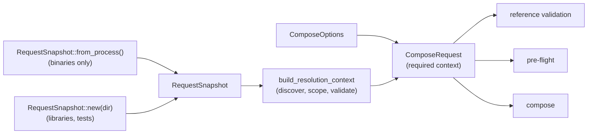
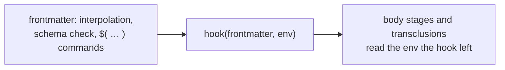

# Compose Requests

Every Darkmatter call that resolves a file reference runs inside a **compose
request**. The request fixes, once, where `./`, `&`, `^`, `@`, `~`, and
`{{VAR}}` references start and which repository they belong to. Every phase of
the request (validation, pre-flight, composition, every transcluded child)
then resolves against that same answer.

## Preparing a request

A request is built from two things:

- **`ComposeOptions`**: what to do (operations, overrides, shell and remote
  policy).
- **`RequestSnapshot`**: where the request runs. It names the request
  directory and carries the home directory, the environment, any extra `@`
  search roots, and the reference that opened the document.

```rust
use darkmatter::markdown::Markdown;
use darkmatter::markdown::compose::{ComposeOptions, ComposeRequest, RequestSnapshot};

// A binary reads its own process once, at its entry point.
let snapshot = RequestSnapshot::from_process()?;
let request = ComposeRequest::prepare(ComposeOptions::new().with_source_file("docs/guide.md"), &snapshot)?;

let md = Markdown::try_from(std::path::Path::new("docs/guide.md"))?;
let preflight = md.compose_preflight(&request)?;
let (composed, report) = md.compose_with(&request)?;
# Ok::<(), Box<dyn std::error::Error>>(())
```

`from_process` takes the home directory from `biscuit_file::home_dir()`:
`HOME` on macOS and Linux, `USERPROFILE` on native Windows (`HOME` alone does
not move it there), with the platform's profile lookup as the fallback when
the variable is unset. A relative value is no home at all, so `~` references
fail instead of resolving against the working directory. Whoever launches a
binary therefore chooses its home through the child's environment. For a
document containing `::file ~/x.md`:

```text
HOME=/tmp/fixture md compose doc.md          transcludes /tmp/fixture/x.md
USERPROFILE=D:\fixture md compose doc.md     transcludes D:\fixture\x.md (Windows)
HOME=relative md compose doc.md              fails: missing-context (no home)
```

A library never reads the process. `RequestSnapshot::new(dir)` starts with no
home directory and an empty environment, so a library call states every input
it depends on:

```rust
use std::collections::HashMap;
use darkmatter::markdown::compose::RequestSnapshot;

let snapshot = RequestSnapshot::new("/work/project")
    .with_home(Some("/home/me".into()))
    .with_env(HashMap::from([("NOTES".into(), "/home/me/notes".into())]));
```

`snapshot.at_request_dir(dir)` keeps the home directory, environment, and
extra roots but anchors the request elsewhere, for example at a document that
lives in another repository.



## What the builder does

`build_resolution_context(&snapshot)` is the one way a request obtains a
`FileResolutionContext`. In order, it:

1. Takes the request directory, home directory, and environment from the
   snapshot.
2. Discovers the repository containing the request directory, and its
   packages and package areas. These become the `&` and `^` anchors and the
   launch `@` scope.
3. Adds the snapshot's extra `@` roots (see [magic paths](./magic-paths.md)).
4. Derives the context for the opening reference, when there is one, so a
   document opened as `~/notes/x.md` keeps `~` as its tree root.
5. Validates the result.
6. Logs one `debug` event naming the request directory and where the tree
   root came from (`base_dir_origin`), so a "file not found" report can be
   traced to the context it was resolved in.

`ComposeRequest::prepare` calls the builder. A caller that already holds a
built context (for example one derived for a document in another repository)
uses `ComposeRequest::with_context(options, context)`, which validates it.

A context built at another repository's directory carries that directory's
launch `@` scope. To keep `@` searching the tree the request was launched in,
copy the launch scope onto it, as `md` does:

```rust
let source = build_resolution_context(&snapshot.at_request_dir(document_dir))?
    .for_trusted_external_source(&document)
    .with_launch_magic_scope(launch.launch_magic_scope().clone());
```

The document's own repository then anchors its `./`, bare, `&`, and `^`
references, and `@` keeps the launch tree.

Passive readers that take a context and never discover a repository need
that prepared context as well. Schema detection is one: given the launch
context for a document outside its tree, every reference in the document
fails to resolve and is detected as `string` rather than `file`. Pass each
document its own context with `detect_schema_with_contexts`, as `md schema
detect` does.

A source document outside the request's repository is admitted the way a
transcluded file outside it is: as a trusted external source. Requested from
`/work/repo`, the document `/home/me/notes/doc.md` resolves `./beside.md`
beside itself and `../../outside.md` to `/home/outside.md`; its own folder,
not the repository, bounds nothing. Its schema `file` values resolve the
same way. A document opened through `~` (`::file ~/notes/doc.md`) instead
keeps `HOME` as its tree root, so the same `../../outside.md` is refused.

## Reading a failure's class

Every failed file reference keeps biscuit-file's `ResolutionFailure` class
(`InvalidReference`, `MissingContext`, `NoMatch`, `Io`, `UnsupportedRemote`).
Compare failures by class, never by message:

```rust,ignore
match markdown.compose_with(&request) {
    Err(error) => assert_eq!(error.resolution_failure(), Some(ResolutionFailure::NoMatch)),
    // A failure composition tolerated (the content replaced by a notice)
    // is a warning carrying the same class.
    Ok((_, report)) => assert!(report.warnings.iter().all(|w| w.resolution_failure.is_none())),
}
```

`MarkdownError::resolution_failure()` finds the class through nested
transclusions, `::toc-linking` chains (which report the first target's
class), and schema `file` values. `md` prints the class as a
`failure: <class>` row, in kebab case, on every error block and warning for
a failed reference.

## Keeping the warnings of a failed composition

`compose_with` returns only the error when composition fails, so warnings
reported before the failure (an uncertain call, an undeclared property) are
lost. `compose_with_warnings` takes the same request and, on failure, returns
a boxed `ComposeFailure` holding both:

```rust,ignore
match markdown.compose_with_warnings(&request) {
    Ok((composed, report)) => { /* report.warnings as with compose_with */ }
    Err(failure) => {
        // The outer document's warnings come first; a child that had
        // already succeeded reported into its parent.
        for warning in &failure.warnings { eprintln!("warning: {}", warning.message); }
        return Err(failure.error);
    }
}
```

`md compose --output report-json` uses it to list every diagnostic of a
failed run (see [`report-json` output](../cli/report-json.md)).

## When a request cannot be built

The builder returns `ContextBuildError` instead of letting a bad context fail
later as a missing file:

| Situation | Error | `resolution_failure()` |
|---|---|---|
| The request directory is relative (`RequestSnapshot::new("docs")`) | `Invalid` (`RelativeContextDirectory`) | `MissingContext` |
| The opening reference resolves outside the request's repository (`~/notes/x.md` opened from inside a repository) | `Invalid` (`RepositoryRootNotContainingSource`) | `MissingContext` |
| Repository discovery fails, for example a corrupt `.git/config` | `Discovery` | `MissingContext` |

Finding no repository is not an error: the request directory becomes the
tree root. `resolution_failure()` uses the same classes as biscuit-file's
`FileReferenceError::resolution_failure()`.

<a id="one-environment-per-request"></a>

## One environment per document

`{{ env.NAME }}`, `ctx.agent`, `ctx.model`, and a `{{NAME}}/file.md` file
reference all read the snapshot's environment. A request composes one
document, and every file that document transcludes shares the request, so an
expression and a file reference anywhere in that document always agree, even
if the process environment changes or differs. `md compose` is one document:
it captures its process once, at its entry point.

```text
NOTES=/a md compose doc.md     {{ env.NOTES }} renders /a, ::file {{NOTES}}/x.md reads /a/x.md
```

A `ComposeContext` captured on its own (`ComposeContext::capture_for_document`
and its siblings) reads no process environment either: its `env` starts empty,
so `ctx.agent` is `"unknown"` until a request installs the snapshot's
environment over it. No expression reads the live process environment, so
`env` does not change during a composition, except at the one point a host
asks to change it (see [Choosing the body's environment from the
frontmatter](#choosing-the-bodys-environment-from-the-frontmatter)).

A host that runs several documents in one process gives each document its own
request, built from a snapshot captured when that document starts. A later
document may therefore see a different environment from an earlier one, while
each stays internally consistent. Claudine works this way: every sequence step,
group leg, and `proxy` target is its own document with its own captured map
(see Claudine's [composition](../../../claudine/docs/topics/composition.md)
topic).

### Choosing the body's environment from the frontmatter

Sometimes the environment a body should render with depends on the
document's own frontmatter. Claudine, for example, picks the provider a prompt
launches on from its `agent`, and the body's `{{ env.AGENT }}` must name that
provider, even when `agent` is a `$( … )` command. Composing the document twice
would run every command twice, so Darkmatter offers one call instead:
`Markdown::compose_with_frontmatter_hook`.



The hook is called once, for the request's root document only, after every
frontmatter value has resolved and before any body stage runs. It receives the
resolved frontmatter and the request's environment, and may change that
environment. The body, every file it transcludes, and its `as_markdown()`
content then read the changed environment. Frontmatter values have already
resolved, so a frontmatter value that reads `env` keeps what it read. An error
from the hook ends the composition before the body renders.

```rust
# use darkmatter::markdown::Markdown;
# use darkmatter::markdown::compose::{ComposeOptions, ComposeRequest, RequestSnapshot};
let md: Markdown = "---\nagent: goose\n---\nYou are {{ env.AGENT }}.\n".into();
let request = ComposeRequest::prepare(ComposeOptions::new(), &RequestSnapshot::new(std::env::temp_dir()))?;

let (composed, _report) = md.compose_with_frontmatter_hook(&request, &mut |frontmatter, env| {
    if let Some(agent) = frontmatter.as_map().get("agent").and_then(|value| value.as_str()) {
        env.insert("AGENT".to_string(), agent.to_string());
    }
    Ok(())
})?;
assert!(composed.content().contains("You are goose."));
# Ok::<(), Box<dyn std::error::Error>>(())
```

### The environment shell children start from

A `::shell` directive and a frontmatter `$( … )` command run as child
processes. By default a child inherits the composing process's environment,
which is right for `md compose`: it is one document in one process.

A host that composes several documents in one process, each under its own
environment (Claudine runs every sequence step and group leg as its own
document), states the child environment on the request instead:

```rust
use darkmatter::markdown::compose::ComposeOptions;
use darkmatter::markdown::compose::shell_expansion::ShellChildEnvironment;

let options = ComposeOptions::new().with_shell_child_environment(ShellChildEnvironment::new([
    ("PATH", "/usr/bin:/bin"),
    ("DOC_MARK", "b"),
]));
```

The supplied map replaces the inherited environment rather than adding to it.
The executable is looked up on the supplied `PATH`, `PWD` is set to the
directory the command runs in, and `NO_COLOR=1` is still added while ANSI
stripping is on. Values are raw OS strings, so a value that is not valid UTF-8
reaches the child unchanged. `::shell printenv DOC_MARK` above prints `b`
whatever this process holds.
