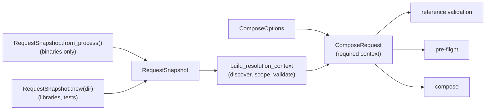
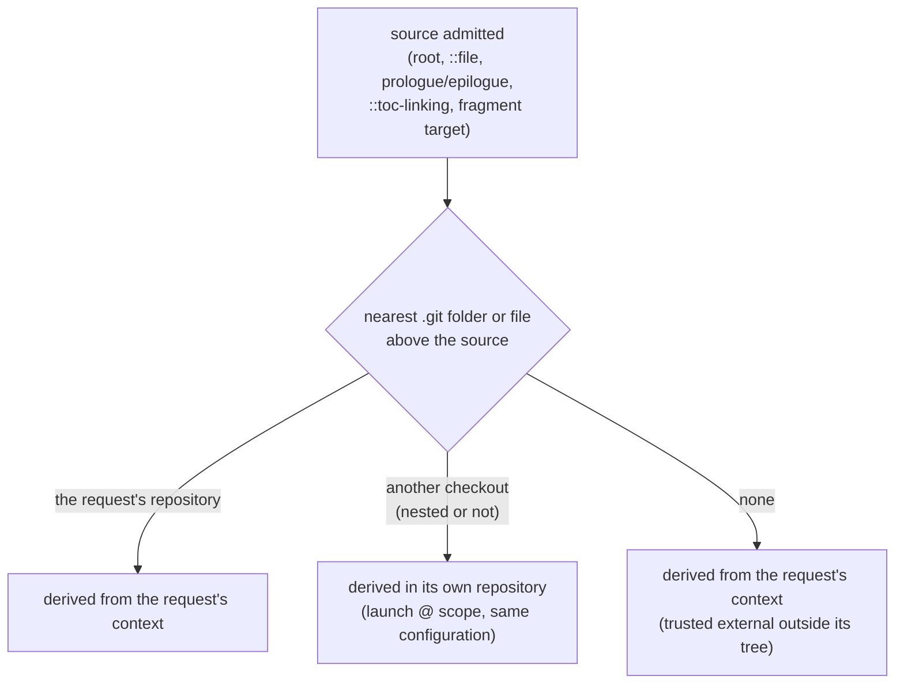
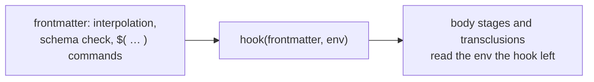

# Compose Requests

Every Darkmatter call that resolves a file reference runs inside a **compose
request**. The request fixes, once, where `./`, `&`, `^`, `@`, `~`, and
`{{VAR}}` references start and which repository they belong to. Every phase of
the request (validation, pre-flight, composition, every transcluded child)
then resolves against that same answer.

## Preparing a request

A request is built from two things:

- **`ComposeOptions`**: what to do (operations, overrides, shell and remote
  policy).
- **`RequestSnapshot`**: where the request runs. It names the request
  directory and carries the home directory, the environment, any extra `@`
  search roots, and the reference that opened the document.

```rust
use darkmatter::markdown::Markdown;
use darkmatter::markdown::compose::{ComposeOptions, ComposeRequest, RequestSnapshot};

// A binary reads its own process once, at its entry point.
let snapshot = RequestSnapshot::from_process()?;
let request = ComposeRequest::prepare(ComposeOptions::new().with_source_file("docs/guide.md"), &snapshot)?;

let md = Markdown::try_from(std::path::Path::new("docs/guide.md"))?;
let preflight = md.compose_preflight(&request)?;
let (composed, report) = md.compose_with(&request)?;
# Ok::<(), Box<dyn std::error::Error>>(())
```

A relative source path names the file under the snapshot's request
directory, so `docs/guide.md` above and its absolute spelling are the same
source: same repository, schema roots, triggers, and `&` root. The source can
be given on the request, on the `Markdown` (`Markdown::try_from(path)` or
`with_source`), or both. A request with no source of its own takes the
document's when it composes, pre-flights, builds a reference graph,
validates references, lists transclusions, or prepares the effective schema
(`effective_schema_for`); the reference graph, the validators, and the
transclusion query always root at the document's own source when it has one.

The reverse holds too: a `Markdown` with no source, given a request that
names a file, is that file's text. This is how an editor composes an unsaved
buffer:

```rust
# use darkmatter::markdown::Markdown;
# use darkmatter::markdown::compose::{ComposeOptions, ComposeRequest, RequestSnapshot};
# let snapshot = RequestSnapshot::new(std::env::temp_dir());
# let buffer = String::new();
let request = ComposeRequest::prepare(ComposeOptions::new().with_source_file("vendor/review.md"), &snapshot)?;
let md = Markdown::from(buffer); // the editor's text, never re-read from disk
let (composed, _report) = md.compose_with(&request)?; // composed.source() names vendor/review.md
# Ok::<(), Box<dyn std::error::Error>>(())
```

Every entry point above then decides the file's identity exactly as if the
path were on the `Markdown`: its checkout's schema roots, bare `$schema`
names and triggers, the `&` root, the reference graph's root and the origin
of each of its own references, the base of its relative links and of every
inclusion (body `::file` and `::code`, `prologue`, `epilogue`), and the file
its errors name. Only the path is attached; the text judged is always the
buffer. Text a host generated from a file and marked with
`Markdown::with_context_identity` is not that file's text, so it keeps no
source and its errors keep naming the identity.

`from_process` takes the home directory from `biscuit_file::home_dir()`:
`HOME` on macOS and Linux, `USERPROFILE` on native Windows (`HOME` alone does
not move it there), with the platform's profile lookup as the fallback when
the variable is unset. A relative value is no home at all, so `~` references
fail instead of resolving against the working directory. Whoever launches a
binary therefore chooses its home through the child's environment. For a
document containing `::file ~/x.md`:

```text
HOME=/tmp/fixture md compose doc.md          transcludes /tmp/fixture/x.md
USERPROFILE=D:\fixture md compose doc.md     transcludes D:\fixture\x.md (Windows)
HOME=relative md compose doc.md              fails: missing-context (no home)
```

A library never reads the process. `RequestSnapshot::new(dir)` starts with no
home directory and an empty environment, so a library call states every input
it depends on:

```rust
use std::collections::HashMap;
use darkmatter::markdown::compose::RequestSnapshot;

let snapshot = RequestSnapshot::new("/work/project")
    .with_home(Some("/home/me".into()))
    .with_env(HashMap::from([("NOTES".into(), "/home/me/notes".into())]));
```

`snapshot.at_request_dir(dir)` keeps the home directory, environment, and
extra roots but anchors the request elsewhere, for example at a document that
lives in another repository.

### Configuration

Every request holds one configuration snapshot (`request.config_snapshot()`),
which all its derivations share. `prepare` loads it passively when you supply
none. A caller of `ComposeRequest::with_context` whose context names a
repository must supply its own, because only the caller's capture holds that
repository's committed policy:

```rust
use std::sync::Arc;
use darkmatter::config::load::{ConfigLoadMode, ConfigSnapshot};
use darkmatter::markdown::compose::{
    ComposeOptions, ComposeRequest, RequestSnapshot, capture_resolution_context,
};

let snapshot = RequestSnapshot::new("/work/project").with_home(Some("/home/me".into()));
let (context, committed) = capture_resolution_context(&snapshot)?;
let config = Arc::new(ConfigSnapshot::load_captured(&context, committed.as_ref(), ConfigLoadMode::Passive)?);
let request = ComposeRequest::with_context(ComposeOptions::new().with_config_snapshot(config), context)?;
# Ok::<(), Box<dyn std::error::Error>>(())
```

An embedder that composes many documents attaches its capture to the `ctx`
it composes under (`ComposeContext::with_config_source`) instead of supplying
a snapshot to each request. Leaving a repository context without a snapshot
is `ContextBuildError::ConfigSnapshotRequired`; the request never discovers
the repository again and never runs without its policy. See
[Configuration Files](configuration.md#one-snapshot-per-request).



## What the builder does

`build_resolution_context(&snapshot)` is the one way a request obtains a
`FileResolutionContext`. In order, it:

1. Takes the request directory, home directory, and environment from the
   snapshot.
2. Discovers the repository containing the request directory, and its
   packages and package areas. These become the `&` and `^` anchors and the
   launch `@` scope.
3. Adds the snapshot's extra `@` roots (see [magic paths](./magic-paths.md)).
4. Derives the context for the opening reference, when there is one, so a
   document opened as `~/notes/x.md` keeps `~` as its tree root.
5. Validates the result.
6. Logs one `debug` event naming the request directory and where the tree
   root came from (`base_dir_origin`), so a "file not found" report can be
   traced to the context it was resolved in.

`ComposeRequest::prepare` calls the builder. A caller that already holds a
built context (for example one derived for a document in another repository)
uses `ComposeRequest::with_context(options, context)`, which validates it.

A context built at another repository's directory carries that directory's
launch `@` scope. To keep `@` searching the tree the request was launched in,
derive the document with `derive_in_own_repository`, as `md` does:

```rust
use darkmatter::markdown::compose::{build_resolution_context, derive_in_own_repository};

let own = build_resolution_context(&snapshot.at_request_dir(document_dir))?;
let source = derive_in_own_repository(&own, &launch, &document, None);
```

The document's own repository then anchors its `./`, bare, `&`, and `^`
references and its [schema roots](schemas/definition.md#schema-roots), and
`@` keeps the launch tree. Pass the opening reference instead of `None` when
the document was opened as `~/…` or `{{VAR}}/…`, so that anchor is kept.

Passive readers that take a context and never discover a repository need
that prepared context as well. Schema detection is one: given the launch
context for a document outside its tree, every reference in the document
fails to resolve and is detected as `string` rather than `file`. Pass each
document its own context with `detect_schema_with_contexts`, as `md schema
detect` does.

A request applies the same rule to every source it admits across a file
boundary: the root document, a `::file`, `prologue:`, or `epilogue:` child, a
`::toc-linking` target, and a fragment link's target. Which repository a
source belongs to is decided by Git, not by folder nesting: it is the
checkout whose root is the nearest folder above the source holding a `.git`
folder or a `.git` file (the file a submodule or `git init
--separate-git-dir` leaves). A source whose nearest checkout is not the
repository the request's context names gets a context derived in its own
repository with `derive_in_own_repository`, keeping the request's launch `@`
scope and its configuration snapshot. That covers a note in a second checkout
(requested from `~/app`, the note `~/notes/review.md`) and a component
checked out inside the launch tree (`~/app/vendor/review.md`, where
`~/app/vendor` has its own `.git`): each uses its own `schemas/` root and
root triggers, never `~/app`'s.

The request directory follows the same rule. Options that already hold a
repository observation (captured by `ComposeOptions::for_document` in
`~/app`, say) lend it to a request only when it describes the request
directory's own nearest checkout: a request prepared in `~/app/vendor`
discovers `~/app/vendor` instead, and its `&marker.md` is
`~/app/vendor/marker.md`. The options' captured `ctx.*` values stay as the
caller captured them.

The request looks up the nearest checkout once per source folder and
discovers each other repository once, when its first source is admitted, and
composition, command discovery, reference checks, and schema preparation all
read that one context. The order sources are visited in never matters:
including `~/notes/seed.md` before `~/notes/vendor/review.md` gives the
nested note the same repository as including it alone.



A source document outside every repository is admitted the way a
transcluded file outside it is: as a trusted external source. Requested from
`/work/repo`, the document `/home/me/notes/doc.md` resolves `./beside.md`
beside itself and `../../outside.md` to `/home/outside.md`; its own folder,
not the repository, bounds nothing. Its schema `file` values resolve the
same way. A document opened through `~` (`::file ~/notes/doc.md`) instead
keeps `HOME` as its tree root, so the same `../../outside.md` is refused.

## Limits for `::map` and `::filter`

Two positive limits bound a request's collection work across nested regions,
child compositions, and cache reuse. Both take `NonZeroU64`, so zero cannot be
expressed:

```rust
# use darkmatter::markdown::compose::ComposeOptions;
# use std::num::NonZeroU64;
let options = ComposeOptions::default()
    .with_max_iteration_visits(NonZeroU64::new(200_000).unwrap())
    .with_max_expansion_bytes(NonZeroU64::new(33_554_432).unwrap());
assert_eq!(options.iteration_limits().max_visits().get(), 200_000);
```

Defaults are 100,000 visits and 16,777,216 bytes. Exhaustion fails the request.
`with_allow_untyped_map_variables(true)` and
`with_allow_untyped_filter_variables(true)` turn a missing iterable
declaration into a warning. See [map](../inline/map.md#failures-limits-and-diagnostics).

## Reading a failure's class

Every failed file reference keeps biscuit-file's `ResolutionFailure` class
(`InvalidReference`, `MissingContext`, `NoMatch`, `Io`, `UnsupportedRemote`).
Compare failures by class, never by message:

```rust,ignore
match markdown.compose_with(&request) {
    Err(error) => assert_eq!(error.resolution_failure(), Some(ResolutionFailure::NoMatch)),
    // A failure composition tolerated (the content replaced by a notice)
    // is a warning carrying the same class.
    Ok((_, report)) => assert!(report.warnings.iter().all(|w| w.resolution_failure.is_none())),
}
```

`MarkdownError::resolution_failure()` finds the class through nested
transclusions, `::toc-linking` chains (which report the first target's
class), and schema `file` values. `md` prints the class as a
`failure: <class>` row, in kebab case, on every error block and warning for
a failed reference.

## Keeping the warnings of a failed composition

`compose_with` returns only the error when composition fails, so warnings
reported before the failure (an uncertain call, an undeclared property) are
lost. `compose_with_warnings` takes the same request and, on failure, returns
a boxed `ComposeFailure` holding both:

```rust,ignore
match markdown.compose_with_warnings(&request) {
    Ok((composed, report)) => { /* report.warnings as with compose_with */ }
    Err(failure) => {
        // The outer document's warnings come first; a child that had
        // already succeeded reported into its parent.
        for warning in &failure.warnings { eprintln!("warning: {}", warning.message); }
        return Err(failure.error);
    }
}
```

`md compose --output json` uses it to list every diagnostic of a
failed run (see [Data contracts](../cli/data-contracts.md)).

## One data runtime per command

A command often runs several passes over one document: `md compose` runs a
reference check, a pre-flight walk, lifecycle events, and composition. A
**data runtime** (`DataRuntime`) lets those passes share two things:

- the [`load_data` memo](./caching.md#the-load_data-memo), so a data file
  is read once for the whole command rather than once per pass;
- the **read set**, the files and URLs the command's expressions read.

The runtime is shared the same way as the remote-fetch runtime: it is held
on `ComposeOptions`, and every request, pass, and expression context built
from a clone of those options shares it. Attach one before building the
first request:

```rust,ignore
use darkmatter::markdown::compose::{ComposeOptions, ComposeRequest, DataRuntime};

let runtime = DataRuntime::new();
let options = ComposeOptions::new().with_data_runtime(runtime.clone());
let check = ComposeRequest::prepare(options.clone(), &snapshot)?;
let request = ComposeRequest::prepare(options, &snapshot)?;
// ... run the check, then compose with `request` ...
assert_eq!(request.read_set(), runtime.read_set());
```

`with_shared_data_runtime()` attaches a fresh runtime without keeping a
handle. `md compose`, `md graph`, and `md validate refs` each attach one, so
their reference check, pre-flight, lifecycle expressions, and composition
read through one memo. A root composition run from a library with none
attached builds its own for that run, so two separate compositions never
share a memo or a read set.

### Reading the read set

The read set is available in three places:

| Where | When |
| --- | --- |
| `ComposeRequest::read_set()` | at any time; empty when no runtime is attached |
| `ComposeReport::read_set` | after a successful composition |
| `ComposeFailure::read_set` | after a failed one (`compose_with_warnings`) |

It is a sorted, deduplicated `Vec<String>`. Local files are canonical paths
written as portable absolute text, and URLs are normalized the way the remote
runtime normalizes them, with their query kept. It contains:

- every file or URL a read-side expression function resolved: `load_data`,
  `frontmatter`, `try_frontmatter`, `markdown_title`, `markdown_body_empty`,
  and `validate_schema`'s document;
- for a reference that resolved to no file (a missing `load_data`,
  `frontmatter`, or `file_exists` target), every candidate path it probed;
- for the path functions (`absolute`, `relative`, `basename`, `join`,
  `link`, …), each candidate they probed up to the first that exists, and for
  `has_skill`/`has_local_skill`, each skill folder they probed;
- for `find_first_index`/`find_last_index`, the folder they listed;
- the schema files a `load_data` contract imports, and the schema files
  `validate_schema` reads, with their transitive imports (an embedded schema
  adds none), plus every location a missing import was looked for.

`find_files` lists a glob pattern, not one file or folder, so it adds nothing
to the set (its listing is still observed; see below).

An entry is recorded when the reference resolves, before anything is read.
An unreadable or malformed file therefore stays in the set, and so does a
URL whose host policy denied the fetch, and a missing file is a dependency
like a present one: creating it would change the answer. Reads in the reference check
count, and emptying the memo after a command never removes an entry, so a
run that fails in the reference check still reports the file it failed on.
The set lists what expressions read, not every file a composition touches:
transcluded files and link targets are not in it.
`md compose --output json` prints it as
[`read_set`](../cli/data-contracts.md#read-set).

### Observations

Beside the read set, the runtime keeps an ordered log of what each read
observed (`DataRuntime::observations_since`): a content read with the BLAKE3
hash of the bytes read, an existence answer, a missing probe, or a listing
with the hash of its sorted names (`ObservationKind`). A read answered by the
`load_data` memo is observed again with the same hash, so a caller that takes
a mark before evaluating (`DataRuntime::read_mark`) and reads the log after
it sees every input that evaluation depended on, which is what lets a
computed result be reused only while those inputs are unchanged. A failed
read is observed without a hash.

`DataRuntime::memo_generation` starts at 0 and grows each time the memo is
emptied after a command ran, so a holder of an earlier result knows to check
its observations again. `DataRuntime::record_entry` adds an entry to the read
set directly, for a cached result that replays the reads its first run made.

## When a request cannot be built

The builder returns `ContextBuildError` instead of letting a bad context fail
later as a missing file:

| Situation | Error | `resolution_failure()` |
|---|---|---|
| The request directory is relative (`RequestSnapshot::new("docs")`) | `Invalid` (`RelativeContextDirectory`) | `MissingContext` |
| The opening reference resolves outside the request's repository (`~/notes/x.md` opened from inside a repository) | `Invalid` (`RepositoryRootNotContainingSource`) | `MissingContext` |
| Repository discovery fails, for example a corrupt `.git/config` | `Discovery` | `MissingContext` |
| `with_context` gets a context naming a repository and no configuration snapshot | `ConfigSnapshotRequired` | `MissingContext` |
| The configuration does not load, for example an unknown key in `~/.darkmatter.yaml` | `Config` (the located `ConfigError`) | `MissingContext` |

Finding no repository is not an error: the request directory becomes the
tree root. `resolution_failure()` uses the same classes as biscuit-file's
`FileReferenceError::resolution_failure()`.

<a id="one-environment-per-request"></a>

## One environment per document

`{{ env.NAME }}`, `ctx.agent`, `ctx.model`, and a `{{NAME}}/file.md` file
reference all read the snapshot's environment. A request composes one
document, and every file that document transcludes shares the request, so an
expression and a file reference anywhere in that document always agree, even
if the process environment changes or differs. `md compose` is one document:
it captures its process once, at its entry point.

```text
NOTES=/a md compose doc.md     {{ env.NOTES }} renders /a, ::file {{NOTES}}/x.md reads /a/x.md
```

A `ComposeContext` captured on its own (`ComposeContext::capture_for_document`
and its siblings) reads no process environment either: its `env` starts empty,
so `ctx.agent` is `"unknown"` until a request installs the snapshot's
environment over it. No expression reads the live process environment, so
`env` does not change during a composition, except at the one point a host
asks to change it (see [Choosing the body's environment from the
frontmatter](#choosing-the-bodys-environment-from-the-frontmatter)).

A host that runs several documents in one process gives each document its own
request, built from a snapshot captured when that document starts. A later
document may therefore see a different environment from an earlier one, while
each stays internally consistent. Claudine works this way: every sequence step,
group leg, and `proxy` target is its own document with its own captured map
(see Claudine's [composition](../../../claudine/docs/topics/composition.md)
topic).

### Choosing the body's environment from the frontmatter

Sometimes the environment a body should render with depends on the
document's own frontmatter. Claudine, for example, picks the provider a prompt
launches on from its `agent`, and the body's `{{ env.AGENT }}` must name that
provider, even when `agent` is a `$( … )` command. Composing the document twice
would run every command twice, so Darkmatter offers one call instead:
`Markdown::compose_with_frontmatter_hook`.



The hook is called once, for the request's root document only, after every
frontmatter value has resolved and before any body stage runs. It receives the
resolved frontmatter and the request's environment, and may change that
environment. The body, every file it transcludes, and its `as_markdown()`
content then read the changed environment. Frontmatter values have already
resolved, so a frontmatter value that reads `env` keeps what it read. An error
from the hook ends the composition before the body renders.

```rust
# use darkmatter::markdown::Markdown;
# use darkmatter::markdown::compose::{ComposeOptions, ComposeRequest, RequestSnapshot};
let md: Markdown = "---\nagent: goose\n---\nYou are {{ env.AGENT }}.\n".into();
let request = ComposeRequest::prepare(ComposeOptions::new(), &RequestSnapshot::new(std::env::temp_dir()))?;

let (composed, _report) = md.compose_with_frontmatter_hook(&request, &mut |frontmatter, env| {
    if let Some(agent) = frontmatter.as_map().get("agent").and_then(|value| value.as_str()) {
        env.insert("AGENT".to_string(), agent.to_string());
    }
    Ok(())
})?;
assert!(composed.content().contains("You are goose."));
# Ok::<(), Box<dyn std::error::Error>>(())
```

### The environment shell children start from

A `::shell` directive and a frontmatter `$( … )` command run as child
processes. By default a child inherits the composing process's environment,
which is right for `md compose`: it is one document in one process.

A host that composes several documents in one process, each under its own
environment (Claudine runs every sequence step and group leg as its own
document), states the child environment on the request instead:

```rust
use darkmatter::markdown::compose::ComposeOptions;
use darkmatter::markdown::compose::shell_expansion::ShellChildEnvironment;

let options = ComposeOptions::new().with_shell_child_environment(ShellChildEnvironment::new([
    ("PATH", "/usr/bin:/bin"),
    ("DOC_MARK", "b"),
]));
```

The supplied map replaces the inherited environment rather than adding to it.
The executable is looked up on the supplied `PATH`, `PWD` is set to the
directory the command runs in, and `NO_COLOR=1` is still added while ANSI
stripping is on. Values are raw OS strings, so a value that is not valid UTF-8
reaches the child unchanged. `::shell printenv DOC_MARK` above prints `b`
whatever this process holds.
