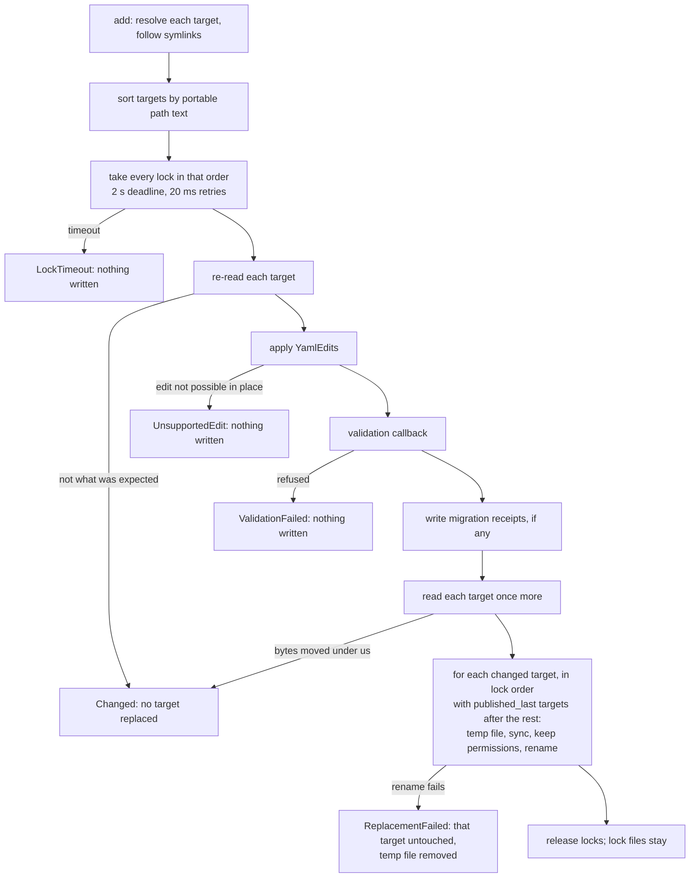
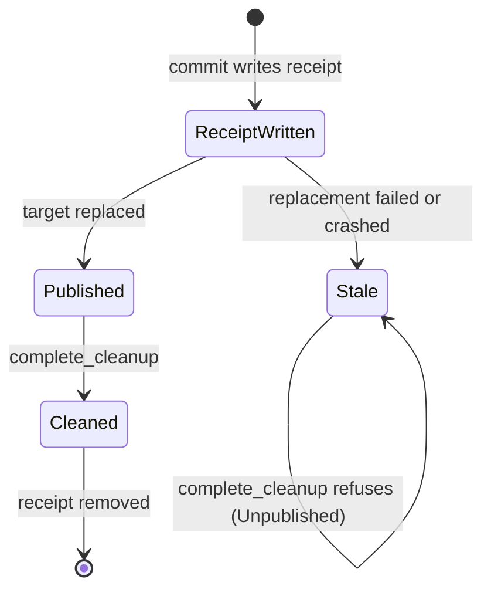

# Writing Configuration Files Safely

More than one program edits the same configuration file: `md` saves an
approval into `~/.darkmatter.yaml`, Claudine's setup and configuration editor
write `~/.claudine/config.yaml`, and the Darkmatter file may point at the
Claudine one. The `darkmatter::config` module gives every such writer one
mechanism, so two programs saving at the same moment both keep their change
and a hand edit made in between is never silently overwritten.

This page covers:

- [the transaction API](#the-transaction-api) and what it guarantees,
- [how locking works](#locking) and what it does not promise,
- [creating a file](#creating-a-file) and [symlinked files](#symlinks-and-aliases),
- [errors](#errors), and
- [migration receipts](#migration-receipts), which let a migration finish
  removing the files it converted after a crash.

The edits themselves are made by the comment-preserving YAML editor described
in [Editing Plain YAML Files](./yaml-editing.md); this page is about getting
them onto disk.

## The transaction API

A `ConfigTransaction` holds one or more `TargetChange`s. Each change names a
file, says what you expect it to hold, and lists `YamlEdit`s. `commit` takes a
validation callback and saves everything, or nothing.

```rust
use darkmatter::config::write::{
    ConfigTransaction, SourceExpectation, TargetChange, ValidationRefusal,
};
use darkmatter::yaml_edit::YamlEdit;
use simplified_schema::PropertyPath;

let mut transaction = ConfigTransaction::new();
transaction.add(TargetChange::edit(
    "/home/me/.darkmatter.yaml",
    SourceExpectation::Current,
    vec![YamlEdit::Set {
        path: PropertyPath::parse("permissions.network")?,
        value: "deny".into(),
    }],
))?;

let outcome = transaction.commit(&|candidate| {
    // Passive check of the edited text: parse and validate, no I/O.
    if candidate.candidate.contains("network: deny") {
        Ok(())
    } else {
        Err(ValidationRefusal::new("network must stay deny"))
    }
})?;
assert!(outcome.targets[0].written);
```

Paths must be absolute: the writer never reads the process's current
directory, so resolve a path against your own captured context first.

`SourceExpectation` says what the file must hold when it is read again under
the lock:

| Expectation | Use it when | A different file means |
| --- | --- | --- |
| `Current` | your edits name single values and do not depend on the rest of the file (saving an approval) | nothing; the edits apply to whatever is there |
| `Bytes(original)` | you computed the edits from the bytes you read (an editor screen showing the whole file) | the save stops with `Changed` |
| `Blake3(hash)` | as `Bytes`, holding only a hash (`migration_receipt::content_hash`) | the save stops with `Changed` |

A `Changed` save is never retried; tell the user and let them try again
against the new contents.

The validation callback sees a `ValidationCandidate` (`target`, `original`
text, `candidate` text) for every file before anything is written. It must be
passive: no file reads, no network, no changes. Return `ValidationRefusal::at`
to name the offending property. Darkmatter and Claudine pass their own schema
checks here, so both programs share this one transaction mechanism.

## The life of a transaction



Every step from taking the locks to the last rename happens while all locks
are held.

Targets are replaced one at a time, so a failure after the first rename
leaves the earlier targets published (`ReplacementFailed` lists them). When
one file only points at another, mark the pointing file
`TargetChange::published_last()`: it is replaced after every other target,
whatever the lock order, so a failure in between never leaves it pointing at
a file that does not yet hold what it should. Claudine's setup uses this to
move a `permissions` block into `~/.claudine/config.yaml` before
`~/.darkmatter.yaml` is rewritten to refer to it.

```rust
transaction.add(TargetChange::edit(&claudine_config, SourceExpectation::Bytes(read), move_block))?;
transaction.add(TargetChange::edit(&darkmatter_config, SourceExpectation::Bytes(read_too), refer).published_last())?;
```

Tests built with the `effects-instrumentation` feature can fail a replacement
on purpose: `write::test_hooks::fail_next_replacement()` fails the next one,
and `fail_replacement_after(n)` lets `n` through first (an interruption
between two targets).

## Locking

Each target has a lock file beside it, named by appending
`.darkmatter-lock` to the file name: `config.yaml` is locked through
`config.yaml.darkmatter-lock`. The lock is the operating system's exclusive
file lock (`std::fs::File::try_lock`), so it works between threads and between
processes on macOS, Linux, Windows, and WSL2. Lock files are kept after use
and never deleted; deleting one while another writer waits on it would let
two writers hold "the" lock at once.

What this guarantees:

- **Cooperating writers serialize.** Two programs, or two threads, that both
  write through `ConfigTransaction` never interleave. With `Current`
  expectations, both of their edits land.
- **Same file, same lock.** The lock is named from the resolved file, so
  `~/.darkmatter.yaml` and a symlink to it share one lock.
- **No deadlock between multi-file saves.** A transaction takes its locks in
  ascending order of the files' portable path text, so two transactions over
  the same files always wait in the same direction.
- **A writer gives up after 2 seconds** (retrying every 20 ms) with
  `LockTimeout`, rather than hanging.

What it does not guarantee: an editor that does not take the lock (a text
editor saving by hand) can still write between the writer's final check and
its rename. The writer re-reads just before replacing and stops with `Changed`
if the bytes moved, which narrows that window, but no check-then-rename can
close it. Nothing here claims otherwise.

Lock files inside a repository (`{repo}/.darkmatter.yaml.darkmatter-lock`)
are ordinary untracked files; ignore them in that repository's `.gitignore`.

## Replacing the file

A changed file is written to a temporary file in the same directory, flushed
to disk, given the original file's permissions (its Unix mode bits), and then
renamed over the original. The original is never deleted first. On Windows a
rename that another program's open handle briefly blocks is retried with a
short, bounded backoff, the same behavior as Darkmatter's other atomic writes.
If anything fails, the temporary file is removed and the original is
untouched.

A Windows file with the read-only attribute is refused with
`ReplacementFailed`: Windows will not rename over it, and the writer does not
clear an attribute the user set. On Unix a read-only mode does not stop the
rename, and the mode is kept.

A transaction whose edits leave a file's bytes unchanged does not rewrite it
(`written: false`).

## Creating a file

`TargetChange::create(path, initial_text, edits)` creates a missing file from
`initial_text` with `edits` applied, under the same lock. If the file exists
by the time the lock is taken, the save stops with `Changed`.

The file's directory must already exist. The writer never creates
directories; a missing one is `PathResolution` with
`PathProblem::MissingParent`. Create the directory yourself when your program
owns it (as Claudine owns `~/.claudine/`).

A newly created file gets the temporary file's permissions, which on Unix are
owner read and write only (`0600`).

## Symlinks and aliases

The writer follows symlinks to the real file and edits that file in place; a
symlink you pass stays a symlink. The lock file and any receipt sit beside the
real file. A symlink to a missing file is refused (`DanglingSymlink`) rather
than replaced by a regular file.

Adding the same real file twice to one transaction, under any spelling, makes
one target with one lock; the second change's edits apply after the first's.
The two changes must agree on what the file should hold, or `add` returns
`ConflictingChanges`.

## Errors

`ConfigWriteError` is one enum; every variant names the file concerned.

| Variant | Meaning | Files changed |
| --- | --- | --- |
| `PathResolution { problem }` | relative path, no file name, missing directory, dangling symlink, not a regular file, or a path a receipt cannot record | none |
| `LockTimeout { lock, waited }` | another writer held the lock for the whole deadline | none |
| `Io { path, source }` | a read or the lock file failed; editing a file that does not exist is `NotFound` here | none |
| `Changed { path }` | the file differs from what you expected, or moved during the save | none |
| `UnsupportedEdit { path, source }` | the YAML editor refused an edit; `source` carries the line and column | none |
| `ValidationFailed { path, refusal }` | your callback refused the edited text | none |
| `ReplacementFailed { path, published }` | renaming the temporary file failed; `path` is untouched | only the files listed in `published` |
| `ConflictingChanges { path }` | one file added twice with different expectations | none |

## Migration receipts

A migration converts old files (for example a `.darkmatter-shell-whitelist`)
into the new configuration and then deletes or backs up the old files. If the
program crashes after saving the new configuration but before the cleanup,
nothing in the configuration itself shows the cleanup is still owed. A
**receipt** records it.

```rust
use darkmatter::config::migration_receipt::{MigrationSource, complete_cleanup};
use darkmatter::config::write::{ConfigTransaction, SourceExpectation, TargetChange};

let legacy = home.join(".darkmatter-shell-whitelist");
let legacy_bytes = std::fs::read(&legacy)?;

// 1. Publish the converted policy; the receipt is written under the lock,
//    after validation and before the file is replaced.
let mut transaction = ConfigTransaction::new();
transaction.add(
    TargetChange::edit(&config, SourceExpectation::Current, converted_edits)
        .with_migration(vec![MigrationSource::delete(&legacy, &legacy_bytes)]),
)?;
transaction.commit(&validate)?;

// 2. Clean up. Pass the exact legacy files your program knows about.
complete_cleanup(&config, &[legacy.clone()])?;
```

The receipt sits beside the real target, named by appending
`.darkmatter-migration.json`, and is a closed JSON object:

```json
{
  "format_version": 1,
  "target": "/home/me/.darkmatter.yaml",
  "published_hash": "<BLAKE3 hex of the published file>",
  "sources": [
    { "path": "/home/me/.darkmatter-shell-whitelist", "hash": "<BLAKE3 hex>", "action": "delete" },
    { "path": "/home/me/old.json5", "hash": "<BLAKE3 hex>", "action": "backup", "backup_path": "/home/me/old.json5.bak" }
  ]
}
```

Every field is required and non-null, `sources` is never empty, unknown keys
and duplicate keys are refused, and `backup_path` appears exactly when
`action` is `backup`. Paths are written with `/` separators on every OS.



`complete_cleanup(target, known_sources)` takes the target's lock and then:

1. Returns `NothingPending` when no receipt exists, so calling it on every
   load is cheap and a finished cleanup is a no-op.
2. Refuses a receipt that names another target, or a source or backup path
   that is not in `known_sources` or is the target itself. The receipt alone
   never grants permission to delete anything.
3. Refuses unless the target holds exactly the published bytes. A receipt
   written for a save that never landed therefore authorizes nothing.
4. Refuses unless every remaining source holds the bytes that were migrated,
   and every backup destination is free. A source already gone counts as
   cleaned.
5. Only then deletes or moves each source, and removes the receipt.

Every refusal is a `MigrationError` with `kind`, the `receipt` file, and a
JSON `pointer` to the value concerned (`/sources/1/hash`; empty for the
receipt as a whole), and every source is kept. A source that is a symlink is
removed as a link; its destination is not touched. `read_receipt(target)`
returns the pending receipt, under the same lock and with the same checks of
its shape.
