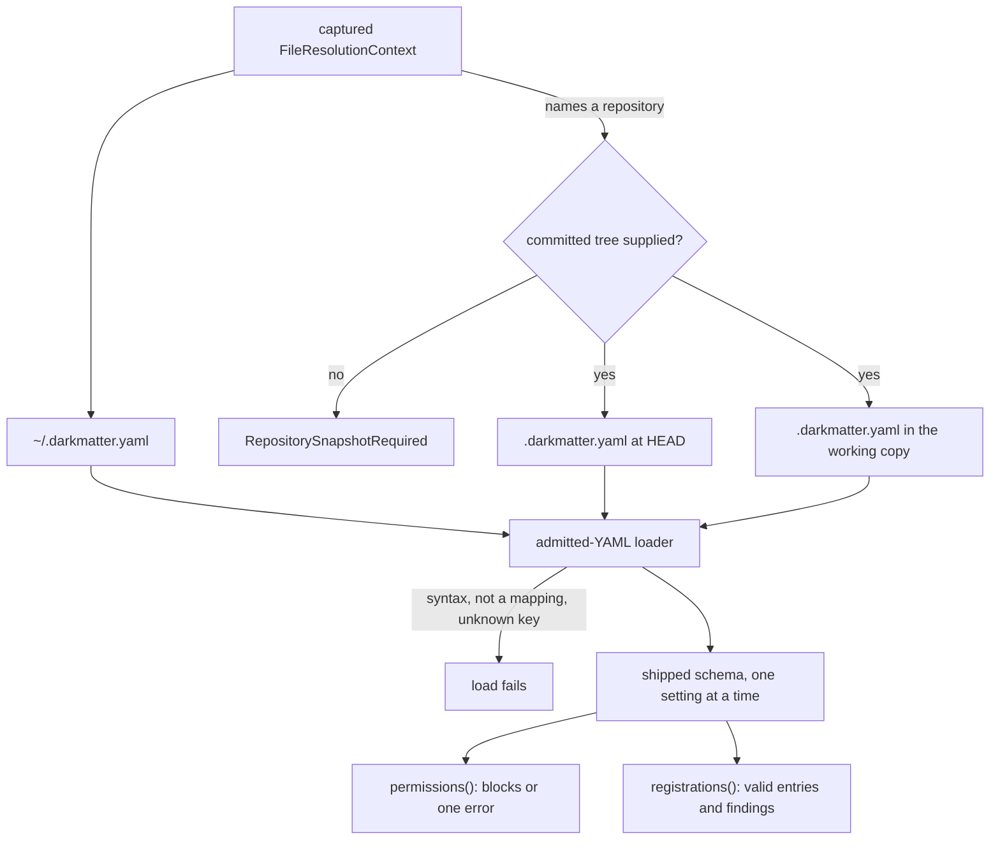
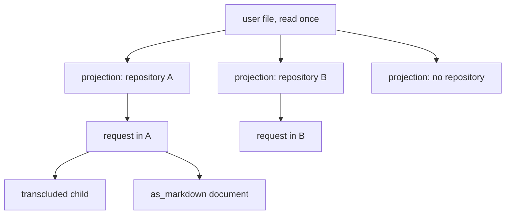

# Configuration Files

Darkmatter reads two optional YAML files. They decide which files a schema
slot may read, which shell commands run without a prompt, whether URLs may
be fetched, and which host manifests to register:

| Scope | Path |
| --- | --- |
| user | `~/.darkmatter.yaml` |
| repository | `{repo-root}/.darkmatter.yaml` |

This page covers:

- [what a configuration file holds](#the-file) and its [defaults](#defaults),
- [the permissions block](#permissions), and pointing it at
  [another file](#pointing-at-another-file),
- [loading a snapshot](#loading-a-snapshot) from Rust,
- [how errors are reported](#errors), and
- [the repository's two revisions](#the-repository-file-at-head-and-in-the-working-copy).

To change a file safely from code, see
[Writing Configuration Files Safely](./config-writes.md).

## The File

A configuration file is one YAML mapping with at most two keys:

```yaml
permissions:
    file-read:
        - "&**/*.yaml"
        - "!&secrets/**"
    shell-commands:
        - prefix ls
        - exact ps -e
        - template git add {{ string }}
        - "!prefix git add secrets"
    network: deny
register:
    - ~/hosts/claudine.yaml
```

Any other key is an error, and so is a second YAML document, a duplicate key,
or an empty file. Write `{}` for a file that keeps every default.

The shape and every default come from one shipped schema,
`darkmatter/schemas/darkmatter-config.yaml`. Darkmatter, DMLS, and Claudine
read defaults from it; none of them hard-codes a default. Other schemas import
the permissions block as `permissions@darkmatter:config` (or
`user-permissions@darkmatter:config` / `repository-permissions@darkmatter:config`
for a scope's defaults) instead of declaring it again:

```yaml
# a host's own configuration schema
kind: schema
types:
    host-config:
        permissions: user-permissions@darkmatter:config
```

## Defaults

An absent setting takes its scope's default. A list you write **replaces**
the default; it is never merged with it, so `file-read: []` pre-approves no
file at that scope. Explicit `null` is an error, never "use the default".

| Setting | User default | Repository default |
| --- | --- | --- |
| `file-read` | `./*.<ext>`: files beside the reading document | `&**/*.<ext>`: files anywhere in the repository |
| `shell-commands` | none (every command prompts) | none |
| `network` | `deny` | `deny` |
| `register` | `[]` | `[]` |

`<ext>` is each of `txt`, `text`, `md`, `csv`, `tsv`, `json`, `json5`,
`yaml`, `yml`, and `toml`, one entry per extension. An absent `permissions`
block, or `permissions: {}`, holds all three permission defaults.

## Permissions

`permissions` holds three separate policies; an entry of one never approves
anything for another.

**`file-read`** lists glob references (the grammar `$path` and `match()`
use). A leading `!` excludes what it matches.

| Pattern | Means | User | Repository |
| --- | --- | --- | --- |
| `./*.yaml`, `data/*.csv` | relative to the reading document | yes | yes, unless `..` leaves the starting folder |
| `&docs/**/*.md` | from the repository root | yes | yes, unless `..` climbs above the root |
| `^*.md` | nearest package, package area, then repository | yes | yes |
| `~/notes/*.md` | under your home directory | yes | no |
| `{{NOTES}}/*.md` | under a declared portable variable | yes, when listed in `PORTABLE_ENV_VARIABLES` | only when its value lies inside the repository |
| `/etc/*.md`, `C:\data\*.md` | absolute | no | no |
| `@x/*.md`, `vault:x/*.md`, URLs | search roots and remote | no | no |

**`shell-commands`** lists rules, one per entry: `exact <command>`,
`prefix <executable>`, or `template <shape>`, optionally led by `!`. A rule
with no command is an error.

**`network`** is `allow` or `deny`.

How the user and repository policies combine, and how a read or a command is
judged against them, is **planned**: until then the snapshot only records the
validated blocks.

### Pointing at another file

`permissions` may be a file reference instead of a block. It resolves from the
configuration file's directory, and the named YAML file holds the block under
its own `permissions` key:

```yaml
# ~/.darkmatter.yaml
permissions: ~/.claudine/config.yaml
```

Loading checks the reference's syntax: a blank or remote reference is an
error, and a repository file's reference must stay inside the repository
(no `~/`, absolute path, variable, or `..` above the repository root).
Following the reference and validating its target is **planned**; a missing
or invalid target will be an error, never an empty policy.

## Loading a Snapshot

`ConfigSnapshot::load` reads both files once, from a request's captured
context, and is cheap to share across threads (`Arc<ConfigSnapshot>`):

```rust
use biscuit_file::FileResolutionContext;
use darkmatter::config::load::{ConfigLoadMode, ConfigSnapshot};

fn load(context: &FileResolutionContext) -> Result<(), Box<dyn std::error::Error>> {
    // `None`: this context names no repository.
    let snapshot = ConfigSnapshot::load(context, None, ConfigLoadMode::Passive)?;
    let permissions = snapshot.permissions()?; // blocks only permission users
    for registration in &snapshot.registrations().entries {
        println!("register {}", registration.reference);
    }
    if let Some(path) = snapshot.user_config_missing() {
        eprintln!("warning: {} does not exist; run `md init`", path.display());
    }
    let _ = permissions;
    Ok(())
}
```

- The home directory comes from the context, never from the process.
- When the context names a repository, pass its captured
  `sniff::filesystem::git::CommittedTreeSnapshot`; leaving it out is an error
  (`RepositorySnapshotRequired`), never a silent fall back to the working copy.
- Loading is passive. It runs no shell command, fetches nothing, resolves no
  schema slot, and judges the files with the shipped schema only.
- `ConfigLoadMode::MigrateLegacy` is for a writing CLI's startup. Converting
  legacy policy files there is **planned**; today it loads exactly as
  `Passive`.
- `dependencies()` lists every file the load observed with the BLAKE3 hash of
  its bytes (or `None` when it was absent), so a caller can tell when a
  snapshot is stale.

Each typed value records whether the file wrote it (`Setting::authored`), next
to its effective value. `ConfigFile::effective()` is the whole document with
every default it relied on in place, and `defaults()` lists those defaults.



## Errors

Failures are attributed as narrowly as the file allows:

| Problem | Effect |
| --- | --- |
| malformed YAML, a duplicate key, several documents, a non-string key, an inadmissible number, invalid UTF-8 | the whole load fails |
| an empty file or a non-mapping document | the whole load fails |
| a key other than `permissions` and `register` | the whole load fails |
| an invalid `permissions` value in any file | `permissions()` returns the error; registrations still load |
| an invalid `register` entry | that entry is left out and reported; the others load |

Every problem names its file, which revision (user, repository `HEAD`, or
repository working copy), a JSON pointer such as `/permissions/file-read/2`,
and a 1-based line and column when the text has one. A reference problem has
the code `dm.config.reference`; every other problem `dm.config.invalid`.

`diagnostics()` returns everything a caller should report:
`dm.config.missing` when the user file does not exist (a missing repository
file is normal and never reported), the permissions error, and each
registration finding. `md` and Claudine report the missing file as described
in [How `md` and Claudine report configuration](#how-md-and-claudine-report-configuration);
reporting in DMLS is **planned**. The same module defines the codes
`dm.config.not_saved` and `dm.config.migration` for saving approvals and
migrating legacy files.

## One Snapshot per Request

Every `ComposeRequest` holds exactly one `Arc<ConfigSnapshot>`
(`request.config_snapshot()`). It is captured once, when the request is
built, and every view of the request shares that same `Arc`: a transcluded
child, an inline pass, an `as_markdown` document, `map_options`, and every
clone. Nothing downstream reads `.darkmatter.yaml` again.

Where the snapshot comes from:

| How the request is built | Snapshot |
| --- | --- |
| `ComposeOptions::with_config_snapshot(snapshot)` | the one you supplied |
| options whose `ctx` carries a host capture (`ComposeContext::with_config_source`) | the host's projection for the context's repository |
| `ComposeRequest::prepare` with neither | loaded passively once the context exists, reading `HEAD` from the tree the request's own repository discovery pinned (no second discovery) |
| `ComposeRequest::with_context` with neither, context names no repository | the user file, loaded passively |
| `ComposeRequest::with_context` with neither, context names a repository | error `ContextBuildError::ConfigSnapshotRequired` |

```rust
use std::sync::Arc;
use darkmatter::config::load::{ConfigLoadMode, ConfigSnapshot};
use darkmatter::markdown::compose::{
    ComposeOptions, ComposeRequest, RequestSnapshot, capture_resolution_context,
};

let snapshot = RequestSnapshot::new("/work/project").with_home(Some("/home/me".into()));
// One discovery: the context and the tree committed at HEAD.
let (context, committed) = capture_resolution_context(&snapshot)?;
let config = Arc::new(ConfigSnapshot::load_captured(&context, committed.as_ref(), ConfigLoadMode::Passive)?);
let request = ComposeRequest::with_context(ComposeOptions::new().with_config_snapshot(config), context)?;
# Ok::<(), Box<dyn std::error::Error>>(())
```

A host that resolves documents in several repositories reads the user file
once and projects it for each repository:

- `ConfigSnapshot::load_user(&request_snapshot, mode)` reads the user file
  alone, discovering nothing.
- `snapshot.with_repository_projection(&context, committed)` returns the
  snapshot for the repository `context` names, re-reading the user file from
  the bytes already held, never from disk.

A local-only expression context (`ComposeRequest::local_expression_context`)
fetches nothing remote, runs no shell command, and evaluates no schema slot,
so it needs no snapshot.



## How `md` and Claudine Report Configuration

`md` loads the user file once per invocation (in `ConfigLoadMode::MigrateLegacy`,
since `md` writes files), after help, completion, and usage errors have
returned. When it does not exist, the run reports one `dm.config.missing`
warning naming the file and `md init`:

- formatted output: one warning row on stderr;
- data output (`--output json`, …): one record in the result's `diagnostics`
  (or `run_diagnostics` for `md clean`), with stderr empty.

This holds for every command, including ones that compose nothing (`md hash`,
`md get`). A repository without `.darkmatter.yaml` reports nothing.

A user or repository file that does not load stops each command that reads the
configuration (`md compose`, `md graph`, `md validate refs`) with exit status 1
and a located error: `dm.config.invalid` (or `dm.config.reference`) with the
file, line, and column. A command that reads no configuration still runs.

```text
$ md compose doc.md
Error: /home/me/.darkmatter.yaml:2:1 at `/not-a-setting`: `not-a-setting` is not a configuration setting
```

Claudine reads the same file once at startup, before any hook, agent,
provider, or composition is dispatched. A file that does not load stops the
run with that located error. A missing file is one warning naming
`claudine init`, except for a provider hook callback (`claudine handle`) and
`claudine steer`, which answer a program on their streams; completion reads no
configuration. Each request Claudine composes receives the invocation's
snapshot, projected for the repository the request's document lives in.

## The Repository File at HEAD and in the Working Copy

Inside a repository the file is read twice: as committed at the `HEAD` the
request captured, and as it is in the working copy. Each is judged on its
own, and each takes the repository defaults when it is absent (an unborn
`HEAD` counts as absent). An invalid committed file blocks permissions just
as an invalid working file does.

The two are kept apart so a repository's permissions can widen only through
committed content: an uncommitted edit that adds an entry will have no effect
until it is committed, while one that removes an entry or adds a `!` applies
at once. Applying that rule (the narrower of the two, combined with the user
policy) is **planned** permission evaluation.

A committed `.darkmatter.yaml` that is a symbolic link, a directory, or a
submodule is an error; it is never followed.
