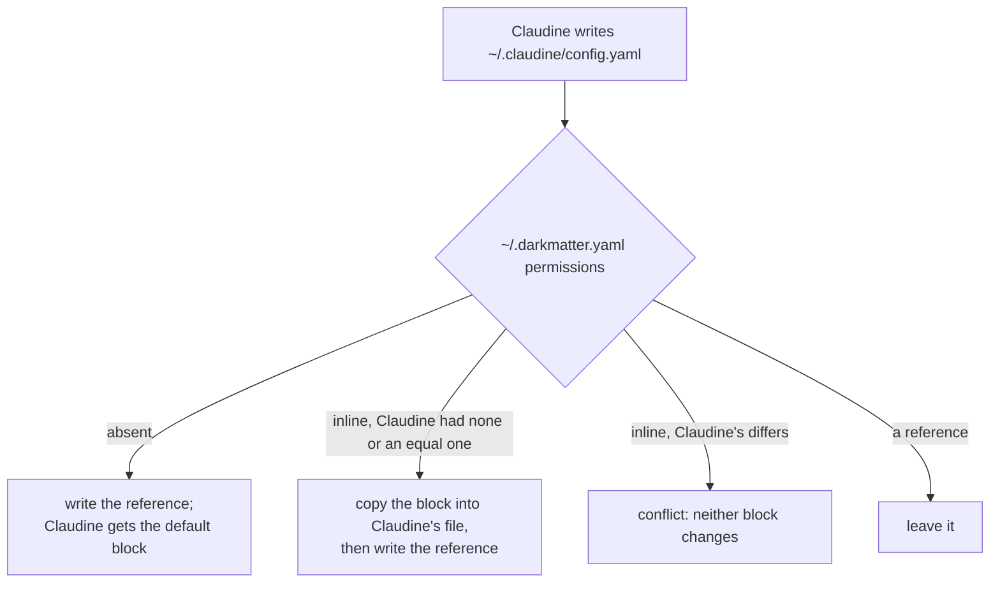
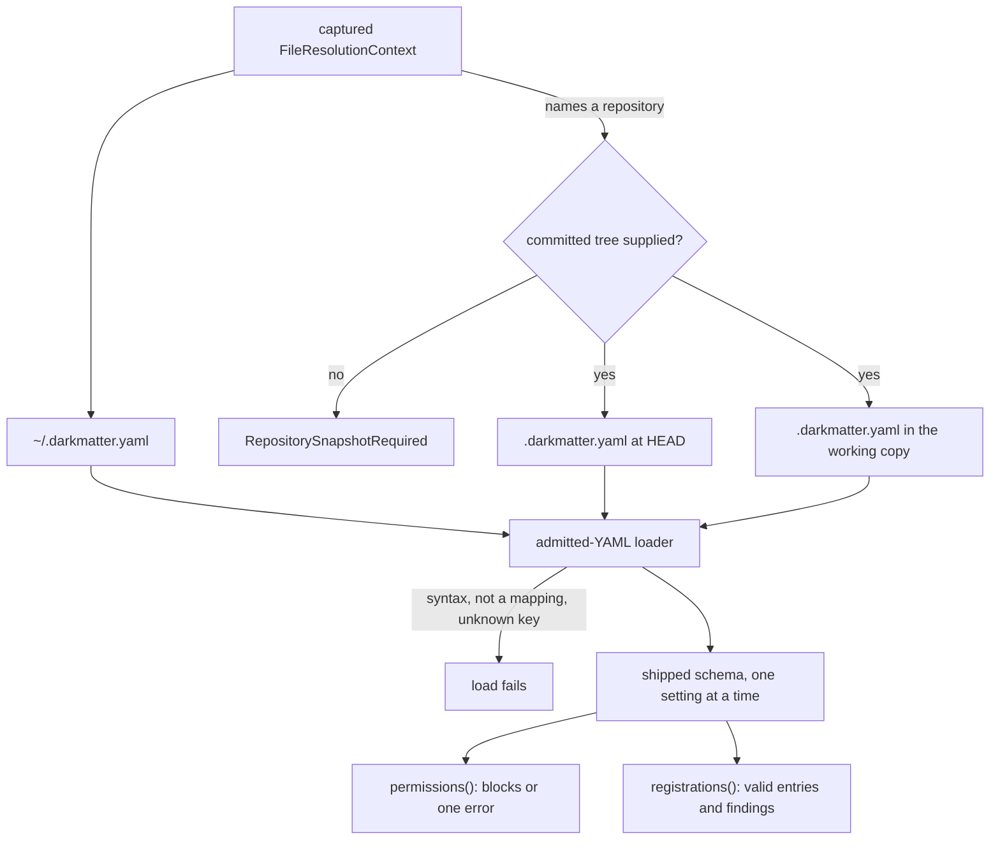
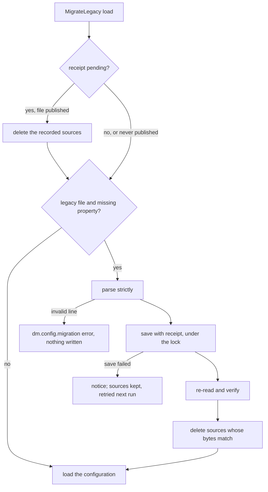
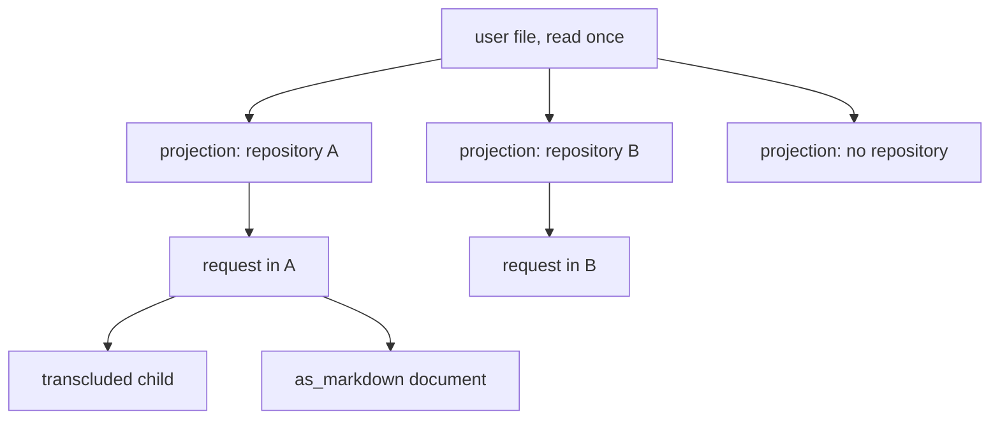
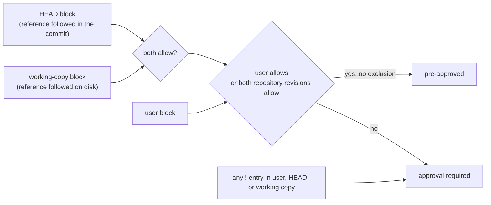

# Configuration Files

Darkmatter reads two optional YAML files. They decide which files a schema
slot may read, which shell commands run without a prompt, whether URLs may
be fetched, and which host manifests to register:

| Scope | Path |
| --- | --- |
| user | `~/.darkmatter.yaml` |
| repository | `{repo-root}/.darkmatter.yaml` |

This page covers:

- [what a configuration file holds](#the-file) and its [defaults](#defaults),
- [setting the files up](#setting-up-md-init) with `md init`, and what
  [Claudine's setup](#when-claudine-is-set-up) does to them,
- [the permissions block](#permissions) in brief (its rules are in
  [Permissions](./permissions.md)), and pointing it at
  [another file](#pointing-at-another-file),
- [loading a snapshot](#loading-a-snapshot) from Rust,
- [how errors are reported](#errors), and
- [the repository's two revisions](#the-repository-file-at-head-and-in-the-working-copy).

To change a file safely from code, see
[Writing Configuration Files Safely](./config-writes.md). What a `register`
entry names, and how a registered host loads, is
[Host Registration](./host-registration.md).

## The File

A configuration file is one YAML mapping with at most two keys:

```yaml
permissions:
    file-read:
        - "&**/*.yaml"
        - "!&secrets/**"
    shell-commands:
        - prefix ls
        - exact ps -e
        - template git add {{ string }}
        - "!prefix git add secrets"
    network: deny
register:
    - ~/hosts/claudine.yaml
```

Any other key is an error, and so is a second YAML document, a duplicate key,
or an empty file. Write `{}` for a file that keeps every default.

Each `register` entry names a host manifest (`kind: darkmatter-host`); see
[Host Registration](./host-registration.md) for its format and loading.

The shape and every default come from one shipped schema,
`darkmatter/schemas/darkmatter-config.yaml`. Darkmatter, DMLS, and Claudine
read defaults from it; none of them hard-codes a default. Other schemas import
the permissions block as `permissions@darkmatter:config` (or
`user-permissions@darkmatter:config` / `repository-permissions@darkmatter:config`
for a scope's defaults) instead of declaring it again:

```yaml
# a host's own configuration schema
kind: schema
types:
    host-config:
        permissions: user-permissions@darkmatter:config
```

### Editing a configuration file

DMLS checks `~/.darkmatter.yaml` and `<repo-root>/.darkmatter.yaml` (and
Claudine's `.claudine/config.yaml` in the same two places) against the same
scope contract as `md`, with completion, hover showing each setting's
description and default, and located diagnostics. A newly created, still
empty buffer already offers every key, even before its folder exists (a
`~/.claudine/config.yaml` buffer opened before `~/.claudine/` is created).
See [Configuration files](./schemas/dmls-schema-support.md#configuration-files).

## Defaults

An absent setting takes its scope's default, and so does an explicit `null`:
`network: null` is `deny`, `permissions: null` holds all three permission
defaults. A list you write **replaces** the default; it is never merged with
it, so `file-read: []` pre-approves no file at that scope. A `null` inside a
list (`register: [null]`) is still an error.

| Setting | User default | Repository default |
| --- | --- | --- |
| `file-read` | `./*.<ext>`: files beside the reading document | `&**/*.<ext>`: files anywhere in the repository |
| `shell-commands` | none (every command prompts) | none |
| `network` | `deny` | `deny` |
| `register` | `[]` | `[]` |

`<ext>` is each of `txt`, `text`, `md`, `csv`, `tsv`, `json`, `json5`,
`yaml`, `yml`, and `toml`, one entry per extension. An absent `permissions`
block, or `permissions: {}`, holds all three permission defaults.

## Setting Up: `md init`

`md init` writes `~/.darkmatter.yaml` with every setting at its default, so
you can see and edit them. You rarely need to run it for the user file: the
first `md` or Claudine run that finds no `~/.darkmatter.yaml` writes the same
file and says so once (see
[How `md` and Claudine report configuration](#how-md-and-claudine-report-configuration)). `md init --repo` also writes the repository's
`.darkmatter.yaml` (with the repository defaults). The command reference is
[`md init`](../cli/init.md).

```yaml
# ~/.darkmatter.yaml, as `md init` creates it
permissions:
  file-read:
  - ./*.txt
  - ./*.text
  # … one entry per default extension
  shell-commands: []
  network: deny
register: []
```

Running it on a file you already have is safe:

- every value, comment, reference, and `register` entry you wrote stays byte
  for byte; only a missing top-level setting (`permissions`, `register`) is
  added, at its default;
- a second run writes nothing;
- it never resets a policy and never replaces a `permissions` reference;
- an invalid file is reported (`dm.config.invalid`) and left alone.

`md init --inline` is the one repair: it replaces a `permissions` reference
with the block the referenced file holds. When that file cannot be read (it
is missing, invalid, or has no `permissions` mapping), the reference is
replaced with the schema defaults and the command says so, because the
defaults may grant or revoke something the lost block did.

`--repo` outside a repository fails before anything is written, the user
file included. Without a home directory nothing can be written either; see
[No home directory](#no-home-directory).

From Rust, `darkmatter::config::init::{init, init_user, init_repository}`
do the same through one locked transaction and return what happened to each
file (`created`, `updated`, or `unchanged`) with any notices.

### When Claudine is set up

Most people who use Darkmatter's permissions meet them through Claudine, so
once Claudine is set up its file holds the block and `~/.darkmatter.yaml`
points at it (`permissions: ~/.claudine/config.yaml`). Claudine's setup
writes its own file first and `.darkmatter.yaml` second:

| Before Claudine's setup | After it |
| --- | --- |
| no `~/.darkmatter.yaml` | created with `permissions: ~/.claudine/config.yaml`; Claudine's file holds the default block |
| `~/.darkmatter.yaml` with an inline block | the block moves into `~/.claudine/config.yaml`, then `.darkmatter.yaml` is rewritten to the reference |
| both files hold a block, and they differ | nothing moves; setup reports a conflict naming both files and keeps the inline block in force |
| `.darkmatter.yaml` already refers to Claudine's file | nothing changes |
| `.darkmatter.yaml` refers to some other file | the reference stays; Claudine does not take it over |

`md init` after Claudine's setup leaves the reference alone. The two writes
take both files' locks in path order, and `.darkmatter.yaml` is replaced
last: if anything fails between them, the original inline block is still the
one in force, and running setup again finishes the move. The same applies to
`{repo-root}/.darkmatter.yaml` and `{repo-root}/.claudine/config.yaml`
(referenced as `./.claudine/config.yaml`) for Claudine's repository setup.



## Permissions

`permissions` holds three separate policies: `file-read` (the files a schema
slot may read without asking), `shell-commands` (the commands that run
without a prompt), and `network` (`allow` or `deny` for URL fetches). A
leading `!` on a list entry excludes what it matches from pre-approval:

```yaml
permissions:
    file-read:
        - "&**/*.yaml"
        - "!&secrets/**"
    shell-commands:
        - prefix ls
    network: deny
```

Inside a repository, an operation is pre-approved when no file excludes it
and either your user file allows it or the repository file allows it both as
committed at `HEAD` and in the working copy; `network` is `allow` only when
every file says so. The entry forms, how the scopes combine, current-run
approvals, and the built-in shell blacklist are described in
[Permissions](./permissions.md).

### Pointing at another file

`permissions` may be a file reference instead of a block. It resolves from the
configuration file's directory, and the named YAML file holds the block under
its own `permissions` key:

```yaml
# ~/.darkmatter.yaml
permissions: ~/.claudine/config.yaml
```

Loading checks the reference's syntax: a blank or remote reference is an
error, and a repository file's reference must stay inside the repository
(no `~/`, absolute path, variable, or `..` above the repository root).

The reference is then followed, once per file:

- The target's top-level `permissions` must be a mapping. It is checked
  against the same permissions type and entry rules as an inline block, and
  takes the **referring** file's scope defaults for anything it omits.
- A missing, unreadable, or invalid-YAML target, one without a
  `permissions` mapping, or one whose `permissions` is another reference (no
  chains) is an error (`dm.config.reference`) naming both files and
  suggesting `md init --inline`. It is never replaced by defaults or an
  empty policy; a command that needs the policy stops.
- A repository file's target must really be inside the repository: in the
  working copy, a symbolic link that leads outside is an error. At `HEAD` the
  target is read from the committed tree only, never from disk; committed
  symbolic links are followed inside the tree, and a link that leaves the
  repository, a cycle, or more than 40 links is an error.

Each target is listed in `dependencies()` with its hash, with
`referenced_from` naming the file that points at it.

## Loading a Snapshot

`ConfigSnapshot::load` reads both files once, from a request's captured
context, and is cheap to share across threads (`Arc<ConfigSnapshot>`):

```rust
use biscuit_file::FileResolutionContext;
use darkmatter::config::load::{ConfigLoadMode, ConfigSnapshot};

fn load(context: &FileResolutionContext) -> Result<(), Box<dyn std::error::Error>> {
    // `None`: this context names no repository.
    let snapshot = ConfigSnapshot::load(context, None, ConfigLoadMode::Passive)?;
    let permissions = snapshot.permissions()?; // blocks only permission users
    for registration in &snapshot.registrations().entries {
        println!("register {}", registration.reference);
    }
    if let Some(path) = snapshot.user_config_missing() {
        eprintln!("warning: {} does not exist; run `md init`", path.display());
    }
    let _ = permissions;
    Ok(())
}
```

- The home directory comes from the context, never from the process.
- When the context names a repository, pass its captured
  `sniff::filesystem::git::CommittedTreeSnapshot`; leaving it out is an error
  (`RepositorySnapshotRequired`), never a silent fall back to the working copy.
- Loading is passive. It runs no shell command, fetches nothing, resolves no
  schema slot, and judges the files with the shipped schema only.
- `ConfigLoadMode::MigrateLegacy` is for a writing CLI's startup. Before it
  reads anything it converts legacy policy files into the configuration; see
  [Migrating legacy policy files](#migrating-legacy-policy-files-temporary).
  Then, when `~/.darkmatter.yaml` still does not exist, it creates the file
  with every setting at its default (exactly what `md init` writes) and loads
  that: `user_config_created()` returns its path and `diagnostics()` holds one
  `dm.config.created` notice. Only when the file cannot be written does the
  load fall back to the defaults, with a `dm.config.missing` warning that
  says why.
- `ConfigLoadMode::Setup` migrates like `MigrateLegacy` but never creates the
  user file. It is for a setup command, such as `md init`, that creates the
  file in its own transaction and must write nothing when that fails.
- `Passive` never writes or deletes a file; a missing user file is reported
  as `dm.config.missing`.
- `dependencies()` lists every file the load observed with the BLAKE3 hash of
  its bytes (or `None` when it was absent), so a caller can tell when a
  snapshot is stale.

Each typed value records whether the file wrote it (`Setting::authored`), next
to its effective value. `ConfigFile::effective()` is the whole document with
every default it relied on in place, and `defaults()` lists those defaults.



### Checking one file without loading

A diagnostic tool (such as `claudine doctor`) that wants to know whether one
configuration file is valid, without any side effect, calls
`inspect_working_file`. It judges the user file, or the repository file as it
is in the working copy, exactly as a load would, and returns that one
`ConfigFile`:

```rust
use biscuit_file::FileResolutionContext;
use darkmatter::config::load::inspect_working_file;
use darkmatter::config::schema::ConfigScope;

fn check(context: &FileResolutionContext) {
    match inspect_working_file(context, ConfigScope::User) {
        Ok(file) if !file.is_present() => println!("{} does not exist", file.path().display()),
        Ok(file) => {
            if let Err(error) = file.permissions() {
                println!("invalid permissions: {error}");
            }
            for finding in file.registration_findings() {
                println!("invalid register entry: {finding}");
            }
        }
        // Not YAML, not a mapping, an unknown key, or unreadable.
        Err(error) => println!("{error}"),
    }
}
```

- It reads that one file and nothing else: not the committed (`HEAD`) file,
  not the target of a `permissions` reference (the setting is the reference
  as written), and no installed registration.
- It never writes: a missing file is not created, and a legacy policy file is
  neither migrated nor deleted.
- A context with no home (user scope) or no repository (repository scope) is
  a `Read` error.
- `md init` reads the file it edits through the same reader and judge.

## Errors

Failures are attributed as narrowly as the file allows:

| Problem | Effect |
| --- | --- |
| malformed YAML, a duplicate key, several documents, a non-string key, an inadmissible number, invalid UTF-8 | the whole load fails |
| an empty file or a non-mapping document | the whole load fails |
| a key other than `permissions` and `register` | the whole load fails |
| an invalid `permissions` value in any file | `permissions()` and `policy()` return the error; registrations still load |
| a `permissions` reference whose target is missing or invalid | `policy()` returns the error (`permissions()` still returns the raw reference); registrations still load |
| an invalid `register` entry | that entry is left out and reported; the others load |
| in `MigrateLegacy` mode, a legacy policy file that cannot be read or has an invalid line, or a migration receipt that cannot be finished | the whole load fails with `dm.config.migration`; nothing is written |

Every problem names its file, which revision (user, repository `HEAD`, or
repository working copy), a JSON pointer such as `/permissions/file-read/2`,
and a 1-based line and column when the text has one. A reference problem has
the code `dm.config.reference`; every other problem `dm.config.invalid`.

`diagnostics()` returns everything a caller should report:
`dm.config.created` when the load created the user file,
`dm.config.missing` when the user file does not exist and was not created (a
missing repository file is normal and never reported), the permissions
error, and each registration finding. `md` and Claudine report the missing file as described
in [How `md` and Claudine report configuration](#how-md-and-claudine-report-configuration);
DMLS reports it as described in [How DMLS reports configuration](#how-dmls-reports-configuration).
The same module defines the codes
`dm.config.not_saved` and `dm.config.migration` for saving approvals and
migrating legacy files.

## Migrating Legacy Policy Files (Temporary)

Before `.darkmatter.yaml` existed, three plain-text files held these policies.
A load in `ConfigLoadMode::MigrateLegacy` (every `md` and Claudine run)
converts them once and deletes them. This conversion is temporary and will be
removed after a few releases; anything it missed is re-created by hand.

| Legacy file | Where | Becomes |
| --- | --- | --- |
| `.darkmatter-shell-whitelist` | home, repository root | `permissions.shell-commands` entries |
| `.darkmatter-shell-blacklist` | home, repository root | `!` entries in `permissions.shell-commands` |
| `.config/darkmatter/schema-read-policy` | home | `permissions.file-read` entries |

A home whitelist and blacklist like these:

```text
# ~/.darkmatter-shell-whitelist
prefix ls
exact ps -e

# ~/.darkmatter-shell-blacklist
prefix rm
```

become one list in `~/.darkmatter.yaml` (created when it does not exist):

```yaml
permissions:
  shell-commands:
  - prefix ls
  - exact ps -e
  - "!prefix rm"
```

The rules:

- **Only a missing property is filled.** A file whose configuration already
  writes the property, even as `[]`, is left in place and reported as
  ignored; delete it once its rules are in the configuration. A `permissions`
  value that refers to another file is never migrated into; copy the rules
  there by hand.
- **The whitelist and blacklist move together**, so writing one never stops
  the other from migrating.
- **A blacklist rule now prompts.** It becomes a `!` exclusion, which removes
  pre-approval instead of refusing the command; each such rule is reported.
- **Grant-store lines become portable patterns.** `allow file` and `allow dir`
  lines under the home become `~/` entries (`allow file /home/me/x/a[1].yaml`
  becomes `~/x/a[[]1[]].yaml`, with glob characters escaped; `allow dir
  /home/me/notes` becomes `~/notes/**`), and `deny` lines become the same
  entries with `!`. The scope's default `file-read` list from the shipped
  schema is written first, because a written list replaces the default. A
  path outside the home, and every `allow url`, `url-any-query`, or `site`
  line, is dropped and reported; `network` stays `deny`.
- **A line the old grammar rejects stops the load** with a
  `dm.config.migration` error naming the file and line. Nothing is written
  and every legacy file is kept.
- **Repository files** migrate into the working-copy `.darkmatter.yaml`. Under
  the commit rule, the new entries take effect once that file is committed.
- Policy files in a document's own folder are never read or migrated.

The new entries are saved with the same locked, comment-preserving writer as
every configuration edit, together with a migration receipt beside the file
(`.darkmatter.yaml.darkmatter-migration.json`). Only after the saved file reads
back with the new entries are the legacy files deleted, and only those whose
bytes still match the receipt.



- A crash after the save but before the deletion is finished by the next
  load, from the receipt.
- A failed save keeps every source and is tried again on the next run.
- A source edited after it was migrated is kept, with a notice, until it is
  deleted by hand.
- Running again changes nothing: the property is now written, so nothing is
  migrated twice.

Each migrated file, each dropped line, and each blacklist rule is one
`dm.config.migration` notice in `diagnostics()`. A `Passive` load (DMLS,
validators) writes nothing; it reports each legacy file a writing run would
migrate. DMLS shows each such notice once per session (see
[How DMLS reports configuration](#how-dmls-reports-configuration)) and leaves
the file where it is.

## One Snapshot per Request

Every `ComposeRequest` holds exactly one `Arc<ConfigSnapshot>`
(`request.config_snapshot()`). It is captured once, when the request is
built, and every view of the request shares that same `Arc`: a transcluded
child, an inline pass, an `as_markdown` document, `map_options`, and every
clone. Nothing downstream reads `.darkmatter.yaml` again.

Where the snapshot comes from:

| How the request is built | Snapshot |
| --- | --- |
| `ComposeOptions::with_config_snapshot(snapshot)` | the one you supplied |
| options whose `ctx` carries a host capture (`ComposeContext::with_config_source`) | the host's projection for the context's repository |
| `ComposeRequest::prepare` with neither | loaded passively once the context exists, reading `HEAD` from the tree the request's own repository discovery pinned (no second discovery) |
| `ComposeRequest::with_context` with neither, context names no repository | the user file, loaded passively |
| `ComposeRequest::with_context` with neither, context names a repository | error `ContextBuildError::ConfigSnapshotRequired` |

```rust
use std::sync::Arc;
use darkmatter::config::load::{ConfigLoadMode, ConfigSnapshot};
use darkmatter::markdown::compose::{
    ComposeOptions, ComposeRequest, RequestSnapshot, capture_resolution_context,
};

let snapshot = RequestSnapshot::new("/work/project").with_home(Some("/home/me".into()));
// One discovery: the context and the tree committed at HEAD.
let (context, committed) = capture_resolution_context(&snapshot)?;
let config = Arc::new(ConfigSnapshot::load_captured(&context, committed.as_ref(), ConfigLoadMode::Passive)?);
let request = ComposeRequest::with_context(ComposeOptions::new().with_config_snapshot(config), context)?;
# Ok::<(), Box<dyn std::error::Error>>(())
```

A host that resolves documents in several repositories reads the user file
once and projects it for each repository:

- `ConfigSnapshot::load_user(&request_snapshot, mode)` reads the user file
  alone, discovering nothing.
- `snapshot.with_repository_projection(&context, committed)` returns the
  snapshot for the repository `context` names, re-reading the user file from
  the bytes already held, never from disk.

A local-only expression context (`ComposeRequest::local_expression_context`)
fetches nothing remote, runs no shell command, and evaluates no schema slot,
so it needs no snapshot.



## How `md` and Claudine Report Configuration

`md` loads the user file once per invocation (in `ConfigLoadMode::MigrateLegacy`,
since `md` writes files), after help, completion, and usage errors have
returned. When it does not exist, the run creates it with every setting at
its default, uses it, and reports one `dm.config.created` notice naming the
file. Every later run finds the file and reports nothing:

```text
$ md get doc.md title
created `/home/me/.darkmatter.yaml` with every setting at its default
My Title
$ md get doc.md title
My Title
```

- formatted output: one info row on stderr;
- data output (`--output json`, …): one `info` record in the result's
  `diagnostics` (or `run_diagnostics` for `md clean`), with stderr empty.

This holds for every command, including ones that compose nothing (`md hash`,
`md get`), except `md init`, which creates the file itself and reports it as
`created` in its own result. When the file cannot be written (a read-only
home, for example), the run still uses the defaults and reports one
`dm.config.missing` warning saying why it could not be created. A repository
without `.darkmatter.yaml` reports nothing.

Claudine does the same at startup, writing the created (or could-not-create)
line to stderr; its setup later moves the inline `permissions` block into
`~/.claudine/config.yaml` as described in
[When Claudine is set up](#when-claudine-is-set-up).

### No home directory

When no home directory can be found for the process, there is no user file
to read. Every command still runs with the
user defaults and reports one `dm.config.missing` warning saying that no home
directory is available. Nothing is created or ever written there: `md init` fails with
`dm.config.not_saved`, and an "always allow" approval applies to the current
run only.

A user or repository file that does not load stops each command that reads the
configuration (`md compose`, `md graph`, `md validate refs`) with exit status 1
and a located error: `dm.config.invalid` (or `dm.config.reference`) with the
file, line, and column. A command that reads no configuration still runs.

```text
$ md compose doc.md
Error: /home/me/.darkmatter.yaml:2:1 at `/not-a-setting`: `not-a-setting` is not a configuration setting
```

Claudine reads the same file once at startup, before any hook, agent,
provider, or composition is dispatched. A file that does not load stops the
run with that located error. A missing file is one warning naming
`md init`, except for a provider hook callback (`claudine handle`) and
`claudine steer`, which answer a program on their streams; completion reads no
configuration. Each request Claudine composes receives the invocation's
snapshot, projected for the repository the request's document lives in.
Claudine's shell approvals decide with that same projection: a prompt in
another repository is judged by that repository's rules, in the same order as
`md` (built-in blacklist, then `!` entries, then allows), and an invalid
`permissions` block fails every command instead of falling back to an empty
policy. DMLS shows the same verdict on a shell command's hover from a
`Passive` load; it never prompts or saves.

### How DMLS reports configuration

DMLS, the language server, loads the configuration passively: it never
creates, migrates, or writes a file, and never prompts. It shows these as
editor messages (`window/showMessage`), each once per editor session:

| Situation | Message |
| --- | --- |
| `~/.darkmatter.yaml` does not exist | one `dm.config.missing` warning naming the file and `md init`, however many documents load the configuration. A repository without `.darkmatter.yaml` shows nothing |
| a legacy policy file is waiting to be migrated | one `dm.config.migration` information message per file, saying the next `md` or Claudine run migrates it |

For example, with no user file:

```text
dmls: dm.config.missing: `/home/me/.darkmatter.yaml` does not exist, so every setting takes its default; `md init` creates it
```

Creating the file needs no restart: DMLS watches both configuration files,
present or absent, and reloads them when they change. A problem inside an
open configuration file is reported on that file (see
[Editing a configuration file](#editing-a-configuration-file)).

## The Repository File at HEAD and in the Working Copy

Inside a repository the file is read twice: as committed at the `HEAD` the
request captured, and as it is in the working copy. Each is judged on its
own, and each takes the repository defaults when it is absent (an unborn
`HEAD` counts as absent). An invalid committed file blocks permissions just
as an invalid working file does.

The two are kept apart so a repository's permissions can widen only through
committed content (see
[How the scopes combine](./permissions.md#how-the-scopes-combine)):
an uncommitted edit that adds an entry has no effect until it is committed,
while one that removes an entry or adds a `!` applies at once. Each revision
follows its own reference, so turning an inline block into a reference,
pointing a reference at another file, or editing or deleting the target is
subject to the same rule: `HEAD` reads the target's committed bytes, the
working copy its current ones. A failure to read the committed tree is an
error, never a working-copy-only policy.



A committed `.darkmatter.yaml` that is a symbolic link, a directory, or a
submodule is an error; it is never followed.

## The Cloned-Repository Risk

The commit rule stops an uncommitted edit, including an agent editing its own
configuration, from widening a repository's permissions. It cannot protect you
from a repository whose **committed** configuration is hostile: clone it, and
its `shell-commands` can pre-approve any command (its `file-read` still cannot
leave the repository). Read a cloned repository's `.darkmatter.yaml` and
`.claudine/config.yaml` before you run Darkmatter or Claudine in it.

A repository can make every widening deliberate by reviewing each committed
change to its permissions. `darkmatter::config::widening` is the comparison
for that: `compare_revisions(repository, base, head, &inputs)` reads two
commits as Git objects only (nothing is checked out or run), resolves each
policy file's block in each commit (following a reference to its target in
that same commit, with the shipped defaults filled in), and returns a
`WideningReport` whose `potential_widening` is true when the head may grant
more:

```rust
use darkmatter::config::widening::{WideningInputs, compare_revisions};

let inputs = WideningInputs::from_json(&std::fs::read_to_string(".github/ci/permission-inputs.json")?)?;
let report = compare_revisions(Path::new("."), &base_commit, &head_commit, &inputs)?;
for reason in &report.reasons {
    println!("{}: {:?} — {}", reason.input, reason.kind, reason.detail);
}
```

| Change | Result |
|---|---|
| the same block, inline or behind a reference, in any order | not widening |
| an entry removed, a `!` exclusion added, `network: allow` → `deny` | not widening |
| an entry added (a rewritten glob or command counts as added) | `added-allow` |
| a `!` exclusion removed | `removed-exclusion` |
| `network: deny` → `allow` | `network-allowed` |
| a deleted file or property whose default is wider | `added-allow` |
| a shipped default that grows, or that the trusted code cannot read | `added-allow`, `defaults-not-understood` |
| any change to a file the check depends on | `checker-input-changed` |
| a file, Git, YAML, or reference error in either commit | an error, never "no change" |

This repository runs the comparison in CI from the base commit's code and,
when a pull request widens or narrows the resolved permissions, says which in
a comment on that pull request and lists every entry that changed, so whoever
merges it decides with the change in view; see
"Permission-change report" in `docs/topics/ci-cd.md`. The report makes a
widening visible, not impossible.

## Saving an "Always Allow" Approval

When a user chooses to keep an approval, call
`darkmatter::config::permissions::persist::save_user_approval` with the
snapshot's policy:

```rust
use darkmatter::config::load::ConfigSnapshot;
use darkmatter::config::permissions::persist::{PersistentApproval, save_user_approval};
use darkmatter::markdown::compose::shell_expansion::store::parse_rule_entry;

fn keep(snapshot: &ConfigSnapshot) -> Result<(), Box<dyn std::error::Error>> {
    let rule = parse_rule_entry("prefix ls")?;
    match save_user_approval(snapshot.policy()?, &PersistentApproval::ShellRule { rule, command: None }) {
        Ok(saved) => println!("saved `{}` to {}", saved.entry, saved.file.display()),
        Err(not_saved) => eprintln!("{}: {not_saved}", not_saved.code()), // dm.config.not_saved
    }
    Ok(())
}
```

What it does:

- It writes to the **user** scope only: `~/.darkmatter.yaml`, or the file
  its `permissions` reference names (for example Claudine's
  `config.yaml`). A repository file is never edited. A missing
  `~/.darkmatter.yaml` is created when there is a home directory.
- It appends one entry to `shell-commands` (the approved `exact`, `prefix`,
  or `template` rule) or `file-read` (the one approved file), skipping an
  entry that is already there. Every other byte of the file (comments, key
  order, quoting, other keys) is unchanged.
- When the list was omitted, the scope's default entries are written first,
  because a written list replaces the default:

  ```yaml
  # before                      # after approving ~/data/[id].yaml
  permissions:                  permissions:
      network: deny                 network: deny
                                    file-read:
                                        - ./*.txt
                                        # … the other nine defaults
                                        - ~/data/[[]id[]].yaml
  ```

- A file is saved as an exact `~/` reference with glob characters escaped,
  never as a folder pattern. A file outside the home has no portable
  spelling and is not saved; neither is a directory.
- It never saves a site or `network` grant and never removes a `!` entry:
  when an exclusion still matches the approved command or file, the result
  says so and nothing is written.
- The edit is made under the file's lock and the edited block is validated
  before the file is replaced; an edit that cannot be made in place (a
  one-line `[a, b]` list) or that would leave the block invalid is refused
  and the file is untouched.

A not-saved result (`NotSaved`, code `dm.config.not_saved`) never cancels the
approval for the current run, and a saved one does not change the snapshot
already captured: the new entry takes effect in the snapshot of the next run.

Composition does this for you when a shell prompt's "always allow" choice is
picked: it saves the rule, adds it to the run's own approvals (so a later
command it covers is not asked about again, unless an exclusion matches that
command), and reports a rule that could not be saved as a
`dm.config.not_saved` warning while the command still runs. See
[Pre-Flight Shell Approval](../inline/preflight-checks.md#interactive-approval).
