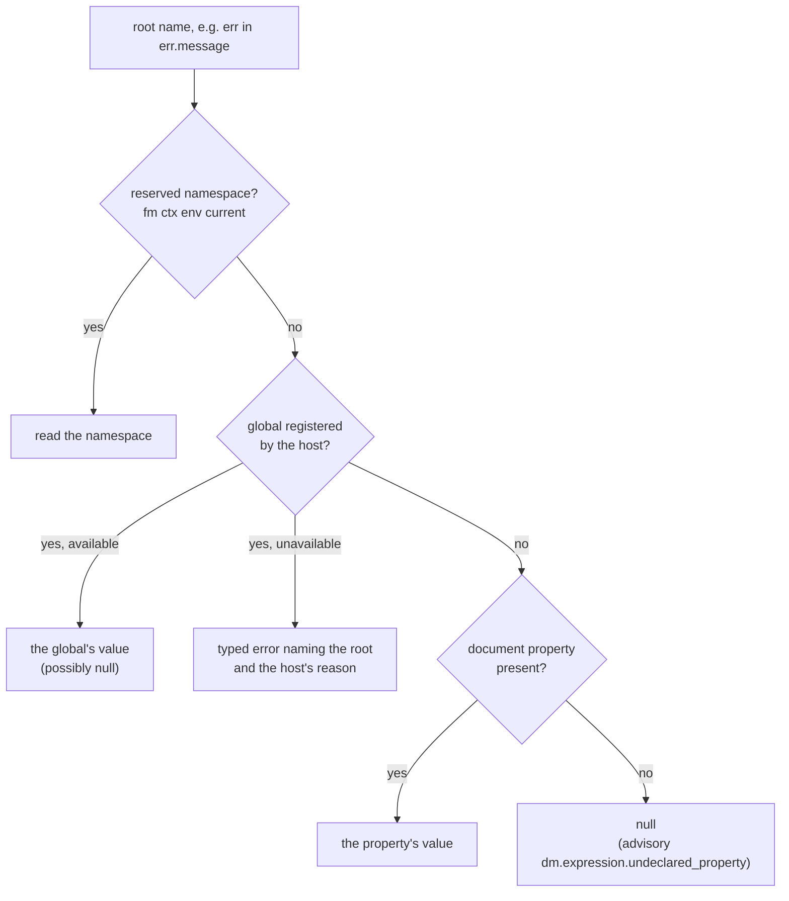
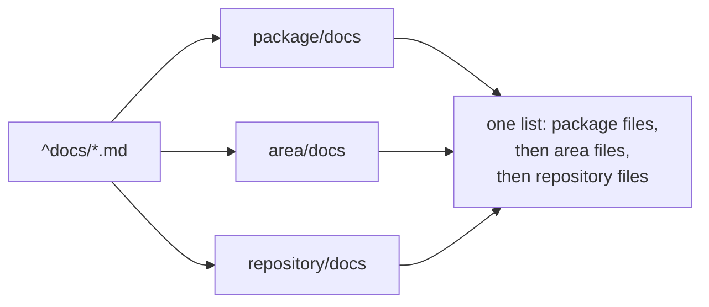

# Darkmatter Expressions

Darkmatter exposes a single expression language used in two kinds of surface:

- **interpolation** — `{{ ... }}` expansions in document content and frontmatter
- **conditions** — `when="..."` attributes on [page blocks](../inline/page-blocks.md), [transclusion directives](../transclusion/block-transclusion.md), and reference-graph conditional extraction

Both kinds share the same lexer, parser, and evaluator, so the operator
set, truthiness rules, helper functions, and access semantics described here
are identical everywhere.

### Availability across every surface

The same grammar — including the [read-side functions](#read-side-functions)
and the [`fm.*` namespace](#namespaces) — evaluates identically on every
surface that runs it:

| Surface | Form |
| --- | --- |
| Frontmatter interpolation (pass 1, pre-shell) | `key: "{{ ... }}"` |
| Frontmatter interpolation (pass 2, post-shell; deferred keys only) | `key: "{{ ... }}"` |
| `$()` frontmatter shell ternary condition | `key: "$( cond ? a : b )"` |
| `$()` frontmatter shell ternary branch | `key: "$( cond ? a : b )"` |
| Body interpolation | `{{ ... }}` |
| `::block` / `::file` / `::code` conditions | `when="..."` |
| Reference-graph conditional extraction | `when="..."` |
| Public condition API | `evaluate_condition_against(...)` |
| Claudine loop conditions | `until=` / `while=` / `action=` |
| Claudine hook conditions | `when=` |

This is the **availability invariant**: a read-side function or `fm.*`
reference resolves on every surface above, except that Claudine hook conditions
have no document: they read the hook payload through their own `hook` root
instead of `fm`. The historical asymmetry — where
read-side functions worked only in body interpolation — is gone; the compose
pipeline and public condition API use the same evaluation contract.

> Earlier docs called this "Boolean Conditional Logic". The language is now
> general-purpose and supports arithmetic, member/index access, type
> predicates, and date helpers, so this topic is the authoritative reference
> under its new name.

All functions provided here DO NOT mutate state, they only _report_ on state. If you are looking for ways to mutate state then you should go to the [side effects](./side-effects.md) documentation. Most functions report only on values already in scope, but the read-side functions (such as `frontmatter(...)` and `file_exists(...)`) also _read_ other files — and, for some, remote URLs — so they report on more than just the local document.

## Core Expression Engine

The parser, AST, and evaluator live in the [`expression`](../../lib/src/markdown/compose/expression/mod.rs) module and are public API:

- **`expression::Expr`** — the AST type
- **`expression::Lexer`** — tokenizes expression strings
- **`expression::Parser`** — builds an `Expr` from tokens
- **`expression::evaluate`** — evaluates an `Expr` against any [`EvaluationLookup`](#evaluationlookup-trait)
- **`expression::parse_condition`** — parses a string in condition mode (`||` is logical OR, `&&` is logical AND)

## How Parsing Works

Text becomes an AST in three stages: **scanning** finds `{{ … }}` regions in a
document, **lexing** turns the text inside one into tokens, and the **grammar**
turns those tokens into an AST. Only the first stage is document-aware; surfaces
where the expression is the whole string — `when="…"`, the public condition API —
start at lexing.

The principles worth carrying around:

- **One implementation, every surface.** The same lexer, parser, and AST serve
  body interpolation, frontmatter, `when=` conditions, `$()` ternaries, and the
  language server. A grammar change is never local to one surface.
- **Parsing is context-free.** Nothing in these stages reads frontmatter, the
  filesystem, or the function catalog. The same text always yields the same AST;
  an unknown variable or an unknown function is an *evaluation* concern, not a
  parse error.
- **Identifiers are letters, digits, `_`, and inner `-`, and never start with
  a digit.** A `-` joins an identifier only mid-identifier and only when an
  identifier character follows it, so a kebab-case key such as `spec-name` is
  simply `{{ spec-name }}`. `a - b`, `a -b`, `4-2`, and `foo--bar` stay
  subtraction. Subtracting from a name therefore needs whitespace:
  `iteration - 1`, not `iteration-1`, which names a key. See
  [lexing](./parsing/lexing.md#--inside-an-identifier).
- **Dotted paths are one token.** `a.b.c` lexes as a single variable; a `.`
  followed by a digit does not fold, which is why `items.0` is rejected and
  `items[0]` is the array form.
- **Precedence is the call ladder.** Ternary is loosest, then `||`, `&&`,
  comparison, `+ -`, `* / %`, unary, then primary and postfix access. Binary
  operators are left-associative; the ternary is right-associative. Comparisons
  do **not** chain — `a < b < c` is a parse error, not `(a < b) < c`.
- **Mode changes exactly one thing.** `||` is fallback when interpolating and
  logical OR in a condition. `&&` is logical AND in both, and both are lowered
  into `and(…)` / `or(…)` calls in the AST.
- **Failure is fatal.** An expression that cannot be parsed or evaluated aborts
  composition with an error naming the source line, on every surface.
- **An absent property is `null`, not a failure.** A bare name that is not a
  reserved namespace or a host global is a document property; when nothing
  supplies it, it evaluates to `null` and renders empty. When no frontmatter
  key, caller input, or schema property declares its root, composition adds
  the advisory `dm.expression.undeclared_property` once, unless the expression
  handles the absence (`x || "d"`, `x ? … : …`, `is_null(x)`). See
  [Interpolation § Missing Variables](../inline/interpolation.md#missing-variables).

Full detail lives under [Parsing](./parsing/index.md):
[scanning](./parsing/scanning.md), [lexing](./parsing/lexing.md), and
[grammar](./parsing/grammar.md).

## Where Expressions Read Values From

Expressions evaluate against Darkmatter's effective state, which can include:

- frontmatter values from the current document
- the whole frontmatter object and its properties under `fm` / `fm.*` (see [Namespaces](#namespaces))
- inherited state passed from parent documents during recursive composition
- runtime context values under `ctx.*`
- environment variables under `env.*`

An unprefixed name is a document property and nothing else: when frontmatter
and inherited state do not hold it, it is absent (`null`). It never falls back
to `ctx`, so `repo` and `ctx.repo` are different names. The reserved namespaces
(`fm`, `ctx`, `env`, `current`) are resolved first, exact roots included, so
bare `env` is the environment even when the frontmatter has an `env` key; that
key is reachable as `fm.env`. `doc` and `current_env` are not reserved: each is
an ordinary property name like any other.

```markdown
---
title: Notes
---
{{ repo }}      <!-- absent: renders empty -->
{{ ctx.repo }}  <!-- the repository name -->
```

Every root is classified the same way, in this order. A host such as Claudine
can register extra globals (see [Host Bindings](#host-bindings)); plain
`md compose` registers none, so for it every unreserved root is a document
property.



A missing document property is a valid lookup, not an error, so an optional
input needs no `||` fallback to be legal: `{{ plan ? 'plan: ' + plan : '' }}`
renders empty when `plan` is unset. Use a fallback only to choose a default
(`{{ title || 'Untitled' }}`). Compose reports an unhandled read of a property
nothing declares as the advisory `dm.expression.undeclared_property`; it is a
warning and never stops composition.

An expression is evaluated once, where it is written. Whatever it returns is
**data**: if a value, a file read, or a shell command yields text that contains
`{{ … }}` or `$( … )`, that text is inserted as written and never evaluated.
To build a string from several values, concatenate inside one expression
(`{{ "in " + area }}`) rather than returning a template to be evaluated later.
See [Inserted Text Is Data](../inline/interpolation.md#inserted-text-is-data).

### Nullable directive targets

Optional schema properties remain nullable until the document or caller binds
a concrete non-null value. A schema `default(...)` is descriptive metadata; it
does not install a runtime value and therefore does not make an unbound target
non-null. Use `required`, provide a concrete binding, or guard the directive:

```md
::block when="file_exists(log)"
::file {{log}}
::end-block
```

For a whole-value `::file`, `::code`, or `::url` target, evaluation to `null`
or `""` skips the directive with a compose warning. The guard above is applied
before body interpolation, so it removes the directive and suppresses that
warning. DMLS warns on statically nullable unguarded targets without executing
the expression; unsupported expression or schema shapes remain unknown rather
than being guessed nullable or safe. Any enclosing `when` that proves the
target's property present on its true side counts as its guard (`log`,
`log != null`, `log == 'main.md'`, `is_string(log)`, `!is_null(log)`,
`file_exists(log)` and their aliases, or a conjunction holding one), by the
same rules that excuse a missing shell placeholder (see
[Guarded values](../inline/preflight-checks.md#guarded-values)); `!log`,
`log || other`, `log != ''`, and a guard on a member such as `log.path` do
not. A missing `log` is `null`, and `null != ''` is true, so `log != ''` lets
a missing value through.

## Operator Precedence

From highest to lowest:

1. **Primary / member access** — literals, variables, function calls, `foo.bar`, `foo[0]`, `(expr)`
2. **Unary** — `!`, `-`
3. **Multiplicative** — `*`, `/`, `%`
4. **Additive** — `+`, `-`
5. **Comparison** — `==`, `!=`, `>`, `>=`, `<`, `<=`
6. **Logical AND** — `&&`
7. **Logical OR / Fallback** — `||` (mode-dependent)
8. **Ternary** — `? :`

## Operator Associativity

- All binary operators are **left-associative**
    - `a - b - c` is `(a - b) - c`
    - `a / b / c` is `(a / b) / c`
    - `a || b || c` is `(a || b) || c`
- The ternary operator `? :` is **right-associative**
    - `a ? b : c ? d : e` is `a ? b : (c ? d : e)`

Use parentheses whenever the desired grouping would otherwise be ambiguous.

## Truthiness

The following values are **falsy**:

| Value | Falsy |
|-------|-------|
| `null` / missing | yes |
| `false` | yes |
| `0` | yes |
| `0.0` | yes |
| `""` (empty string) | yes |
| `[]` (empty array) | yes |
| `{}` (empty object) | yes |
| any other value | no |

This makes `||` a true fallback operator: `a || b` evaluates to `a` when `a`
is truthy, and `b` otherwise.

Note that the string `"false"` is still truthy — it is a non-empty string.
Equality is strict, so a boolean flag compares with `flag == true`; a
stringly-typed flag needs `flag == 'true'`, and the two forms are not
interchangeable (see [Equality and Inequality](#equality-and-inequality)).

## What a Guard Proves

A condition that guards a region tells Darkmatter something about the values
read inside that region. Shell pre-flight, transclusion-target warnings,
absence warnings, and DMLS hover all use this, without running the condition.
The guarded regions are:

- the body of a `::block when="…"` (nested blocks combine);
- the branches of a ternary `c ? a : b`, and the right operand of `&&`, `||`,
  `and(…)`, and `or(…)`;
- a host's own guards, such as Claudine's lifecycle `when:` items and
  sequence task `when:` (see Claudine's
  [Pre-flight Checks](../../../claudine/docs/topics/pre-flight-checks.md)).

```md
---
release_tag: string | null
---
::block when="release_tag"
::shell git tag {{ release_tag }}      <!-- release_tag is present here -->
::end-block

::shell git tag {{ release_tag }}      <!-- not guarded: a missing value fails pre-flight -->
```

Each site has one **type scope**: the type of each value at that site. It has
three layers, which stay separate:

| Layer | Comes from | Example |
| --- | --- | --- |
| Declaration | the document's schema | `tag: string \| null`; an optional property includes `null`, and a `default(…)` binds no value |
| Refinement | every guard enclosing the site | under `when="tag"`, `tag` is `string` |
| Approval fallback | shell templates only | a placeholder of unknown or non-string type approves as `{{ string }}` |

The fallback is only the shape a shell command is approved by. It is not a
declaration: an undeclared name stays unknown to functions, warnings, and
DMLS. An undeclared value is unknown, which proves nothing about presence
until a guard does.

### Guard forms

What each form proves on its true side (the region it guards) and on its
false side (an `else`, a ternary's second branch, or `!` around it):

| Guard | True side | False side |
| --- | --- | --- |
| `x` | `x` is present and not a falsy literal | nothing |
| `!g` | the false side of `g` | the true side of `g` |
| `a && b`, `and(a, b)` | everything `a` and `b` prove | what every way of failing has in common |
| `a \|\| b`, `or(a, b)` | what every way of holding has in common | the false sides of both |
| `is_string(x)`, `is_number(x)`, `is_array(x)`, `is_object(x)` | `x` has that type | `x` does not have that type |
| `is_null(x)` | `x` is missing | `x` is present |
| `is_empty(x)` | nothing | `x` is present |
| `file_exists(x)` | `x` is a present string | nothing |
| `x == null` | `x` is missing | `x` is present |
| `x != null` | `x` is present | `x` is missing |
| `x == 'debug'`, `x == 5`, `x == true` | `x` is present and equals that literal; an enum narrows to that member, and alternatives of another type are dropped | `x` is not that value (it may still be missing) |
| `x != 'debug'`, `x != ''` | `x` is not that value (it may still be missing) | `x` is present and equals that literal |
| `x == y` | `x` can only strictly equal one of `y`'s possible values, when `y`'s type lists them (an enum, literals, `boolean`, or `null`) | nothing, unless `y` has a single possible value |
| `x == []`, `x == {…}` | `x` is present and is an array (or an object); its elements are not pinned | nothing |
| `<`, `>`, `<=`, `>=`, `!=` against `[]` or `{}`, any other function | nothing | nothing |

Predicate aliases (`isString`, `fileExists`) and case resolve to the same
function and prove the same facts. Reversed operands (`'' != x`) prove the
same facts as `x != ''`. Equality follows the evaluator exactly (see
[Equality and Inequality](#equality-and-inequality)): a missing value is
`null`, `null` equals only `null`, and a value of one type never equals a
value of another. That is why `x != null` (or `!is_null(x)`) is the presence
check and `x != ''` is not: a missing `x` is `null`, which differs from `''`.

A fact is about one **stable subject**: a variable, or a path with constant
members and indices (`x`, `fm.x`, `x.a`, `items[0]`). `x` and `fm.x` share a
fact when they name the same document property. A guard on a computed value
proves nothing about its inputs: `is_number(length(x))` says nothing about
`x`, and `items[i]` is not a stable subject. A guard on `x.a` proves nothing
about `x` or about a sibling `x.b`. A guard that contradicts itself
(`mode == 'a' && mode == 'b'`) is not treated as dead code: every check still
applies to the region.

### How long a fact lasts

- A fact ends where its region ends. After a conditional, only what every
  branch agrees on remains.
- A write ends the facts about what it writes: a Claudine lifecycle `set` of
  `x` ends what guards proved about `x`, `fm.x`, every path below `x`, and
  every path above it, for the actions after it. A write whose destination is
  not a constant path ends every fact about document properties. A write
  inside an inner branch still ends the fact after the outer branch joins.
- Facts never carry across a lifecycle event, a loop pass, a retry, a resume,
  or a proxy handoff. Entering a guard again proves its facts again.

### Facts are static; live values are still checked

Building a scope reads the expressions only. It evaluates nothing, runs no
function, and touches no file or network: `file_exists(x)` checks nothing on
disk while pre-flight or DMLS analyzes it. A fact is evidence about the region,
not a promise about the value. When a guarded command runs, its value is read
and checked against both its declaration and the guard's refinement. A `null`
fails with `MissingValue`, and a value of another type fails with
`TemplateValueRejected`, before any part of the command starts. Narrowing never
changes a stored value, never proves that a file exists, and never grants
access. See [Guarded values](../inline/preflight-checks.md#guarded-values) for
how pre-flight approves and runs a guarded command.

### Planned

These are not built yet. Until they are, the guards involved prove only what
the table above says:

- **planned:** narrowing an object from a guard on one of its members
  (`x.kind == 'a'` narrowing `x`), and nested unions;
- **planned:** typed host values for `seq`, `loop`, and `group`;
- **planned:** function arguments checked against the scope;
- **planned:** DMLS narrowing of Claudine lifecycle `then:`/`else:` actions and
  sequence task bodies.

## Literals and Grouping

- string literals use double or single quotes: `"claude"`, `'claude'`
- numeric literals: `0`, `1`, `3.14`, `-2`; no exponent (`1e3`) or
  leading-dot (`.5`) form, and a whole literal must be held exactly by an
  `f64`: `9007199254740993` is an error ("cannot be represented exactly").
  See [Numbers](./numbers.md)
- boolean literals: `true`, `false`
- parentheses for grouping: `(env.AGENT == "claude" || env.AGENT == "opencode")`

## Interpolation Literals

A triple-brace span `{{{ ... }}}` is an **interpolation literal**. It is recognized on every expression-scanning surface but is **inert**: the content is never lexed, parsed, or evaluated, and it produces no diagnostic.

- `{{{ name }}}` composes to the literal text `{{ name }}`.
- `{{{ {{ x }} }}}` composes to `{{ {{ x }} }}` with `x` unevaluated.
- The literal closes at the first subsequent `}}}`; an unclosed `{{{` falls back to legacy `{{` scanning.
- Literals are inert on every scanner consumer: interpolation, DMLS diagnostics, demand-driven context capture, and remote-reference discovery.
- The output is data. `note: "{{{ area }}}"` makes `note` the text `{{ area }}`, and a later `{{ note }}` inserts that text; no later pass or transcluded child evaluates it.
- `{{!data:` after two braces is not an expression: it opens a [literal token](../inline/interpolation.md#literal-tokens), a stored string that only tools write. Show the spelling with `{{{!data:…}}}`.

Use interpolation literals when documentation needs to display `{{ ... }}` syntax rather than evaluate it. The fenced-code-block alternative remains the way to show literal `{{{ ... }}}` syntax itself.

## Variable Access

Supported variable forms:

- simple keys: `draft`
- kebab-case keys: `spec-name`, `fm.spec-name`
- nested keys: `user.role`
- context variables: `ctx.today`, `ctx.repo`, `ctx.current_package` — see [context variables](state-management/context-variables.md)
- environment keys: `env.AGENT`, `env.HOME`

### Dot Access

Dot access reads named properties of a dictionary: `foo.bar.baz`.

- a non-existent path resolves to `null` (no error)
- dot access on a `null` base (`null.foo`) returns `null`
- numeric dot access (`foo.0`) is **not supported** — use bracket syntax for
  array indexing

### Bracket Access

Bracket access reads array indexes and object keys.

- **arrays**: `foo[0]`, `foo[-1]` (negative indexes count from the end). The
  index expression must evaluate to a number; booleans, strings, objects,
  arrays, and `null` indexes return `null`.
- **objects**: `foo["key"]` (string keys only). The index expression must
  evaluate to a string; numbers, booleans, objects, arrays, and `null` keys
  return `null`.
- **chained**: `items[-1].name`, `config["key"][0]`

Bracket access follows a **null-propagation philosophy**: any invalid bracket
access returns `null` and never errors.

| Form | Result |
|------|--------|
| `items[-1]` on empty array | `null` |
| `items[0]` where `items` is `null` | `null` |
| `items[true]` where `items` is an array | `null` |
| `config["key"]` where `config` is a string | `null` |
| `obj["missing"]` | `null` |
| `obj[0]` where `obj` is an object | `null` |

## Namespaces

Four reserved prefixes select a distinct value source. They are intercepted
before ordinary key lookup, so neither a frontmatter property nor a
caller-injected global that happens to share a namespace name can shadow the
namespace.

| Namespace | Resolves to | Observed |
| --- | --- | --- |
| `fm` / `fm.*` | the **current** document's frontmatter (this document) | eager |
| `ctx.*` | runtime context (date/time, repo, OS, hardware, …) — see [context variables](state-management/context-variables.md) | eager, captured once per request |
| `env.*` | environment variables from the request's snapshot (the same map `{{VAR}}` file references read) | eager |
| `current.*` | the same keys as `ctx.*`, each observed when the reference is evaluated | lazy |

`env` does not change during a composition: every `env.*` read in a request
sees the same captured map.

### The lazy `current` namespace

`current` mirrors `ctx` key for key. There is no nesting: `current.ctx.x` and
`current.env.x` name no member and fail as unknown paths.

- **Freshness.** `ctx.branch` is the branch at the start of the request;
  `current.branch` is the branch when the expression evaluating it runs.
- **Memo scope.** A key is observed at most once per expression evaluation, so
  repeated reads inside one `{{ … }}` span, one `when=` condition, or one `$()`
  branch agree. The next expression observes the fact afresh.
- **What never refreshes.** The invocation directory and the root document's
  identity (`ctx.self`, `ctx.hash`, `ctx.id`, `ctx.sid`) are owned by the
  request, so `current` reads exactly what `ctx` does for them. The repository
  root and package topology (`repo`, `repo_root`, `packages`, `area`, and the
  other repository keys) are fixed by the request's repository observation,
  made once when the request is created: `current` answers them from that one
  observation, never by discovering the repository again. Only mutable Git and
  filesystem facts (`branch`, `recent_commits`, `dirty_files`) refresh at
  reference time.
- **Cost.** A `current.*` reference adds no eager capture, and an unreached
  reference observes nothing.
- **Bare `current`** enumerates the context variable names with no value
  observed for any of them.
- **Who supplies the answer.** `md compose` refreshes at the directory the
  request captured — never the process CWD at reference time. An embedder that
  drives composition installs its own capability; a key it does not supply
  resolves to nothing and raises a partial-capture warning rather than falling
  back to host discovery or to the stale `ctx` value.

#### Migrating from `current_env`

`current_env` used to be a lazy reserved root that reread the live process
environment. It has no alias: `current_env` is now an ordinary property, so an
old expression still parses but reads the document.

| Expression | Before | Now |
| --- | --- | --- |
| `{{ current_env.HOME }}` | the live process value of `HOME` | member `HOME` of the frontmatter property `current_env` (usually absent) |

Rewrite `current_env.` to `env.` to read the request's captured environment.
An old `current_env.X` with no `current_env` property renders empty and is
reported as the advisory `dm.expression.undeclared_property`.

### The `fm` namespace

`fm` ("frontmatter") reads the current document's own frontmatter.

- **Bare `fm`** is a snapshot of the document's effective frontmatter at the
  moment the expression runs: the authored values, caller overrides, injected
  values, and any lifecycle `set` written before it. It is a copy: an object an
  earlier expression returned does not change when a later `set` lands.
- **`fm.<path>`** is a root frontmatter property, with dotted traversal for
  nested values: `fm.build`, `fm.config.retries`. Bracket access reaches keys
  the identifier form cannot spell: `fm['release.channel']`.
- A missing `fm.<path>` is absent (`null`). It never falls back to `ctx` or any
  other root.
- Reading a value never runs it: a stored string that looks like `{{ … }}` or
  `$( … )` is returned as data.
- A property literally named `fm` is reached as **`fm.fm`**.

A bare name is the same property as its `fm.` form (`{{ title }}` and
`{{ fm.title }}` agree), with one exception: a bare name that is a reserved
root resolves to that root. A frontmatter key named after a reserved root is
read through `fm.`, and `doc` is an ordinary property name:

```md
---
env: staging
ctx:
  area: docs
doc: specs/notes.md
---
{{ env.HOME }}     <!-- the environment, not "staging" -->
{{ fm.env }}       <!-- "staging" -->
{{ fm.ctx.area }}  <!-- "docs": the document's own `ctx` key -->
{{ doc }}          <!-- "specs/notes.md": an ordinary property -->
```

A frontmatter `ctx` key must be a mapping of context variable names.
Darkmatter also deep-merges it into the runtime context: the runtime value wins
a collision (with a warning), so `ctx.area` above is still the captured area.
A scalar `ctx` is a composition error unless `--allow-override` is passed.

`fm.*` is available in every expression surface (frontmatter and body
interpolation, `when=` conditions, the `$()` ternary condition/branches, and
claudine loop conditions). It is the explicit, unambiguous form of a bare
property reference — useful when a property name collides with an executable
during [`$()` token resolution](#token-resolution-in--shell-expressions), where
`fm.build` bypasses the executable-first ladder and always reads the property.
Claudine hook conditions have no frontmatter; they read the hook payload
through their own `hook` root.

`fm.*` is distinct from the [`frontmatter()`](#read-side-functions) function:
`fm.build` reads *this* document's frontmatter, whereas
`frontmatter('other.md')` reads *another* file's frontmatter.

During frontmatter interpolation, `fm.<root>` is dependency-ordered exactly
like the bare `<root>` reference: `b: "{{ fm.a }}"` waits for the templated key
`a`, and `fm.fm` waits for a literal key named `fm`. A literal bracket key
waits the same way: `fm['a']` waits for `a`, and `fm['release.channel']` waits
for the single key `release.channel`, not `release`. Bare `fm` is a snapshot
of the currently-resolved frontmatter and contributes no dependency — it does
not wait for every templated key (which would create all-key dependencies or a
self-cycle). To read the complete final frontmatter object, reference `fm` from
body interpolation, `when=`, or another post-frontmatter surface.

#### Migrating from the `doc` root

This root was previously named `doc`. The rename has no alias: `doc` is now an
ordinary property, so an old expression still parses but reads a different
value. Nothing rewrites documents automatically, because a property named
`doc` is valid data.

| Expression | Before | Now |
| --- | --- | --- |
| `{{ doc.title }}` | the frontmatter `title` | member `title` of a property named `doc` (usually absent) |
| `{{ doc }}` | the whole frontmatter object | the frontmatter property `doc` |
| `{{ doc.doc }}` | the frontmatter property `doc` | member `doc` of the property `doc` |
| `{{ fm.title }}` | member `title` of a property named `fm` | the frontmatter `title` |
| `has_key(fm, 'x')` | whether a property named `fm` has `x` | whether the frontmatter has `x` |

Rewrite `doc.` to `fm.` where it meant the frontmatter, and `doc.doc` to `doc`
(or `fm.doc`). An old `doc.x` with no `doc` property renders empty and is
reported as the advisory `dm.expression.undeclared_property`.

## Interpolation vs. Condition Mode

The parser supports two modes. Only `||` differs between them; `&&` is logical
AND in both:

| Surface | `||` meaning |
| --- | --- |
| `{{ ... }}` (interpolation) | fallback, first truthy value wins |
| `when="..."` (condition) | logical OR, returns a boolean |

Consequences:

- `when="a || b"` is logical OR and evaluates to a boolean
- `{{ a || "default" }}` is fallback sugar and expands to the first truthy value
- `{{ a && b }}` is logical AND (lowered to `and(a, b)`)
- `when="a && b"` is logical AND

The function-call forms `and(...)` and `or(...)` are valid in both modes.

## Comparison Operators

All six comparisons are supported: `==`, `!=`, `>`, `>=`, `<`, `<=`.

### Equality and Inequality

`==` and `!=` are **strict**: two values are equal only when they have the
same runtime type and the same value. The runtime types are null, boolean,
number, string, array, and object; a schema type such as `email` or `date` is
a string at runtime. `!=` is always the exact opposite of `==`.

```md
::block when="stage == 'draft'"
Draft-only content
::end-block

::file ./public.md when="audience != 'internal'"
```

| Expression | Result | Why |
| --- | --- | --- |
| `5 == "5"`, `true == "true"` | `false` | a number or boolean never equals a string |
| `0 == false`, `[] == {}` | `false` | different runtime types |
| `[] == '[]'` | `false` | a container never equals its JSON text |
| `5 == 5.0` | `true` | one number type; integer and decimal spellings of the same value are equal |
| `'A' == 'a'`, `' a ' == 'a'` | `false` | strings compare exactly: no case folding, trimming, or Unicode normalization |
| `null == null` | `true` | `null` equals itself |
| `null == ''`, `'' == null` | `false` | `null` equals nothing else |
| `[1, null] == [1.0, null]` | `true` | arrays: same length, equal elements in order |
| `[1, 2] == [2, 1]` | `false` | order matters in arrays |
| `{a: 1, b: null} == {b: null, a: 1.0}` | `true` | objects: same keys and equal values; key order is ignored |
| `{a: null} == {}` | `false` | a missing key is not a key holding `null` |

Rules:

- **Missing values are `null`.** A property that is absent, or present with
  `null`, compares as `null`: `missing == null` is true, and `missing == ''`
  and `missing == 'x'` are false.
- **Numbers compare by exact value**, with no tolerance, and `0 == -0` is
  true. Every number a document, schema, or literal supplies is an `f64` held
  exactly ([Numbers](./numbers.md)), so equality agrees with `<` and `>`.
  Only a typed value supplied from outside, such as `--set`, can hold an
  integer no `f64` holds; it is compared without rounding, so
  `9007199254740992` and a supplied `9007199254740993` stay unequal.
- **Containers compare recursively** with these same rules.
- **Schema coercion still applies first.** A value whose schema declares it a
  `number` is coerced before any comparison runs, so a quoted `phase: "3"`
  under `phase: number` equals `3`. An undeclared `"3"` stays a string and
  does not.
- **Errors are not inequality.** A failed operand (a malformed expression,
  a failed function call, an unavailable host binding) fails the expression;
  it never becomes `null` or an unequal comparison.

Choose the check by what you mean:

| Intended check | Expression |
| --- | --- |
| missing or `null` | `x == null`, `is_null(x)` |
| present, including empty values | `x != null`, `!is_null(x)` |
| exactly the empty string | `x == ''` |
| missing or the empty string | `is_null(x) \|\| x == ''` |
| present and not the empty string | `x != null && x != ''` |
| `null`, or an empty string, array, or object | `is_empty(x)` |
| none of those | `!is_empty(x)` |

Convert explicitly when the types differ on purpose:

```md
{{ 5 == number("5") }}          ⇒ true    <!-- numeric comparison against text -->
{{ ('' + x) == ('' + y) }}      ⇒ compares rendered text; null renders as ""
```

The rendered-text form makes `null` and `""` equal again for that site only;
it does not make two missing values unequal.

### Numeric Comparisons

For `>`, `>=`, `<`, and `<=`, both sides are coerced to numbers. Ordering is
not strict the way equality is: `5 <= "5"` and `5 >= "5"` both hold, while
`5 == "5"` is false.

- numbers stay numbers
- numeric strings are parsed with the [number rules](./numbers.md#arithmetic)
  (`" 4 "` and `"1_000"` are numbers; `"inf"` and `"9007199254740993"` are not)
- `true` becomes `1`
- `false` becomes `0`
- `null`, arrays, objects, and non-numeric strings become `0`

```md
::file ./large.md when="length(items) > 3"
::file ./small.md when="length(items) <= 3"
```

## Arithmetic Operators

All arithmetic operators (`+`, `-`, `*`, `/`, `%`) accept numbers and numeric
strings. For `+`, a numeric string paired with a number is coerced before
addition. Other string combinations use **string concatenation**, including
two numeric strings.

```md
{{ 5 + 3 }}            ⇒ 8
{{ "2" + 1 }}          ⇒ 3
{{ "2" + "1" }}        ⇒ "21"
{{ "count: " + 5 }}    ⇒ "count: 5"
{{ 10 * (1 + 2) }}     ⇒ 30
{{ 7 % 3 }}            ⇒ 1
{{ 10 / 4 }}           ⇒ 2.5
{{ 4.5 - 0.5 }}        ⇒ 4
```

Arithmetic computes in `f64`, and a whole result displays without a decimal
suffix and with every digit (`{{ 9007199254740992 + 0 }}` ⇒
`9007199254740992`); see [Numbers](./numbers.md).

### Errors

Arithmetic errors fail composition:

- **Division by zero** — `x / 0` and `x % 0` raise an error
- **Non-finite results** — a result too large for an `f64` (`big * 10` when
  `big` is the largest finite number) raises "not finite", never infinity
- **Non-numeric operands** — using `-`, `*`, `/`, or `%` on `null`, booleans,
  arrays, or objects raises an error
- **Numbers that cannot be represented** — numeric text or a supplied integer
  no `f64` holds exactly (`"9007199254740993" + 1`) raises "cannot be
  represented exactly"

### Remainder Semantics

`%` follows C-style semantics: the sign of `a % b` follows the sign of `a`
(the dividend).

```md
{{ -5 % 3 }}    ⇒ -2
{{  5 % -3 }}   ⇒ 2
```

## Unary Operators

- `!x` — boolean negation (`!truthy ⇒ false`, `!falsy ⇒ true`)
- `-x` — numeric negation; `-null` is `null`; `-"hi"` is an error

## Functions

Function names are **case-insensitive**: `has_key`, `HasKey`, and `haskey` all
resolve to the same function.

The authored source for this table is the function catalog
[`schemas/partials/functions.yaml`](../../schemas/partials/functions.yaml),
read through `expression_function_catalog()`. Categories appear in the order of
the catalog's `categories:` list and functions alphabetically within each
category, one row per overload. The `Example` column shows every example: inline
ones as `call ⇒ result` (a display-only one marked with its reason) and
file-form ones from `schemas/partials/function-examples/`. Do not edit the
generated table directly; run `just darkmatter regen-expr-doc` from the
repository root to refresh it after changing the catalog.

<!-- BEGIN GENERATED FUNCTION TABLE -->

| Category | Function | Description | Example |
| --- | --- | --- | --- |
| Type Predicates | `is_array(x)` | Returns true when the value is an array. | `is_array([1, 2, 3])` ⇒ `true` |
| Type Predicates | `is_empty(x)` | Returns true when the value is null, empty text, an empty array, or an empty object. | `is_empty("")` ⇒ `true` |
| Type Predicates | `is_integer(val)` | Returns true when the value is a number with no fractional part; text is never an integer. | `is_integer(7)` ⇒ `true` |
| Type Predicates | `is_negative(val)` | Returns true when the number is less than zero; null is false. | `is_negative(-3)` ⇒ `true` |
| Type Predicates | `is_null(x)` | Returns true when the value is null. | `is_null(null)` ⇒ `true` |
| Type Predicates | `is_number(x)` | Returns true when the value is a number; numeric text such as `"4"` is not. | `is_number(42)` ⇒ `true` |
| Type Predicates | `is_object(x)` | Returns true when the value is an object. | `is_object({a: 1})` ⇒ `true` |
| Type Predicates | `is_positive(val)` | Returns true when the number is greater than zero; null is false. | `is_positive(5)` ⇒ `true` |
| Type Predicates | `is_string(x)` | Returns true when the value is text. | `is_string("hello")` ⇒ `true` |
| Math | `abs(x)` | Returns the absolute value of a number. | `abs(-3)` ⇒ `3` |
| Math | `max(a, b)` | Returns the larger of two numbers. | `max(2, 5)` ⇒ `5` |
| Math | `min(a, b)` | Returns the smaller of two numbers. | `min(2, 5)` ⇒ `2`<br>`min("4", 5)` ⇒ `4`<br>`min("pear", 5)` ⇒ `error` |
| Math | `round(x, [fallback])` | Rounds a number or numeric text to the nearest whole number, halfway values away from zero. When `x` is not a number or numeric text, a supplied `fallback` is rounded and returned instead; without one the call is a type error. | `round(3.7)` ⇒ `4`<br>`round("3.7")` ⇒ `4`<br>`round(-2.5)` ⇒ `-3`<br>`round("pear", 2.7)` ⇒ `3`<br>`round("pear")` ⇒ `error` |
| Collection | `contains(haystack, needle)` | Returns true when the needle occurs in the haystack. Text is searched for a case-sensitive substring; array elements and object values (never keys) are compared by their rendered text, so `4` matches `"4"`. A null needle renders as empty text, and a null haystack is false. | `contains("hello", "ell")` ⇒ `true`<br>`contains([4], "4")` ⇒ `true`<br>`contains({a: "x"}, "a")` ⇒ `false` |
| Collection | `first(x)` | Returns the first element of a list, or null when the list is empty or null. | `first([1, 2, 3])` ⇒ `1` |
| Collection | `has_key(obj, key)` | Returns true when the object has the given key; a null object or key is false. | `has_key({a: 1}, "a")` ⇒ `true` |
| Collection | `keys(obj)` | Returns the keys of a map in the order they were written; a null map has no keys. Its counterpart is `values`. | `keys({b: 1, a: 2})` ⇒ `["b", "a"]` |
| Collection | `last(x)` | Returns the last element of a list, or null when the list is empty or null. | `last([1, 2, 3])` ⇒ `3` |
| Collection | `length(val)` | Counts the characters of text, the elements of an array, or the keys of an object; a number counts the characters of its displayed text. A boolean is a type error. | `length("hello")` ⇒ `5`<br>`length("true")` ⇒ `4`<br>`length(2.5)` ⇒ `3`<br>`length({a: 1})` ⇒ `1`<br>`length(true)` ⇒ `error` |
| Collection | `values(obj)` | Returns the values of a map in the order their keys were written; a null map has no values. Its counterpart is `keys`. | `values({b: 1, a: 2})` ⇒ `[1, 2]` |
| String Predicates | `ends_with(x, find)` | Returns true when the text ends with the given suffix (case-sensitive); null is false. | `ends_with("hello", "lo")` ⇒ `true` |
| String Predicates | `starts_with(x, find)` | Returns true when the text starts with the given prefix (case-sensitive); null is false. | `starts_with("hello", "he")` ⇒ `true` |
| String Mutations | `camel_case(x)` | Converts text to camelCase; null passes through. | `camel_case("hello world")` ⇒ `"helloWorld"` |
| String Mutations | `capitalize(x)` | Capitalizes the first character of the text; null passes through. | `capitalize("hello")` ⇒ `"Hello"` |
| String Mutations | `ensure_leading(var, prefix)` | Ensures the text form of a value starts with a prefix, adding it only when missing. A value that already starts with it is returned unchanged, and a number given a numeric prefix stays a number. Null passes through. | `ensure_leading("world", "hello ")` ⇒ `"hello world"` |
| String Mutations | `ensure_trailing(var, postfix)` | Ensures the text form of a value ends with a postfix, adding it only when missing. A value that already ends with it is returned unchanged, and a number given a numeric postfix stays a number. Null passes through. | `ensure_trailing("hello", " world")` ⇒ `"hello world"` |
| String Mutations | `kebab_case(x)` | Converts text to kebab-case; null passes through. | `kebab_case("Hello World")` ⇒ `"hello-world"` |
| String Mutations | `lower(x)` | Converts text to lowercase; null passes through. | `lower("HELLO")` ⇒ `"hello"` |
| String Mutations | `pascal_case(x)` | Converts text to PascalCase; null passes through. | `pascal_case("hello world")` ⇒ `"HelloWorld"` |
| String Mutations | `replace(x, find, replacement)` | Replaces every literal, case-sensitive occurrence of a substring; an empty `find` changes nothing. Null passes through. | `replace("a.b.c", ".", "/")` ⇒ `"a/b/c"` |
| String Mutations | `replace_first(x, find, replacement)` | Replaces the first literal, case-sensitive occurrence of a substring; an empty `find` changes nothing. Null passes through. | `replace_first("a.b.c", ".", "/")` ⇒ `"a/b.c"` |
| String Mutations | `replace_last(x, find, replacement)` | Replaces the last literal, case-sensitive occurrence of a substring; an empty `find` changes nothing. Null passes through. | `replace_last("a.b.c", ".", "/")` ⇒ `"a.b/c"` |
| String Mutations | `snake_case(x)` | Converts text to snake_case; null passes through. | `snake_case("Hello World")` ⇒ `"hello_world"` |
| String Mutations | `title_case(x)` | Converts text to Title Case; null passes through. | `title_case("hello world")` ⇒ `"Hello World"` |
| String Mutations | `trim(text)` | Removes leading and trailing whitespace; null passes through. | `trim("  a  ")` ⇒ `"a"`<br>`trim(null)` ⇒ `null` |
| String Mutations | `upper(x)` | Converts text to uppercase; null passes through. | `upper("hello")` ⇒ `"HELLO"`<br>`upper(2026)` ⇒ `"2026"` |
| String Mutations | `without_date(string)` | Removes every substring that is a real YYYY-MM-DD calendar date, leaving the surrounding text untouched; null passes through. | `without_date("Note 2024-06-15")` ⇒ `"Note "` |
| Rendering | `terminal(content)` | Renders Prose markup to terminal text with ANSI SGR sequences; null passes through. | `terminal("hello")` ⇒ `"hello"` |
| Date Formatting | `date(iso, fmt)` | Formats an ISO date or datetime in a named format. `short` is `MMMM Do`, `short-optional` is `MMMM Do [YYYY]`, and `long` is `ddd, MMMM Do, YYYY`; a `[YYYY]` year appears only when it is not the current year. Null passes through. | `date("2024-06-15", "long")` ⇒ `"Sat, June 15th, 2024"` |
| Date Validators | `is_date(x)` | Returns true when the value is text holding a valid ISO date (YYYY-MM-DD). | `is_date("2024-06-15")` ⇒ `true` |
| Date Validators | `is_date_time(x)` | Returns true when the value is text holding a valid ISO datetime, with or without an offset. | `is_date_time("2024-06-15T12:30:00")` ⇒ `true` |
| Date Validators | `is_date_time_utc(x)` | Same as is_date_time; a datetime's format does not depend on the time zone. | `is_date_time_utc("2024-06-15T12:30:00Z")` ⇒ `true` |
| Date Validators | `is_date_utc(x)` | Same as is_date; a date's format does not depend on the time zone. | `is_date_utc("2024-06-15")` ⇒ `true` |
| Date Validators | `is_this_month(x)` | Returns true when the value is an ISO date or datetime in the current local month. | `is_this_month("2024-06-15")` ⇒ `true` (display only: wall-clock dependent) |
| Date Validators | `is_this_month_utc(x)` | Returns true when the value is an ISO date or datetime in the current UTC month. | `is_this_month_utc("2024-06-15")` ⇒ `true` (display only: wall-clock dependent) |
| Date Validators | `is_this_year(x)` | Returns true when the value is an ISO date or datetime in the current local year. | `is_this_year("2024-06-15")` ⇒ `true` (display only: wall-clock dependent) |
| Date Validators | `is_this_year_utc(x)` | Returns true when the value is an ISO date or datetime in the current UTC year. | `is_this_year_utc("2024-06-15")` ⇒ `true` (display only: wall-clock dependent) |
| Date Validators | `is_today(x)` | Returns true when the value is an ISO date or datetime that falls on today's local date. | `is_today("2024-06-15")` ⇒ `true` (display only: wall-clock dependent) |
| Date Validators | `is_today_utc(x)` | Returns true when the value is an ISO date or datetime that falls on today's UTC date. | `is_today_utc("2024-06-15")` ⇒ `true` (display only: wall-clock dependent) |
| Date Validators | `is_tomorrow(x)` | Returns true when the value is an ISO date or datetime that falls on tomorrow's local date. | `is_tomorrow("2024-06-16")` ⇒ `true` (display only: wall-clock dependent) |
| Date Validators | `is_tomorrow_utc(x)` | Returns true when the value is an ISO date or datetime that falls on tomorrow's UTC date. | `is_tomorrow_utc("2024-06-16")` ⇒ `true` (display only: wall-clock dependent) |
| Date Validators | `is_yesterday(x)` | Returns true when the value is an ISO date or datetime that falls on yesterday's local date. | `is_yesterday("2024-06-14")` ⇒ `true` (display only: wall-clock dependent) |
| Date Validators | `is_yesterday_utc(x)` | Returns true when the value is an ISO date or datetime that falls on yesterday's UTC date. | `is_yesterday_utc("2024-06-14")` ⇒ `true` (display only: wall-clock dependent) |
| Date Arithmetic | `date_delta(date1, date2, diff)` | Returns true when the two dates are at least the given duration apart, in either order. A duration is a whole count and a unit, such as `14d`, `2mo`, or `1 hour`; `m` means minutes and `mo` months. | `date_delta("2024-06-01", "2024-06-20", "14d")` ⇒ `true` |
| Date Arithmetic | `newer_than(date1, date2, diff)` | Returns true when date1 is at least the given duration newer (later) than date2. | `newer_than("2024-06-20", "2024-06-01", "14d")` ⇒ `true` |
| Date Arithmetic | `older_than(date1, date2, diff)` | Returns true when date1 is at least the given duration older (earlier) than date2. | `older_than("2024-06-01", "2024-06-20", "14d")` ⇒ `true` |
| Logical | `and(...)` | Returns true when every argument is truthy, evaluating them in order and stopping at the first falsy one. | `and(true, true)` ⇒ `true` |
| Logical | `or(...)` | Returns true when any argument is truthy, evaluating them in order and stopping at the first truthy one. | `or(false, true)` ⇒ `true` |
| Type Conversion | `number(x, [fallback])` | Converts a number or numeric text to a number. When `x` cannot convert (malformed text, null, a boolean, a list, an object, or a number that cannot be held exactly), a supplied `fallback` is returned instead; without one the call is a type error. The fallback must itself be a number. | `number("42")` ⇒ `42`<br>`number("4")` ⇒ `4`<br>`number(" 4 ")` ⇒ `4`<br>`number("pear", 7)` ⇒ `7`<br>`number(null, 7)` ⇒ `7`<br>`number(true, 7)` ⇒ `7`<br>`number([], 7)` ⇒ `7`<br>`number("9007199254740993", 7)` ⇒ `7`<br>`number("pear")` ⇒ `error`<br>`number("4", "x")` ⇒ `error`<br>`number()` ⇒ `error` |
| Filesystem | `absolute(file)` | Returns the absolute path a file reference names, in native spelling. A missing target returns the first location it would be resolved at, so the result does not prove the file exists. Rejects HTTP(S) URLs; null passes through. | `absolute("fixture.md")` ⇒ `"/path/to/fixture.md"` (display only: resolves to an absolute path of the resolution context, which is not portable) |
| Filesystem | `basename(file)` | Returns the final path component, including its extension; null passes through. | `basename("sub/note.md")` ⇒ `"note.md"` |
| Filesystem | `basename_without_index(file)` | Returns the basename with any index suffix (`-NNN`) removed from its stem; null passes through. | `basename_without_index("review-1.md")` ⇒ `"review.md"` |
| Filesystem | `code_link(file)` | Creates a Markdown link to a local file whose text is its relative path as inline code. Destinations, null handling, and errors match link(). | `code_link("fixture.md")` ⇒ `"[`fixture.md`](/path/to/fixture.md)"` (display only: result includes an absolute path, which is not portable) |
| Filesystem | `code_link(target, desc)` | Creates a Markdown link whose text is the description as inline code; brackets and backslashes are kept as written. Destinations, null handling, and errors match link(). | `code_link("fixture.md", "md hash")` ⇒ `"[`md hash`](/path/to/fixture.md)"` (display only: result includes an absolute destination path, which is not portable) |
| Filesystem | `decrement_file_index(file)` | Decrements the numeric index suffix, clamped at 0, in the resolved file's directory; an unindexed name gets index 0. An absolute input returns an absolute path; null passes through. | `decrement_file_index("review-2.md")` ⇒ `"review-1.md"` |
| Filesystem | `dir_leading(file)` | Returns the directory path above the last directory segment, dropping the basename and its parent (the complement of file_trailing); empty when there is none. Null passes through. | `dir_leading("sub/note.md")` ⇒ `""` |
| Filesystem | `dirname(file)` | Returns the directory portion of the display path; an absolute input returns its absolute parent directory. Null passes through. | `dirname("sub/note.md")` ⇒ `"sub"` |
| Filesystem | `ext(file)` | Returns the final extension without its leading dot, or empty text when there is none; null passes through. | `ext("sub/note.md")` ⇒ `"md"` |
| Filesystem | `file_exists(value)` | Returns true when the file exists, locally or as a fetched remote URL. The argument is inspected, never converted, so null, a number, a boolean, an array, or an object is false. An invalid reference, a missing context, a probe failure, or a failed remote fetch is an error. | `file_exists("fixture.md")` ⇒ `true` |
| Filesystem | `file_index(file)` | Returns the numeric index suffix of the file's stem, or -1 when it has none; null passes through. | `file_index("review-1.md")` ⇒ `1` |
| Filesystem | `file_trailing(file)` | Returns the last directory segment plus the basename, or the basename alone when there is no directory; null passes through. | `file_trailing("sub/note.md")` ⇒ `"sub/note.md"` |
| Filesystem | `find_files(pattern)` | Returns every file a glob reference matches (`&dir/**/name.md`, `^docs/*.md`) as absolute paths, merged across every root of its prefix: the most local root first, then the shallowest, then by path component. A bare pattern searches the document's folder, then the repository root. A matched file symlink whose target leaves the file tree is skipped with a `dm.glob.skipped_symlink` warning, and a directory the search cannot read is an error. A null pattern lists nothing. | `length(find_files("**/note.md"))` ⇒ `2` |
| Filesystem | `find_first_index(file)` | Returns the lowest-indexed existing member of the file's index family in its directory, the unindexed base sorting first; returns the input when no member exists. An absolute input returns an absolute path; null passes through. | `find_first_index("review-2.md")` ⇒ `"review-1.md"` |
| Filesystem | `find_last_index(file)` | Returns the highest-indexed existing member of the file's index family in its directory; returns the input when no member exists. An absolute input returns an absolute path; null passes through. | `find_last_index("review-1.md")` ⇒ `"review-2.md"` |
| Filesystem | `frontmatter(file)` | Reads the frontmatter of a Markdown file as an object; null passes through. A missing or unparsable file is an error. | `frontmatter("fixture.md")` ⇒ `{title: "Fixture Title"}` |
| Filesystem | `frontmatter(file, prop)` | Reads one top-level frontmatter property of a Markdown file, or null when the property is absent or the file is null. | `frontmatter("fixture.md", "title")` ⇒ `"Fixture Title"` |
| Filesystem | `has_binary(name_or_path)` | Returns true when the command is found on PATH or is an existing executable absolute path; the same check as has_command. The command is never run. | `has_binary("sh")` ⇒ `true` (display only: result is host-dependent) |
| Filesystem | `has_command(cmd)` | Returns true when the command is found on PATH or is an existing executable absolute path; it is never run. Null, empty text, and a relative path with a directory part are false. | `has_command("sh")` ⇒ `true` (display only: result is host-dependent) |
| Filesystem | `increment_file_index(file)` | Increments the numeric index suffix, preserving its zero-padding width, in the resolved file's directory; an unindexed name gets index 2. An absolute input returns an absolute path; null passes through. | `increment_file_index("review-1.md")` ⇒ `"review-2.md"` |
| Filesystem | `is_indexed_file(file)` | Returns true when the file's stem ends in a numeric index suffix (`base-NNN`); null is false. | `is_indexed_file("review-1.md")` ⇒ `true` |
| Filesystem | `join(left, right)` | Joins two path strings with normalized separators and validates the result as a path; HTTP(S) arguments are rejected. Null passes through. | `join("sub", "note.md")` ⇒ `"sub/note.md"` |
| Filesystem | `link(file)` | Creates a Markdown link to a local file, using its relative path as the link text and its absolute path as the destination. HTTP(S) URLs are rejected because they need a description; null passes through. | `link("fixture.md")` ⇒ `"[fixture.md](/path/to/fixture.md)"` (display only: result includes an absolute path, which is not portable) |
| Filesystem | `link(target, desc)` | Creates a Markdown link to a local file or an HTTP(S) URL with the given description as its text; null passes through. | `link("fixture.md", "Fixture")` ⇒ `"[Fixture](/path/to/fixture.md)"` (display only: result includes an absolute destination path, which is not portable) |
| Filesystem | `markdown_body_empty(file)` | Returns true when the Markdown file's body holds only whitespace; null is false. | `markdown_body_empty("fixture.md")` ⇒ `false` |
| Filesystem | `markdown_title(file)` | Returns the Markdown file's frontmatter `title`, else its first H1 heading, else null; null passes through. | `markdown_title("fixture.md")` ⇒ `"Fixture Title"` |
| Filesystem | `parent_dir(file)` | Returns the directory segment immediately above the basename, or empty text when there is none; null passes through. | `parent_dir("sub/note.md")` ⇒ `"sub"` |
| Filesystem | `relative(file)` | Returns a best-effort relative path from the document's base directory, with forward slashes; null passes through. | `relative("fixture.md")` ⇒ `"fixture.md"` |
| Filesystem | `try_frontmatter(file)` | Reads the frontmatter of a Markdown file as `{ok, value, error}`. A file that reads and parses gives `ok` true and the frontmatter as `value`; a missing, unreadable, or unparsable file gives `ok` false and its reason as `error` instead of failing. Null passes through. | `try_frontmatter("fixture.md")` ⇒ `{ok: true, value: {title: "Fixture Title"}, error: null}` |
| Filesystem | `validate_schema(file)` | Returns whether a Markdown document's frontmatter is valid against its declared schema; a document that declares no schema is valid. Null passes through; a file that cannot be loaded, or a schema that cannot be processed, is an error. | `validate_schema("fixture.md")` ⇒ `true` |
| Filesystem | `validate_schema(file, obj)` | Merges `obj` over a Markdown document's frontmatter (nested objects merge; supplied values, arrays, and explicit nulls win) and returns whether the combined page is valid against its schema. Validation happens in memory; the file and `obj` are never modified. | `validate_schema("fixture.md", {})` ⇒ `true` |
| Context | `has_local_skill(name)` | Returns true when a skill directory with this name exists in a local-scoped skill root of the executing agent. Null and empty text are false; a name with a path separator is an error. | `has_local_skill("darkmatter")` ⇒ `true` (display only: depends on agent-specific skill roots outside the tempdir fixture) |
| Context | `has_skill(name)` | Returns true when a skill directory with this name exists in a user-scoped or local-scoped skill root of the executing agent. Null and empty text are false; a name with a path separator is an error. | `has_skill("darkmatter")` ⇒ `true` (display only: depends on agent-specific skill roots outside the tempdir fixture) |
| List Formatting | `as_csv(list)` | Joins a list into comma-separated text (`, ` between elements); null passes through. | `as_csv([1, 2, 3])` ⇒ `"1, 2, 3"` |
| List Formatting | `as_json(list)` | Renders a list as compact JSON, the explicit spelling of how a bare array renders in text. An empty list renders as `[]`; null passes through. | `as_json(["a", 1])` ⇒ `'["a",1]'` |
| List Formatting | `as_json5(list)` | Renders a list as compact single-line JSON5, with single-quoted strings and unquoted object keys where they are valid identifiers. An empty list renders as `[]`; null passes through. | `as_json5(["a", 1])` ⇒ `"['a', 1]"` |
| List Formatting | `as_line_separated(list)` | Joins a list into newline-separated text, one element per line; null passes through. | `as_line_separated(["a", "b", "c"])` ⇒ `"a\nb\nc"` (example file) |
| List Formatting | `as_ordered_list(list)` | Renders a list as a Markdown ordered list, nesting nested arrays and object-array shapes as indented sublists; null passes through. | `as_ordered_list(["first", ["a", "b"], "second"])` ⇒ `"1. first\n  1. a\n  2. b\n2. second"` (example file) |
| List Formatting | `as_space_separated(list)` | Joins a list into space-separated text; null passes through. | `as_space_separated([1, 2, 3])` ⇒ `"1 2 3"` |
| List Formatting | `as_tsv(list)` | Joins a list into tab-separated text; null passes through. | `as_tsv(["a", "b", "c"])` ⇒ `"a\tb\tc"` (example file) |
| List Formatting | `as_unordered_list(list)` | Renders a list as a Markdown unordered list, nesting nested arrays and object-array shapes as indented sublists; null passes through. | `as_unordered_list([{package: "darkmatter", dependencies: ["biscuit-terminal", "renderable"]}, {package: "renderable", dependencies: []}])` ⇒ `"- darkmatter\n  - biscuit-terminal\n  - renderable\n- renderable"` (example file) |
| Git | `branch_exists_on_remote()` | Returns whether the caller's current branch exists on the selected remote, from its live ref advertisement or authoritative provider API. | `branch_exists_on_remote()` ⇒ `true` (display only: Requires an allowlisted remote-provider fixture.) |
| Git | `branch_exists_on_remote(branch)` | Returns whether the exact branch exists on the selected remote, from its live ref advertisement or authoritative provider API. | `branch_exists_on_remote("main")` ⇒ `true` (display only: Requires an allowlisted remote-provider fixture.) |
| Git | `branch_exists_on_remote(branch, remote)` | Returns whether the exact branch exists on the named remote, from its live ref advertisement or authoritative provider API. | `branch_exists_on_remote("main", "origin")` ⇒ `true` (display only: Requires an allowlisted remote-provider fixture.) |
| Git | `predict_conflicts(branch)` | Returns the repository-relative paths that would conflict if the named local branch were merged into the caller's current branch; null passes through. | `predict_conflicts("feature/example")` ⇒ `["src/config.rs"]` (display only: Requires a Git fixture with divergent local branch tips.) |
| Git | `recent_commits(count)` | Returns the newest `count` commits of the caller's repository, newest first, rendered as `ctx.recent_commits` renders them. `ctx.recent_commits` holds the last 10, captured at the start of execution; `recent_commits(count)` returns the newest `count`, evaluated at call time. Commits that touched no files are left out, so the list can be shorter than `count`; it is empty outside a repository. | `recent_commits(3)` ⇒ `["- [abc1234] feat(sniff) at 1:01pm Today: add gateways\n\n"]` (display only: result depends on the repository history and the local clock) |
| Git | `remote_vendor([remote])` | Returns the canonical provider token for the selected configured remote, probing an ambiguous self-hosted server only when allowlisted. | `remote_vendor()` ⇒ `"github"` (display only: Requires a configured caller repository remote.) |
| Pull Requests | `pr(id)` | Returns one pull or merge request, addressed by number or canonical URL, in canonical Markdown form. | `pr(123)` ⇒ `"[PR #123 — Fix parser](https://provider/pr/123) · open · @alice"` (display only: Requires an allowlisted remote-provider fixture.) |
| Pull Requests | `pr_list(query)` | Queries pull or merge requests with the canonical bounded filter vocabulary. See the [provider query vocabulary](darkmatter-expressions.md#provider-query-vocabulary) for keys, enum values, defaults, and bounds. | `pr_list({ state: "open", limit: 5 })` ⇒ `["[PR #123 — Fix parser](https://provider/pr/123) · open · @alice"]` (display only: Requires an allowlisted remote-provider fixture.) |
| Pull Requests | `pr_list(count)` | Lists the most recent `count` pull or merge requests, from 1 to 100. | `pr_list(5)` ⇒ `["[PR #123 — Fix parser](https://provider/pr/123) · open · @alice"]` (display only: Requires an allowlisted remote-provider fixture.) |
| CI/CD | `cicd(id)` | Returns one provider-addressable CI/CD job, addressed by number or canonical URL, in canonical Markdown form. | `cicd(456)` ⇒ `"[CI job #456 — test](https://provider/job/456) · failed"` (display only: Requires an allowlisted remote-provider fixture.) |
| CI/CD | `cicd_list(query)` | Queries CI/CD jobs with bounded direct listing or parent-execution traversal. See the [provider query vocabulary](darkmatter-expressions.md#provider-query-vocabulary) for keys, enum values, defaults, and bounds. | `cicd_list({ statuses: ["failed"], limit: 5 })` ⇒ `["[CI job #456 — test](https://provider/job/456) · failed"]` (display only: Requires an allowlisted remote-provider fixture.) |
| CI/CD | `cicd_list(count)` | Lists the most recent `count` CI/CD jobs, from 1 to 100. | `cicd_list(5)` ⇒ `["[CI job #456 — test](https://provider/job/456) · failed"]` (display only: Requires an allowlisted remote-provider fixture.) |
| Shell | `can_execute(name)` | Returns true when the name is a binary, an alias, a shell builtin, or a user function (has_binary, then the login-shell probes). Null and empty text are false; the name is never run. | `can_execute("git")` ⇒ `true` (display only: result depends on the host and the login shell profile) |
| Shell | `has_alias(name)` | Returns true when the name is an alias in the login shell ($SHELL, or pwsh then powershell.exe on Windows). Any probe failure, null, and empty text are false; the name is never run. | `has_alias("ll")` ⇒ `true` (display only: result depends on the login shell profile) |
| Shell | `has_builtin_function(name)` | Returns true when the name is a shell builtin (or a PowerShell cmdlet) in the login shell. Any probe failure, null, and empty text are false; the name is never run. | `has_builtin_function("cd")` ⇒ `true` (display only: result depends on the login shell) |
| Shell | `has_user_function(name)` | Returns true when the name is a user-defined function in the login shell. Any probe failure, null, and empty text are false; the name is never run. | `has_user_function("mkcd")` ⇒ `true` (display only: result depends on the login shell profile) |
| Agentic CLIs | `has_agentic_cli(agent)` | Returns true when the named agentic CLI is installed on PATH, from the request's captured agent observation. Names are the Claudine provider roster slugs and their aliases; null is false. | `has_agentic_cli("claude")` ⇒ `true` (display only: result depends on the host PATH) |
| Repository | `package(where)` | Returns the name of the package containing the path, from the captured repository observation. Returns empty text outside the repository, outside a monorepo, or when no package contains the path. | `package("darkmatter/lib/src/lib.rs")` ⇒ `"darkmatter"` (display only: result depends on the captured repository) |
| Repository | `package_area(where)` | Returns the name of the package area containing the path, from the captured repository observation. Returns empty text outside the repository, outside a monorepo, or when no area contains the path. | `package_area("darkmatter/lib/src/lib.rs")` ⇒ `"darkmatter"` (display only: result depends on the captured repository) |
| Network | `ipv4([filter])` | Returns the host's IPv4 addresses, excluding loopback and link-local, from the request's captured network observation. A valid CIDR filter selects addresses inside that network (and can include loopback or link-local); any other filter is a substring match over the default set. | `ipv4("192.168.0.0/16")` ⇒ `["192.168.10.5"]` (display only: result depends on the host interfaces) |
| Network | `ipv6([filter])` | Returns the host's IPv6 addresses, excluding loopback and link-local; scoped addresses keep their %scope suffix. Filters behave as in ipv4. | `ipv6("::1/128")` ⇒ `["::1"]` (display only: result depends on the host interfaces) |
| Network | `ping(address, [timeout])` | Sends one ICMP echo to an IP address and returns true when it replies within `timeout` milliseconds (default 100, at most 60000). Returns null with a warning when the address is not granted through --allow-host, false when there is no reply, and an error when the host cannot send ICMP. | `ping("192.168.1.1", 250)` ⇒ `true` (display only: result depends on the network and the ICMP grant) |
| Network | `ping_under(address, timeout, [attempts])` | Sends `attempts` ICMP echoes (default 3) one after another, each with a timeout of `timeout` milliseconds. Returns true when every reply arrives in time, false when none does, and "unstable" otherwise. Consent and error rules match ping. | `ping_under("192.168.1.1", 50, 5)` ⇒ `"unstable"` (display only: result depends on the network and the ICMP grant) |
| Composition | `as_markdown(content)` | Composes the text as Markdown through the root document's request (same context, base directory, consent, and recursion budget) and returns the composed Markdown; null passes through. | `as_markdown("::file ./intro.md")` ⇒ `"# Introduction"` (display only: result depends on the transcluded file) |
<!-- END GENERATED FUNCTION TABLE -->

### `date()` format tokens

`date(iso, format)` reformats an ISO date or datetime string into a named
human format. The date portion is extracted from datetime inputs.

Supported format tokens (canonical name plus aliases):

| Format | Alias | Example output |
|--------|-------|----------------|
| `MMMM Do` | `short` | `July 12th` |
| `MMMM Do [YYYY]` | `short-optional` | `July 12th` (current year) / `July 12th 1999` |
| `MMMM Do YYYY` | | `July 12th 2026` |
| `D MMMM [YYYY]` | | `12 July` (current year) / `12 July 1999` |
| `D MMMM YYYY` | | `12 July 2021` |
| `ddd, MMMM Do, YYYY` | `long` | `Mon, July 12th, 2021` |

The `[YYYY]` token includes the year only when it differs from the current
year. Invalid ISO input or an unknown format token returns an error; a `null`
argument propagates as `null`.

### Read-Side Functions

Read-side functions report on the filesystem — and, for some, remote URLs. They
are pure in the sense that they mutate no state, but they require a
**resolution context** (a document-relative base directory) to resolve their
path arguments. The context is supplied automatically on every
[surface](#availability-across-every-surface).

All path arguments are resolved through the shared rules below. With the
exception of `file_exists` and `has_command`, read-side functions do not check
whether a local path exists; they operate on the resolved path shape.

#### Shared Path Rules

- Paths are resolved through `FileReference` against the document resolution
  context: explicit `./`/`../` paths from the source document's directory only,
  bare implicit paths from the source directory first and then the repository
  root, plus magic (`@`), repository-root (`&`), and repository-scoped (`^`)
  forms.
- Output paths use `/` as the separator, regardless of platform. `absolute`
  is the exception: it returns the platform's native spelling.
- Missing local files are generally **not** an error for path helpers; existence
  is checked only when the operation genuinely needs it. A missing target takes
  the first location the reference would be resolved at, so a path helper and
  a later read or write agree on where the file is.
- HTTP(S) URL strings are rejected by the path helpers. URL support for the
  document-reading functions (`file_exists`, `frontmatter`, `markdown_title`,
  `markdown_body_empty`, `validate_schema`) is available only in **body
  interpolation**, where a remote runtime exists.
- `absolute` and `relative` are local-only path transforms; they never perform
  remote egress.

#### Building Paths That Stay Anchored

`absolute(file)` builds a path; it does not prove the file exists. With the
document in `/r/prompts` inside repository `/r`:

| Expression | Files on disk | Result |
| --- | --- | --- |
| `absolute("notes.md")` | `/r/prompts/notes.md` and `/r/notes.md` | `/r/prompts/notes.md` (document first) |
| `absolute("sub/x.md")` | only `/r/sub/x.md` | `/r/sub/x.md` |
| `absolute("./sub/new.md")` | none | `/r/prompts/sub/new.md` |
| `absolute("https://example.com/x.md")` | — | error: `absolute() does not accept HTTP(S) URLs` |
| `absolute("%x.md")` | none | error: a recursive search found nothing |

Use `file_exists(file)` to ask whether the file is there.

`dirname`, `increment_file_index`, `decrement_file_index`, `find_first_index`,
and `find_last_index` resolve their input first and change only the filename,
so the result stays in the resolved directory. When the input is **absolute**
the result is absolute too, even inside the repository, because a
repository-relative result would be looked up from the document's directory
first by whoever reads it next:

```md
---
review: "{{ dirname(absolute(spec)) + '/review-1.md' }}"
---
```

With `spec` = `/r/claudine/features/x/spec.md` and the document in
`/r/prompts`, `review` is `/r/claudine/features/x/review-1.md` whether or not
that file exists yet, and `increment_file_index(review)` is
`/r/claudine/features/x/review-2.md`. A relative input keeps the relative
display form: `dirname("sub/x.md")` is `sub`.

`file_exists(file)` is `false` only when the file is genuinely absent (a
directory also reads `false`). It fails, rather than answering `false`, when
it cannot tell: an invalid reference, a relative path that leaves the file
tree, a `~`, `&`, `^`, or `vault:` reference whose home, repository, or vault
is not available, a permission error while probing a candidate, or a remote
URL whose fetch was denied or failed.

#### Filesystem Helpers

| Function | Reads | Remote URL arg? |
| --- | --- | --- |
| `file_exists(path)` | whether a file exists | yes (body only) |
| `frontmatter(path)` | another file's frontmatter object | yes (body only) |
| `frontmatter(path, prop)` | a single property from another file's frontmatter | yes (body only) |
| `markdown_title(path)` | another file's first H1 title | yes (body only) |
| `markdown_body_empty(path)` | whether another file's body is empty | yes (body only) |
| `validate_schema(path)` | a file against its declared `$schema` | yes (body only) |
| `validate_schema(path, obj)` | the file's frontmatter with `obj` merged over it, validated in memory | yes (body only) |
| `absolute(path)` | the absolute path a reference names, existing or not | **no** |
| `relative(path)` | a path relative to the base dir | **no** |
| `has_command(cmd)` | whether a command is runnable on the host | **no** |
| `find_files(pattern)` | every file a glob reference matches | **no** |

`frontmatter(path, …)` and `markdown_title(path)` decode a stored
[literal token](../inline/interpolation.md#literal-tokens) to the text it
holds, so `{{ frontmatter('log.md', 'note') }}` never inserts a
`{{!data:v1:…}}` spelling. Like every expression result, the returned value is
data: it is inserted once and never evaluated. A malformed token comes back
unchanged.

`has_command(cmd)` is a `PATH`/executable existence probe: it reports whether
`cmd` can be run on the host and **never executes** it, so it needs no command
whitelisting. A bare name (`git`) triggers an OS-native `PATH` search; an
absolute path (`/usr/bin/git`) must both exist and be executable. On Windows the
search honors `PATHEXT`; on Unix the executable bit is required. Symlinked
executables are followed, and directories are rejected.

Unlike the document-reading helpers, `has_command` takes **no** remote URL
argument and does not use the shared path-resolution rules. Two path shapes are
intentionally **not** resolved and always return `false` by design:

- **Tilde** — `~` is not expanded, so `has_command("~/bin/mytool")` is `false`.
- **Relative paths** — `./mytool` and `bin/foo` are not resolved against `PATH`,
  a base directory, or the CWD.

Both follow the never-error contract — they return `false` rather than raising —
and can be addressed later without an API change.

#### Finding Files

`find_files(pattern)` lists every file a **glob reference** matches, so a
document can count, list, or link a set of files it does not name one by one:

```md
{{ as_unordered_list(find_files("^docs/*.md")) }}
{{ length(find_files("&**/spec.md")) }} specs in this repository
```

The pattern is an optional file-reference prefix followed by a glob. The
prefix picks the folders searched, exactly as it does for a single file
reference, and the result merges the matches of **every** folder, not just the
first one that has any:

| Pattern | Folders searched, in order |
| --- | --- |
| `*.md` (bare) | the document's folder, then the repository root |
| `./docs/*.md`, `../x/*.md` | the document's folder only |
| `&**/spec.md` | the repository root |
| `^docs/*.md` | the package, the package area, then the repository root |
| `@prompts/*.md`, `~/notes/*.md`, `/abs/*.md` | the `@` folders, the home directory, the folder as written |

Results are absolute paths, spelled with `/`, in **native order**: the most
local folder's files first, then within each folder the shallowest files
first, then by path component. They are not re-sorted alphabetically across
folders. A file reached from two folders is listed once, under the first.



`*` and `?` stay within one path segment and `**` crosses segments. The full
grammar, including `!` exclusions and escaping, is biscuit-file's
[Glob References](../../../biscuit-file/docs/topics/file-references.md#glob-references-globreference).

- **Nothing is filtered.** Hidden files, gitignored files, and `_`-prefixed
  files are listed like any other, so `find_files("&**/*.md")` walks build
  output such as `target/` too. Narrow the pattern (`&docs/**/*.md`) when that
  matters.
- **Symlinks.** Directory symlinks are never followed. A file symlink that a
  bare, `./`, or `../` pattern matches and whose target leaves the document's
  file tree is left out, and the compose report gets one
  `dm.glob.skipped_symlink` warning naming the link and its target.
- **`null` lists nothing.** `find_files(null)` returns `[]`.
- **Failures.** A pattern that cannot be used fails the expression, and the
  error ends with the same `failure:` row a failed file reference shows (see
  [File Reference Failures](../errors/file-reference-failures.md)):

  | Pattern | Why | Row |
  | --- | --- | --- |
  | `../../*.md` in a document at the repository root | a bare, `./`, or `../` glob may not climb out of the file tree (`RelativeTreeEscape`) | `failure: invalid-reference` |
  | `&**/*.md` or `^*.md` outside a repository | `&` and `^` need a repository (`OutsideRepository`) | `failure: missing-context` |
  | `[a.md` | the glob syntax is invalid | `failure: invalid-reference` |
  | `https://example.com/*.md` | a glob reference is local only | `failure: unsupported-remote` |
  | `docs/**/*.md` where `docs/locked/` cannot be read | the search would have to enter a directory it cannot read; the error names that directory rather than returning a partial list | `failure: io` |

#### Indexed and Path Helpers

A filename matches the indexed grammar when its stem ends with `-` followed by
one or more digits, where the hyphen is not preceded by another hyphen:
`review-1.md`, `review-100.md`, and `review-001.md` match; `review1.md`,
`review_1.md`, `review-.md`, and `review--1.md` do not.

| Function | Description |
| --- | --- |
| `is_indexed_file(file)` | `true` when the filename stem matches `base-NNN` |
| `file_index(file)` | the parsed index suffix, or `-1` when non-indexed |
| `increment_file_index(file)` | bumps the index; non-indexed files start at `2`; preserves zero-padding width; stays in the resolved directory |
| `decrement_file_index(file)` | decrements the index, clamped at `0`; non-indexed files start at `0`; stays in the resolved directory |
| `basename(file)` | final component including extension |
| `basename_without_index(file)` | basename with any indexed suffix removed from the stem |
| `dirname(file)` | directory portion of the display path; the absolute parent for an absolute input |
| `ext(file)` | final extension without the leading dot; `""` when none |
| `parent_dir(file)` | directory segment immediately above the basename |
| `file_trailing(file)` | last directory segment plus basename |
| `dir_leading(file)` | directory path above the last directory segment, dropping the basename and its parent (complement of `file_trailing`) |
| `join(left, right)` | joins two path strings, normalizing separators |

#### Git Helpers

`predict_conflicts(branch)` predicts the unresolved paths produced by merging
the named local branch into the caller's current local branch. The named branch
is incoming (`theirs`); the current branch is the destination (`ours`). The
repository is resolved from the caller or launch-area anchor, not from the
Markdown document's directory.

Prediction uses only the two captured committed branch tips. Staged, unstaged,
untracked, and already-conflicted index state do not affect it, including staged
`.gitattributes`. It performs no fetch, network request, hook, merge driver,
filter, or subprocess, and it does not change HEAD, refs, the index, worktree,
or on-disk object database. A clean merge returns `[]`; missing prerequisites
such as a repository, attached current branch, exact incoming local branch, or
supported merge configuration return an error.

Render predicted paths as a Markdown list:

```md
{{ as_unordered_list(predict_conflicts("feature/api")) }}
```

Branch on the result in an ordinary interpolation:

```md
{{ is_truthy(predict_conflicts("feature/api")) ? "Conflicts need resolution" : "Merge is clean" }}
```

The same function is available in frontmatter interpolation and `$()` ternary
conditions or branches:

```yaml
merge_status: '$( is_truthy(predict_conflicts("feature/api")) ? "conflicted" : "clean" )'
```

#### Link Helpers

- `link(file)` — emits `[relative](absolute)` for a local file. The one-argument
  form rejects HTTP(S) URLs because a description is required.
- `link(target, desc)` — emits `[desc](destination)`. `target` may be a local
  file reference or an HTTP(S) URL; `desc` must be a string. Link text escapes
  `\`, `[`, and `]`; destinations that would break CommonMark (spaces,
  parentheses, angle brackets, control characters) are wrapped in angle
  brackets.
- `code_link(file)` and `code_link(target, desc)` — the same link with the text
  as inline code. Arguments, null handling, destinations, and errors are
  `link()`'s; only the text differs.

  ```md
  The {{code_link(plan)}} _plan_ has been created
  ```

  With `plan` set to `plans/foo.md`, this composes to
  `` The [`plans/foo.md`](/abs/plans/foo.md) _plan_ has been created `` and
  renders as a clickable link with a code-styled label.
  `{{code_link("https://example.com", "md hash")}}` gives
  `` [`md hash`](https://example.com) ``.

  Because the text is a code span, it is literal: `[`, `]`, and `\` are kept as
  written, not escaped, so `code_link(url, "a]b")` gives `` [`a]b`](url) ``. The
  fence grows past any backtick in the text (`` a`b `` gives
  ```` [``a`b``](url) ````), line endings become spaces, and an empty text gives
  the ordinary empty link `[](url)`. Use `code_link()` rather than wrapping
  `{{link(x)}}` in backticks: a code span around a link shows the literal
  `[text](url)`.

#### Skill Helpers

- `has_skill(name)` — `true` when a direct child directory named `name` exists
  in any user-scoped or local-scoped skill root for the executing agent.
- `has_local_skill(name)` — `true` when a direct child directory named `name`
  exists in any local-scoped skill root for the executing agent.

The agent is derived from `ctx.agent` when available, otherwise from the `AGENT`
environment variable. Recognized agent aliases are normalized to `claude`,
`opencode`, or `codex`. Names containing path separators or `..` are rejected.
Missing skill roots return `false`, not an error.

### Function Contracts

Every function call runs in two steps. First Darkmatter **binds** the
arguments to the function's declared signature (its entry in the function
catalog): each argument is kept, converted by the same rules that convert
frontmatter values, or rejected. Only when every argument binds does the
function **compute** its result. A call that does not bind is a type error
that names the function, the parameter, the expected type, and the value it
received; the function never runs.

```text
{{ min("4", 5) }}       → 4        ("4" converts to a number)
{{ upper(2026) }}       → 2026     (a number converts to text)
{{ min("pear", 5) }}    → type error: a: expected number, received text "pear"
```

The conversions, the union and overload rules, and what a type error
reports are the same engine frontmatter uses, described once in
[Type Coercion](./schemas/definition.md#type-coercion). Before a document
composes, a call that no value could ever bind, such as `min(flag, 5)` with
`flag: boolean(required)`, rejects the document even in a branch that never
runs; see [Call Check](../inline/call-check.md).

`null` is a type like any other, and a parameter admits it only when its
signature says so:

| Family | Example | Result for `null` |
| --- | --- | --- |
| Text transforms (`upper`, `lower`, `trim`, `capitalize`, …) | `upper(null)` | `null` |
| Yes/no checks (`is_*`, `has_*`, `starts_with`, `file_exists`, …) | `has_key(null, "a")` | `false` (`is_null(null)` and `is_empty(null)` are `true`) |
| Arithmetic and comparison (`min`, `max`, `abs`, `length`, …) | `min(null, 5)` | type error |
| Lists rendered as text (`as_csv`, `as_json`, …) and `first`/`last` | `as_csv(null)` | `null` |
| Map helpers `keys`/`values` | `keys(null)` | `[]` |

A yes/no check given the wrong kind of value (`has_key("hello", "a")`) is a
type error, not `false`. The inspecting predicates (`is_string`, `is_number`,
`is_array`, `is_object`, `is_null`, `is_empty`, `is_integer`) see the value
exactly as written, so `is_number("4")` is `false`.

A few functions keep a contract of their own:

- `number(x, fallback?)` and `round(x, fallback?)` accept a number or numeric
  text. If `x` does not bind, a supplied `fallback` is used
  (`number("pear", 7)` → `7`); without one the call is a type error.
  `round` rounds halves away from zero (`round(-2.5)` → `-3`).
- `length(val)` counts the characters of text, the elements of a list, or the
  keys of an object; a number counts the characters of its displayed text
  (`length(2.5)` → `3`), and a boolean is a type error.
- `contains(haystack, needle)` compares by rendered text, so
  `contains([4], "4")` is `true`; an object's values are searched, not its
  keys.

## Provider Query Vocabulary

`pr_list()` and `cicd_list()` accept a structured query object drawn from a
closed, canonical vocabulary. This section is the authority for that
vocabulary; the catalog descriptions for both functions link here, so editor
hover and completion reach the same tables.

### Shared rules

- **Repository-only scope.** A query is scoped to the repository identified by
  the selected configured remote. Organization, group, workspace, account, and
  all-visible scopes are not available.
- **No provider-native escape hatch.** Only the canonical keys below are
  accepted. Adapter-native query syntax stays internal to Sniff. A canonical
  field the selected provider cannot honor exactly fails with an
  unsupported-filter error naming the field and the provider flavor — it is
  never ignored, approximated, or silently downgraded.
- **Limits.** An omitted `limit` means 20; the hard maximum is 100. A
  non-positive or over-maximum limit is an invalid-query error.
- **Ordering.** Both functions return newest-first by default. `pr_list`'s
  `sort: "provider-default"` preserves the provider's own result order
  verbatim; because `direction` only orders a sort key, combining it with
  `provider-default` is an invalid-query error rather than an ignored field.
- **Provider-capability filters.** `stage` is honored only where the provider
  exposes stage data (GitLab); on any other provider it fails with the
  unsupported-filter error before any request. `workflow` matches the parent
  workflow/pipeline name, its definition ID, or its definition path (for
  example `.github/workflows/ci.yml`) where the provider has workflow
  definitions.
- **Empty results.** A successful query with no matches returns `[]`.
- **Datetimes.** `*_after` / `*_before` values are RFC 3339 / ISO 8601 strings
  (for example `2026-07-13T00:00:00Z`). Both bounds are inclusive; an inverted
  range is an invalid-query error.
- **Validation is pre-network.** Unknown keys, wrong types, invalid enum
  values, inverted ranges, and invalid filter combinations are rejected before
  any provider request.
- **Integer overload.** `pr_list(count)` and `cicd_list(count)` are shorthand
  for the newest `count` items — open pull requests for `pr_list`, jobs of any
  status for `cicd_list`. `count` must be a positive integer and is capped by
  the same hard maximum of 100.

### `pr_list(query)` keys

| Key | Type | Meaning |
|-----|------|---------|
| `remote` | string | Exact configured remote name; preferred remote when absent |
| `state` | string or string[] | Any of `open`, `closed`, `merged`; defaults to `open` |
| `draft` | boolean | Independently select draft/non-draft state |
| `source_branch` | string | Exact source branch |
| `target_branch` | string | Exact destination branch |
| `author` | string | Provider login/username |
| `assignee` | string | Provider login/username |
| `reviewer` | string | Provider login/username |
| `labels` | string[] | Require all listed labels |
| `milestone` | string | Provider milestone title/identifier |
| `search` | string | Portable title/body search term |
| `commit` | string | Pull requests associated with a commit SHA |
| `created_after` / `created_before` | datetime | Inclusive creation window |
| `updated_after` / `updated_before` | datetime | Inclusive update window |
| `sort` | string | `created`, `updated`, or `provider-default` |
| `direction` | string | `ascending` or `descending` |
| `limit` | number(integer) | Maximum returned items; default 20, maximum 100 |

### `cicd_list(query)` keys

| Key | Type | Meaning |
|-----|------|---------|
| `remote` | string | Exact configured remote name; preferred remote when absent |
| `statuses` | string or string[] | Normalized lifecycle states; defaults to all statuses |
| `name` | string | Exact or provider-supported job-name match |
| `stage` | string | Pipeline stage when the provider exposes stages |
| `workflow` | string | Parent workflow/pipeline name, definition ID, or path |
| `parent` | number(integer) or string | Exact parent workflow-run/pipeline identity |
| `branch` | string | Exact branch/ref |
| `commit` | string | Exact commit SHA |
| `actor` | string | Triggering provider login/username |
| `trigger` | string | Push, PR/MR, schedule, manual, parent, or provider event |
| `created_after` / `created_before` | datetime | Inclusive creation window |
| `updated_after` / `updated_before` | datetime | Inclusive update window |
| `direction` | string | `ascending` or `descending` |
| `limit` | number(integer) | Maximum returned jobs; default 20, maximum 100 |

### Closed enum values

| Enum | Accepted values |
|------|-----------------|
| `state` (`pr_list`) | `open`, `closed`, `merged` |
| `statuses` (`cicd_list`) | `success`, `failed`, `cancelled`, `queued`, `running`, `manual`, `skipped` |
| `sort` (`pr_list`) | `created`, `updated`, `provider-default` |
| `direction` | `ascending`, `descending` |

The `statuses` values are Darkmatter's *normalized* vocabulary. Provider-native
spellings are mapped onto it (for example GitHub's `completed` and Bitbucket's
`successful` both normalize to `success`); the provider's raw state is retained
in the structured record alongside the normalized one.

```text
pr_list({ state: ["open", "merged"], target_branch: "main", limit: 10 })
cicd_list({ statuses: ["failed", "cancelled"], branch: "main", limit: 10 })
```

## Null Propagation Summary

| Operation | Behavior |
|-----------|----------|
| Dot access on `null` / missing path | `null` |
| Numeric dot access (`foo.0`) | parse error / unsupported |
| Bracket out-of-bounds | `null` |
| Bracket on `null` base | `null` |
| Bracket key on non-collection | `null` |
| Negative index from the end | element or `null` if outside range |

## Timezone & Date Behavior

- The local system timezone is detected using the `sniff` library (already a
  Darkmatter dependency).
- Default behavior for date/datetime operators uses the **local timezone**.
- UTC variants (`*Utc`) are provided for every date/datetime operator.
- Datetime values with **no offset**:
    - treated as **local time** when using the base (non-UTC) variant
    - treated as **UTC** when using the UTC variant

### Date Validator Input Contracts

**Strict format validators** (`is_date`, `is_date_time`, and UTC variants;
`is_datetime` and `is_datetime_utc` are accepted aliases):

- accept **strings only**
- return `false` for non-string inputs, including `null`
- return `false` for strings that do not match the expected exact format

**Relative validators** (`is_today`, `is_yesterday`, `is_tomorrow`, `is_this_month`, `is_this_year` plus UTC variants):

- accept both **date** and **datetime** strings
- when given a datetime string, extract the date portion for comparison
- return `false` on `null` or any invalid input
- use the operator's timezone semantics (local or UTC) for the reference date

## Token Resolution in `$()` Shell Expressions

A frontmatter `$( … )` value is a **shell expansion** only when the author wrote
it that way: a value that becomes `$( … )` through interpolation, a file read,
or shell output is text (see
[Only Authored Commands Run](../inline/fm-shell-expansion.md#only-authored-commands-run)).
Within an authored `$( … )`, the engine and the
shell coexist. A token in **executed position** (a non-ternary
directive body, or a ternary branch) resolves by this precedence ladder:

1. **Quoted** (single/double) → string literal.
2. **Numeric** → number literal.
3. **`true` / `false`** → boolean literal. *Never* a command or a property.
4. **`name(...)`** (trailing parentheses) → an expression function. These are
   **safe functions** — they spawn no process and require **no
   preflight/approval**. No shell executable contains `(` or `)`, so this is an
   unambiguous syntactic distinction.
5. **Bare name / path:**
   - **Path-bearing** (`/usr/bin/doit`, `./doit`) → an **executable**: it exists
     and is executable, or it does not. Never a frontmatter property.
   - **Bare relative** (`doit`):
     - found on `PATH` → an **executable** (a shell command, subject to
       preflight/approval),
     - not found on `PATH` → a **frontmatter property**,
     - property absent → **`null`**.

Because a bare name can resolve to an executable *or* a property depending on
what is installed, use [`fm.<name>`](#namespaces) to force the property
reading: `fm.build` always reads the `build` frontmatter property even when a
`build` executable is on `PATH`.

### Validity rule and the no-command diagnostic

A `$()` is valid only if at least one **executed-position** token is a real
shell command (for a ternary, at least one branch; for a non-ternary, the
directive itself). The **condition** of a ternary is always expression content
and never counts as the command.

A `$()` that contains no shell command — e.g.
`"$( file_exists('x') ? 'a' : 'b' )"`, which is entirely expression-engine
content — is a user error. It is rejected with a targeted diagnostic suggesting
`{{ … }}` interpolation instead.

Intermixing is fully supported when a real command is present:

```yaml
build: "$( file_exists('Cargo.toml') ? cargo build : make )"
```

Here the condition uses the engine (and resolves read-side functions against the
resolution context at the real run), while the chosen branch is a shell
pipeline (`cargo build` or `make`).

### Preflight behavior

Shell-approval preflight does **not** evaluate the expression engine and needs
**no resolution context**: it enumerates **both** ternary branches so the
approved set is a superset of what can run, and nothing executes unapproved. It
performs a read-only `PATH` probe to classify bare names (executable → needs
approval; otherwise property/null → ignored). Safe `name(...)` functions are
excluded by construction. The resolution context is needed only by the **real
run**, so the chosen branch's condition resolves.

## Programmatic Evaluation

Darkmatter exposes the condition evaluator as a Rust API so external tools and
tests can evaluate expressions without running the full compose pipeline.

### `evaluate_condition_against`

Use [`evaluate_condition_against`](../../lib/src/markdown/compose/conditions.rs)
when you have plain JSON data and want a simple boolean result:

```rust
use darkmatter::markdown::compose::conditions::evaluate_condition_against;
use darkmatter::markdown::compose::{RequestSnapshot, build_resolution_context};
use serde_json::json;

let snapshot = RequestSnapshot::new("/work/project").with_env(
    [("AUDIENCE".to_string(), "internal".to_string())].into(),
);
let context = build_resolution_context(&snapshot).unwrap();
let data = json!({ "draft": true });
let result = evaluate_condition_against(
    "draft && env.AUDIENCE == 'internal'",
    &data,
    &context,
).unwrap();
assert!(result);
```

This shortcut resolves variables in the same order as the compose pipeline:

1. `fm` / `fm.*` against the provided `data` (intercepted first; never falls back to `ctx.fm`).
2. Top-level and nested paths against the provided `data`.
3. `env.*` against the context's environment, never the process's.
4. `ctx.*` via lazy runtime context capture.

A missing unprefixed key is absent (`null`); it never reads `ctx.*`.

The `context` argument is a built
[`FileResolutionContext`](../../../biscuit-file/lib/src/file_reference/context.rs):
the [read-side functions](#read-side-functions) (`file_exists`, `absolute`,
`relative`, …) resolve through it, and `env.*` reads its environment. Build
it from a `RequestSnapshot` that names the directory the expression belongs
to; a binary captures its own process with `RequestSnapshot::from_process()`.
A snapshot starts with an empty environment, so `env.X` is null unless the
snapshot carries `X`.

### `evaluate_condition`

Use [`evaluate_condition`](../../lib/src/markdown/compose/conditions.rs) when
you are already inside the compose pipeline and have an `EffectiveState`.

### `EvaluationLookup` Trait

For custom evaluation backends, implement
[`EvaluationLookup`](../../lib/src/markdown/compose/expression/mod.rs) and call
`expression::evaluate` directly:

```rust
use darkmatter::markdown::compose::expression::{EvaluationLookup, evaluate, Expr};
use serde_json::{Value, json};
use std::collections::HashMap;

struct SimpleLookup {
    data: HashMap<String, Value>,
}

impl EvaluationLookup for SimpleLookup {
    fn get(&self, path: &str) -> Option<Value> {
        self.data.get(path).cloned()
    }
}

let lookup = SimpleLookup {
    data: [("name".to_string(), json!("Alice"))].into(),
};
let expr = Expr::Variable("name".to_string());
assert_eq!(evaluate(&expr, &lookup).unwrap(), json!("Alice"));
```

`evaluate` reads variables through `EvaluationLookup::resolve`, which returns a
`ResolvedBinding`: a document property, a reserved-namespace path, or a host
global. Its default wraps `get` as a document property and never fails, so a
custom lookup needs only `get`. Interpolation renders the resolved value with
`EvaluationLookup::format_resolved` and never looks the path up a second time.
Darkmatter's own lookups override `resolve`, so composition never evaluates a
cataloged `ctx.*` variable to a silent `null`:

- If the request's context never captured the variable's group, evaluation
  fails with `ExpressionError::ContextNotCaptured`. Composition never captures
  a group at the point of use. A document's groups are added when the document
  becomes reachable (the root, or a transcluded child), and only when the
  options' `ContextAuthority` allows growth. `ComposeOptions::new()` allows it,
  while `new_with_context` and `with_context` freeze the supplied context.
- If the group was captured but omitted the key, evaluation fails with
  `ExpressionError::ContextProjectionInvariant`, which is a Darkmatter bug.

Both are fatal on every compose surface, including lenient
(`fail_fast: false`) mode and a lenient transclusion, whose failing child would
otherwise become a notice. Only an evaluated reference fails: an unchosen
ternary branch, a short-circuited operand, a `{{{ … }}}` literal, and content a
false `::block` removed raise nothing. A captured `null`, `""`, `[]`, or `{}` is
a real value and raises nothing. Unknown `ctx.*` names keep the
unknown-variable warning path. A caller finds either error through
`MarkdownError::missing_runtime_context`, which walks the typed cause chain of
condition, `$()` ternary, and interpolation errors.

### Host Bindings

A host that adds its own globals to expressions (for example an `err` value
that exists only while handling a failure) declares them in a `BindingView` and
evaluates through an `EvaluationSession`. A root then resolves in this order:
reserved namespace (`fm`, `ctx`, `env`, `current`), registered
global, document property. A registered global shadows a document property of
the same name, and `fm.<name>` still reads the document.

```rust
use std::sync::Arc;
use darkmatter::markdown::compose::EffectiveStateBuilder;
use darkmatter::markdown::compose::expression::{
    AuthoredMode, Availability, BindingView, EvaluationSession, RuntimeBinding, ScopeId,
    UnavailabilityReason, evaluate_prepared, prepare_value, validate_prepared,
};
use serde_json::json;

let view = Arc::new(
    BindingView::builder(ScopeId::new("start"))
        .declare("err", "The failure being handled.",
            Availability::Unavailable(UnavailabilityReason::new("host.no-error")))
        .build()?,
);
let document = EffectiveStateBuilder::new().build()?;
let session = EvaluationSession::associate(
    view.clone(),
    &document,
    [("err".to_string(), RuntimeBinding::unavailable(UnavailabilityReason::new("host.no-error")))],
)?;

let prepared = prepare_value(&json!("{{ ok ? 'fine' : err.message }}"), AuthoredMode::InterpolatedValue)?;
assert_eq!(validate_prepared(&prepared, &view).len(), 1); // `err` in the unchosen branch
let failure = evaluate_prepared(&prepared, &session);     // fails only if that branch runs
```

- **Available** globals always have a value, possibly `null`; a missing member
  is `null` inside the global, never a document fallback.
- **Unavailable** globals fail every read with `ExpressionError::Binding`,
  carrying the host's namespaced reason code. A `||` fallback does not hide it.
- **Execution-dependent** globals are decided at invocation: passive validation
  skips them, and association requires an explicit available or unavailable
  entry.

`EvaluationSession::associate` checks the whole registration before anything
runs. It rejects a reserved name, a dotted root, a duplicate, an undeclared
global, a declared global with no entry, and an entry that contradicts its
declaration. A lazy global (`RuntimeBinding::lazy`) runs at most once per
session, on first read, and caches a `null` result too.

`prepare_value` parses every expression in a value without evaluating it.
`validate_prepared` reports unavailable globals and unknown functions in every
branch, and runs no provider. `evaluate_prepared` evaluates through a session
and fails on any parse or evaluation error.

A static tool that parses its own text uses the same check per expression:
`validate_expression(&expr, &view)` returns each problem's span and typed
error. `BindingView::baseline()` is the view with no host globals, and
`names_document_property(root)` says whether a bare root reads the document
under a view (not a reserved namespace, a declared global, or `null`). DMLS
classifies every bare root this way, so in the editor a host global such as
Claudine's `err` is an undeclared document property:

```rust
use darkmatter::markdown::compose::expression::{BindingView, parse_spanned, validate_expression};

let baseline = BindingView::baseline();
assert!(baseline.names_document_property("err"));
assert!(!baseline.names_document_property("ctx"));
let problems = validate_expression(&parse_spanned("no_such_fn(title)").unwrap(), &baseline);
assert_eq!(problems.len(), 1); // an unknown function, at `no_such_fn(title)`
```

Subtree compose (`SubtreeCompose`, `compose_subtree`) associates one session
per `compose` call. Pass the view with `with_binding_view` to have the globals
checked against it. Without a view, each supplied global is simply available,
or unavailable with its own reason, and only the root checks apply, so a global
named `current` still fails. `subtree::layered_session` builds the same session
for a direct `evaluate`.

```rust
use darkmatter::markdown::compose::subtree::{InjectedGlobal, SubtreeCompose};

let rendered = SubtreeCompose::new(&json!("{{ err.msg }}: {{ missing }}"), &document)
    .with_global("err", InjectedGlobal::eager(json!({ "msg": "boom" })))
    .compose()?;
assert_eq!(rendered, json!("boom: ")); // an absent property renders empty
```

A whole composition takes host globals too. `HostGlobals::associate(view,
entries)` runs the same registration checks once, and
`ComposeOptions::with_host_globals` hands the result to every evaluation
surface of the document and of each document it transcludes: frontmatter
values, the body, `when=` conditions, and page blocks. A declared global wins
over a frontmatter key of the same name for bare, dotted, and bracket reads,
while `fm.<name>` still reads the key. A compose-time frontmatter value may read
a declared global even when a deferred key (`with_exclude_keys`) shares its
name; an explicit `fm.<name>` read of that key is still rejected. A read of a
global declared unavailable fails the composition, in a transcluded document
too, and `MarkdownError::unavailable_binding` finds it in the cause chain.
A host can opt selected roots into `with_document_fallbacks(["previous"])`.
For those roots, a present property in the reading document wins, including
an explicit null; the registered global is used only when that property is
absent. This supports typed migration errors for retired names while keeping
ordinary authored properties. The default remains complete-root shadowing.
Configured name coercion applies in string presentation to host globals too;
whole-value expression results retain their original types.

Without host globals nothing changes: every non-reserved root is a document
property.

```rust
use darkmatter::markdown::compose::ComposeOptions;
use darkmatter::markdown::compose::expression::HostGlobals;

// `loop:` is a configuration key the host defers; `loop` is also its global.
let view = Arc::new(
    BindingView::builder(ScopeId::new("iteration"))
        .declare("loop", "The iteration's values.", Availability::Available)
        .build()?,
);
let globals = HostGlobals::associate(
    view,
    [("loop".to_string(), RuntimeBinding::eager(json!({ "count": 2 })))],
)?;
let options = ComposeOptions::new()
    .with_exclude_keys(["loop"])
    .with_host_globals(globals);
// `label: "pass {{ loop.count }}"` composes to `pass 2`; `{{ fm.loop }}` in the
// body renders the configuration block.
```

### Lazy `ctx.*` Resolution

Context capture is **lazy**: only the context groups actually referenced by
the expression are captured, and only when evaluation reaches a `ctx.*`
lookup. This matters because some context groups perform I/O (e.g. reading
git state or querying hardware).

Examples of lazy behavior:

- `false_flag && ctx.repo == "x"` — repo context is not captured (`&&` short-circuits)
- `true_flag || ctx.gpu` — hardware context is not captured (`||` short-circuits)
- `draft == true` — no `ctx.*` referenced, no context captured

### Error Handling

Both `evaluate_condition` and `evaluate_condition_against` return
[`ConditionError`](../../lib/src/markdown/compose/conditions.rs), which
implements
[`biscuit_terminal::errors::BlockError`](../../lib/src/markdown/compose/conditions.rs).
Parse and evaluation failures render as rich status blocks in terminal
output.

## Common Patterns

### Mutually Exclusive Includes

```md
::file ./claude.md when="env.AGENT == 'claude'"
::file ./opencode.md when="env.AGENT == 'opencode'"
::file ./default.md when="!env.AGENT"
```

### Gate Content on a Nested Property

```md
::block when="user.role == 'admin'"
Admin-only details
::end-block
```

### Indexed Access in Conditions

```md
::file ./first.md when="items[0] == 'release'"
::file ./latest.md when="releases[-1].published"
```

### Type Predicates

```md
::block when="is_array(tags) && length(tags) > 0"
Has tags
::end-block

::block when="is_empty(tags)"
No tags
::end-block
```

### String Mutations Inside Interpolation

```md
{{ kebab_case(title) }}      → "my-document"
{{ upper(env.AGENT) }}      → "CLAUDE"
{{ starts_with(slug, "x-") ? "experimental" : "stable" }}
```

### Date Gates

```md
::block when="is_today(published)"
Published today!
::end-block

::block when="is_this_month(published)"
Recent
::end-block
```

### Grouped Boolean Expressions

Use parentheses whenever `&&` and `||` appear in the same expression and the
precedence is not obvious.

```md
::block when="(draft || preview) && user.is_admin"
Early access content for admins.
::end-block
```

## Errors and Unsupported Syntax

Executable expressions fail closed on real defects, and only on those:

| Fails composition | Evaluates normally |
| --- | --- |
| malformed syntax (`{{ 1 + }}`) | an absent document property (`null`) |
| an unknown function (`{{ no_such_fn(x) }}`) | a missing member or index (`null`) |
| a function that rejects its arguments, or a failed file read | `null` inside text (renders empty) |
| a call no value could bind, in any branch ([Call Check](../inline/call-check.md)) | |
| a read of a host global the host marked unavailable | an escaped span (`{{{ x }}}` renders `{{ x }}`) |

Inserted values are data: text an expression returns is never scanned for
`{{ … }}` again, so it cannot fail a later pass.

Invalid expressions fail composition with a parse or evaluation error that
includes the source line number. This holds on **every** surface, body
interpolation included: an expression that cannot be parsed or evaluated is an
authoring error, never something to paper over by emitting the `{{ … }}`
verbatim. See [Parsing § Failure handling](./parsing/index.md#failure-handling).

Unsupported or easy-to-misread forms:

- a single `&`, `|`, or `=` — each is a lexer error; all three are only valid doubled
- numeric dot access like `foo.0` — use `foo[0]` instead
- chained comparison like `a < b < c` — use `a < b && b < c`
- unspaced subtraction after a name: `{{ iteration-1 }}` reads a key named
  `iteration-1` (and warns when nothing defines it) — write `{{ iteration - 1 }}`
- keys the identifier form cannot spell — containing `.` or `--`, starting with
  a digit, or ending in `-` — use bracket access: `{{ fm['foo--bar'] }}`
- number forms with an exponent (`1e3`), a leading dot (`.5`), or digit
  separators (`1_000`)

## Authoring a New Expression Function

Expression functions live in domain modules under
[`expression/functions/`](../../lib/src/markdown/compose/expression/functions/mod.rs)
and share one registration model:

- **Pure functions** — depend only on their arguments. Most
  helpers (`length`, `min`, `kebab_case`, `is_today`, …) are pure.
- **Context functions** — need a
  [`ResolutionContext`](../../lib/src/markdown/compose/expression/resolve_ctx.rs)
  to resolve path arguments. The [read-side functions](#read-side-functions)
  live here; without a context a call fails with the "requires a document
  resolution context" error.
- **Lazy functions** — `and` and `or`, which the evaluator computes so it can
  stop at the first argument that decides the answer.

Every call goes through one dispatch entry, `call_function`, which resolves the
name (case-insensitive, canonical or alias), binds the arguments to the
function's declared overloads, and only then enters the handler.

To add a function:

1. Add its `function(...)` type to the catalog
   [`schemas/partials/functions.yaml`](../../schemas/partials/functions.yaml):
   parameters, return type, `category(...)` (one listed in `categories:`),
   description, and examples. Overloads are a list of `function(...)` types.
2. In the owning domain module, implement the handler and add one runtime binding
   containing its canonical name, aliases, evaluation mode, and handler kind.
   Consumers read the catalog through `expression_function_catalog()` and
   `function_descriptors(name)`; runtime bindings do not repeat authored
   metadata.

For a read-side function, obtain paths through the `ResolutionContext`
(`cwd`, the document's directory; magic search paths; optional remote runtime)
rather than the process CWD. Its `base_dir()` is the document's tree root, which
relative references may not leave (see
[File Trees](../transclusion/block-transclusion.md#file-trees)); resolve through
the shared helpers so that rule applies. Honor remote URL arguments only when the context carries a remote
runtime; in a local-only context (any frontmatter surface) a remote URL
must **fail loudly**, not silently default. Because every surface now supplies a
context, a read-side function either resolves or fails loudly on every surface —
it never leaks an unresolved `{{ … }}` literal.

## See Also

- [Parsing](./parsing/index.md) — scanning, lexing, and grammar in detail
- [Side Effects](./side-effects.md)
- [Page Blocks](../inline/page-blocks.md)
- [Block Transclusion](../transclusion/block-transclusion.md)
- [Context Variables](state-management/context-variables.md)
