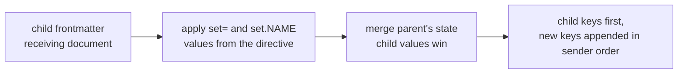

# Frontmatter and Recursion

When a document transcludes a child (`::file child.md`), the parent's
frontmatter is passed down and merged into the child's. The child is the
**receiving document**: it decides which values win and where keys sit.
Parsing and key order in a single document are covered in
[Frontmatter](./frontmatter.md).

## Which Value Wins

- A key only the parent has is inherited.
- A key both hold keeps the **child's** value when it is a scalar or a list.
  Lists are values, never concatenated.
- A key whose value is a mapping on both sides is merged key by key, by the
  same rules, at every depth.
- A child value of `null` means "not set", so the parent's value is used.
- `prologue` and `epilogue` are never inherited.

## Key Order

The receiving document's keys come first, in the order its author wrote them.
Inherited keys are appended after them, in the parent's order. The same rule
applies inside every merged mapping. Which side's value wins never moves a
key.

```markdown
<!-- parent.md -->
---
zeta: p
owner:
  name: Parent
  team: core
tags: [p1, p2]
note: from parent
---
::file child.md

<!-- child.md -->
---
own: c
owner:
  email: c@x
  name: Child
tags: [c1]
note: null
---
{{ fm }}
```

The child's `{{ fm }}` renders:

```json
{"own":"c","owner":{"email":"c@x","name":"Child","team":"core"},"tags":["c1"],"note":"from parent","zeta":"p"}
```

`own`, `owner`, `tags`, and `note` keep the child's positions; `zeta` is
appended. Inside `owner`, the child's `email` and `name` come first and the
inherited `team` follows. `note` sits where the child wrote it but takes the
parent's value, because the child's was `null`.



### Directive `set` Values

Values a directive sets (`set='{ … }'`, `set.NAME=…`) override the child's
own values and are applied before the parent's state is merged. A directive
value of `null` really sets `null`. The child's keys stay first, keys that
only the directive sets follow in the order written, and inherited keys come
last:

```markdown
<!-- parent.md -->
---
zeta: p
alpha: p
---
::file child.md set.new_b=1 set.own="set" set.new_a=2

<!-- child.md -->
---
own: c
alpha: c
---
{{ fm }}
```

renders `{"own":"set","alpha":"c","new_b":1,"new_a":2,"zeta":"p"}`.

### External State

State a host passes to composition (for example Claudine, or a library caller
using `ComposeOptions::with_external_state`) is merged the same way into the
root document: the document's keys come first, its values win by default, and keys
only the external state holds are appended in its order.

## Inherited Values Are Data

The child receives the parent's **composed** values, and it treats them as data: it never evaluates a `{{ … }}`, converts a `{{{ … }}}`, or runs a `$( … )` it finds in them. The parent already evaluated what its author wrote, so evaluating it again in every child would let text produced by an expression, a file read, or a command become a new instruction.

```md
<!-- parent.md -->
---
area: claudine
note: "fixed {{{ area }}}"
---
::file child.md

<!-- child.md -->
Child: {{ note }}
```

The child composes to `Child: fixed {{ area }}`, exactly as the parent's own body would.

Values a transclusion directive sets (`::file child.md set.x="…"`) are authored when the parent wrote them literally in the directive, and data when any part of the directive's options came from interpolation (the parent evaluates `set.x="{{ v }}"` before the child sees it). The child's own frontmatter is authored and scanned as usual. See [Inserted Text Is Data](../inline/interpolation.md#inserted-text-is-data).

## Exceptions

- `ctx` is a property which is provided to each document by Darkmatter; it is recommended that document authors **not** use this property themselves but it is supported. When a document _does_ have a `ctx` property then we will use the normal recursion process described above.
