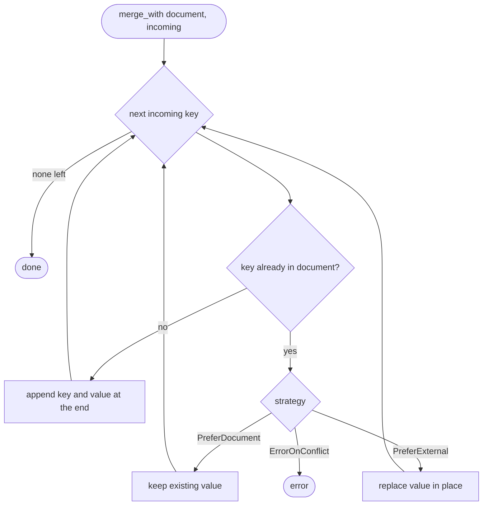

# Frontmatter

Frontmatter is the YAML block between the `---` fences at the top of a
document. Darkmatter parses it into ordered JSON-like values that composition,
schemas, expressions, and the `md get` / `md set` / `md rm` commands all
share.

```markdown
---
title: Release notes
owner:
  name: Kim
  email: kim@example.com
tags: [cli, docs]
---
# Release notes
```

This page covers how frontmatter is parsed, the key order you can rely on,
and the shallow merges the library offers. How a parent's frontmatter reaches
a transcluded child is covered in
[Frontmatter and Recursion](./frontmatter-recursion.md).

## Parsing

- The block must be valid YAML whose root is a mapping.
- A key may appear only once in any mapping, at any depth. A duplicate key is
  a parse error, not "last one wins":

  ```yaml
  title: First
  title: Second   # error: duplicate entry with key "title"
  ```

- Values become strings, numbers, booleans, `null`, lists, and mappings. A
  [schema](./schemas/definition.md) can then check and convert them.

## Key Order

**Key order is the order you wrote**, at every depth, including mappings
inside lists. Darkmatter never sorts your keys. That order is what you see
when you:

- read a value with `md get` (`md get doc.md owner` prints `name` before
  `email` for the example above),
- render a mapping in a composed document, for example with `{{ fm }}` or
  `{{ owner }}`,
- edit with [`md set`](../cli/set.md) or [`md rm`](../cli/rm.md), and
- iterate a mapping with `keys()` / `values()` in an expression.

Edits follow two rules:

| Edit | Result |
| --- | --- |
| Replace an existing key | the key stays where it was |
| Add a new key | it is appended after the existing keys |
| Remove a key | the keys after it close the gap, in order |

```bash
md set doc.md title "Notes" --save   # title stays first
md set doc.md draft true --save      # draft becomes the last key
md rm doc.md owner                   # tags moves up to second place
```

Values produced by a program, such as an expression result or the external
state a host passes to composition, keep the order their producer built them
in.

Key order never changes what a document means. The semantic (non-strict)
hash from [`md hash`](../cli/hash.md#key-order-and-stored-baselines) ignores
it at every depth, while the strict hash follows it.

## Shallow Merges (Library)

The library's `Frontmatter` type merges another mapping into itself with
`merge_with`, choosing what happens when both sides hold the same key:

| Strategy | Conflict on an existing key |
| --- | --- |
| `PreferDocument` | the existing value is kept |
| `PreferExternal` | the incoming value replaces it |
| `ErrorOnConflict` | the merge fails |

`set_defaults` adds the keys a document is missing and keeps every existing
value, like `PreferDocument`.

These merges are **shallow**: they compare top-level keys only. Whichever
strategy is chosen, key order follows the same rules:

- existing keys keep their positions, even when their value is replaced;
- keys only the incoming mapping holds are appended in the incoming order;
- a nested mapping that is replaced is replaced whole, keeping the incoming
  mapping's own key order. Its keys are not merged one by one.

```yaml
# document              # incoming             # PreferExternal result
z: 1                    a: 3                   z: 1
a: 2                    b: 4                   a: 3
owner:                  owner:                 owner:
  name: Kim               email: k@x.io          email: k@x.io
                                               b: 4
```

With `PreferDocument` the result has the same order, `z, a, owner, b`, but
keeps `a: 2` and the document's `owner`.



An `ErrorOnConflict` failure does not roll back: keys merged before the
conflicting key stay merged.

Composition does not use these shallow merges for inherited state; it merges
nested mappings key by key, as described in
[Frontmatter and Recursion](./frontmatter-recursion.md).
