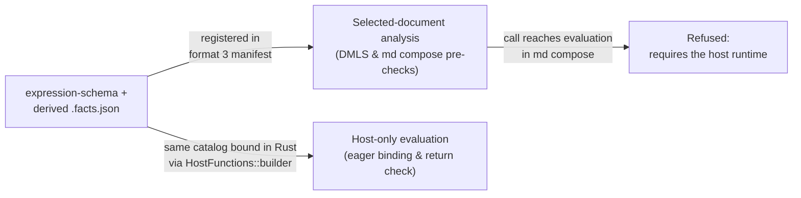
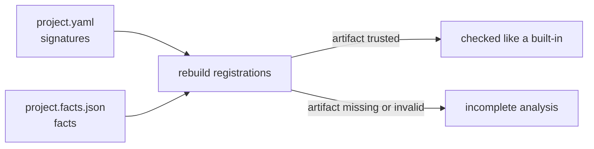
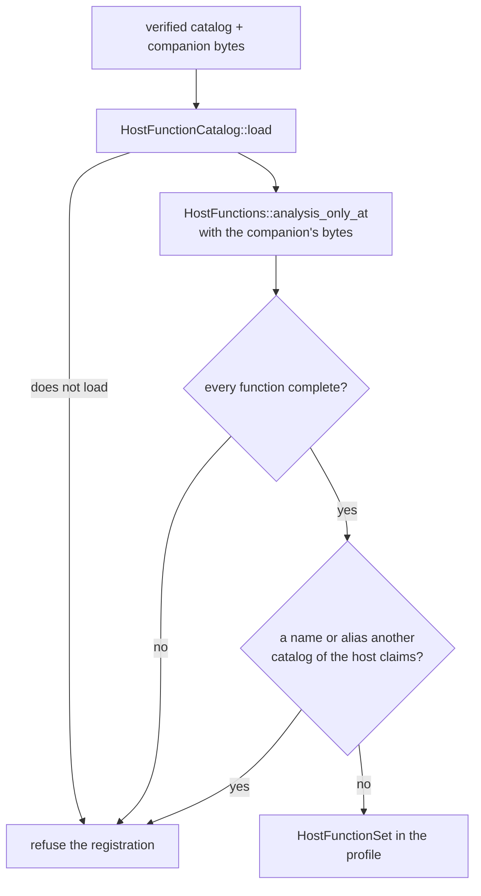

# Host Expression Functions

A program that embeds Darkmatter (a **host**, such as Claudine) can add its
own functions to the expression language. A host function is called, typed,
narrowed, and rejected exactly like a built-in such as `min` or
`is_file_type`. The host supplies functions only; it cannot add grammar or
change how expressions are evaluated.

This page covers how a host declares and registers its functions, how the
editor (DMLS) learns about them, and what happens when it cannot.

## The parts of a host function

Each host function has three parts, kept in two places:

| Part | Where it lives | What it says |
| --- | --- | --- |
| Signature | the host's **function catalog**, a YAML file | parameters, return type, category, description, and what a `true`/`false` result proves (the `narrows(...)` clause) |
| Behavior facts | Rust registration | source exclusions, numeric recovery, the malformed-reference rule |
| Handler | Rust registration | the code that computes the result |

The function catalog uses the same format as Darkmatter's own
`darkmatter/schemas/partials/functions.yaml`: a `kind: expression-schema`
document with a `categories:` list and `function(...)` entries under
`types:`. Other `types:` entries are helper types local to the catalog. A
catalog is not a schema: a document cannot name it as its `$schema`, and a
schema cannot import its types.

```yaml
# schemas/project.yaml
kind: expression-schema
categories:
    - Project -> Ask about the files and names of the project.
types:
    is_project_file: |-
        function(
            parameters(value: unknown | null);
            returns(boolean);
            narrows(value: file; true-implies);
            category(Project);
        ) -> Returns true when the value is text naming a Markdown file of the project.
```

A host catalog cannot use file-form examples (`example(./x.yaml)`); inline
`example(call => result)` entries are fine. Neither `expression-schema` nor
`mutation-schema` allows a `when` key: lifecycle event availability and
allowed actions remain in the host's [lifecycle artifact](./lifecycle/host-artifact.md).

Darkmatter itself also uses `kind: mutation-schema` for its built-in
signature-backed lifecycle actions (`darkmatter/schemas/partials/mutations.yaml`),
which share the same envelope and catalog checks (except `narrows(...)` is
refused on mutations):

```yaml
kind: mutation-schema
categories:
    - Files -> Update a Markdown file.
types:
    set_frontmatter: |-
        function(
            parameters(file: string, prop: string, value: unknown | null);
            returns(unknown | null);
            category(Files);
            fallible;
        ) -> Sets a frontmatter property and returns its prior value, or null.
```

Hosts cannot register `mutation-schema` catalogs: a host registration listing
one is refused with `host-defined actions are not supported`.

The scope boundary from authoring to execution stays explicit:



`HostFunctionCatalog::load` refuses a catalog, with the failing declaration's
location and, for a conflict, the other declaration's location, when:

- `types:` declares no callable, or an entry mixes `function(...)` arms with an
  ordinary type;
- two callables have names that match without regard to ASCII case
  (`is_project_file` and `Is_Project_File`);
- a callable reuses a built-in function's canonical name or alias (`min`,
  `IsNull`); the related location is the built-in's declaration in
  `functions.yaml`;
- a callable names no category, an undeclared category, or overloads name
  different categories;
- a helper reference leaves the catalog (`Name@file`), names a type the
  catalog does not declare, uses a callable as a type, or holds a `{{ … }}`
  slot;
- a callable does not compile for eager evaluation.

`md schema validate` and DMLS run the same check, so an editor shows the same
error, code `dm.schema.callable_catalog`, before the host loads the file.

## Registering functions

The host loads its catalog and registers every function it declares, with
the same `RegistrationBuilder` the built-ins use:

```rust
use std::sync::Arc;
use darkmatter::markdown::compose::expression::{
    HostFunctionCatalog, HostFunctions, install_host_functions,
};

let catalog = HostFunctionCatalog::load(&catalog_text, "schemas/project.yaml")?;
let functions = HostFunctions::builder(catalog)
    .function(
        "is_project_file",
        &[],                                   // aliases
        |registration| registration,          // the catalog's `narrows(...)` clause declares the fact
        Arc::new(|call| Ok(serde_json::json!(call.args().text(0).is_some_and(|t| t.ends_with(".md"))))),
    )
    .build()?;
std::fs::write("schemas/project.facts.json", functions.facts_artifact())?;
install_host_functions(functions)?;
```

`build()` checks the whole set before anything is evaluated and fails with a
`HostFunctionError` when:

- a canonical name or alias is used twice in the set;
- an alias is already a built-in's canonical name or alias (a canonical name
  that collides is refused earlier, when the catalog loads);
- a catalog function has no registration, or a registration names a function
  the catalog does not declare;
- a function is registered as lazy (host functions are always evaluated
  eagerly; only Darkmatter's `and` and `or` are lazy);
- a `narrows(...)` clause is invalid, exactly as for a built-in: a clause on a
  parameter no overload declares, on a function that does not return
  `boolean`, overloads that disagree on the fact, and so on (the catalog
  fails to load before a builder exists).

`install_host_functions` makes the set visible to every thread for the rest
of the process. Installing is additive; a name that is already installed is
an error.

With the predicate above installed, and `source: unknown` in the document's
`$schema`, the call check treats the guard like any built-in guard:

```markdown
{{ is_project_file(source) && frontmatter(source, 'title') }}   <!-- category 1: no finding -->
{{ frontmatter(source, 'title') }}                              <!-- category 4: type unknown -->
```

Analysis never calls a handler. At runtime the handler runs only for a call
that is evaluated, after its arguments bind to the signature, and its result
is checked against the declared return type.

## The facts artifact

The editor runs in its own process and cannot run the host's Rust
registration, so the signature catalog alone would leave it without the
behavior facts: `is_project_file(source)` would narrow in composition but not
in the editor. The host closes that gap by writing a **facts artifact**, a
JSON file generated from its registration. Write it before passing the
function set to `install_host_functions`, which takes ownership of that set:

```rust
std::fs::write("schemas/project.facts.json", functions.facts_artifact())?;
```

The artifact is **derived output**. Narrowing facts come from the catalog's
`narrows(...)` clauses; the artifact's `facts` list repeats them so the editor
can check that the artifact belongs to this catalog. The reader compares the
decoded fact with the one the catalog declares, including absence, and a
mismatch makes that function's analysis incomplete (below). `format_version`
stays `1`. Never edit the artifact by hand; regenerate it.

The artifact sits beside the catalog and is named after it: the catalog's
last extension, `.yaml` or `.yml`, is replaced by `.facts.json`, so
`project.yaml` gets `project.facts.json` and `acme.v2.yml` gets
`acme.v2.facts.json`. That naming convention is the only way the editor
finds it: a registration manifest lists the catalog and digests the
artifact under the derived name, never listing it on its own (see
[Expression catalogs and their facts companions](./host-registration.md#expression-catalogs-and-their-facts-companions)).

```json
{
  "catalog_hash": "6d1d4c52…",
  "format_version": 1,
  "functions": {
    "is_project_file": {
      "aliases": [],
      "conversion_recovery": null,
      "facts": [
        { "kind": "true_implies", "parameter": "value", "position": 0, "type": "file" }
      ],
      "lazy": false,
      "malformed_reference": null,
      "source_exclusions": []
    }
  }
}
```

| Field | Meaning |
| --- | --- |
| `format_version` | the artifact format; `1` |
| `catalog_hash` | the BLAKE3 hex digest of the catalog file's bytes it was generated from |
| `functions` | one entry per registered function, keyed by canonical name |
| `aliases` | the function's aliases |
| `facts` | its narrowing facts (at most one): parameter name and position, `kind` (`true_implies`, `true_iff`, or `false_implies`), and `type` (type text, or `<non-null>` for presence only) |
| `lazy` | always `false` for a host function |
| `conversion_recovery` | `null`, or the numeric recovery's `subject` and `fallback` parameters |
| `source_exclusions` | each parameter that refuses some original value kinds before conversion, with those `kinds` |
| `malformed_reference` | `null`, or the parameter (name and position) whose malformed file-reference text makes the call always `false` |

The output is deterministic: keys are sorted at every level, so the same
registration and catalog always give the same bytes. A host should keep a
test that regenerates the artifact and compares it with the committed file,
so a stale artifact fails the build.

## How the editor reads host functions

A host ships its function catalogs through its
[registration](./host-registration.md): each catalog is a `files` item of its
manifest, and its facts artifact is the catalog's derived companion; both are
digest-checked members of the host's bundle. For a document one of the host's
triggers matches, DMLS and `md compose` rebuild every registration from the
catalog's signatures and the artifact's facts, through the same registration
API, and analyze the document with those functions: completion, binding
diagnostics, and static call checks. A document that selects no host, or
another host, does not see them. Neither runs host code: a call that reaches
evaluation fails with `host function is_project_file() requires the host
runtime`. A function catalog in a schema root is an ordinary file: nothing
discovers it.



The artifact is read strictly, as inert data. A registration loads only when
every function of every catalog is complete: any problem below refuses the
whole registration with a `dm.host.registration` warning, and none of the
host's functions, globals, or triggers is used.

A tool that builds a set itself with `HostFunctions::analysis_only` (below)
gets **incomplete analysis** instead of a refusal. A call to an incomplete
function is still a known function (no `unknown_function` error), but it gets
no argument category and proves no narrowing, and each call is reported as
`dm.expression.incomplete_analysis`.

| Problem | Functions affected |
| --- | --- |
| the file is absent or unreadable | every function in the catalog |
| not valid JSON, a duplicate key at any depth, or content after the JSON value | every function |
| `format_version` is not `1`, or `catalog_hash` differs from the loaded catalog's | every function |
| a top-level field is absent, `null`, of the wrong type, or unknown | every function |
| an entry for a function the catalog does not declare | every function |
| `functions: {}` | every function (none has an entry) |
| a function has no entry, or its entry is not an object | that function |
| an entry field is absent, of the wrong type, or unknown, or a field that must not be `null` is `null` | that function |
| one element of `facts` or `source_exclusions` is invalid (never skipped) | that function |
| a fact names a parameter the catalog does not declare, or records the wrong position | that function |
| the artifact's `facts` differ from the catalog's `narrows(...)` clause (a different kind, type, or parameter, a fact the catalog does not declare, or none where it does) | that function |

An absent field and an explicit `null` are different problems and the
message says which. `facts: []` is valid and means the function declares no
narrowing; `conversion_recovery: null` and `malformed_reference: null` mean the
function has none.

Editing a catalog changes its hash, so its artifact reads as stale until the
host regenerates it. A function catalog that does not load, or that declares
a function a built-in already names, refuses the registration the same way.

## Catalogs are never document schemas

A function catalog declares signatures and a global catalog declares the
shapes of globals; each is registered for that role only. Neither is ever
applied as a document schema: a function catalog contributes no
frontmatter property and is never a schema trigger, so a
document key named `is_project_file` is an ordinary property. A function
catalog also grants no permission and adds no lifecycle action key: a
host's function is called inside an expression, including an expression in
an action's operand, never written as an action. A `kind: mutation-schema`
member of a registration is refused with `host-defined actions are not
supported`.

## APIs for tools that only analyze

The editor's view is built from library APIs that any analysis-only tool can
use:

- `HostFunctions::analysis_only(catalog, artifact)` builds a set with no
  handlers, reading facts named after the catalog;
  `HostFunctions::analysis_only_at(catalog, facts_path, artifact)` does the
  same for facts a caller located itself (registration passes the derived
  companion). Calling one of its functions at runtime fails with
  `host function <name>() requires the host runtime`.
- `functions.enter()` makes the set visible on the current thread only,
  while the returned guard lives, ahead of installed sets and the built-ins,
  so each document can be analyzed with its own host's functions. A
  composition entered under the guard passes the same view to the worker
  threads that compose its transcluded documents.
- `incomplete_host_calls(expr)` lists the calls in an expression to functions
  that are incomplete in the current scope.
- `RegisteredHostProfile::functions()` gives a registered host's sets, one
  `HostFunctionSet` per catalog in bundle-path order, built from its
  verified catalogs and facts (see
  [How a registration loads its catalogs](#how-a-registration-loads-its-catalogs)).

## How long a loaded catalog lives

A loaded `HostFunctionCatalog` owns everything it read: names, signatures,
descriptions, compiled types, examples, and display-only reasons. It borrows
nothing from the source text or the path, so both can be dropped as soon as
`load` returns.

The catalog, its clones, every `HostFunctions` set built from it, and every
guard returned by `set.enter()` share one copy of that data. The copy is freed
when the last of them is dropped:

```rust
use darkmatter::markdown::compose::expression::{FactsArtifact, HostFunctionCatalog, HostFunctions};

let catalog = HostFunctionCatalog::load(&catalog_text, "schemas/project.yaml")?;
drop(catalog_text);                    // the catalog does not borrow it
let set = HostFunctions::analysis_only(catalog, FactsArtifact::Absent)?;
let guard = set.enter();
drop(set);                             // the guard still holds the catalog
drop(guard);                           // nothing holds it now: it is freed
```

What a catalog lends is borrowed from it, so it cannot outlive it:
`catalog.function_names()`, `set.function_names()`, and the descriptors and
`example()` views of a loaded catalog all borrow from their owner.

Only two things are kept for the rest of the process, deliberately: a set
passed to `install_host_functions`, which serves every thread, and
Darkmatter's own built-in catalog, which is built once and hands out
`&'static` descriptors (`expression_function_descriptors()`,
`function_descriptors(name)`). A registered host's sets live as long as the
profile that holds them (next section).

## How a registration loads its catalogs

A registration builds its function sets from the verified bytes of its
bundle, once per installed revision. The owners of the loaded registrations
keep the profiles, and the profiles keep the sets.

| Owner | Keeps a profile for |
| --- | --- |
| `md` (one request's registered hosts) | the run, per repository its documents resolve in |
| DMLS | one configuration's installed registrations, until a watched file changes and the reload completes |



**An unchanged revision is never rebuilt.** The owner reuses the profile it
installed while the registration's revision (the digests of every member and
companion) is the same.

**A changed catalog or companion builds a new profile.** Editing either file
changes the revision; the next load builds new sets from the new bytes.

**A set already handed out keeps working.** A profile that is replaced, or a
guard entered from one of its sets, keeps the old signatures, registrations,
and analysis until it lets go.

**A failing revision never returns the last good set.** If an edit makes the
catalog fail to load, the registration is refused and its documents are
analyzed as `md` documents, without the earlier functions. The next valid
revision loads again and recovers.

**Facts problems refuse the registration.** `analysis_only_at` itself still
gives a set when the facts are absent, unreadable, stale, or invalid; the
affected functions are incomplete, each with a reason such as ``the facts
artifact `schemas/project.facts.json` is absent``. The registration loader
refuses a set with any incomplete function, at the companion.

| Revision | Result |
| --- | --- |
| valid catalog, matching companion | the set is in the profile, every function complete |
| valid catalog, companion stale or invalid | the registration is refused at the companion |
| companion missing | the registration is refused at the catalog's `files` entry |
| catalog that does not load | the registration is refused at the catalog |
| catalog naming a built-in such as `min` | the registration is refused at the catalog, with the built-in as a related location |

## See Also

- [Darkmatter Expressions](./darkmatter-expressions.md) — guards, narrowing
  facts, and the built-in functions
- [Call checks](../inline/call-check.md) — argument categories
- [Host Lifecycle Artifacts](./lifecycle/host-artifact.md) — the same
  companion-file design for a host's lifecycle events and verbs
- [DMLS diagnostics](../../dmls/docs/diagnostics.md)
