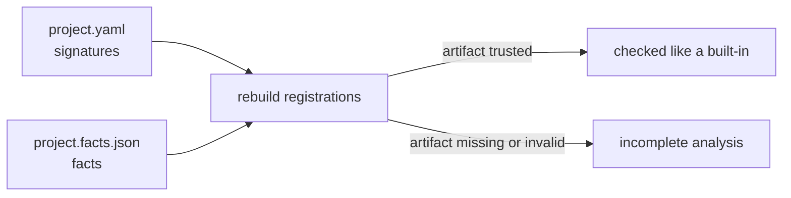

# Host Expression Functions

A program that embeds Darkmatter (a **host**, such as Claudine) can add its
own functions to the expression language. A host function is called, typed,
narrowed, and rejected exactly like a built-in such as `min` or
`is_file_type`. The host supplies functions only; it cannot add grammar or
change how expressions are evaluated.

This page covers how a host declares and registers its functions, how the
editor (DMLS) learns about them, and what happens when it cannot.

## The parts of a host function

Each host function has three parts, kept in two places:

| Part | Where it lives | What it says |
| --- | --- | --- |
| Signature | the host's **function catalog**, a YAML file | parameters, return type, category, description |
| Behavior facts | Rust registration | what a `true` result proves (narrowing), source exclusions, numeric recovery, the malformed-reference rule |
| Handler | Rust registration | the code that computes the result |

The function catalog uses the same format as Darkmatter's own
`darkmatter/schemas/partials/functions.yaml`: a tagged `kind: schema`
document with a `categories:` list and `function(...)` entries under
`types:`.

```yaml
# schemas/project.yaml
kind: schema
categories:
    - Project -> Ask about the files and names of the project.
types:
    is_project_file: |-
        function(
            parameters(value: unknown | null);
            returns(boolean);
            category(Project);
        ) -> Returns true when the value is text naming a Markdown file of the project.
```

A host catalog cannot use file-form examples (`example(./x.yaml)`); inline
`example(call => result)` entries are fine.

## Registering functions

The host loads its catalog and registers every function it declares, with
the same `RegistrationBuilder` the built-ins use:

```rust
use std::sync::Arc;
use darkmatter::markdown::compose::expression::call_binding::{FactKind, FactType};
use darkmatter::markdown::compose::expression::{
    HostFunctionCatalog, HostFunctions, install_host_functions,
};

let catalog = HostFunctionCatalog::load(&catalog_text, "schemas/project.yaml")?;
let functions = HostFunctions::builder(catalog)
    .function(
        "is_project_file",
        &[],                                   // aliases
        |registration| registration.narrows("value", FactKind::TrueImplies, FactType::Type("file".into())),
        Arc::new(|call| Ok(serde_json::json!(call.args().text(0).is_some_and(|t| t.ends_with(".md"))))),
    )
    .build()?;
std::fs::write("schemas/project.facts.json", functions.facts_artifact())?;
install_host_functions(functions)?;
```

`build()` checks the whole set before anything is evaluated and fails with a
`HostFunctionError` when:

- a canonical name or alias is used twice in the set;
- a name or alias is already a built-in's canonical name or alias;
- a catalog function has no registration, or a registration names a function
  the catalog does not declare;
- a function is registered as lazy (host functions are always evaluated
  eagerly; only Darkmatter's `and` and `or` are lazy);
- a fact is invalid, exactly as for a built-in: a fact on a parameter no
  overload declares, a narrowing fact on a function that does not return
  `boolean`, and so on.

`install_host_functions` makes the set visible to every thread for the rest
of the process. Installing is additive; a name that is already installed is
an error.

With the predicate above installed, and `source: unknown` in the document's
`$schema`, the call check treats the guard like any built-in guard:

```markdown
{{ is_project_file(source) && frontmatter(source, 'title') }}   <!-- category 1: no finding -->
{{ frontmatter(source, 'title') }}                              <!-- category 4: type unknown -->
```

Analysis never calls a handler. At runtime the handler runs only for a call
that is evaluated, after its arguments bind to the signature, and its result
is checked against the declared return type.

## The facts artifact

The editor runs in its own process and cannot run the host's Rust
registration, so the signature catalog alone would leave it without the
behavior facts: `is_project_file(source)` would narrow in composition but not
in the editor. The host closes that gap by writing a **facts artifact**, a
JSON file generated from its registration. Write it before passing the
function set to `install_host_functions`, which takes ownership of that set:

```rust
std::fs::write("schemas/project.facts.json", functions.facts_artifact())?;
```

The artifact sits beside the catalog and is named after it: `project.yaml`
gets `project.facts.json`. That naming convention is the only way the editor
finds it.

```json
{
  "catalog_hash": "6d1d4c52…",
  "format_version": 1,
  "functions": {
    "is_project_file": {
      "aliases": [],
      "conversion_recovery": null,
      "facts": [
        { "kind": "true_implies", "parameter": "value", "position": 0, "type": "file" }
      ],
      "lazy": false,
      "malformed_reference": null,
      "source_exclusions": []
    }
  }
}
```

| Field | Meaning |
| --- | --- |
| `format_version` | the artifact format; `1` |
| `catalog_hash` | the BLAKE3 hex digest of the catalog file's bytes it was generated from |
| `functions` | one entry per registered function, keyed by canonical name |
| `aliases` | the function's aliases |
| `facts` | its narrowing facts (at most one): parameter name and position, `kind` (`true_implies`, `true_iff`, or `false_implies`), and `type` (type text, or `<non-null>` for presence only) |
| `lazy` | always `false` for a host function |
| `conversion_recovery` | `null`, or the numeric recovery's `subject` and `fallback` parameters |
| `source_exclusions` | each parameter that refuses some original value kinds before conversion, with those `kinds` |
| `malformed_reference` | `null`, or the parameter (name and position) whose malformed file-reference text makes the call always `false` |

The output is deterministic: keys are sorted at every level, so the same
registration and catalog always give the same bytes. A host should keep a
test that regenerates the artifact and compares it with the committed file,
so a stale artifact fails the build.

## How the editor reads host functions

DMLS looks in the document's schema roots (the same roots that hold host
global catalogs) for function catalogs, and reads each one's facts artifact
beside it. It rebuilds every registration from the catalog's signatures and
the artifact's facts, through the same registration API, and analyzes the
document with those functions. It never runs host code.



The artifact is read strictly, as inert data. When it cannot be trusted,
DMLS does not guess: the affected functions get **incomplete analysis**. A
call to an incomplete function is still a known function (no
`unknown_function` error), but it gets no argument category and proves no
narrowing, and each call is reported as `dm.expression.incomplete_analysis`.

| Problem | Functions affected |
| --- | --- |
| the file is absent or unreadable | every function in the catalog |
| not valid JSON, a duplicate key at any depth, or content after the JSON value | every function |
| `format_version` is not `1`, or `catalog_hash` differs from the loaded catalog's | every function |
| a top-level field is absent, `null`, of the wrong type, or unknown | every function |
| an entry for a function the catalog does not declare | every function |
| `functions: {}` | every function (none has an entry) |
| a function has no entry, or its entry is not an object | that function |
| an entry field is absent, of the wrong type, or unknown, or a field that must not be `null` is `null` | that function |
| one element of `facts` or `source_exclusions` is invalid (never skipped) | that function |
| a fact names a parameter the catalog does not declare, or records the wrong position | that function |

An absent field and an explicit `null` are different problems and the
message says which. `facts: []` is valid and means the function proves
nothing; `conversion_recovery: null` and `malformed_reference: null` mean the
function has none.

Editing a catalog changes its hash, so its artifact reads as stale until the
host regenerates it. A function catalog that does not load, or that declares
a function a built-in already names, is reported once as
`dm.schema.host_catalog`, and its functions stay unknown.

## Catalogs are never document schemas

A function catalog declares signatures and a global catalog declares the
shapes of globals; each is registered for that role only. Neither is ever
applied as a document schema: a function catalog in a schema root
contributes no frontmatter property and is never a schema trigger, so a
document key named `is_project_file` is an ordinary property.

## APIs for tools that only analyze

The editor's view is built from library APIs that any analysis-only tool can
use:

- `HostFunctions::analysis_only(catalog, artifact)` builds a set with no
  handlers; calling one of its functions at runtime fails with "no
  implementation in this process".
- `functions.enter()` makes the set visible on the current thread only,
  while the returned guard lives, ahead of installed sets and the built-ins,
  so each document can be analyzed with its own schema roots' functions.
- `incomplete_host_calls(expr)` lists the calls in an expression to functions
  that are incomplete in the current scope.
- `darkmatter::markdown::schemas::catalog::host_function_catalogs(context)`
  discovers, loads, and caches the sets of a document's schema roots.

## See Also

- [Darkmatter Expressions](./darkmatter-expressions.md) — guards, narrowing
  facts, and the built-in functions
- [Call checks](../inline/call-check.md) — argument categories
- [Host Lifecycle Artifacts](./lifecycle/host-artifact.md) — the same
  companion-file design for a host's lifecycle events and verbs
- [DMLS diagnostics](../../dmls/docs/diagnostics.md)
