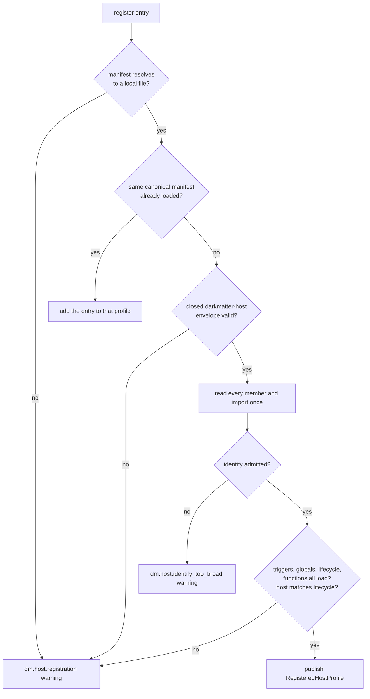
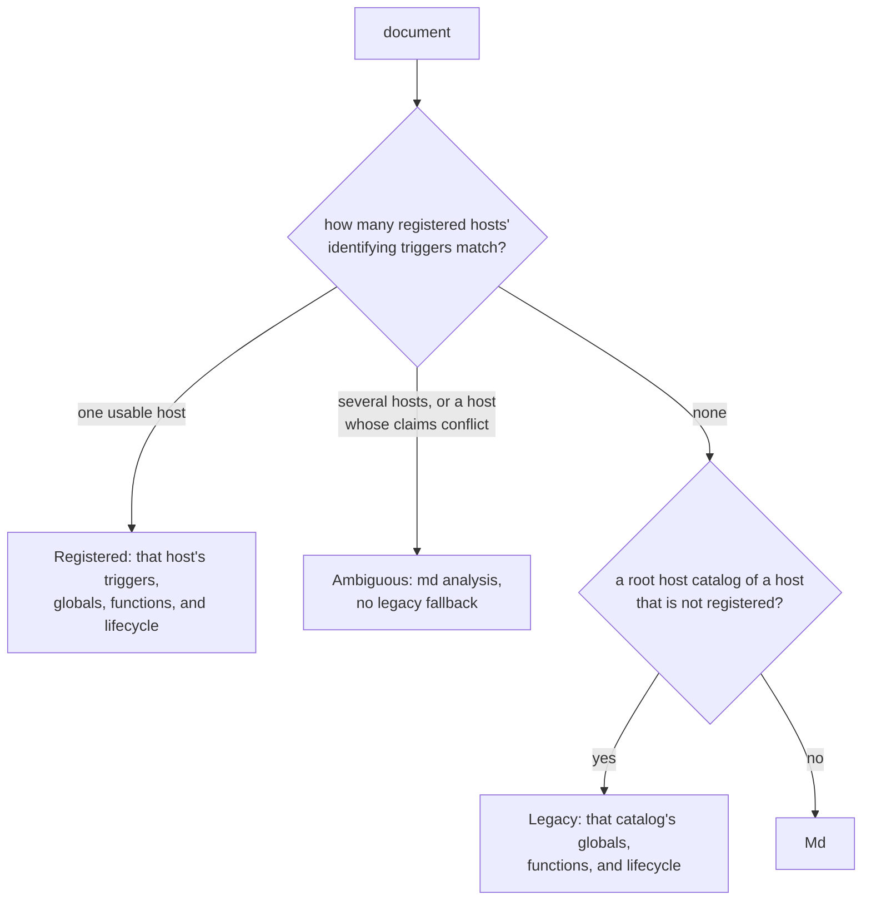
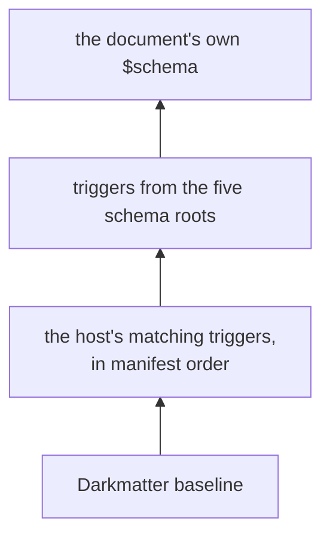
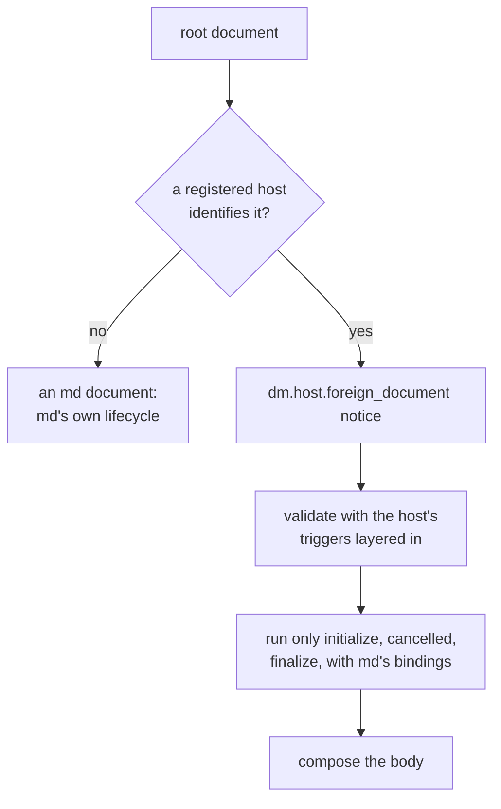

# Host Registration

A **host** is a program that reads Darkmatter documents with its own
frontmatter keys, lifecycle events, globals, and functions. Claudine is one:
its documents carry `prompt:`, `model:`, and `sequence:`, which plain `md`
knows nothing about. Registration lets a passive reader (an editor,
`md schema validate`, DMLS) type those documents as the host would, without
running the host.

This page covers:

- [registering a host](#registering-a-host) in `.darkmatter.yaml`,
- [the manifest format](#the-manifest),
- [the identifying trigger](#the-identifying-trigger) that decides which
  documents belong to the host,
- [how a registration loads](#how-a-registration-loads), from Rust,
- [which host a document belongs to](#selecting-a-documents-host),
- [how the host's schemas layer](#layering) into the document's schema,
- [what `md compose` does](#md-compose-of-a-hosts-document) with a document
  a registered host identifies, and
- [what is reported](#diagnostics) when something cannot be used.

## Registering a host

A `register` entry in either configuration file names one **host manifest**,
a file the host program installs:

```yaml
# ~/.darkmatter.yaml
register:
    - ~/.acme/darkmatter-host.yaml
```

The reference is an ordinary local file reference, resolved from the
directory of the configuration file that lists it. User entries come first,
then the repository's. A URL is refused; see
[Configuration Files](./configuration.md) for the rest of the file.

Registration is **passive**. It supplies types, event names, and verb shapes
only: it never writes a file, fetches a URL, prompts, runs a command, or
installs a function handler, and it grants no permission. A repository may
register a host (a team's in-house tool) because it gains nothing a
repository's own `schemas/` folder could not already do.

## The manifest

The host writes the manifest and every file it names; you never edit them by
hand. Every field is required, and no other field is allowed:

```yaml
# ~/.acme/darkmatter-host.yaml (written by the acme program)
kind: darkmatter-host
format_version: 1
host: acme
version: 1.2.0
identify: ./schemas/identify.yaml
triggers:
    - ./schemas/widget.yaml
    - ./schemas/gadget.yaml
globals: ./schemas/globals.yaml
lifecycle: ./schemas/globals.lifecycle.json
functions:
    - catalog: ./schemas/functions.yaml
      facts: ./schemas/functions.facts.json
```

| Field | What it holds |
| --- | --- |
| `kind` | always `darkmatter-host` |
| `format_version` | the manifest format: the integer `1` (not `"1"`, not `1.0`) |
| `host` | the host's identifier; its lifecycle artifact must record the same name |
| `version` | the host release that wrote the manifest (not the format) |
| `identify` | the [identifying trigger](#the-identifying-trigger) |
| `triggers` | schema triggers applied, in this order, to the host's documents; may be `[]` |
| `globals` | the host's global catalog (`kind: schema` with a `$schema` mapping of globals) |
| `lifecycle` | the lifecycle artifact the host generated for that catalog |
| `functions` | function catalogs, each with the facts artifact generated for it; write `functions: []` for none |

Every member is a **local** file reference resolved from the manifest's
directory. A trigger's own imports (`widget@./library.yaml`) resolve from the
trigger's file, so library files sit beside the triggers. A remote member
(`https://…`) is refused without being fetched.

The schema of the envelope ships with Darkmatter
(`darkmatter/schemas/darkmatter-host.yaml`) and is importable as
`darkmatter-host@darkmatter:host`.

## The identifying trigger

A host's schemas apply only to documents its identifying trigger matches. It
is an ordinary `schema-trigger`; its `$schema` payload may be empty:

```yaml
# ./schemas/identify.yaml
kind: schema-trigger
match:
    group:
        - widget: object(required)
        - gadget: string(required)
$schema: {}
```

Every alternative must require at least one non-null top-level key that the
`md` host does not own. The `md` host owns its baseline frontmatter
properties, its lifecycle event keys (`initialize`, `composed`, `failed`,
`cancelled`, `finalize`), and its globals (`fm`, `ctx`, `current`, `env`,
`err`, `timing`). A document with only `initialize:` belongs to `md` and to
every host alike, so `initialize` can never identify a host:

```yaml
# refused: dm.host.identify_too_broad
match:
    group:
        - widget: object(required)
        - initialize: object(required)   # shared with md
```

An optional key, a `$path` pattern, and a `none:` exclusion never identify a
host either. The proof is structural: when it cannot be made, the trigger is
refused with a repair hint rather than guessed at.

## How a registration loads



`load_registrations` takes the configuration snapshot, the request's captured
context, and the names Darkmatter owns:

```rust
use biscuit_file::FileResolutionContext;
use darkmatter::config::load::{ConfigLoadMode, ConfigSnapshot};
use darkmatter::config::registration::{agreement, load_registrations, md_owned_names};

fn hosts(context: &FileResolutionContext) -> Result<(), Box<dyn std::error::Error>> {
    let snapshot = ConfigSnapshot::load(context, None, ConfigLoadMode::Passive)?;
    let loaded = load_registrations(&snapshot, context, md_owned_names());
    for profile in &loaded.profiles {
        println!("{} {} ({} triggers)", profile.host(), profile.version(), profile.triggers().len());
    }
    for diagnostic in &loaded.diagnostics {
        eprintln!("{}: {}", diagnostic.code, diagnostic.message);
    }
    let _claims = agreement(&loaded.profiles);
    Ok(())
}
```

The rules a load follows:

- **All or nothing.** A profile is published only when every member loads:
  the envelope, the identifying trigger, each trigger and its payload, the
  global catalog, the lifecycle artifact, and each function catalog with its
  facts. Otherwise the entry produces a warning and nothing of it is used: no
  partial globals, functions, lifecycle events, or trigger payloads.
- **Strict artifacts.** The lifecycle artifact and each facts artifact must
  record the hash of the catalog they were generated for. A stale artifact
  (the catalog changed after it was generated), a missing one, or a function
  whose facts are incomplete refuses the registration.
- **One host name.** The manifest's `host` must equal the host the lifecycle
  artifact records.
- **Each file once.** Every member and every file it imports is read once
  for the whole load and listed in `dependencies()` with the BLAKE3 hash of
  its bytes, so a caller (DMLS) knows what to watch.
- **One manifest, one load.** Entries that resolve to the same canonical
  manifest, from the user file and the repository file, or spelled two ways,
  load it once; `entries()` lists every entry that named it.
- **A content revision.** `revision()` digests the manifest's meaning (its
  values, not its comments) and every other file's content, keyed by its
  route from the manifest's directory. Two installs laid out alike with the
  same content have the same revision wherever they live.

A [`register` entry that is itself invalid](./configuration.md#errors) (not a
file reference, or a URL) is already reported by the configuration snapshot
and is not loaded or reported again.

### Two manifests for one host

`agreement(&profiles)` groups profiles by `host`. Claims whose revisions are
equal collapse into the first (`HostClaim::Agreed`). Claims that differ are a
`HostClaim::Conflict`, and `HostClaim::diagnostics()` gives one
`dm.host.registration` warning per claim: neither is used, whatever their
order.

## Diagnostics

Every diagnostic but `dm.host.foreign_document` (a notice, below) is a
warning. It names the entry (the declaring file and
its index in `register`), the failing manifest field when one failed
(`lifecycle`, `triggers[1]`, `functions[0].facts`), and the file, line, and
column of the problem when known: the configuration file when the manifest
cannot be found, the manifest for its own shape or a member it cannot
resolve, and the member file for a member that does not load.
`markdown::compose::report_diagnostics::registration_diagnostic` turns one
into the record `md` reports. DMLS reporting is **planned**.

`md` loads the registrations once per run (per repository a run's documents
resolve in) and reports each distinct warning once: on stderr for a formatted
output, in the result's `diagnostics` for a data output, whose stderr stays
empty. `md compose`, `md clean`, `md schema validate`, and `md schema triggers`
also report the selection warnings of the documents they judge.

| Code | When |
| --- | --- |
| `dm.host.registration` | a manifest or member is missing, invalid, or remote; an artifact is refused; the host name differs from the lifecycle artifact's; or two manifests claim one host with different content (reported for each run, and again for a document such a host identifies) |
| `dm.host.identify_too_broad` | the identifying trigger could match on keys `md` owns alone |
| `dm.host.ambiguous` | two or more hosts identify the same document; it is analyzed as an `md` document |
| `dm.host.foreign_document` | `md compose` composes a document a registered host identifies; an `info` notice, once per run, naming the host's own command (see [below](#md-compose-of-a-hosts-document)) |

## Selecting a document's host

Every document is analyzed as exactly one host. Selection is passive: it
writes nothing, fetches nothing, prompts for nothing, and reads only the host
catalogs in the document's schema roots (for the legacy case below).



| Result | When | What applies |
| --- | --- | --- |
| `Registered(profile)` | exactly one registered host identifies the document | that host's matching triggers, its globals, functions, and lifecycle profile, together |
| `Ambiguous(hosts)` | two hosts identify it (`dm.host.ambiguous`), or a host whose two manifests conflict does (their `dm.host.registration` warnings) | nothing of any host; the document is an `md` document |
| `Legacy(host)` | no registered host identifies it, and its schema roots hold a host catalog (a `globals.yaml` with its `globals.lifecycle.json`) of a host that is **not** registered | that catalog's globals and function catalogs, and the first usable lifecycle profile |
| `Md` | anything else | no host |

A document is identified judged in its own context: its frontmatter, and its
own path for `$path` predicates, whose bare and `./` patterns read from the
document's tree root.

Two rules keep a registered host's facts on its own documents:

- **A conflict never wins.** When two manifests claim one host with different
  content, neither is used, and a document their identifying triggers match is
  `Ambiguous`, not handed to a root catalog.
- **A registered host is never a legacy host.** When a host is registered but
  its identifying trigger did not match the document, its root catalog (and the
  function catalogs beside it) is left out of the legacy view, inside the
  host's own package area and outside it. A document with only shared keys
  (`initialize:`) next to an installed host's catalog is therefore an `md`
  document. A root catalog whose host is not registered still serves as the
  compatibility fallback.

From Rust:

```rust
use biscuit_file::FileResolutionContext;
use darkmatter::config::load::ConfigSnapshot;
use darkmatter::config::registration::{HostSelection, RegisteredHosts, select};
use darkmatter::markdown::Markdown;
use darkmatter::markdown::schemas::frontmatter_as_json;

fn host_of(snapshot: &ConfigSnapshot, document: &Markdown, path: &std::path::Path, context: &FileResolutionContext) {
    let hosts = RegisteredHosts::load(snapshot, context);
    let selected = select(Some(&hosts), &frontmatter_as_json(document), Some(path), context);
    match selected.selection {
        HostSelection::Registered(profile) => println!("{}", profile.host()),
        HostSelection::Legacy(legacy) => println!("legacy: {} catalogs", legacy.globals().len()),
        HostSelection::Ambiguous(hosts) => println!("ambiguous: {hosts:?}"),
        HostSelection::Md => println!("md"),
    }
}
```

`RegisteredHosts::identify` is the same choice without the legacy view; it
reads nothing. A composition request carries the hosts with
`ComposeOptions::with_registered_hosts`, and `ComposeOptions::host_selection_for`
gives a document's selection. A caller that supplies its own host globals
(`ComposeOptions::with_host_globals`, as Claudine does when it runs a
document) keeps them: its documents select `Md`, and no registered layer is
added. Registration supplies type information only; when the host itself runs
a document, its own in-process definitions stay authoritative.

## Layering

For a document a registered host identifies, the schema layers are, from
lowest to highest:



A higher layer replaces a property a lower one declares, so a repository's
root trigger can refine or override a registered host, and the document's
`$schema` overrides both. For example, with the host's `widget.yaml` declaring
`widget: widget@./library.yaml` and a repository's own `schemas/widget.yaml`
declaring `gadget: number`:

```yaml
---
widget:
    size: big     # rejected by the host's `size: number`
gadget: name      # rejected by the root trigger's `gadget: number`
---
```

- **Registration is a separate source.** A root trigger file with the same
  name as a host trigger does not shadow it: both apply, the root's on top.
  Shadowing by file name stays among the schema roots.
- **Each trigger once.** When the host's trigger file is also visible in a
  schema root (the same file, with the same content), it applies once, as the
  host's. An unrelated file with the same name is a different trigger.
- **Ordinary matching.** A host trigger applies only when its `match:` matches
  the document, exactly as a root trigger does; identification only decides
  which host's triggers are considered.
- **Imports stay anchored.** A host trigger's relative imports resolve from
  the trigger's own file.
- **Cache identity.** A host layer's validator identity includes the
  manifest's identity and content revision, so a changed host install never
  reuses a validator compiled for another.

`--disable schema-triggers` turns off the registered layer together with the
schema roots' triggers. `md schema triggers` reports the registered host and
each of its triggers; see [`md schema triggers`](../cli/schema.md#md-schema-triggers).

## `md compose` of a host's document

`md compose` can compose a document a registered host identifies (a Claudine
document, for example): it checks the document against the host's schemas,
composes its Markdown body, and runs the lifecycle events `md` shares with the
host. It never runs the host itself: no agent starts, no task or sequence
step runs, no host function is called, and nothing is spoken or notified. To
run the document as its host does, use the host's own command
(`claudine compose`).

For a host shaped like Claudine (it renames `composed` to `start` and
`failed` to `blocked`, adds `success` and `failure`, and supplies `seq`):

```yaml
---
sequence:
    - name: one
      prompt: hi
initialize:
    - info: "starting {{ title }}"   # runs: a shared event, md's bindings
    - info: "{{ seq.name }}"         # fails: `seq` has no value under md
start:
    - say: "{{ seq.name }}"          # never runs, never evaluated
composed:                            # rejected by the host's schema (`start:`)
    - info: x
---
```



- **Validation.** The host's matching triggers judge the document, as
  described under [Layering](#layering). Its spellings of renamed events are
  the host's to judge: Claudine's schema types `composed` and `failed` as
  `null`, so either key is a schema error, never an `md` stack.
- **Lifecycle.** `md` reads only the events it shares with the host under the
  same name (for Claudine `initialize`, `cancelled`, and `finalize`) and runs
  them as it runs its own, with its own bindings and verbs (a verb `md` does
  not run, such as `say`, is skipped with a warning). The host's own events
  (`start`, `blocked`, `success`, `failure`, `loop`) and `composed`/`failed`
  never run here.
- **Deferred keys.** Every event key the host registers keeps its value as
  authored: no compose-time pass evaluates it, exactly like `md`'s own event
  keys on a lifecycle document. Every other key, `sequence` included, is
  ordinary frontmatter.
- **Host globals.** The host's globals (`seq`, `loop`, `group`) are declared,
  so a read of one is not an undeclared property, but they have no value:
  reading one, in a shared event, the frontmatter, or the body, fails as any
  unavailable global does, with the reason `dm.host.runtime_only`. `md` never
  makes up a value.
- **Host functions.** The host's functions are known for typing, so a call is
  checked against its signature, but they have no implementation in `md`: a
  call that is evaluated fails.
- **The notice.** One `dm.host.foreign_document` notice per run names the host
  and its command: on stderr for a formatted output, in `diagnostics` for a
  data output, whose stderr stays empty. Only the root document decides it:
  a transcluded document the host identifies adds no second notice, and an
  `md` root that transcludes one gets none (a child never runs a lifecycle).

```text
ℹ this is a `claudine` document: `md compose` checks it against `claudine`'s schemas, composes its body, and runs only its `initialize`, `cancelled` and `finalize` events; run `claudine compose` to run it as `claudine` does
```

A document with only shared keys (`initialize:` alone) is not identified by
Claudine and composes as an ordinary `md` document, with no notice.

From Rust, a caller that is not the host attaches the selected profile's
passive view with `ComposeOptions::with_selected_host`, which declares the
host's globals as unavailable (`RegisteredHostProfile::analysis_globals`)
while the registered layer keeps applying.
`lifecycle::md_host::{shared_event_keys, execution_projection,
foreign_deferred_keys}` give the shared events, the frontmatter `md` parses a
lifecycle from, and the deferred keys. A caller with its own host globals
(`with_host_globals`, Claudine) is unaffected: `with_selected_host` leaves
its options unchanged.
