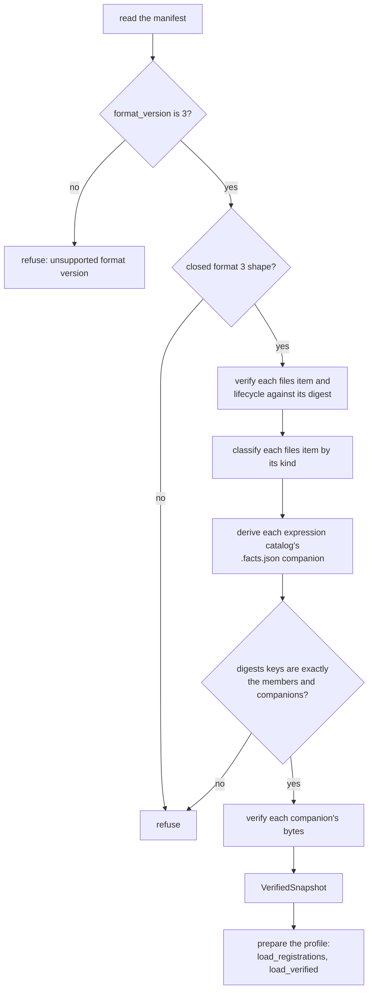
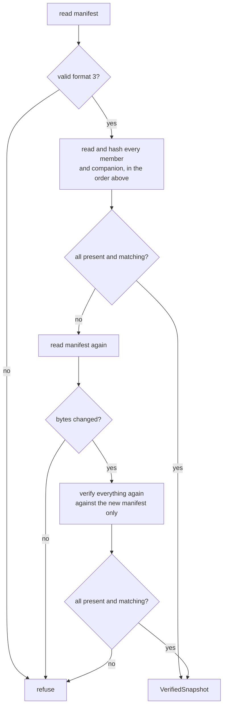
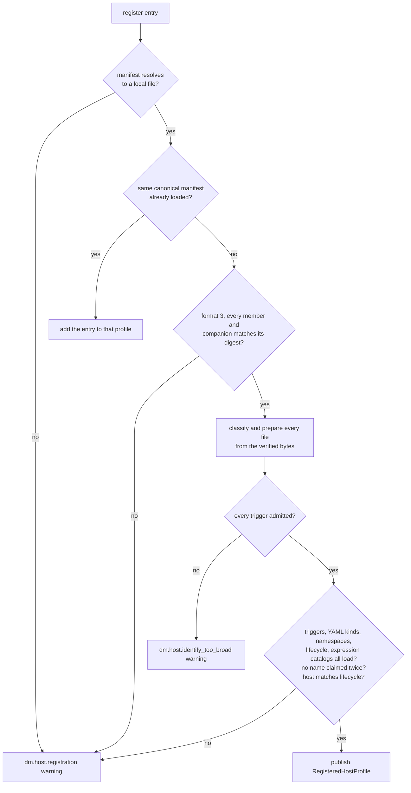
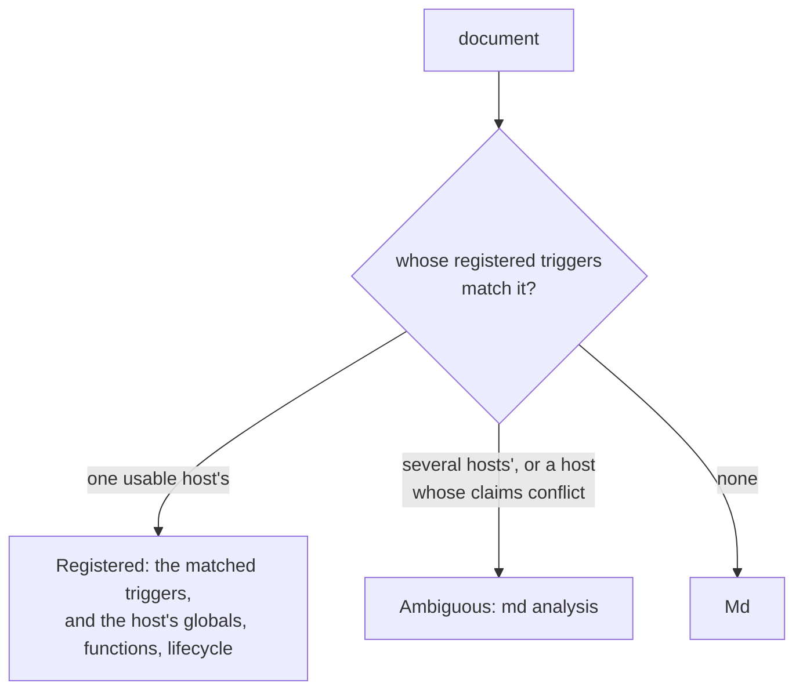
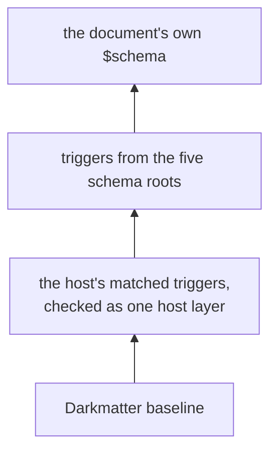
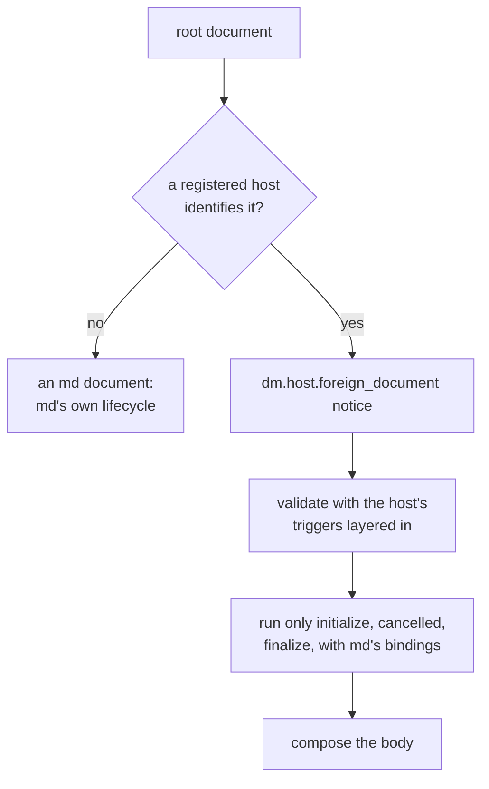
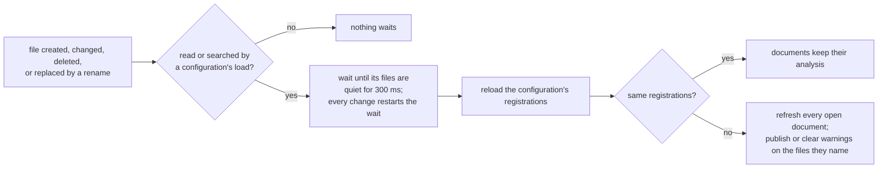

# Host Registration

A **host** is a program that reads Darkmatter documents with its own
frontmatter keys, lifecycle events, globals, and functions. Claudine is one:
its documents carry `prompt:`, `model:`, and `sequence:`, which plain `md`
knows nothing about. Registration lets a passive reader (an editor,
`md schema validate`, DMLS) type those documents as the host would, without
running the host.

This page covers:

- [registering a host](#registering-a-host) in `.darkmatter.yaml`,
- [the manifest format](#the-manifest), format 3, which lists every file of
  the host's bundle with its digest,
- [the files a bundle holds](#the-files-of-a-bundle): triggers, YAML kinds,
  namespaces, type libraries, and expression catalogs,
- [which documents belong to the host](#which-documents-belong-to-the-host),
- [how a registration loads](#how-a-registration-loads), from Rust,
- [which host a document belongs to](#selecting-a-documents-host),
- [how the host's schemas layer](#layering) into the document's schema,
- [what `md compose` does](#md-compose-of-a-hosts-document) with a document
  a registered host identifies,
- [what the editor shows](#in-the-editor-dmls) for one, and
- [what is reported](#diagnostics) when something cannot be used.

## Registering a host

A `register` entry in either configuration file names one **host manifest**,
a file the host program installs:

```yaml
# ~/.darkmatter.yaml
register:
    - ~/.acme/registration/manifest.yaml
```

The reference is an ordinary local file reference, resolved from the
directory of the configuration file that lists it. User entries come first,
then the repository's. A URL is refused; see
[Configuration Files](./configuration.md) for the rest of the file.

Registration is **passive**. It supplies types, event names, and verb shapes
only: it never writes a file, fetches a URL, prompts, runs a command, or
installs a function handler, and it grants no permission. The only input it
reads is the bundle itself: the manifest and the files it lists, each
prepared from the exact bytes that matched its digest. Applying the host's
types to a document adds no I/O beyond that one verified read. A repository may
register a host (a team's in-house tool) because it gains nothing a
repository's own `schemas/` folder could not already do.

A host program usually adds its own entry during its setup, through
`darkmatter::config::init::register_manifest`. That call keeps every
existing entry, value, and comment. It adds nothing when an entry already
names the same manifest file, however it is spelled (`~/…` or an absolute
path). The manifest must already exist, so a host publishes its bundle
first and registers it last. Claudine's setup, for example, publishes its
bundle and then adds this entry to `~/.darkmatter.yaml` (see
[The published host registration](../../../claudine/docs/topics/schemas.md#the-published-host-registration)):

```yaml
register:
    - ~/.claudine/registrations/darkmatter/manifest.yaml
```

A host whose manifest moved calls
`darkmatter::config::init::replace_manifest_registration(context, scope, new, old_path)`
instead. Every entry naming `old_path` or the new manifest, in any spelling
(`~/…`, an absolute path, or a path relative to the configuration file) and
even when the old file no longer exists, is replaced: the first becomes the
new reference as written and keeps the comment on its line, the rest are
removed together with the comment on each one's line, and with none the new
reference is appended. Other entries, and every comment not on a removed
entry's line (one on its own line above it included), are kept, and a file
that already lists the new reference once writes nothing:

```yaml
# before: replace_manifest_registration(…, "~/.acme/registration/manifest.yaml", ~/.acme/host.yaml)
register:
    - ~/tools/mine.yaml
    - /home/me/.acme/host.yaml       # Acme
# after
register:
    - ~/tools/mine.yaml
    - ~/.acme/registration/manifest.yaml       # Acme
```

To report such a leftover before writing anything, a host asks
`darkmatter::config::registration::entry_names_location(reference, declared_in, context, old_path)`
for each `register` entry it loaded. It answers with the rule the writer
uses to pick the entries it replaces, so a diagnostic and the edit agree
on every spelling, whether or not `old_path` still exists:

```rust
// ~/.darkmatter.yaml lists `./.acme/host.yaml`; ~/.acme/host.yaml was deleted
for entry in file.registrations() {
    if entry_names_location(&entry.reference, &entry.declared_in, &context, &old) {
        // entry.index and entry.at locate it; replace_manifest_registration removes it
    }
}
```

An explicit repair that must never create a configuration file (Claudine's
[`doctor --fix`](../../../claudine/docs/cli/doctor.md#registration-repair),
for example) calls
`darkmatter::config::init::replace_manifest_registration_existing` with the
same arguments. It makes the same edit, but refuses a missing file (a read
error of kind `NotFound`) and edits only while the file still holds the bytes
it read; a file another program changed in the meantime is refused, never
overwritten:

```rust
// ~/.darkmatter.yaml missing: Err(InitError::Read { .. }), nothing created
// ~/.darkmatter.yaml present: the same entries as replace_manifest_registration
replace_manifest_registration_existing(&context, ConfigScope::User, "~/.acme/registration/manifest.yaml", &old)?;
```

The edit keeps every byte it does not change, so it cannot be made inside an
inline list or mapping: appending to `register: [~/tools/mine.yaml]`, or
editing any `register` in a root written as `{register: [], …}`, is refused
with `ConfigWriteError::UnsupportedEdit`, and the block form of the same
file is edited. A host that publishes its manifest before it registers can
ask first, with the same arguments and an observation of the file:
`darkmatter::config::init::replace_manifest_refusal(&observe(context, scope)?, context, new, old_path)`
returns the editor's refusal of exactly the planned edit, or `None` when the
edit can be made or none is needed (an inline list that already names the
new manifest is left alone). A manifest that is not published yet is
identified by the location the reference would open:

```rust
// ~/.darkmatter.yaml: `register: [~/tools/mine.yaml]`, manifest not yet published
let refusal = replace_manifest_refusal(&observe(&context, ConfigScope::User)?, &context, new, &old)?;
assert!(refusal.is_some()); // ask the person to write `register` in block form first
```

All three calls check the edited file against the rules of the `scope` you
pass, and nothing else decides it. A user file stays a user file when it is
reached from a repository: when the repository's `.darkmatter.yaml` is a link
to `~/.darkmatter.yaml`, or when the home itself is the repository root. So a
user grant that a repository file may not hold, such as reading
`~/notes/*.md`, does not stop the host from registering:

```yaml
# ~/.darkmatter.yaml, also reached as {repo-root}/.darkmatter.yaml
register:
    - ~/.other/manifest.yaml
    - ~/.acme/registration/manifest.yaml   # added with ConfigScope::User
permissions:
    file-read:
        - ~/notes/*.md                     # a user grant: allowed here
```

## The manifest

The host writes the manifest and every file it lists; you never edit them by
hand. The manifest lists every file of the host's **bundle** (the manifest's
directory and everything below it) together with the BLAKE3 digest of each
file's exact bytes. A reader checks every file against its digest before
using any of it, so it never mixes files from two releases of the host, even
while the host is publishing a new one.

```yaml
# ~/.acme/registration/manifest.yaml (written by the acme program)
kind: darkmatter-host
format_version: 3
host: acme
version: "1.2.0"
files:
    - ./schemas/widget.yaml
    - ./schemas/library.yaml
    - ./schemas/run.yaml
    - ./functions/project.yaml          # a `kind: expression-schema` catalog
lifecycle: ./globals.lifecycle.json
digests:
    ./schemas/widget.yaml: "<64 lowercase hex digits>"
    ./schemas/library.yaml: "<64 lowercase hex digits>"
    ./schemas/run.yaml: "<64 lowercase hex digits>"
    ./functions/project.yaml: "<64 lowercase hex digits>"
    ./functions/project.facts.json: "<64 lowercase hex digits>"   # the catalog's companion, never in `files`
    ./globals.lifecycle.json: "<64 lowercase hex digits>"
```

| Field | What it holds |
| --- | --- |
| `kind` | always `darkmatter-host` |
| `format_version` | the integer `3` (not `"3"`, not `3.0`) |
| `host` | the host's identifier, a nonempty string; its lifecycle artifact must record the same name |
| `version` | the host release that wrote the manifest, a nonempty string |
| `files` | the bundle's schema files and expression catalogs ([below](#the-files-of-a-bundle)); their order has no effect; may be `[]` |
| `lifecycle` | the host's [lifecycle artifact](./lifecycle/host-artifact.md); always required |
| `digests` | one entry per `files` item and for `lifecycle`, keyed by the reference exactly as written, plus one for each expression catalog's [facts companion](#expression-catalogs-and-their-facts-companions), keyed by its derived spelling |

These seven fields are all required and no other field is allowed: `files:
null` is refused (write `[]`), and so is a `functions` field, which format 3
does not have. A member without a digest, or a digest for no member, refuses
the manifest at that entry. A digest is the BLAKE3 hash of the file's bytes
as 64 lowercase hexadecimal digits (`biscuit_hash::blake3_hash_bytes`);
`ABC…` or a short digest is refused.

Claudine's published manifest has the same shape. It has no expression
catalogs, so its `digests` list only its `files` and its lifecycle artifact:

```yaml
# ~/.claudine/registrations/darkmatter/manifest.yaml (written by claudine; do not edit)
kind: darkmatter-host
format_version: 3
host: claudine
version: "0.1.0"
files:
    - "./schemas/composition.yaml"
    - "./schemas/inline-composition.yaml"
    - "./schemas/loop.yaml"
    # … every other file of the bundle
lifecycle: "./globals.lifecycle.json"
digests:
    "./schemas/composition.yaml": "<64 lowercase hex digits>"
    # … one entry per member, the lifecycle artifact included
```

The schema of the envelope ships with Darkmatter
(`darkmatter/schemas/darkmatter-host.yaml`) and is importable as
`darkmatter-host@darkmatter:host`.

**A manifest of another format is refused, not guessed at.** Darkmatter
reads `format_version` before it checks anything else. Any other integer
(1, 2, or a later version) refuses the manifest with one
`dm.host.registration` warning at its `format_version`:

```text
unsupported host registration format version 2; update Darkmatter and the host tool, then republish the registration
```

A manifest without `format_version` that writes one of the removed format 1
fields (`identify`, `triggers`, or `globals`) is format 1 and gets the same
warning at that field. A `format_version` that is not an integer (`"3"`,
`3.0`) is an ordinary shape error. Nothing else about a refused manifest is
judged, and nothing of it is used, so documents the host would have typed are
analyzed as `md` documents until it is repaired.

The repair is the host's, not Darkmatter's: update the host program and
rerun its setup, which republishes its bundle in the current format. For
Claudine that is `claudine setup`, which publishes the format 3 bundle,
replaces an old `~/.claudine/darkmatter-host.yaml` entry in
`~/.darkmatter.yaml` with the new manifest, and then removes the old files.
It asks nothing, keeps every other setting, and changes nothing when run
again (see [`claudine setup`](../../../claudine/docs/cli/setup.md)). Setup
never edits a repository's configuration: once it has removed an old
manifest, a repository entry that still names it is reported at the
repository's `.darkmatter.yaml` as naming no existing file, for its owners to
remove.

**Member paths** are written so that one manifest works on macOS, Linux, and
Windows alike:

| Rule | Accepted | Refused |
| --- | --- | --- |
| starts with `./` or `../` | `./schemas/a.yaml` | `schemas/a.yaml`, `/abs/a.yaml` |
| forward slashes only | `./schemas/a.yaml` | `./schemas\a.yaml` |
| names use `A-Z`, `a-z`, `0-9`, `.`, `_`, `-` | `./schemas/my_type-2.yaml` | `./schemas/my type.yaml`, `./schémas/a.yaml` |
| no empty segment or trailing `.` | | `./schemas//a.yaml`, `./schemas/a.yaml.` |
| no Windows device name, with any extension or case | `./schemas/console.yaml` | `./schemas/CON.yaml`, `./aux`, `./com1.json` |
| stays inside the bundle | `./schemas/../a.yaml`, `../registration/a.yaml` (when the manifest sits in `registration/`) | `../a.yaml` |
| local only | | `https://…` (never fetched) |

After `.` and `..` are applied, each member is known by its path from the
bundle root (`schemas/a.yaml`). Two entries naming the same file
(`./a.yaml` and `./x/../a.yaml`) are refused, and so are names that differ
only in letter case (`./Schemas/a.yaml` beside `./schemas/b.yaml`), because a
case-insensitive file system would merge them. The same checks apply to a
derived facts companion as to a listed member. A symbolic link, or on
Windows a junction or other reparse point, anywhere between the bundle root
and a member is refused; it is never followed.

### Expression catalogs and their facts companions

An expression catalog (a `kind: expression-schema` file, see
[Host Expression Functions](./host-functions.md)) declares functions the
host's documents call. The editor needs a second file to check those calls:
the catalog's **facts companion**, a JSON file the host generates from its
Rust registration. The manifest lists only the catalog in `files`; the
companion's name is derived from the catalog's, and the companion is
digest-checked like every other member.

The derivation replaces the catalog's last extension, `.yaml` or `.yml`,
with `.facts.json`, and keeps the directory and every earlier dot exactly
as written:

| `files` item | `digests` key of its companion |
| --- | --- |
| `./functions/project.yaml` | `./functions/project.facts.json` |
| `./functions/project.yml` | `./functions/project.facts.json` |
| `./functions/acme.v2.yaml` | `./functions/acme.v2.facts.json` |
| `../registration/project.yaml` | `../registration/project.facts.json` |

Because the companion is implied, the manifest must agree with it:

- **The companion has a digest.** A catalog whose companion has no `digests`
  entry refuses the manifest at the catalog's `files` entry, naming the
  expected key:

  ```text
  `./functions/project.yaml` is an expression catalog, so `digests` must list its facts companion `./functions/project.facts.json`
  ```

- **The companion is never listed.** A `files` item that is also a catalog's
  companion, or two catalogs that derive the same companion
  (`./functions/project.yaml` beside `./functions/project.yml`), refuse the
  manifest at the catalog's entry.
- **The catalog's name can name a companion.** A catalog whose file name
  does not end in lowercase `.yaml` or `.yml` is refused at its entry.
- **`digests` holds exactly the members.** Its keys must be the `files`
  items, `lifecycle`, and the companions those catalogs derive, nothing
  more. Any other key is refused at `digests.<key>`.

A companion that is missing, or whose bytes do not match its digest, is
refused like any other member, at its catalog's `files` entry.

### Reading a bundle

`config::registration::bundle::load_snapshot(manifest, context)` reads a
manifest and its members into a `VerifiedSnapshot`, or refuses it with a
`SnapshotRefusal` (code `dm.host.registration`, located in the manifest at
the failing field; `unsupported_format` holds the version of a manifest in
another format). It parses no member; the snapshot holds each member's
verified bytes for the code that does. [`load_registrations`](#how-a-registration-loads)
calls it for every entry; call it yourself only to inspect a bundle.

```rust
use std::path::Path;
use biscuit_file::FileResolutionContext;
use darkmatter::config::registration::bundle::load_snapshot;

fn show(manifest: &Path, context: &FileResolutionContext) {
    match load_snapshot(manifest, context) {
        Ok(snapshot) => println!("{} {} revision {}", snapshot.host(), snapshot.version(), snapshot.revision()),
        Err(refusal) => eprintln!("{}:{:?}: {}", refusal.file.display(), refusal.line, refusal.message),
    }
}
```

A bundle is verified in a fixed order, so a companion is only looked for
once its catalog is known to be one, and only verified bytes decide that:



Each file is read once and hashed once. When a member or companion is
missing or does not match its digest, the host may be in the middle of
publishing (it replaces members first and the manifest last), so the reader
reads the manifest once more:



The retry happens at most once, and the second attempt reads every member
again, so a snapshot never combines files from two manifests. Other
problems (a bad path, a symbolic link, an unreadable file) refuse at once.

What a snapshot records:

- `files()` in authored order and `sorted_files()`, `lifecycle()`: each a
  `BundleMember` with its manifest field (`files[3]`), the reference as
  written, its bundle-relative path, and the line and column of its entry
  in the manifest.
- `companions()`: each expression catalog as a `BundleCompanion { catalog,
  facts }`, in `files` order. The `facts` member's reference is the derived
  spelling, and its field and position are its catalog's `files` entry.
  `members()` iterates every member: the `files` items, `lifecycle`, then
  the companions.
- `bytes()`: the verified bytes of every member, companions included, by
  bundle-relative path.
- `revision()`: a digest of the host, version, format, sorted file paths,
  lifecycle path, each catalog's companion (sorted by catalog path), and
  every member's digest. Reordering `files`, reformatting the manifest, or
  copying the bundle to another directory keeps it; changing any member
  byte changes it.
- `manifest_hash()`: the digest of the manifest's own bytes, which does
  change with layout and comments.
- `dependencies()` and `candidates()`: every file read (with the hash of
  its latest read) and every location looked at, from both attempts when
  the reader retried. Every companion the manifest could imply is looked at
  before any member is read, so it is a candidate even when the load stops
  at another member. A refusal carries the same two lists, so a caller can
  watch for a missing member or companion to appear.

### Admitting a manifest without reading its members

A publisher replacing its own bundle needs to know which files the manifest
it is replacing listed, even when some of those files no longer match it
(a publish was interrupted after replacing members). For that,
`config::registration::bundle::admit_manifest(manifest, bytes)` judges the
manifest's bytes by the same rules as `load_snapshot` (the closed envelope,
the digest map, a single YAML document, and every member path) and returns
an `AdmittedManifest` with `host()`, `version()`, `format_version()`, and
`members()`, or the same located `SnapshotRefusal`. It reads and probes no
member, so the digests it lists are what the manifest claims, not what the
files hold. Without reading a member it cannot tell which `files` items are
catalogs, so its companions are the `digests` keys that are the companion
spelling of a `files` item.

So that a publisher can retire what it published before, `admit_manifest`
also admits a well-formed format 2 manifest; its `members()` then include
each of the old `functions` pairs' `catalog` and `facts`. A format 2
manifest that is malformed in any way is refused and so grants no cleanup.
Nothing `admit_manifest` admits is loaded: a format 2 manifest only names
the files it listed.

Member paths are judged from their spelling alone: `.` and `..` are applied
to the text, so `../host/schemas/b.yaml`, which `load_snapshot` follows out
of the bundle folder and back in, is refused here. Admission is therefore
never more permissive than the verifying reader.

```rust
use std::path::Path;
use darkmatter::config::registration::bundle::admit_manifest;

fn previously_published(manifest: &Path) -> Vec<String> {
    let Ok(bytes) = std::fs::read(manifest) else { return Vec::new() };
    // Trust nothing from a manifest that fails admission.
    admit_manifest(manifest, &bytes)
        .map(|admitted| admitted.members().map(|member| member.path.clone()).collect())
        .unwrap_or_default()
}
```

A caller that will read the members itself and needs the same member
paths the loader checks uses
`config::registration::bundle::admit_installed_manifest(manifest, bytes,
context)` instead. It applies the same rules but resolves each member the
way `load_snapshot` does: from the manifest's folder, and confined to it.
For a bundle installed in `host/`, `../host/schemas/b.yaml` is admitted as
`schemas/b.yaml`, and `../schemas/b.yaml`, which ends outside `host/`, is
refused. It admits a format 3 manifest only, since an installed manifest of
any other format is one the loader refuses. It reads no member and checks no
link, so the caller still decides how each `members()` entry is read. `claudine doctor` uses it this way before
reading the bundle without following links.

```rust
use std::path::Path;
use biscuit_file::FileResolutionContext;
use darkmatter::config::registration::bundle::admit_installed_manifest;

fn member_paths(manifest: &Path, bytes: &[u8], context: &FileResolutionContext) -> Vec<String> {
    admit_installed_manifest(manifest, bytes, context)
        .map(|admitted| admitted.members().map(|member| member.path.clone()).collect())
        .unwrap_or_default()
}
```

### Judging a bundle you have already read

A diagnostic tool (such as `claudine doctor`) may need to know whether
Darkmatter would load a bundle without going through a `register` entry,
for example because it reads the files itself without following links.
Digest agreement is not enough for that answer: a member can match its
digest and still fail to parse, and a generated artifact can match its
digest and still disagree with the schemas it was built from. Two
functions give the same answer the loader gives:

1. `config::registration::bundle::verify_read(manifest, bytes, context,
   members)` takes the manifest's bytes and every member's bytes, each
   catalog's facts companion included, keyed by bundle path
   (`schemas/action.yaml`). It applies `load_snapshot`'s
   admission, member resolution, and digest checks to them and returns a
   `VerifiedSnapshot` or the same located `SnapshotRefusal`. It reads and
   probes nothing, so the caller is responsible for how the bytes were
   read (`load_snapshot`'s refusal of a member reached through a link is
   not applied).
2. `config::registration::load_verified(snapshot, context, owned)` prepares
   that snapshot exactly as a `register` entry's snapshot is prepared:
   every member classified and prepared, every declared type checked, the
   namespace catalog built, the lifecycle artifact checked against it, and
   each expression catalog loaded with its facts companion. It returns the
   `RegisteredHostProfile` or every refusal.

```rust
use std::collections::BTreeMap;
use std::path::Path;
use std::sync::Arc;
use biscuit_file::FileResolutionContext;
use darkmatter::config::registration::{bundle::verify_read, load_verified, md_owned_names};

fn loads(manifest: &Path, bytes: &[u8], members: &BTreeMap<String, Arc<[u8]>>, context: &FileResolutionContext) -> bool {
    verify_read(manifest, bytes, context, members)
        .is_ok_and(|snapshot| load_verified(snapshot, context, md_owned_names()).is_ok())
}
```

The loader itself goes through the same two steps (`load_snapshot` and the
same preparation), so the answer cannot drift from what `md` and DMLS do.

## The files of a bundle

Each `files` member is classified by its own `kind`:

| `kind` | What it does for the host |
| --- | --- |
| `schema-trigger` | selects the host's Markdown documents (its `match:`) and types them (its `$schema`, when it has one) |
| `yaml-schema` | defines a YAML document kind, such as `kind: sequence` |
| `namespace-schema` | declares one of the host's expression globals |
| `schema` with a nonempty `types` table and no `$schema` | a library of reusable types the other files import |
| `expression-schema` | declares functions the host's documents call, read with its [facts companion](#expression-catalogs-and-their-facts-companions) (see [Expression catalogs](#expression-catalogs)) |

Any other kind, a `kind: schema` file that declares `$schema`, or a library
with an empty `types` table refuses the registration at that member. A
`kind: mutation-schema` file is refused at its `kind` with
`host-defined actions are not supported`: a host can add functions to
expressions, never lifecycle actions.

**Each kind's top level is closed.** Before a file is prepared, its envelope
is checked against the keys its kind allows, each with a value of the right
YAML type. A host that compiles its bundle in (Claudine) runs the same check
when it builds, so a file the build accepts is one registration accepts:

| `kind` | Allowed keys | Rules |
| --- | --- | --- |
| `schema-trigger` | `kind`, `name`, `description`, `match`, `$schema`, `types` | `match` is required; a missing or `null` `$schema` makes a matcher-only trigger |
| `yaml-schema` | `kind`, `description`, `categories`, `$schema`, `types` | `$schema` is a required mapping |
| `namespace-schema` | `kind`, `namespace`, `description`, `$schema`, `types` | `namespace` is a required string; `$schema` a required mapping, `{}` allowed |
| `schema` (types-only) | `kind`, `name`, `description`, `categories`, `$schema`, `types` | `types` is a required nonempty mapping; `$schema` absent or `null` |
| `expression-schema` | `kind`, `description`, `categories`, `types` | `categories` is a required nonempty list and `types` a required nonempty mapping; `description` may be left out or empty, but not `null` |

An optional field may be left out. Written as `null`, a `name`, a trigger's
or namespace's `description`, and a trigger's or namespace's `types` are
refused; a `yaml-schema`'s or library's `description` and a `yaml-schema`'s
`types` read as absent, as they do wherever such a file is read. A
`yaml-schema`'s `types`, when written as a table, must not be empty
(`types: {}` is refused; omit it or leave it blank). Every later check of the
member, such as the check of every `types` declaration below, reads those fields as the
envelope admitted them. A refusal names the key it is about and is located
there:

```yaml
# ./schemas/library.yaml — refused at `extra`
kind: schema
types:
    widget: string
extra: 1
```

**Imports stay inside the bundle.** Every file is prepared from the verified
bytes alone. A reference from one member to another is written `./…` or
`../…` from the referring file (`widget@./library.yaml`) and must name a
listed member. An unlisted file, a path that leaves the bundle, a bare name
that would search schema roots, and a URL are refused, so a bundle copied
to another machine behaves the same. Darkmatter's built-in schemas
(`Name@darkmatter:lifecycle`) stay available.

The rule covers every declaration in a file's `types` table, not only the
ones the file's `$schema` uses. Each import, `$extends`, spread, and union
arm a declaration names, and each file-backed `example(…)`, must stay inside
the bundle even when nothing uses that declaration yet. One that does not
refuses the whole registration, located at the declaration that wrote it:

```yaml
# ./schemas/library.yaml — refused at the declaration naming `./options.yaml` (not a listed member)
kind: schema
types:
    widget: string
    optional-host-settings: Options@./options.yaml   # used by nothing
    review-note: string(example(./options.yaml))     # used by nothing
```

This check selects each referenced file and does not read it. A listed
example's content is judged when a declaration that uses it is prepared.
A `{{ … }}` template is not evaluated at load time: what it returns is
checked when it is resolved (see the next paragraph).

The same rule holds for a trigger whose payload is a `{{ … }}` template.
When the template is resolved for a document, its slots still need the
normal read grants, but a type a slot returns is read from the bundle the
registration verified, never from the disk:

```yaml
# ./schemas/widget.yaml (a listed member)
kind: schema-trigger
match:
    widget: object(required)
$schema:
    widget: "{{ 'widget@./library.yaml' }}"   # listed: served from the verified bytes
    # "{{ 'widget@./stray.yaml' }}"           # unlisted: refused at this slot
    # "{{ 'widget@../../outside.yaml' }}"     # leaves the bundle: refused at this slot
```

A resolution is reused only for the registration revision it read, so a
republished member is never judged by an earlier copy. A YAML kind or
namespace schema must be complete when the registration loads; a slot in
one refuses the registration at that member.

**Display names are unique.** A trigger or library may declare a `name`
(`name: widget-schema`); two files of one registration with the same name
refuse it, with a warning at each file's `name`. The name is only a label:
diagnostics show it beside the file's path (see
[Diagnostics](#diagnostics)).

### Namespace schemas

A namespace schema declares one global the host's expressions read, and its
members:

```yaml
# ./schemas/run.yaml
kind: namespace-schema
namespace: run
description: The current pass.
$schema:
    count: "number(integer; min(1)) -> The one-based pass."
    label: "label@./library.yaml -> What the pass is called."
types: {}
```

The namespace files together are the host's **global catalog**: one global
per file, with its description, its members typed by `$schema` (which may
import bundled libraries or name the file's own private `types`), and its
location in that file. `$schema: {}` declares a global with no members.

- The name must be an expression identifier (`run`, `seq`, `loop`), and it
  may not be one Darkmatter already owns: a reserved root, `null`, or one of
  Darkmatter's globals (`fm`, `ctx`, `current`, `env`, `err`, `timing`). A
  reserved name is refused at its `namespace:`.
- Two files declaring one namespace are refused at both declarations.
- A namespace file is never a document's `$schema` target and never selects
  a YAML document kind.
- Checking the file itself (`md schema validate ./schemas/run.yaml`, or the
  file open in an editor running DMLS) runs the same preparation, so it
  reports what registering it would refuse, at the field; only the reserved
  names above are registration's alone.

The lifecycle artifact is versioned against this catalog: its
`catalog_hash` is the digest of a canonical JSON object that maps each
namespace file, and every bundled file its preparation read, to the digest
of its exact bytes, all by bundle-relative path.
`config::registration::namespaces::prepare_catalog` prepares the catalog and
that map in one pass, and `namespace_catalog_hash` gives the hash; a host
generates its artifact with the same two functions. Editing a namespace file,
or a library one imports, without regenerating the artifact refuses the host
as stale. See [the lifecycle artifact](./lifecycle/host-artifact.md).

### Expression catalogs

An expression catalog lets a passive reader check calls to the host's own
functions. Its format, the facts companion's fields, and the checks a
catalog must pass are described in
[Host Expression Functions](./host-functions.md); this section covers what
registering one does.

```yaml
# ./functions/project.yaml (files[3]); its companion is ./functions/project.facts.json
kind: expression-schema
categories:
    - Project -> Ask about the files and names of the project.
types:
    is_project_file: |-
        function(
            parameters(value: unknown | null);
            returns(boolean);
            narrows(value: file; true-implies);
            category(Project);
        ) -> Returns true when the value is text naming a Markdown file of the project.
```

- **Loaded once, from verified bytes.** Each catalog is read with
  `HostFunctionCatalog::load` and its facts with
  `HostFunctions::analysis_only_at`, once per installed revision. A catalog
  that does not load, or a function whose facts are incomplete, refuses the
  whole registration.
- **Analysis only.** A registered function has a signature and facts but no
  implementation. It is visible only while a document selected for that
  host is analyzed: completion, binding diagnostics, and `md compose`'s
  static call checks. A call that reaches evaluation fails with
  `host function is_project_file() requires the host runtime`. Only the
  host program itself, with its own Rust handlers, runs the function.
- **One namespace per host.** Canonical names and the aliases in each
  companion are compared without letter case across all of one host's
  catalogs, in bundle-path order. A later claim is refused at its
  declaration (the catalog's `types` key, or the alias in the companion),
  and the earlier claim is attached as a related location:

  ```yaml
  # ./functions/project.yaml          # ./functions/tools.yaml
  types:                              types:
      is_project_file: …                  Is_Project_File: …   # refused: project.yaml claims it
  ```

  Another host may publish the same name or alias; each host's functions
  are entered only for its own documents.
- **Signatures only.** A catalog grants no permission, adds no lifecycle
  action key, and changes no event; `when` is not available in a catalog.
- **Registration is the only way in.** A catalog sitting in a schema root is
  an ordinary YAML file you can validate and edit; it is never a
  registration, and nothing discovers it there.

## Which documents belong to the host

A host's schemas apply only to documents one of its triggers matches. There
is no separate identifying file: the triggers' own `match:` conditions decide.
A trigger without `$schema` only identifies documents and contributes no
types.

```yaml
# ./schemas/widget.yaml
kind: schema-trigger
match:
    widget: object(required)
$schema:
    widget: widget@./library.yaml
```

Matching is ordinary trigger matching against the document's frontmatter as
written (before defaults or coercion; a `$schema` key is ignored) and its
path. A `literal` value must be equal, so `kind: literal(sequence; required)`
matches `kind: sequence` and not `kind: other`.

Every registered trigger must also be unable to match a document `md` owns:
each alternative must require at least one non-null top-level key that the
`md` host does not own. The `md` host owns its baseline frontmatter
properties, its lifecycle event keys (`initialize`, `composed`, `failed`,
`cancelled`, `finalize`), and its globals (`fm`, `ctx`, `current`, `env`,
`err`, `timing`). A document with only `initialize:` belongs to `md` and to
every host alike, so `initialize` can never select a host:

```yaml
# refused: dm.host.identify_too_broad
kind: schema-trigger
match:
    group:
        - widget: object(required)
        - initialize: object(required)   # shared with md
```

An optional key, a `$path` pattern, and a `none:` exclusion never select a
host either. The proof is structural: when it cannot be made, the whole
registration is refused with a warning at the trigger's `match:`, rather than
guessed at.

## How a registration loads



`load_registrations` takes the configuration snapshot, the request's captured
context, and the names Darkmatter owns:

```rust
use biscuit_file::FileResolutionContext;
use darkmatter::config::load::{ConfigLoadMode, ConfigSnapshot};
use darkmatter::config::registration::{agreement, load_registrations, md_owned_names};

fn hosts(context: &FileResolutionContext) -> Result<(), Box<dyn std::error::Error>> {
    let snapshot = ConfigSnapshot::load(context, None, ConfigLoadMode::Passive)?;
    let loaded = load_registrations(&snapshot, context, md_owned_names());
    for profile in &loaded.profiles {
        println!("{} {} ({} triggers)", profile.host(), profile.version(), profile.triggers().len());
        for namespace in profile.namespaces() {
            println!("  global `{}` from {}", namespace.namespace, namespace.path);
        }
    }
    for diagnostic in &loaded.diagnostics {
        eprintln!("{}: {}", diagnostic.code, diagnostic.message);
    }
    let _claims = agreement(&loaded.profiles);
    Ok(())
}
```

The rules a load follows:

- **All or nothing.** A profile is published only when every member loads:
  each trigger and its payload, each YAML kind definition, each library, the
  namespace catalog, the lifecycle artifact, and each expression catalog with
  its facts companion. Otherwise the entry produces one or more warnings and
  nothing of it is used: no partial globals, functions, lifecycle events,
  trigger payloads, or YAML kinds.
- **Strict artifacts.** The lifecycle artifact must record the hash of the
  namespace catalog it was generated for, and each facts companion the hash
  of its expression catalog. A stale artifact, a missing one, a format 1
  lifecycle artifact, an artifact that binds a root (an event's
  declaration or a host global) that neither Darkmatter nor a namespace
  declares, or a function whose facts are incomplete refuses the
  registration.
- **One host name.** The manifest's `host` must equal the host the lifecycle
  artifact records.
- **What to watch.** A profile's `dependencies()` lists every file read with
  the hash of its bytes, and `candidates()` every location looked at,
  including a path a member referred to that is not listed and each
  catalog's companion, present or not. A refused entry
  leaves the same locations in `LoadedRegistrations::watches`, so a caller
  (DMLS) sees a missing or broken file being repaired.
- **One manifest, one load.** Entries that resolve to the same canonical
  manifest, from the user file and the repository file, or spelled two ways,
  load it once; `entries()` lists every entry that named it.
- **A content revision.** `revision()` is the snapshot's: two installs of one
  release have the same revision wherever they live, and in whatever order
  they list `files`; any member byte changes it.
- **Bundle order never matters.** `triggers()`, `yaml_kinds()`, and
  `functions()` (one `HostFunctionSet` per catalog, with its `bundle_path`,
  catalog and facts files, and analysis-only `functions`) are in bundle-path
  order, whatever the order of `files`.

A [`register` entry that is itself invalid](./configuration.md#errors) (not a
file reference, or a URL) is already reported by the configuration snapshot
and is not loaded or reported again.

### Two manifests for one host

`agreement(&profiles)` groups profiles by `host`. Claims whose revisions are
equal collapse into the first (`HostClaim::Agreed`), so the same release
installed twice is one host. Claims that differ are a `HostClaim::Conflict`,
and `HostClaim::diagnostics()` gives one `dm.host.registration` warning per
claim, whatever their order. The conflict has a different reach for each kind
of document:

- **Markdown:** neither installation's triggers apply. A document their
  triggers match is `Ambiguous` and gets Darkmatter's own types.
- **YAML:** both installations' `yaml-schema` definitions stay indexed. A
  kind only one of them defines is judged by that definition; a kind both
  define differently cannot be selected and is a kind-selection error naming
  both files; a kind both define identically is one definition.

For example, if a second copy of a host renames its `sequence` kind to
`other-sequence`, a YAML file with `kind: sequence` is still checked by the
first copy's definition and one with `kind: other-sequence` by the second's,
while an inline Markdown prompt that either copy's triggers would match falls
back to Darkmatter. The warning says the same: the triggers do not apply to
Markdown, and each copy's YAML kinds stay available.

## Diagnostics

Every diagnostic but `dm.host.foreign_document` (a notice, below) and
`dm.host.trigger_conflict` (an error, below) is a warning. It names the entry (the declaring file and
its index in `register`), the failing manifest field when one failed
(`lifecycle`, `files[1]`; a facts companion is reported under its catalog's
`files` entry), and the file, line, and column of the problem when known:
the configuration file, at the entry, when the manifest cannot be found, the
manifest for its own shape or a member that is missing or does not match its
digest, and the member file for a member that does not load. When the problem
involves a second place (the earlier claim of a function name, or the
built-in a catalog name reuses), `RegistrationDiagnostic::related` lists it
with its own file, line, and column, and DMLS attaches it as related
information.

A member is shown by its display label when it has one. A trigger or
types-only library that declares a valid `name` is written `name (path)`
beside its manifest field, its path relative to the manifest, and so is an
importer a library's refusal names. A member without a valid `name` is
shown by its field alone, and an importer by its path alone:

```text
… is not loaded at `files[1]` (`gadget-schema (schemas/gadget.yaml)`): the trigger is invalid: …
… is not loaded at `files[2]` (`parts-list (schemas/library.yaml)`): imported by `files[0]` (`widget-schema (schemas/widget.yaml)`): …
… is not loaded at `files[2]` (`parts-list (schemas/library.yaml)`): imported by `files[1]` (`schemas/gadget.yaml`): …
… is not loaded at `files[1]`: the trigger is invalid: …
```

The label is read with the same rules as an ordinary schema root's skipped
trigger, so a file whose envelope is refused for another reason (an
unexpected key, a `match` typo) is still named. An invalid `name` is never
shown: it is the problem reported. A YAML kind or namespace member has no
display name, and a problem found before the bundle's digests are verified
(the manifest's shape, a missing or mismatched member) names the manifest
entry alone. The embedded loader's refusal carries the same label in its
`label` field, beside `member`.
`markdown::compose::report_diagnostics::registration_diagnostic` turns one
into the record `md` reports. DMLS reports them on the documents they affect;
see [In the editor (DMLS)](#in-the-editor-dmls).

### Where a refusal points

A refusal points at the most specific place its problem has. You can jump
from the warning straight to the line to fix. A refusal about a reference
(an import, an `example(...)` file, a `$schema` file) points at the
declaration that wrote it, in the file that wrote it, because the resolver
records that declaration when it first reads the reference. That holds when
the reference finds its file but the file cannot be used the way the
declaration asks: a valid member of another kind is not the mistake, the
declaration that named it is. A file that fails on its own content (it does
not parse, or is no schema at all) is reported in that file instead.
Darkmatter never searches the file's text for the reference, so the same
path in a comment, a `description`, or another declaration's
`-> description` is never reported. When the declaration is not known, the
warning is about the whole file.

| Problem | Reported at |
| --- | --- |
| a field a member requires that is missing (a trigger's `match`, a `yaml-schema`'s `$schema`, a namespace's `namespace` or `$schema`, a library's `types`, any member's `kind`) | the mapping that lacks it, at its first key after any leading comments; the same field written as `null` is reported at its value |
| a field of a member with a wrong value (a trigger's `name`, a `match` condition, a namespace's `$schema` entry) | that field's value; a `match` condition inside an `all`/`group`/`none`/`min-match` list at its own value, never at a payload property of the same name |
| a key written twice in a member | the second spelling of the key |
| a declaration that does not resolve (an unknown type, a bad `$extends` target) | that declaration's value, in the section (`$schema` or `types`) that wrote it; inside a union (a root-union arm or a list of property arms) at the failing arm, never at another arm, its `$extends`, or a same-named declaration in the other section |
| a declaration the type grammar rejects (`string(requird)`) | the rejected token (`requird`) inside the declaration, in its own arm |
| a reference that names no listed member, or leaves the bundle (also a missing, remote, or unresolvable reference, and an `example(...)` file that does not resolve) | the declaration that wrote the reference, in the file that wrote it, at the declaration's value: `size: widget@./extra.yaml` at `widget@…`, `note: string(example(./extra.yaml))` at `string(…`, a `$extends: widget@./extra.yaml` operand at its value, a property's union arm at that arm, and a whole payload written as a reference (`$schema: ./extra.yaml`) at that value. A reference written in an imported library, an `example(...)` file included, is reported in that library for every member that imports it. When no single declaration is known to have written it (two declarations of one payload write the same `example(...)` file), the warning names the file without a line and column, in every member kind |
| a reference that finds a listed file which cannot serve the way the declaration uses it: a types-only library, a `yaml-schema`, a `namespace-schema`, or a trigger named as a payload's `$schema` (whole or as a root-union arm); a trigger, or a schema with no named types of its own (a root union, a whole-file reference), named in a `Name@file` import; a JSON Schema in another dialect | the declaration that named the file, at its value, as for a reference above; the message names the file and what it is (`it declares only `types``, `it is a `namespace-schema``). A trigger payload that reaches a trigger file this way is refused as a payload cycle (`resolved to a schema-trigger envelope`) at the same declaration, and a library import that names a trigger is reported in the library for every trigger importing it |
| a `$schema` reference that closes a loop of files delegating to each other (`a.yaml` names `b.yaml`, which names `a.yaml`) | the `$schema` value that closes the loop, in the file that wrote it |
| a referenced file that fails on its own content: not valid YAML, no schema at all, or a JSON Schema its dialect's meta-schema rejects | that file, at the parser's position when it does not parse, otherwise without a line and column |
| a `kind: yaml-schema` definition whose `kind` claims no fixed set of kinds (`kind: kind-token(required)` where `kind-token` is a `string`) | the `kind` declaration's value in `$schema`, the position `md schema validate` reports for the definition |
| a broken declaration in a file another member imports | the declaration, in the imported file; the message names the importer |
| a file another member imports that does not load at all (not valid YAML, no or an unknown `kind`) | the imported file, at the parser's position when the YAML does not parse; the message names the importer |
| a member that is not UTF-8 text | its entry in the manifest |
| a manifest of another format version | its `format_version`, or the format 1 field a manifest without one writes |
| an expression catalog whose companion has no digest, is also listed in `files`, or is shared with another catalog | the catalog's `files` entry in the manifest; the message names the expected companion |
| a `digests` key that names no member and no derived companion | that key in the manifest (`digests.<key>`) |
| a `kind: mutation-schema` member | its `kind` |
| a lifecycle or facts artifact field the reader refuses (a stale `catalog_hash`, a wrong type, an unknown field, a `host_globals` name the catalog lacks) | that field in the JSON; a missing field at the object that lacks it; text that is not JSON at the parser's position |
| an expression catalog that does not load | the rejected token in the catalog; a conflict's other declaration (a built-in's, for a reused built-in name) is a related location |
| a function name or alias another catalog of the same host already claims | the later claim: the catalog's `types` key, or the alias in its companion; the earlier claim is a related location |
| a manifest `host` that differs from the lifecycle artifact's, or two manifests claiming one host | the manifest's `host` |

For example, a library a trigger imports declares an unknown type:

```yaml
# ./schemas/library.yaml
kind: schema
types:
    widget:
        size: "numbr -> The widget's size."   # line 4
```

The one warning is reported in `schemas/library.yaml` at line 4, column 15
(the declaration), under that file's manifest field `files[2]`, and its
message begins `imported by `files[0]` (`schemas/widget.yaml`)`. When a
library several members import is broken, each importer's warning is
reported at the same place.

A failure inside a union is reported in its own arm. In this trigger, the
second arm's unknown type is reported at line 8, column 15, not at the first
arm's `gadget` (line 6) or at either `$extends`:

```yaml
kind: schema-trigger
match:
    gadget: string(required)
$schema:
    - $extends: widget@./library.yaml
      gadget: "gadget(required)@./library.yaml"
    - $extends: widget@./library.yaml
      gadget: "Missing(required)"           # line 8
```

A reference is reported where it was written, not where it is used. In this
library, `last_updated` names an example file the bundle does not list:

```yaml
# ./schemas/library.yaml (files[2])
kind: schema
types:
    widget:
        size: number
        last_updated: "string(example(./notes.yaml))"   # line 6
```

Every trigger that imports `widget` gets a warning at line 6, column 23 of
`schemas/library.yaml` (the start of the declaration's value), and its
message begins `imported by` and names that trigger. The trigger's own
`widget@./library.yaml` import is never reported for it, whatever else that
trigger imports.

A file the bundle lists can still be the wrong file for a declaration. In
this trigger, the payload names the types-only library as its whole schema:

```yaml
# ./schemas/gadget.yaml (files[1])
kind: schema-trigger
match:
    gadget: string(required)
$schema: ./library.yaml          # line 4
```

The warning is reported at line 4, column 10 of `schemas/gadget.yaml` (the
value `./library.yaml`), and its message says that `library.yaml` is not a
valid schema definition because it declares only `types`. Written as a root
union's second arm (`    - ./library.yaml`), it is reported at that arm. A
payload naming a trigger file, its own or another, is reported the same way,
as a payload cycle.

A refused member never adds a second, misleading refusal elsewhere. When a
`files` member is refused before its `kind` is known (it is not UTF-8, not
valid YAML, or declares no or an unknown `kind`), or a namespace member is
refused, the member might be missing from the host's catalog, so Darkmatter
does not check the lifecycle artifact against that catalog. You see the
member's own refusal, not also a stale `catalog_hash`; fix it and reload to
see any refusal the lifecycle artifact still has.

`md` loads the registrations once per run (per repository a run's documents
resolve in) and reports each distinct warning once: on stderr for a formatted
output, in the result's `diagnostics` for a data output, whose stderr stays
empty. A formatted warning with a position starts with it, as
`path:line:column:` (the path written with forward slashes):

```text
/home/me/.acme/schemas/library.yaml:4:15: host registration `./.acme/darkmatter-host.yaml` (entry 1 of `register` in `/home/me/.darkmatter.yaml`) is not loaded at `files[2]`: imported by `files[0]` (`schemas/widget.yaml`): …
```

The entry number counts the `register` list of the named file from 1, as
you read it: the second item is entry 2, however its path is spelled.
`md compose`, `md clean`, `md schema validate`, and `md schema triggers`
also report the selection warnings of the documents they judge.

| Code | When |
| --- | --- |
| `dm.host.registration` | a manifest or member is missing, invalid, or remote; a member does not match its digest; a member has an unsupported `kind` or imports outside the bundle; a namespace is reserved or declared twice; two files share a `name`; a manifest of another format version is read; an expression catalog's companion is missing, has no digest, or describes incomplete functions; a `kind: mutation-schema` member is listed; two of a host's catalogs claim one function name or alias; an artifact is refused; the host name differs from the lifecycle artifact's; or two manifests claim one host with different content (reported for each run, and again for a document such a host identifies) |
| `dm.host.identify_too_broad` | a registered trigger could match on keys `md` owns alone |
| `dm.host.ambiguous` | two or more hosts' triggers match the same document; it is analyzed as an `md` document |
| `dm.host.trigger_conflict` | an error on the document: two of the host's triggers that match it declare a property, or the root rules, in ways that cannot be layered as one (see [When two triggers declare one property](#when-two-triggers-declare-one-property)); it names the host, the property or "the root rules", and both trigger files, each with its display name when it declares one |
| `dm.host.foreign_document` | `md compose` composes a document a registered host identifies; an `info` notice, once per run, naming the host's own command (see [below](#md-compose-of-a-hosts-document)) |
| `dm.lifecycle.unknown_host` | DMLS only: a root key of a document no registered host identifies is a lifecycle event only a registered host has (see [below](#in-the-editor-dmls)) |

## Selecting a document's host

Every document is analyzed as exactly one host. Selection is passive: it
reads no file, writes nothing, fetches nothing, and prompts for nothing.
Nothing in a schema root names a host: a `globals.yaml` and lifecycle
artifact left in a schema root by an older host install are ordinary files.



| Result | When | What applies |
| --- | --- | --- |
| `Registered(profile)` | one usable registered host's triggers match the document; `Selected::matched` lists which | that host's matched triggers, its globals, functions, and lifecycle profile, together |
| `Ambiguous(hosts)` | two hosts' triggers match it (`dm.host.ambiguous`), or a host whose two manifests conflict does (their `dm.host.registration` warnings) | nothing of any host; the document is an `md` document |
| `Md` | anything else | no host |

A document is judged in its own context: its frontmatter, and its own path
for `$path` predicates, whose bare and `./` patterns read from the
document's tree root. A conflict never wins: when two manifests claim one
host with different content, neither's triggers are used, and a document
their triggers match is `Ambiguous` (their YAML kinds stay available; see
[Two manifests for one host](#two-manifests-for-one-host)).

From Rust:

```rust
use biscuit_file::FileResolutionContext;
use darkmatter::config::load::ConfigSnapshot;
use darkmatter::config::registration::{HostSelection, RegisteredHosts, select};
use darkmatter::markdown::Markdown;
use darkmatter::markdown::schemas::frontmatter_as_json;

fn host_of(snapshot: &ConfigSnapshot, document: &Markdown, path: &std::path::Path, context: &FileResolutionContext) {
    let hosts = RegisteredHosts::load(snapshot, context);
    let selected = select(Some(&hosts), &frontmatter_as_json(document), Some(path), context);
    match &selected.selection {
        HostSelection::Registered(profile) => {
            let matched: Vec<&str> = selected.matched_triggers().map(|trigger| trigger.bundle_path.as_str()).collect();
            println!("{} via {matched:?}", profile.host());
        }
        HostSelection::Ambiguous(hosts) => println!("ambiguous: {hosts:?}"),
        HostSelection::Md => println!("md"),
    }
}
```

A composition request carries the hosts with
`ComposeOptions::with_registered_hosts`, and `ComposeOptions::host_selection_for`
gives a document's selection. A caller that supplies its own host globals
(`ComposeOptions::with_host_globals`, as Claudine does when it runs a
document) keeps them: its documents select `Md`, and no registered layer is
added. Registration supplies type information only; when the host itself runs
a document, its own in-process definitions stay authoritative.

### Whole YAML documents

A whole `.yaml`/`.yml` document whose `kind` a registered host's
`kind: yaml-schema` file claims is judged by that definition, in
`md schema validate` and in DMLS. Registered definitions are the lowest kind
tier:

1. the built-in kinds (`schema`, `yaml-schema`, `schema-trigger`, …);
2. a definition in one of the document's schema roots;
3. a registered host's definition.

A higher tier always wins, including its failures: a broken local definition
claiming `roster` makes `kind: roster` unavailable rather than falling through
to the host's. An identical copy of a host registered twice is one claim; two
different registered definitions of one kind, in one host or across hosts,
refuse the kind and name each definition file. A selected kind outranks the
document's own root `$schema`; a kind nothing claims falls through to it.

```yaml
# ~/.acme/schemas/roster.yaml (a member of the acme bundle)
kind: yaml-schema
$schema:
    kind: literal(roster; required)
    platforms: string[](required)
```

```yaml
# team.yaml: judged by acme's definition; `platforms: 3` is a problem
kind: roster
platforms: 3
```

A YAML document gets no trigger layer: registered triggers apply only to
Markdown frontmatter. `RegisteredHosts::yaml_kinds()` is the index, and
`YamlContract::registered()` names the host, bundle path, and file of the
definition that judged a document.

### A registration compiled into its host

A host program can judge its own documents with the bundle it publishes
without reading the published copy, for example before its setup has ever
run. It hands Darkmatter the manifest and member bytes it carries in memory,
and they load through the same checks as an installed bundle:

```rust,ignore
use std::collections::BTreeMap;
use std::sync::Arc;
use darkmatter::config::registration::bundle::VerifiedSnapshot;
use darkmatter::config::registration::{load_embedded, md_owned_names};

// `manifest` and each member's bytes are compiled into the host binary.
let members: BTreeMap<String, Arc<[u8]>> = BTreeMap::from([
    ("schemas/widget.yaml".to_string(), Arc::from(&WIDGET[..])),
    // …every member the manifest lists, and each expression catalog's companion
]);
let snapshot = VerifiedSnapshot::from_embedded("acme", "manifest.yaml", MANIFEST, &members)?;
// `prepared` may serve a payload the host prepared ahead of time, by bundle
// path; `None` resolves it from the member's text.
let profile = load_embedded(snapshot, md_owned_names(), &|_path| None)?;
```

- **Nothing is read from disk.** `from_embedded` verifies the supplied bytes
  in the same order as an installed bundle (members, then derived
  companions, then the exact `digests` set), under a virtual root `<acme>`.
  A missing member or a digest mismatch refuses it, as for an installed
  bundle. The profile's `dependencies()` and `candidates()` are
  empty.
- **Embedded identity.** Each trigger's origin is
  `TriggerSource::Embedded { bundle: "acme", name: "schemas/widget.yaml" }`
  (shown as `embedded:acme/schemas/widget.yaml`) and its `location` is the
  virtual `<acme>/schemas/widget.yaml`. `RegisteredTrigger::path()` names an
  installed file and panics for an embedded trigger; check `is_embedded()`
  first, or read `location`.
- **The same layer.** The profile is used through `RegisteredHosts` like any
  other: its matched triggers are checked as one host layer, root unions
  allowed, below every schema-root trigger.

## Layering

For a document a registered host identifies, the schema layers are, from
lowest to highest:



A higher layer replaces a property a lower one declares, so a repository's
root trigger can refine or override a registered host, and the document's
`$schema` overrides both. For example, with the host's `widget.yaml` declaring
`widget: widget@./library.yaml` and a repository's own `schemas/widget.yaml`
declaring `gadget: number`:

```yaml
---
widget:
    size: big     # rejected by the host's `size: number`
gadget: name      # rejected by the root trigger's `gadget: number`
---
```

- **Registration is a separate source.** A root trigger file with the same
  name as a host trigger does not shadow it: both apply, the root's on top.
  Shadowing by file name stays among the schema roots.
- **Each trigger once.** When the host's trigger file is also visible in a
  schema root (the same file, with the same content), it applies once, as the
  host's. An unrelated file with the same name is a different trigger. A
  root trigger never duplicates an
  [embedded registration](#a-registration-compiled-into-its-host)'s trigger,
  whose identity is its bundle path, not a file: a copy of it in a schema
  root applies as an ordinary trigger on top.
- **Ordinary matching.** A host trigger applies only when its `match:` matches
  the document, exactly as a root trigger does; the same match that selects
  the host decides which of its triggers apply.
- **Imports stay anchored.** A host trigger's relative imports resolve from
  the trigger's own file.
- **Cache identity.** A host layer's validator identity includes the
  manifest's identity and content revision, so a changed host install never
  reuses a validator compiled for another.

### Higher layers over a host's root union

A host layer can be a root union: a document must match one of its arms (for
example, Claudine's inline composition has one arm that requires `prompt` and
one that requires `sections`). The layers above it keep their ordinary
precedence inside every arm. Each arm is built from the lower layers, then
the arm's own declarations, then the root triggers and the document's
`$schema`:

- **A higher declaration wins in every arm.** A document that redeclares
  `prompt` replaces the host's `prompt` in both arms, including the arm that
  admitted only `null` for it.
- **A higher root rule holds in every arm.** A `closed` document `$schema`
  (or a closed root trigger, when no document `$schema` sits above it)
  refuses any key that no layer declares, whichever arm the document matches:

  ```yaml
  ---
  $schema:
      $constraints: { closed: true }
      prompt: string
  prompt: hi
  extra: hi       # refused: dm.schema.unknown_key
  ---
  ```

  The host arm's own keys (`sections` here) count as declared.
- **A document union makes one arm per pair.** When the document's `$schema`
  is itself a root union, the effective schema has one arm for each host arm
  and document arm, host arms first. A document must therefore match one arm
  of each:

  ```yaml
  ---
  $schema:
      - x: string(required)
      - y: number(required)
  prompt: hi      # the host's `prompt` arm
  x: a            # the document's first arm
  ---
  ```

  Leaving out both `x` and `y`, or both `prompt` and `sections`, matches no
  arm. Where a document arm redeclares a host key, that arm's declaration
  wins in its pairs only.

Only one root union is allowed among the host's matched triggers (see the
next section); a root trigger above the host is always an object.

In the editor, a host's root union contributes the keys of every arm: a
declaration all arms share is offered and hovered exactly as written, and a
key whose arms declare it differently shows each arm's alternative. An arm
that types a key the document writes with a value as `null` alone drops out
of that view, so writing `prompt: hi` leaves the `prompt` arm's
declarations (see [In the editor (DMLS)](#in-the-editor-dmls)). A document
`$schema` root union follows the same rule after its `literal(...)`
discriminant, when it has one.

### When two triggers declare one property

A document can match several of one host's triggers. Together they form one
host layer, so they must agree wherever they overlap. Each property two or
more matched triggers declare is compared pair by pair, after named types and
`$extends` are resolved (an inherited property counts as declared):

| The two declarations | Result |
| --- | --- |
| the same type and the same rules | they coalesce; the first trigger in bundle-path order is the property's origin |
| one type is strictly narrower (`enum(claude, codex)` inside `string`) and presence, null admission, defaults, descriptions, and constraints agree, alternative by alternative | the narrower one applies, with its own origin |
| incomparable types (`number` and `boolean`), or a narrower type whose rules differ (`string(required)` and an optional `enum(...)`; `string` and `string \| null`; different descriptions, defaults, or constraints) | `dm.host.trigger_conflict` |

Every pair counts: a third trigger narrower than both does not hide an
incompatible pair. Only matched triggers are compared, so two triggers that
never match the same document never conflict.

When a property is a union, descriptions and rules stay with the
alternative they were written on. Presence, null admission, and the
property's default belong to the whole property; everything else is
compared alternative by alternative. Each alternative of the narrower
declaration is paired with an alternative of the wider one that covers it,
and the two must have the same description, default, examples, and other
rules. A list's element rules (`string(no-coerce)[]`) and its own rules
(`string[](min(1))`) are compared separately, and an equivalent nested
object must match field by field. The `generated` marker belongs to its
alternative, whichever side of `[]` it is written on, so
`string(generated)[]` and `string[](generated)` coalesce. An alternative the narrower declaration
leaves out takes its rules with it.

```yaml
# a.yaml                                # b.yaml
review-model:                           review-model:
    - "string -> single model"              - "enum(claude, codex) -> single model"
    - "string[] -> model choices"           - "string[] -> model choices"
```

These narrow: `b.yaml`'s enum keeps the description of the `string` it
narrows. Were `b.yaml` to swap the two descriptions, or to move a
`no-coerce` from the `string` alternative to the list's elements, the
document would fail with `dm.host.trigger_conflict` on `review-model`, even
though the same descriptions and rules appear somewhere in both. An
alternative that no single alternative of the other declaration covers (it
spans two of them) has nothing to be compared with, so it conflicts too.

A list's items are alternatives as well. When a list narrows a list, the
two lists' own description and list rules are compared once, and then each
item alternative of the narrower list is paired with an item alternative of
the wider one that covers it, and their element rules are compared there.
A grouped union (`(string | number)[]`) and a list of a named union type
(`ModelIds[]` with `ModelIds: [string, number]`) both have one item
alternative per arm:

```yaml
# a.yaml
review-model: "(string | number)[](min(1))"
# b.yaml
review-model: "enum(claude, codex)[](min(1))"
```

The enum list wins because every enum value fits the string item
alternative and the list minimum agrees. Moving `min(1)` from the list
to the items, or giving the retained item different rules, conflicts.

Coverage respects the boundary between a property's alternatives and a
list's item alternatives. `string[] | number[]` narrows
`(string | number)[]` because each homogeneous list fits the mixed list.
The reverse direction fails because `[claude, 3]` needs both item types
in one list. Adding a `boolean` property alternative to the homogeneous
declaration makes the pair incomparable.

A named type compares as the type it names, whether it was written inline
or reached through a reference. This holds however the type is stored: a
type used in two places is stored once and referenced, and that never
changes the result. The description and rules written where the name is
used count at the level they apply to. On a list type they are the
list's own, so `Models(min(1)) -> reviewed` compares like the same list
written out with `[](min(1)) -> reviewed`:

```yaml
# a.yaml                                    # b.yaml
types:                                      $schema:
    Models: "(string | { id: string })[]"       review-model: "{ id: string }[] -> reviewed"
$schema:
    review-model: "Models -> reviewed"
    spare: Models
```

These narrow: a document gets `b.yaml`'s list of objects, and the
description they share. Had `b.yaml` written `"(string | { id: string })[]
-> reviewed"`, the two would coalesce. A named union (`Models: [string,
"{ id: string }"]`) is the same as writing out its alternatives, and an
object, dictionary value (`<string>: Models`) or tuple position that uses a
named type matches the same one written out. In a
root union, a key one arm writes inline and another arm writes through a
named type is still the same key in every arm, not one that defines the
union's alternatives. Two named types that refer to themselves are
compared structure by structure, so the same recursive type under two names
coalesces. A recursive type also matches its body written out, however many
levels deep the two spellings stop:

```yaml
# a.yaml and b.yaml both declare
types:
    Node: "{ name: string, children: Node[] }"
# a.yaml
$schema:
    review-model: Node
# b.yaml
$schema:
    review-model: "{ name: string, children: Node[] }"
```

These coalesce, at the top or nested in an object, dictionary value, tuple,
or list, and a document's `review-model` children are still checked at
every depth. `Node | string` narrows to the written-out tree alone. A rule
that differs anywhere inside the tree, even one level below where either
spelling repeats itself (`{ name: string, children: { name: string(min(1)),
children: Node[] }[] }` against `Node`), conflicts.

```yaml
# ./schemas/a.yaml                     # ./schemas/b.yaml
kind: schema-trigger                    kind: schema-trigger
match:                                  match:
    team: string(required)                  team: string(required)
$schema:                                $schema:
    agent: string                           agent: enum(claude, codex)
```

A document with `team: core` gets `agent: enum(claude, codex)`. Were `a.yaml`
to declare `agent: string(required)`, the document would fail with
`dm.host.trigger_conflict` naming `agent`, `a.yaml`, and `b.yaml`. The
message gives the host, both trigger files, the property, and the reason; a
trigger that declares a valid `name` is written `name (path)`
(`` `team-agent (/home/me/.acme/registration/schemas/a.yaml)` ``), and
`related` keeps the paths alone;
`md schema validate --output json` reports it as the file's schema error
with both trigger files in `related` (other keys omitted):

```json
{
  "file": "team.md",
  "valid": false,
  "error": "schema",
  "code": "dm.host.trigger_conflict",
  "message": "registered host `acme`'s triggers `/home/me/.acme/registration/schemas/a.yaml` and `/home/me/.acme/registration/schemas/b.yaml` conflict on `agent`: one is required and the other is not",
  "related": [
    "/home/me/.acme/registration/schemas/a.yaml",
    "/home/me/.acme/registration/schemas/b.yaml"
  ]
}
```

The reason is one of: their types are incomparable; one is required and the
other is not; one admits null and the other does not; their defaults,
descriptions, constraints, element constraints, or list constraints differ
(with `at alternative N` when the narrower declaration has several);
their equivalent types differ in a nested declaration; an alternative
narrows no single alternative of the other declaration; an item
alternative of a list narrows no single item alternative of the other
list. In the editor the same message is an
error on the document's frontmatter, with each trigger file attached as
related information ("the first conflicting trigger", "the second
conflicting trigger").

The root of the payloads is compared too:

- A single matched trigger keeps its root rules (`$constraints`, for example
  `closed: true`).
- With two or more, none may write root rules, and at most one may be a root
  union. The other triggers' properties are merged into every arm of that
  union, arm order kept, and none of them may declare a key that tells the
  arms apart (one some arm omits or declares differently).

A conflict is a schema preparation error, not a validation problem: the
document is not validated or composed, and nothing a higher layer declares,
the document's own `$schema` included, clears it. A trigger whose payload is
a `{{ … }}` template is listed whole by `pending_templates_for` and checked
only once it is resolved.

`--disable schema-triggers` turns off the registered layer together with the
schema roots' triggers. `md schema triggers` reports the registered host and
each of its triggers and runs the same check over the matched triggers whose
payloads are not templates: a conflict is listed with both trigger files and
the run fails with status 1, so inspecting a document never reports success
for one that validation and composition refuse. A template payload stays
pending there and is not evaluated; see
[`md schema triggers`](../cli/schema.md#md-schema-triggers).

## `md compose` of a host's document

`md compose` can compose a document a registered host identifies (a Claudine
document, for example): it checks the document against the host's schemas,
composes its Markdown body, and runs the lifecycle events `md` shares with the
host. It never runs the host itself: no agent starts, no task or sequence
step runs, no host function is called, and nothing is spoken or notified. To
run the document as its host does, use the host's own command
(`claudine compose`).

For a host shaped like Claudine (it renames `composed` to `start` and
`failed` to `blocked`, adds `success` and `failure`, and supplies `seq`):

```yaml
---
sequence:
    - name: one
      prompt: hi
initialize:
    - info: "starting {{ title }}"   # runs: a shared event, md's bindings
    - info: "{{ seq.name }}"         # fails: `seq` has no value under md
start:
    - say: "{{ seq.name }}"          # never runs, never evaluated
composed:                            # rejected by the host's schema (`start:`)
    - info: x
---
```



- **Validation.** The host's matching triggers judge the document, as
  described under [Layering](#layering). Its spellings of renamed events are
  the host's to judge: Claudine's schema types `composed` and `failed` as
  `null`, so either key is a schema error, never an `md` stack.
- **Lifecycle.** `md` reads only the events it shares with the host under the
  same name (for Claudine `initialize`, `cancelled`, and `finalize`) and runs
  them as it runs its own, with its own bindings and verbs (a verb `md` does
  not run, such as `say`, is skipped with a warning). The host's own events
  (`start`, `blocked`, `success`, `failure`, `loop`) and `composed`/`failed`
  never run here.
- **Deferred keys.** Every event key the host registers keeps its value as
  authored: no compose-time pass evaluates it, exactly like `md`'s own event
  keys on a lifecycle document. Every other key, `sequence` included, is
  ordinary frontmatter. Not evaluating an event does not skip checking it:
  `md compose` reports the host schema's problems with every event,
  including those it never runs, exactly as `md schema validate` does. For
  Claudine, `start: 5` and `loop: [1, 2]` fail both commands, and a
  `{{ … }}` template the host renders at event time is set aside by both.
- **Host globals.** The host's globals (`seq`, `loop`, `group`) are declared,
  so a read of one is not an undeclared property, but they have no value:
  reading one, in a shared event, the frontmatter, or the body, fails as any
  unavailable global does, with the reason `dm.host.runtime_only`. `md` never
  makes up a value.
- **Host functions.** The functions of the host's
  [expression catalogs](#expression-catalogs) are entered for this document
  only, so a call is checked against its signature and its static problems
  are reported, but they have no implementation in `md`: a call that is
  evaluated fails with `host function <name>() requires the host runtime`.
  A document the root transcludes sees the root's host functions, whichever
  thread composes it. A document `md` owns, or one another host identifies,
  does not see them.
- **The notice.** One `dm.host.foreign_document` notice per run names the host
  and its command: on stderr for a formatted output, in `diagnostics` for a
  data output, whose stderr stays empty. Only the root document decides it:
  a transcluded document the host identifies adds no second notice, and an
  `md` root that transcludes one gets none (a child never runs a lifecycle).

```text
ℹ this is a `claudine` document: `md compose` checks it against `claudine`'s schemas, composes its body, and runs only its `initialize`, `cancelled` and `finalize` events; run `claudine compose` to run it as `claudine` does
```

A document with only shared keys (`initialize:` alone) is not identified by
Claudine and composes as an ordinary `md` document, with no notice.

From Rust, a caller that is not the host attaches the selected profile's
passive view with `ComposeOptions::with_selected_host`, which declares the
host's globals as unavailable (`RegisteredHostProfile::analysis_globals`)
while the registered layer keeps applying.
`lifecycle::md_host::{shared_event_keys, execution_projection,
foreign_deferred_keys}` give the shared events, the frontmatter `md` parses a
lifecycle from, and the deferred keys. A caller with its own host globals
(`with_host_globals`, Claudine) is unaffected: `with_selected_host` leaves
its options unchanged.

## In the editor (DMLS)

DMLS, the Darkmatter language server, analyzes each Markdown document under
the one host [selection](#selecting-a-documents-host) chooses for it, and
every editor feature reads that same choice: schema validation (with the
registered host's triggers [layered](#layering) in), completion and hover of
the host's globals, the host's lifecycle stacks (its events, renames, and
verbs), and the completion, typing, and binding diagnostics of calls to the
functions of the host's [expression catalogs](#expression-catalogs). No
feature looks for host catalogs or registrations on its own, so a document
that selects no host, or another host, is offered none of them.

For the Claudine-shaped `relay` host registered in `~/.darkmatter.yaml`, a
document anywhere (inside the host's package area or not) that writes
`sequence:` is a `relay` document:

```yaml
---
sequence:
    - name: one
      prompt: hi
start:
    - info: "{{ err.message }}"   # error: `err` is unavailable in `start`
---
{{ seq.name }}                     # completes and hovers from the relay's catalog
```

- **Registrations load once per configuration.** DMLS reads the home's and
  the repository's configuration files read-only, the way `md` does, and
  loads their `register` entries off the request thread: it never migrates a
  file, writes, prompts, or fetches. Every document whose context
  projects the same configuration shares the result. Startup loads the
  configuration of every workspace folder; a document with frontmatter
  elsewhere loads its own before it is analyzed.
- **A document without frontmatter gets the same choice.** It is analyzed
  as if its frontmatter were empty, under the installed registrations. It never waits
  for a load: until its configuration's registrations are loaded it is an
  `md` document, and it is refreshed when they are.
- **The choice is made once per schema preparation** and kept with the
  document's schema until the text, the schema inputs, the context, or the
  registrations change. Its revision is part of the schema's cache identity
  and of the document's analysis snapshot, so a changed host install is
  never answered from facts prepared for another.
- **A broken replacement is not hidden.** When a manifest or a member
  changes so that the registration no longer loads, the host's view is
  dropped as soon as the reload completes (see
  [below](#changes-are-followed-without-a-restart)): the document is
  analyzed as `md`, and the new `dm.host.registration` warning appears on
  the file that is wrong. A file that is saved with the same bytes changes
  nothing.
- **Ambiguity is `md`.** A document two registered hosts identify gets one
  `dm.host.ambiguous` warning and `md` analysis.

### Where the warnings appear

A warning about a registration is published on the file that has the
problem, at its line and column, whether that file is open or not. The
column `md` prints counts characters; the editor receives the same point in
the position encoding it negotiated, so after `café` or `🧪` on the line a
UTF-8 client gets a larger column than a UTF-16 one, and both land on the
same character. A warning
about how one document was analyzed is published on that document:

| Code | Where |
| --- | --- |
| `dm.host.registration`, `dm.host.identify_too_broad` for a refused entry | on the file the problem is in: the configuration file, at the `register` entry naming a manifest that cannot be found, the manifest for its own shape or a member it cannot resolve, otherwise the member |
| `dm.host.registration` for two manifests claiming one host | on each manifest, and again at the top of every document such a host identifies |
| `dm.host.ambiguous` | at the top of a document two or more hosts identify |
| `dm.lifecycle.unknown_host` | at a root key that is a host-only lifecycle event of a registered host which did not identify the document |

An open file keeps its own diagnostics beside these. For example, an open
`~/.darkmatter.yaml` with an unsaved `network: sometimes` and an entry naming
a manifest that is not there shows both the configuration's own
`dm.schema.constraint` error and the entry's `dm.host.registration` warning.
When the problem is fixed, the warning is cleared from the file.

### Changes are followed without a restart

DMLS watches everything a registration is loaded from, wherever it lives:

- both configuration files, `~/.darkmatter.yaml` and
  `<repo-root>/.darkmatter.yaml`, whether or not they exist;
- every manifest and member, YAML and JSON alike, each expression
  catalog's derived facts companion, every unlisted path a member refers
  to, and the folders they are in, so a member or companion that is missing
  is seen when it is created;
- the place a `register` entry points at when no manifest is there yet;
- the repository's `HEAD` and the branch it names, because the repository
  file's permissions count only as committed (see
  [configuration](./configuration.md#the-repository-file-at-head-and-in-the-working-copy)),
  so a commit or a checkout can change what loads.

A watched change reloads the registrations of every configuration that read
the file, or searched the folder it is in, and refreshes every open document
they serve. The reload waits until that configuration's files have been
quiet for **300 ms**: one publish (`claudine setup`, for example) rewrites a
dozen files, and an editor reports them in several batches, so every change
restarts the wait and the whole burst gives one reload. Until the reload
completes, open Markdown and YAML documents keep the view they had; nothing
is published from a half-written install. The reload runs off the request
thread and reads and compares the files there: a reload that finds the same
registrations (a file saved with the same bytes) changes no document's
analysis, and one whose warnings alone changed republishes only the
warnings. A change reported during a reload makes that reload's result
obsolete, and the next one, after quiet, is installed instead. This holds
for the first load too: when a change arrives while the server is still
loading a configuration for the first time, no registered host, refusal, or
configuration notice from that obsolete load is shown. Its documents are
analyzed as if nothing were registered (the `md` host, and no host kinds for
YAML documents) until the next load completes.

```mermaid
sequenceDiagram
    participant P as claudine setup
    participant E as editor
    participant S as DMLS
    participant W as background reload
    P->>E: rewrites members, then the manifest
    E->>S: change batch 1
    Note over S: wait restarts (300 ms);<br/>documents keep the last loaded view
    E->>S: change batch 2
    Note over S: wait restarts again
    Note over S: 300 ms with no change
    S->>W: reload this configuration's registrations
    W-->>S: completed view (or a refusal)
    S->>S: install the latest completed view for<br/>open Markdown and YAML documents;<br/>publish or clear dm.host.* warnings
```

Ordinary editing is never held: a document edit, a schema file a document
names, a trigger file, or a `.dmls.toml` change is analyzed at once, under
the registrations still installed. The same handling covers every way an
editor or a tool changes a file:



For example, deleting `globals.lifecycle.json` of a registered host drops
the host from its documents and puts a `dm.host.registration` warning on the
manifest; restoring the file brings the host back and clears the warning.
Adding a `register` entry to `~/.darkmatter.yaml` registers the host for
every open document of that configuration, and removing it unregisters it.

An editor that cannot watch folders outside the workspace makes DMLS reload
the registrations after every save instead, with the same 300 ms wait.
Command-line reads (`md compose`, `md schema validate`) do not wait: the
publisher replaces the manifest last, so a read sees either the earlier
install or the new one.

DMLS shows a missing `~/.darkmatter.yaml` once per session as a message
naming `md init`; it never creates the file (see
[configuration](./configuration.md#how-dmls-reports-configuration)).

`dm.lifecycle.unknown_host` explains a stack that does nothing. With the
`relay` host registered, a document without `sequence:` or `start:` is not a
relay document, so its `success:` is ordinary data:

```yaml
---
title: notes
success:          # warning: `success` is a lifecycle event of `relay`, which
    - info: done  # does not identify this document
my_data: 1        # no warning: no registered host uses `my_data`
---
```

Keys `md` shares with every host (`initialize`, `cancelled`, `finalize`) and
keys no registered host uses as an event are never reported.

