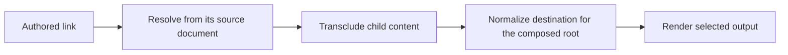

# Hyperlinking

Darkmatter supports ordinary Markdown links, formatted link text, browser
tooltips, custom HTML attributes, and prompts that appear on hover or keyboard
focus. You can author these in Markdown and render the same document to HTML
or a terminal. Image references use a related vocabulary described in
[Image Previews and References](./image-previews.md).

## Write a link

Use the usual Markdown syntax for URLs, files, and headings. Link text can
contain inline formatting, including code:

```md
[Documentation](https://example.com/docs)
[Installation](#installation)
[Local guide](./guide.md)
[`Cargo.toml`](./Cargo.toml)
[**Important** guidance](./guide.md)
<https://example.com/docs>
<help@example.com>
```

Reference-style links also work. Their optional title is processed the same
way as an inline link's title:

```md
[Documentation][docs]

[docs]: https://example.com/docs "Project documentation"
```

Render a document with the CLI:

```sh
md render guide.md
md render guide.md --output html > guide.html
```

The first command prints terminal output, which off a color terminal is the
same text as `--output plain`. See [Render](../cli/render.md) and
[Output and width](../cli/output-and-width.md) for explicit output selection.

## Add an ordinary tooltip

Markdown permits an optional title after the destination. Darkmatter emits a
plain title as the HTML anchor's `title` attribute:

```md
[Documentation](https://example.com/docs "Project documentation")
```

```html
<a href="https://example.com/docs" title="Project documentation">Documentation</a>
```

The browser supplies its native tooltip. This does not activate Darkmatter's
prompt popover.

## Put structured attributes in the title

A title that is a JSON or JSON5 object is structured data. Any other title is
a plain string, exactly as in CommonMark. Keep the whole object inside the
Markdown title's quotes. Single quotes around the title and double quotes
inside it make short objects easy to read, and JSON5 lets you leave most keys
unquoted:

```md
[Documentation](https://example.com/docs '{ class: "docs-link", target: "_blank", title: "Project documentation", "data-section": "help" }')
```

This produces an anchor with the following attributes; attribute order may
differ:

```html
<a href="https://example.com/docs" class="docs-link" target="_blank" title="Project documentation" data-section="help">Documentation</a>
```

The supported properties are:

| Property | Example | HTML behavior |
| --- | --- | --- |
| `class` | `class: "docs-link prominent"` | Adds CSS classes to the anchor. Supply the corresponding stylesheet yourself. |
| `style` | `style: "color: blue; text-decoration: underline;"` | Adds parsed inline CSS. |
| `target` | `target: "_blank"` | Sets the browsing context: `_self`, `_blank`, `_parent`, `_top`, or a named context such as `preview`. |
| `title` | `title: "Project documentation"` | Sets the ordinary HTML tooltip text. |
| `prompt` | `prompt: "Open the documentation site"` | Creates Darkmatter's accessible prompt popover. |
| `data-*` | `"data-section": "help"` | Adds custom data attributes with valid attribute names. The hyphen means the key needs quotes. Values are strings. |
| `qp` | `qp: { line: 14, column: 83 }` | Adds query parameters; see [Carry a location with `qp`](#carry-a-location-with-qp). |

Property names are case-insensitive. Unknown properties and invalid CSS are
ignored. For example, `rel: "..."` is not part of this authoring vocabulary. A
number or boolean given to a property above other than `qp` becomes its text
(`title: 42` is the tooltip `42`).

### How a title is read

Only an object is structured. The two warnings below tell you when a title
looks like it was meant to be structured but is not:

| Title | Read as | Warning |
| --- | --- | --- |
| `'{ class: "docs" }'`, a JSON or JSON5 object | structured | `dm.link.malformed_structured_title` when a value had to be ignored (`{ class: ["a"] }`); the rest of the object still applies |
| `"{ class: "`, starts with `{` but is not a JSON5 object | plain text | `dm.link.malformed_structured_title` |
| `"class='docs'"`, a leftover `key=value` title | plain text; nothing is applied | `dm.link.legacy_structured_title` |
| `"42"`, `"[1, 2]"`, or `"'quoted'"`, valid JSON5 that is not an object | plain text | none |
| anything else | plain text | none |

`md compose` and `md render` report both warnings like any other: on stderr, or
in the `diagnostics` of a [data output](../cli/data-contracts.md). To make
either one stop a run, name its code:

```sh
md render guide.md --deny dm.link.legacy_structured_title
```

The legacy warning fires on an unquoted `=` straight after a word, so a tooltip
that happens to contain one (`"x=42"`, `"a = b"`) also raises it. Write such a
tooltip as an object to say what you mean:

```md
[Calculation](https://example.com '{ title: "x=42" }')
```

### Migrate `key=value` titles

Earlier documents wrote attributes as `key=value` pairs. That syntax is no
longer read, so those links keep their text as a tooltip and lose their
attributes until you migrate them. `md clean` does this for you; run it with
`--save` to rewrite the file in place:

```md
<!-- before -->
[Docs](https://example.com/docs "class='docs-link' target='_blank' data-section='help'")

<!-- after md clean -->
[Docs](https://example.com/docs '{ class: "docs-link", target: "_blank", "data-section": "help" }')
```

See [Legacy link titles](./markdown-formatting.md#legacy-link-titles) for what
migration leaves alone.

The encoded metadata described under [the Rust API](#use-the-rust-api-and-preserve-metadata)
is a separate serialization format.

## Carry a location with `qp`

`qp` (query parameters) is how a link carries data for whatever opens it, such
as the line and column a report's location link points at. It is an object whose
values are strings, finite numbers, or booleans. Any other value (`null`, an
array, a nested object, `Infinity`) is dropped with the
`dm.link.malformed_structured_title` warning, and the other entries still apply.

```md
[Types](https://example.com/types.md?keep=1#setup '{ qp: { line: 14, column: 83, review: true } }')
```

**In HTML,** each entry becomes a query parameter and the fragment becomes
`heading=`, so the result has no `#` part:

```html
<a href="https://example.com/types.md?keep=1&amp;heading=setup&amp;line=14&amp;column=83&amp;review=true">Types</a>
```

The destination's own parameters come first. Then come `heading`, `line`,
`column`, and the remaining keys sorted by name. When `qp` sets a key the
destination already has, `qp` wins and the key appears once. A `heading` in `qp`
replaces the fragment. The path is never rewritten.

**In a terminal,** the same data becomes [OSC 8](#understand-terminal-output)
parameters on a bare URI, with the query and fragment removed. `line`, `column`,
and `heading` come first, then the remaining keys sorted by name:

```text
parameters: line=14:column=83:heading=setup:review=true
URI:        https://example.com/types.md
```

OSC 8 parameters cannot hold `:`, `;`, or control characters, so an entry whose
key or value contains one is left out of the terminal link.

**In Markdown output,** the title stays a JSON5 object, with `qp` in its authored
order.

A link with no `qp` keeps its destination exactly as written, fragment included,
in every output.

## Add a prompt popover

A prompt is explanatory text the reader can reveal without following the
link. It is separate from the native title tooltip:

```md
[Documentation](https://example.com/docs '{ prompt: "Open the documentation site", target: "_blank" }')
```

In HTML, Darkmatter wraps the anchor and a separate prompt element, associates
them with `aria-describedby`, and includes the shared popover CSS once per
page. The prompt appears on hover or keyboard focus. The anchor retains its
destination, classes, inline style, target, title, and custom data attributes.
Prompt text is escaped text, not embedded HTML or Markdown.

The internal `data-prompt` transport is consumed into the popover; it is not
left as a custom data attribute in the resulting document. Native popover
support enhances the output, while CSS provides the hover/focus behavior.
No custom JavaScript is required. See [Prompted Links](../rendering/popover.md)
for the markup and accessibility contract.

## Style links across a document

Use `style.hyperlinks` in frontmatter to set shared appearance and
`local-style` for local destinations, including `#heading` and `file://`
links:

```md
---
style:
  hyperlinks:
    color: cyan-400
    local-style:
      color: blue-300
---
[Remote documentation](https://example.com)
[Local guide](./guide.md)
```

Shared styles also support background color and text layout, including width,
maximum width, and alignment. Terminal link labels can be padded or truncated
without changing the destination. An individual link's `style` CSS is
merged with the frontmatter CSS overlay, with the individual link taking
precedence for conflicting declarations. See
[Layouts and Style](./layouts-and-style.md#links-and-images) for the shared
style vocabulary and output-specific behavior.

HTML metadata such as `class`, `target`, `title`, and `data-*` has browser
semantics. Arbitrary inline CSS is not a terminal styling language; use the
frontmatter style system for presentation across both targets.

## Keep local destinations correct during composition

File destinations use Darkmatter's [file-reference grammar](./file-referencing.md),
including document-relative references and repository-root references such as
`&/docs/guide.md`. Composition resolves references in the context of the
document that authored them, so a link inside a transcluded child does not
silently become relative to its parent.



[Link Resolve](../operations/link-resolve.md) establishes absolute targets
before transclusion; [Link Normalization](../inline/link-normalization.md)
chooses portable spellings at the end. These stages address destinations,
not how HTML metadata is displayed.

[Reference validation](../inline/link-validation.md) can check local targets,
remote URL syntax, and optionally remote reachability and heading fragments.
For file-based composition, missing references are reported before output;
the [diagnostic policy](../cli/policy.md) provides controls such as
`md compose guide.md --allow missing-hyperlinks`.

You can generate links rather than hand-author them:

- [`link()` and `code_link()`](./darkmatter-expressions.md#link-helpers)
  create links from expression values; `code_link()` gives the label inline
  code formatting.
- [`::toc-linking`](../inline/toc-linking.md) generates links to headings in
  another document.
- [`::file-links`](../inline/file-links.md) generates a linked tree of files.

## Understand terminal output

On terminals with hyperlink support, link labels can carry OSC 8 escape
sequences, the terminal protocol for clickable text. When that capability is
unavailable, including whenever output is piped, the document renderer prints
the label alone; pass `-v` to add the destination
(`Documentation <https://example.com/docs>`). See
[Links and images that cannot be clickable](../cli/output-and-width.md#links-and-images-that-cannot-be-clickable). Formatted labels, including
inline code, remain part of the document's inline structure.

Browser targets, tooltips, custom data attributes, and prompt popovers do not
create terminal interactions. A plain title is not printed as an additional
terminal tooltip.

## Use the Rust API and preserve metadata

The document renderer uses `Link::with_title_parsed()` to interpret metadata,
transfers it into typed render-tree attributes, and then renders the tree to
HTML. It does not serialize every document link by calling `Link::to_html()`.
That distinction allows formatted link children to survive rendering.

For a standalone link, use [`Link`](../structs/Link.md) directly:

```rust
use darkmatter::render::Link;

let link = Link::with_title_parsed(
    "Documentation",
    "https://example.com/docs",
    r#"{ class: "docs-link", target: "_blank", title: "Project documentation" }"#,
)?;
let html = link.to_html();
let markdown = link.to_markdown(false);
```

`Link::to_html()` emits an anchor; `to_html_with_popover()` emits the enhanced
markup when a prompt is present. Standalone popover markup also needs the
shared CSS. For multiple prompted links, use the document renderer so prompt
IDs are unique across the final page.

The standalone `to_markdown(false)` helper preserves rich metadata by default
as a JSON5 title, which parses back to the same link. Darkmatter also still
reads the base64-encoded JSON package this helper used to write. Basic links
with only text, a destination, and an optional title remain ordinary Markdown.

| Standalone serialization setting | Extended metadata output |
| --- | --- |
| Default | Markdown with a JSON5 title. |
| `LINK_METADATA=inline` | Inline HTML. |
| `LINK_METADATA=strip` | Ordinary Markdown, dropping extended metadata. |
| `to_markdown(true)` | Inline HTML regardless of the environment setting. |

These are policies of the `Link` serialization helper, not a guarantee that
every document-to-Markdown rendering path preserves all browser attributes.
Other Markdown renderers do not interpret Darkmatter metadata and may display
the structured title as a native tooltip.

A title the parser could not honor is available as `Link::title_notice()`; the
`Link` itself never prints a warning. `Link::try_from()` can also import an HTML
anchor. For document inspection,
`Markdown::links()` extracts Markdown links and `inline_html_links()` extracts
raw HTML anchors separately. Importing HTML through these APIs does not make
raw HTML trusted document content: normal HTML document rendering escapes raw
HTML. Prefer Markdown links for rendered documents.
