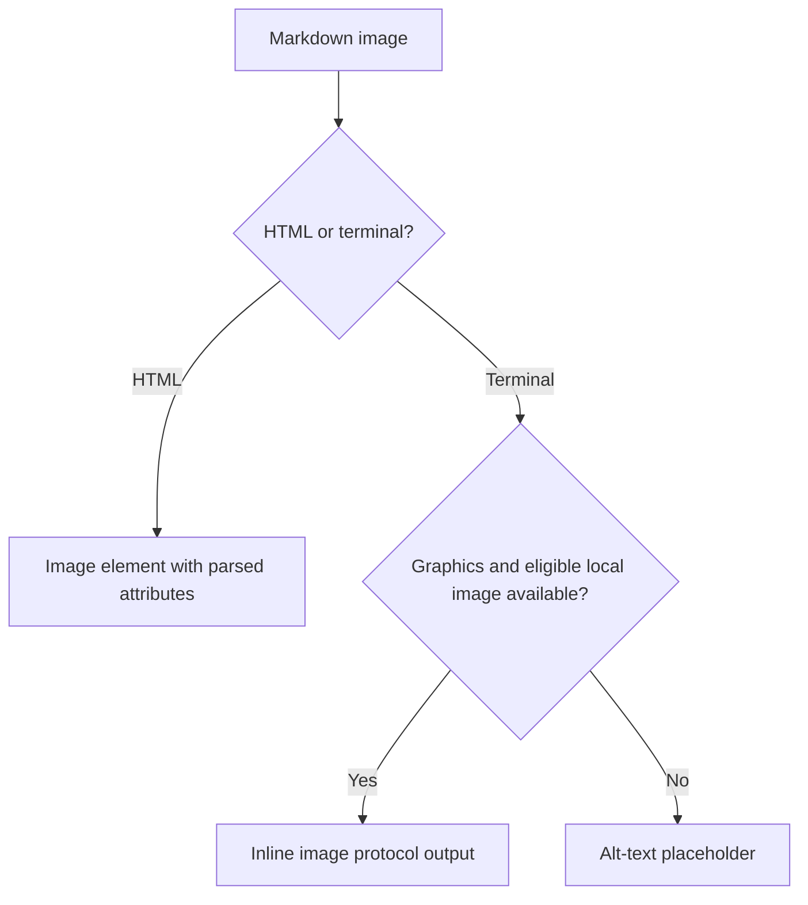

# Image Previews and References

Darkmatter renders Markdown image references as browser images or terminal
previews with an alt-text fallback. An image's optional title can carry either
a native tooltip or structured attributes such as CSS classes and inline
style, using the same assignment syntax as
[hyperlinks](./hyperlinking.md#put-structured-attributes-in-the-title).

## Embed an image

Use `` to embed an image. The description becomes its
alternative text, so describe what the image communicates:

```md


```

In HTML, these become `` elements with `src` and `alt` attributes. A
remote `src` is loaded by the browser when the output is viewed; that is
separate from fetching remote content during Darkmatter composition.

Render a document with:

```sh
md render guide.md
md render guide.md --output html > guide.html
```

The first command uses terminal rendering when stdout is a terminal; its
default output when piped is Markdown. See [Render](../cli/render.md).

To make an image itself a link, put the image inside a Markdown link:

```md
[](./images/full-size.png)
```

The outer link's metadata controls navigation; the inner image's metadata
controls the preview. For example:

```md
[](./images/full-size.png "target='_blank' title='Open the full-size image'")
```

## Add a native tooltip

A plain optional title becomes the image's HTML `title` attribute:

```md

```

```html

```

The browser provides its native tooltip. The alt text remains separate; a
title does not replace it.

## Add structured attributes

Use a quoted list of `property=value` assignments in the title position to
attach metadata to an image:

```md

```

The resulting image carries these attributes; attribute order and CSS
formatting may differ:

```html

```

The image authoring vocabulary is smaller than the hyperlink vocabulary:

| Property | Example | HTML behavior |
| --- | --- | --- |
| `class` | `class='diagram rounded'` | Adds CSS classes to the image. Supply the corresponding stylesheet yourself. |
| `style` | `style='width: 50%; max-width: 640px;'` | Adds parsed inline CSS. |
| `title` | `title='Request processing stages'` | Sets the native tooltip. |
| `data-*` | `data-topic='rendering'` | Adds custom data attributes with valid attribute names. Values are strings. |

Separate assignments with whitespace or commas, and quote values containing
whitespace or commas. Property names are case-insensitive. Unknown properties
are ignored, and invalid CSS is not applied. The raw assignment list is
consumed rather than displayed as the HTML tooltip; only `title='...'` sets
that tooltip.

Images do not accept `prompt` or `target` in this vocabulary. To add a prompt
or choose a browsing context, wrap the image in a hyperlink and put those
properties on the outer link. Similarly, `loading='lazy'`, `width=640`, and
`srcset='...'` are not supported assignments in an authored image title.
The larger standalone `ImageRef` API is described below.

Structured mode is inferred from an unquoted `key=` assignment inside the
title. For a literal tooltip containing an assignment, make the intent
explicit:

```md

```

JSON and JSON5 objects are not accepted as author-supplied image metadata
today. The encoded metadata package used by the Rust serializer is a
different mechanism.

## Style previews across a document

Use the frontmatter `style.images` bucket for shared presentation and
`local-style` to override local image appearance:

```md
---
style:
  images:
    alignment: center
    max-width: 80%
    local-style:
      color: green-400
      max-width: 60%
---

```

In HTML, image appearance is expressed through the render tree's CSS and
layout. In a terminal, text-layout settings control the fallback text rather
than the image protocol's pixel dimensions. Per-image title CSS merges with
the frontmatter CSS overlay and takes precedence for conflicting declarations.
Use `style='width: 50%;'` for an individual browser image's display width.

Arbitrary browser CSS is not translated into terminal graphics instructions.
See [Layouts and Style](./layouts-and-style.md#links-and-images) for the shared
style system.

## Understand terminal previews and fallback

The document renderer attempts an inline image when graphics are enabled and
the terminal supports an image protocol. If it cannot emit pixels, it retains
a text placeholder based on the image's alt text.



The current terminal image path accepts an existing relative file under its
image base directory (`TerminalOptions::base_path`, or the working directory
when unset). It rejects remote URLs, absolute paths, paths escaping that
directory, and files over its size limit. Decoding or protocol failures also
fall back to text. Thus a browser image can work while terminal output shows
its description instead; not every source form produces terminal pixels.

Library callers choose `TerminalOptions::image_mode` as `Auto`, `Never`, or
`Force`. `Never` disables image attempts. `Force` requests a graphics route
despite ordinary capability detection; it does not bypass file checks or
guarantee a successful image render. Browser tooltips and custom data
attributes have no terminal interaction.

The standalone `ImageRef::to_terminal()` helper has a different role: it
renders the alt text as an OSC 8 hyperlink to the image, or as `alt [source]`
when hyperlinks are unavailable. It does not emit image pixels.

## Resolve and validate image sources

Local image destinations use the same
[file-reference grammar](./file-referencing.md) as hyperlinks. Composition
resolves each destination from its source document before transclusion and
normalizes it for the final composed root afterwards. See
[Link Resolve](../operations/link-resolve.md) and
[Link Normalization](../inline/link-normalization.md).

Reference validation checks image targets as well as hyperlinks. A missing
local image can prevent file-based composition; use
`md compose guide.md --allow missing-image-refs` when the intended behavior is
to keep that reference and report the issue. See
[Diagnostic Policy](../cli/policy.md). Keeping a missing reference does not
create a preview or make the resource available to a browser.

## Use the Rust API

Document rendering uses `ImageRef::with_title_parsed()` to interpret the title,
copies supported attributes to an image node, and renders that node. It does
not call `ImageRef::to_html()` for every image in a document.

For a standalone image, the [`ImageRef`](../structs/ImageRef.md) API supports
more HTML state:

```rust
use darkmatter::render::{ImageLoading, ImageRef};

let image = ImageRef::new("./images/pipeline.png", "Pipeline overview")?
    .with_class("diagram")
    .with_width(640)
    .with_height(360)
    .with_loading(ImageLoading::Lazy);
let html = image.to_html();
let markdown = image.to_markdown(false);
```

The standalone model can store and serialize `srcset`, `sizes`, intrinsic
`width` and `height`, `loading`, `decoding`, `fetchpriority`, `referrerpolicy`,
classes, style, title, and custom data attributes. It requires at least one
of `src` or `srcset`. HTML import accepts these attributes; invalid typed
attribute values are ignored. ANSI escapes are stripped from alt and title
text when exporting HTML.

This full state is not the document authoring vocabulary. The current
document adapter transfers class, style, title, and custom data attributes
from parsed metadata; it does not transfer all the standalone model's image
attributes. In particular, encoding `loading` or `srcset` in a title package
does not make the document renderer emit them.

The standalone Markdown parser also recognizes an alt-text width suffix:

```md

```

`ImageRef::try_from()` removes a recognized suffix from alt text and stores it
as CSS width. Bare numbers in this parser mean pixels. This helper behavior
is not a guarantee that document HTML or terminal rendering interprets the
suffix identically. Prefer explicit title CSS for browser sizing and the
frontmatter style system for document layout.

`Markdown::image_references()` extracts Markdown images;
`inline_html_image_references()` extracts raw HTML images separately. The
ability to import an HTML `` through an API does not enable raw HTML in
normal document output: the HTML renderer escapes raw HTML. Use Markdown
image syntax when authoring rendered documents.

## Preserve metadata when serializing to Markdown

The standalone `ImageRef::to_markdown(false)` helper emits ordinary Markdown
for basic images with only alt text, a source, and an optional title. For
extended state, its default is a base64-encoded JSON package in the title.
Darkmatter can decode that package to restore the model's metadata.

| Standalone serialization setting | Extended metadata output |
| --- | --- |
| Default | Markdown with an encoded metadata title. |
| `IMAGE_REF_METADATA=inline` | Inline HTML. |
| `IMAGE_REF_METADATA=strip` | Ordinary Markdown, dropping extended metadata. |
| `to_markdown(true)` | Inline HTML regardless of the environment setting. |

An image with only `srcset` and no `src` always serializes as HTML because the
helper has no single Markdown destination to write. These policies belong to
the standalone helper; they do not guarantee preservation of every attribute
through document rendering. Other Markdown renderers may show structured or
encoded titles as native tooltip text rather than interpreting them.
