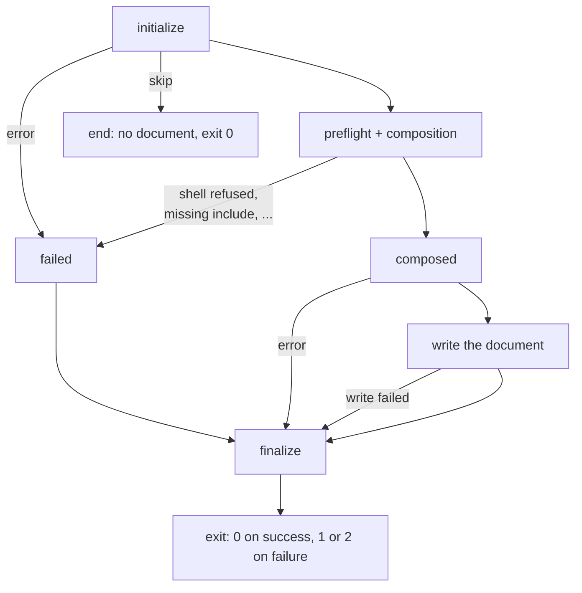
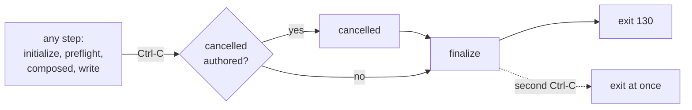
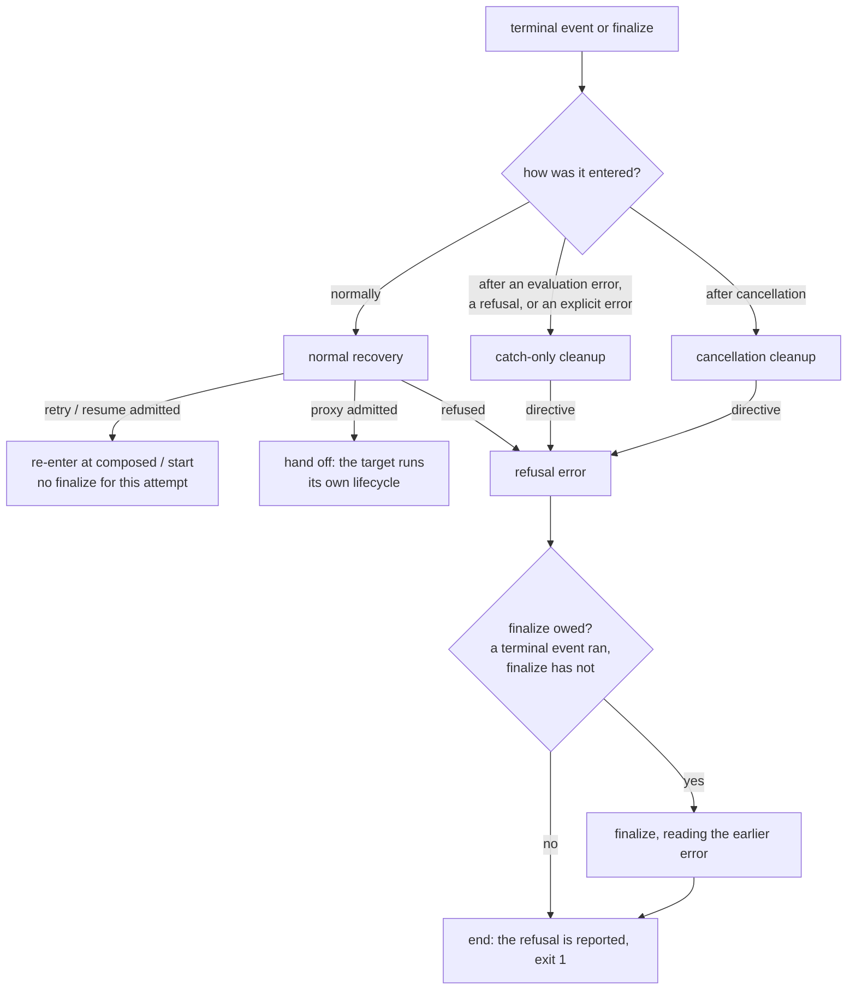

# Lifecycle Error Handling

This page explains what happens when a [lifecycle](./index.md) run goes
wrong: which event runs next, what the `err` global holds there, how an error
inside a cleanup stack is treated, what Ctrl-C does, and which exit status
`md compose` returns. The first half covers `md compose`; the second half
covers rules that only matter under a host that runs its own work and can
recover from failure, such as Claudine.

The short version for `md compose`:

| What failed | Events that run after it | Document written | Exit |
|---|---|---|---|
| The lifecycle itself is malformed, or the root cannot be read | none | no | 1 |
| An error in `initialize` | `failed`, `finalize` | no | 1 |
| Preflight: a refused shell command | `failed`, `finalize` | no | 1 |
| Preflight: unresolved references (a missing include, a broken link) | `failed`, `finalize` | no | 2 |
| An error in `composed` | `finalize` | no | 1 |
| Writing the document (for example a closed stdout pipe) | `finalize` | partly, never repeated | 1 |
| An error in `failed` or `finalize` | see [Errors inside cleanup](#errors-inside-cleanup) | — | 1 |
| Ctrl-C | `cancelled`, `finalize` | no further output | 130 |

## How failures route under `md`



### Before the run starts

`md` opens the root document and parses every stack before any action runs.
An unreadable root, malformed frontmatter, or a malformed stack (`then`
without `when`, `info: { bogus: x }`, `shell` in `initialize`, `skip` in
`composed`) is reported and nothing runs: no event fires and no cleanup stack
executes, because a stack that failed to parse cannot be trusted to clean up.

### `initialize` and preflight: `failed`, then `finalize`

An error raised in `initialize` (an explicit `error`, or an expression that
fails to evaluate) ends `initialize`, skips composition, and runs `failed`
then `finalize`. So does any failure while preparing the document: a shell
command the audit refuses, a reference that does not resolve, a lifecycle
command whose template value is missing at preflight.

```yaml
initialize:
    - when: "!file_exists('CHANGELOG.md')"
      then:
          - error: "CHANGELOG.md is missing"
failed:
    - warn: "not composed: {{ err.msg }}"
finalize:
    - info: "done"
```

Shells are still locked in that `failed` and `finalize`: preflight never
succeeded, so a `shell` action there is refused, and the refusal becomes the
run's error.

Unresolved references exit with status 2, as they do without a lifecycle.
If a cleanup error replaces that refusal as the selected error, the exit is 1.

### `composed` and the document write: `finalize` without `failed`

`failed` means "composition or preflight failed". Once `composed` fires, both
have succeeded, so `md` never runs `failed` after it. An error in the
`composed` stack, or a failure writing the document, runs `finalize` and
exits 1.

```yaml
composed:
    - error: "refusing to publish"   # no document is written
failed:
    - info: "never runs here"
finalize:
    - warn: "{{ err.msg }}"          # prints: refusing to publish
```

An error in `composed` happens before the write, so no document is written.
A failed write may leave part of the document on stdout; it is neither rolled
back nor repeated.

### Errors inside cleanup

`failed` and `finalize` are cleanup. An error raised inside one **replaces**
the run's selected error, and cleanup never starts over:

- an error in `failed` ends `failed`; `finalize` runs next and reads the new
  error; `failed` does not run again;
- an error in `finalize` ends `finalize`; nothing else runs; the run exits 1
  with that error.

```yaml
failed:
    - error: "cleanup broke"
finalize:
    - info: "{{ err.msg }}"     # prints: cleanup broke
```

## Cancellation

Ctrl-C stops the run wherever it is. No further normal actions run and no
further document output is written. The authored `cancelled` stack runs, then
`finalize`; without a `cancelled` stack, `finalize` runs alone. The exit
status is 130.



- Cleanup errors are still reported, but the exit stays 130.
- Shells unlock only when `composed` is entered. Interrupted before that,
  `cancelled` and `finalize` cannot run a shell either.
- Composition cannot be stopped midway: an interrupt during composition takes
  effect when composition returns, and its result is discarded.
- An interrupt during `finalize` lets that `finalize` finish; it does not run
  twice.
- A second Ctrl-C exits immediately, cutting cleanup short.
- Output already written before the interrupt stays written.

`cancelled` can only clean up. Its one flow verb is `stop`; `skip` and
`error` there are parse errors.

```yaml
cancelled:
    - warn: "interrupted: {{ err.msg }}"
finalize:
    - info: "closed"
```

## The `err` global

`err` is the failure the run is handling. It is read as a global, never from
frontmatter.

| Event | `err` |
|---|---|
| `initialize` | unavailable (reason `lifecycle.no-error-before-composition`) |
| `composed` | unavailable (reason `lifecycle.composition-succeeded`) |
| `failed` | the failure |
| `cancelled` | the cancellation cause |
| `finalize` | the selected failure, or `null` when nothing failed |

Reading `err` where it is unavailable is an evaluation error that names the
scope and the reason; it never falls back to a frontmatter property called
`err`. That error is handled like any other error in that event, so in
`initialize` it routes to `failed`. To read a document property named `err`,
write `fm.err`.

```yaml
finalize:
    - when: "err"
      then:
          - warn: "failed: {{ err.msg }}"
      else:
          - success: "composed"
```

### Fields

| Field | Meaning |
|---|---|
| `msg` | A concise, single-line message. Always present. Safe to print; do not branch on it. |
| `code` | A stable dotted code such as `composition.invalid_file_reference`. |
| `category` | The coarse domain: the dotted prefix of `code`. |
| `disposition` | How to handle it: `transient`, `throttled`, `correctable`, `needs_input`, or `unrecoverable`. |
| `origin` | Who must fix it: `provider`, `author`, `caller`, `environment`, or `internal`. |
| `severity` | `info`, `warning`, or `error`. |
| `detail` | The code's payload object; every field the code declares is present, `null` when unknown. |
| `is_transient`, `is_throttled`, `is_correctable` | Booleans derived from `disposition`. |
| `reset_at`, `retry_after_ms` | Shortcuts into `detail`, or `null`. |
| `cause` | The next diagnostic in the chain, or `null`. |

Every field but `msg` is present only when the host can classify the failure.
`md` does not classify failures yet, so under `md compose` those fields are
`null` and `msg` is the field to use. Under a host that classifies, branch on
the stable fields:

```yaml
# under a classifying host
failed:
    - when: "err.code == 'composition.invalid_file_reference'"
      then:
          - warn: "a link is broken: {{ err.msg }}"
```

## Host-level rules

The rules below only come into play under a host that does its own work
between `composed` and `finalize` and supports recovery directives (`retry`,
`resume`, `proxy`). They are Darkmatter's engine rules, and every host that
uses the engine gets them. Claudine is the example throughout, so events are
shown with both names where Claudine renames them: `composed` (`start`) and
`failed` (`blocked`). Under `md` none of this is reachable: `md` has no
recovery directives and no work that can fail after `composed` except the
document write.

### Which event a failure selects

The host reports where a failure happened, and the engine picks the event:
before the host's operation started, the failure is a preparation failure and
selects `failed` (`blocked`); afterwards, it selects the host's failure
outcome (`failure`).

| Failure | Event |
|---|---|
| Composition, preflight, or a host check inside the run (a refused shell, launch-schema validation, agent resolution, a missing include) | `failed` (`blocked`) |
| An internal setup failure before the operation started (materialization, parsing a hand-off target) | `failed` (`blocked`) |
| A refused hand-off or a refused recovery before the operation started, even after `composed` (`start`) fired | `failed` (`blocked`) |
| Building the launch, after `composed` (`start`) | `failure` |
| A `resume` refused because the session no longer matches | `failure` |
| The operation fails, or its completion check fails | `failure` |
| A refused hand-off or recovery after the operation started | `failure` |

A host check made before the run starts fires no event when it fails. The
check site chooses this boundary (`CheckStage::BeforeRun` or `InRun`); the
check's name does not decide it. For example, Claudine's initial provider
selection can fail before `initialize`, whereas provider selection reached
inside an active sequence is an in-run preflight failure. Only the latter
routes through `blocked` and `finalize`.

Because of the third row, `failed` (`blocked`) can follow `composed`
(`start`) under such a host. It never does under `md`.

An error raised in a stack, rather than reported by the host, routes this way
under a host with a failure outcome:

| Error raised in | Next events |
|---|---|
| `initialize` | `failure`, `finalize` (under `md`: `failed`, `finalize`) |
| `composed` (`start`) | `failure`, `finalize` (under `md`: `finalize`) |
| `failed` (`blocked`), explicit `error` or evaluation error | `failure`, `finalize` |
| the success outcome, explicit `error` | `failure`, `finalize` |
| the success outcome, evaluation error | `finalize` only; exit 1 |
| `failure` | `finalize` |
| `finalize` | nothing; exit 1 |
| an iteration gate (`loop`) | nothing; exit 1 |

### Terminal downgrade

A run has one terminal slot. An explicit `error` in the success outcome or in
`failed` (`blocked`) moves that slot to the failure outcome, and the
`failure` stack runs. Communications the first stack already sent are not
undone. A host declares which downgrades it allows when it registers its
outcome pair.

### Recovery modes

The engine, not the host, decides from how an event was entered whether a
recovery directive in it counts:

| Mode | When | Recovery directives |
|---|---|---|
| Normal recovery | A terminal event (`failed`, `failure`, `success`) or `finalize` reached normally | Requested from the host, which admits or refuses them against its budgets |
| Catch-only cleanup | `failed`/`failure`/`finalize` reached because an expression failed, a directive was refused, or an explicit `error` was raised | Refused and reported as an error |
| Cancellation cleanup | `cancelled` and `finalize` after cancellation | Refused and reported; the run stays cancelled |

In catch-only cleanup, a later error replaces the earlier one.

`failed` (`blocked`) reached from preflight has nothing to retry or resume
and no document to hand off from, so `retry`, `resume`, and `proxy` there are
refused (a `retry` or `resume` that asks for zero attempts is ignored).



The diagram shows a document. Claudine's sequence and group containers route
some refusals through `failure` first (see the link at the end of this page).

### `finalize` is not an unconditional `finally`

`finalize` closes a lifecycle once per loop iteration. It runs after
success, failure, `break`, and cancellation (after `cancelled`). The
exceptions are exactly `skip`, `proxy`, `retry`, and `resume`:

- `skip` (only in `initialize`) ends the run with no `finalize`.
- An admitted `retry` or `resume` from a terminal event re-enters at once,
  without running the current attempt's `finalize`. The lifecycle continues,
  and `finalize` runs when it ends.
- An admitted `proxy` from a terminal event hands off before the source's
  `finalize`, which never runs; the target runs its own lifecycle.
- A recovery chosen inside `finalize` happens after that `finalize` ran. The
  next attempt runs its own events through its own `finalize`; the old
  attempt never gets a second one.
- An error inside `finalize` never runs `finalize` again.

A refused recovery in a document runs only a `finalize` the run already
owes, and that `finalize` reads the error selected before the refusal; the
refusal is reported afterwards. A recovery
refused before any terminal event ran, such as a `resume` in `start` before
anything launched, ends the run with exit 1 and no `finalize`. A hand-off
target whose own lifecycle fails to parse also ends the run with no further
events.

### Re-entry

- `retry` and `resume` re-read and re-audit the document without a second
  `initialize`.
- A new loop iteration re-enters at `composed` (`start`) using the plan
  already audited.
- An adopted `proxy` starts a fresh lifecycle for the target: a new
  `initialize`, with shells locked again until its `composed` (`start`).

Claudine's sequence and group containers add their own routing for refused
recoveries; see
[Claudine's Composition Lifecycle](../../../../claudine/docs/topics/flow-control/lifecycle.md).
