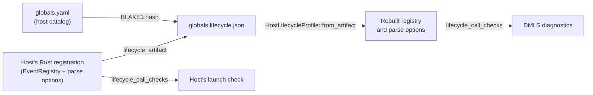

# Host Lifecycle Artifacts

A host that runs Darkmatter lifecycle stacks can name its own events, rename
Darkmatter's, decide which globals each event may read, and accept verbs the
`md` host ignores. Claudine does all four: `composed` is `start`, `failed` is
`blocked`, it adds `success`, `failure`, and `loop`, and its stacks may
`say`, `retry`, or `proxy`. The editor (DMLS) cannot run the host's Rust
registration, so the host writes that registration down as data: a **host
lifecycle artifact**, a JSON file beside the host's global catalog. DMLS reads
it and types every lifecycle expression with the host's events and verbs,
through the same library walk the host's runtime uses.

With Claudine's artifact in place, the editor shows exactly what a Claudine
launch reports for this document (with `[expressions] strict = true` the
second call is a `dm.expression.uncertain_call` warning, and the first is
silent):

```yaml
---
$schema:
  count: number
count: 1
success:
  - when: count
    then:
      - say: "{{ min(count, 5) }}"   # silent: the guard proves `count` present
      - set:
          count: 7
      - say: "{{ min(count, 6) }}"   # warns: the write ended the guard's fact
---
```

Without the artifact, DMLS knows only the `md` host: `success` is ordinary
frontmatter, `say` is a verb `md` ignores, and both calls warn.

## Where the artifact lives

The artifact is named after its catalog: `<catalog stem>.lifecycle.json`
beside the catalog file. Claudine's are `claudine/schemas/globals.yaml` and
`claudine/schemas/globals.lifecycle.json`. DMLS finds host catalogs in a
document's schema roots (package, package area, `base_dir()`, `SCHEMAS_DIR`,
`~/schemas`), so a Claudine prompt anywhere in the `claudine/` package area
gets Claudine's lifecycle.



The first host catalog in the document's schema roots whose artifact is
usable decides the document's host. A catalog file name in an earlier root
shadows the same name in a later one, as it does for globals.

## What the artifact records

| Field | What it carries |
|---|---|
| `events` | Darkmatter's five events (each with the host's spelling as `name`), then the host's own in registration order, with `position` and `role`, the admitted action types, and the event's globals view (`scope` and each declaration's `root`, `description`, and `availability`) |
| `outcome_pair` | The host's success and failure alternatives and the explicit-error downgrades, or `null` |
| `host_globals` | The late globals the host adds after `err` and `timing` (Claudine's `loop` and `group`) |
| `global_catalog` | Whether the host types those globals with the catalog beside the artifact |
| `unknown_verbs` | `"reject"`, `"ignore"`, or `{ "ignore_unprovided": [verbs] }` |
| `effects` | The effect names the host accepts in a literal `effect` operand |
| `catalog_hash`, `format_version` | The BLAKE3 hash of the catalog's bytes, and the format (`1`) |

An availability is `"available"`, `"execution-dependent"`, or
`{ "unavailable": { "code": "claudine.event-has-no-error", "parameters": {} } }`.
The writer sorts every object's keys, pretty-prints, and ends with one
newline, so the same registration always writes the same bytes. An effect
name matches when its lowercase letters and digits equal a recorded name's
(`Electronic_Hit_FX1` matches `electronic-hit-fx1`), the rule Playa's own
lookup falls back to.

## Writing it from a host

The host passes its parse options (which hold its registry), the effect names
it knows, and the catalog's text to one call:

```rust
let text = darkmatter::lifecycle::host_profile::lifecycle_artifact(
    &parse_options,             // the host's LifecycleParseOptions
    playa::SoundEffect::all_names(),
    HOST_CATALOG_TEXT,          // the catalog's bytes
);
```

Commit the result beside the catalog, and add a test that compares it with
the committed file. Claudine's is
`claudine/lib/tests/l1/host_catalog.rs::lifecycle_artifact`, and
`just regen-lifecycle-artifact` in `claudine/` rewrites the file. Regenerate it
whenever the catalog, the registration, or the effect catalog changes.

## Reading it

`HostLifecycleProfile::from_artifact(catalog, path, text, artifact)` rebuilds
the registry through the same registration calls a host makes (`rename`,
`register`, `register_outcome_pair`, `declare_host_global`, `validate`), so a
registration the artifact cannot carry fails exactly as it would in the host.
`profile.parse_options(None)` gives the host's `LifecycleParseOptions`, and
`profile.registry()` its `EventRegistry`; pass both to
`parse_lifecycle_config_with` and `lifecycle_call_checks`.
`schemas::catalog::host_lifecycle_profiles(context)` does the discovery for a
document. Reading is passive: nothing in a profile runs. Each call reads the
schema roots' files and looks each one up by its path, content hash, and
artifact; a file seen before with the same bytes, catalog or not, is not
parsed again.

The reader is strict. Each of these makes the whole profile unusable, with a
reason naming the file:

- the file is absent or unreadable;
- it is not strict JSON (a duplicate key or trailing content counts);
- `catalog_hash` is not the hash of the catalog beside it, so the catalog
  changed after the artifact was written (regenerate it);
- `format_version` is unknown, or a field is missing, unknown, or of the
  wrong type;
- the registration is refused, such as an outcome alternative naming an event
  the artifact does not list.

## What the editor does without a usable artifact

DMLS then analyzes the document's stacks as the `md` host's and puts one
`dm.lifecycle.incomplete_analysis` warning at the top of the document, per
host catalog, with the reason. It never claims a narrowing it cannot prove: a
host-only event is plain frontmatter and is checked unguarded, and a verb `md`
ignores contributes no guarded surface.

## Limits

- Under a host that renames an event, Darkmatter's spelling (`composed` or
  `failed` under Claudine) is not a stack. The host refuses such a document
  before anything runs, so its values are checked as plain frontmatter, and
  the rest of the document's lifecycle is not narrowed either, because the
  host's parser refuses the whole document.
- Hover inside a `then:`/`else:` body shows the declared type, not the
  guarded one; only call diagnostics are narrowed.

## See Also

- [Lifecycle](index.md) — events, hosts, and registration
- [Host Expression Functions](../host-functions.md) — the facts artifact, the
  same design for host functions
- [DMLS diagnostics](../../dmls/docs/diagnostics.md)
