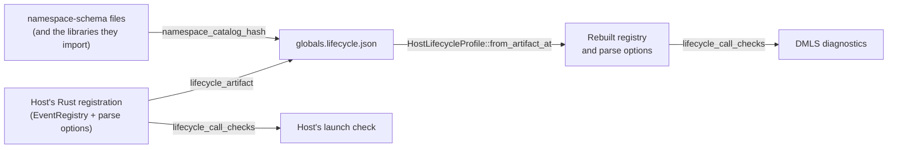
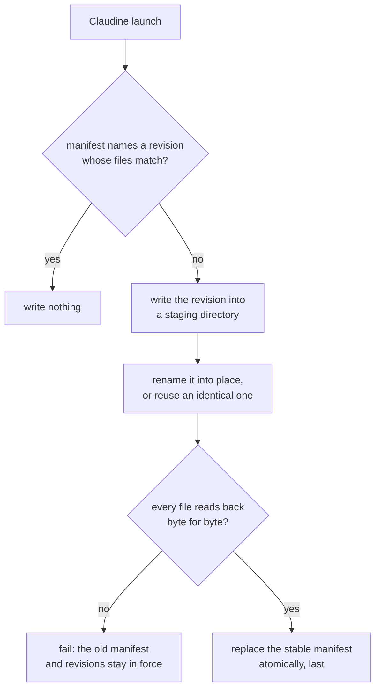

# Host Lifecycle Artifacts

A host that runs Darkmatter lifecycle stacks can name its own events, rename
Darkmatter's, decide which globals each event may read, and accept verbs the
`md` host ignores. Claudine does all four: `composed` is `start`, `failed` is
`blocked`, it adds `success`, `failure`, and `loop`, and its stacks may
`say`, `retry`, or `proxy`. The editor (DMLS) cannot run the host's Rust
registration, so the host writes that registration down as data: a **host
lifecycle artifact**, a JSON file in the host's registration bundle. DMLS reads
it and types every lifecycle expression with the host's events and verbs,
through the same library walk the host's runtime uses.

With Claudine's artifact in place, the editor shows exactly what a Claudine
launch reports for this document (with `[expressions] strict = true` the
second call is a `dm.expression.uncertain_call` warning, and the first is
silent):

```yaml
---
$schema:
  count: number
count: 1
success:
  - when: count
    then:
      - say: "{{ min(count, 5) }}"   # silent: the guard proves `count` present
      - set:
          count: 7
      - say: "{{ min(count, 6) }}"   # warns: the write ended the guard's fact
---
```

Without the artifact, DMLS knows only the `md` host: `success` is ordinary
frontmatter, `say` is a verb `md` ignores, and both calls warn.

## Where the artifact lives

The artifact is one member of a host's [registration bundle](../host-registration.md):
the manifest's `lifecycle` field names it, and its digest is listed with
every other member. A document gets the host's lifecycle only when a usable
registered host's trigger matches it, wherever the document lives. Nothing in
a schema root names a host: a `globals.yaml` with a `globals.lifecycle.json`
beside it, left there by an older host install, is an ordinary pair of files.



## Shipping it with a host registration

```yaml
# ~/.acme/registration/manifest.yaml
kind: darkmatter-host
format_version: 2
host: acme
# …
files:
    - ./schemas/run.yaml           # kind: namespace-schema
lifecycle: ./globals.lifecycle.json
# digests: one per member
```

The loader holds the artifact to the rules [below](#reading-it), and two
more: the artifact's recorded host must equal the manifest's `host`, and a
stale, missing, or refused artifact refuses the **whole** registration with a
`dm.host.registration` warning (no partial lifecycle, globals, or triggers
are used). See
[How a registration loads](../host-registration.md#how-a-registration-loads).

Claudine publishes its registration itself on every launch, from the files
compiled into its binary, so the files the manifest names always match the
running release. Claudine still writes a format 1 manifest, which this reader
refuses; publishing format 2, with Claudine's globals as namespace files, is
**planned**. Its publication rules stay:

- Every release's files go into an **immutable revision directory** named
  after the host version and a BLAKE3 digest of the files' contents
  (`~/.claudine/darkmatter-host/0.1.0-<digest>/schemas/`). The directory is
  written under a staging name and renamed into place whole, and a directory
  with a final name is never written to again.
- The **stable manifest**, `~/.claudine/darkmatter-host.yaml`, names one
  revision. It is replaced atomically and **last**, only after the revision's
  files read back byte for byte, so a reader never pairs a new trigger with
  an old catalog or artifact.
- An existing revision whose files differ from the expected bytes is left
  alone and the release is published under the next suffixed name
  (`<version>-<digest>-2`). Old revisions are kept for readers still holding
  an older manifest.
- When the manifest already names a revision that verifies, nothing is
  written.



## What the artifact records

| Field | What it carries |
|---|---|
| `events` | Darkmatter's five events (each with the host's spelling as `name`), then the host's own in registration order, with `position` and `role`, the admitted action types, and the event's globals view (`scope` and each declaration's `root`, `description`, and `availability`) |
| `outcome_pair` | The host's success and failure alternatives and the explicit-error downgrades, or `null` |
| `host_globals` | The late globals the host adds after `err` and `timing` (Claudine's `loop` and `group`) |
| `global_catalog` | Whether the host types those globals with its namespace catalog; when `true`, every `host_globals` name must be a namespace the bundle declares |
| `unknown_verbs` | `"reject"`, `"ignore"`, or `{ "ignore_unprovided": [verbs] }` |
| `effects` | The effect names the host accepts in a literal `effect` operand |
| `catalog_hash`, `format_version` | The hash of the namespace catalog the artifact was generated for, and the format (`2`) |

`catalog_hash` is `config::registration::namespaces::namespace_catalog_hash`
of a map from each namespace file, and each bundled file its preparation
read, to the BLAKE3 digest of its bytes (`namespaces::member_digest`), keyed
by bundle-relative path. Editing a namespace file, or a library one imports,
makes the artifact stale. A format 1 artifact, which hashed a single
`globals.yaml`, is refused.

An availability is `"available"`, `"execution-dependent"`, or
`{ "unavailable": { "code": "claudine.event-has-no-error", "parameters": {} } }`.
The writer sorts every object's keys, pretty-prints, and ends with one
newline, so the same registration always writes the same bytes. An effect
name matches when its lowercase letters and digits equal a recorded name's
(`Electronic_Hit_FX1` matches `electronic-hit-fx1`), the rule Playa's own
lookup falls back to.

## Writing it from a host

The host passes its parse options (which hold its registry), the effect names
it knows, and the namespace catalog's hash to one call:

```rust
use std::collections::BTreeMap;
use darkmatter::config::registration::namespaces::{member_digest, namespace_catalog_hash};

let digests = BTreeMap::from([("schemas/run.yaml".to_string(), member_digest(RUN_NAMESPACE.as_bytes()))]);
let text = darkmatter::lifecycle::host_profile::lifecycle_artifact(
    &parse_options,             // the host's LifecycleParseOptions
    playa::SoundEffect::all_names(),
    &namespace_catalog_hash(&digests),
);
```

`namespaces::prepare_catalog` returns the same map and hash after preparing
the namespace files, so a host can generate both from one preparation.
Commit the result in the bundle, and add a test that compares it with the
committed file. `just regen-lifecycle-artifact` in `claudine/` rewrites
Claudine's. Regenerate it whenever a namespace file, a library it imports,
the registration, or the effect catalog changes.

## Reading it

`HostLifecycleProfile::from_artifact_at(catalog, catalog_hash, path, artifact)`
rebuilds the registry through the same registration calls a host makes
(`rename`, `register`, `register_outcome_pair`, `declare_host_global`,
`validate`), so a registration the artifact cannot carry fails exactly as it
would in the host. The registration loader calls it with the prepared
namespace catalog and its hash, from the artifact's verified bytes;
`RegisteredHostProfile::lifecycle()` is the result.
`profile.parse_options(None)` gives the host's `LifecycleParseOptions`, and
`profile.registry()` its `EventRegistry`; pass both to
`parse_lifecycle_config_with` and `lifecycle_call_checks`. Reading is
passive: nothing in a profile runs. The profile owns everything it loaded
(its registry, catalog, host-global names, and ignored verbs), so dropping
the last holder of the profile or its registry releases them.

The reader is strict. Each of these makes the whole profile unusable, with a
reason naming the file:

- the file is absent or unreadable;
- it is not strict JSON (a duplicate key or trailing content counts);
- `catalog_hash` is not the hash of the namespace catalog that was loaded,
  so a namespace file changed after the artifact was written (regenerate it);
- `format_version` is not `2`, or a field is missing, unknown, or of the
  wrong type;
- `global_catalog` is `true` and a `host_globals` name is not a declared
  namespace;
- the registration is refused, such as an outcome alternative naming an event
  the artifact does not list.

## What the editor does without a usable artifact

A registration whose artifact is unusable is refused as a whole, so DMLS
analyzes the documents its triggers would have matched as `md` documents and
reports the registration's `dm.host.registration` warning. It never claims a
narrowing it cannot prove: a host-only event is plain frontmatter and is
checked unguarded, and a verb `md` ignores contributes no guarded surface.

## Limits

- Under a host that renames an event, Darkmatter's spelling (`composed` or
  `failed` under Claudine) is not a stack. The host refuses such a document
  before anything runs, so its values are checked as plain frontmatter, and
  the rest of the document's lifecycle is not narrowed either, because the
  host's parser refuses the whole document.
- Hover inside a `then:`/`else:` body shows the declared type, not the
  guarded one; only call diagnostics are narrowed.

## See Also

- [Lifecycle](index.md) — events, hosts, and registration
- [Host Registration](../host-registration.md) — the manifest that names
  this artifact, and how a registered host is chosen for a document
- [Host Expression Functions](../host-functions.md) — the facts artifact, the
  same design for host functions
- [DMLS diagnostics](../../../dmls/docs/diagnostics.md)
