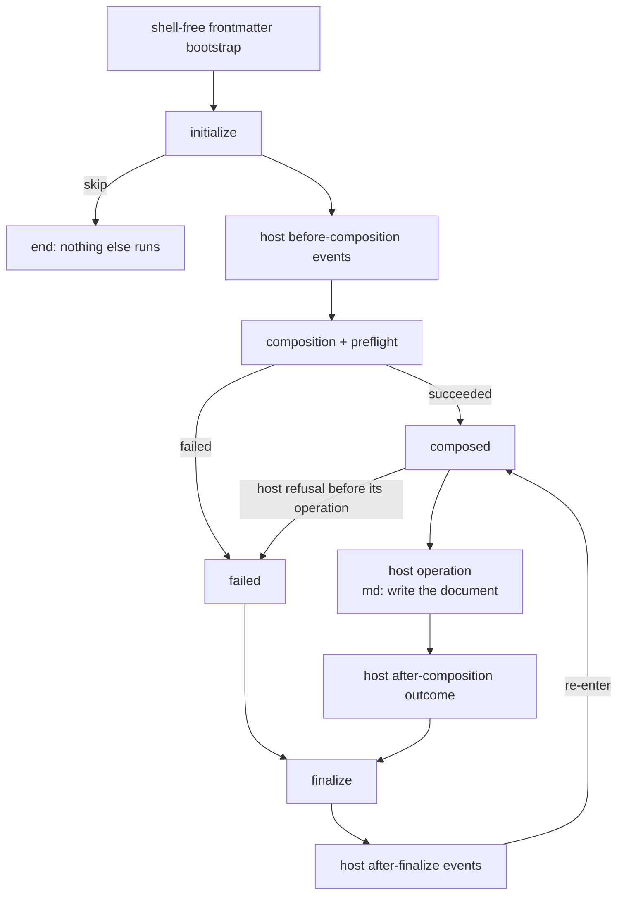
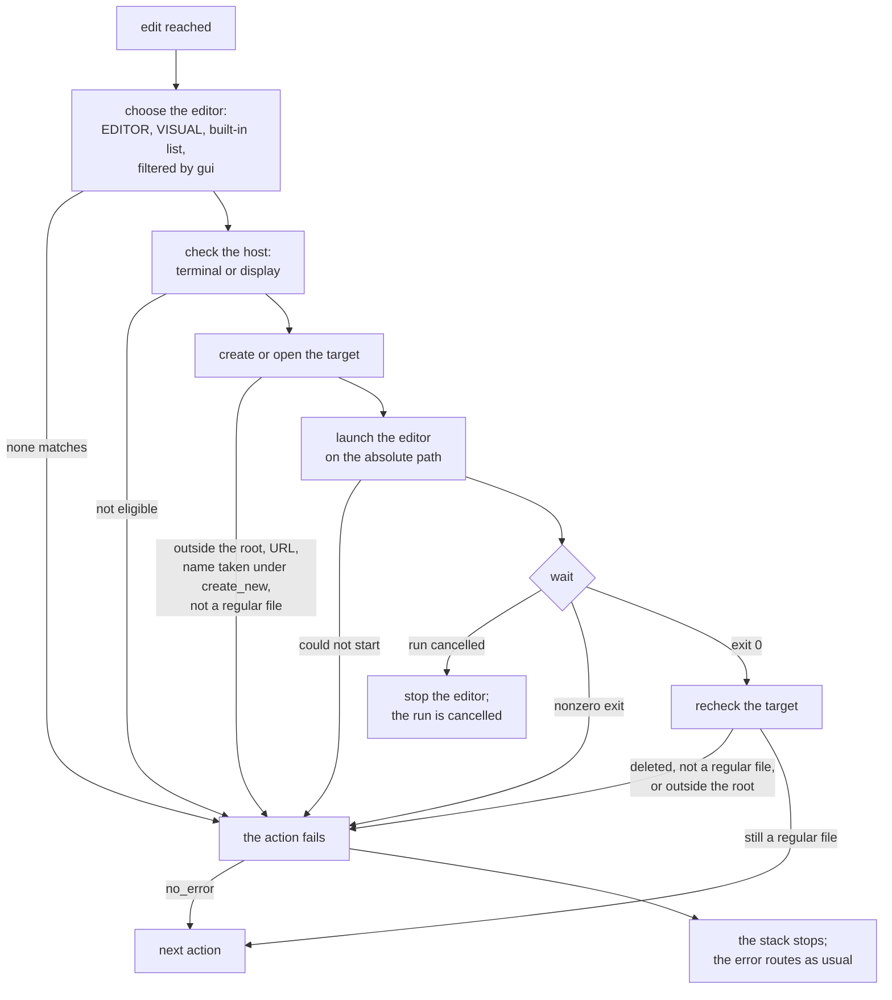

# Lifecycle Events

A **lifecycle event** is a frontmatter key whose value is a list of actions
that run at a fixed moment of a document's run: before composition, after it,
when it fails, when it is interrupted, and at the very end. With them you can
check a precondition before composing, print a status line, run an approved
command once the document is composed, or clean up whatever happened.

```yaml
---
title: Weekly report
initialize:
    - when: "!file_exists('CHANGELOG.md')"
      then:
          - error: "CHANGELOG.md is missing"
composed:
    - info: "composed {{ title }}"
    - shell: "git status --short"
failed:
    - warn: "could not compose {{ title }}: {{ err.msg }}"
finalize:
    - info: "done"
---
# {{ title }}
```

`md compose report.md` runs those stacks around composition. Nothing else
runs them: `md render`, schema validation, the editor, and the library's
compose API treat the same keys as data (see
[Passive surfaces](#passive-surfaces-run-nothing)).

Darkmatter owns the event grammar and the engine that runs it. A program that
embeds Darkmatter and drives a run is a **host**. `md compose` is one host;
Claudine (`claudine compose`) is another, which adds events of its own and
renames two of Darkmatter's (see [Hosts](#hosts)).

For what happens when something goes wrong (which event runs, what `err`
holds, exit codes, Ctrl-C), read [Lifecycle Error Handling](./error-handling.md).

## Darkmatter's five events

| Event | Fires when | `err` |
|---|---|---|
| `initialize` | First. After the shell-free frontmatter bootstrap, before the body is read, schema validation, the shell audit, and composition; its effects stay done if validation then refuses the document | unavailable |
| `composed` | Composition and preflight both succeeded | unavailable |
| `failed` | Composition or preflight failed, or an `initialize` error was raised; under some hosts also a refusal before the host's own work started | available |
| `cancelled` | The run was interrupted (Ctrl-C) | depends on the run: the cancellation cause |
| `finalize` | Last, once, on success, failure, and cancellation; not after `skip` | available; `null` when nothing failed |

An omitted event, `[]`, and `{}` all mean "no actions". A document opts into a
lifecycle run by authoring at least one of these five keys.



The boxes named "host" are empty under `md`: it registers no events of its
own, its operation is writing the composed document, and nothing re-enters.

### What each event can read

Every event reads the document's frontmatter and the usual expression roots
(see [Darkmatter Expressions](../darkmatter-expressions.md)), plus two
lifecycle globals:

- `timing`: observed durations, readable in every event.
- `err`: the failure the run is handling. Its fields and its availability are
  described in [The `err` global](./error-handling.md#the-err-global).

`initialize` sees the document as the bootstrap left it: frontmatter
`$( … )` values are **not** expanded yet, because no shell has been approved.
They read as their literal text in `initialize` and as their command output
from `composed` on.

```yaml
stamp: $(git rev-parse --short HEAD)
initialize:
    - info: "{{ stamp }}"   # prints: $(git rev-parse --short HEAD)
composed:
    - info: "{{ stamp }}"   # prints: 3f2a9c1
```

## Writing a stack

A stack is either a **list** of actions, run in order, or a **dictionary** of
verbs, which is expanded into a list in a fixed canonical order.

```yaml
composed:                 # a list: runs top to bottom
    - stdout: "Generated by md compose"
    - info: "composed"

finalize:                 # a dictionary: one entry per verb
    info: "done"
    set: { finished: true }
```

### Lists, compact dictionaries, and named arguments

Use a list when order matters. A compact dictionary always runs `set` first,
then communication (`stdout`, `stderr`, `info`, `warn`, `success`, `message`,
`notify`, `effect`, `say`), then `shell`, then other verbs in ascending name
order, and finally its flow-control directive. A host decides which of these
verbs it provides; the [supported verbs](#what-md-runs-and-what-it-skips) still
apply under `md`. In the `finalize` dictionary above, `finished` is set before
`info` runs, regardless of their written order.

The short form supplies a verb's arguments directly. The named form is useful
for optional parameters:

```yaml
composed:
    - shell:
          command: "git status --short"
          on_error: "could not read Git status"
          no_error: true
```

A mapping under a verb is its named-argument form, except `set`, whose mapping
is always the data to write. A dictionary containing several verbs uses short
forms; put multiple named forms into separate list items. Unknown parameters
of a supported verb are errors. A dictionary at an event root cannot carry
`when`, `then`, or `else`; use a list item for a condition.

`no_error: true` tolerates an operation that fails after its arguments were
evaluated, such as a command returning a nonzero status. It does not suppress
an expression error or grant permission to execute a command. It belongs
inside a named action, as above, or beside the verbs of a compact dictionary,
where it applies to each eligible action. Do not place it beside a
conditional's `then`/`else`. It never applies to `set`, which refuses the key
(even `no_error: null`): a failed mutation stops the stack.

The flag is a literal, read when the stack is parsed and never evaluated:

| Written | Read as |
|---|---|
| omitted, or `null` | `false` |
| `true`, `false` | itself |
| boolean-like text: `"yes"`, `"no"`, `"on"`, `"off"`, `"1"`, `"0"`, any letter case | `true` or `false`, by the shared [conversion rules](../../../../simplified-schema/docs/topics/conversion.md#type-coercion) |
| a native number (`1`), a list, a mapping, or a `{{ … }}` template | error: `` `no_error` must be a boolean `` |

**Write the flag in one place.** Writing it both inside an action's long form
and beside it is an error, even when the two agree:

```yaml
composed:
    - edit: { file: notes.md, no_error: true }
      no_error: true     # error: `no_error` is set both beside `edit` and inside it
```

`md compose` refuses that document before any event fires, and `md schema
validate` and DMLS report the same error at the inner flag. They also report
the other placement errors the parser refuses: a flag beside `then`, a flag
on `set` (even `null`), and a `when` with nothing to guard.

A **filled default** is a different thing. Schema validation completes every
place an action can carry the flag with `no_error: false`, so
`{ edit: { file: notes.md } }` gains `false` both beside and inside the long
form. A filled value is never a placement: it never conflicts with a flag you
wrote, never sits beside `then`, never gives `set` a flag, and never adds an
action or changes how many verbs an item holds. Only a value you wrote, other
than `null`, counts as yours.

Omitting an ordinary event, writing `null`, or giving it `[]` or `{}` means
no actions. An explicitly written `then` or `else` body must contain an action;
those empty forms are errors in a branch. `cancelled` is different: its value
must be a stack, so use `[]` or `{}` rather than `null`.

### Conditions: `when`, `then`, `else`

A list item with `when:` runs `then:` when the expression is true and `else:`
otherwise. `then` without `when`, an empty explicit branch, and a malformed
`when` expression are parse errors. Conditionals nest at most **five** levels
deep; a sixth level is a parse error.

```yaml
finalize:
    - when: "err"
      then:
          - warn: "failed: {{ err.msg }}"
      else:
          - success: "composed {{ title }}"
```

Both branches are parsed and validated before anything runs, so an error in
an unselected branch still stops the document.

### Action types

Every action belongs to one of four types. A host declares, per event, which
types it allows.

| Type | Verbs `md` runs | Examples |
|---|---|---|
| `expression` | `set`, side-effect verbs (such as `ensure_file`), expression functions, [`edit`](#editing-a-file-edit) | `set: { stage: "done" }` |
| `communicate` | `stdout`, `stderr`, `info`, `warn`, `success`, `message` | `info: "composed {{ title }}"` |
| `flow` | `stop`, `skip`, `error` | `error: "CHANGELOG.md is missing"` |
| `shell` | `shell` | `shell: "git status --short"` |

A flow directive must be the last item in its list. `edit` is an `expression`
action even though it starts a program: it launches the user's editor through
a dedicated launcher, never through a shell, so it is allowed in `initialize`
and needs no shell approval. In a compact dictionary it runs with the other
`expression` verbs in ascending name order: after `set`, communication, and
`shell`, and before the flow directive.

### Invariants every host keeps

These rules hold whatever a host declares; no host can relax them.

- **No shell in `initialize`.** A `shell` action, and a `set` whose whole value
  is a `$( … )` command, are parse errors in `initialize`, even in a branch
  that can never run. `shell-commands` rules, cached approvals, and `no_error` cannot grant
  an exception.

  ```yaml
  initialize:
      - when: "false"
        then:
            - set: { sha: "$(git rev-parse HEAD)" }   # error: shell in initialize
  ```

- **No shell before preflight succeeded.** Shells unlock when `composed` is
  entered. A `failed`, `cancelled`, or `finalize` stack reached before that
  point cannot run one: the command is refused and the refusal is an error in
  that stack.
- **`skip` only in `initialize`.** It ends the run: nothing else fires,
  `finalize` included. `skip` anywhere else is a parse error.

  ```yaml
  initialize:
      - when: "!file_exists('input.csv')"
        then:
            - skip
  ```

- **`finalize` closes the run.** It runs once after success, failure, or
  cancellation. Under `md` the only exception is `skip`; the full rules, which
  matter for hosts with recovery, are in
  [`finalize` is not an unconditional `finally`](./error-handling.md#finalize-is-not-an-unconditional-finally).
- **`cancelled` cannot redirect the run.** Its only flow verb is `stop`;
  `skip` and `error` there are parse errors.
- **An approved command runs as approved.** See
  [Shell commands in events](#shell-commands-in-events).

## The `md` host

`md compose` fires Darkmatter's five events under their own names, and only
for the **root** document. A transcluded child never fires an event, even when
its frontmatter authors one.

### What `md` runs and what it skips

`md` runs the verbs in the [action types table](#action-types). Any other verb
is **ignored with a warning** and the rest of the stack runs. That covers
another host's verbs (Claudine's `say`, `speak`, `effect`, `notify`, `retry`,
`resume`, `proxy`, `prep`, `break`, `defer`) and verbs nobody knows:

```yaml
composed:
    - say: "starting"     # warning: `md` does not run `say`; skipped it in `composed`
    - info: "composed"    # runs
```

An ignored action is inert:

- its operand is never parsed, interpolated, or evaluated, and any command
  hidden in its payload is never audited or run;
- it warns once per occurrence the run actually reaches; an action in an
  unselected branch warns nothing;
- the exit status is unaffected.

The tolerance stops at actions `md` does run. A malformed supported action
(`info: { bogus: x }`), a supported action its event forbids (`shell` in
`initialize`, `skip` in `composed`), and a malformed structure (`then`
without `when`) are errors before any action runs. To run a document written
for another host with all of its actions, use that host.

### Output order

The composed document is written after `composed` and before `finalize`, and
it is the only thing on stdout, so `md compose doc.md > out.md` captures the
document alone. In Markdown mode, all lifecycle output goes to stderr in run
order: every communication verb (`stdout`, `stderr`, `info`, `warn`, `success`,
`message`) and the output of lifecycle commands. With a data output
(`--output json`, `json5`, `yaml`, or `toml`), stderr stays empty and the same
output goes into the payload's `lifecycle_output`, one entry per step. See the
[`md compose` reference](../../cli/compose.md#lifecycle-events) and
[Data contracts](../../cli/data-contracts.md).

```yaml
composed:
    - stdout: "before"
finalize:
    - stdout: "after"
```

```text
$ md compose doc.md 2>/dev/null
<the composed document>

$ md compose doc.md >/dev/null
before
after

$ md compose doc.md --output json
{
  "file": "doc.md",
  "outcome": "success",
  "document": "<the composed document>",
  ...
  "lifecycle_output": [
    { "stage": "composed", "step": "stdout", "text": "before" },
    { "stage": "finalize", "step": "stdout", "text": "after" }
  ]
}
```

Communication text is rendered as inline Markdown prose, so `**bold**` shows as
bold on a terminal and as `bold` when stderr is a pipe or a file. In
`lifecycle_output`, `text` holds it as authored.

### `stop`, `set`, and `skip`

- `stop` ends the current event's stack only. Composition, the document
  write, and `finalize` still happen, and the outcome is unchanged.
- `set` changes run state that later events read. It never recomposes the
  body. A `set` in `initialize` is input to the first and only composition,
  so it does reach the body:

  ```markdown
  ---
  stamp: authored
  initialize:
      - set: { stamp: "from-initialize" }
  ---
  stamp={{ stamp }}
  ```

  This composes to `stamp=from-initialize`.

  After `composed`, the body is fixed. A `set` writes run state, not the
  source file; only an explicit side-effect action writes a file.
- `skip` in `initialize` writes no document, runs no `finalize`, and exits 0.

`initialize` runs before the body is read, so a side effect there can create
a file the body includes:

```markdown
---
initialize:
    - ensure_file: ["part.md", "placeholder"]
---
::file ./part.md
```

### Shell commands in events

Lifecycle commands go through the same approval as body `::shell` commands:
the built-in blacklist, the `permissions.shell-commands` rules and exclusions, batched interactive approval, refusal when no
terminal can prompt, and the shell timeout (see
[Preflight Checks](../../inline/preflight-checks.md)). A document whose only
commands are in lifecycle stacks is still audited.

- The audit is **condition-blind**: every command in every stack is approved
  before composition, including commands in branches that may never run.
  `md compose --shell` lists them without running anything.
- An **exact** approval runs the bytes fixed at preflight. A `set` in
  `initialize` is part of what the audit sees; a `set` in `composed` cannot
  change what an exactly approved command runs.
- A **typed template** approval (`template git log {{ string }}`) fills the
  value current when the command runs, as one argument. A value outside the
  template's type, a value the document's `$schema` rejects, or a missing
  value is refused before the command starts.
- A value an enclosing `when:` proves present passes the audit even when it
  is missing at preflight; it is checked again when its branch runs.

```yaml
x: plain
composed:
    - set: { x: changed }
    - shell: "echo {{ x }}"
# shell-commands rule `exact echo plain`           -> runs `echo plain`
# shell-commands rule `template echo {{ string }}` -> runs `echo changed`
```

A refused command fails the run like any other preflight failure; see
[Lifecycle Error Handling](./error-handling.md).

### Passive surfaces run nothing

Only a host that drives a run executes a stack. These read lifecycle keys and
never run them:

- `md render` (and bare `md <doc>`), `md schema validate`, `md get`, `md toc`,
  `md hash`, and `md graph`;
- `md compose --shell`, which reports lifecycle commands next to body ones;
- the DMLS language server, which types and checks stacks in the editor;
- the library's compose API, unless the caller drives a run.

`md compose` has no dry-run mode; `--shell` is its only report-only mode.

None of these surfaces launches an editor for an [`edit`](#editing-a-file-edit)
action or creates its file or directories. They still check its shape and
types. Within a run, an `edit` in a branch that is not taken never chooses an
editor or touches the disk, although the branch's actions are still validated.

## Editing a file: `edit`

The `edit` action opens a named file in your editor and waits until you close
it; then the stack carries on with its next action. Use it when a run should
pause for a person to write something. The typical case is a "create" prompt:
it computes where a new file belongs, refuses to overwrite one that is already
there, and opens the new file for you to fill in.

```yaml
fqn: "{{ ctx.cwd }}/specs/new-widget/spec.md"
initialize:
    - when: file_exists(fqn)
      then:
        - warn: "The spec already exists: {{ fqn }}"
        - skip
      else:
        - edit:
            file: "{{ fqn }}"
            create_new: true
        - info: "The spec is ready at {{ fqn }}"
        - skip
```

On the first run the file is missing, so the `else` branch creates
`specs/new-widget/spec.md` (and its parent directories), opens it in your
editor, and waits. When you save and close the editor, `info` prints and
`skip` ends the run without composing anything. On a second run the file
exists, the `warn` branch runs, and no editor opens.

Two details make this example robust:

- **The path is absolute.** `ctx.cwd` is the directory the command was
  launched from, so `file_exists` and `edit` name the same file wherever the
  prompt itself is stored.
- **`create_new: true` is the real guarantee.** `file_exists` only chooses the
  friendly branch; another process could create the file between the check
  and the edit. `create_new` makes the action fail, without opening an editor,
  if anything holds the name by the time it creates the file.

`edit` does not compose the edited file, evaluate its contents, add it to the
frontmatter, or return its contents as a value. It also does not end the event
or the run: pair it with `skip` (as above) or `stop` when that is what you
want.

### Writing an `edit`

The short form names the file. A list with one item is the same thing:

```yaml
initialize:
    - edit: "{{ fqn }}"          # the computed path
    - edit: ["{{ fqn }}"]        # identical
    - edit: notes.md             # a file literally named notes.md
```

The operand is interpolated once, like any lifecycle operand, so a bare word
is a file name, not a property lookup: `edit: fqn` opens a file called `fqn`.

The long form adds options:

```yaml
initialize:
    - edit:
        file: "{{ fqn }}"
        create_new: true
        gui: false
        no_error: true
```

| Field | Default | Meaning |
|---|---|---|
| `file` | required | The file to open. Any local [file reference](../file-referencing.md) form is accepted. |
| `create_new` | `false` | `true` requires the action to create the file: if anything (a file, a directory, a symlink) already holds the name, the action fails before an editor opens and the entry is left untouched. With `false`, an existing file is opened and a missing one is created. |
| `gui` | omitted | `true` accepts only a GUI editor, `false` only a terminal editor; omitted or `null` accepts either. See [Which editor opens](#which-editor-opens). |
| `no_error` | `false` | Continue the stack when the edit fails; see [When an `edit` fails](./error-handling.md#when-an-edit-fails). |

The target is mandatory and must name a file:

- The path must be non-blank. Whitespace inside a non-blank path is kept.
- A native number or boolean names the file spelled by its text, as any
  `string` value converts: `edit: 5` opens `5`, `edit: true` opens `true`,
  `edit: 2.5` opens `2.5`. A `{{ … }}` template whose whole result is a
  number or boolean is still an error.
- A bare `edit`, `edit: null`, `edit: []`, a list with two items, a long form
  without `file` (or with `file: null`), and unknown fields are errors.
  `null` supplies no target, so it is never "no edit".

The flags follow the same literal rules as `no_error`: `true`/`false` or
boolean-like text (`"yes"`, `"off"`) converts; omitting a flag or writing
`null` takes its default (`create_new` and `no_error` are `false`, and `gui`
has no preference); a native number, a list, a mapping, or a `{{ … }}`
template is an error. The flags are never evaluated, while the file name is
an interpolated operand.

`md compose`, `md schema validate`, and the DMLS language server report the
same problems, located at the same property.

```yaml
initialize:
    - edit: { file: notes.md, gui: "yes" }   # valid: a GUI editor
    - edit: { file: notes.md, gui: null }    # valid: either kind of editor
    - edit: { file: notes.md, gui: 1 }       # error at `gui`: must be a boolean, got number
    - edit: "   "                            # error: the path must not be blank
    - edit: null                             # error: no target
```

`edit` is a lifecycle action only. There is no `edit()` function for `{{ }}`
expressions, and the action can appear in any event (including `initialize`)
and inside `then`/`else` branches. When a message must follow the edit, put it
in its own list item rather than beside `edit` in a compact dictionary, where
communication runs first.

### Which editor opens

`edit` chooses an editor the same way [`md edit`](../../cli/edit.md#how-the-editor-is-chosen)
does: `$EDITOR`, then `$VISUAL`, then the first installed editor from a
built-in list. Because the action waits for the editor to close, it only
chooses an editor it can wait for: a terminal editor, a GUI editor launched
with its wait flag (`code --wait`, `kate --block`), or a command it does not
recognize (such as your own wrapper script), which is trusted to wait. A GUI
editor that has no wait flag (Geany, Lapce) is never chosen.

`gui` narrows the choice to one kind of editor. Resolution walks the same
order and skips every candidate of the other kind. Two kinds of candidate
never match an explicit `gui`, because Darkmatter cannot prove which surface
they will use: editors that can run either way (Emacs opens a window when a
display exists and runs in the terminal otherwise) and unrecognized commands.
With `gui` set, the built-in list is searched even when `$EDITOR` or `$VISUAL`
is set, since you asked for a kind of editor they do not provide.

```text
EDITOR=nvim  VISUAL=code
edit: { file: notes.md }              -> nvim notes.md        (ordinary order)
edit: { file: notes.md, gui: true }   -> code --wait notes.md
edit: { file: notes.md, gui: false }  -> nvim notes.md

EDITOR=emacs  (VISUAL unset)
edit: { file: notes.md, gui: false }  -> the first installed terminal editor, such as nvim
```

When nothing matches, the action fails with a message naming the kind of
editor requested and every candidate checked, with the reason each one was
passed over.

### What the host must provide

The editor that was chosen, not the `gui` option, decides what the running
process must provide. A terminal editor borrows the terminal the command runs
in; a GUI editor draws in its own window and only needs a desktop to draw on.
An unrecognized command, and an editor such as Emacs chosen without `gui`,
are treated as terminal editors, the cautious choice.

| | Terminal editor | GUI editor |
|---|---|---|
| Interactive terminal | required: stdin and stdout are terminals, the command runs in the terminal's foreground, and under `md compose` stderr is a terminal too | not required |
| Display session | not required | required: on Linux and WSL2, `DISPLAY` or `WAYLAND_DISPLAY` is set; macOS and Windows are assumed to have one |
| The editor's stdin | the terminal | empty |
| The editor's output | the terminal (under `md compose`, through stderr, so the composed document on stdout stays clean) | `md compose` in Markdown mode: stderr; with a data output: discarded |
| `md compose --output json` (or another data output) | refused | allowed |
| A document piped to `md compose` on stdin | refused: stdin is not yours to type into | allowed |
| A member of a parallel group (Claudine) | refused: it has no terminal of its own | allowed |
| Cancellation | stops the editor and everything it started | stops only the waiting client; see [Cancellation](#cancellation) |

Only one terminal editor can use the terminal at a time; a second one is
refused. Every check above, and the choice of editor, happens before anything
is created, so a refusal leaves no new file or directory behind.

Redirecting the composed document is the case most likely to surprise you:

```sh
md compose new-spec.md > out.md   # a terminal editor is refused: stdout is not a terminal
md compose new-spec.md            # works
```

Set `gui: true` when the run's streams cannot be lent to a terminal editor.

### Creating the file

`file` is read as a [file reference](../file-referencing.md): relative,
absolute, and prefixed forms such as `&docs/plan.md` all work, and a URL is
refused without fetching anything.

- **Where it resolves.** An existing file is found the way the document's
  other references find one. A missing plain relative name, such as
  `notes.md`, is created under the host's mutation root.
- **The mutation root.** Every target, including an absolute path, must lie
  inside the host's mutation root, the directory within which lifecycle
  actions may write; a symlink that leads outside it is refused too. Under
  `md compose` the root is the directory that holds the composed document, so
  the example above works when the prompt is stored in the launch directory or
  one of its ancestors, while a prompt kept in a sibling directory is refused.
  Claudine's root is the launch workspace.
- **A missing file** is created empty, together with any missing parent
  directories. The creation is exclusive: if another process creates the name
  first, nothing is overwritten. Without `create_new`, the action then opens
  that file as an existing one; with `create_new: true`, it fails.
- **An existing regular file** is opened as it is; its bytes are not touched
  before the editor starts.
- **A directory or another non-regular entry** at the path fails the action.

The editor receives the absolute path as a single argument, so spaces, shell
metacharacters, and a leading dash in the name reach it unchanged. Exclusive
creation only reserves the name: it does not lock the file against other
programs while you edit it.

### Waiting and returning

The action blocks until the editor exits. A terminal editor takes over the
terminal for that time, and the host gets it back, with its settings
restored, before the next action runs.

The edit succeeds when the editor exits with status 0 and the path is still a
regular file inside the mutation root. An unchanged or empty file is a
success, and so is an editor that saves by replacing the file. Whatever the
editor saved is kept byte for byte: the action does not read, trim, compose,
or re-hash it, and never rolls it back, even when the action fails.

The next action sees the edit. A later `file_exists`, `load_data`, or other
file read in the same run reads the file again rather than a value cached
before the editor opened. Frontmatter values that were already evaluated are
not recomputed.

```yaml
initialize:
    - edit: todo.yaml
    - info: "{{ length(load_data('todo.yaml', 'string[]')) }} items"   # counts what you just saved
```

A failed edit stops the stack, like any failed action, unless `no_error` is
set. The failures, and which ones `no_error` can suppress, are listed in
[When an `edit` fails](./error-handling.md#when-an-edit-fails). Quitting the
editor with an error status (Vim's `:cq`, for example) is therefore a way to
abort the rest of the stack; `no_error: true` removes that option, so keep it
for edits that are truly optional.



### Cancellation

A run can be cancelled while the editor is open: `md compose` receives an
interrupt signal, or, under Claudine, a sibling fails in a group. While a
terminal editor holds the terminal, a Ctrl-C you type goes to the editor, not
to `md`; an interrupt sent to the `md` process itself still cancels the run.

The action stops only processes it started, never an editor that was already
running:

- **A terminal editor** is started as the root of its own process tree: a
  process group on Linux and macOS, a Windows Job object on Windows. On
  cancellation the group is sent `SIGTERM`, then `SIGKILL` after two seconds
  if anything is left; on Windows the job is terminated. The host then takes
  the terminal back and restores its settings. Unsaved changes in the editor
  are lost, and the editor may leave a recovery file (such as Vim's `.swp`),
  which the action does not remove.
- **A GUI editor** is only partly owned. What the action starts is the
  waiting client (`code --wait`, for example). Stopping it ends the wait, but
  the editor's window may stay open with the file, and you can still save
  after the run has ended. Use `gui: false` when you need cancellation to stop
  the editing session completely.

Either way, bytes saved before the cancellation and a file the action created
are kept. The next action never runs, even with `no_error`, and the run is
reported as cancelled (exit 130 under `md compose`). An `edit` reached after
cancellation, in `cancelled` or in the `finalize` that follows it, does not
open an editor and fails.

On Windows, a successful edit releases the job without closing what is left in
it, so a GUI editor window that the waiting client started stays open.

### `edit` compared with similar features

| Feature | What it does | How `edit` differs |
|---|---|---|
| Claudine's wrapper `--edit` (`claudine claude --edit`) | Opens a temporary file and uses what you write as the agent's prompt | `edit` opens a named file in place and returns nothing; the file is not used as a prompt or composed |
| [`md edit`](../../cli/edit.md) | Opens a file from the command line and prints its path | Same editor choice, but `md edit` fails on a file left empty and removes a file it created; `edit` accepts an empty file and never removes one |
| `stop` | Ends the current event's stack | `edit` returns to the next action; quitting the editor with an error is what stops the stack |
| `skip` in `initialize` | Ends the run without composing or running `finalize` | `edit` never skips anything; follow it with `skip` when the run should end there |

## Hosts

A host is the program that runs a document's lifecycle. It supplies the
names, the services behind the verbs (audio, notifications, recovery), and the
work between `composed` and `finalize`. Darkmatter supplies the grammar, the
order of events, and the invariants above.

### Registering events

A host registers each of its own events with:

| Field | Meaning |
|---|---|
| name | The frontmatter key. It cannot collide with a Darkmatter event, another registered event, or a reserved root. |
| position | `before-composition` (after `initialize`), `after-composition` (after `composed`, before `finalize`), or `after-finalize`. |
| role | `notification` (an ordinary stack), `terminal-outcome` (shares the run's one terminal slot with `failed`), or `iteration-gate` (runs after `finalize` and decides whether the run re-enters). |
| globals | The globals the event may read and whether each is available, unavailable with a reason, or known only at run time (a `BindingView`). This is how a host offers or refuses `err`. |
| action types | Which of `expression`, `flow`, `communicate`, and `shell` the event allows. |

- Notification events at one position fire in registration order.
- Terminal outcomes come as a pair: the event a successful operation selects,
  the one a failed operation selects, and which events an explicit `error`
  may downgrade to the failed one. Only the selected alternative fires.
- Registration is fixed once a run starts. A stack cannot fire an event, and
  a host cannot fire one outside its position or role.

`md` registers nothing, so its terminal slot only ever holds `failed`.

### Renaming `composed` and `failed`

A host may expose `composed` and `failed` under its own names. `initialize`,
`cancelled`, and `finalize` are guarantees and keep their names; a
registration that renames them is refused.

- Each event has exactly one name per host; there are no aliases.
- In a document run by a renaming host, the Darkmatter spelling is a typed
  parse error that names the host's spelling.
- A host-only key means nothing to another host. Under `md`, `start`,
  `blocked`, `success`, `failure`, and `loop` are plain frontmatter data:

  ```yaml
  start: start-value
  finalize:
      - info: "{{ start }}"   # under md: prints start-value
  ```

### Claudine as a worked example

Claudine runs an AI agent between `composed` and `finalize`. It renames
`composed` to `start` and `failed` to `blocked`, and registers:

| Event | Position | Role | `err` |
|---|---|---|---|
| `success` | after-composition | terminal outcome (success) | unavailable |
| `failure` | after-composition | terminal outcome (failure) | available |
| `loop` | after-finalize | iteration gate | unavailable |

An explicit `error` in `success` or `blocked` downgrades the terminal slot to
`failure`. The same document, written for each host:

```yaml
# md compose report.md          # claudine compose review.md
composed:                       # start:
    - info: "composed"          #     - say: "starting the review"
failed:                         # blocked:
    - warn: "{{ err.msg }}"     #     - warn: "{{ err.msg }}"
                                # success:
                                #     - say: "review finished"
finalize:                       # finalize:
    - info: "done"              #     - info: "review closed"
```

Under Claudine a `composed:` key is an error that says to use `start`, and an
unknown verb is an error rather than a warning. Claudine records this
registration in a [host lifecycle artifact](host-artifact.md) beside its host
catalog, so the editor checks its stacks with the same events and verbs. Claudine's events, recovery
directives, and loop are documented in
[Claudine's Composition Lifecycle](../../../../claudine/docs/topics/flow-control/lifecycle.md).

### Driving a run from Rust

The `darkmatter::lifecycle` module owns parsing, action validation, ordered
execution, run accounting, failure routing, and recovery admission. It does
not depend on Claudine. A host supplies effects and application checks through
Darkmatter's interfaces; speech configuration, provider selection, and approval
prompts stay in Claudine. Claudine's lifecycle module adapts and re-exports the
shared implementation rather than carrying another parser or executor.

A host:

1. builds an `EventRegistry` (`EventRegistry::md()` for Darkmatter's five
   events; `EventRegistry::new(host)` plus `rename`, `register`, and
   `register_outcome_pair` for its own);
2. parses the root document's stacks with `parse_lifecycle_config_with` and
   `LifecycleParseOptions`, which carries the registry and the host's policy
   for verbs it does not run (`UnknownVerbPolicy`);
3. drives a `run::Run`. `Run::pending` returns the one request the run waits
   on (evaluate an event, prepare the document, perform the host operation,
   decide a recovery), the host does the work and answers with
   `Run::reply`, and `Run::cancel` starts cancellation. Each event's stack is
   evaluated through `executor::StackExecutor`, with the host's policy
   supplied by an implementation of `executor::LifecycleHost`.

`lifecycle::md_host` is a complete small host: `md_host::drive` runs the loop
above over an `MdRunHost` that supplies `event`, `prepare`, `write`, and
`interrupted`. Nothing runs unless a host calls it.

Claudine still drives its runs through the direct-call
`run_guard::LifecycleRunGuard`; moving it onto `Run`'s request/reply protocol
is **planned**. Both make the same decisions through `lifecycle::policy`.
