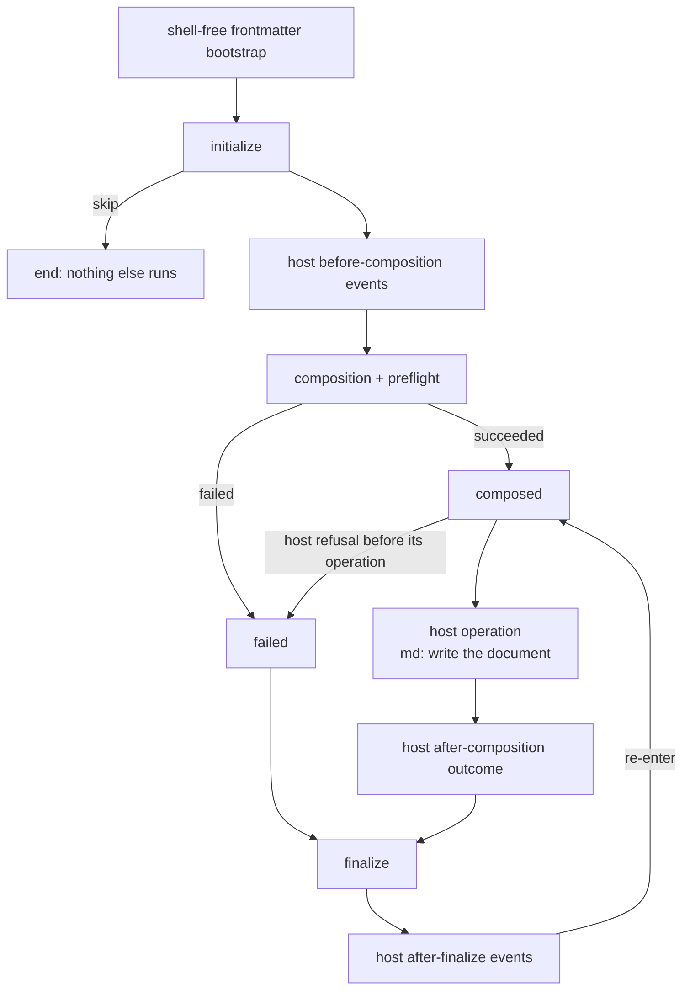

# Lifecycle Events

A **lifecycle event** is a frontmatter key whose value is a list of actions
that run at a fixed moment of a document's run: before composition, after it,
when it fails, when it is interrupted, and at the very end. With them you can
check a precondition before composing, print a status line, run an approved
command once the document is composed, or clean up whatever happened.

```yaml
---
title: Weekly report
initialize:
    - when: "!file_exists('CHANGELOG.md')"
      then:
          - error: "CHANGELOG.md is missing"
composed:
    - info: "composed {{ title }}"
    - shell: "git status --short"
failed:
    - warn: "could not compose {{ title }}: {{ err.msg }}"
finalize:
    - info: "done"
---
# {{ title }}
```

`md compose report.md` runs those stacks around composition. Nothing else
runs them: `md render`, schema validation, the editor, and the library's
compose API treat the same keys as data (see
[Passive surfaces](#passive-surfaces-run-nothing)).

Darkmatter owns the event grammar and the engine that runs it. A program that
embeds Darkmatter and drives a run is a **host**. `md compose` is one host;
Claudine (`claudine compose`) is another, which adds events of its own and
renames two of Darkmatter's (see [Hosts](#hosts)).

For what happens when something goes wrong (which event runs, what `err`
holds, exit codes, Ctrl-C), read [Lifecycle Error Handling](./error-handling.md).

## Darkmatter's five events

| Event | Fires when | `err` |
|---|---|---|
| `initialize` | First. After the shell-free frontmatter bootstrap, before the body is read, the shell audit, and composition | unavailable |
| `composed` | Composition and preflight both succeeded | unavailable |
| `failed` | Composition or preflight failed, or an `initialize` error was raised; under some hosts also a refusal before the host's own work started | available |
| `cancelled` | The run was interrupted (Ctrl-C) | depends on the run: the cancellation cause |
| `finalize` | Last, once, on success, failure, and cancellation; not after `skip` | available; `null` when nothing failed |

An omitted event, `[]`, and `{}` all mean "no actions". A document opts into a
lifecycle run by authoring at least one of these five keys.



The boxes named "host" are empty under `md`: it registers no events of its
own, its operation is writing the composed document, and nothing re-enters.

### What each event can read

Every event reads the document's frontmatter and the usual expression roots
(see [Darkmatter Expressions](../darkmatter-expressions.md)), plus two
lifecycle globals:

- `timing`: observed durations, readable in every event.
- `err`: the failure the run is handling. Its fields and its availability are
  described in [The `err` global](./error-handling.md#the-err-global).

`initialize` sees the document as the bootstrap left it: frontmatter
`$( … )` values are **not** expanded yet, because no shell has been approved.
They read as their literal text in `initialize` and as their command output
from `composed` on.

```yaml
stamp: $(git rev-parse --short HEAD)
initialize:
    - info: "{{ stamp }}"   # prints: $(git rev-parse --short HEAD)
composed:
    - info: "{{ stamp }}"   # prints: 3f2a9c1
```

## Writing a stack

A stack is either a **list** of actions, run in order, or a **dictionary** of
verbs, which is expanded into a list in a fixed canonical order.

```yaml
composed:                 # a list: runs top to bottom
    - stdout: "Generated by md compose"
    - info: "composed"

finalize:                 # a dictionary: one entry per verb
    info: "done"
    set: { finished: true }
```

### Conditions: `when`, `then`, `else`

A list item with `when:` runs `then:` when the expression is true and `else:`
otherwise. `then` without `when`, an empty explicit branch, and a malformed
`when` expression are parse errors. Conditionals nest at most **five** levels
deep; a sixth level is a parse error.

```yaml
finalize:
    - when: "err"
      then:
          - warn: "failed: {{ err.msg }}"
      else:
          - success: "composed {{ title }}"
```

Both branches are parsed and validated before anything runs, so an error in
an unselected branch still stops the document.

### Action types

Every action belongs to one of four types. A host declares, per event, which
types it allows.

| Type | Verbs `md` runs | Examples |
|---|---|---|
| `expression` | `set`, side-effect verbs (such as `ensure_file`), expression functions | `set: { stage: "done" }` |
| `communicate` | `stdout`, `stderr`, `info`, `warn`, `success`, `message` | `info: "composed {{ title }}"` |
| `flow` | `stop`, `skip`, `error` | `error: "CHANGELOG.md is missing"` |
| `shell` | `shell` | `shell: "git status --short"` |

A flow directive must be the last item in its list.

### Invariants every host keeps

These rules hold whatever a host declares; no host can relax them.

- **No shell in `initialize`.** A `shell` action, and a `set` whose whole value
  is a `$( … )` command, are parse errors in `initialize`, even in a branch
  that can never run. Whitelists, cached approvals, and `no_error` cannot grant
  an exception.

  ```yaml
  initialize:
      - when: "false"
        then:
            - set: { sha: "$(git rev-parse HEAD)" }   # error: shell in initialize
  ```

- **No shell before preflight succeeded.** Shells unlock when `composed` is
  entered. A `failed`, `cancelled`, or `finalize` stack reached before that
  point cannot run one: the command is refused and the refusal is an error in
  that stack.
- **`skip` only in `initialize`.** It ends the run: nothing else fires,
  `finalize` included. `skip` anywhere else is a parse error.

  ```yaml
  initialize:
      - when: "!file_exists('input.csv')"
        then:
            - skip
  ```

- **`finalize` closes the run.** It runs once after success, failure, or
  cancellation. Under `md` the only exception is `skip`; the full rules, which
  matter for hosts with recovery, are in
  [`finalize` is not an unconditional `finally`](./error-handling.md#finalize-is-not-an-unconditional-finally).
- **`cancelled` cannot redirect the run.** Its only flow verb is `stop`;
  `skip` and `error` there are parse errors.
- **An approved command runs as approved.** See
  [Shell commands in events](#shell-commands-in-events).

## The `md` host

`md compose` fires Darkmatter's five events under their own names, and only
for the **root** document. A transcluded child never fires an event, even when
its frontmatter authors one.

### What `md` runs and what it skips

`md` runs the verbs in the [action types table](#action-types). Any other verb
is **ignored with a warning** and the rest of the stack runs. That covers
another host's verbs (Claudine's `say`, `speak`, `effect`, `notify`, `retry`,
`resume`, `proxy`, `prep`, `break`, `defer`) and verbs nobody knows:

```yaml
composed:
    - say: "starting"     # warning: `md` does not run `say`; skipped it in `composed`
    - info: "composed"    # runs
```

An ignored action is inert:

- its operand is never parsed, interpolated, or evaluated, and any command
  hidden in its payload is never audited or run;
- it warns once per occurrence the run actually reaches; an action in an
  unselected branch warns nothing;
- the exit status is unaffected.

The tolerance stops at actions `md` does run. A malformed supported action
(`info: { bogus: x }`), a supported action its event forbids (`shell` in
`initialize`, `skip` in `composed`), and a malformed structure (`then`
without `when`) are errors before any action runs. To run a document written
for another host with all of its actions, use that host.

### Output order

The composed document is written after `composed` and before `finalize`.
`stdout` actions and the output of lifecycle commands share stdout with the
document, in run order; every other communication verb (`stderr`, `info`,
`warn`, `success`, `message`) writes to stderr.

```yaml
composed:
    - stdout: "before"
finalize:
    - stdout: "after"
```

```text
$ md compose doc.md 2>/dev/null
before
<the composed document>
after
```

On a terminal, communication text is rendered as inline Markdown prose, so
`**bold**` shows as bold. When stdout is a pipe or a file, a `stdout` action
writes its text exactly as authored, so it joins the Markdown document
unchanged:

```text
$ md compose doc.md > out.md    # composed: [{ stdout: "**draft** <!-- x -->" }]
$ head -1 out.md
**draft** <!-- x -->
```

### `stop`, `set`, and `skip`

- `stop` ends the current event's stack only. Composition, the document
  write, and `finalize` still happen, and the outcome is unchanged.
- `set` changes run state that later events read. It never recomposes the
  body. A `set` in `initialize` is input to the first and only composition,
  so it does reach the body:

  ```markdown
  ---
  stamp: authored
  initialize:
      - set: { stamp: "from-initialize" }
  ---
  stamp={{ stamp }}
  ```

  This composes to `stamp=from-initialize`.

  After `composed`, the body is fixed. A `set` writes run state, not the
  source file; only an explicit side-effect action writes a file.
- `skip` in `initialize` writes no document, runs no `finalize`, and exits 0.

`initialize` runs before the body is read, so a side effect there can create
a file the body includes:

```markdown
---
initialize:
    - ensure_file: ["part.md", "placeholder"]
---
::file ./part.md
```

### Shell commands in events

Lifecycle commands go through the same approval as body `::shell` commands:
the blacklists, the whitelist, batched interactive approval, refusal when no
terminal can prompt, and the shell timeout (see
[Preflight Checks](../../inline/preflight-checks.md)). A document whose only
commands are in lifecycle stacks is still audited.

- The audit is **condition-blind**: every command in every stack is approved
  before composition, including commands in branches that may never run.
  `md compose --shell` lists them without running anything.
- An **exact** approval runs the bytes fixed at preflight. A `set` in
  `initialize` is part of what the audit sees; a `set` in `composed` cannot
  change what an exactly approved command runs.
- A **typed template** approval (`template git log {{ string }}`) fills the
  value current when the command runs, as one argument. A value outside the
  template's type, a value the document's `$schema` rejects, or a missing
  value is refused before the command starts.
- A value an enclosing `when:` proves present passes the audit even when it
  is missing at preflight; it is checked again when its branch runs.

```yaml
x: plain
composed:
    - set: { x: changed }
    - shell: "echo {{ x }}"
# whitelist `exact echo plain`        -> runs `echo plain`
# whitelist `template echo {{ string }}` -> runs `echo changed`
```

A refused command fails the run like any other preflight failure; see
[Lifecycle Error Handling](./error-handling.md).

### Passive surfaces run nothing

Only a host that drives a run executes a stack. These read lifecycle keys and
never run them:

- `md render` (and bare `md <doc>`), `md schema validate`, `md get`, `md toc`,
  `md hash`, and `md graph`;
- `md compose --shell`, which reports lifecycle commands next to body ones;
- the DMLS language server, which types and checks stacks in the editor;
- the library's compose API, unless the caller drives a run.

`md compose` has no dry-run mode; `--shell` is its only report-only mode.

## Hosts

A host is the program that runs a document's lifecycle. It supplies the
names, the services behind the verbs (audio, notifications, recovery), and the
work between `composed` and `finalize`. Darkmatter supplies the grammar, the
order of events, and the invariants above.

### Registering events

A host registers each of its own events with:

| Field | Meaning |
|---|---|
| name | The frontmatter key. It cannot collide with a Darkmatter event, another registered event, or a reserved root. |
| position | `before-composition` (after `initialize`), `after-composition` (after `composed`, before `finalize`), or `after-finalize`. |
| role | `notification` (an ordinary stack), `terminal-outcome` (shares the run's one terminal slot with `failed`), or `iteration-gate` (runs after `finalize` and decides whether the run re-enters). |
| globals | The globals the event may read and whether each is available, unavailable with a reason, or known only at run time (a `BindingView`). This is how a host offers or refuses `err`. |
| action types | Which of `expression`, `flow`, `communicate`, and `shell` the event allows. |

- Notification events at one position fire in registration order.
- Terminal outcomes come as a pair: the event a successful operation selects,
  the one a failed operation selects, and which events an explicit `error`
  may downgrade to the failed one. Only the selected alternative fires.
- Registration is fixed once a run starts. A stack cannot fire an event, and
  a host cannot fire one outside its position or role.

`md` registers nothing, so its terminal slot only ever holds `failed`.

### Renaming `composed` and `failed`

A host may expose `composed` and `failed` under its own names. `initialize`,
`cancelled`, and `finalize` are guarantees and keep their names; a
registration that renames them is refused.

- Each event has exactly one name per host; there are no aliases.
- In a document run by a renaming host, the Darkmatter spelling is a typed
  parse error that names the host's spelling.
- A host-only key means nothing to another host. Under `md`, `start`,
  `blocked`, `success`, `failure`, and `loop` are plain frontmatter data:

  ```yaml
  start: start-value
  finalize:
      - info: "{{ start }}"   # under md: prints start-value
  ```

### Claudine as a worked example

Claudine runs an AI agent between `composed` and `finalize`. It renames
`composed` to `start` and `failed` to `blocked`, and registers:

| Event | Position | Role | `err` |
|---|---|---|---|
| `success` | after-composition | terminal outcome (success) | unavailable |
| `failure` | after-composition | terminal outcome (failure) | available |
| `loop` | after-finalize | iteration gate | unavailable |

An explicit `error` in `success` or `blocked` downgrades the terminal slot to
`failure`. The same document, written for each host:

```yaml
# md compose report.md          # claudine compose review.md
composed:                       # start:
    - info: "composed"          #     - say: "starting the review"
failed:                         # blocked:
    - warn: "{{ err.msg }}"     #     - warn: "{{ err.msg }}"
                                # success:
                                #     - say: "review finished"
finalize:                       # finalize:
    - info: "done"              #     - info: "review closed"
```

Under Claudine a `composed:` key is an error that says to use `start`, and an
unknown verb is an error rather than a warning. Claudine records this
registration in a [host lifecycle artifact](host-artifact.md) beside its host
catalog, so the editor checks its stacks with the same events and verbs. Claudine's events, recovery
directives, and loop are documented in
[Claudine's Composition Lifecycle](../../../../claudine/docs/topics/flow-control/lifecycle.md).

### Driving a run from Rust

The `darkmatter::lifecycle` module holds the engine. A host:

1. builds an `EventRegistry` (`EventRegistry::md()` for Darkmatter's five
   events; `EventRegistry::new(host)` plus `rename`, `register`, and
   `register_outcome_pair` for its own);
2. parses the root document's stacks with `parse_lifecycle_config_with` and
   `LifecycleParseOptions`, which carries the registry and the host's policy
   for verbs it does not run (`UnknownVerbPolicy`);
3. drives a `run::Run`. `Run::pending` returns the one request the run waits
   on (evaluate an event, prepare the document, perform the host operation,
   decide a recovery), the host does the work and answers with
   `Run::reply`, and `Run::cancel` starts cancellation. Each event's stack is
   evaluated through `executor::StackExecutor`, with the host's policy
   supplied by an implementation of `executor::LifecycleHost`.

`lifecycle::md_host` is a complete small host: `md_host::drive` runs the loop
above over an `MdRunHost` that supplies `event`, `prepare`, `write`, and
`interrupted`. Nothing runs unless a host calls it.

Claudine still drives its runs through the direct-call
`run_guard::LifecycleRunGuard`; moving it onto `Run`'s request/reply protocol
is **planned**. Both make the same decisions through `lifecycle::policy`.
