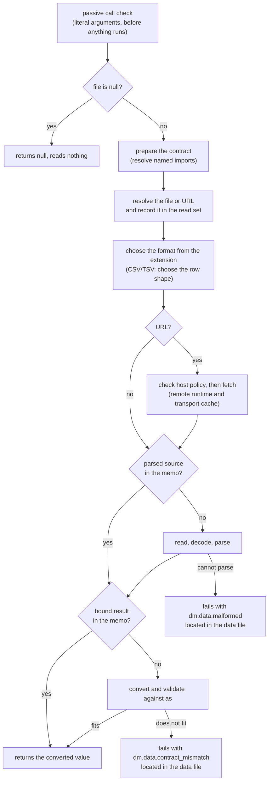

# Loading Data

`load_data(file, as)` reads a data file into an expression. The file can be
YAML, JSON, JSON Lines, CSV, TSV, TOML, or JSON5, and `as` says what shape the
data must have. The result is the parsed data, converted to that shape, or a
failure that names the place in the file where the data breaks it. A partly
valid file never produces a partial value.

Given `os.yaml`:

```yaml
- macOS
- Linux
- Windows
```

a document can list it, or build anything else an expression can build:

```md
Supported: {{ as_csv(load_data("os.yaml", "string[]")) }}

{{ map(load_data("hosts.csv", "{ name: string, port: number }[]"), h => h.name + ":" + h.port) }}
```

```text
Supported: macOS, Linux, Windows
```

The signature, catalog examples, and aliases are on the generated
[`load_data` function page](../functions/load-data.md). This page explains
what each rule means for an author.

## How a call runs

A `load_data` call is judged twice. Before anything in the document runs,
the passive [call check](../inline/call-check.md) rejects a call whose
literal arguments prove it can never work, such as a contract that is not a
container. It reads no file to do so. When the call later executes, it goes
through the steps below. A failure at any step stops there, so it never
depends on work a later step would have done.



The [memo](#reading-a-file-once-per-command) and the
[read set](#the-read-set) are described below.

## Writing `as`

`as` is a **quoted string** that holds a SimplifiedSchema type definition,
the same type language frontmatter schemas use. It is quoted because the
expression parser cannot read type syntax directly: unquoted, `string[]`
would be the variable `string` followed by an index, and `{ … }` would be an
object literal.

```md
{{ load_data("os.yaml", "string[]") }}     the contract is the text string[]
{{ load_data("os.yaml", string[]) }}       a parse error
```

Every common container form works:

| Shape | `as` | Data it accepts |
| --- | --- | --- |
| array | `"string[]"` | `["macOS", "Linux"]` |
| array of objects | `"{ name: string, port: number }[]"` | `[{name: "web", port: 8080}]` |
| object | `"{ name: string, tags: string[] }"` | `{name: "Ada", tags: ["math"]}` |
| tuple | `"tuple([string, number])"` | `["web", 8080]` |
| dictionary | `"{ <string>: number }"` | `{web: 8080, db: 5432}` |
| nullable | `"string[] \| null"` | `["macOS"]`, or an empty YAML file |

Write a tuple as `tuple([string, number])`. A bracket list such as
`[string, number]` is not a tuple in SimplifiedSchema: in a schema it means
the union `string | number`, and inside an `as` string it is rejected as
invalid syntax before anything runs.

The data is converted the way frontmatter is: `"8080"` against `number`
becomes `8080`, and a value that cannot convert without changing its meaning
is a failure. See [conversion rules](../../../simplified-schema/docs/topics/conversion.md#conversion-rules).

### `as` must be a container

`as` must describe an array, a tuple, an object, or a dictionary, or a union
whose non-null arms all do. A scalar contract such as `"string"`,
`"number"`, or `"enum(a, b)"` fails with `dm.data.not_a_container`, and so
do `"unknown"` and `"null"` alone. The full rule, with the union cases, is in
[Container types](schemas/definition.md#container-types).

When `as` is a literal, the call check rejects it before anything runs. When
`as` is computed (for example a frontmatter value `t: string` used as
`load_data(f, t)`), the call fails with the same code when it executes.

### Named types from a schema file

A contract can name a type declared in a schema file, with the usual
`Name@file` import, or a type shipped with Darkmatter, with
`Name@darkmatter:<stem>`:

```yaml
# schemas/os.yaml
kind: schema
types:
    os-list: string[]
```

```md
{{ load_data("os.yaml", "os-list@./schemas/os.yaml") }}
```

- A relative import resolves from the calling document, through the same
  schema roots as any other import, and imports inside that schema keep
  resolving from the schema file. Two documents in different folders can
  write the same text and name different files; each gets its own contract.
- The call check accepts a file import provisionally, without opening the
  schema file. The import is resolved, and the container rule applied to
  it, when the call runs. A missing or broken import fails as an evaluation
  error naming the import, not as bad data.
- `Name@this` is rejected with `dm.data.this_import_rejected`: an expression
  argument has no schema document of its own for `this` to name. Inside an
  imported schema, `Name@this` keeps its ordinary meaning.

## Formats

The format comes from the file's extension, or from the extension of a URL's
path (its `?query` and `#fragment` are ignored). Matching ignores letter
case, so `DATA.JSON` is JSON. Neither the file's content nor an HTTP
`Content-Type` header is consulted, and there is no way to override the
choice.

| Extension | Read as |
| --- | --- |
| `.yaml`, `.yml` | one YAML document, any top-level shape |
| `.json` | one JSON value, any top-level shape |
| `.jsonl`, `.ndjson` | one JSON value per line, returned as an array |
| `.csv` | comma-separated rows with a header, returned as an array (see [CSV and TSV](#csv-and-tsv)) |
| `.tsv` | tab-separated rows with a header, returned as an array |
| `.toml` | one TOML document, always a table |
| `.json5` | one JSON5 value, any top-level shape |

Any other extension fails with `dm.data.unsupported_format`.

```md
{{ load_data("events.ndjson", "{ id: number, ok: boolean }[]") }}
{{ load_data("Cargo.toml", "{ package: { name: string, version: string } }") }}
{{ load_data("config.json5", "{ hosts: string[] }") }}
```

### What every format accepts

Input that a format cannot parse fails with `dm.data.malformed`. These rules
decide the edge cases:

| Input | Result |
| --- | --- |
| a byte-order mark at the start | stripped, in every format |
| CRLF line endings | accepted, in every format |
| a local file that is not valid UTF-8 | malformed, located by byte offset |
| a zero-byte file | YAML: `null`; JSON and JSON5: malformed; JSON Lines, CSV, TSV: `[]`; TOML: `{}` |
| several YAML documents in one file | malformed |
| YAML anchors and aliases | the aliases are expanded |
| YAML custom tags (`!foo`) | malformed |
| YAML duplicate or non-string mapping keys | malformed |
| a JSON object with a duplicate key | the last value wins |
| a whole number that a 64-bit float cannot hold exactly (`9007199254740993`), in any format | malformed |
| TOML or JSON5 `nan` or infinity | malformed |
| a TOML date or time | its TOML text, as a string |
| a JSON Lines line holding only spaces, tabs, or a CR | skipped |
| a JSON Lines line that is not one JSON value | malformed, at that line |

An empty YAML file is `null`, so a contract for a YAML file that may be empty
needs a null arm: `"string[] | null"`. Number rules are described in
[Numbers](./numbers.md).

Loaded values are data. A string in the file that contains `{{ … }}`,
`$( … )`, or a directive is returned as that text, and a YAML mapping with a
`kind` or `$schema` key selects no schema; only `as` supplies the contract.

## CSV and TSV

CSV and TSV rows carry no types. The **first row is always a header**, and
the element type of `as` decides what each row becomes:

- an **object** element turns each row into an object keyed by the header;
- a **tuple or array** element turns each row into a list of cells, and the
  header row is skipped.

Given `hosts.csv`:

```text
name,port
web,8080
db,5432
```

```md
{{ load_data("hosts.csv", "{ name: string, port: number }[]") }}
{{ load_data("hosts.csv", "tuple([string, number])[]") }}
{{ load_data("hosts.csv", "{ <string>: string }[]") }}
```

```text
[{name: "web", port: 8080}, {name: "db", port: 5432}]
[["web", 8080], ["db", 5432]]
[{name: "web", port: "8080"}, {name: "db", port: "5432"}]
```

Cells are text until `as` converts them, so `"8080"` becomes a number only
where `as` asks for one. TSV uses the same quoting as CSV, with a tab as the
delimiter.

### Choosing the row shape

Every non-null arm of `as` must be an array or tuple whose elements all pick
the same row shape. Anything else fails with `dm.data.row_shape_conflict`,
which suggests `"{ <string>: string }[]"` or `"tuple([…])[]"`:

| `as` over a CSV | Result |
| --- | --- |
| `"{ name: string }[]"`, `"{ name: string }[] \| null"` | object rows |
| `"tuple([string, number])[]"`, `"string[][]"` | list rows |
| `"{ a: string }[] \| tuple([string])[]"` | conflict: the arms disagree |
| `"string[]"`, `"unknown[]"` | conflict: a scalar or `unknown` element is not a row |
| `"object"`, `"{ <string>: string }"` | conflict: a top-level object is not a list of rows |

When both `file` and `as` are literals, the call check knows the extension
and reports the conflict before anything runs.

### The strict rules

| Case | Result |
| --- | --- |
| a header-only file | `[]` |
| a duplicate or empty header name, object rows | malformed, naming the columns, on the header's line |
| a duplicate or empty header name, list rows | allowed, because the header is skipped |
| a row with more or fewer cells than the header | malformed, at that row |
| a blank line outside a quoted cell | skipped; it is never an empty header or row |
| a line holding only delimiters (`,,`) | a row of empty cells |
| an empty cell | `""`; `as` decides whether that is acceptable |
| a quoted cell holding the delimiter, a line break, or a doubled quote (`""`) | allowed |
| a quoted cell with no closing quote | malformed |
| a quote inside an unquoted cell (`ab"c`) | malformed |
| text between a closing quote and the next delimiter (`"ab"c`) | malformed |

Cells and headers are never trimmed: `name, port` has a header named
` port`. A file without a header row is not supported; its first row is
read as the header.

### How cell text converts

Cells convert with the same rules frontmatter uses. The boolean words follow
a YAML 1.1 style vocabulary, which can surprise a CSV author: `1` reads as
`true`.

| Cell | as `number` | as `boolean` | as `string` |
| --- | --- | --- | --- |
| ` 42 ` | `42` (whitespace trimmed) | fails | ` 42 ` |
| `1_000` | `1000` | fails | `1_000` |
| `1` | `1` | `true` | `1` |
| `0` | `0` | `false` | `0` |
| `yes`, `on`, `true` (any letter case) | fails | `true` | kept |
| `no`, `off`, `false` (any letter case) | fails | `false` | kept |
| empty | fails | fails | `""` |
| `1,000`, `NaN`, `0x10` | fails | fails | kept |
| `9007199254740993` | fails (not exactly representable) | fails | kept |

## Files that may be missing

There is no `try_load_data`. For a file that may be absent, test for it
first:

```md
{{ file_exists(f) ? load_data(f, "string[]") : [] }}
```

`load_data(f, "string[]") || []` does **not** recover. `||` supplies a
default for a falsy value, but a failed call is an error, not a value, and
the error stops the composition (see [Logical OR](./darkmatter-expressions.md#logical-or)).

The guard handles absence only. A file that exists but is malformed, or does
not fit `as`, still fails.

The same guard is needed for a file that a frontmatter `$( … )` command
creates. Before composition, `md compose` runs a reference check that
evaluates expressions before any command has run. An unguarded call on a
file that does not exist yet fails there, before the command can create it.
A file that exists but is broken also stops the check, so generate or repair
such inputs before running `md compose`.

## Typed results

When `as` is a literal, the call check and DMLS treat the result as the type
`as` describes instead of `unknown`. The type flows into inline callbacks:

```md
{{ map(load_data("hosts.yaml", "{ name: string, port: number }[]"), h => h.name) }}
```

Here `h` is known to be `{ name: string, port: number }`. DMLS offers `name`
and `port` when completing after `h.`, and a call that can never work is
rejected before anything runs: with `"{ flag: boolean(required) }[]"`,
`min(h.flag, 5)` is an incompatible call. The file argument's nullability
carries through: a file that may be `null` makes the result type the
contract's type or `null`, and a literal `null` file makes it `null`.

The typing has limits:

- **Computed contracts are untyped.** `load_data(f, t)` with a computed `t`
  is `unknown`.
- **Named references are `unknown`.** A `Name@file` import, a
  `Name@darkmatter:<stem>` import, or a recursive type is `unknown` where it
  appears; inline structure around it keeps its type, so
  `"{ host: Host@./types.yaml, port: number }[]"` still knows `port`.
- **Misspelled members are not reported.** `h.nmae` raises no warning; it is
  `null` at run time. Only an undeclared top-level name is reported, as for
  any frontmatter value.

To type a `::map` region, load the data in frontmatter and declare the
property in the document's schema; the region's item type comes from that
schema:

```md
---
hosts: "{{ load_data('hosts.yaml', '{ name: string, port: number }[]') }}"
---
::map hosts
- {{ i.name }}:{{ i.port }}
::end-map
```

## Remote URLs

`load_data` reads an HTTP(S) URL like the other read-side functions, on the
same surfaces (see [Remote URL References](./remote-url-references.md)).
Network access is deny-all by default; grant a host on the command line:

```sh
md compose doc.md --allow host=data.example.com
```

```md
{{ load_data("https://data.example.com/hosts.json?v=2", "{ name: string }[]") }}
```

- The format comes from the URL path's extension, so `?v=2` above is
  ignored and the response is read as JSON.
- Host policy is checked before any memo or transport-cache lookup. A denied
  host fails without a network request, even when an earlier run cached the
  response.
- The URL is fetched once per command and reaches the transport cache like
  any remote body; see [Caching](./caching.md#remote-transport-cache).
- The reference check that `md compose` runs first has no network
  permission. A URL there is left for composition to read, not recorded as a
  failure.
- Fetched text that is not valid UTF-8 is a transport failure, not
  `dm.data.malformed`.

## Reading a file once per command

Within one command, a file is read and parsed once, and validated once per
contract, however many calls name it. For `md compose` this covers the
reference check, the pre-flight walk, lifecycle events, and composition, so
a `{{ load_data(…) }}` inside a 100-item `::map` reads its file once. Two
different contracts over one file read it once and validate it twice. This
holds in every cache access mode, `Off` and `Refresh` included: those modes
govern the composed-result cache, not this memo. Nothing is persisted.

Anything that might have changed a file ends the reuse. The memo is emptied
after every command that actually runs, whether it succeeds or fails: a
frontmatter `$( … )`, a `::shell` line, a shell block, or a lifecycle shell
step. It is also emptied after every lifecycle event whose stack is not
empty, so a file an `initialize` step rewrote is read again. A shell command
answered from the shell cache ran nothing and keeps the memo.

```md
---
made: "$(./regenerate-hosts)"
---
{{ load_data("hosts.yaml", "string[]") }}
```

Here the reference check reads the old `hosts.yaml`, the command runs and
empties the memo, and composition reads the new file.

> **Limitation.** The shell stage fills in some body expressions before it
> runs the commands around them: an expression on a later top-level `::shell`
> line, and plain text inside a `::map` body. Such an expression is evaluated
> before an earlier command runs, so it does not see that command's rewrite.
> An expression inside the command itself is filled in as the command runs
> and does see it.

There is no file-size limit. The `::map` iteration limits bound how many
items a region visits and how much it writes, not how many bytes a file may
hold. Details of the two memo levels are in
[Caching](./caching.md#the-load_data-memo).

## The read set

Every command keeps a **read set**: the files and URLs its expressions read.
`load_data` and every other read-side function (`frontmatter`,
`try_frontmatter`, `file_exists`, `markdown_title`, `markdown_body_empty`,
`validate_schema`) record into it, on every surface where expressions run,
including the reference check. A file is recorded as soon as its reference
resolves, before it is read, so an unreadable or malformed file is in the
set, and so is a URL whose host was denied. A reference that resolves to no
file at all (a missing `load_data` file) has no path to record;
`file_exists` is the exception, and records every candidate path it probed.
The schema files a contract imports, and those `validate_schema` reads, are
recorded too, including an import that made the contract fail because it is
not a schema or does not export the type `as` names.

`md compose --output json` prints it as `read_set`, on success and failure;
see [Read set](../cli/data-contracts.md#read-set). A library caller reads it
from the compose report; see
[Compose Requests](./compose-requests.md#one-data-runtime-per-command).

## When loading fails

A `load_data` failure is an error, never a warning, and it stops the
composition. That includes a failure in the reference check `md compose` runs
before composing: a malformed data file stops the command there, and the
failed run's `read_set` still lists it. The stopping rules are in
[Composition Problems](../errors/composition-problems.md#data-failures).

Each problem has its own code:

| Code | Meaning |
| --- | --- |
| `dm.data.not_a_container` | `as` is not a container |
| `dm.data.row_shape_conflict` | `as` cannot choose a CSV/TSV row shape |
| `dm.data.this_import_rejected` | `as` uses `Name@this` |
| `dm.data.unsupported_format` | the extension names no supported format |
| `dm.data.malformed` | the file cannot be parsed under its format's rules |
| `dm.data.contract_mismatch` | the parsed data does not fit `as` |

A file that cannot be found or read, or a URL that cannot be fetched, keeps
the general code `dm.expression.evaluation_failure`. When the file is
missing or unreadable, a contract import is missing, or a URL's host is not
allowed, its record in a data output carries the same fields as a reference
failure: `construct`
(`load_data()`), `reference` (the argument as written), `failure` (the
resolution class, such as `no-match`), and, where a reference phrase
applies, `reason` (`file not found`). Every read-side function fills them.
A fetch that fails after its host was allowed, including a response that is
not valid UTF-8, reports only its message.

A data diagnostic points at two places. `source` is the call in the
Markdown document. `data_location` points into the data file: its `file`,
the JSON Pointer of the offending value (`/0/port`), and a `line` and
`column`. A contract mismatch lists every violating location, in file order,
up to 20 records, then one record counting the rest. The record fields are
on [Data Contracts](../cli/data-contracts.md#data-errors) and
[Data location](../cli/data-contracts.md#data-location).

### How positions are counted

- Lines are 1-based. LF and CRLF end a line; a lone CR (not followed by LF)
  does not. In CSV and TSV a lone CR still ends a record, but the record
  after it keeps the same line number.
- Columns are 1-based and count characters, not bytes, after one leading
  byte-order mark is removed. A CRLF file reports the same columns as its LF
  copy.
- A local file that is not valid UTF-8 has no line or column; its
  `byte_offset` counts from the first byte of the file.
- In CSV and TSV a cell's position is where its raw text starts, including an
  opening quote, and a row problem points at the row's start.

### YAML positions that cannot be proven

For a YAML file that contains an alias (`*name`) or a flow collection that
spans more than one line (`servers: [` … `]`), a contract mismatch reports
`file` and `pointer` only, with no `line` or `column`. A guessed position is
never reported in their place. A syntax error in such a file still has the
parser's line and column.

Some malformed YAML is located less precisely: a duplicate key is reported
at the start of the mapping that holds it, and a second document or a
non-string key reports no line or column.

## See also

- [`load_data` function page](../functions/load-data.md): signature and
  catalog examples
- [Darkmatter Expressions](./darkmatter-expressions.md): the expression
  language and the other read-side functions
- [Container types](schemas/definition.md#container-types): which type
  definitions `as` accepts
- [Data Contracts](../cli/data-contracts.md#data-errors): the `dm.data.*`
  records, `data_location`, and `read_set`
- [Caching](./caching.md#the-load_data-memo) and
  [Compose Requests](./compose-requests.md#one-data-runtime-per-command): the
  memo and the command-wide runtime
