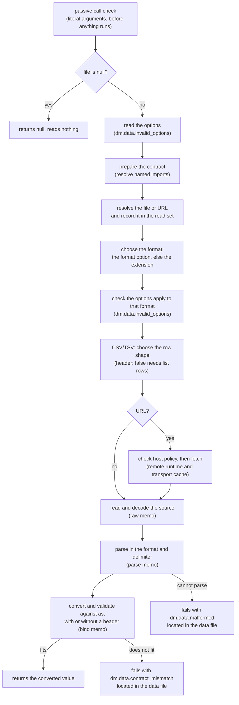

# Loading Data

`load_data(file, as, options)` reads a data file into an expression. The file
can be YAML, JSON, JSON Lines, CSV, TSV, TOML, or JSON5, `as` says what shape
the data must have, and the optional [`options`](#options) object says how to
read it when the file's extension is not enough: a format, a CSV delimiter, or
a CSV file with no header row. The result is the parsed data, converted to that shape, or a
failure that names the place in the file where the data breaks it. A partly
valid file never produces a partial value.

Given `os.yaml`:

```yaml
- macOS
- Linux
- Windows
```

a document can list it, or build anything else an expression can build:

```md
Supported: {{ as_csv(load_data("os.yaml", "string[]")) }}

{{ map(load_data("hosts.csv", "{ name: string, port: number }[]"), h => h.name + ":" + h.port) }}
```

```text
Supported: macOS, Linux, Windows
```

The signature, catalog examples, and aliases are on the generated
[`load_data` function page](../functions/load-data.md). This page explains
what each rule means for an author.

## How a call runs

A `load_data` call is judged twice. Before anything in the document runs,
the passive [call check](../inline/call-check.md) rejects a call whose
literal arguments prove it can never work, such as a contract that is not a
container. It reads no file to do so. When the call later executes, it goes
through the steps below. A failure at any step stops there, so it never
depends on work a later step would have done. In particular, every problem
with the options is found before the file is read.



The [memo](#reading-a-file-once-per-command) and the
[read set](#the-read-set) are described below.

## Writing `as`

`as` is a **quoted string** that holds a SimplifiedSchema type definition,
the same type language frontmatter schemas use. It is quoted because the
expression parser cannot read type syntax directly: unquoted, `string[]`
would be the variable `string` followed by an index, and `{ … }` would be an
object literal.

```md
{{ load_data("os.yaml", "string[]") }}     the contract is the text string[]
{{ load_data("os.yaml", string[]) }}       a parse error
```

Every common container form works:

| Shape | `as` | Data it accepts |
| --- | --- | --- |
| array | `"string[]"` | `["macOS", "Linux"]` |
| array of objects | `"{ name: string, port: number }[]"` | `[{name: "web", port: 8080}]` |
| object | `"{ name: string, tags: string[] }"` | `{name: "Ada", tags: ["math"]}` |
| tuple | `"tuple([string, number])"` | `["web", 8080]` |
| dictionary | `"{ <string>: number }"` | `{web: 8080, db: 5432}` |
| nullable | `"string[] \| null"` | `["macOS"]`, or an empty YAML file |

Write a tuple as `tuple([string, number])`. A bracket list such as
`[string, number]` is not a tuple in SimplifiedSchema: in a schema and
inside an `as` string alike it means the union `string | number`, which is
not a container, so `load_data("os.yaml", "[string, number]")` is rejected
before anything runs. A list whose items are containers is a container:
`"['string[]', null]"` (quote an item holding brackets, as in any YAML list).

The data is converted the way frontmatter is: `"8080"` against `number`
becomes `8080`, and a value that cannot convert without changing its meaning
is a failure. See [conversion rules](../../../simplified-schema/docs/topics/conversion.md#conversion-rules).

### `as` must be a container

`as` must describe an array, a tuple, an object, or a dictionary, or a union
whose non-null arms all do. A scalar contract such as `"string"`,
`"number"`, or `"enum(a, b)"` fails with `dm.data.not_a_container`, and so
do `"unknown"` and `"null"` alone. The full rule, with the union cases, is in
[Container types](schemas/definition.md#container-types).

When `as` is a literal, the call check rejects it before anything runs. When
`as` is computed (for example a frontmatter value `t: string` used as
`load_data(f, t)`), the call fails with the same code when it executes.

### Named types from a schema file

A contract can name a type declared in a schema file, with the usual
`Name@file` import, or a type shipped with Darkmatter, with
`Name@darkmatter:<stem>`:

```yaml
# schemas/os.yaml
kind: schema
types:
    os-list: string[]
```

```md
{{ load_data("os.yaml", "os-list@./schemas/os.yaml") }}
```

- A relative import resolves from the calling document, through the same
  schema roots as any other import, and imports inside that schema keep
  resolving from the schema file. Two documents in different folders can
  write the same text and name different files; each gets its own contract.
- The call check accepts a file import provisionally, without opening the
  schema file. The import is resolved, and the container rule applied to
  it, when the call runs. A missing or broken import fails as an evaluation
  error naming the import, not as bad data.
- `Name@this` is rejected with `dm.data.this_import_rejected`: an expression
  argument has no schema document of its own for `this` to name. Inside an
  imported schema, `Name@this` keeps its ordinary meaning.

## Formats

The format comes from the file's extension, or from the extension of a URL's
path (its `?query` and `#fragment` are ignored). Matching ignores letter
case, so `DATA.JSON` is JSON. Neither the file's content nor an HTTP
`Content-Type` header is consulted.

A [`format` option](#options) replaces the extension entirely: the extension
is not looked at, so a `.txt` file, an extensionless file, or a `.json` file
can each be read as any format.

```md
{{ load_data("export", "{ name: string }", {format: "json"}) }}
{{ load_data("hosts.txt", "{ name: string }[]", {format: "csv"}) }}
```

| Extension | Read as |
| --- | --- |
| `.yaml`, `.yml` | one YAML document, any top-level shape |
| `.json` | one JSON value, any top-level shape |
| `.jsonl`, `.ndjson` | one JSON value per line, returned as an array |
| `.csv` | comma-separated rows with a header, returned as an array (see [CSV and TSV](#csv-and-tsv)) |
| `.tsv` | tab-separated rows with a header, returned as an array |
| `.toml` | one TOML document, always a table |
| `.json5` | one JSON5 value, any top-level shape |

Any other extension, or no extension, fails with `dm.data.unsupported_format`
unless the call names a `format`. This holds whether or not the file exists:
`load_data("notes.txt", "string[]")` reports `dm.data.unsupported_format`, not
a missing file, so `try` never mistakes the bad request for an absent source
(see [Files that may be missing](#files-that-may-be-missing)).

```md
{{ load_data("events.ndjson", "{ id: number, ok: boolean }[]") }}
{{ load_data("Cargo.toml", "{ package: { name: string, version: string } }") }}
{{ load_data("config.json5", "{ hosts: string[] }") }}
```

### What every format accepts

Input that a format cannot parse fails with `dm.data.malformed`. These rules
decide the edge cases:

| Input | Result |
| --- | --- |
| a byte-order mark at the start | stripped, in every format |
| CRLF line endings | accepted, in every format |
| a local file that is not valid UTF-8 | malformed, located by byte offset |
| a zero-byte file | YAML: `null`; JSON and JSON5: malformed; JSON Lines, CSV, TSV: `[]`; TOML: `{}` |
| several YAML documents in one file | malformed |
| YAML anchors and aliases | the aliases are expanded |
| YAML merge keys (`<<: *b`) | not applied; `<<` is an ordinary key |
| YAML custom tags (`!foo`) | malformed |
| YAML duplicate or non-string mapping keys | malformed |
| a JSON object with a duplicate key | the last value wins |
| a whole number that a 64-bit float cannot hold exactly (`9007199254740993`), in any format | malformed |
| TOML or JSON5 `nan` or infinity | malformed |
| a TOML date or time | its TOML text, as a string |
| a JSON Lines line holding only spaces, tabs, or a CR | skipped |
| a JSON Lines line that is not one JSON value | malformed, at that line |

An empty YAML file is `null`, so a contract for a YAML file that may be empty
needs a null arm: `"string[] | null"`. Number rules are described in
[Numbers](./numbers.md).

Loaded values are data. A string in the file that contains `{{ … }}`,
`$( … )`, or a directive is returned as that text, and a YAML mapping with a
`kind` or `$schema` key selects no schema; only `as` supplies the contract.

## CSV and TSV

CSV and TSV rows carry no types. By default the **first row is a header**
(see [Files without a header row](#files-without-a-header-row) to turn that
off), and the element type of `as` decides what each row becomes:

- an **object** element turns each row into an object keyed by the header;
- a **tuple or array** element turns each row into a list of cells, and the
  header row is skipped.

Given `hosts.csv`:

```text
name,port
web,8080
db,5432
```

```md
{{ load_data("hosts.csv", "{ name: string, port: number }[]") }}
{{ load_data("hosts.csv", "tuple([string, number])[]") }}
{{ load_data("hosts.csv", "{ <string>: string }[]") }}
```

```text
[{name: "web", port: 8080}, {name: "db", port: 5432}]
[["web", 8080], ["db", 5432]]
[{name: "web", port: "8080"}, {name: "db", port: "5432"}]
```

Cells are text until `as` converts them, so `"8080"` becomes a number only
where `as` asks for one. TSV uses the same quoting as CSV, with a tab as the
delimiter.

### Choosing the row shape

Every non-null arm of `as` must be an array or tuple whose elements all pick
the same row shape. Anything else fails with `dm.data.row_shape_conflict`,
which suggests `"{ <string>: string }[]"` or `"tuple([…])[]"`:

| `as` over a CSV | Result |
| --- | --- |
| `"{ name: string }[]"`, `"{ name: string }[] \| null"` | object rows |
| `"tuple([string, number])[]"` | list rows |
| `"{ a: string }[] \| tuple([string])[]"` | conflict: the arms disagree |
| `"string[]"`, `"unknown[]"` | conflict: a scalar or `unknown` element is not a row |
| `"object"`, `"{ <string>: string }"` | conflict: a top-level object is not a list of rows |

When both `file` and `as` are literals, the call check knows the extension
and reports the conflict before anything runs.

### The strict rules

| Case | Result |
| --- | --- |
| a header-only file | `[]` |
| a duplicate or empty header name, object rows | malformed, naming the columns, on the header's line |
| a duplicate or empty header name, list rows | allowed, because the header is skipped |
| a row with more or fewer cells than the header | malformed, at that row |
| a blank line outside a quoted cell | skipped; it is never an empty header or row |
| a line holding only delimiters (`,,`) | a row of empty cells |
| an empty cell | `""`; `as` decides whether that is acceptable |
| a quoted cell holding the delimiter, a line break, or a doubled quote (`""`) | allowed |
| a quoted cell with no closing quote | malformed |
| a quote inside an unquoted cell (`ab"c`) | malformed |
| text between a closing quote and the next delimiter (`"ab"c`) | malformed |

Cells and headers are never trimmed: `name, port` has a header named
` port`. A file without a header row needs `{header: false}`; without it, the
first row is read as the header.

### How cell text converts

Cells convert with the same rules frontmatter uses. The boolean words follow
a YAML 1.1 style vocabulary, which can surprise a CSV author: `1` reads as
`true`.

| Cell | as `number` | as `boolean` | as `string` |
| --- | --- | --- | --- |
| ` 42 ` | `42` (whitespace trimmed) | fails | ` 42 ` |
| `1_000` | `1000` | fails | `1_000` |
| `1` | `1` | `true` | `1` |
| `0` | `0` | `false` | `0` |
| `yes`, `on`, `true` (any letter case) | fails | `true` | kept |
| `no`, `off`, `false` (any letter case) | fails | `false` | kept |
| empty | fails | fails | `""` |
| `1,000`, `NaN`, `0x10` | fails | fails | kept |
| `9007199254740993` | fails (not exactly representable) | fails | kept |

## Options

The third argument is an object with up to three keys. Each key is optional,
and leaving it out, or writing `null`, means its default. Omitting the whole
object, or passing `null` or `{}`, reads the file exactly as a two-argument
call does.

| Key | Values | Default | Applies to |
| --- | --- | --- | --- |
| `format` | `yaml`, `json`, `jsonl`, `csv`, `tsv`, `toml`, `json5`, and the aliases `yml` (for `yaml`) and `ndjson` (for `jsonl`) | chosen from the extension | every call |
| `delimiter` | one ASCII character other than a double quote, CR, or LF | `,` for CSV, a tab for TSV | CSV and TSV only |
| `header` | `true` or `false` | `true` | CSV and TSV only |

Format names are exact and lowercase: `"CSV"`, `" csv"`, and `"text"` are
errors. An alias is the same format, not a variant: `{format: "yml"}` reads
exactly as `{format: "yaml"}` does, and a message about it names `YAML`.

The options object is closed. A key other than these three, or a value that
cannot convert to its field's type (`{header: [1]}`, `{delimiter: {}}`), is
refused like any other argument of the wrong type, before anything runs.

Option values convert the way every function argument does, and every check
judges the converted value, whether the call runs or is only checked:
`{header: "false"}` is `{header: false}`, and `{delimiter: 5}` is
`{delimiter: "5"}`. So `{delimiter: 10}` is the two-character delimiter
`"10"` and is refused, and `{header: "false"}` with an object-row contract
is the headerless conflict described below.

### Files without a header row

`{header: false}` reads every CSV or TSV record as a row, the first included.
Rows are then lists of cells, so `as` must describe list rows, such as
`"tuple([string, number])[]"`.

Given `ports.csv`:

```text
web,8080
db,5432
```

```md
{{ load_data("ports.csv", "tuple([string, number])[]", {header: false}) }}
```

```text
[["web", 8080], ["db", 5432]]
```

An object-row contract has no header names to use as keys, so
`load_data("ports.csv", "{ name: string, port: number }[]", {header: false})`
fails with `dm.data.row_shape_conflict`. When `as` is a literal, the call
check reports it before anything runs, at `as`; a contract that imports a
type from a file is checked when the call runs, before the data file is read.

Without a header, the first record sets the number of cells every other
record must have, a file with no records (empty, or only blank lines) is `[]`,
and positions count from the first record: in the file above, a bad `8080`
is `/0/1` on line 1. The other [strict rules](#the-strict-rules) still apply.

### Another delimiter

`delimiter` changes the character that separates CSV cells. Quoting works the
same way: a quoted cell may contain the delimiter.

Given `hosts.txt`:

```text
name;port
web;8080
db;5432
```

```md
{{ load_data("hosts.txt", "{ name: string, port: number }[]", {format: "csv", delimiter: ";"}) }}
{{ load_data("hosts.psv", "{ name: string }[]", {format: "csv", delimiter: "|"}) }}
```

Write a tab as `"\t"`. A CSV call with a tab delimiter stays CSV; it does not
become TSV.

TSV is tab-separated by definition, so a TSV read accepts only a tab:
`{format: "tsv", delimiter: ","}` fails, and so does `{delimiter: ";"}` on a
`.tsv` file. To read data separated by another character, use
`{format: "csv", delimiter: …}`. `{delimiter: "\t"}` on a TSV read is
accepted.

### Options that cannot apply

`delimiter` and `header` only mean something for CSV and TSV. Either one on
any other format fails with `dm.data.invalid_options`, even when its value is
the default:

```md
{{ load_data("config.json", "{ hosts: string[] }", {header: true}) }}
```

```text
load_data(): option `header` is invalid: applies only to CSV and TSV data, but this call reads JSON; remove it or select a tabular format
```

The format a call reads is decided first (the `format` option, else the
extension), and the options are checked against that format, so
`{format: "csv", header: false}` on `data.json` is valid.

Every invalid delimiter fails the same way, naming the key:

| Call | Why it fails |
| --- | --- |
| `{delimiter: ""}`, `{delimiter: ",,"}` | not exactly one character |
| `{delimiter: "é"}` | not ASCII |
| `{delimiter: "\""}`, `{delimiter: "\n"}` | a quote or a line break cannot separate cells |
| `{format: "tsv", delimiter: ","}` | TSV accepts only a tab |
| `{format: "json", delimiter: ";"}` | `delimiter` does not apply to JSON |

### When options are computed

Options may be computed, as a whole (`load_data(f, t, opts)`) or member by
member (`{format: fmt, header: false}`). The call check judges only what it
can prove from the literal parts: a literal `delimiter` is always checked; the
format checks run only when no computed value can change the format. A
computed value is checked when the call runs, with the same message. See
[When loading fails](#when-loading-fails) for where each failure is located.

A computed `as` does not stop these checks: `load_data("rows.json", t,
{header: true})` is refused before anything runs, because `header` never
applies to JSON whatever the contract is. Only the row rules for CSV and TSV
(for example `header: false` with object rows) wait until the call runs and
the contract is known.

A `null` file still returns `null` without reading anything, and its computed
options are not checked; a literal mistake in its options is still refused
before anything runs.

## Files that may be missing

Wrap a read that may fail in [`try`](./darkmatter-expressions.md#recovering-from-read-failures).
`try(expr, fallback)` returns the file's value when it loads and evaluates
`fallback` only when the read fails:

```md
{{ try(load_data("optional.yaml", "string[]"), []) }}
```

`load_data(f, "string[]") || []` does **not** recover. `||` supplies a
default for a falsy value, but a failed call is an error, not a value, and
the error stops the composition (see [Logical OR](./darkmatter-expressions.md#logical-or)).

`try` covers a file that is present but bad as well as one that is absent.
An existence check only answers whether the file is there:

```md
{{ file_exists(f) ? load_data(f, "string[]") : [] }}
```

| `f` is | Existence check | `try(load_data(f, "string[]"), [])` |
| --- | --- | --- |
| missing | `[]` | `[]` |
| present and valid | the data | the data |
| present but malformed (`dm.data.malformed`) | fails | `[]` |
| present but not a `string[]` (`dm.data.contract_mismatch`) | fails | `[]` |

`try` recovers only failures of the data itself: a missing or unreadable
file, a remote read that fails in transport, malformed data, and a contract
mismatch. A mistake in the request still fails: an invalid `as`, bad
options, a missing or invalid imported contract, and a denied host. The full
list is in
[Recovering from read failures](./darkmatter-expressions.md#which-failures-try-recovers).

A mistake in the request fails whether or not the file exists, so `try`
never mistakes it for an absent source. `load_data` judges a missing file's
request by the extension it was asked for (or the `format` option) before it
reports the miss. The extension is read after `{{VAR}}` environment
placeholders are expanded, so `%{{DATA_FILE}}` with `DATA_FILE=optional.yaml`
is judged as YAML, exactly as it would be read once the file exists:

- an extension that names no format fails with `dm.data.unsupported_format`
  (see [Formats](#formats)), for a `%` search too;
- options that cannot apply to the format, such as a `delimiter` on YAML or a
  `;` on TSV, fail with `dm.data.invalid_options`;
- a CSV or TSV contract that cannot describe rows, or object rows with
  `header: false`, fails with `dm.data.row_shape_conflict`.

This holds when the file name, contract, or options come from frontmatter,
which only composition can judge. Name a format the request suits, and a
missing file becomes an ordinary miss:

```md
{{ try(load_data("optional.xyz", "string[]"), []) }}                    <!-- fails: dm.data.unsupported_format -->
{{ try(load_data("optional.yaml", "string[]", {delimiter: ";"}), []) }} <!-- fails: dm.data.invalid_options -->
{{ try(load_data("optional.xyz", "string[]", {format: "json"}), []) }}  <!-- []: the file is missing -->
```

When a reference could resolve to files of several formats, the missing
file is a miss as long as any of them would accept the request.

A file that a frontmatter `$( … )` command creates needs the same care.
Before composition, `md compose` runs a reference check that evaluates
expressions before any command has run. An unguarded call on a file that
does not exist yet fails there, before the command can create it. Inside
`try`, the check takes the fallback and continues, and composition, which
runs after the command, reads the real file.

### The memo and read set under `try`

Recovery changes what the expression returns, not what was read:

- The [memo](#reading-a-file-once-per-command) keeps the source's own result
  or failure, never the fallback. A later unguarded call on the same malformed
  file fails from the memo, and another `try` on it can supply a different
  fallback.
- The [read set](#the-read-set) is the same as it would be without `try`: a
  malformed or unreadable file is in it, and so are the paths a missing file
  was looked for at. Reads made by a fallback that ran are recorded; a
  fallback that did not run records nothing.
- A contract import is not the data source. An `as` that imports a missing or
  invalid schema file fails inside `try` too.

## Typed results

When `as` is a literal, the call check and DMLS treat the result as the type
`as` describes instead of `unknown`. The type flows into inline callbacks:

```md
{{ map(load_data("hosts.yaml", "{ name: string, port: number }[]"), h => h.name) }}
```

Here `h` is known to be `{ name: string, port: number }`. DMLS offers `name`
and `port` when completing after `h.`, and a call that can never work is
rejected before anything runs: with `"{ flag: boolean(required) }[]"`,
`min(h.flag, 5)` is an incompatible call. The file argument's nullability
carries through: a file that may be `null` makes the result type the
contract's type or `null`, and a literal `null` file makes it `null`.

The typing has limits:

- **Computed contracts are untyped.** `load_data(f, t)` with a computed `t`
  is `unknown`.
- **Named references are `unknown`.** A `Name@file` import, a
  `Name@darkmatter:<stem>` import, or a recursive type is `unknown` where it
  appears; inline structure around it keeps its type, so
  `"{ host: Host@./types.yaml, port: number }[]"` still knows `port`.
- **A misspelled member is a warning, not an error.** `h.nmae` against
  `"{ name: string, port: number }[]"` reports
  `dm.expression.undeclared_member` and still reads `null` at run time. A
  member read through a computed contract or a named reference is never
  reported, because its type is `unknown`. See
  [Misspelled members](./darkmatter-expressions.md#misspelled-members).

To type a `::map` region, load the data in frontmatter and declare the
property in the document's schema; the region's item type comes from that
schema:

```md
---
hosts: "{{ load_data('hosts.yaml', '{ name: string, port: number }[]') }}"
---
::map hosts
- {{ i.name }}:{{ i.port }}
::end-map
```

## Remote URLs

`load_data` reads an HTTP(S) URL like the other read-side functions, on the
same surfaces (see [Remote URL References](./remote-url-references.md)).
Network access is deny-all by default; grant a host on the command line:

```sh
md compose doc.md --allow host=data.example.com
```

```md
{{ load_data("https://data.example.com/hosts.json?v=2", "{ name: string }[]") }}
```

- The format comes from the URL path's extension, so `?v=2` above is
  ignored and the response is read as JSON. An address with no extension,
  such as `https://data.example.com/export?id=7`, needs a `format` option:
  `load_data("https://data.example.com/export?id=7", "{ name: string }[]", {format: "json"})`.
- `format` only says how to read the response. It grants no network access
  and changes nothing about host policy or redirects.
- Host policy is checked before any memo or transport-cache lookup. A denied
  host fails without a network request, even when an earlier run cached the
  response.
- The URL is fetched once per command and reaches the transport cache like
  any remote body; see [Caching](./caching.md#remote-transport-cache).
- The reference check that `md compose` runs first has no network
  permission. A URL there is left for composition to read, not recorded as a
  failure.
- Fetched text that is not valid UTF-8 is a transport failure, not
  `dm.data.malformed`. Like a request that fails, it is
  `dm.expression.evaluation_failure` with reason `unreachable` and failure
  `io` (see [File errors](../cli/data-contracts.md#file-errors)).

## Reading a file once per command

Within one command, a file is read once, parsed once per format and
delimiter, and validated once per contract and header choice, however many
calls name it. For `md compose` this covers the reference check, the
pre-flight walk, lifecycle events, and composition, so a
`{{ load_data(…) }}` inside a 100-item `::map` reads its file once.

| Calls over one file | Reads | Parses | Validations |
| --- | --- | --- | --- |
| two different contracts | 1 | 1 | 2 |
| `{delimiter: ","}` and `{delimiter: ";"}` | 1 | 2 | 2 |
| `{header: true}` and `{header: false}`, both list rows | 1 | 1 | 2 |
| no options, `{}`, `{format: "csv"}` on `a.csv`, `{delimiter: ","}` | 1 | 1 | 1 |
| `{format: "yml"}` and `{format: "yaml"}` | 1 | 1 | 1 |

Options that mean the same thing share the work, because the memo is keyed
by the effective format, delimiter, and header rather than by how the call
spelled them. A failure is kept with its key too: a header-name failure under
object rows does not affect a `header: false` call over the same file. This
holds in every cache access mode, `Off` and `Refresh` included: those modes
govern the composed-result cache, not this memo. Nothing is persisted.

Anything that might have changed a file ends the reuse. The memo is emptied
after every command that actually runs, whether it succeeds or fails: a
frontmatter `$( … )`, a `::shell` line, a shell block, or a lifecycle shell
step. A lifecycle side effect that may write a file (`append_line`,
`append_jsonl`, `ensure_file`, `ensure_dir`, a frontmatter mutation such as
`set_frontmatter`, or `http_post`) empties it too, as soon as it has run and
whether or not it succeeded, so the next step of the same event reads the
file again:

```yaml
initialize:
  - info: "before {{ length(load_data('d.yaml', 'string[]')) }}"   # before 1
  - append_line: [d.yaml, "- b"]
  - info: "after {{ length(load_data('d.yaml', 'string[]')) }}"    # after 2
```

A step that did not run keeps the memo: a step its `when:` guard turned off,
an `info` or other message, and a side effect whose arguments failed to
evaluate. A shell command answered from the shell cache ran nothing and keeps
the memo too. A URL is not fetched again after the memo is emptied: the
command keeps the response it already received.

```md
---
made: "$(./regenerate-hosts)"
---
{{ load_data("hosts.yaml", "string[]") }}
```

Here the reference check reads the old `hosts.yaml`, the command runs and
empties the memo, and composition reads the new file.

A body read after a command waits for it, so it sees the rewrite: plain
text, a later `::shell` line's argument, and a `::file` target, in every
item of a `::map` or `::filter` body. Here the first item shows `value: 1`
and the second `value: 2`:

```md
::map items "i => i"
value: {{ load_data('d.toml', '{ a: { b: number } }').a.b }}
::shell git config --file d.toml a.b 2

::end-map
```

A read written before a command keeps the old value. So does a read in a
`::block when=` condition or a `::map` source or callback: those are decided
before any body command runs. See
[Reads after a command](../darkmatter-compose-pipeline.md#reads-after-a-command).

There is no file-size limit. The `::map` iteration limits bound how many
items a region visits and how much it writes, not how many bytes a file may
hold. Details of the three memo layers are in
[Caching](./caching.md#the-load_data-memo).

## The read set

Every command keeps a **read set**: the files and URLs its expressions read.
`load_data` and every other read-side function (`frontmatter`,
`try_frontmatter`, `file_exists`, `markdown_title`, `markdown_body_empty`,
`validate_schema`) record into it, on every surface where expressions run,
including the reference check. A file is recorded as soon as its reference
resolves, before it is read, so an unreadable or malformed file is in the
set, and so is a URL whose host was denied. A reference that resolves to no
file at all (a missing `load_data` file) records every candidate path it
probed, so creating the file changes the answer.
The schema files a contract imports, and those `validate_schema` reads, are
recorded too, at any depth of import. A preparation that fails keeps every
schema file it read before stopping: an import that made the contract fail
because it is not a schema or does not export the type `as` names, and every
import read before it. An import file that does not exist is recorded at
every location it was looked for. The full list, including the path and skill
functions, is in
[Compose Requests](./compose-requests.md#reading-the-read-set).

For example, with `good.yaml` exporting `Good` and `bad.yaml` exporting only
`Other`, the contract `{ a: Good@./good.yaml, b: Missing@./bad.yaml }[]`
fails, and the failed run's read set lists both `good.yaml` and `bad.yaml`
(but not the data file, which was never reached).

`md compose --output json` prints it as `read_set`, on success and failure;
see [Read set](../cli/data-contracts.md#read-set). A library caller reads it
from the compose report; see
[Compose Requests](./compose-requests.md#one-data-runtime-per-command).

## When loading fails

A `load_data` failure is an error, never a warning, and it stops the
composition unless a [`try`](#files-that-may-be-missing) recovers it. That includes a failure in the reference check `md compose` runs
before composing: a malformed data file stops the command there, and the
failed run's `read_set` still lists it. The stopping rules are in
[Composition Problems](../errors/composition-problems.md#data-failures).

Each problem has its own code:

| Code | Meaning |
| --- | --- |
| `dm.data.not_a_container` | `as` is not a container |
| `dm.data.row_shape_conflict` | `as` cannot choose a CSV/TSV row shape, or describes object rows with `header: false` |
| `dm.data.invalid_options` | an option value is not usable (a bad delimiter), or an option does not apply to the format read |
| `dm.data.this_import_rejected` | `as` uses `Name@this` |
| `dm.data.unsupported_format` | the extension names no supported format, and no `format` option was given |
| `dm.data.malformed` | the file cannot be parsed under its format's rules |
| `dm.data.contract_mismatch` | the parsed data does not fit `as` |

A `dm.data.invalid_options` message names the key and the fix, for example
``load_data(): option `delimiter` is invalid: must be one ASCII character
other than a double quote, CR, or LF (write a tab as "\t")``. When the
options are literal, the call check reports it before anything runs, located
at the options argument; DMLS underlines the same range. When a computed
value is wrong, the call fails when it runs, located at the whole call,
because a running call keeps no position for each argument. Either way no
file is read, and the record has no `data_location`.

An unknown key, a value of the wrong type, or a format name that is not in
the list is an argument of the wrong type, reported before anything runs as
`dm.expression.incompatible_call` at the options argument.

A file that cannot be found or read, or a URL that cannot be fetched, keeps
the general code `dm.expression.evaluation_failure`. When the file is
missing or unreadable, a contract import is missing, or a URL's host is not
allowed, its record in a data output carries the same fields as a reference
failure: `construct`
(`load_data()`), `reference` (the argument as written), `failure` (the
resolution class, such as `no-match`), and, where a reference phrase
applies, `reason` (`file not found`). Every read-side function fills them.
A fetch that fails after its host was allowed, including a response that is
not valid UTF-8, reports only its message.

A data diagnostic points at two places. `source` is the call in the
Markdown document. `data_location` points into the data file: its `file`,
the JSON Pointer of the offending value (`/0/port`), and a `line` and
`column`. A contract mismatch lists every violating location, in file order,
up to 20 records, then one record counting the rest. The record fields are
on [Data Contracts](../cli/data-contracts.md#data-errors) and
[Data location](../cli/data-contracts.md#data-location).

### How positions are counted

- Lines are 1-based. LF and CRLF end a line; a lone CR (not followed by LF)
  does not. In CSV and TSV a lone CR still ends a record, but the record
  after it keeps the same line number.
- Columns are 1-based and count characters, not bytes, after one leading
  byte-order mark is removed. A CRLF file reports the same columns as its LF
  copy.
- A local file that is not valid UTF-8 has no line or column; its
  `byte_offset` counts from the first byte of the file.
- In CSV and TSV a cell's position is where its raw text starts, including an
  opening quote, and a row problem points at the row's start.

### YAML aliases and merge keys

A YAML alias (`*name`) reuses the value an anchor (`&name`) marked earlier.
A failure in the expanded value is located at the alias that brought it in,
and every other value in the file keeps its own position. With
`base: &b {port: x}` on line 1 and `one: *b` on line 2, `/base/port` is
line 1, column 17 (the `x`) and `/one/port` is line 2, column 6 (the `*b`).
A flow collection written across several lines (`servers: [` … `]`) is
located inside and after it.

YAML merge keys are not applied: `<<: *b` is an ordinary member named `<<`
whose value is the expanded alias, and nothing is inherited. A contract that
rejects the `<<` member says so in its message: "YAML merge keys are not
applied, so `<<` is read as an ordinary key." See
[Data Contracts](../cli/data-contracts.md#yaml-anchors-aliases-and-merge-keys).

### YAML positions that cannot be proven

When a YAML file's layout cannot be matched to its parsed value, such as an
anchor on a key (`&k a: 1`), a contract mismatch in that file reports `file`
and `pointer` only, with no `line` or `column`. A guessed position is never
reported in their place. A syntax error in such a file still has the
parser's line and column.

Malformed YAML always keeps a line and column. A second
document is reported at the `---` that starts it, a non-string key and a tag
at the key or tag itself. A duplicate key is located less precisely: at the
start of the mapping that holds it.

## Loading data into a schema

A schema can take a list of values from a data file by calling `load_data`
inside a `{{ … }}` [schema slot](./schemas/schema-slots.md):

```yaml
# schemas/provider.yaml
kind: schema
$schema:
    os: enum({{ load_data("./os.yaml", "string[]") }}; required)
```

The call works as everywhere else, with these differences:

- **The path resolves from the schema file.** `./os.yaml` above is
  `schemas/os.yaml`, whichever document the schema validates. A slot inside a
  named type imported from another file resolves from that file's folder, and
  a slot in a document's inline `$schema` from the document's folder.
- **Every read must be approved.** The slot's reads are checked before the
  file is opened or the URL fetched, and before the command's memo is
  consulted, so a file the document already loaded is not handed to the slot
  unapproved. A clean, committed file in the schema's own repository is
  approved automatically; see
  [What a slot may read](./schemas/schema-slots.md#what-a-slot-may-read).
- **The reads join the command's read set.** A slot shares the command's
  [memo](#reading-a-file-once-per-command) and records into its
  [read set](#the-read-set) like any other call, including the candidate
  paths probed for a file that was not found and every location searched for
  a contract import that does not exist, so creating either one changes the
  answer.
- **A contract may name a type that holds slots.** Inside a slot, a contract
  such as `"os-list@./types.yaml"` whose type is itself a template resolves
  that type's slots in the same slot session; a contract that leads back to
  a template already being resolved fails with `dm.schema.slot_cycle`.
  Outside a slot, in a document's own `load_data`, the same contract fails as
  unresolved.

A failure inside a slot keeps its `dm.data.*` code and `data_location`, and
is reported at the slot. The full rules are in
[Schema Slots in Darkmatter](./schemas/schema-slots.md).

## See also

- [`load_data` function page](../functions/load-data.md): signature and
  catalog examples, including the three-argument forms
- [Darkmatter Expressions](./darkmatter-expressions.md): the expression
  language and the other read-side functions
- [Container types](schemas/definition.md#container-types): which type
  definitions `as` accepts
- [Data Contracts](../cli/data-contracts.md#data-errors): the `dm.data.*`
  records, `data_location`, and `read_set`
- [Caching](./caching.md#the-load_data-memo) and
  [Compose Requests](./compose-requests.md#one-data-runtime-per-command): the
  memo and the command-wide runtime
